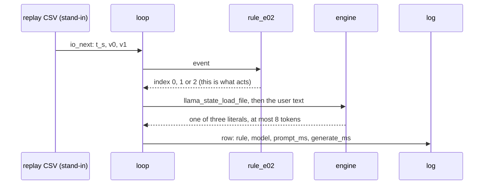

# Project 2. The decision loop: grammar, state reuse, control harness

> **Board:** Raspberry Pi 4 Model B, no HAT  
> **Owns:** the reference loop every later chapter instances: one model, one grammar, one saved prompt state, one rule, one log

> [!IMPORTANT]
> **The question, instanced**
>
> What does a small local model add over a two-line threshold, and when does it get it wrong? Here the threshold is two lines of C on a synthetic level and slope, the model is told the same two thresholds in its system prompt, and the question is whether a 0.5B model constrained to three literals can even apply them, over 1000 events, without ever producing a fourth word.

> **Key facts**
>
> - **Board:** Raspberry Pi 4 Model B, card `eplepi`, 4 threads
> - **HAT slot:** empty; the one wiring figure in the volume with nothing on the header
> - **Parts:** the Pi 4B, a USB keyboard, the console from [Project 1](01-bring-up-and-the-honest-tokens-per-second.md); no sensor
> - **Interface:** a replayed CSV through `io.h`; from [Project 1](01-bring-up-and-the-honest-tokens-per-second.md)'s table the latency, from here the loop every later chapter runs with `--live`
> - **Language and variant:** C, catalogue variant C: plain C over `llama.h` in one process; variants A and B priced beside it once, in this chapter only
> - **Model:** Qwen2.5-0.5B-Instruct Q4\_K\_M, 491 MB, Apache 2.0
> - **Decision:** one of NORMAL, WATCH, ALERT through the grammar; the stub answers NORMAL in CI
> - **Control rule:** ALERT if the level is above 80 or the slope above 10; WATCH if the level is above 60; else NORMAL
> - **Acceptance:** 1000 decisions with zero free text; state restore at least 2x faster than a cold decode, measured by the comparison harness; throttle bits `0x0` before and after
> - **Difficulty:** 3 of 5
> - **Effort:** two evenings on the host for the loop and the oracle, one afternoon on the Pi 4B for the 1000-decision run and the comparison

## Pitch

Every later chapter is this loop with a device behind the `io.h` boundary instead of a file. So the loop is built once, here, on a file, and tested until it is boring: an event arrives, the rule decides in two lines and that decision is what acts, the loop restores the saved state of a system prompt that was decoded once at start, appends twenty tokens of user text, and samples at most eight tokens under a grammar whose root can produce exactly three strings. The model's answer goes into the log beside the rule's, and nowhere else. Two things are measured: that the grammar keeps its promise over 1000 events, which the oracle test checks letter for letter, and that restoring the saved state costs less than half of decoding the prompt again, which is the whole reason the latency design of the volume is affordable on a Pi. The agreement table at the end is the first instance of the volume's through-line question, and in CI it has a number already: the stub always answers the grammar's first expansion, and the agreement that produces is the fraction of events the rule also calls NORMAL.

## Origin and what changed

New, because every later project is an instance of it. The draft had the decision loop written inside each idea, with a different prompt shape, a different way of trimming the context and a different log in each; a disagreement in one chapter could then have been a fact about the model or a fact about that chapter's loop, and nobody could tell which. What changed is that the loop moved into `common/c/src/edgellm_main.c` with one callback per project for the user text, that the five pieces, model, grammar, system prompt state, rule and log, got one file each in the repository with the chapter printing the same files, and that the synthetic event stream was written so the loop has an oracle before any sensor exists. The two alternative loops in C++, one on `llama.h` directly and one over the C API, exist only in this chapter, so that the cost of a C++ layer is priced once and never argued about again.

## Parts and interface

| **Part** | **Role** | **Interface** | **Address or pin** |
| --- | --- | --- | --- |
| Raspberry Pi 4 Model B | runs the loop, the model and the comparison | SSH, or the Renkforce cable from [Project 1](01-bring-up-and-the-honest-tokens-per-second.md) | none on the header |
| Card `eplepi` | Raspberry Pi OS trixie, the model file in `~/models` | the card is the hostname |  |
| USB keyboard | the Raspberry Pi keyboard, for a sitting at the board itself | USB-A | not the header |
| `replay/synthetic_1000.csv` | the event stream, 1000 rows of `t_s,tag,v0,v1` generated by `tools/make_replay.py` | `io_open_replay` |  |
| `grammars/e02_decision.gbnf` | the three literals, in the house shape | the grammar sampler of the engine | root symbol `root` |
| `prompt.txt` | the system prompt, 59 words, well under 120 tokens | decoded once, state saved |  |
| `src/rules_e02.c` | the control rule, registered by name | `rule_find("e02")` | index 0, 1, 2 |
| `tests/oracle/e02.expected.csv` | the 1000 expected rule decisions and the stub's column | the oracle check in C, row by row |  |

## Model and grammar

Qwen2.5-0.5B-Instruct at Q4\_K\_M, the file `qwen2.5-0.5b-instruct-q4_k_m.gguf`, 491 MB, Apache 2.0, from [Qwen/Qwen2.5-0.5B-Instruct-GGUF](https://huggingface.co/Qwen/Qwen2.5-0.5B-Instruct-GGUF) (verified Wednesday 14 October 2026). It is the Pi 4 default for enum decisions in the ladder and the rung the Pi 4B admits as long as [Project 1](01-bring-up-and-the-honest-tokens-per-second.md)'s memory reading is above 818 MB available; if that reading says otherwise, this chapter runs on SmolLM2-360M with no other change, because nothing below depends on which model answers. The engine is the pinned `v0.6.0` of [Project 1](01-bring-up-and-the-honest-tokens-per-second.md). The grammar is GBNF, one file per decision enum, root symbol `root`, in the house shape every grammar of the repository follows: one JSON object with one `decision` key; the syntax is the engine's own, documented at [grammars/README.md](https://github.com/ggml-org/llama.cpp/blob/master/grammars/README.md) in the engine's tree (to verify). Whitespace admits spaces and tabs and never a newline, so that the longest answer stays inside eight tokens on every tokenizer of the ladder.

```gbnf
# e02_decision.gbnf: the three literals of rules_e02.c, letter for letter, in the house
# shape: one JSON object with one "decision" key. Nothing else can be sampled, so a
# decision is never free text. ws admits spaces and tabs only, never a newline, so the
# longest answer stays inside the n_predict of 8 tokens on every tokenizer in the ladder.
root     ::= "{" ws "\"decision\"" ws ":" ws decision ws "}"
decision ::= "\"NORMAL\"" | "\"WATCH\"" | "\"ALERT\""
ws       ::= [ \t]*
```

The system prompt, decoded once and never again during a run, reads in full: You are an edge agent on a Raspberry Pi. You see one level reading and its slope. Answer only with the JSON decision and nothing else. ALERT when the level is above 80 or the slope is above 10 per second. WATCH when the level is above 60. Otherwise NORMAL. The model is told the thresholds on purpose: the question of this chapter is not whether a 0.5B model can guess a rule, it is whether it can apply one it has been given, which is the easiest version of the volume's question and therefore the right one to ask first.

## What the model decides or writes

One of three literals, through the grammar, with `n_predict` 8 and greedy sampling. The model cannot write anything else: every token is checked against the grammar's automaton before it is accepted, and a token that no continuation of `root` allows is never sampled. So the model column of the log holds one JSON object whose decision is NORMAL, WATCH or ALERT, or an object that did not close inside eight tokens, which the agreement tool counts as a row without a literal and the chapter counts as its own failure, not the model's. In CI there is no model file; the stub behind the same `edgellm_decide` expands the grammar's first alternative on every path, so it answers `{"decision":"NORMAL"}` with timings of zero and the engine column reading stub, and the loop, the log, the oracle check and the agreement tool are exercised end to end on a runner with no engine.

## Control rule

Two thresholds, strict, on the two values of the event. The names table is what the grammar reproduces letter for letter; the oracle test and the agreement table both depend on that equality, which is why the names live in the rule file and the grammar is written from them by hand once and compared by lint ever after. The last line registers the rule before `main` runs, so the shared main finds it by the name `e02`.

```c
static const char *const rule_e02_names[] = { "NORMAL", "WATCH", "ALERT", NULL };

static int rule_e02_fn(const rule_ctx *ctx, const io_event *ev)
{
    (void)ctx;                                        /* two values decide; no history */
    if (ev->n < 2) return 0;                          /* a short event is NORMAL, not a guess */
    if (ev->v[0] > 80.0 || ev->v[1] > 10.0) return 2; /* ALERT: above 80, or slope above 10 */
    if (ev->v[0] > 60.0) return 1;                    /* WATCH: level above 60 */
    return 0;                                         /* NORMAL */
}

/* The constructor below registers the rule before main() runs; rule_find("e02") then
 * returns it. The file is compiled into the executable, never into an archive. */
const rule_desc rule_e02 = { "e02", rule_e02_fn, rule_e02_names };
RULE_REGISTER(rule_e02);
```

The user text the loop hands to the engine is built by the one function this project adds to the shared main. It names the level, the slope and the last three levels, and nothing else; the thresholds are in the system prompt, so they cost no tokens per event. The current event is not yet in the history when the function is called, so the previous levels are exactly that.

```c
const char *project_format_prompt(const io_event *ev, const rule_ctx *ctx, char *buf,
                                  size_t len)
{
    char hist[96] = "";
    int  k = 0, i;
    for (i = (ctx->n > 3 ? ctx->n - 3 : 0); i < ctx->n && k < (int)sizeof hist - 12; i++)
        k += snprintf(hist + k, sizeof hist - (size_t)k, "%s%.0f", k ? ", " : "",
                      ctx->hist[i].v[0]);
    snprintf(buf, len, "level %.1f, slope %.1f per second, previous levels %s. Decide.",
             ev->n > 0 ? ev->v[0] : 0.0, ev->n > 1 ? ev->v[1] : 0.0, k ? hist : "none");
    return buf;
}
```

## Real, modelled, absent

- **have:** real: the Pi 4 Model B, the card, the model file, the engine at the pinned tag, the rule, the grammar, the log and the timings it holds
- **learn:** modelled: the event stream, a replayed CSV generated by a seeded walk, drawn dashed; it stands in for a sensor only so that the loop has an oracle before any sensor is wired, and nothing about the sensor is claimed
- **absent:** absent: nothing. This is the one chapter with no dotted block; every later chapter adds at least one

## System architecture


*Figure 2.1. The five pieces on the Pi 4 Model B. Inside a dashed layer labelled with the board and the card, six solid blocks: the loop (edgellm\_main.c) in user-space green at the centre, the control rule above it with the green rule outline, the model to its right with the yellow model outline, and three grey blocks around the model for the saved system prompt state, the grammar file and, further right, the per-event log in green. Outside the layer on the left, a dashed grey block for the replayed CSV, the only stand-in, and a solid grey block for tools/agreement.py on the host. Solid arrows carry io\_next from the replay to the loop, the event up to the rule and its index back, the user text from the loop to the model with a dashed reply carrying the JSON decision, the saved state and the grammar into the model, and the log row down and across to the log; a dashed stop-coloured arrow from the rule to the model says that the rule acts and the model proposes. A last solid arrow carries the 1000 rows from the log to the agreement tool. A note says that nothing is absent here.*

The one arrow to read twice is the dashed red one. The rule's index is what the loop acts on, in [Project 3](03-led-status-explainer.md) by lighting an LED through `project_actuate` and in later chapters by sending a message; the model's answer only ever reaches the log. In this chapter nothing is actuated at all, and the shared main's empty default stands in. The safety rule of the volume is not a sentence in the front matter, it is the absence of any arrow from the model block to anything but the log, in this figure and in all nineteen that follow it.

## Wiring

| **Header pin** | **BCM** | **Part pin** | **Wire colour if known** |
| --- | --- | --- | --- |
| none | none | none | nothing is wired; the keyboard is USB and the console is the LAN or the cable from [Project 1](01-bring-up-and-the-honest-tokens-per-second.md) |


*Figure 2.2. The 40-pin header of the Pi 4 Model B as two columns of small solid blocks, pin 1 at the top left, with no block filled and a dashed layer around all forty labelled all 40 pins free. To the right, a solid hardware block for the Pi 4 Model B with the card eplepi and four threads; above it a solid hardware block for the USB keyboard joined by a solid arrow labelled USB-A, not the header; to its right a grey block for the console, SSH or the Renkforce cable, joined by a solid two-headed line; below it a grey block for the model file on the card joined by a solid arrow labelled mmap from the SD card. A note says this is the one wiring figure in the volume with nothing on the header, on purpose, and that from e03 on the same binary runs with -live and a device behind io.h. Nothing is dotted.*

## Sequence


*Figure 2.3. One decision as a sequence diagram with six actors: the replay CSV, drawn dashed as the stand-in, then the loop, the rule, the engine, the grammar sampler and the log, all solid. Solid arrows carry io\_next with t, v0 and v1 from the replay to the loop and the event from the loop to the rule; a dashed reply brings the index 0, 1 or 2 back. Over a blue activation bar on the engine, two solid arrows from the loop carry llama\_state\_load\_file and then the user text with llama\_decode; inside the bar a solid arrow carries logits to the grammar sampler and a dashed reply brings back the one token the root allows, with a note that at most 8 tokens are sampled greedily and every one is checked. A dashed reply returns the JSON decision to the loop, and the last solid arrow writes the row, rule WATCH, model WATCH, prompt ms and generate ms, into the log. A note says that the rule's index is what acted and that the model's answer went only to the log.*

## States and data


*Figure 2.4. The three decisions as three rounded green states in a row, NORMAL, WATCH and ALERT, entered at NORMAL from the initial dot. Between neighbours, pairs of solid arrows with the thresholds as labels: level above 60 from NORMAL to WATCH and level at or below 60 back; level above 80 or slope above 10 from WATCH to ALERT and level 60 to 80 with slope at or below 10 back. Two curved solid arrows join the ends: slope above 10 at any level from NORMAL straight to ALERT over the top, and level at or below 60 with slope at or below 10 from ALERT straight back to NORMAL underneath. A note says that both thresholds are strict, so 60.0, 80.0 and 10.0 stay in the lower band, and that the six test cases hold those three boundary values. Nothing is dashed or dotted.*

The record is the per-event log, `projects/e02-decision-loop/evidence/e02_run.csv`, in the shape `elog.h` fixes for every project: `t_s, tag, raw, rule, model, prompt_ms, generate_ms, n_generated, engine`. The rule column and the model column sit side by side so that `tools/agreement.py` needs nothing from the program to build the table, and the engine column names the build so that a log from the stub can never be read as a log from the Pi.

## Data flow

```text
  tools/make_replay.py (seeded)        the loop, edgellm_main.c, on the Pi 4B            host
  +------------------------+           +----------------------------------------+     +----------------+
  | replay/synthetic_1000  |-io_next-->| rule_e02.fn(ctx, ev) -> 0 | 1 | 2       |     | agreement.py   |
  |   t_s,tag,v0,v1        |           |      |                                  |     |  confusion     |
  +------------------------+           |      v   project_format_prompt(ev, ctx) |     |  table, 3 by 3 |
                                       |      |   "level 72.4, slope 3.1 ..."    |     +----------------+
  prompt.txt ---decode once----------> | [state] --llama_state_load_file--> ctx  |            ^
    llama_state_save_file  (at start)  |      user tokens --llama_decode--> ctx  |            |
                                       |      sample <= 8 under grammar, greedy  |            |
  grammars/e02_decision.gbnf --------> |      {"decision": "WATCH"}              |            |
    llama_sampler_init_grammar(root)   |      |                                  |            |
                                       |      v                                  |            |
                                       | elog_row: t, rule, model, ms, engine    |--1000 rows-+
                                       +----------------------------------------+
  tests/oracle/e02.expected.csv: rule column from the same thresholds in Python; model column the stub's
```



## Latency design

The system prompt is 59 words, under 120 tokens on the Qwen tokenizer, and it is decoded once at start; its state is written with `llama_state_save_file` and read back with `llama_state_load_file` before every decision, so each event pays for its own twenty to forty tokens of user text and nothing else. The alternative, keeping the prompt resident and trimming the user tokens after each decision with `llama_memory_seq_rm`, saves the file read and is the route a long-running service takes; the chapter uses the file route because it is the one that survives a restart, and [Project 8](08-explorer700-console-with-a-model.md) measures the resident route when it builds its daemon. `n_ctx` 512 is more than ten times what one decision occupies and is kept because the state file's size follows the context. `n_predict` 8, greedy under the grammar, 4 threads on the Pi 4B, and the interval is whatever the replay file says, one event per second in the synthetic set, which is far slower than the loop and is meant to be. The expected decision time is one prompt decode of about thirty tokens plus eight single-token decodes, and with [Project 1](01-bring-up-and-the-honest-tokens-per-second.md)'s table that becomes a number; until that table is measured it is a shape, drawn as one in the data figure.

## Steps

**Step 1.** Generate the replay file and the oracle on the authoring laptop, and read the summary: it prints the count of each decision and the agreement the stub will reach.

```bash
# win11 aquamarine
cd C:\Users\aquamarine\Desktop\edge-llm-pi; python projects\e02-decision-loop\tools\make_replay.py
```

**Step 2.** Build the repository with the stub model in skyhorizon's WSL. Nothing compiles on aquamarine; this is the first build and the first test of every C project at once.

```bash
# win11 skyhorizon, WSL side
cd ~/src/edge-llm-pi; cmake -S . -B build -DEDGELLM_STUB_MODEL=ON; cmake --build build -j8
```

**Step 3.** Run the shared rule harness, which carries this project's six cases beside every other project's. Three of the six are the boundary values.

```bash
# win11 skyhorizon, WSL side
cd ~/src/edge-llm-pi; ctest --test-dir build -R rules_test --output-on-failure
```

**Step 4.** Run the oracle test: the loop over the 1000 rows with the stub, and the log compared row by row against the oracle file by `tests/oracle_check`. It passes only when every rule cell and every model cell matches.

```bash
# win11 skyhorizon, WSL side
cd ~/src/edge-llm-pi; ctest --test-dir build -R edgellm-e02-oracle --output-on-failure
```

**Step 5.** Run the same stub loop by hand and score the log with the agreement tool, to see the table the CI number comes from: 82.3 percent, with every disagreement the stub calling a WATCH or an ALERT event NORMAL, and zero rows without a literal.

```bash
# win11 skyhorizon, WSL side
cd ~/src/edge-llm-pi; build/projects/e02-decision-loop/edgellm-e02 --project e02 \
  --replay projects/e02-decision-loop/replay/synthetic_1000.csv \
  --grammar projects/e02-decision-loop/grammar.gbnf \
  --prompt projects/e02-decision-loop/prompt.txt --log /tmp/e02_stub.csv --stub
```

```bash
# win11 skyhorizon, WSL side
cd ~/src/edge-llm-pi; python tools/agreement.py /tmp/e02_stub.csv
```

**Step 6.** Copy the model file and the repository to the Pi 4B, build against the real engine with the board's own flags as in [Project 1](01-bring-up-and-the-honest-tokens-per-second.md), and read the throttle bits before the run.

```bash
# Raspberry Pi 4 Model B, card eplepi
cd ~/edge-llm-pi; cmake -S . -B build -DGGML_NATIVE=ON; cmake --build build -j4
```

```bash
# Raspberry Pi 4 Model B, card eplepi
cd ~; vcgencmd get_throttled
```

**Step 7.** Run the 1000 decisions with the real model and read the bits again. The log's engine column must name the build, not the stub.

```bash
# Raspberry Pi 4 Model B, card eplepi
cd ~/edge-llm-pi; build/projects/e02-decision-loop/edgellm-e02 --project e02 \
  --replay projects/e02-decision-loop/replay/synthetic_1000.csv \
  --grammar projects/e02-decision-loop/grammar.gbnf \
  --prompt projects/e02-decision-loop/prompt.txt \
  --model ~/models/qwen2.5-0.5b-instruct-q4_k_m.gguf --state /tmp/e02.state \
  --log projects/e02-decision-loop/evidence/e02_run.csv; vcgencmd get_throttled
```

**Step 8.** Score the real log. The count of rows without a literal must be zero; the agreement is whatever it is, and it goes into the table below with its date.

```bash
# Raspberry Pi 4 Model B, card eplepi
cd ~/edge-llm-pi; python tools/agreement.py projects/e02-decision-loop/evidence/e02_run.csv --md
```

**Step 9.** Measure the state restore against the cold decode with the comparison harness, twice: once restoring the saved state, once with `--cold`. The ratio of the two mean `prompt_ms` figures is the second acceptance number.

```bash
# Raspberry Pi 4 Model B, card eplepi
cd ~/edge-llm-pi/projects/e02-decision-loop; ../../build/projects/e02-decision-loop/e02_variant_a \
  --model ~/models/qwen2.5-0.5b-instruct-q4_k_m.gguf --replay replay/synthetic_1000.csv
```

```bash
# Raspberry Pi 4 Model B, card eplepi
cd ~/edge-llm-pi/projects/e02-decision-loop; ../../build/projects/e02-decision-loop/e02_variant_a \
  --model ~/models/qwen2.5-0.5b-instruct-q4_k_m.gguf --replay replay/synthetic_1000.csv --cold
```

**Step 10.** Run variant B the same way, then `ls -l` the three binaries and copy the three VmRSS lines and the three timing lines into the comparison table of the Variant chosen subsection, with the date.

## Variant chosen

C, catalogue variant C: plain C over `llama.h` in one process, which is the shared `common/c` core every later C project links and the C ABI that [Project 18](18-mini-industrial-serial-logger.md)'s Rust service and [Project 8](08-explorer700-console-with-a-model.md)'s daemon call. On practicality it scores highest because the engine's API is C already and the loop is sixty lines that need no class to be readable; on relevance it is the one variant that can be the reference for all the others, since a C ABI is what every other language binds; on popularity it is the second most common way the engine is embedded, after the C++ tools themselves; on compliance it is MIT on both sides with no third party; on best practice it is the house rule of the bench, C for anything that runs on a board, with the exceptions stated where a chapter makes one. What it costs is the comparison this chapter makes once so that nobody has to make it again: variants A and B, the two C++ loops in `src/variant_a_cpp.cpp`, which includes `llama.h` directly and owns the engine in one class, and `src/variant_b_capi.cpp`, which never sees `llama.h` and reaches the C API through the header-only wrapper `common/cpp/edgellm.hpp` that [Project 7](07-iks4a1-climate-and-motion-narrator.md), [Project 9](09-lcd-prompt-and-verdict-display.md) and [Project 12](12-stwin-box-vibration-band-reporter.md) build on, run the same 1000 rows with the same rule symbol, prompt, grammar and oracle, and are compared on four figures: resident memory from `VmRSS` in `/proc/self/status`, binary size from `ls -l`, tokens per second from the mean `prompt_ms` and `generate_ms` columns of each log, and agreement against the same oracle, which must be identical to the last row or one of the three loops is wrong. The table is filled on the Pi 4B and not before.

| **Variant** | **VmRSS kB** | **Binary size** | **prompt, generate ms** | **Agreement** | **Instrument** |
| --- | --- | --- | --- | --- | --- |
| C, variant C (chosen) | not measured | not measured | not measured | not measured | the edgellm-e02 log on the Pi 4B, not run yet |
| C++ on llama.h, variant A | not measured | not measured | not measured | not measured | e02\_variant\_a, not run yet |
| C++ over the C API, variant B | not measured | not measured | not measured | not measured | e02\_variant\_b, not run yet |

## Embedded Linux and Yocto

The application recipe `meta-edgellm/recipes-app/edgellm-e02/edgellm-e02_0.1.bb` is the layer's worked example: three variables, the project id `e02`, the folder `e02-decision-loop` and the model package `model-qwen2.5-0.5b`, and then the shared include `meta-edgellm/recipes-app/edgellm-common.inc`, which builds the loop with the `cmake` class against the installed library of [Project 1](01-bring-up-and-the-honest-tokens-per-second.md)'s runtime recipe from the tree the layer sits in, installs the binary as `/usr/bin/edgellm-e02` with the prompt, the grammar and the replay folder under `/usr/share/edgellm/e02`, and enables the unit below. The model file is not in this package: it comes from the model recipe, which fetches the GGUF with its SHA256 into `/usr/share/edgellm/models`, or from the external model partition the image recipe describes. The unit is a simple service that runs the 1000-row replay, ends by itself and is restarted only on failure; a live project replaces `--replay` with `--live` and adds `After=` for its device. No overlay fragment: nothing on the header.

```text
[Service]
Type=simple
# The replay run ends by itself; a live project (e03 onwards) replaces --replay with
# --live <backend> <spec> and adds After= for the device its overlay creates.
ExecStart=/usr/bin/edgellm-e02 --project e02 \
    --replay /usr/share/edgellm/e02/replay/synthetic_1000.csv \
    --model /usr/share/edgellm/models/qwen2.5-0.5b-instruct-q4_k_m.gguf \
    --grammar /usr/share/edgellm/e02/grammar.gbnf \
    --prompt /usr/share/edgellm/e02/prompt.txt \
    --log /var/lib/edgellm/e02.csv \
    --threads 4 --n-predict 8 --state /run/edgellm/e02.state
StateDirectory=edgellm
RuntimeDirectory=edgellm
```

The layer parse, not the image build, is the check that runs on skyhorizon before anything is wired; the image build is a separate later sitting of hours, and the kas file for the Pi 4B lists `edgellm-e02` as the one application of the first image:

```bash
# win11 skyhorizon, WSL side
cd ~/bench/edge-llm-pi; kas shell meta-edgellm/kas/edgellm-pi4.yml -c "bitbake -p"
```

## Acceptance test

Two quantities. First, over the 1000 rows of `replay/synthetic_1000.csv`, the number of rows whose model column holds no one of the three literals: the instrument is `tools/agreement.py` reading the log, the pass condition is zero, and a single row with anything else fails the chapter, because it means the grammar did not hold or the answer did not close inside eight tokens. Second, the ratio of the mean `prompt_ms` with the system prompt decoded again every event to the mean with the saved state restored, measured by `e02_variant_a` with and without `--cold` on the Pi 4B at four threads over the same 1000 rows: the pass condition is at least 2.0. Both are taken with `vcgencmd get_throttled` reading `0x0` before and after, and a run with any bit set is discarded. The commands are steps 8 and 9 above; the CI run, with the stub, checks the first quantity and the exact log shape through the oracle test of step 4.

## Agreement table

Over the synthetic 1000 as generated on Wednesday 14 October 2026 by `tools/make_replay.py` with its fixed seed, the rule column holds 823 NORMAL, 110 WATCH and 67 ALERT. On the bench the model column is not measured: the Pi 4B run has not been taken. In CI the stub answers NORMAL for every row, so the agreement is the NORMAL fraction of the rule column, 823 of 1000, 82.3 percent, and every disagreement is of one kind, the stub calling a WATCH or an ALERT event NORMAL. That number is printed here so that a reader of the CI log knows what to expect and so that the first number from the real model has something beside it: a model that scores 82 percent on this set has learned nothing that the first literal did not already give it.

| **Rule says** | **Model NORMAL** | **Model WATCH** | **Model ALERT** | **Instrument** |
| --- | --- | --- | --- | --- |
| NORMAL, 823 | 823 | 0 | 0 | the stub in CI; bench: not measured |
| WATCH, 110 | 110 | 0 | 0 | the stub in CI; bench: not measured |
| ALERT, 67 | 67 | 0 | 0 | the stub in CI; bench: not measured |
| agreement | 82.3 percent |  |  | the stub in CI; bench: not measured, run pending on the Pi 4B |

## Measured data


*Figure 2.5. The shape the acceptance test expects, drawn with TikZ axes and not a measurement. The horizontal axis is decision latency in multiples of the state-restore median, 1x to 4x; the vertical axis the share of the 1000 decisions. Two dashed histograms: a narrow green hump centred at 1x, labelled state restored, expected, and a wider hardware-coloured hump centred near 2.5x, labelled cold decode, expected. A dashed stop-coloured vertical line at 2x carries the acceptance condition, cold at least 2x restore. A note says that the first run of e02\_variant\_a with and without -cold on the Pi 4B replaces both humps with measured bins and names the millisecond scale.*

## Pitfalls

- **`use_mmap` and `llama_kv_self_*` are gone.** Any loop copied from a page older than the pinned tag fails to compile at those names; the memory is reached through `llama_get_memory` and the state through `llama_state_save_file` and `llama_state_load_file`. Pin the tag and build against it, nothing else.
- **A literal that differs by one letter.** The grammar's `"WATCH"` and the rule's `"WATCH"` must be the same bytes; a trailing space, a lower-case letter or an underscore in one of them gives 0 percent agreement with no error anywhere. Lint compares the printed files to the repository; the oracle test compares the columns.
- **A tokenizer that splits an enum literal.** ALERT may be two tokens on one tokenizer and one on another; the grammar handles that, but the token count of the longest answer changes, and an `n_predict` that was enough on Qwen may be one short on SmolLM2. The failure is an object that never closes; the fix is to count the tokens of each literal on the tokenizer in use before fixing `n_predict`.
- **The stub always answers the first expansion.** A log where every model cell reads `{"decision":"NORMAL"}` and every engine cell reads stub is a CI log, not a bench log, and its 82.3 percent is the NORMAL fraction of the replay, not a property of any model. Read the engine column before reading the agreement.
- **A rule file put into a static library.** `RULE_REGISTER` is a constructor, and the linker drops an archive member nothing references, so the rule is silently absent and the loop stops with no rule registered for project e02. The rule file is listed as a source of the executable, which `edgellm_add_project` does.
- **Restoring a state saved with a different model or context size.** `llama_state_load_file` refuses it, and the loop must treat that refusal as fatal rather than falling back to a cold decode silently, or the 2x acceptance is measured against the wrong thing.
- **The model file over 60 percent of `MemAvailable`.** Then every decision pages, the restore path and the cold path both read the card, and the ratio between them says nothing. [Project 1](01-bring-up-and-the-honest-tokens-per-second.md)'s reading comes first.

## Future and extra exercises

- The same loop in C++ as the chosen variant, A or B: already written here as the comparison; the delta is the RAII wrapper in `common/cpp` that [Project 7](07-iks4a1-climate-and-motion-narrator.md) and [Project 9](09-lcd-prompt-and-verdict-display.md) build on.
- The same loop in Rust over `llama-cpp-2` (MIT): the delta is the bundled engine commit against the pinned tag, and the `socketcan` and `industrial-io` crates that [Project 5](05-adxl345-event-reporter.md) and [Project 13](13-can-honesty-agent.md) need.
- The same loop in Python over `llama-cpp-python` (MIT): the delta is the interpreter's cost per decision, priced in [Project 15](15-esp32-sidecar-with-a-bounded-pattern-proposal.md).
- Variant D, the loop as a client of `llama-server` over HTTP: the delta is the request round trip and the loss of `llama_state_save_file`, measured in [Project 4](04-pi-thermal-and-throttle-narrator.md).
- Variant O, the engine as a separate daemon over a Unix socket: the delta is restart isolation, which [Project 8](08-explorer700-console-with-a-model.md) demonstrates by stopping the daemon under the console.
- The resident-state route, `llama_memory_seq_rm` instead of the file: the delta is the file read per decision against the loss of the state across a restart.

## Video potential

3 of 5. The hook: the model is only allowed to answer A, B or C. On screen the grammar file, seven lines, then the log scrolling with two columns that mostly agree and sometimes do not, then the agreement table. It is the clearest three-minute statement of what the volume is for, and it is a hard sell as a first video because nothing moves and nothing lights; it is better as the second half of [Project 3](03-led-status-explainer.md)'s piece, where the same loop lights an LED through the rule and the model only explains.

## Sources

- Qwen2.5-0.5B-Instruct-GGUF, Apache 2.0, the file `qwen2.5-0.5b-instruct-q4_k_m.gguf` at 491 MB, [huggingface.co/Qwen/Qwen2.5-0.5B-Instruct-GGUF](https://huggingface.co/Qwen/Qwen2.5-0.5B-Instruct-GGUF) (verified Wednesday 14 October 2026).
- llama.cpp `include/llama.h`, for the state, memory, grammar and sampler symbols, [raw.githubusercontent.com/ggml-org/llama.cpp/master/include/llama.h](https://raw.githubusercontent.com/ggml-org/llama.cpp/master/include/llama.h) (verified Wednesday 14 October 2026). MIT.
- llama.cpp, the pinned release `v0.6.0`, [api.github.com/repos/ggml-org/llama.cpp/releases/latest](https://api.github.com/repos/ggml-org/llama.cpp/releases/latest) (verified Wednesday 14 October 2026).
- GBNF grammar syntax, in the engine's tree, [grammars/README.md](https://github.com/ggml-org/llama.cpp/blob/master/grammars/README.md) (to verify).
- The honesty rule, solid, dashed and dotted, from the joint node volume, chapter 1; that volume has no public URL.

---

[Previous](01-bring-up-and-the-honest-tokens-per-second.md) &nbsp;&nbsp;|&nbsp;&nbsp; [Contents](../CONTENTS.md) &nbsp;&nbsp;|&nbsp;&nbsp; [Next](03-led-status-explainer.md)
