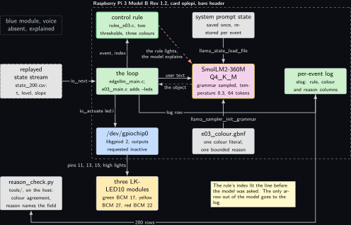
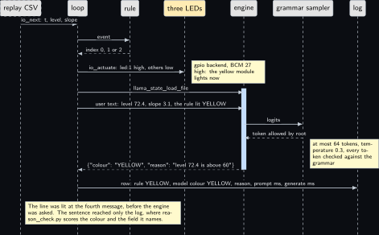
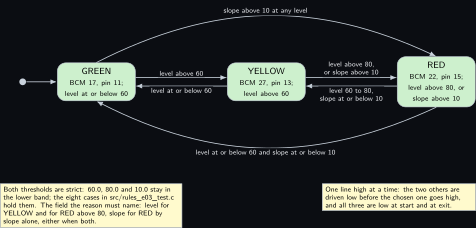
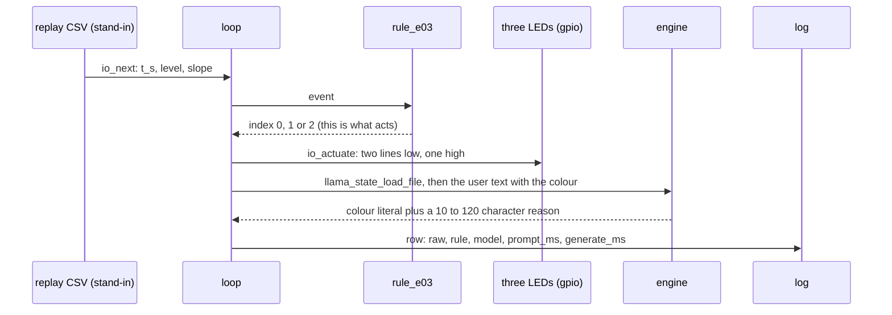
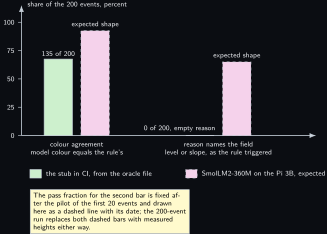

# Project 3. LED status explainer

> **Board:** Raspberry Pi 3 Model B Rev 1.2, bare header, three LED modules; NanoPi NEO Air variant  
> **Owns:** the first real output of the volume: a line lit by the rule, and the sentence the model writes about it

> [!IMPORTANT]
> **The question, instanced**
>
> What does a small local model add over a two-line threshold, and when does it get it wrong? Here the threshold lights one of three LEDs and the model is not asked to choose at all: it is told which colour is lit, the level and the slope, and asked to write one sentence that says why. The question becomes whether a 360M model on a 1 GB board can name the field that actually tripped the rule, level or slope, over 200 events, and how often it contradicts the LED in front of it.

> **Key facts**
>
> - **Board:** Raspberry Pi 3 Model B Rev 1.2, 1 GB, card `eplepi` moved from the Pi 4B for this sitting, 4 threads; the NanoPi NEO Air (512 MB, armv7) as a variant
> - **HAT slot:** empty; three Joy-it LK-LED10 modules on the bare header, header pins 11, 13 and 15, ground on pin 25
> - **Parts:** the Pi 3B, the green, yellow and red modules; the blue module stays in the box; the NanoPi for the variant
> - **Interface:** the replayed state stream of [Project 2](02-the-decision-loop.md) through `io.h` for the events; libgpiod 2 through the gpio backend for the three lines, opened by the project's own `--leds` option
> - **Language and variant:** C, catalogue variant C: plain C over `llama.h` through the shared main of [Project 2](02-the-decision-loop.md), plus libgpiod 2
> - **Model:** SmolLM2-360M-Instruct Q4\_K\_M, 0.27 GB, Apache 2.0; SmolLM2-135M-Instruct Q4\_K\_M, 105 MB, on the NanoPi
> - **Decision:** the rule chooses the colour; the model restates it under the grammar and writes one reason of 10 to 120 characters that must name the field, level or slope
> - **Control rule:** RED if the level is above 80 or the slope above 10; YELLOW if the level is above 60; else GREEN; the index drives `led:i` high and the two others low
> - **Acceptance:** over 200 events, two fractions from `reason_check.py`: the model's colour equals the rule's, and the reason names the field the rule triggered on; the pass fraction for the second is fixed after a pilot of 20 events and both are published either way; zero rows without a parseable object; throttle bits `0x0`
> - **Difficulty:** 2 of 5
> - **Effort:** one evening on the host for the rule, the grammar and the oracle; one afternoon on the Pi 3B for the wiring, the pilot and the 200; one evening for the NanoPi cross build

## Pitch

The loop of [Project 2](02-the-decision-loop.md) with a device behind it for the first time, and the smallest device the bench has: three LED modules on three GPIO lines. The rule of [Project 2](02-the-decision-loop.md) is kept with its two thresholds, only its names change from NORMAL, WATCH, ALERT to GREEN, YELLOW, RED, and its index now does something: through `project_actuate` and the gpio backend it drives one line high and the two others low, so one module lights per event. The model gets a different job from the one it had in [Project 2](02-the-decision-loop.md). It is told the level, the slope and the colour that is lit, and it writes one sentence, bounded by the grammar to letters, digits, spaces, commas and full stops, that must say why. That sentence is checkable: the rule's own arithmetic says which field tripped it, and a short Python checker counts how often the sentence names that field and how often the restated colour equals the lit one. The LEDs show what the rule decided; the log shows what the model said about it; nothing the model says reaches a line. In CI the stub answers GREEN with an empty reason, so the colour agreement is the GREEN fraction of the replay, 67.5 percent, and the reason fraction is 0, both printed here so the first real numbers have something beside them.

## Origin and what changed

Draft idea 13, an LED status interpreter, re-framed. The draft had the model read the level and decide which LED to light, which the safety rule of the volume forbids and which is a rule in any case: three thresholds, three colours, two lines of C. What changed is that the interpreter became the rule and the model's job became the explanation, which is the one part of the idea a model can add and the one part that can be scored without a person reading every row. The second change is in the loop. The shared main opens exactly one `io_source`, replay or live, and for this project the two things differ in kind: the level and slope are modelled, a replayed CSV, while the LEDs are real. `--live gpio` would make the line read-backs the event stream, so `src/e03_main.c` takes one option of its own, `--leds`, strips it from `argv` before the shared loop sees it, opens the gpio backend through `io_open_live` and drives the lines through `io_actuate`, the same call the replay backend counts when the option is absent. The loop in `common/c/src/edgellm_main.c` is untouched; the chapter prints the twenty lines that do this so the deviation is on the page.

## Parts and interface

| **Part** | **Role** | **Interface** | **Address or pin** |
| --- | --- | --- | --- |
| Raspberry Pi 3 Model B Rev 1.2 | runs the loop, the rule, the model and the lines; 1 GB, so the 360M file needs 450 MB available | SSH | header pins 11, 13, 15, 25 |
| Card `eplepi` | Raspberry Pi OS trixie, user `bing` in group `gpio`, libgpiod-dev 2.2.1 from the archive | the card is the hostname |  |
| Green LK-LED10 | lit for GREEN, index 0; 7.39 mA at 3.3 V (PPK2, Saturday 3 October 2026) | S to GPIO17, G to the rail | pin 11 |
| Yellow LK-LED10 | lit for YELLOW, index 1; 6.20 mA at 3.3 V | S to GPIO27, G to the rail | pin 13 |
| Red LK-LED10 | lit for RED, index 2; 6.34 mA at 3.3 V | S to GPIO22, G to the rail | pin 15 |
| Blue LK-LED10 | stays in the box; 2.94 mA at 3.3 V; a fourth state is an exercise | none | none |
| NanoPi NEO Air | the variant: 512 MB, armv7, SmolLM2-135M, three lines of the 24-pin header | SSH over Wi-Fi | Allwinner numbering, to confirm on the silkscreen |
| `replay/state_200.csv` | the event stream, 200 rows of `t_s,tag,v0,v1` generated by `tools/make_replay.py` | `io_open_replay` |  |
| `grammars/e03_colour.gbnf` | the three colour literals and the bounded reason | the grammar sampler | root symbol `root` |
| `prompt.txt` | the system prompt, 66 words | decoded once, state saved |  |
| `src/rules_e03.c` | the control rule, registered by name | `rule_find("e03")` | index 0, 1, 2 |
| `tools/reason_check.py` | the acceptance instrument: two fractions from the log | reads `raw`, `rule`, `model` |  |
| `tests/oracle/e03.expected.csv` | the 200 expected colours and the stub's column | the oracle check in C, row by row |  |

## Model and grammar

SmolLM2-360M-Instruct at Q4\_K\_M, the file `SmolLM2-360M-Instruct-Q4_K_M.gguf`, 0.27 GB, Apache 2.0, from [bartowski/SmolLM2-360M-Instruct-GGUF](https://huggingface.co/bartowski/SmolLM2-360M-Instruct-GGUF) (verified Wednesday 14 October 2026), the Pi 3 family default of the ladder; on this 1 GB board it needs 450 MB of `MemAvailable` under the 60 percent rule, which the pre-flight reads. The NanoPi variant runs SmolLM2-135M-Instruct at Q4\_K\_M, the file `SmolLM2-135M-Instruct-Q4_K_M.gguf`, 105 MB, Apache 2.0, from [bartowski/SmolLM2-135M-Instruct-GGUF](https://huggingface.co/bartowski/SmolLM2-135M-Instruct-GGUF) (verified Wednesday 14 October 2026), the only rung that fits 512 MB. Both are ChatML models, so the shared main wraps the system prompt and the user text in the ChatML markers and `prompt.txt` stays plain text. The engine is the pinned `v0.6.0` of [Project 1](01-bring-up-and-the-honest-tokens-per-second.md). The grammar departs from the house shape of [Project 2](02-the-decision-loop.md) in one way: the object has two keys, the colour literal first and then a reason bounded by a repetition range on a character class, `{10,120}`, which the engine's grammar syntax provides, read at [grammars/README.md](https://raw.githubusercontent.com/ggml-org/llama.cpp/master/grammars/README.md) (verified Wednesday 14 October 2026). The class admits no quote, brace or newline, so the reason cannot escape the object, and the object closes only after it.

```gbnf
root   ::= "{" ws "\"colour\"" ws ":" ws colour ws "," ws "\"reason\"" ws ":" ws reason ws "}"
colour ::= "\"GREEN\"" | "\"YELLOW\"" | "\"RED\""
reason ::= "\"" [a-zA-Z0-9 ,.]{10,120} "\""
ws     ::= [ \t]*
```

The system prompt, decoded once and never again during a run, reads in full: You explain three status LEDs on a Raspberry Pi. A rule picks the colour from one level reading and its slope: RED when the level is above 80 or the slope is above 10 per second, YELLOW when the level is above 60, otherwise GREEN. Answer only with the JSON object: the colour the rule lit, and one short reason that names the field that decided it, level or slope. It is 66 words; the token count on the SmolLM2 tokenizer is read at the first run and must be under 120. The thresholds are in the prompt on purpose: the model is not asked to guess why the rule fired, it is asked to apply the arithmetic it has been given to two numbers and say which one crossed.

## What the model decides or writes

One JSON object with two values, through the grammar, with `n_predict` 64 and temperature 0.3, the sentence setting of the volume's latency design. The colour is one of three literals and is a copy: the user text says which colour the rule lit, and a model that writes another one has contradicted the LED in front of it, which is the first thing the checker counts. The reason is 10 to 120 characters of letters, digits, spaces, commas and full stops, and it is the real test: the rule's arithmetic fixes which field tripped it, level for YELLOW and for RED by level, slope for RED by slope alone, either when both are over, and the checker counts the rows whose reason contains that word. An object that does not close inside 64 tokens is a row without a parseable object; the checker reports it separately and the chapter counts it as its own failure, not the model's. In CI there is no model file; the stub expands the grammar's first alternative on every path and a character class to nothing, so it answers `{"colour":"GREEN","reason":""}` on every row with timings of zero and the engine column reading stub, and the loop, the log, the oracle check and the checker are exercised end to end on a runner with no engine and no GPIO.

## Control rule

The two thresholds of [Project 2](02-the-decision-loop.md), strict, with the colours as names. The names table is what the grammar reproduces letter for letter and what `project_actuate` indexes into: index 0 is the line on BCM 17, 1 on BCM 27, 2 on BCM 22. GREEN is first because the stub answers the first literal in CI and the quiet state is the one it should answer.

```c
static const char *const rule_e03_names[] = { "GREEN", "YELLOW", "RED", NULL };

static int rule_e03_fn(const rule_ctx *ctx, const io_event *ev)
{
    (void)ctx;                                        /* two values decide; no history */
    if (ev->n < 2) return 0;                          /* a short event lights GREEN */
    if (ev->v[0] > 80.0 || ev->v[1] > 10.0) return 2; /* RED: above 80, or slope above 10 */
    if (ev->v[0] > 60.0) return 1;                    /* YELLOW: level above 60 */
    return 0;                                         /* GREEN */
}

/* The constructor below registers the rule before main() runs; rule_find("e03") then
 * returns it. The file is compiled into the executable, never into an archive. */
const rule_desc rule_e03 = { "e03", rule_e03_fn, rule_e03_names };
RULE_REGISTER(rule_e03);
```

The index acts here, in the one function of this project that touches a line. The two other lines go low before the chosen one goes high, so two modules are never lit together, and the colour that was lit is kept in one static for the prompt function, which the shared main calls next for the same event.

```c
int project_actuate(io_source *src, const rule_desc *rule, int rule_index,
                    const io_event *ev)
{
    io_source *sink = leds != NULL ? leds : src;
    char what[16];
    int i, rc = 0;
    (void)ev;
    lit = rule->names[rule_index];
    for (i = 0; i < E03_LEDS; i++) {
        if (i == rule_index)
            continue;
        snprintf(what, sizeof what, "led:%d", i);
        if (io_actuate(sink, what, 0) != 0)
            rc = -1;
    }
    snprintf(what, sizeof what, "led:%d", rule_index);
    if (io_actuate(sink, what, 1) != 0)
        rc = -1;
    return rc;
}
```

The user text names the level, the slope and the lit colour, and nothing else; the thresholds are in the system prompt, so they cost no tokens per event.

```c
const char *project_format_prompt(const io_event *ev, const rule_ctx *ctx, char *buf,
                                  size_t len)
{
    (void)ctx;
    snprintf(buf, len, "level %.1f, slope %.1f per second. The rule lit %s. Explain why in "
                       "one sentence.",
             ev->n > 0 ? ev->v[0] : 0.0, ev->n > 1 ? ev->v[1] : 0.0, lit);
    return buf;
}
```

## Real, modelled, absent

- **have:** real: the Pi 3 Model B, the card, the three modules on their lines, the GPIO character device and libgpiod 2, the model file, the engine at the pinned tag, the rule, the grammar, the log and the timings it holds; the NanoPi for the variant
- **learn:** modelled: the event stream, the replayed CSV of [Project 2](02-the-decision-loop.md)'s shape generated by a seeded walk, drawn dashed in every figure; it stands in for a sensor so that the lines are driven by a stream with an oracle, and nothing about any sensor is claimed
- **absent:** absent: voice, which the draft idea wanted and no microphone on the bench can give, and the fourth module's use; the blue module is on the bench and in the box, and a fourth state is listed as an exercise

## System architecture



*Figure 3.1. The loop of e02 with a real output behind it, on the Pi 3 Model B. Inside a dashed layer labelled with the board and the card, seven solid blocks: the loop (edgellm\_main.c, with e03\_main.c adding the -leds option) in user-space green at the centre, the control rule above it with the green rule outline, the model to its right with the yellow model outline, grey blocks for the saved system prompt state and the grammar file around the model, the per-event log in green further right, and below the loop a kernel-blue block for /dev/gpiochip0 through libgpiod 2 with its outputs requested inactive. Outside the layer on the left, a dashed grey block for the replayed state stream, the only stand-in, a solid hardware block for the three LK-LED10 modules on BCM 17, 27 and 22, a dotted grey block for the absent blue module and voice, and a solid grey block for tools/reason\_check.py on the host. Solid arrows carry io\_next from the replay to the loop, the event up to the rule and its index back, the user text to the model with a dashed reply carrying the object back, the saved state and the grammar into the model, io\_actuate led:i from the loop down to the GPIO block and from there to the modules on pins 11, 13 and 15, where high lights, and the log row across to the log; a dashed stop-coloured arrow from the rule to the model says that the rule lights and the model explains. A last solid arrow carries the 200 rows from the log to the checker. A note says that the rule's index lit the line before the model was asked and that the only arrow out of the model goes to the log.*

The figure differs from [Project 2](02-the-decision-loop.md)'s in two blocks and one arrow: the GPIO block and the modules are the output, and the arrow into them starts at the loop, carrying the rule's index, not at the model. The model's block has one outgoing arrow, to the log, as it has in every figure of the volume. The checker is on the host because it is the one piece of Python in the project, the instrument harness the house rule allows.

## Wiring

| **Header pin** | **BCM** | **Part pin** | **Wire colour if known** |
| --- | --- | --- | --- |
| 11 | GPIO17 | green module, S | not recorded |
| 13 | GPIO27 | yellow module, S | not recorded |
| 15 | GPIO22 | red module, S | not recorded |
| 25 | GND | the ground rail, G of all three modules | not recorded; the record of Saturday 3 October 2026 names only the signal pins, and pin 25 is chosen because no other project on this board claims it |
| none |  | the V pin of each module | left unconnected; the measurement names a signal pin and 3.3 V across the module and nothing on V; to confirm on the module's silkscreen |
| 1, 17 | 3V3 | nothing | the lines are driven by the SoC, not by a rail |


*Figure 3.2. The 40-pin header of the Pi 3 Model B as two columns of small solid blocks, pin 1 at the top left, with four blocks filled in the hardware colour: pins 11, 13 and 15, the signal lines GPIO17, GPIO27 and GPIO22 in the odd column, and pin 25, GND. To the left of the header, three solid hardware blocks for the green, yellow and red LK-LED10 modules, each with its measured current at 3.3 V, joined to their pins by solid arrows labelled S and the GPIO name; a solid line joins the three G pins into a ground rail that runs down the left and across to pin 25. To the right, a solid hardware block for the NanoPi NEO Air variant, whose three lines on the 24-pin header are to confirm on the silkscreen, and a dotted grey block for the absent blue module, which stays in the box. A note says that the anode is on the signal pin so a line driven high lights, that one line is high at a time so a pad sources at most the green module's 7.39 mA, that the ground pin was not recorded on the measurement day, and that nothing is on 3V3 or 5V.*

The current figures are the bench's own, taken with the PPK2 as a source meter at 3.3 V on Saturday 3 October 2026, three modules together 16.5 mA and each alone as the table says. The loop never holds two lines high, so the largest draw on any pad is the green module's 7.39 mA; whether that sits inside the pad's default drive setting is a datasheet question left marked, to verify against the SoC documentation before a long run.

## Sequence



*Figure 3.3. One event as a sequence diagram with seven actors: the replay CSV, drawn dashed as the stand-in, then the loop, the rule, the three LEDs in the hardware colour, the engine, the grammar sampler and the log, all solid. Solid arrows carry io\_next with t, level and slope from the replay to the loop and the event from the loop to the rule; a dashed reply brings the index 0, 1 or 2 back. The fourth message is a solid arrow from the loop to the LEDs, io\_actuate led:1 high and the others low, with a note that the gpio backend drives BCM 27 high and the yellow module lights now. Over a blue activation bar on the engine, two solid arrows from the loop carry llama\_state\_load\_file and then the user text, level 72.4, slope 3.1, the rule lit YELLOW; inside the bar a solid arrow carries logits to the grammar sampler and a dashed reply brings back the one token the root allows, with a note that at most 64 tokens are sampled at temperature 0.3 and every one is checked. A dashed reply returns the object with the colour YELLOW and the reason that the level is above 60 to the loop, and the last solid arrow writes the row, rule YELLOW, model colour YELLOW, the reason, prompt ms and generate ms, into the log. A note says that the line was lit at the fourth message, before the engine was asked, and that the sentence reached only the log, where reason\_check.py scores it.*

## States and data



*Figure 3.4. The three colours as three rounded green states in a row, GREEN on BCM 17 at pin 11, YELLOW on BCM 27 at pin 13 and RED on BCM 22 at pin 15, entered at GREEN from the initial dot. Between neighbours, pairs of solid arrows with the thresholds as labels: level above 60 from GREEN to YELLOW and level at or below 60 back; level above 80 or slope above 10 from YELLOW to RED and level 60 to 80 with slope at or below 10 back. Two curved solid arrows join the ends: slope above 10 at any level from GREEN straight to RED over the top, and level at or below 60 with slope at or below 10 from RED straight back to GREEN underneath. Two notes: one says that both thresholds are strict so 60.0, 80.0 and 10.0 stay in the lower band, that the eight test cases hold them, and which field the reason must name in each state; the other says that one line is high at a time, the two others driven low before the chosen one goes high, and all three low at start and at exit. Nothing is dashed or dotted.*

The record is the per-event log, `projects/e03-led-explainer/evidence/e03_run.csv`, in the shape `elog.h` fixes for every project: `t_s, tag, raw, rule, model, prompt_ms, generate_ms, n_generated, engine`. The `raw` column holds the level and the slope joined by a semicolon, which is what lets the checker recompute the triggering field without the program's help; the `model` column holds the whole JSON object, CSV-quoted, so the reason's commas survive. The engine column names the build, so a log from the stub can never be read as a log from the Pi.

## Data flow

```text
  tools/make_replay.py (seeded)        the loop on the Pi 3B: edgellm_main.c + e03_main.c       host
  +------------------------+           +----------------------------------------------+   +------------------+
  | replay/state_200.csv   |-io_next-->| rule_e03.fn(ctx, ev) -> 0 | 1 | 2             |   | reason_check.py  |
  |   t_s,tag,v0,v1        |           |      |                                        |   |  colour agrees   |
  +------------------------+           |      v   project_actuate: led:i high, others  |   |  reason names    |
                                       |      |   low, through io_actuate              |   |  level or slope  |
  --leds /dev/gpiochip0:17,27,22 ----> |      |-----> gpio backend -> BCM 17 | 27 | 22  |   +------------------+
    libgpiod 2, outputs inactive       |      |         -> one LK-LED10 lights           |          ^
                                       |      v   project_format_prompt(ev, ctx)        |          |
  prompt.txt ---decode once----------> | [state] --llama_state_load_file--> ctx         |          |
    llama_state_save_file  (at start)  |      "level 72.4, slope 3.1 ... lit YELLOW"    |          |
                                       |      sample <= 64 under grammar, temp 0.3      |          |
  grammars/e03_colour.gbnf ----------> |      {"colour": "YELLOW", "reason": "..."}     |          |
    llama_sampler_init_grammar(root)   |      |                                        |          |
                                       |      v                                        |          |
                                       | elog_row: t, raw, rule, model, ms, engine     |--200 rows-+
                                       +----------------------------------------------+
  tests/oracle/e03.expected.csv: rule column from the same thresholds in Python; model column the stub's
```



## Latency design

The system prompt is 66 words, decoded once at start, its state written with `llama_state_save_file` and read back before every event, so each event pays for its own thirty tokens of user text and the sentence. The sentence is the new cost: an enum answer in [Project 2](02-the-decision-loop.md) was eight tokens at most, and here the object with a 120-character reason can reach the `n_predict` of 64, most of it single-token decodes at the Pi 3's generation rate from [Project 1](01-bring-up-and-the-honest-tokens-per-second.md)'s table, which is not measured yet. So the time per event is a shape until that table exists: one prompt decode of about thirty tokens plus twenty to sixty generation steps. Temperature 0.3 under the grammar, as the volume's latency design sets for text; `n_ctx` 512; 4 threads on the Pi 3B and the count [Project 1](01-bring-up-and-the-honest-tokens-per-second.md) measures on the NanoPi. The interval is whatever the replay says, one event per second in the synthetic set, which the loop cannot keep up with on this board and is not meant to: the acceptance run takes events as fast as the model answers, and the demonstration run adds `--interval 10` so that each colour stays visible for ten seconds. The LEDs cost nothing in this budget; `gpiod_line_request_set_value` is three calls per event on a character device.

## Steps

**Step 1.** Generate the replay file and the oracle on the authoring laptop, and read the summary: it prints the count of each colour, the count of each RED cause and the two fractions the stub will reach.

```bash
# win11 aquamarine
cd C:\Users\aquamarine\Desktop\edge-llm-pi; python projects\e03-led-explainer\tools\make_replay.py
```

**Step 2.** Build the repository with the stub model in skyhorizon's WSL. The gpio backend is not needed for the oracle test; CI compiles it in with every other backend.

```bash
# win11 skyhorizon, WSL side
cd ~/src/edge-llm-pi; cmake -S . -B build -DEDGELLM_STUB_MODEL=ON; cmake --build build -j8
```

**Step 3.** Run the shared rule harness, which carries this project's eight cases beside every other project's. Three of the eight are the boundary values.

```bash
# win11 skyhorizon, WSL side
cd ~/src/edge-llm-pi; ctest --test-dir build -R rules_test --output-on-failure
```

**Step 4.** Run the oracle test: the loop over the 200 rows with the stub, and the log compared row by row against the oracle file. It passes only when every rule cell and every model cell matches, which includes the stub's empty reason.

```bash
# win11 skyhorizon, WSL side
cd ~/src/edge-llm-pi; ctest --test-dir build -R edgellm-e03-oracle --output-on-failure
```

**Step 5.** Run the same stub loop by hand and score the log with the checker, to see where the CI numbers come from: colour agreement 135 of 200, 67.5 percent, every disagreement the stub calling a YELLOW or a RED event GREEN; reason fraction 0 of 200.

```bash
# win11 skyhorizon, WSL side
cd ~/src/edge-llm-pi; build/projects/e03-led-explainer/edgellm-e03 --project e03 \
  --replay projects/e03-led-explainer/replay/state_200.csv \
  --grammar projects/e03-led-explainer/grammar.gbnf \
  --prompt projects/e03-led-explainer/prompt.txt --n-predict 64 --temperature 0.3 \
  --log /tmp/e03_stub.csv --stub; \
  python projects/e03-led-explainer/tools/reason_check.py /tmp/e03_stub.csv
```

**Step 6.** Move the card to the Pi 3B, wire the three modules as the table says, and run the pre-flight of `wiring.md`: memory, throttle bits, the chip, the three lines unused, the `gpio` group, then one module blinked by hand with the `gpiod` tools of trixie (2.2.1; the option spelling is read from `gpioset --help`, to verify).

```bash
# Raspberry Pi 3 Model B Rev 1.2, card eplepi
cd ~; free -m; vcgencmd get_throttled; gpiodetect; gpioinfo -c gpiochip0 17 27 22; groups
```

```bash
# Raspberry Pi 3 Model B Rev 1.2, card eplepi
cd ~; gpioset -c gpiochip0 -t 500ms 17=1
```

**Step 7.** Install the library and build on the board with the gpio backend compiled in, at two parallel jobs because a 1 GB board swaps at four.

```bash
# Raspberry Pi 3 Model B Rev 1.2, card eplepi
cd ~; sudo apt install libgpiod-dev gpiod
```

```bash
# Raspberry Pi 3 Model B Rev 1.2, card eplepi
cd ~/edge-llm-pi; cmake -S . -B build -DGGML_NATIVE=ON -DEDGELLM_IO_GPIO=ON \
  -DEDGELLM_BUILD_TESTS=OFF; cmake --build build -j2 --target edgellm-e03
```

**Step 8.** Run the pilot: the command of step 9 with `--max-events 20` added and the log written to `evidence/e03_pilot.csv`, then the checker on that log. The reason fraction it prints is what fixes the pass fraction for the 200, written into the Acceptance test subsection with its date before step 9 runs.

```bash
# Raspberry Pi 3 Model B Rev 1.2, card eplepi
cd ~/edge-llm-pi; python projects/e03-led-explainer/tools/reason_check.py \
  projects/e03-led-explainer/evidence/e03_pilot.csv
```

**Step 9.** Run the 200 with the throttle bits read before and after, then score the log. The engine column must name the build, not the stub; the count of unparsed rows must be zero; the two fractions go into the agreement table with their date, pass or not.

```bash
# Raspberry Pi 3 Model B Rev 1.2, card eplepi
cd ~/edge-llm-pi; vcgencmd get_throttled; build/projects/e03-led-explainer/edgellm-e03 \
  --project e03 --replay projects/e03-led-explainer/replay/state_200.csv \
  --leds /dev/gpiochip0:17,27,22 --grammar projects/e03-led-explainer/grammar.gbnf \
  --prompt projects/e03-led-explainer/prompt.txt \
  --model ~/models/SmolLM2-360M-Instruct-Q4_K_M.gguf --n-predict 64 --temperature 0.3 \
  --threads 4 --state /tmp/e03.state \
  --log projects/e03-led-explainer/evidence/e03_run.csv; vcgencmd get_throttled
```

```bash
# Raspberry Pi 3 Model B Rev 1.2, card eplepi
cd ~/edge-llm-pi; python projects/e03-led-explainer/tools/reason_check.py \
  projects/e03-led-explainer/evidence/e03_run.csv --md
```

**Step 10.** Cross build for the NanoPi NEO Air in skyhorizon's WSL with the armv7 flags of [Project 1](01-bring-up-and-the-honest-tokens-per-second.md) and the gpio backend, copy the binary, the 135M file and the project folder over, read the three line offsets from the silkscreen and `gpioinfo` on the board, and run step 9 again with those offsets in the `--leds` spec and the thread count [Project 1](01-bring-up-and-the-honest-tokens-per-second.md) measured there. Its two fractions get their own row. The configure line is [Project 1](01-bring-up-and-the-honest-tokens-per-second.md)'s cross build line with `-DEDGELLM_IO_GPIO=ON` and `-DEDGELLM_BUILD_TESTS=OFF` added; the libgpiod headers for armv7 come from the sysroot that line names, to verify at the first configure.

```bash
# win11 skyhorizon, WSL side
cd ~/src/edge-llm-pi; cmake --build build-armv7 -j8 --target edgellm-e03; scp \
  build-armv7/projects/e03-led-explainer/edgellm-e03 nanopi:
```

## Variant chosen

C, catalogue variant C: plain C over `llama.h` through the shared main of [Project 2](02-the-decision-loop.md), with libgpiod 2 for the lines. On practicality it scores highest because the whole project is one rule file, one prompt function, one actuation function and twenty lines of `main`, and the library's own header is C, read at [include/gpiod.h](https://raw.githubusercontent.com/brgl/libgpiod/master/include/gpiod.h) (verified Wednesday 14 October 2026), LGPL-2.1-or-later by its SPDX line; on relevance it is the leanest binary the bench can put on a 1 GB board and on the NanoPi's armv7, where a runtime or a binding layer would be paid for on every one of 512 MB; on popularity libgpiod is the current route to a GPIO line on Linux now that the sysfs interface is deprecated, and its tools ship in trixie as `gpiod` 2.2.1, [packages.debian.org/trixie/libgpiod-dev](https://packages.debian.org/trixie/libgpiod-dev) (verified Wednesday 14 October 2026); on compliance it is MIT on the engine side and LGPL on the library side, dynamically linked, which the recipe respects by listing the package rather than vendoring it; on best practice it is the house rule, C for anything that runs on a board, and the one backend file `common/c/src/io_gpio.c` that every later GPIO project reuses. What it costs is the deviation this chapter had to make: the shared main's one-source rule met a project whose events are modelled and whose output is real, and the answer was a second source opened by the project's own `main`, the last function of `src/e03_main.c`, which copies `argv` without the `--leds` pair, opens the sink, calls `edgellm_main` with the rest, and drives the three lines low before it returns. What it gains is that the rule's index reaches a line through the same `io_actuate` call the replay backend counts, so the CI run and the bench run differ by one option. Binary size from `ls -l` and resident memory from the loop's own `rss` line are not measured: the Pi 3B run has not been taken.

## Embedded Linux and Yocto

The application recipe `meta-edgellm/recipes-app/edgellm-e03/edgellm-e03_0.1.bb` follows the worked example of [Project 2](02-the-decision-loop.md): the project id `e03`, the folder `e03-led-explainer`, the model package `model-smollm2-360m`, and then the shared include, with two lines the example did not need: `EDGELLM_IO_OPTIONS` carries `-DEDGELLM_IO_GPIO=ON` so the backend is compiled in, and `libgpiod` is added to `DEPENDS` and to the runtime dependencies, because the include lists only the engine. The binary installs as `/usr/bin/edgellm-e03` with the prompt, the grammar and the replay folder under `/usr/share/edgellm/e03`. The unit is the first live one of the layer and it is still a replay unit: the events come from the installed CSV, and the lines come from the `--leds` spec. No overlay and no `After=` for a device, because `gpiochip0` exists from the kernel at boot on every Pi. The NanoPi image uses the same recipe with the 135M package in its `EDGELLM_MODELS` and the unit's three offsets edited on the board, to confirm on the silkscreen.

```text
ExecStart=/usr/bin/edgellm-e03 --project e03 \
    --replay /usr/share/edgellm/e03/replay/state_200.csv \
    --leds /dev/gpiochip0:17,27,22 \
    --model /usr/share/edgellm/models/SmolLM2-360M-Instruct-Q4_K_M.gguf \
    --grammar /usr/share/edgellm/e03/grammar.gbnf \
    --prompt /usr/share/edgellm/e03/prompt.txt \
    --log /var/lib/edgellm/e03.csv \
    --threads 4 --n-predict 64 --temperature 0.3 --interval 10 \
    --state /run/edgellm/e03.state
StateDirectory=edgellm
RuntimeDirectory=edgellm
```

The kas file for the Pi 3, `meta-edgellm/kas/edgellm-pi3.yml`, lists `edgellm-e02` as its one application today; the image sitting that builds this chapter sets `EDGELLM_APPS = "edgellm-e03"` in that file's local configuration, a one-line edit made at that sitting and not here. The layer parse, not the image build, is the check that runs on skyhorizon before anything is wired; the image build is a separate later sitting of hours.

```bash
# win11 skyhorizon, WSL side
cd ~/bench/edge-llm-pi; kas shell meta-edgellm/kas/edgellm-pi3.yml -c "bitbake -p"
```

## Acceptance test

Two fractions and one count, over the 200 rows of `replay/state_200.csv` run with the real model and the real lines on the Pi 3B at four threads. The instrument is `tools/reason_check.py` reading the log: it takes the colour and the reason from the model column, recomputes from the `raw` column which field the rule triggered on, and prints the colour agreement, the fraction of reasons that contain that field's word, the 3 by 3 confusion table and every row to read. The count of rows with no parseable object must be zero, as in [Project 2](02-the-decision-loop.md), or the grammar or `n_predict` failed and the chapter has. The pass fraction for the reason is not stated before the pilot: step 8 runs the first 20 events, and the fraction it prints is what fixes the bar for the 200, written into this paragraph with its date before step 9 runs; the 200 are then published pass or fail, because a 360M model that names the wrong field in a third of its sentences is exactly the finding the volume's question asks for. The colour agreement has no pass bar: it is a copy of a word the model was given, and every miss is a contradiction of the LED, listed row by row. Both are taken with `vcgencmd get_throttled` reading `0x0` before and after. The commands are steps 8 and 9 above; the CI run, with the stub, checks the log shape and the rule column through the oracle test of step 4.

## Agreement table

Over the 200 rows as generated on Wednesday 14 October 2026 by `tools/make_replay.py` with its fixed seed, the rule column holds 135 GREEN, 38 YELLOW and 27 RED; of the 27 RED, 14 are by level alone, 8 by slope alone and 5 by both, so the slope word is the only correct one in 8 rows and the level word in 187. On the bench the model columns are not measured: the Pi 3B run has not been taken. In CI the stub answers GREEN with an empty reason for every row, so the colour agreement is the GREEN fraction, 135 of 200, 67.5 percent, every disagreement of one kind, the stub calling a YELLOW or a RED event GREEN, and the reason fraction is 0 of 200, because an empty string names nothing. Both are printed so that the first numbers from the real model have something beside them: a model that scores 67.5 percent on the colour has learned nothing that the first literal did not give it, and a reason fraction above zero is already more than the stub.

| **Rule lit** | **Model GREEN** | **Model YELLOW** | **Model RED** | **Instrument** |
| --- | --- | --- | --- | --- |
| GREEN, 135 | 135 | 0 | 0 | the stub in CI; bench: not measured |
| YELLOW, 38 | 38 | 0 | 0 | the stub in CI; bench: not measured |
| RED, 27 | 27 | 0 | 0 | the stub in CI; bench: not measured |
| colour agreement | 67.5 percent |  |  | the stub in CI; bench: not measured, run pending on the Pi 3B |
| reason names the field | 0 of 200 |  |  | the stub's reason is empty; bench: not measured, pass fraction fixed after the pilot |

| **Rule lit, cause** | **Rows** | **Word the reason must hold** | **Instrument** |
| --- | --- | --- | --- |
| GREEN, nothing crossed | 135 | level | `tools/make_replay.py`, its printed summary |
| YELLOW, level above 60 | 38 | level | the same |
| RED, level above 80 only | 14 | level | the same |
| RED, slope above 10 only | 8 | slope | the same |
| RED, both | 5 | level or slope | the same |

## Measured data



*Figure 3.5. The two acceptance fractions over the 200 events as bars, drawn with TikZ axes, the vertical axis the share of events in percent. Two solid green bars are a record, the CI figures from the oracle file as generated on Wednesday 14 October 2026: colour agreement 135 of 200, and a zero-height mark for the reason fraction, 0 of 200, labelled empty reason. Two dashed bars in the firmware colour are the shape expected from SmolLM2-360M on the Pi 3B and not a measurement, their heights placeholders. A legend names the two kinds, and a note says that the pass fraction for the second bar is fixed after the pilot of the first 20 events and drawn then as a dashed line with its date, and that the 200-event run replaces both dashed bars with measured heights either way.*

## Pitfalls

- **All three light at the request.** The modules light on drive high, and a line request that leaves the output value at its default on some stacks starts high. The backend in `common/c/src/io_gpio.c` calls `gpiod_line_settings_set_output_value` with the inactive value before the request, so the lines start low; a request written without that call lights all three for as long as it takes the first event to arrive, and on a 10-second interval that is a visible wrong state. Check the three modules are dark after the chip opens and before the first row.
- **Pins 11, 13, 15 and the ground rail.** The three signal pins are in the odd column, one row apart, with pin 9 and pin 17 at either end; a module on pin 17 is on 3V3 and lit for ever, a module on pin 9 is on ground and never lit. The record of Saturday 3 October 2026 names no ground pin, and pin 25 is this chapter's choice, not a measurement. Count from pin 1 at the SD card end before the first run and blink one module by hand.
- **`--live gpio` is the wrong flag here.** With it the gpio backend is the event source and every event is three line read-backs, which the rule reads as a level of 0 or 1 and calls GREEN for ever. The events are the replay; the lines are the `--leds` sink. A log whose `tag` column reads `gpio` instead of `state` is this mistake.
- **The stub always answers GREEN with an empty reason.** A log where every model cell reads `{"colour":"GREEN","reason":""}` and every engine cell reads stub is a CI log, and its 67.5 percent is the GREEN fraction of the replay, not a property of any model; its reason fraction of zero is the empty string, not a verdict. Read the engine column before reading either number.
- **`tools/agreement.py` reads a `decision` key.** This project's object has a `colour` key and a `reason`, so the shared tool returns the whole object as the decision and scores 0 percent with no error. The checker for this chapter is `tools/reason_check.py`, and the oracle test does not depend on either.
- **A reason that names both fields.** The checker counts a row as naming the field when the triggering word is present, so a sentence that says level and slope both crossed when only the level did passes the count and is still wrong. The list of rows to read at the end of the checker's output is where that shows; the fraction is the instrument, the list is the reading.
- **The NanoPi build is armv7 and 512 MB.** The 360M file needs 450 MB available and will not fit beside the system; the variant runs the 135M file, 105 MB, and nothing larger. The 24-pin header has no 40-pin layout and its lines are numbered by the Allwinner port, so 17, 27 and 22 mean nothing there; the three offsets come from the silkscreen and `gpioinfo` on the board, and the chapter claims none.
- **A line held by another consumer.** `gpioinfo` shows a consumer name on a line that a previous run, a stuck `gpioset` or another project still holds, and the request is refused with the chip's name and nothing else useful. Stop the holder; the backend releases every line on close and `main` drives them low first.

## Future and extra exercises

- The same project in C++ over the C API, variant B: the delta is the RAII face in `common/cpp/edgellm.hpp` and the C++ binding of libgpiod 2 (LGPL-2.1-or-later), priced in [Project 7](07-iks4a1-climate-and-motion-narrator.md) and [Project 9](09-lcd-prompt-and-verdict-display.md).
- The same project in Rust, variant R7: the delta is the `gpiod` crate over the same library and the bundled engine commit of `llama-cpp-2` against the pinned tag, priced in [Project 5](05-adxl345-event-reporter.md) on the same board.
- The same project in Python over `llama-cpp-python` and the `gpiod` Python binding: the delta is the interpreter's cost per sentence on a 1 GB board, priced in [Project 15](15-esp32-sidecar-with-a-bounded-pattern-proposal.md).
- The blue module as a fourth state: a fourth literal in the grammar and a fourth name in the rule, with the threshold that earns it stated; it costs one line, pin 7 or any free odd pin, and 2.94 mA.
- A PWM dimming rule: brightness from the distance to the next threshold through a software PWM on the same line; the delta is a thread the loop does not have and the MCC 118 of [Project 10](10-mcc-118-voltage-event-labeller.md) as the witness that the duty cycle is what the rule set.
- Voice: a sentence spoken rather than logged; absent until a microphone and a speaker are on the bench, and named here so the dotted block has a sequel.

## Video potential

3 of 5. The hook: three LEDs, one small model, the sentence it writes. On screen the three modules on the header, the level climbing in the terminal, the yellow module lighting, and the sentence appearing a few seconds later with the word level in it; then a RED by slope and the sentence that says slope, or does not. It moves and it lights, which [Project 2](02-the-decision-loop.md) could not offer, and it is the natural second half of a piece whose first half is that chapter's grammar; what is slow on camera is the sentence, seconds per event on a Pi 3, which is shown once live and then cut.

## Sources

- SmolLM2-360M-Instruct-GGUF by bartowski, Apache 2.0, 0.27 GB at Q4\_K\_M, the file named in the key facts, [huggingface.co/bartowski/SmolLM2-360M-Instruct-GGUF](https://huggingface.co/bartowski/SmolLM2-360M-Instruct-GGUF) (verified Wednesday 14 October 2026).
- SmolLM2-135M-Instruct-GGUF by bartowski, Apache 2.0, 105 MB at Q4\_K\_M, the file named in the key facts, [huggingface.co/bartowski/SmolLM2-135M-Instruct-GGUF](https://huggingface.co/bartowski/SmolLM2-135M-Instruct-GGUF) (verified Wednesday 14 October 2026).
- libgpiod, the v2 C API header with the request, settings and value functions the backend uses, and the SPDX line LGPL-2.1-or-later, the raw file on GitHub at [brgl/libgpiod, include/gpiod.h](https://raw.githubusercontent.com/brgl/libgpiod/master/include/gpiod.h) (verified Wednesday 14 October 2026).
- libgpiod documentation, the core API, bindings and tools sections; the page names no version, [libgpiod.readthedocs.io](https://libgpiod.readthedocs.io/) (verified Wednesday 14 October 2026).
- Debian trixie, `libgpiod-dev` and `gpiod` at 2.2.1-2+deb13u1, [packages.debian.org/trixie/libgpiod-dev](https://packages.debian.org/trixie/libgpiod-dev) (verified Wednesday 14 October 2026) and [packages.debian.org/trixie/gpiod](https://packages.debian.org/trixie/gpiod) (verified Wednesday 14 October 2026).
- GBNF grammar syntax, the repetition range and the root rule, in the engine's tree, [raw.githubusercontent.com/ggml-org/llama.cpp/master/grammars/README.md](https://raw.githubusercontent.com/ggml-org/llama.cpp/master/grammars/README.md) (verified Wednesday 14 October 2026).
- Joy-it LK-LED10, the module's product page, which carries the picture and no pinout; the pin names S, V and G and the anode-on-signal fact are the bench's own record of Saturday 3 October 2026, [joy-it.net/en/products/LK-LED10](https://joy-it.net/en/products/LK-LED10) (verified Wednesday 14 October 2026).
- llama.cpp, the pinned release `v0.6.0` and the C API symbols, cited in [Project 1](01-bring-up-and-the-honest-tokens-per-second.md) and [Project 2](02-the-decision-loop.md) with their marks. MIT.
- The honesty rule, solid, dashed and dotted, from the joint node volume, chapter 1; that volume has no public URL.

---

[Previous](02-the-decision-loop.md) &nbsp;&nbsp;|&nbsp;&nbsp; [Contents](../CONTENTS.md) &nbsp;&nbsp;|&nbsp;&nbsp; [Next](04-pi-thermal-and-throttle-narrator.md)
