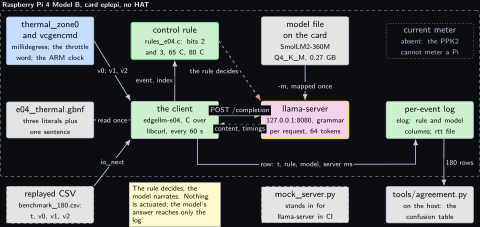
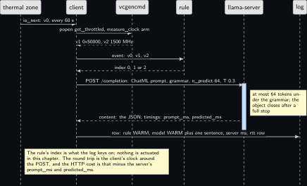
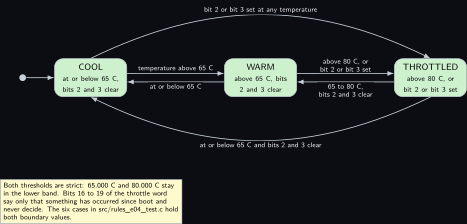
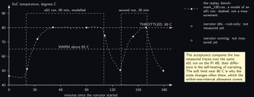

# Project 4. Pi thermal and throttle narrator

> **Board:** Raspberry Pi 4 Model B, no HAT  
> **Owns:** the HTTP integration: one engine process behind llama-server, one client process with the loop, and the price of the wire between them

> [!IMPORTANT]
> **The question, instanced**
>
> What does a small local model add over a two-line threshold, and when does it get it wrong? Here the threshold is two lines of C on the board's own temperature and throttle word, the model is told the same thresholds and asked for one sentence besides the enum, and the question has a second half: how much does the narrator heat the board it narrates, and what does a round trip over HTTP cost against [Project 2](02-the-decision-loop.md)'s in-process decision.

> **Key facts**
>
> - **Board:** Raspberry Pi 4 Model B, card `eplepi`, 4 threads in the server
> - **HAT slot:** empty; nothing is read from the header
> - **Parts:** the Pi 4B, its thermal zone and its firmware's throttle word; the console from [Project 1](01-bring-up-and-the-honest-tokens-per-second.md); no sensor
> - **Interface:** `/sys/class/thermal/thermal_zone0/temp` through the sysfs backend of `io.h` at a 60 s interval; `vcgencmd get_throttled` and `vcgencmd measure_clock arm` through `popen` in the client; HTTP on the loopback interface to `llama-server`
> - **Language and variant:** C, catalogue variant D: a client of `llama-server` over HTTP with libcurl; the engine runs in its own process
> - **Model:** SmolLM2-360M-Instruct Q4\_K\_M, 0.27 GB, Apache 2.0, served with `-c 512`, the grammar sent with every request
> - **Decision:** one of COOL, WARM, THROTTLED plus one sentence of 10 to 160 characters, through the grammar; the mock answers COOL and an empty sentence in CI
> - **Control rule:** THROTTLED when bit 2 or bit 3 of the throttle word is set or the temperature is above 80 C; WARM above 65 C; else COOL
> - **Acceptance:** during an [Project 1](01-bring-up-and-the-honest-tokens-per-second.md) benchmark run the model's enum agrees with the rule in at least 95 percent of the rows once the rows where the rule itself changed are set aside; the self-heating of narrating read as the difference of two temperature traces; the HTTP round trip from the client's own clock beside [Project 2](02-the-decision-loop.md)'s in-process figure
> - **Difficulty:** 3 of 5
> - **Effort:** one evening on the host for the client and the mock, two sittings on the Pi 4B, each the length of an [Project 1](01-bring-up-and-the-honest-tokens-per-second.md) run, for the idle and the running trace

## Pitch

The board narrates itself. Once a minute the client reads the SoC temperature from the kernel's thermal zone, asks the firmware for the throttle word and the ARM clock, decides in two lines whether the board is COOL, WARM or THROTTLED, and then asks a model running in another process for the same decision and one plain sentence about it. The model is reached over HTTP, because that is how most applications in the wild reach an engine: `llama-server` holds the model, the client holds the loop, and swapping the model is a change to one command line. The chapter measures what that costs. The round trip is timed by the client's own clock and the server's own timings come back in the answer, so the wire's share is a subtraction; and because a model that narrates the throttle also heats the board, the temperature trace with the narrator running is compared against the trace with the narrator idle over the same benchmark run. The agreement table has a CI number before any board is touched: the mock server answers the grammar's first literal, and that is 35.0 percent on the replayed run, the COOL fraction and nothing more.

## Origin and what changed

Draft idea 16 wanted a power narrator: the Pi's current under load, read by the PPK2, turned into a sentence. The PPK2 cannot source or meter a Raspberry Pi, which draws about an ampere under load, and the bench owns no USB-C inline meter, so the current is absent and the chapter says so with a dotted block. What is real on a Pi 4B without any instrument is its temperature and its throttle state, both already read before and after every timing run in [Project 1](01-bring-up-and-the-honest-tokens-per-second.md) as a gate; here they become the subject. What also changed is the integration: this is the one chapter in the volume where the engine is a separate server, so that the HTTP route is priced once, against [Project 2](02-the-decision-loop.md)'s in-process loop, and never argued about again. The narrator is non-critical and runs at a 60 s interval, which is why the wire is affordable here and not in a chapter that acts.

## Parts and interface

| **Part** | **Role** | **Interface** | **Address or pin** |
| --- | --- | --- | --- |
| Raspberry Pi 4 Model B | runs both processes and is the subject of the narration | SSH, or the Renkforce cable from [Project 1](01-bring-up-and-the-honest-tokens-per-second.md) | none on the header |
| Card `eplepi` | Raspberry Pi OS trixie, the model file in `~/models` | the card is the hostname |  |
| `thermal_zone0/temp` | the SoC temperature in millidegrees | the sysfs backend of `io.h`, interval 60 s | `/sys/class/thermal/thermal_zone0/temp` |
| `vcgencmd` | the throttle word and the ARM clock from the firmware | `popen` in the client, two calls per event | the mailbox `/dev/vcio`, video group |
| `llama-server` | holds the model, samples under the grammar, answers over HTTP | POST `/completion`, GET `/health` and `/props` | `127.0.0.1:8080` |
| `replay/benchmark_180.csv` | 180 rows of `t_s,tag,v0,v1,v2`, one per minute, generated by `tools/make_replay.py` | `io_open_replay` |  |
| `grammars/e04_thermal.gbnf` | the three literals and the sentence rule | the `grammar` field of every request | root symbol `root` |
| `prompt.txt` | the system prompt, 90 words | sent in the ChatML form with every request, cached by the server |  |
| `src/rules_e04.c` | the control rule, registered by name | `rule_find("e04")` | index 0, 1, 2 |
| `tools/mock_server.py` | the stand-in for `llama-server` in CI; the oracle `tests/oracle/e04.expected.csv` holds its column | the same three endpoints on an ephemeral port |  |

## Model and grammar

SmolLM2-360M-Instruct at Q4\_K\_M, the file `SmolLM2-360M-Instruct-Q4_K_M.gguf`, 0.27 GB, Apache 2.0, from [bartowski/SmolLM2-360M-Instruct-GGUF](https://huggingface.co/bartowski/SmolLM2-360M-Instruct-GGUF) (verified Wednesday 14 October 2026), a ChatML model whose card prints the `<|im_start|>` form the client builds. It is chosen on the Pi 4B on purpose: the subject of the chapter is the wire and the self-heating, a smaller model keeps both measurements short and fits under 60 percent of `MemAvailable` whatever [Project 1](01-bring-up-and-the-honest-tokens-per-second.md) reads, and the 1.5B model is the exercise it becomes once the memory is known. The engine is the pinned `v0.6.0` of [Project 1](01-bring-up-and-the-honest-tokens-per-second.md), built with its server target. The server takes the grammar with every request: the `/completion` endpoint's `grammar` field sets grammar-based sampling for that request, with no grammar as the default, and its `json_schema` field is the alternative that converts a schema into one; the server's second, chat-shaped `/v1/chat/completions` endpoint documents `response_format` with plain or schema-constrained JSON instead and no GBNF field, which is why the client uses `/completion`. All of that is read from the server's README at [tools/server/README.md](https://raw.githubusercontent.com/ggml-org/llama.cpp/master/tools/server/README.md) (verified Wednesday 14 October 2026). The grammar is in the house shape with one key added: the `decision` key keeps the house name so that `tools/agreement.py` reads the log unchanged, and the `summary` key holds the sentence; the plan named the first key `state`, and it was renamed for that one reason. The GBNF syntax is the engine's own, documented at [grammars/README.md](https://github.com/ggml-org/llama.cpp/blob/master/grammars/README.md) in the engine's tree (to verify).

```gbnf
# e04_thermal.gbnf: the three literals of rules_e04.c, letter for letter, in the house
# shape extended by one key: the "decision" key keeps the house name so that
# tools/agreement.py reads it unchanged, and the "summary" key holds one sentence of
# 10 to 160 characters that ends in a full stop, so the end-of-generation token is
# reachable only after a complete sentence. The class admits no quote, no brace and no
# newline, so the object always closes and the log's CSV quoting stays simple. ws
# admits spaces and tabs only, never a newline.
root ::= "{" ws "\"decision\"" ws ":" ws decision ws "," ws "\"summary\"" ws ":" ws summary ws "}"
decision ::= "\"COOL\"" | "\"WARM\"" | "\"THROTTLED\""
summary ::= "\"" [A-Za-z0-9 ,.%]{9,159} "." "\""
ws ::= [ \t]*
```

The system prompt, sent with every request and cached by the server, reads in full: You are an edge agent on a Raspberry Pi 4 narrating the board's own temperature and throttle state once a minute. You see the SoC temperature in degrees C, the throttle bits from vcgencmd and the ARM clock in MHz. Answer only with the JSON decision and summary. THROTTLED when bit 2 or bit 3 of the throttle bits is set or the temperature is above 80 C. WARM when the temperature is above 65 C. Otherwise COOL. The summary is one plain sentence naming the temperature and the clock. That is 90 words; its token count on the SmolLM2 tokenizer is the `prompt_n` the server reports in its first answer and goes into the evidence file.

## What the model decides or writes

One of three literals and one sentence, through the grammar, with `n_predict` 64 and temperature 0.3, the volume's setting for a sentence. The object cannot close before the sentence has at least ten characters and a full stop, and the sentence cannot contain a quote, a brace or a newline, so the model column holds one JSON object or an object that did not close inside 64 tokens, which the agreement tool counts as a row whose model column is not one of the rule's decisions and the chapter counts as its own failure. The sentence is not scored by any rule; it is read, and a sentence that names a temperature or a clock the row does not hold is counted as an invented number, as [Project 7](07-iks4a1-climate-and-motion-narrator.md) and [Project 17](17-cellular-status-summariser.md) count theirs. In CI there is no engine: `tools/mock_server.py` answers every request with the grammar's first alternative walked from `root`, exactly as `common/c/src/edgellm_stub.c` does for the in-process projects, so the content is `{"decision":"COOL","summary":"."}` with zero timings, and the engine column reads `llama-server mock mock`, from the `build_info` and `model_path` the mock's `/props` returns.

## Control rule

Two thresholds and two bits, on the first two values of the event. The temperature arrives in millidegrees because that is what the thermal zone prints, and the throttle word arrives as a number because a CSV column and a parsed `popen` line both hold it that way; bits 16 to 19, the four that say something has occurred since boot, never decide. The names table is what the grammar reproduces letter for letter, and the last line registers the rule before `main` runs.

```c
static const char *const rule_e04_names[] = { "COOL", "WARM", "THROTTLED", NULL };

static int rule_e04_fn(const rule_ctx *ctx, const io_event *ev)
{
    double temp_c = ev->n > 0 ? ev->v[0] / 1000.0 : 0.0;  /* millidegrees to degrees */
    long   bits   = ev->n > 1 ? (long)ev->v[1] : 0;       /* the get_throttled word */
    (void)ctx;                                            /* one reading decides; no history */
    if ((bits & 0x4) || (bits & 0x8) || temp_c > 80.0) return 2; /* THROTTLED: bit 2 or 3 */
    if (temp_c > 65.0) return 1;                          /* WARM: above 65 C */
    return 0;                                             /* COOL */
}

/* The constructor below registers the rule before main() runs; rule_find("e04") then
 * returns it. The file is compiled into the executable, never into an archive. */
const rule_desc rule_e04 = { "e04", rule_e04_fn, rule_e04_names };
RULE_REGISTER(rule_e04);
```

The bit meanings are the firmware's, read from the Raspberry Pi OS documentation at [raspberrypi.com/documentation/computers/os.html](https://www.raspberrypi.com/documentation/computers/os.html) (verified Wednesday 14 October 2026), section vcgencmd: bit 0 undervoltage detected, bit 1 Arm frequency capped, bit 2 currently throttled, bit 3 soft temperature limit active, and bits 16 to 19 the same four as has occurred. The same page documents `measure_clock` with `arm` as the Arm cores’ clock and `measure_temp` as the SoC's own sensor; the chapter reads the temperature from sysfs so that one `io.h` backend serves the replay and the live run, and keeps `measure_temp` as the cross-check in the pre-flight.

The client does not use the shared main of [Project 2](02-the-decision-loop.md), because that main owns an in-process engine. It owns its own loop, and the piece to read is how a request is built: the ChatML form is assembled here, because the server applies no chat template on `/completion`, and the answer is read back by a hand-written extractor of forty lines, which finds a key and reads the string or number after it and is enough for an answer whose keys occur once at the top level, as this server's do.

```c
static int build_request(buf *req, const char *system_prompt, const char *user,
                         const char *grammar, int n_predict, double temperature)
{
    char num[64];
    req->len = 0;
    if (buf_add_str(req, "{\"prompt\":\"<|im_start|>system\\n") ||
        buf_add_json(req, system_prompt) ||
        buf_add_str(req, "<|im_end|>\\n<|im_start|>user\\n") ||
        buf_add_json(req, user) ||
        buf_add_str(req, "<|im_end|>\\n<|im_start|>assistant\\n\",\"grammar\":\"") ||
        buf_add_json(req, grammar))
        return -1;
    snprintf(num, sizeof num, "\",\"n_predict\":%d,\"temperature\":%.3f,", n_predict,
             temperature);
    if (buf_add_str(req, num) ||
        buf_add_str(req, "\"cache_prompt\":true,\"seed\":1,\"stream\":false}"))
        return -1;
    return 0;
}
```

The function `narrate` in the same file posts the body, reads the clock before and after, and pulls `content`, `prompt_ms`, `predicted_ms`, `predicted_n` and `prompt_n` out of the answer into the result the logger takes. The user text names the three numbers and up to three previous temperatures and nothing else; the thresholds are in the system prompt, which the server keeps in its cache between requests, so they cost no tokens per event.

## Real, modelled, absent

- **have:** real: the Pi 4 Model B, the card, the thermal zone, the firmware's throttle word and clock, the model file, the server at the pinned tag, the rule, the grammar, the log, the round trip from the client's clock and the server's timings in every answer
- **learn:** modelled: the benchmark load during replay, a 180-row CSV generated by a seeded first-order model of an [Project 1](01-bring-up-and-the-honest-tokens-per-second.md) run with the firmware's soft limit at 80 C, drawn dashed; and the mock server, which stands in for `llama-server` in CI and answers from the grammar alone
- **absent:** absent: the board's current. The PPK2 cannot source or meter a Raspberry Pi and the bench owns no USB-C inline meter, so the self-heating of narrating is a temperature difference and never a power figure; dotted in every figure

## System architecture



*Figure 4.1. Two processes on the Pi 4 Model B. Inside a dashed layer labelled with the board and the card, eight blocks: on the upper row a solid kernel-blue block for the thermal zone and vcgencmd, the control rule with the green rule outline, a grey block for the model file on the card, and a dotted grey block for the absent current meter; on the lower row a grey block for the grammar file, the client in user-space green, llama-server with the yellow model outline, and the per-event log in green. Below the layer, a dashed grey block for the replayed CSV, a note, a dashed grey block for the mock server that stands in for llama-server in CI, and a solid grey block for tools/agreement.py on the host. Solid arrows carry v0 by io\_next and v1 and v2 by popen from the inputs to the client, the grammar read once into the client and sent per request, the event up to the rule and its index back, the POST to the server with a dashed reply carrying content and timings, the model file into the server, the log row routed under the server to the log, io\_next from the replay, and 180 rows from the log to the agreement tool; a dashed stop-coloured arrow from the rule to the server says that the rule decides and the model only narrates.*

The arrow to read twice is again the dashed red one. Nothing is actuated; the model's answer reaches the log and nowhere else, and the server reaches nothing but the client that asked it, because it listens on the loopback interface alone. What is new against [Project 2](02-the-decision-loop.md) is the line between the client and the server: a process boundary and a socket, which is what the round trip measures and what a server restart crosses without losing anything, since the client holds the state and the state is one CSV row per minute.

## Wiring

| **Header pin** | **BCM** | **Part pin** | **Wire colour if known** |
| --- | --- | --- | --- |
| none | none | none | nothing is wired; the inputs are the kernel's thermal zone and the firmware's mailbox, and the console is the LAN or the cable from [Project 1](01-bring-up-and-the-honest-tokens-per-second.md) |


*Figure 4.2. The 40-pin header of the Pi 4 Model B as two columns of small solid blocks, pin 1 at the top left, with no block filled and a dashed layer around all forty labelled all 40 pins free: this chapter, like e02, puts nothing on the header, and says so. To the right, a solid hardware block for the Pi 4 Model B with the card eplepi, joined by a solid two-headed line to a grey console block. Below the board, inside a dashed layer labelled two processes on the board, loopback only, the two processes as blocks: the client edgellm-e04 in user-space green and llama-server with the yellow model outline, joined by a solid arrow for the POST and a dashed reply for the content and timings; a solid arrow from the board says both run here. Below the client, a solid kernel-blue block for the kernel and firmware inputs with a solid arrow up; below the server, a grey block for the model file with a solid arrow up. At the bottom right a dotted grey block for the absent current meter, and a note that no pin is used and that self-heating is measured as temperature, never as power.*

## Sequence



*Figure 4.3. One narration as a sequence diagram with six solid actors: the thermal zone, the client, vcgencmd, the rule, llama-server and the log. A solid arrow carries io\_next with v0 from the thermal zone to the client every 60 s; a solid arrow carries the two popen calls to vcgencmd and a dashed reply brings the throttle word and the clock back; a solid arrow carries the three-value event to the rule and a dashed reply the index 0, 1 or 2. Over a blue activation bar on the server, a solid arrow carries the POST to /completion with the ChatML prompt, the grammar, n\_predict 64 and temperature 0.3, with a note that at most 64 tokens are sampled under the grammar and the object closes only after a full stop; a dashed reply returns the content and the server's own timings. The last solid arrow writes the row, rule WARM, model WARM plus one sentence and the server's milliseconds, into the log, with the round trip into the rtt file. A note says that the rule's index is what the log keys on, that nothing is actuated, and that the HTTP cost is the round trip minus the server's prompt\_ms and predicted\_ms.*

## States and data



*Figure 4.4. The three decisions as three rounded green states in a row, COOL, WARM and THROTTLED, entered at COOL from the initial dot. Between neighbours, pairs of solid arrows with the thresholds as labels: temperature above 65 C from COOL to WARM and at or below 65 C back; above 80 C or bit 2 or bit 3 set from WARM to THROTTLED and 65 to 80 C with bits 2 and 3 clear back. Two curved solid arrows join the ends: bit 2 or bit 3 set at any temperature from COOL straight to THROTTLED over the top, and at or below 65 C with bits 2 and 3 clear from THROTTLED straight back to COOL underneath. A note says that both thresholds are strict, so 65.000 C and 80.000 C stay in the lower band, that bits 16 to 19 never decide, and that the six test cases hold both boundary values. Nothing is dashed or dotted.*

The record is the per-event log, `projects/e04-thermal-narrator/evidence/e04_live.csv`, in the shape `elog.h` fixes for every project; its two millisecond columns are the server's own `prompt_ms` and `predicted_ms`, so that they mean what [Project 2](02-the-decision-loop.md)'s columns mean, and its engine column names the server's build and model file from `/props`. Beside it the client writes `evidence/e04_live_rtt.csv`, with `t_s, rtt_ms, server_prompt_ms, server_predicted_ms, http_ms`. The temperature trace of a run is the first number of the log's raw column, in the idle run as in the live one.

## Data flow

```text
  the Pi 4B: kernel and firmware     the client, edgellm-e04, one process          the server, another process
  +-------------------------+        +------------------------------------+        +--------------------------+
  | thermal_zone0/temp      |io_next | rule_e04.fn(ev) -> 0 | 1 | 2        |        | llama-server, -c 512 -t 4|
  |   v0 millidegrees, 60 s |------->|      |            (this decides)    |        |   -m SmolLM2-360M        |
  | vcgencmd get_throttled  | popen  |      v  format_prompt: "SoC temp... |        |   127.0.0.1:8080         |
  |   v1 the word, 0x50000  |------->|      v  build_request: ChatML, the  |        |                          |
  | vcgencmd measure_clock  | popen  |         grammar, n_predict 64, T 0.3|        |  grammar sampler, 64     |
  |   v2 hertz              |------->|      |                              |        |  tokens, cache_prompt    |
  +-------------------------+        |      +--POST /completion, t0 ------>|------->|                          |
                                     |      <--content, prompt_ms, pred_ms |<-------|  content, timings        |
  replay/benchmark_180.csv (dashed) >|         rtt = now - t0              |        +--------------------------+
    t_s,tag,v0,v1,v2, one per minute |      |                              |        mock_server.py (dashed, CI):
                                     | elog_row: t, rule, model, server ms |--> log  the same three endpoints,
  absent: current meter (dotted)     | rtt row: rtt, server ms, http = diff|--> rtt  answers the first literal
                                     +------------------------------------+
  tests/oracle/e04.expected.csv: rule column from the same thresholds in Python; model column the mock's
```

```mermaid
sequenceDiagram
    participant Z as thermal zone and vcgencmd
    participant C as client
    participant R as rule_e04
    participant S as llama-server
    participant G as log
    Z->>C: v0 millidegrees (io_next), v1 bits, v2 clock (popen)
    C->>R: event
    R-->>C: index 0, 1 or 2 (this is what the log keys on)
    C->>S: POST /completion: ChatML prompt, grammar, 64 tokens
    S-->>C: content, prompt_ms, predicted_ms
    C->>G: row: rule, model, server ms; rtt row
```

## Latency design

The system prompt is 90 words and is sent with every request in the ChatML form; the server's `cache_prompt` field, true by default, lets it re-use the KV cache of a previous request where the prefix matches, which is the server's counterpart of [Project 2](02-the-decision-loop.md)'s `llama_state_load_file`, and how many prompt tokens it actually evaluated per request is its own `prompt_n`, logged per row, so the re-use is read and not assumed. `n_predict` 64 and temperature 0.3 under the sentence grammar; `-c 512` on the server, the same context as every loop in the volume; 4 threads in the server. The interval is 60 s from the sysfs backend's own clock; a round trip of a few seconds on a 360M model at [Project 1](01-bring-up-and-the-honest-tokens-per-second.md)'s rate is a small fraction of it, and one that approaches it is a finding, printed as one. The wire's share is expected to be milliseconds on the loopback interface and is measured rather than assumed, because the body carries the whole grammar and the whole prompt on every request and the server parses both each time.

## Steps

**Step 1.** Generate the replay file and the oracle on the authoring laptop, and read the summary: it prints the count of each decision, the number of rows where the decision changed, and the agreement the mock will reach.

```bash
# win11 aquamarine
cd ~\Desktop\edge-llm-pi; python projects\e04-thermal-narrator\tools\make_replay.py
```

**Step 2.** Install libcurl's development package in skyhorizon's WSL and build the repository with the stub engine; the client never links the engine, so the stub option is there for the other projects in the same tree.

```bash
# win11 skyhorizon, WSL side
cd ~/src/edge-llm-pi; sudo apt-get install -y libcurl4-openssl-dev; \
  cmake -S . -B build -DEDGELLM_STUB_MODEL=ON; cmake --build build -j8
```

**Step 3.** Run the shared rule harness, which carries this project's six cases beside every other project's. Two of the six are the boundary temperatures and one is the bit-2 case at a temperature the rule would otherwise call WARM.

```bash
# win11 skyhorizon, WSL side
cd ~/src/edge-llm-pi; ctest --test-dir build -R rules_test --output-on-failure
```

**Step 4.** Run the oracle test: the mock server on an ephemeral port, the client over the 180 rows against it, and the log compared row by row with the oracle file by `tests/oracle_check`. It passes only when every rule cell and every model cell matches.

```bash
# win11 skyhorizon, WSL side
cd ~/src/edge-llm-pi; ctest --test-dir build -R edgellm-e04-oracle --output-on-failure
```

**Step 5.** Run the same mock loop by hand and score the log with the agreement tool: 35.0 percent, every disagreement the mock calling a WARM or a THROTTLED row COOL, zero rows whose model column is not one of the rule's decisions, and the engine column reading `llama-server mock mock`.

```bash
# win11 skyhorizon, WSL side
cd ~/src/edge-llm-pi; python projects/e04-thermal-narrator/tools/mock_server.py --run -- \
  build/projects/e04-thermal-narrator/edgellm-e04 --project e04 \
  --replay projects/e04-thermal-narrator/replay/benchmark_180.csv \
  --grammar projects/e04-thermal-narrator/grammar.gbnf \
  --prompt projects/e04-thermal-narrator/prompt.txt \
  --server http://127.0.0.1:{PORT} --log /tmp/e04_mock.csv; \
  python tools/agreement.py /tmp/e04_mock.csv
```

**Step 6.** On the Pi 4B, add the server target to the engine build of [Project 1](01-bring-up-and-the-honest-tokens-per-second.md), start the server on the loopback interface in its own terminal, and from a second terminal read `/health` until it answers ok and `/props` for the build and the model.

```bash
# Raspberry Pi 4 Model B, card eplepi
cd ~/edge-llm-pi; cmake --build build --config Release -j3 --target llama-server
```

```bash
# Raspberry Pi 4 Model B, card eplepi, first terminal
cd ~/edge-llm-pi; build/bin/llama-server -m ~/models/SmolLM2-360M-Instruct-Q4_K_M.gguf \
  --host 127.0.0.1 --port 8080 -c 512 -t 4
# second terminal, once the model has loaded
cd ~; curl -s http://127.0.0.1:8080/health; curl -s http://127.0.0.1:8080/props
```

**Step 7.** Build the client on the Pi 4B after installing libcurl's development package, then run the pre-flight of `wiring.md`: the video group, the mailbox, the throttle bits.

```bash
# Raspberry Pi 4 Model B, card eplepi, second terminal
cd ~/edge-llm-pi; sudo apt-get install -y libcurl4-openssl-dev; \
  cmake --build build -j4 --target edgellm-e04
```

```bash
# Raspberry Pi 4 Model B, card eplepi, second terminal
cd ~; id -nG; ls -l /dev/vcio; vcgencmd get_throttled; vcgencmd measure_temp
```

**Step 8.** Run the replay against the real server. This is the first real agreement number and the first round-trip file, taken with the board idle; the engine column must name the server build and the model file, not the mock.

```bash
# Raspberry Pi 4 Model B, card eplepi, second terminal
cd ~/edge-llm-pi; build/projects/e04-thermal-narrator/edgellm-e04 --project e04 \
  --replay projects/e04-thermal-narrator/replay/benchmark_180.csv \
  --grammar projects/e04-thermal-narrator/grammar.gbnf \
  --prompt projects/e04-thermal-narrator/prompt.txt --server http://127.0.0.1:8080 \
  --log projects/e04-thermal-narrator/evidence/e04_replay.csv \
  --rtt projects/e04-thermal-narrator/evidence/e04_replay_rtt.csv; vcgencmd get_throttled
```

**Step 9.** Take the idle trace: start the client in rule-only mode, which logs the temperature and the rule every 60 s and never asks the model, run [Project 1](01-bring-up-and-the-honest-tokens-per-second.md)'s reference benchmark from its step 6 in the first terminal with the server stopped, and Ctrl-C the client when the board has cooled.

```bash
# Raspberry Pi 4 Model B, card eplepi, second terminal
cd ~/edge-llm-pi; build/projects/e04-thermal-narrator/edgellm-e04 --project e04 \
  --live sysfs /sys/class/thermal/thermal_zone0/temp:60 \
  --grammar projects/e04-thermal-narrator/grammar.gbnf \
  --prompt projects/e04-thermal-narrator/prompt.txt --rule-only \
  --log projects/e04-thermal-narrator/evidence/e04_idle.csv
```

**Step 10.** Take the running trace on another sitting from the same starting temperature: the server up, the client live, the same benchmark in a third terminal, Ctrl-C after the cool-down; then score the log, subtract the two temperature columns, and copy the mean of the `http_ms` column into the comparison table beside [Project 2](02-the-decision-loop.md)'s figure.

```bash
# Raspberry Pi 4 Model B, card eplepi, second terminal
cd ~/edge-llm-pi; build/projects/e04-thermal-narrator/edgellm-e04 --project e04 \
  --live sysfs /sys/class/thermal/thermal_zone0/temp:60 \
  --grammar projects/e04-thermal-narrator/grammar.gbnf \
  --prompt projects/e04-thermal-narrator/prompt.txt --server http://127.0.0.1:8080 \
  --log projects/e04-thermal-narrator/evidence/e04_live.csv \
  --rtt projects/e04-thermal-narrator/evidence/e04_live_rtt.csv
```

```bash
# Raspberry Pi 4 Model B, card eplepi, second terminal, after Ctrl-C
cd ~/edge-llm-pi; python tools/agreement.py --md \
  projects/e04-thermal-narrator/evidence/e04_live.csv
```

## Variant chosen

C, catalogue variant D: a client of `llama-server` over HTTP, with libcurl under the curl licence, an MIT-derived licence read at [curl.se/docs/copyright.html](https://curl.se/docs/copyright.html) (verified Wednesday 14 October 2026). On practicality it scores highest for this project because the client is two hundred lines with no engine header in them and the model is swapped by editing one command line; on relevance it is the integration a narrator wants, a non-critical consumer at a slow interval that can share one engine process with others; on popularity it is the most common way an application reaches an engine in the wild, a chat-shaped HTTP server on the same host; on compliance it adds one dependency, libcurl, and keeps the engine's MIT; on best practice it is a conscious exception to the volume's in-process rule, made once and priced once. What it costs is the wire and the loss of `llama_state_save_file`, which the server replaces by its own prompt cache; both are measured, by the client's clock against the server's timings and by the server's `prompt_n`. What it gains is restart isolation at no code, which [Project 8](08-explorer700-console-with-a-model.md) builds by hand. The comparison is like for like only on the same model: [Project 2](02-the-decision-loop.md)'s loop runs on SmolLM2-360M with no other change, on the same board on the same sitting.

| **Route** | **prompt ms** | **generate ms** | **round trip ms** | **HTTP ms** | **Instrument** |
| --- | --- | --- | --- | --- | --- |
| D, llama-server, SmolLM2-360M (chosen) | not measured | not measured | not measured | not measured | the e04\_live\_rtt.csv file on the Pi 4B, not run yet |
| C, in-process, SmolLM2-360M, e02's loop | not measured | not measured | not applicable | not applicable | the edgellm-e02 log on the Pi 4B with the 360M file, not run yet |

## Embedded Linux and Yocto

The application recipe `meta-edgellm/recipes-app/edgellm-e04/edgellm-e04_0.1.bb` sets the three variables of the layer's pattern, the project id `e04`, the folder `e04-thermal-narrator` and the model package `model-smollm2-360m`, requires the shared include of [Project 2](02-the-decision-loop.md), and adds what this project has and the others do not: `curl` in `DEPENDS` for libcurl, `llama-cpp-server` in the runtime dependencies, the package [Project 1](01-bring-up-and-the-honest-tokens-per-second.md)'s runtime recipe splits `llama-server` into, and a second unit. Both units live in the project folder under `files/`, which the recipe prepends to the search path. The server unit runs `llama-server` on the loopback interface with the model package's file, `-c 512` and four threads, restarted on failure; the client unit requires it and starts after it, as a dynamic user with the video group added:

```text
Requires=edgellm-llama-server.service
After=edgellm-llama-server.service

[Service]
Type=simple
ExecStart=/usr/bin/edgellm-e04 --project e04 \
    --live sysfs /sys/class/thermal/thermal_zone0/temp:60 \
    --server http://127.0.0.1:8080 \
    --grammar /usr/share/edgellm/e04/grammar.gbnf \
    --prompt /usr/share/edgellm/e04/prompt.txt \
    --log /var/lib/edgellm/e04.csv \
    --rtt /var/lib/edgellm/e04_rtt.csv \
    --n-predict 64 --temperature 0.3 --wait-s 120
StateDirectory=edgellm
# vcgencmd opens the firmware mailbox /dev/vcio, which the video group owns on
# Raspberry Pi OS; the service runs unprivileged with that one group added.
DynamicUser=yes
SupplementaryGroups=video
```

Two things the recipe does not settle: which meta-raspberrypi package provides `vcgencmd` on the `raspberrypi4-64` machine, `userland` or `rpi-utils`, is to verify on the first image build, when the runtime dependency is added; and `edgellm-e04` joins the `EDGELLM_APPS` line of the Pi 4B kas file when its image is built. No overlay fragment: nothing on the header. The layer parse runs on skyhorizon first:

```bash
# win11 skyhorizon, WSL side
cd ~/bench/edge-llm-pi; kas shell meta-edgellm/kas/edgellm-pi4.yml -c "bitbake -p"
```

## Acceptance test

Three quantities, all on the Pi 4B, with `vcgencmd get_throttled` read before each run. Bit 2 or bit 3 set during the benchmark is the subject and the run is kept; bit 0 set at any point discards it, because an under-voltage event changes the clock for a reason the chapter is not about. First, the agreement: over the live log of step 10, the fraction of rows whose model literal equals the rule's, counted by `tools/agreement.py`, with the rows where the rule's decision differs from the previous row's set aside, which the client counts on exit; the pass condition is at least 95 percent of the remaining rows, over at least 100 events, and zero rows whose model column is not one of the rule's decisions. Second, the self-heating: the running trace minus the idle trace, both over the same benchmark from the same starting temperature, read at the end of the window and at the peak; no pass condition, the number is the result. Third, the wire: the mean of the `http_ms` column of the rtt file, placed in the table above beside [Project 2](02-the-decision-loop.md)'s loop on the same model; again no pass condition, and a mean above one second on the loopback interface is a finding to be explained before it is published. The commands are steps 8 to 10; step 4 is the CI check.

## Agreement table

Over the replayed benchmark of 180 rows as generated on Wednesday 14 October 2026 by `tools/make_replay.py` with its fixed seed, the rule column holds 63 COOL, 66 WARM and 51 THROTTLED, and 24 rows carry a decision that differs from the previous row's, most of them around the soft limit at 80 C. On the bench the model column is not measured: the Pi 4B run has not been taken. In CI the mock answers COOL for every row, so the agreement is the COOL fraction of the rule column, 63 of 180, 35.0 percent, and every disagreement is of one kind; the 95 percent of the acceptance is therefore a real distance from doing nothing, which it was not in [Project 2](02-the-decision-loop.md), whose replay is 82 percent NORMAL.

| **Rule says** | **Model COOL** | **Model WARM** | **Model THROTTLED** | **Instrument** |
| --- | --- | --- | --- | --- |
| COOL, 63 | 63 | 0 | 0 | the mock in CI; bench: not measured |
| WARM, 66 | 66 | 0 | 0 | the mock in CI; bench: not measured |
| THROTTLED, 51 | 51 | 0 | 0 | the mock in CI; bench: not measured |
| agreement | 35.0 percent |  |  | the mock in CI; bench: not measured, run pending on the Pi 4B |
| rule changed, rows | 24 |  |  | `tools/make_replay.py`; the within-one-interval allowance |

## Measured data



*Figure 4.5. The SoC temperature in degrees C against minutes, drawn with TikZ axes. A dashed line with small filled markers is the replayed trace, benchmark\_180.csv as make\_replay.py generated it, sampled every third minute: idle near 46 C, a rise from minute 20 into the WARM band and up to the 80 C soft limit, where the modelled firmware caps the clock and the trace hovers at the threshold until minute 110, a cool-down, and a second run from minute 130 to 160. Two dashed rectangles mark the two benchmark windows, a dashed grey line marks 65 C and a dashed stop-coloured line marks 80 C, each labelled. The legend's two hollow markers stand for the two measured traces the acceptance compares, narrator idle and narrator running, not taken yet and not plotted. The trace is a model of an e01 run, dashed because it is not a measurement; a note says that the difference of the two measured traces is the self-heating.*

## Pitfalls

- **The narrator heats the board it narrates.** Sixty-four tokens a minute on four threads is a load, and a Pi 4B without a heatsink sits closer to the soft limit with the narrator running than without it. That is why the acceptance has two traces and not one, and why the idle trace is taken by the same binary in rule-only mode and not by a different instrument.
- **`vcgencmd` needs the video group.** The firmware mailbox `/dev/vcio` is owned by root and the video group on Raspberry Pi OS (to verify on the card with `ls -l /dev/vcio`); outside the group every call fails, the client counts it, and the rule decides on the temperature alone with the bits silently zero. Read the vcgencmd error count on the client's summary line before the agreement.
- **Ordering is not readiness.** `After=` and `Requires=` start the server first, but the server answers `/health` with 503 while the model is still loading, which on a card is seconds. A client that posts at once fails its first request and a unit that restarts on failure then loops through those seconds. The client waits on `/health` for up to `--wait-s` before its first event.
- **A server restart loses nothing.** The client holds no state the server needs and the server none the client needs: the next request after a restart carries the prompt and the grammar as every request does, the server's cache is cold for that one answer, which shows in `prompt_n`, and the log has a row for every minute either way.
- **No chat template on `/completion`.** The server applies its chat template on `/v1/chat/completions` and not on `/completion`, so a client that sends the bare prompt gets a model that has never seen a system turn. The client builds the ChatML markers itself; whether the server's tokenizer treats them as special tokens on that endpoint is to verify on the first run, and a sentence that begins by quoting the marker is the symptom.
- **The has-occurred bits.** Bits 16 to 19 stay set until the next boot. A rule that tests the whole word for being non-zero calls a cool board THROTTLED for the rest of the day after one soft-limit event; the rule tests bits 2 and 3 alone, and the replay carries the sticky bits on every row after the first limit so that the oracle would catch the mistake.

## Future and extra exercises

- The in-process form, for the like-for-like comparison: the e04 rule and prompt on [Project 2](02-the-decision-loop.md)'s shared main with `--live sysfs`, which is the row the comparison table needs; the delta is `project_format_prompt` and no HTTP at all.
- A Rust client over `reqwest` (MIT or Apache 2.0) and `serde_json`: the delta is a real JSON parser for the answer and one static binary, priced against this chapter's two hundred lines of C.
- A Python client over `urllib` from the standard library: the delta is the interpreter's cost per request, invisible at a 60 s interval, and the reason the host-shaped [Project 20](20-what-should-i-measure-next.md) is written that way.
- Variant D with Qwen2.5-1.5B once [Project 1](01-bring-up-and-the-honest-tokens-per-second.md) has read the Pi 4B's memory and admits the file: the delta is a better sentence at a price in round trip and in self-heating that this chapter's two numbers make visible.

## Video potential

2 of 5. The hook: the board tells you it is hot, in a sentence it wrote itself, and the sentence made it hotter. On screen the temperature trace climbing while the benchmark runs and the sentences scrolling; the punchline is the second trace, with the narrator running, sitting above the first. Nothing lights and nothing moves, and the two sittings of an hour are recorded earlier; it is a segment inside [Project 1](01-bring-up-and-the-honest-tokens-per-second.md)'s piece rather than a film.

## Sources

- SmolLM2-360M-Instruct-GGUF by bartowski, Apache 2.0, the file `SmolLM2-360M-Instruct-Q4_K_M.gguf` at 0.27 GB, with the ChatML prompt format on the card, [huggingface.co/bartowski/SmolLM2-360M-Instruct-GGUF](https://huggingface.co/bartowski/SmolLM2-360M-Instruct-GGUF) (verified Wednesday 14 October 2026).
- llama.cpp server README, for the `/completion` request and response fields, the `timings` object, the `/health` and `/props` endpoints, `response_format` on `/v1/chat/completions` and the server options, [raw.githubusercontent.com/ggml-org/llama.cpp/master/tools/server/README.md](https://raw.githubusercontent.com/ggml-org/llama.cpp/master/tools/server/README.md) (verified Wednesday 14 October 2026). MIT.
- Raspberry Pi OS documentation, section vcgencmd, for the `get_throttled` bit table, `measure_temp` and `measure_clock arm`, [raspberrypi.com/documentation/computers/os.html](https://www.raspberrypi.com/documentation/computers/os.html) (verified Wednesday 14 October 2026). The page does not state which group may run `vcgencmd`; the video group is a bench fact to verify on the card.
- curl and libcurl, the curl licence, an MIT-derived licence, [curl.se/docs/copyright.html](https://curl.se/docs/copyright.html) (verified Wednesday 14 October 2026).
- GBNF grammar syntax, in the engine's tree, [grammars/README.md](https://github.com/ggml-org/llama.cpp/blob/master/grammars/README.md) (to verify).
- The honesty rule, solid, dashed and dotted, from the joint node volume, chapter 1; that volume has no public URL.

---

[Previous](03-led-status-explainer.md) &nbsp;&nbsp;|&nbsp;&nbsp; [Contents](../CONTENTS.md) &nbsp;&nbsp;|&nbsp;&nbsp; [Next](05-adxl345-event-reporter.md)
