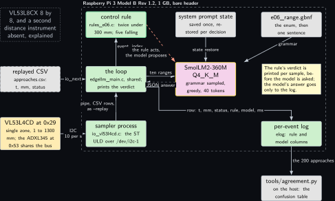
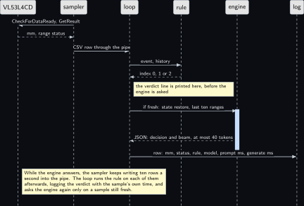
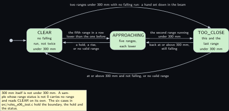
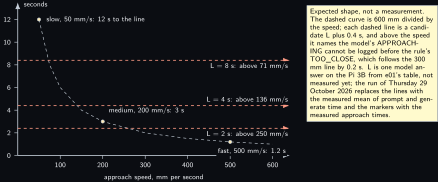

# Project 6. VL53L4CD "too close" explainer

> **Board:** Raspberry Pi 3 Model B Rev 1.2, bare header, the VL53L4CD beside the ADXL345  
> **Owns:** the first video's subject: a two-line rule on a distance, a model that proposes the same enum and one sentence, and the table of where they differ

> [!IMPORTANT]
> **The question, instanced**
>
> What does a small local model add over a two-line threshold, and when does it get it wrong? Here the threshold is two consecutive ranges under 300 mm from a single-zone time-of-flight sensor, the model sees the same last ten ranges and is asked for the same three literals plus one sentence about what is in the beam, and the question has a clock in it: a model answer takes seconds on a Pi 3, and a hand can cross 600 mm in one.

> **Key facts**
>
> - **Board:** Raspberry Pi 3 Model B Rev 1.2, 1 GB, 4 threads; the card in it is named in the evidence file on the day of the run, as [Project 1](01-bring-up-and-the-honest-tokens-per-second.md) requires
> - **HAT slot:** empty: the bare header; the 3.5 inch LCD of [Project 9](09-lcd-prompt-and-verdict-display.md) may sit on pins 27 to 40 for the video, pins 1 to 26 stay reachable
> - **Parts:** the Adafruit VL53L4CD on header pins 1, 9, 3 and 5; the DFRobot ADXL345 of [Project 5](05-adxl345-event-reporter.md) on the same bus at 0x53, wired and not read here; no actuator
> - **Interface:** `/dev/i2c-1` at 100 kHz through the ST ULD in a sampler process that feeds the shared loop through a pipe in the replay shape; on the host, the replayed CSV of approaches
> - **Language and variant:** C, catalogue variant C: plain C over `llama.h` in one process, with the vendor's C driver compiled in from an out-of-tree copy
> - **Model:** SmolLM2-360M-Instruct Q4\_K\_M, 0.27 GB, Apache 2.0; Qwen2.5-0.5B-Instruct Q4\_K\_M, 491 MB, if the 360M agreement is poor
> - **Decision:** one of CLEAR, APPROACHING, TOO\_CLOSE through the grammar, plus one bounded sentence under the key beam; the stub answers CLEAR with an empty sentence in CI
> - **Control rule:** TOO\_CLOSE when this range and the one before are both under 300 mm; APPROACHING when each of the last five ranges is lower than the one before; else CLEAR; a sample whose range status is not 0 carries no range
> - **Acceptance:** 200 approaches by hand at three speeds with the agreement table over the model-answered rows and zero rows without a literal; repeatability at a fixed 200 mm over 100 samples, mean and spread published; the decision latency of one answer against the approach time at each speed; throttle bits `0x0` before and after
> - **Difficulty:** 3 of 5
> - **Effort:** one evening on the host for the rule, the replay and the oracle; one afternoon on the Pi 3B for the ULD build, the wiring and the repeatability; one afternoon, Thursday 29 October 2026, for the 200 approaches

## Pitch

A hand moves towards a sensor on a bench. A rule that fits on two lines says TOO\_CLOSE the moment two readings in a row are under 300 mm, 0.2 s after the hand crosses the line, every time. A 360 million parameter model on the same 1 GB board is handed the same last ten readings and asked for the same word, and it answers in seconds, with a sentence about what is probably in front of the sensor. The chapter logs 200 approaches at three speeds, prints the rule's column beside the model's, classifies every row where they differ, and does the one piece of arithmetic the video is built on: at what approach speed the model's APPROACHING cannot be logged before the rule's TOO\_CLOSE, because the hand reaches the line before the model finishes its first answer. The rule is in charge throughout; the model's answer reaches the log and nothing else. This is the project behind **Video 1** (the video chapters are not published), so the on-camera disagreement is the moment the piece is cut around, and the table at the end is its last slide.

## Origin and what changed

Draft idea 6 and video B, where the sensor was to detect "occupancy". What changed is the word: a single zone of 18 degrees across a bench cannot see whether a room is occupied, only whether something is within range and getting nearer, so the enum became CLEAR, APPROACHING and TOO\_CLOSE and the chapter claims nothing about rooms. The 8 by 8 VL53L8CX stays in the Linux volume, project 11, and in kit lab P06, with its licence-gated firmware upload; the part here is the single-zone VL53L4CD that arrived on Tuesday 6 October 2026. The second change is the clock: the draft treated the model's verdict as a verdict, and the chapter treats it as a verdict with a latency, measured against the time the hand takes, which is what turns a demonstration into a result that can fail. The third change is in the repository: the loop, log and oracle of [Project 2](02-the-decision-loop.md) are used unchanged, and the one thing the shared main could not do, a live source that `io.h` has no hook for, is done by a child process and a pipe rather than by editing `common/`.

## Parts and interface

| **Part** | **Role** | **Interface** | **Address or pin** |
| --- | --- | --- | --- |
| Raspberry Pi 3 Model B Rev 1.2 | 1 GB; runs the sampler, the loop and the model | SSH | header pins 1, 3, 5, 9 |
| Adafruit VL53L4CD, product 5396 | single-zone time of flight, about 1 to 1300 mm, 18 degree field of view, up to 100 Hz; ranges once per 100 ms here | I2C through `/dev/i2c-1` at 100 kHz | 0x29 seven-bit; VIN pin 1, GND pin 9, SDA pin 3, SCL pin 5; XSHUT and GPIO1 unconnected |
| DFRobot SEN0032 ADXL345 | [Project 5](05-adxl345-event-reporter.md)'s part, on the same bus, wired and not read; the reason the bus stays at 100 kHz | I2C | 0x53; CS pin 17, SDO pin 6, INT1 pin 16 |
| The ST ULD, STSW-IMG026 | the vendor's C driver, out of tree, named by `EDGELLM_VL53L4CD_ULD_DIR`; never vendored until its licence is read | six register functions and one wait, supplied by `src/vl53l4cd_platform.c` | 16-bit register indexes, big-endian words |
| `src/io_vl53l4cd.c` | the sampler: init, range, one CSV row per sample into a pipe | the child of `src/e06_main.c` | `/dev/fd/N` as `--replay` |
| `replay/approaches.csv` | 2825 rows of `t_s,tag,v0,v1` at 10 per second, 21 approaches at three speeds, generated by `tools/make_replay.py` | `io_open_replay` |  |
| `grammars/e06_range.gbnf` | the three literals and one bounded sentence | the grammar sampler | root symbol `root` |
| `prompt.txt` | the system prompt, 81 words, under 120 tokens | decoded once, state saved |  |
| `src/rules_e06.c` | the control rule, registered by name | `rule_find("e06")` | index 0, 1, 2 |
| `tests/oracle/e06.expected.csv` | the 2825 expected rule decisions and the stub's column | `tests/oracle_check`, row by row |  |

## Model and grammar

SmolLM2-360M-Instruct at Q4\_K\_M, the file `SmolLM2-360M-Instruct-Q4_K_M.gguf`, 0.27 GB, Apache 2.0, from [bartowski/SmolLM2-360M-Instruct-GGUF](https://huggingface.co/bartowski/SmolLM2-360M-Instruct-GGUF) (verified Wednesday 14 October 2026). It is the Pi 3 family default of the ladder and needs about 450 MB available on the 1 GB board under the rung rule, which a headless boot leaves. If its agreement over the 200 approaches is poor, the alternative is Qwen2.5-0.5B-Instruct at Q4\_K\_M, `qwen2.5-0.5b-instruct-q4_k_m.gguf`, 491 MB, Apache 2.0, from [Qwen/Qwen2.5-0.5B-Instruct-GGUF](https://huggingface.co/Qwen/Qwen2.5-0.5B-Instruct-GGUF) (verified Wednesday 14 October 2026), which needs 818 MB available and is admitted only if [Project 1](01-bring-up-and-the-honest-tokens-per-second.md)'s reading on this board says so; the latency it adds is part of the table, not a footnote to it. Both are ChatML models, so the shared main's default template applies and `prompt.txt` is plain text. The engine is the pinned `v0.6.0`.

The grammar is the house shape of [Project 2](02-the-decision-loop.md) with one addition: after the decision, a second key whose value is one sentence of 8 to 120 characters without quotes or backslashes, ending in a full stop, so that the object stays valid JSON and the end-of-generation token is reachable only after a sentence. The decision comes first so that the literal is sampled inside the first eight tokens, where the agreement is decided, and the sentence costs its tokens afterwards. The syntax, including the repetition range on a character class, is the engine's own, documented at [grammars/README.md](https://github.com/ggml-org/llama.cpp/blob/master/grammars/README.md) in the engine's tree (verified Wednesday 14 October 2026).

```gbnf
root     ::= "{" ws "\"decision\"" ws ":" ws decision ws "," ws "\"beam\"" ws ":" ws beam ws "}"
decision ::= "\"CLEAR\"" | "\"APPROACHING\"" | "\"TOO_CLOSE\""
beam     ::= "\"" [A-Za-z0-9 ,%-]{8,120} ".\""
ws       ::= [ \t]*
```

The system prompt, decoded once and never again during a run, reads in full: You are an edge agent on a Raspberry Pi 3 with one single-zone time-of-flight sensor pointing across a bench. You see the last ten ranges in mm, oldest first; 0 means no valid range. Answer only with the JSON object. TOO\_CLOSE when the two newest ranges are both below 300 mm. APPROACHING when each of the five newest ranges is lower than the one before. Otherwise CLEAR. In beam, one short sentence saying what is probably in front of the sensor. As in [Project 2](02-the-decision-loop.md), the model is told the rule: the question is whether it can apply a rule it has been given to ten numbers, in time.

## What the model decides or writes

One of three literals and one sentence, through the grammar, with `n_predict` 40 and greedy sampling. Forty is what the two parts need together: the object and the literal inside eight tokens, a sentence of up to 120 characters inside about thirty more. An object that does not close inside forty tokens is logged as it stands, `tools/agreement.py` fails to parse it and scores the row as a disagreement, and the chapter counts such rows as its own failure, not the model's. Greedy sampling is kept for the sentence too, because a temperature that helps the sentence read better also lets the literal wander. In CI the stub expands the first alternative of every rule and the character class to nothing, so it answers `{"decision":"CLEAR","beam":"."}` for every row, which is what the oracle file holds in its model column.

The user text per event is the last ten ranges in millimetres, oldest first, with 0 standing for a sample whose range status was not 0, and nothing else. On the bench the model is not asked on every sample: the loop is synchronous and a decision takes seconds, so while the engine answers the sampler keeps writing ten rows a second into the pipe; when the loop catches up it runs the rule on each of those rows, logs the verdict with the sample's own time, and asks the model only on a sample that is still fresh, 2.5 sampling intervals old at most. A row the model was not asked about has an empty model column, which the agreement tool counts separately and never as agreement.

## Control rule

Two conditions on a short history, both tested on every sample. The names table is what the grammar reproduces letter for letter; the oracle test and the agreement table depend on that equality. A sample whose range status is not 0 carries no range: it cannot be the second of two under 300 mm, it breaks a falling run, and on its own it reads CLEAR. The last line registers the rule before `main` runs, so the shared main finds it by the name `e06`.

```c
static const char *const rule_e06_names[] = { "CLEAR", "APPROACHING", "TOO_CLOSE", NULL };

static int is_range(const io_event *e)
{
    return e->n >= 2 && e->v[1] == 0.0;                /* status 0 is the only valid range */
}

static int rule_e06_fn(const rule_ctx *ctx, const io_event *ev)
{
    const io_event *prev = ctx->n > 0 ? &ctx->hist[ctx->n - 1] : NULL;
    int i, falling = ctx->n >= 4;                      /* four earlier samples plus this one */
    if (!is_range(ev)) return 0;                       /* no range in this sample: CLEAR */
    if (ev->v[0] < 300.0 && prev != NULL && is_range(prev) && prev->v[0] < 300.0)
        return 2;                                      /* TOO_CLOSE: below 300 mm twice running */
    for (i = ctx->n - 4; falling && i < ctx->n; i++) { /* APPROACHING: five ranges, each lower */
        const io_event *next = (i + 1 < ctx->n) ? &ctx->hist[i + 1] : ev;
        falling = is_range(&ctx->hist[i]) && next->v[0] < ctx->hist[i].v[0];
    }
    return falling ? 1 : 0;
}

/* The constructor below registers the rule before main() runs; rule_find("e06") then
 * returns it. The file is compiled into the executable, never into an archive. */
const rule_desc rule_e06 = { "e06", rule_e06_fn, rule_e06_names };
RULE_REGISTER(rule_e06);
```

The falling run is strict: five ranges each lower than the one before, at 1 mm resolution. A hand that moves 1 mm per sample, 10 mm per second, is inside the sensor's own spread and will not read as a run; the repeatability test measures that spread, and the slowest approach the rule can see is the one whose step per sample exceeds it. The two functions the project adds to the shared main are the user text and the verdict line; the current sample is not yet in the history when they are called.

```c
static double range_of(const io_event *e)
{
    return (e->n >= 2 && e->v[1] == 0.0) ? e->v[0] : 0.0;   /* 0 means no valid range */
}

const char *project_format_prompt(const io_event *ev, const rule_ctx *ctx, char *buf,
                                  size_t len)
{
    char hist[160] = "";
    int  k = 0, i;
    if (freshness_s > 0.0 && now_s() - ev->t_s > freshness_s)
        return NULL;                                   /* stale: the rule alone, no model */
    for (i = (ctx->n > 9 ? ctx->n - 9 : 0); i < ctx->n && k < (int)sizeof hist - 8; i++)
        k += snprintf(hist + k, sizeof hist - (size_t)k, "%.0f, ", range_of(&ctx->hist[i]));
    snprintf(buf, len, "ranges mm, oldest first: %s%.0f. Decide.", hist, range_of(ev));
    return buf;
}

int project_actuate(io_source *src, const rule_desc *rule, int rule_index, const io_event *ev)
{
    (void)src;
    printf("%.3f %4.0f mm status %.0f %s\n", ev->t_s, ev->n > 0 ? ev->v[0] : 0.0,
           ev->n > 1 ? ev->v[1] : 0.0, rule->names[rule_index]);
    fflush(stdout);
    return 0;
}
```

`project_actuate` drives nothing, because there is nothing to drive here; it prints the rule's verdict the moment the rule has it, before the model is asked, and that line is what the video shows beside the log. The shared main calls it with the rule's index and never with the model's answer: no path from the model to anything but the log.

## Real, modelled, absent

- **have:** real: the Pi 3 Model B Rev 1.2, the VL53L4CD on the bus beside the ADXL345, the ST ULD over i2c-dev, the model file, the engine at the pinned tag, the rule, the grammar, the log with its timings, and the 200 approaches by hand
- **learn:** modelled: the replayed CSV of 21 approaches, drawn dashed; it is generated from the shapes a hand produces at three speeds with 2 mm of noise and a few samples with no range, so that the loop has an oracle before the sensor is wired, and nothing about the sensor is claimed from it
- **absent:** absent: a multizone sensor, the VL53L8CX, which stays in the Linux volume, project 11, and kit lab P06; and a second instrument to measure distance with, so the sensor is the only instrument and the approach itself is the only label a row has

## System architecture



*Figure 6.1. The pieces on the Pi 3 Model B Rev 1.2. Outside the board's dashed layer on the left: the VL53L4CD in solid hardware colour at the bottom, the replayed CSV of approaches dashed in the middle as the one stand-in, and at the top a dotted grey block for the absent multizone sensor and second distance instrument. Inside the layer, a column of three solid user-space blocks, the control rule with its green rule outline, the loop, and the sampler process that runs the ST ULD over /dev/i2c-1; the model with the yellow outline to their right, the system prompt state above it, and in the right column the grammar, a note that the rule's verdict is printed per sample before the model is asked, and the per-event log. Solid arrows carry the I2C samples into the sampler, the CSV rows up into the loop through the pipe opened as a replay, io\_next from the replayed CSV, the event up to the rule and its index back, the ten ranges to the model with a dashed reply carrying the JSON answer, the state and the grammar into the model, the log row under the model to the log, and the rows of the 200 approaches down to tools/agreement.py on the host, outside the layer. The dashed stop-coloured arrow from the rule towards the model says that the rule acts and the model proposes.*

Two arrows carry the chapter: the one from the sampler into the loop, which is the design decision of the Variant chosen paragraph, the sensor reaching the shared loop as CSV rows so that the loop tested on a file in [Project 2](02-the-decision-loop.md) runs on the bench unchanged, and the dashed red one, the volume's safety rule.

## Wiring

| **Header pin** | **BCM** | **Part pin** | **Wire colour if known** |
| --- | --- | --- | --- |
| 1 | 3V3 | VL53L4CD VIN, and the ADXL345 VCC | not recorded; the join of the two leads on a rail or a split jumper is recorded in the evidence file |
| 9 | GND | VL53L4CD GND, and the ADXL345 GND | not recorded |
| 3 | GPIO2, SDA1 | VL53L4CD SDA, and the ADXL345 SDA | not recorded; the Pi's fitted 1.8 kOhm pull-up is on this pin |
| 5 | GPIO3, SCL1 | VL53L4CD SCL, and the ADXL345 SCL | not recorded; the Pi's fitted 1.8 kOhm pull-up is on this pin |
| 17 | 3V3 | ADXL345 CS, strapped high, [Project 5](05-adxl345-event-reporter.md) | not recorded |
| 6 | GND | ADXL345 SDO, strapped low, [Project 5](05-adxl345-event-reporter.md) | not recorded |
| 16 | GPIO23 | ADXL345 INT1, [Project 5](05-adxl345-event-reporter.md) | not recorded |
| none |  | VL53L4CD XSHUT, GPIO1 | unconnected: no shutdown line, no interrupt; the sampler polls |

The breakout's pins, its default address 0x29, its 10 kOhm pull-ups on SDA and SCL, the 2.8 V logic of GPIO1 and the level-shifted, active-low XSHUT are read from the pinouts page of the Adafruit guide, [learn.adafruit.com, pinouts](https://learn.adafruit.com/adafruit-vl53l4cd-time-of-flight-distance-sensor/pinouts) (verified Wednesday 14 October 2026); the range of about 1 to 1300 mm, the 18 degree field of view, the ranging rate up to 100 Hz and the 3 to 5 V input through the on-board regulator from the product page, [adafruit.com/product/5396](https://www.adafruit.com/product/5396) (verified Wednesday 14 October 2026). The breakout's pull-ups sit in parallel with the Pi's 1.8 kOhm on pins 3 and 5: about 1.5 kOhm, 2.2 mA at 3.3 V, inside the 3 mA an I2C driver must sink, so nothing is removed and nothing is added. The bus stays at 100 kHz because the ADXL345 on its current leads answered nothing at 400 kHz on Friday 9 October 2026.


*Figure 6.2. The 40-pin header of the Pi 3 Model B Rev 1.2 as two columns of small solid blocks, pin 1 at the top left, with seven blocks filled in the hardware colour: pins 1, 3, 5 and 9, which both parts use, and pins 17, 6 and 16, which the ADXL345 uses alone; the dashed layer around all forty is labelled no HAT, pins 27 to 40 free for e09's LCD. To the left, a solid hardware block for the Adafruit VL53L4CD at 0x29 with four solid arrows from pins 1, 3, 5 and 9 labelled 3V3 to VIN, SDA, SCL and GND, leaving leftwards so that no arrow crosses the right column, and a note that VIN takes 3 to 5 V, that the logic is level shifted, and that GPIO1 is a 2.8 V output left unconnected. To the right, a solid hardware block for the DFRobot SEN0032 ADXL345 at 0x53 with its seven leads named, joined to the header's edge by one arrow labelled seven leads, as wired in e05, and a note that one jumper fits one pin, so the shared leads join on a breadboard rail or a split jumper recorded in the evidence file, that the bus stays at 100 kHz, and that the two pull-ups in parallel give about 1.5 kOhm, 2.2 mA at 3.3 V. Nothing is dashed or dotted: every block is on the bench.*

## Sequence



*Figure 6.3. One sample as a sequence diagram with six solid actors: the VL53L4CD, the sampler, the loop, the rule, the engine and the log. A solid arrow from the sampler to the sensor carries CheckForDataReady and GetResult and a dashed reply brings the distance and the range status; solid arrows carry the CSV row through the pipe to the loop and the event with its history to the rule, with a dashed reply bringing the index 0, 1 or 2 back, and a note on the loop's lifeline says the verdict line is printed here, before the engine is asked. Over a blue activation bar on the engine, a solid arrow carries, if the sample is fresh, the state restore and the last ten ranges, and a dashed reply returns the JSON decision and sentence, at most 40 tokens. The last solid arrow writes the row into the log. A note at the bottom says that while the engine answers the sampler keeps writing ten rows a second into the pipe, that the loop runs the rule on each of them afterwards with the sample's own time, and that it asks the engine again only on a sample still fresh.*

## States and data



*Figure 6.4. The three decisions as three rounded green states in a row, CLEAR, APPROACHING and TOO\_CLOSE, entered at CLEAR from the initial dot. Between neighbours, pairs of solid arrows with the conditions as labels: to APPROACHING when the fifth range in a row is lower than the one before, and back on a hold, a rise, or no valid range; to TOO\_CLOSE on the second range running under 300 mm, and back when the range is at or above 300 mm again and still falling. Two curved solid arrows join the ends: over the top from CLEAR straight to TOO\_CLOSE when two ranges are under 300 mm with no falling run, a hand set down in the beam, and underneath straight back to CLEAR at or above 300 mm and not falling, or with no valid range. A note says that 300 mm itself is not under 300 mm, that a sample whose range status is not 0 carries no range and reads CLEAR on its own, and that the six cases in src/rules\_e06\_test.c hold the boundary, the hold and the status. Nothing is dashed or dotted.*

The record is the per-event log, `projects/e06-vl53l4cd-too-close/evidence/e06_run.csv`, in the shape `elog.h` fixes for every project: `t_s, tag, raw, rule, model, prompt_ms, generate_ms, n_generated, engine`, with `raw` holding the distance and the status joined by a semicolon. On the bench most rows have an empty model column and a filled rule column, because the rule runs at the sensor's rate and the model at its own; the agreement table is over the rows where both are filled, with the count of rule-only rows beside it. The sample times are the sampler's `CLOCK_MONOTONIC`, so a rule verdict logged late is still logged against the time the sample was taken.

## Data flow

```text
 the sensor and the sampler (child process)     the loop, edgellm_main.c, shared (parent)          host
 +---------------------+   I2C 100 kHz   +----------------------------------------------+    +---------------+
 | VL53L4CD at 0x29    |---------------->| /dev/fd/N opened as --replay: "t_s,tag,v0,v1"|    | agreement.py  |
 |   mm, range status  |  io_vl53l4cd.c  |   one row per sample, 10 per second          |    |  3 by 3 table |
 +---------------------+  --pipe-->      |      |                                       |    +---------------+
                                         |      v   rule_e06.fn(ctx, ev) -> 0 | 1 | 2    |           ^
 replay/approaches.csv (host and CI) --->|      |   printf: t, mm, status, verdict       |           |
   2825 rows, 21 approaches, seeded      |      v   fresh? (live: sample under 0.25 s)   |           |
                                         |   project_format_prompt: last ten ranges     |           |
 prompt.txt ---decode once-------------> | [state] --llama_state_load_file--> ctx       |           |
   llama_state_save_file  (at start)     |      user tokens --llama_decode--> ctx       |           |
 grammars/e06_range.gbnf --------------> |      sample <= 40 under grammar, greedy      |           |
                                         |      {"decision": "APPROACHING", "beam": ".."}|           |
                                         | elog_row: t, mm;status, rule, model, ms      |--rows-----+
                                         +----------------------------------------------+
 tests/oracle/e06.expected.csv: rule column from the same two conditions in Python; model column the stub's
```

```mermaid
sequenceDiagram
    participant S as VL53L4CD
    participant P as sampler (child)
    participant L as loop (shared main)
    participant C as rule_e06
    participant E as engine
    participant G as log
    S->>P: mm, range status, 10 per s
    P->>L: CSV row through the pipe, as --replay
    L->>C: event, history
    C-->>L: index 0, 1 or 2 (printed at once; this is what acts)
    L->>E: if fresh: state restore, last ten ranges
    E-->>L: decision and one sentence, at most 40 tokens
    L->>G: row: mm;status, rule, model, prompt_ms, generate_ms
```

## Latency design

The system prompt is 81 words, under 120 tokens on the SmolLM2 tokenizer, decoded once at start and restored per decision with `llama_state_load_file`; each decision pays for its own user text of about forty tokens, ten numbers with their commas, and for up to forty generated tokens. `n_ctx` 512, 4 threads on the Pi 3B, and no interval flag: the sampler sets the rate at ten per second through the sensor's own timing, 50 ms budget and 100 ms between measurements. The decision latency <span class="math">L</span> is one prompt decode of about forty tokens plus up to forty single-token decodes, and with [Project 1](01-bring-up-and-the-honest-tokens-per-second.md)'s table for this board it becomes a number in seconds; until then it is a shape. The rule's latency is fixed by the design: TOO\_CLOSE follows the crossing of 300 mm by 0.2 s, two samples, and APPROACHING needs five falling samples, 0.4 s after the hand starts to move. The model's APPROACHING can therefore be logged no earlier than <span class="math">0.4 + L</span> seconds after the approach starts, and the hand takes 600 mm divided by its speed from 900 mm to the line: 12 s at 50 mm per second, 3 s at 200, 1.2 s at 500. Wherever <span class="math">600 / v</span> is below <span class="math">0.4 + L</span>, the model's first answer about the approach is written after the rule has already said TOO\_CLOSE, and the chapter publishes the speed at which that happens for the measured <span class="math">L</span>. The sentence is the expensive part of every answer; the split grammar under Future and extra exercises would shorten <span class="math">L</span>, and it is not done here because the first video needs the sentence on screen.

## Steps

**Step 1.** Generate the replay file and the oracle on the authoring laptop, and read the summary: 2825 rows, 21 approaches, the count of each decision and the agreement the stub will reach.

```bash
# win11 aquamarine
cd C:\Users\aquamarine\Desktop\edge-llm-pi;
python projects\e06-vl53l4cd-too-close\tools\make_replay.py
```

**Step 2.** Build the repository with the stub model in skyhorizon's WSL. Without `EDGELLM_VL53L4CD_ULD_DIR` the project builds its replay path only and says so at configure time; nothing compiles on aquamarine.

```bash
# win11 skyhorizon, WSL side
cd ~/src/edge-llm-pi; cmake -S . -B build -DEDGELLM_STUB_MODEL=ON; cmake --build build -j8
```

**Step 3.** Run the shared rule harness, which carries this project's six cases beside every other project's (the boundary at 300 mm, the hold that ends a run, the range status that turns a near sample into no sample), and the oracle test, the loop over the 2825 rows with the stub compared row by row against the oracle file; it passes only when every rule cell and every model cell matches.

```bash
# win11 skyhorizon, WSL side
cd ~/src/edge-llm-pi; ctest --test-dir build -R 'rules_test|edgellm-e06-oracle' --output-on-failure
```

**Step 4.** Run the same stub loop by hand and score the log with the agreement tool, to see the table the CI number comes from: 46.7 percent, every disagreement the stub calling an APPROACHING or a TOO\_CLOSE row CLEAR, and zero rows without a literal.

```bash
# win11 skyhorizon, WSL side
cd ~/src/edge-llm-pi; build/projects/e06-vl53l4cd-too-close/edgellm-e06 --project e06 \
  --replay projects/e06-vl53l4cd-too-close/replay/approaches.csv \
  --grammar projects/e06-vl53l4cd-too-close/grammar.gbnf \
  --prompt projects/e06-vl53l4cd-too-close/prompt.txt --log /tmp/e06_stub.csv --stub
```

```bash
# win11 skyhorizon, WSL side
cd ~/src/edge-llm-pi; python tools/agreement.py /tmp/e06_stub.csv
```

**Step 5.** Unpack the ST ULD on the Pi 3B, downloaded by hand from the STSW-IMG026 page after reading its licence (to verify, see Sources), and build on the board against the real engine with the ULD named; `-j2`, because a 1 GB board swaps at four parallel compiles of the engine.

```bash
# Raspberry Pi 3 Model B Rev 1.2, over SSH
cd ~/edge-llm-pi; cmake -S . -B build -DGGML_NATIVE=ON \
  -DEDGELLM_VL53L4CD_ULD_DIR=$HOME/vl53l4cd-uld
```

```bash
# Raspberry Pi 3 Model B Rev 1.2, over SSH
cd ~/edge-llm-pi; cmake --build build -j2 --target edgellm-e06
```

**Step 6.** Wire the sensor as in the table above, then the pre-flight: memory, throttle bits, the bus scan showing 29 and 53, and the model id read through the two-byte register index the ULD uses; the value the id should hold is read from the ULD's user manual before the run, not guessed here.

```bash
# Raspberry Pi 3 Model B Rev 1.2, over SSH
cd ~; free -m; vcgencmd get_throttled; i2cdetect -y 1; i2ctransfer -y 1 w2@0x29 0x01 0x0f r2
```

**Step 7.** The repeatability run: a card or a box held still at 200 mm, 100 samples with the stub so that no model time is spent, and the mean and sample standard deviation of the distance over the rows with status 0.

```bash
# Raspberry Pi 3 Model B Rev 1.2, over SSH
cd ~/edge-llm-pi; build/projects/e06-vl53l4cd-too-close/edgellm-e06 --project e06 \
  --live vl53l4cd /dev/i2c-1:0x29:interval=0.1:budget=50 --max-events 100 --stub \
  --grammar projects/e06-vl53l4cd-too-close/grammar.gbnf \
  --prompt projects/e06-vl53l4cd-too-close/prompt.txt \
  --log projects/e06-vl53l4cd-too-close/evidence/e06_repeat_200mm.csv
```

```bash
# Raspberry Pi 3 Model B Rev 1.2, over SSH
cd ~/edge-llm-pi; awk -F'[,;]' 'NR>1 && $4==0 {n++; s+=$3; q+=$3*$3} \
  END {m=s/n; print n, m, sqrt((q-n*m*m)/(n-1))}' \
  projects/e06-vl53l4cd-too-close/evidence/e06_repeat_200mm.csv
```

**Step 8.** The 200 approaches with the real model, on Thursday 29 October 2026: start the loop, read the verdict lines as they print, approach by hand at the three speeds in turn, about 70 of each, and stop with Ctrl-C; then read the throttle bits. The log's engine column must name the build, not the stub.

```bash
# Raspberry Pi 3 Model B Rev 1.2, over SSH
cd ~/edge-llm-pi; build/projects/e06-vl53l4cd-too-close/edgellm-e06 --project e06 \
  --live vl53l4cd /dev/i2c-1:0x29:interval=0.1:budget=50 \
  --grammar projects/e06-vl53l4cd-too-close/grammar.gbnf \
  --prompt projects/e06-vl53l4cd-too-close/prompt.txt \
  --model ~/models/SmolLM2-360M-Instruct-Q4_K_M.gguf --n-predict 40 --state /tmp/e06.state \
  --log projects/e06-vl53l4cd-too-close/evidence/e06_run.csv; vcgencmd get_throttled
```

**Step 9.** Score the log and take the latency: the agreement table over the model-answered rows, the count of rule-only rows, and the mean of prompt and generate time, which is <span class="math">L</span>. The count of rows without a literal must be zero.

```bash
# Raspberry Pi 3 Model B Rev 1.2, over SSH
cd ~/edge-llm-pi; python tools/agreement.py --md \
  projects/e06-vl53l4cd-too-close/evidence/e06_run.csv
```

```bash
# Raspberry Pi 3 Model B Rev 1.2, over SSH
cd ~/edge-llm-pi; python -c "import csv,sys; r=[x for x in csv.DictReader(open(sys.argv[1])) \
  if x['prompt_ms']]; print(len(r), sum(float(x['prompt_ms'])+float(x['generate_ms']) \
  for x in r)/len(r))" projects/e06-vl53l4cd-too-close/evidence/e06_run.csv
```

## Variant chosen

C, catalogue variant C: plain C over `llama.h` in one process, on the shared `common/c` core of [Project 2](02-the-decision-loop.md), with the vendor's driver compiled in as it ships. On practicality it scores highest because the ST ULD is C, the engine's API is C, and i2c-dev is a file descriptor and an ioctl: a second language on a 1 GB Pi 3 would buy a binding on each side of a driver that is four files; on relevance it is the project the first video films, and a C binary that builds on the board itself with one option is what a viewer can reproduce; on popularity it is the way the vendor's own examples use the ULD, a `platform.c` over the host's bus; on compliance it keeps the driver out of the tree, pointed at by `EDGELLM_VL53L4CD_ULD_DIR`, until its licence is read from the ST page, and the repository stays MIT with no third-party code in it; on best practice it is the house rule, C on the board, and it reuses the loop, log and oracle of [Project 2](02-the-decision-loop.md) without a line changed. What it costs is the one thing `io.h` cannot do: `io_open_live` dispatches only to the backends compiled into the core, and there is no hook by which a project registers a backend of its own. Rather than edit `common/`, the project owns `main`: on `--live vl53l4cd <spec>` it forks a sampler child that runs `src/io_vl53l4cd.c`, writes a header line and one CSV row per sample into a pipe, and calls `edgellm_main` with `--replay /dev/fd/N` in place of the three live arguments, so the shared loop reads the sensor as it reads a file. The price is one process more, a 64 kB pipe, the freshness test in the prompt function, and a summary line at the end of a live run that names its source as replay, which the chapter says here so that nobody reads it as a host run. What it gains is that the loop, the rule, the logger and the oracle test are byte for byte the ones that passed in CI.

The platform layer, `src/vl53l4cd_platform.c`, is the other half of the choice. The ULD declares in its own `platform.h` six register functions and one wait and expects the host to define them; here a read is one `I2C_RDWR` transfer, the two-byte register index and the data joined by a repeated start, a write is one message, and 16-bit and 32-bit words are big-endian, as in the vendor's own `platform.c` for the STM32 HAL and the Arduino mirror's `platform.cpp` (both verified Wednesday 14 October 2026, see Sources). The names were read from the C ULD in ST's X-CUBE-TOF1 tree: `VL53L4CD_RdByte`, `RdWord`, `RdDWord`, `WrByte`, `WrWord`, `WrDWord`, each taking a `Dev_t`, a 16-bit index and the value, and `VL53L4CD_WaitMs`; the 2021 Arduino mirror spells the wait `WaitMs`, and the standalone STSW-IMG026 download was not reachable, so the wait's name is a CMake option with the X-CUBE spelling as its default and the download's `platform.h` is to verify on the first build. `Dev_t` is treated as opaque: the ULD's examples pass the eight-bit address 0x52, the platform file keeps the descriptor and the seven-bit 0x29 in its own statics, and the ADXL345 at 0x53 is never addressed.

## Embedded Linux and Yocto

The application recipe `meta-edgellm/recipes-app/edgellm-e06/edgellm-e06_0.1.bb` sets the three variables, the project id `e06`, the folder `e06-vl53l4cd-too-close` and the model package `model-smollm2-360m`, and requires the shared include of [Project 2](02-the-decision-loop.md). It adds one variable of its own, `EDGELLM_VL53L4CD_ULD_DIR`, empty by default, because the ULD is not fetched by a recipe: its download sits behind the licence page on st.com, so it is unpacked by hand on the build host and its folder named in `local.conf` or the kas file; with the variable empty the package builds the replay path only and the unit stops at start with the reason. No core backend option is passed, because the sampler reaches the bus through i2c-dev itself; `i2c-tools` is added for the pre-flight scan. The unit runs the live sampler and orders itself after the bus device; the verdict lines go to the journal and the model's answers to the log under `/var/lib/edgellm`.

```text
[Service]
Type=simple
# The live backend: the ST ULD over i2c-dev at 0x29, ten samples per second with a
# 50 ms timing budget, on the bus the ADXL345 of e05 shares at 100 kHz. The rule's
# verdict per sample goes to the journal; the model's answer only to the log.
ExecStart=/usr/bin/edgellm-e06 --project e06 \
    --live vl53l4cd /dev/i2c-1:0x29:interval=0.1:budget=50 \
    --model /usr/share/edgellm/models/SmolLM2-360M-Instruct-Q4_K_M.gguf \
    --grammar /usr/share/edgellm/e06/grammar.gbnf \
    --prompt /usr/share/edgellm/e06/prompt.txt \
    --log /var/lib/edgellm/e06.csv \
    --threads 4 --n-predict 40 --state /run/edgellm/e06.state
StateDirectory=edgellm
RuntimeDirectory=edgellm
```

There is no overlay: the sensor is reached from user space, and the two lines `config.txt` needs, `dtparam=i2c_arm=on` and `dtparam=i2c_arm_baudrate=100000`, are the ones the Pi 3 kas file of the layer already describes for the ADXL345 projects, set with `:forcevariable` as that file explains. The layer parse is the check that runs on skyhorizon before anything is wired; the image build is a separate later sitting of hours.

```bash
# win11 skyhorizon, WSL side
cd ~/bench/edge-llm-pi; kas shell meta-edgellm/kas/edgellm-pi3.yml -c "bitbake -p"
```

## Acceptance test

Three quantities, all from the one instrument on the bench, the VL53L4CD itself, which is why a row has no label other than the approach that produced it. First, over the model-answered rows of the 200 approaches logged on Thursday 29 October 2026, about 70 at each speed, the agreement table: the instrument is `tools/agreement.py` reading the log, the pass condition is zero rows whose model column holds no one of the three literals, and the rate is published whatever it is, with every disagreement classified by the approach's speed and phase. Second, the repeatability at a fixed 200 mm: 100 samples with the hand still, the mean and the sample standard deviation of the distance over the rows with status 0, from the `awk` line of step 8; the pass condition is that the spread is published, and it bounds the slowest approach the rule can see. Third, the decision latency <span class="math">L</span>, the mean of `prompt_ms` plus `generate_ms` over the model-answered rows, against <span class="math">600 / v</span> at each speed; the pass condition is that the chapter states the speed above which <span class="math">600 / v &lt; 0.4 + L</span>. All three are taken with `vcgencmd get_throttled` reading `0x0` before and after, and a run with any bit set is discarded. The CI run, with the stub, checks the zero-free-text condition and the exact log shape through the oracle test of step 4.

## Agreement table

Over the replay of 21 approaches as generated on Wednesday 14 October 2026 by `tools/make_replay.py` with its fixed seed, the rule column holds 1319 CLEAR, 859 APPROACHING and 647 TOO\_CLOSE over 2825 rows, with 5 rows carrying no range. On the bench the model column is not measured: the run of Thursday 29 October 2026 has not been taken. In CI the stub answers CLEAR for every row, so the agreement is the CLEAR fraction of the rule column, 1319 of 2825, 46.7 percent, and every disagreement is of one kind, the stub calling an APPROACHING or a TOO\_CLOSE row CLEAR. The number is lower than [Project 2](02-the-decision-loop.md)'s 82.3 percent because a replay built of approaches spends half its rows approaching or too close; a model that scores 47 percent on the bench has learned nothing that the first literal did not already give it, and a model that scores well on the slow approaches and badly on the fast ones has shown the chapter's clock at work, which the classification column will say.

| **Rule says** | **Model CLEAR** | **Model APPROACHING** | **Model TOO\_CLOSE** | **Instrument** |
| --- | --- | --- | --- | --- |
| CLEAR, 1319 | 1319 | 0 | 0 | the stub in CI over the replay; bench: not measured |
| APPROACHING, 859 | 859 | 0 | 0 | the stub in CI over the replay; bench: not measured |
| TOO\_CLOSE, 647 | 647 | 0 | 0 | the stub in CI over the replay; bench: not measured |
| agreement | 46.7 percent |  |  | the stub in CI; bench: not measured, the run of Thursday 29 October 2026 pending |
| rule-only rows | 0 |  |  | in the replay the model is asked on every row; on the bench most rows are rule-only and their count is published here |

## Measured data

Nothing is measured yet: the spread at 200 mm, the latency <span class="math">L</span> and the per-approach times all come from the runs of Thursday 29 October 2026, and until then the figure draws the arithmetic the acceptance test will be judged by, 600 mm divided by the speed against <span class="math">0.4 + L</span> for three candidate values of <span class="math">L</span>.



*Figure 6.5. The shape the acceptance test expects, drawn with TikZ axes and not a measurement. The horizontal axis is the approach speed in millimetres per second, 0 to 600; the vertical axis seconds, 0 to 12. A dashed curve falls from 12 s at 50 mm per second through 3 s at 200 to 1.2 s at 500, the time a hand takes from 900 mm to the 300 mm line, with a filled marker and a label at each bench speed. Three dashed stop-coloured horizontal lines mark candidate model latencies plus the 0.4 s of five samples, each labelled with the speed above which the model cannot be first: L of 2 s, 250 mm per second; 4 s, 136; 8 s, 71. A note on the right says this is the expected shape, that L is from e01's table and not measured yet, that the rule's TOO\_CLOSE follows the line by 0.2 s, and that the run of Thursday 29 October 2026 replaces the lines and the markers with measured values.*

## Pitfalls

- **The ULD's licence is read before the ULD is copied.** The driver is not in the repository on purpose: the ST download page was not reachable from this bench on Wednesday 14 October 2026, and the two copies that were reachable carry two different texts, BSD 3-Clause in the Arduino mirror and ST's own BSD-form SLA0103 in the X-CUBE tree. Until the STSW-IMG026 page has been read, the ULD lives out of tree and `EDGELLM_VL53L4CD_ULD_DIR` points at it; vendoring is a later decision with the licence text in the commit.
- **Two devices on one bus at 100 kHz.** The ADXL345 of [Project 5](05-adxl345-event-reporter.md) is why the bus is slow, and a chapter that raises the rate for the time-of-flight sensor loses the accelerometer with no error message, as happened on Friday 9 October 2026. Ten samples per second of six bytes is a small fraction of 100 kHz; leave the line in `config.txt` alone.
- **Only range status 0 is a range.** The ULD's result carries a status beside the distance, and a distance with any other status is a number the sensor itself does not vouch for: weak signal, high sigma, a wrapped phase. The rule treats such a sample as no range, the sampler logs the status, and the prompt writes 0 for it; a loop that reads the distance alone will call a sunlit window TOO\_CLOSE.
- **Ambient light and the target's reflectance.** The same hand at the same distance returns a different signal under a desk lamp than in shade, and a dark sleeve returns less than skin; the status flags the worst of it and the spread at 200 mm measures the rest. Take the repeatability run under the light the 200 approaches will be filmed in, and say which in the evidence file.
- **The model's latency against a fast approach.** At 500 mm per second a hand crosses from 900 mm to the line in 1.2 s, and the rule says TOO\_CLOSE 0.2 s later. A model answer of two seconds is logged after that, about an approach that is over, and the row is a disagreement by construction. The data figure says where the crossing speed is for a given <span class="math">L</span>; the table says what <span class="math">L</span> was.
- **The stub answers the first literal.** A log where every model cell reads `{"decision":"CLEAR","beam":"."}` and every engine cell reads stub is a CI log, and its 46.7 percent is the CLEAR fraction of the replay, not a property of any model.
- **A live log whose summary says replay.** The shared main reads the sensor through a pipe opened as `--replay`, so its last line names the source as replay even on the bench. The tag column, the engine column and the evidence file's first line are the record, not the summary line.
- **The pipe fills while the model thinks.** Ten rows a second go into a 64 kB pipe during every multi-second answer. The loop catches up by running the rule on each row, which is right, and must not ask the model about them, which is what the freshness test is for; without it the agreement table scores a queue, not a hand.
- **0x52 and 0x29 are the same sensor.** The ULD's examples and the Arduino mirror pass the eight-bit address 0x52; i2c-dev, `i2cdetect` and this chapter use the seven-bit 0x29. The platform file selects 0x29 with `I2C_SLAVE` and ignores the handle's value; a port that passes 0x52 to `I2C_SLAVE` addresses nothing and the id read fails.

## Future and extra exercises

- A split grammar: the literal alone under `n_predict` 8 on every fresh sample, and the sentence in a second call only when the verdict changes; the delta is the latency <span class="math">L</span> falling to the enum's cost and the crossing speed in the data figure moving right.
- The same loop in C++ as catalogue variant B over `common/cpp/edgellm.hpp`: the delta is the RAII face of [Project 7](07-iks4a1-climate-and-motion-narrator.md) and the ULD compiled as C inside a C++ build.
- The same loop in Rust over `llama-cpp-2` (MIT) and the `i2cdev` crate: the delta is a port of the six platform functions and the bundled engine commit against the pinned tag, as [Project 5](05-adxl345-event-reporter.md) prices it for the ADXL345.
- The same loop in Python over `llama-cpp-python` (MIT) and `smbus2`: the delta is the interpreter's cost per decision, which [Project 15](15-esp32-sidecar-with-a-bounded-pattern-proposal.md) measures, on a board where <span class="math">L</span> is already seconds.
- The VL53L8CX 8 by 8 on the X-NUCLEO-53L8A1: the delta is a zone map in the prompt and the licence-gated firmware upload; the Linux volume, project 11, and kit lab P06 own the port.
- An interrupt on GPIO1 through libgpiod 2, as [Project 3](03-led-status-explainer.md) uses it: the delta is the end of the one-millisecond poll in the sampler and a level shift, because GPIO1 is a 2.8 V output.
- The sensor's own threshold mode, `VL53L4CD_SetDetectionThresholds`, with the 300 mm line inside the part: the delta is a rule that fires without the Pi, and the chapter's rule reduced to confirming it.

## Video potential

5 of 5. The hook: the model and the rule disagree on camera, and the rule is in charge. This is the project **Video 1** (the video chapters are not published) films, and everything the video needs is a column of this chapter: the verdict line that prints before the model has answered, the log with two columns that mostly agree and sometimes do not, the sentence about what is in the beam, and the table at the end with the number read from it on the day of the edit. What is slow on camera is the model's answer, seconds on the Pi 3B, and the piece holds on it rather than hiding it, because the latency is the finding. If no disagreement occurs live, the log of Thursday 29 October 2026 is indexed by event number so that one can be inserted and labelled.

## Sources

- Adafruit VL53L4CD Time of Flight Distance Sensor, product 5396: range about 1 to 1300 mm, 18 degree field of view, up to 100 Hz, VIN, GND, SDA, SCL, XSHUT and GPIO1, on-board regulator for 3 to 5 V, [adafruit.com/product/5396](https://www.adafruit.com/product/5396) (verified Wednesday 14 October 2026).
- The Adafruit guide, pinouts page: the default address 0x29, the 10 kOhm pull-ups on SDA and SCL, GPIO1 at 2.8 V, XSHUT active low and level shifted, [learn.adafruit.com, pinouts](https://learn.adafruit.com/adafruit-vl53l4cd-time-of-flight-distance-sensor/pinouts) (verified Wednesday 14 October 2026); the guide's overview page names ST's Arduino library as the driver, [learn.adafruit.com, overview](https://learn.adafruit.com/adafruit-vl53l4cd-time-of-flight-distance-sensor) (verified Wednesday 14 October 2026).
- The ST ULD page, STSW-IMG026, for the download and its licence text, [st.com, STSW-IMG026](https://www.st.com/en/embedded-software/stsw-img026.html) (to verify: the page timed out twice from this bench on Wednesday 14 October 2026); and the ULD user manual UM2931, for the range status values and the model id, [st.com, UM2931](https://www.st.com/resource/en/user_manual/um2931-a-guide-to-using-the-vl53l4cd-ultra-lite-driver-uld-stmicroelectronics.pdf) (to verify: timed out the same day).
- The stm32duino mirror of the ULD inside an Arduino wrapper, [github.com/stm32duino/VL53L4CD](https://github.com/stm32duino/VL53L4CD) (verified Wednesday 14 October 2026): licence BSD 3-Clause, copyright 2021 STMicroelectronics, read from its LICENSE.md through the GitHub API; the six read and write methods and `WaitMs` from `src/vl53l4cd_class.h`, the big-endian 16-bit register index from `src/platform.cpp`, and the range status mapping and the 10 to 200 ms timing bounds from [src/vl53l4cd\_api.cpp](https://raw.githubusercontent.com/stm32duino/VL53L4CD/main/src/vl53l4cd_api.cpp) (verified Wednesday 14 October 2026, all three files at the main branch).
- The C ULD in ST's X-CUBE-TOF1 tree, for the prototypes the platform file matches, [porting/platform.h](https://raw.githubusercontent.com/STMicroelectronics/x-cube-tof1/main/Drivers/BSP/Components/vl53l4cd/porting/platform.h) (verified Wednesday 14 October 2026) with `modules/vl53l4cd_api.h` beside it, and its LICENSE.md naming BSD open source SLA0103, [vl53l4cd/LICENSE.md](https://raw.githubusercontent.com/STMicroelectronics/x-cube-tof1/main/Drivers/BSP/Components/vl53l4cd/LICENSE.md) (verified Wednesday 14 October 2026); the SLA0103 text itself at [st.com/SLA0103](https://www.st.com/SLA0103) (to verify: timed out).
- SmolLM2-360M-Instruct-GGUF by bartowski, Apache 2.0, 0.27 GB at Q4\_K\_M, [huggingface.co/bartowski/SmolLM2-360M-Instruct-GGUF](https://huggingface.co/bartowski/SmolLM2-360M-Instruct-GGUF) (verified Wednesday 14 October 2026).
- Qwen2.5-0.5B-Instruct-GGUF, Apache 2.0, 491 MB at Q4\_K\_M, [huggingface.co/Qwen/Qwen2.5-0.5B-Instruct-GGUF](https://huggingface.co/Qwen/Qwen2.5-0.5B-Instruct-GGUF) (verified Wednesday 14 October 2026).
- GBNF grammar syntax, including the repetition range on a character class, in the engine's tree, [grammars/README.md](https://github.com/ggml-org/llama.cpp/blob/master/grammars/README.md) (verified Wednesday 14 October 2026). llama.cpp is MIT.
- The bench facts cited by part: the ADXL345's wiring and the 100 kHz measurement of Friday 9 October 2026, the fitted pull-ups on pins 3 and 5, the sensor's arrival on Tuesday 6 October 2026, from the bench records of the Linux volume; those volumes have no public URL.

---

[Previous](05-adxl345-event-reporter.md) &nbsp;&nbsp;|&nbsp;&nbsp; [Contents](../CONTENTS.md) &nbsp;&nbsp;|&nbsp;&nbsp; [Next](07-iks4a1-climate-and-motion-narrator.md)
