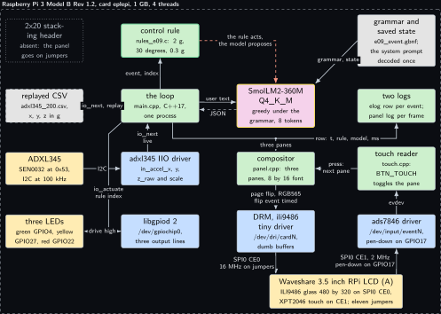
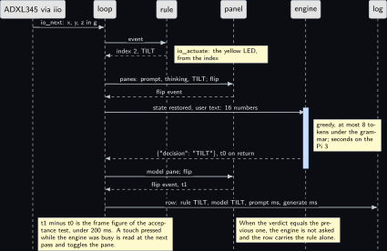
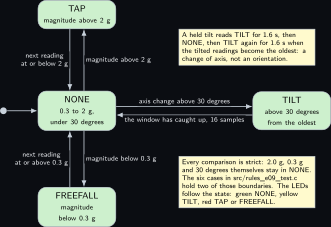
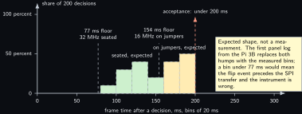

# Project 9. LCD prompt and verdict display

> **Board:** Raspberry Pi 3 Model B Rev 1.2, the 3.5 inch LCD on jumpers, the ADXL345 and three LEDs on pins 1 to 26  
> **Owns:** the on-camera instrument of the channel's first video: the prompt, the model's answer and the rule's verdict as three panes on the glass, with the frame time measured

> [!IMPORTANT]
> **The question, instanced**
>
> What does a small local model add over a two-line threshold, and when does it get it wrong? Here the question is put on a panel a camera can see: the rule classifies each accelerometer reading in microseconds and lights an LED, the 360M model proposes the same four-way enum seconds later, and the glass shows the prompt, the model's answer and the rule's verdict side by side, so that the gap in time and any gap in judgement are both visible without a laptop in the picture.

> **Key facts**
>
> - **Board:** Raspberry Pi 3 Model B Rev 1.2, 1 GB, card `eplepi`, 4 threads
> - **HAT slot:** the Waveshare 3.5 inch RPi LCD (A) on eleven jumper wires rather than seated: a seated panel leaves no header pin reachable and the 2x20 stacking header is not on the bench
> - **Parts:** the panel (ILI9486 glass on SPI0 CE0, XPT2046 touch on CE1), the DFRobot SEN0032 ADXL345 on pins 3 and 5, three Joy-it LK-LED10 modules on GPIO 4, 27 and 22
> - **Interface:** the ADXL345 through the IIO backend of `io.h`, the LEDs through the gpio backend, the panel through libdrm dumb buffers on the ili9486 DRM device, the touch through evdev; a replayed CSV in CI
> - **Language and variant:** C++17, catalogue variant A: one process with the engine linked in, reached through `common/cpp/edgellm.hpp`; its own main, because the shared main has no hook between the rule and the model and this project draws there
> - **Model:** SmolLM2-360M-Instruct Q4\_K\_M, 0.27 GB, Apache 2.0
> - **Decision:** one of NONE, TAP, TILT, FREEFALL through the grammar, asked only when the rule's verdict changes; the stub answers NONE in CI
> - **Control rule:** [Project 5](05-adxl345-event-reporter.md)'s rule in C: TAP above 2 g, FREEFALL below 0.3 g, TILT above 30 degrees of axis change against the oldest reading of the 16-sample window, else NONE; the LEDs follow the rule and never the model
> - **Acceptance:** the frame showing the model's answer completes under 200 ms after the decision returns, by `std::chrono::steady_clock` from the decision's return to the page flip's event, over 200 decisions; a touch toggles the enlarged pane 50 of 50 times, logged; the agreement table over the same 200 decisions; throttle bits `0x0` before and after
> - **Difficulty:** 4 of 5
> - **Effort:** two evenings on the host for the compositor and the oracle, one afternoon on the Pi 3B for the overlay and the wiring, one afternoon for the 200-decision run

## Pitch

The first video of the channel needs one thing in frame: a Pi with no cable, a sensor, and a display that shows what the rule decided and what the model proposed, in that order, because that order is the argument of the whole volume. This chapter builds that display. The loop is [Project 2](02-the-decision-loop.md)'s loop with [Project 5](05-adxl345-event-reporter.md)'s sensor and rule behind `io.h`, written once more in C++ because it has to stop twice per event where the shared main cannot: after the rule, to draw the prompt and the verdict while the engine is still working, and after the engine, to draw its answer beside them. The panel is driven the way the Linux volume's project 7 made possible, as a real DRM device with dumb buffers and page flips, not as a vendor framebuffer, so that the time from a decision to the glass is a number the program measures itself. The touch controller is the second instrument on the glass: a press toggles which of the three panes is enlarged, so the camera can hold on the model's text or on the verdict without anyone touching the laptop. Three quantities are measured: the frame time after each of 200 decisions, the count of 50 presses that toggled a pane, and the agreement between the two columns, which in CI already has a number, 50.0 percent, that is a property of the replay file and of nothing else.

## Origin and what changed

Drafts 4 and 10, the LCD half, with new framing: draft 10 wanted a voice console and there is no microphone on the bench, so what survived is the display alone, with the honest comparison as its content. Three things changed against the plan of Wednesday 14 October 2026 once the panel's facts were read against the board. First, the panel is not seated. Its 26-pin socket mates with header pins 1 to 26 and its carrier runs the full length of the board over pins 27 to 40 without contacts, so a seated panel leaves no pin reachable at all; lab P19 of the kit labs settled that from the carrier's schematic on Thursday 8 October 2026, and the stacking header that would raise every pin above the carrier is absent. The front matter's HAT table reads pins 1 to 26 still free, and the sense in which that holds is this chapter's: the panel hangs on eleven jumper wires, the Linux volume's project 7 second route at 16 MHz instead of 32, and every other part sits on pins 1 to 26, which is also the wiring that holds the day a stacking header seats the panel. Second, the green LED moves from GPIO17 to GPIO4, because header pin 11 is the panel's touch interrupt and the ads7846 driver refuses to probe without one. Third, the ADXL345's two straps are made at the sensor's own header rather than at header pins 17 and 6, because the board has two 3V3 pins and the panel takes one; both changes to a proven wiring are proved again by `i2cdetect` before anything else runs. What did not change: the enum, the thresholds and the grammar are [Project 5](05-adxl345-event-reporter.md)'s, so the two chapters are one agreement table taken twice.

## Parts and interface

| **Part** | **Role** | **Interface** | **Address or pin** |
| --- | --- | --- | --- |
| Raspberry Pi 3 Model B Rev 1.2, card `eplepi` | runs the loop, the model and the compositor; 1 GB, so the rung is SmolLM2-360M; the overlay in `/boot/firmware/overlays` | SSH | the header, pins 1 to 26 |
| Waveshare 3.5 inch RPi LCD (A) | 480 by 320, ILI9486 glass behind a shift-register bridge, XPT2046 touch compatible with the ADS7846 | SPI0 CE0 at 16 MHz on jumpers, CE1 at 2 MHz; the Linux volume's project 7 overlay | eleven jumpers: pins 1, 2, 6, 11, 18, 19, 21, 22, 23, 24, 26 |
| DFRobot SEN0032 ADXL345 | the event source; the part known good, the header unsoldered | I2C at 100 kHz, the `adxl345` IIO driver through `i2c-sensor,adxl345` | 0x53; pins 3, 5, 9, 16, 17 |
| Three Joy-it LK-LED10 | green NONE, yellow TILT, red TAP or FREEFALL, driven by the rule | libgpiod 2 through the gpio backend | GPIO 4, 27, 22 on pins 7, 13, 15; grounds 14, 20, 25 |
| libdrm, and the 8 by 16 font | dumb buffers, `drmModeAddFB2`, `drmModePageFlip`, the flip event; the font in `src/font8x16.h`, 95 glyphs rasterised from DejaVu Sans Mono | `xf86drm.h`, `xf86drmMode.h`; MIT; the font under the Bitstream Vera licence | `/dev/dri/cardN`, found by driver name |
| `replay/adxl345_200.csv` | the event stream, 2221 rows of `t_s,tag,v0,v1,v2` at 10 Hz with 200 verdict changes, generated by `tools/make_replay.py` | `io_open_replay` |  |
| `grammars/e09_event.gbnf`, `prompt.txt` | the four literals in the house shape; the system prompt, 72 words, its token count read in step 7 | the grammar sampler; decoded once, state saved | root symbol `root` |
| `src/rules_e09.c`, `tests/oracle/e09.expected.csv` | the control rule, registered by name; the 2221 expected rule cells and the stub's 200 answers | `rule_find("e09")`; the oracle check in C | index 0 to 3 |

## Model and grammar

SmolLM2-360M-Instruct at Q4\_K\_M, the file `SmolLM2-360M-Instruct-Q4_K_M.gguf`, 0.27 GB, Apache 2.0, from [bartowski/SmolLM2-360M-Instruct-GGUF](https://huggingface.co/bartowski/SmolLM2-360M-Instruct-GGUF) (verified Wednesday 14 October 2026); the card states the ChatML form with the `im_start` and `im_end` markers, which the loop wraps the prompt in, line for line as the shared main does. It is the Pi 3 family default of the ladder and the only rung a 1 GB board admits under the 60 percent rule, 450 MB of `MemAvailable`, which step 5 reads before the run. The engine is the pinned `v0.6.0` of [Project 1](01-bring-up-and-the-honest-tokens-per-second.md). The grammar is the house shape, one JSON object with one `decision` key, root symbol `root`, the literal order the rule's name table, so the stub answers NONE; the syntax is the engine's own, documented at [grammars/README.md](https://github.com/ggml-org/llama.cpp/blob/master/grammars/README.md) in the engine's tree (to verify).

```gbnf
root     ::= "{" ws "\"decision\"" ws ":" ws decision ws "}"
decision ::= "\"NONE\"" | "\"TAP\"" | "\"TILT\"" | "\"FREEFALL\""
ws       ::= [ \t]*
```

The system prompt, decoded once and restored per decision, reads in full: You are an edge agent on a Raspberry Pi reading an accelerometer in g. You see the current x, y, z and magnitude, the peak and minimum magnitude over the last 1.6 seconds, the tilt in degrees against the oldest reading, and the three previous readings. Answer only with the JSON decision. TAP when the magnitude is above 2. FREEFALL when it is below 0.3. TILT when the tilt is above 30 degrees. Otherwise NONE. The model is told the thresholds, as in [Project 2](02-the-decision-loop.md), and the user text hands it the sixteen numbers the rule used, the tilt already computed, so that nothing it is asked requires arithmetic it cannot do.

## What the model decides or writes

One of four literals, through the grammar, with `n_predict` 8 and greedy sampling, and only on the events where the rule's verdict differs from the previous event's. That clause is this chapter's one change to the loop's cadence, made for the instrument's sake: the sensor is polled at 10 Hz, a decision on the Pi 3 takes seconds, and a loop that asked on every sample would read the sensor once per decision and miss every tap by hand. Asking on a change keeps the loop at 10 Hz between events, makes a held tilt one decision in and one out, and makes the 200 decisions of the acceptance test 200 moments a camera can see. The rows between carry the rule's verdict and an empty model cell, which the oracle file expects letter for letter. The model's answer reaches two places, the log and the middle pane. In CI the stub answers `{"decision":"NONE"}` on every asked row with the engine column reading stub, and the loop, both logs, the oracle check and the agreement tool run end to end with `--headless`, which skips the panel and the touch controller and nothing else.

## Control rule

Four classes, every comparison strict, from the current reading and the oldest reading of the window the loop keeps. The magnitudes are compared as squares and the angle through its cosine, because the shared rule harness links no libm. The last line registers the rule before `main` runs.

```c
static const char *const rule_e09_names[] = { "NONE", "TAP", "TILT", "FREEFALL", NULL };

static double mag2(const io_event *ev)
{
    return ev->v[0] * ev->v[0] + ev->v[1] * ev->v[1] + ev->v[2] * ev->v[2];
}

static int rule_e09_fn(const rule_ctx *ctx, const io_event *ev)
{
    const io_event *ref;
    double m2, r2, dot;
    if (ev->n < 3) return 0;                                 /* a short event is NONE */
    m2 = mag2(ev);
    if (m2 > 4.0) return 1;                                  /* TAP: above 2 g */
    if (m2 < 0.09) return 3;                                 /* FREEFALL: below 0.3 g */
    if (ctx->n == 0) return 0;                               /* nothing to compare with */
    ref = &ctx->hist[0];                                     /* the oldest in the window */
    r2 = mag2(ref);
    if (ref->n < 3 || r2 < 0.09) return 0;                   /* no axis in a freefall */
    dot = ev->v[0] * ref->v[0] + ev->v[1] * ref->v[1] + ev->v[2] * ref->v[2];
    if (dot < 0.0 || dot * dot < 0.75 * m2 * r2) return 2;   /* TILT: above 30 degrees */
    return 0;                                                /* NONE */
}

/* The constructor below registers the rule before main() runs; rule_find("e09") then
 * returns it. The file is compiled into the executable, never into an archive. */
const rule_desc rule_e09 = { "e09", rule_e09_fn, rule_e09_names };
RULE_REGISTER(rule_e09);
```

The rule's index drives the LEDs through a second `io.h` source on the gpio backend when the primary source is the sensor, and through the replay source in CI, which counts the call. The function below is the whole of the actuation; the model's answer is not among its arguments.

```cpp
int actuate(io_source *out, int idx)
{
    int rc = 0;
    rc |= io_actuate(out, "led:0", idx == 0);
    rc |= io_actuate(out, "led:1", idx == 2);
    rc |= io_actuate(out, "led:2", idx == 1 || idx == 3);
    return rc;
}
```

## Real, modelled, absent

- **have:** real: the Pi 3 Model B, the card, the panel and its touch controller, the ADXL345, the three LEDs, the engine at the pinned tag, the rule, the grammar, both logs and the frame times they hold
- **learn:** modelled: the event stream in CI, a replayed CSV generated by a seeded script with 200 verdict changes, drawn dashed; it stands in for the sensor so that the loop has an oracle before the panel is wired, and it claims nothing about the sensor
- **absent:** absent: the 2x20 stacking header, drawn dotted, which is why the panel hangs on jumpers and the SPI clock is 16 MHz rather than 32; and the microphone of draft 10, which is why this is a display and not a console

## System architecture



*Figure 9.1. One process on the Pi 3 Model B. Inside a dashed layer labelled with the board, the card, 1 GB and four threads: the loop in user-space green at the centre, the control rule above it with the green rule outline, the model to its right with the yellow outline, a grey block for the grammar and the saved state at the top right, and a green block for the two logs on the right. In the row below, the ADXL345 in the hardware colour on the left feeding the adxl345 IIO driver in kernel blue, then the compositor and the touch reader in green. In the row below that, the three LEDs in the hardware colour and the libgpiod block, the DRM ili9486 driver and the ads7846 driver in blue. At the bottom, one wide hardware block for the panel, glass and touch, on eleven jumpers. Outside the layer: the replayed CSV at the left, dashed, the one stand-in; and at the top left a dotted grey block for the absent stacking header. Solid arrows carry the readings from the sensor through the driver into the loop, the event up to the rule and its index back, the user text to the model, sent only on a verdict change, with a dashed reply carrying the JSON decision, the grammar and state into the model, the log row across to the logs with a fork down to the compositor labelled three panes, the rule's index down through libgpiod to the LEDs, the page flip from the compositor to the DRM driver and on to the panel over SPI0 CE0, the touch from the panel through the ads7846 driver and evdev to the touch reader and from there to the compositor. A dashed stop-coloured arrow from the rule to the model says that the rule acts and the model proposes.*

Two arrows carry the chapter. The dashed red one is the volume's safety rule: there is no path from the model block to the LEDs or to anything else that acts, only to the log and to one of the three panes. The fork below the loop is the instrument: the same moment that writes the row writes the panes, and the compositor's page flip is the one thing in the figure that is timed. The touch reader closes a loop of its own, from the glass back to the compositor, and never reaches the rule or the model.

## Wiring

| **Header pin** | **BCM** | **Part pin** | **Wire colour if known** |
| --- | --- | --- | --- |
| 1, 2, 6 | 3V3, 5V, GND | panel 3V3 logic, 5V backlight, GND: socket pins 1, 2, 6 | not recorded |
| 11 | GPIO17 | panel TP\_IRQ, the pen-down interrupt; why no LED sits on GPIO17 | not recorded |
| 18 | GPIO24 | panel LCD\_RS, data or command | not recorded |
| 19 | GPIO10 MOSI | panel LCD\_SI and TP\_SI | not recorded |
| 21 | GPIO9 MISO | panel TP\_SO, the touch controller's data out | not recorded |
| 22 | GPIO25 | panel RST | not recorded |
| 23 | GPIO11 SCLK | panel LCD\_SCK and TP\_SCK | not recorded |
| 24 | GPIO8 CE0 | panel LCD\_CS | not recorded |
| 26 | GPIO7 CE1 | panel TP\_CS | not recorded |
| 17 | 3V3 | ADXL345 VCC, moved from pin 1; CS joined to VCC at the sensor | not recorded |
| 9 | GND | ADXL345 GND; SDO joined to GND at the sensor | not recorded |
| 3, 5 | GPIO2 SDA, GPIO3 SCL | ADXL345 SDA and SCL, the bus at 100 kHz | not recorded |
| 16 | GPIO23 | ADXL345 INT1, wired as in [Project 5](05-adxl345-event-reporter.md), not read here | not recorded |
| 7 | GPIO4 | green LED signal pin, NONE; moved from GPIO17 | not recorded |
| 13, 15 | GPIO27, GPIO22 | yellow LED, TILT; red LED, TAP or FREEFALL | not recorded |
| 14, 20, 25 | GND | the three LED modules’ ground pins, one each | not recorded |
| 27 to 40 |  | nothing; under the carrier only when the panel is seated |  |


*Figure 9.2. The 40-pin header of the Pi 3 Model B as two columns of small blocks, pin 1 at the top left, with twenty-two blocks filled in the hardware colour: the panel's eleven pins 1, 2, 6, 11, 18, 19, 21, 22, 23, 24 and 26, the sensor's five pins 3, 5, 9, 16 and 17, and the LEDs’ six pins 7, 13, 15, 14, 20 and 25. A dotted grey layer around pins 27 to 40 says they sit under the carrier only if the panel is seated and are unused here. To the right, a solid hardware block for the panel on eleven jumpers with four solid arrows from pins 18, 22, 24 and 26 labelled LCD\_RS, RST, LCD\_CS and TP\_CS, the other seven signals named in the block. To the left, a solid hardware block for the ADXL345 with two solid arrows from pins 3 and 5 labelled SDA and SCL, and below it a solid block for the three LED modules with arrows from pins 13 and 15 labelled yellow and red, the green line on pin 7 named in the block. A note says that a seated panel would leave nothing reachable and that on jumpers every part sits on pins 1 to 26. Nothing is dashed; the only dotted element is the layer over pins 27 to 40.*

## Sequence



*Figure 9.3. One event whose verdict changed, as a sequence diagram with six solid actors: the ADXL345 through the IIO backend, the loop, the rule, the panel, the engine and the log. A solid arrow carries io\_next with x, y and z in g to the loop and the event on to the rule; a dashed reply brings index 2, TILT, back, with a note that io\_actuate lights the yellow LED from that index. A solid arrow to the panel carries the three panes, prompt, thinking and TILT, with the first flip, and a dashed reply brings the flip event. Over a blue activation bar on the engine, a solid arrow carries the restored state and the sixteen numbers of the user text; a note says at most 8 tokens, greedy, under the grammar, seconds on the Pi 3; a dashed reply returns the JSON decision TILT and marks t0 at its return. A second solid arrow to the panel carries the model pane and the flip, and its dashed reply brings the flip event at t1. The last solid arrow writes the row, rule TILT, model TILT, prompt ms and generate ms, into the log. Two notes: t1 minus t0 is the frame figure of the acceptance test, and a touch pressed while the engine was busy is read at the next pass; and when the verdict equals the previous one the engine is not asked and the row carries the rule alone. In CI the replayed CSV stands in for the first actor.*

## States and data



*Figure 9.4. The four decisions as rounded green states: NONE at the centre, entered from the initial dot, TAP above it, TILT to its right and FREEFALL below it, each joined to NONE by a pair of parallel solid arrows. The way out carries the threshold: magnitude above 2 g to TAP, axis change above 30 degrees to TILT, magnitude below 0.3 g to FREEFALL. The way back carries the return: the next reading at or below 2 g, the window having caught up after 16 samples, the next reading at or above 0.3 g. No arrow joins TAP and FREEFALL, which exclude each other by magnitude. Two notes say that every comparison is strict, that the six test cases hold two of the boundaries, that the LEDs follow the state, and that a held tilt reads TILT, then NONE, then TILT again when the tilted readings become the oldest, because the rule reports a change of axis and not an orientation. Nothing is dashed or dotted.*

Two records. The per-event log, `projects/e09-lcd-verdict-display/evidence/e09_run.csv`, is the shape `elog.h` fixes for every project, with the model cell empty on the rows where the verdict did not change; `tools/agreement.py` scores the rows that have one. The panel log, `projects/e09-lcd-verdict-display/evidence/e09_run_panel.csv`, is this chapter's own, `t_s, kind, event, rule, pane, flip_ms`: a row of kind decision per asked event with the milliseconds from the decision's return to the flip event, and a row of kind touch per press with the pane it enlarged. The acceptance test reads the second file and nothing else; in CI its flip cell is empty, so a headless log can never pass for a bench log.

## Data flow

```text
  ADXL345 at 0x53, 100 kHz          the loop, main.cpp, on the Pi 3B                   host
  +---------------------+           +------------------------------------------+     +------------+
  | adxl345 IIO driver  |-io_next-->| x, y, z times g_per_unit                 |     | agreement  |
  |  in_accel_x,y,z_raw |  10 Hz    | rule_e09.fn(ctx, ev) -> 0 | 1 | 2 | 3     |---->|  .py, 4x4  |
  +---------------------+           |   |                                      |     +------------+
  (CI: replay/adxl345_200.csv)      |   +--> io_actuate led:0..2 (gpio) <- the rule only
  prompt.txt --decode once--------> |   v  verdict != previous?  no: log the rule alone
  grammars/e09_event.gbnf --------> |   |  yes: panes[prompt, "thinking", verdict] -> flip
                                    |   |       state restored, 16 numbers, <= 8 tokens
                                    |   |       {"decision": "TILT"} .......... t0
                                    |   |       panes[prompt, answer, verdict] -> flip
                                    |   v       flip event ...................... t1
                                    | elog_row: t, rule, model, ms, engine     |-- 2221 rows
                                    | panel_log: decision, t1 - t0 | touch, pane |-- 200 + 50
                                    +------------------------------------------+
  touch: /dev/input/eventN (ads7846) --BTN_TOUCH--> next pane enlarged, redrawn, logged
  panel: /dev/dri/cardN (ili9486) <-- two RGB565 dumb buffers, drmModePageFlip with an event
```

```mermaid
sequenceDiagram
    participant S as ADXL345 via iio (CI: replay)
    participant L as loop
    participant C as rule_e09
    participant P as panel
    participant E as engine
    participant G as logs
    S->>L: io_next: x, y, z in g
    L->>C: event
    C-->>L: index 0 to 3 (this is what acts; LEDs)
    L->>P: prompt, thinking, verdict; flip
    L->>E: state restored, 16 numbers (on a change)
    E-->>L: one of four literals, at most 8 tokens; t0
    L->>P: answer pane; flip, event at t1
    L->>G: row: rule, model, ms; panel: t1 - t0
```

## Latency design

The system prompt is 72 words, counted with the engine's tokenizer in step 7 against the volume's 120-token ceiling; it is decoded once at start, its state written with `llama_state_save_file` and read back before every decision, so each asked event pays for its own fifty to seventy tokens of user text and nothing else. `n_ctx` 512, `n_predict` 8, greedy under the grammar, 4 threads on the Pi 3B. The sampling interval is 0.1 s, set in the IIO backend's spec, and the model is asked only on a verdict change, so the loop's steady state is a 10 Hz read and a rule call; an event costs two frames and one decision. The decision time on the Pi 3 is one prompt decode of fifty to seventy tokens plus up to eight single-token decodes at [Project 1](01-bring-up-and-the-honest-tokens-per-second.md)'s rate for this board, which is seconds, and the chapter does not hide them: the first frame shows the rule's verdict while the engine works, the second shows the answer, and the camera sees the gap. The frame budget has its own arithmetic: a 480 by 320 RGB565 frame is 2.46 Mbit, which takes 77 ms on the wire at 32 MHz and 154 ms at the 16 MHz the jumper route allows, so the 200 ms acceptance leaves 46 ms for composing, copying and the driver on jumpers and 123 ms on a seated panel; if the bench figure lands over 200 ms on jumpers, the first fix is damage clips, which send only the changed rectangle, not a faster clock the wires cannot carry.

## Steps

**Step 1.** Generate the replay file and the oracle on the authoring laptop, and read the summary: 2221 rows, exactly 200 verdict changes, and the CI agreement, 50.0 percent.

```bash
# win11 aquamarine
cd $HOME\Desktop\edge-llm-pi; python projects\e09-lcd-verdict-display\tools\make_replay.py
```

**Step 2.** Build the repository with the stub model in skyhorizon's WSL, with libdrm on the host so the compositor compiles; without `libdrm-dev` the target still builds and says so, and only `--headless` runs. Then run the shared rule harness, which carries this project's six cases, and the oracle test over the 2221 rows.

```bash
# win11 skyhorizon, WSL side
cd ~/src/edge-llm-pi; sudo apt-get install -y libdrm-dev pkg-config
```

```bash
# win11 skyhorizon, WSL side
cd ~/src/edge-llm-pi; cmake -S . -B build -DEDGELLM_STUB_MODEL=ON; cmake --build build -j8
```

```bash
# win11 skyhorizon, WSL side
cd ~/src/edge-llm-pi; ctest --test-dir build -R 'rules_test|edgellm-e09-oracle' --output-on-failure
```

**Step 3.** Run the stub loop by hand and score the log, to see the table the CI number comes from: 50.0 percent, every disagreement the stub calling a TAP, TILT or FREEFALL event NONE, zero asked rows without a literal.

```bash
# win11 skyhorizon, WSL side
cd ~/src/edge-llm-pi; build/projects/e09-lcd-verdict-display/edgellm-e09 --project e09 \
  --replay projects/e09-lcd-verdict-display/replay/adxl345_200.csv \
  --grammar projects/e09-lcd-verdict-display/grammar.gbnf \
  --prompt projects/e09-lcd-verdict-display/prompt.txt --log /tmp/e09_stub.csv --stub --headless
```

```bash
# win11 skyhorizon, WSL side
cd ~/src/edge-llm-pi; python tools/agreement.py /tmp/e09_stub.csv
```

**Step 4.** Wire the board powered off, from the table above. Then compile the Linux volume's project 7 overlay on the Pi and append four lines to `config.txt`: the SPI bus, the panel overlay with the 16 MHz override, the I2C bus at 100 kHz, and the ADXL345 through `i2c-sensor`, the entry read from the Raspberry Pi overlays README at [boot/overlays/README](https://raw.githubusercontent.com/raspberrypi/firmware/master/boot/overlays/README) (verified Wednesday 14 October 2026). Reboot.

```bash
# Raspberry Pi 3 Model B, card eplepi
cd ~; dtc -@ -I dts -O dtb -o bench-lcd35a.dtbo bench-lcd35a-overlay.dts; \
  sudo cp bench-lcd35a.dtbo /boot/firmware/overlays/
```

```bash
# Raspberry Pi 3 Model B, card eplepi: the four lines appended to /boot/firmware/config.txt
cd ~; printf '%s\n' dtparam=spi=on dtoverlay=bench-lcd35a,speed=16000000 \
  dtparam=i2c_arm=on,i2c_arm_baudrate=100000 dtoverlay=i2c-sensor,adxl345 \
  | sudo tee -a /boot/firmware/config.txt
```

**Step 5.** Pre-flight, in this order, and stop at the first line that disagrees: the memory and the throttle bits, the sensor at 0x53 alone, the IIO device named adxl345 with its scale, both SPI drivers bound, the card whose driver is ili9486, the touch device named by `evtest`, and the console released from the panel so that the kernel cannot repaint over the frames.

```bash
# Raspberry Pi 3 Model B, card eplepi
cd ~; free -m; vcgencmd get_throttled; i2cdetect -y 1; \
  cat /sys/bus/iio/devices/iio:device0/name /sys/bus/iio/devices/iio:device0/in_accel_scale
```

```bash
# Raspberry Pi 3 Model B, card eplepi
cd ~; ls /sys/bus/spi/drivers/ili9486/ /sys/bus/spi/drivers/ads7846/; \
  for c in /dev/dri/card*; do echo $c; cat /sys/class/drm/$(basename $c)/device/modalias; done; \
  sudo evtest
```

```bash
# Raspberry Pi 3 Model B, card eplepi
cd ~; cat /sys/class/vtconsole/vtcon*/name; echo 0 | sudo tee /sys/class/vtconsole/vtcon1/bind
```

**Step 6.** Build on the Pi 3B against the real engine with the two backends and libdrm, at `-j2` because a 1 GB board swaps at four parallel compiles of the engine's tree.

```bash
# Raspberry Pi 3 Model B, card eplepi
cd ~/edge-llm-pi; sudo apt-get install -y libdrm-dev libgpiod-dev pkg-config evtest i2c-tools
```

```bash
# Raspberry Pi 3 Model B, card eplepi
cd ~/edge-llm-pi; cmake -S . -B build -DGGML_NATIVE=ON -DEDGELLM_IO_IIO=ON \
  -DEDGELLM_IO_GPIO=ON -DEDGELLM_BUILD_LLAMA_TOOLS=ON; cmake --build build -j2
```

**Step 7.** Count the prompt's tokens and each literal's tokens on this model's tokenizer with the engine's own tool, and write the counts into the evidence folder: the prompt must be under 120 and the longest answer must close inside 8.

```bash
# Raspberry Pi 3 Model B, card eplepi
cd ~/edge-llm-pi; P=projects/e09-lcd-verdict-display; build/bin/llama-tokenize \
  -m ~/models/SmolLM2-360M-Instruct-Q4_K_M.gguf -f $P/prompt.txt | tail -1
```

**Step 8.** Run the 200 decisions with the real model, as root for the DRM master and the input node, reading the throttle bits before and after; tilt, drop onto a cushion and tap the sensor by hand until the panel log holds 200 decision rows, and touch the glass 50 times along the way. Then score both logs with the agreement tool and the two one-liners of `wiring.md`.

```bash
# Raspberry Pi 3 Model B, card eplepi
cd ~/edge-llm-pi; P=projects/e09-lcd-verdict-display; vcgencmd get_throttled; \
  sudo build/$P/edgellm-e09 --project e09 --live iio /sys/bus/iio/devices/iio:device0:0.1 \
  --g-per-unit 0.1019716 --leds /dev/gpiochip0:4,27,22 --grammar $P/grammar.gbnf \
  --prompt $P/prompt.txt --model ~/models/SmolLM2-360M-Instruct-Q4_K_M.gguf \
  --state /tmp/e09.state --log $P/evidence/e09_run.csv \
  --panel-log $P/evidence/e09_run_panel.csv --max-events 4000; vcgencmd get_throttled
```

```bash
# Raspberry Pi 3 Model B, card eplepi
cd ~/edge-llm-pi; python tools/agreement.py \
  projects/e09-lcd-verdict-display/evidence/e09_run.csv --md
```

## Variant chosen

C++17, catalogue variant A: one process with the engine linked in, as the volume's table assigns it, reached through the header-only `common/cpp/edgellm.hpp` rather than through `llama.h` in the loop, so that the decision code is [Project 2](02-the-decision-loop.md)'s and the chapter's own code is the compositor. On practicality it scores highest because a frame compositor with text layout, word wrapping and two buffers is a class with state, and the C++ standard library gives it strings, vectors and `steady_clock` without a line of allocation code; on relevance the display is the product and a display is written in C++ on every board of this size that has one; on popularity C++ is the language the engine itself and its tools are written in; on compliance it adds libdrm and libgpiod, both permissively licensed, and a font rasterised under the Bitstream Vera licence with its naming condition respected; on best practice one process keeps the frame latency a number the program reads on one clock, which a daemon over a socket could not promise. What it costs is a second main: the shared main's loop is reproduced here in the same order, because this project must draw between the rule and the model and the shared main has no hook there, and those forty lines must be kept equal to `common/c/src/edgellm_main.c` by reading. What it gains is the instrument: the page flip below is the one call in the volume whose return is a measurement of a display.

```cpp
        drm_->flipped = false;
        if (drmModePageFlip(drm_->fd, drm_->crtc, b.fb, DRM_MODE_PAGE_FLIP_EVENT,
                            &drm_->flipped) != 0)
            throw std::runtime_error(card_ + ": drmModePageFlip failed");
        drmEventContext ctx;
        std::memset(&ctx, 0, sizeof ctx);
        ctx.version = DRM_EVENT_CONTEXT_VERSION;
        ctx.page_flip_handler = page_flip_handler;
        while (!drm_->flipped) {
            struct pollfd pfd = { drm_->fd, POLLIN, 0 };
            if (poll(&pfd, 1, 2000) <= 0)
                throw std::runtime_error(card_ + ": no page flip event within 2 s");
            drmHandleEvent(drm_->fd, &ctx);
        }
    }
    drm_->back ^= 1;
    return ms_now() - t0;
```

The DRM master, the dumb buffer and the flip event are the three facts of the user-space interface this rests on, read at [kernel.org/doc/html/latest/gpu/drm-uapi.html](https://www.kernel.org/doc/html/latest/gpu/drm-uapi.html) (verified Wednesday 14 October 2026): only one master is current per device, which is why the console is released first; a dumb buffer is the primitive scanout allocation meant for software rendering, which is all a text compositor needs; and `DRM_EVENT_FLIP_COMPLETE` is sent in response to a page flip made with the event flag, which is what the loop waits for. The acceptance figure is taken in `src/main.cpp` around that call: the clock is read when `engine.decide` returns and again when `flip` returns, and the difference, composing and copying included, is the panel log's `flip_ms`.

## Embedded Linux and Yocto

The application recipe `meta-edgellm/recipes-app/edgellm-e09/edgellm-e09_0.1.bb` is the worked example of [Project 2](02-the-decision-loop.md) with two more lines: the three variables, project `e09`, folder `e09-lcd-verdict-display` and model package `model-smollm2-360m`, the two backends in `EDGELLM_IO_OPTIONS`, the shared include, and then `DEPENDS += "libdrm libgpiod"` with the matching runtime dependency, because a build without libdrm compiles a binary that refuses everything but `--headless`, which an image for this board must not carry. The binary installs as `/usr/bin/edgellm-e09` with the prompt, the grammar and the replay folder under `/usr/share/edgellm/e09`, and the unit below runs it live after releasing the console from the panel. The panel's overlay and kernel fragment are the Linux volume's project 7 (`bench-lcd35a`, nine symbols all built in, the DRM core forced in because the Pi 3 defconfig builds it as a module); the layer's Pi 3 kas file lists `edgellm-e02` as its one application, and putting this project on the image is a two-line change to that file, which this chapter does not own: include the bench's `kas/bench-lcd35a.yml` and set `EDGELLM_APPS` to `edgellm-e09`.

```text
ExecStartPre=-/bin/sh -c 'echo 0 > /sys/class/vtconsole/vtcon1/bind'
ExecStart=/usr/bin/edgellm-e09 --project e09 \
    --live iio /sys/bus/iio/devices/iio:device0:0.1 --g-per-unit 0.1019716 \
    --leds /dev/gpiochip0:4,27,22 \
    --model /usr/share/edgellm/models/SmolLM2-360M-Instruct-Q4_K_M.gguf \
    --grammar /usr/share/edgellm/e09/grammar.gbnf \
    --prompt /usr/share/edgellm/e09/prompt.txt \
    --log /var/lib/edgellm/e09.csv \
    --panel-log /var/lib/edgellm/e09_panel.csv \
    --threads 4 --n-predict 8 --state /run/edgellm/e09.state
```

The layer parse is the check that runs on skyhorizon before anything is wired; the image build is a separate later sitting of hours:

```bash
# win11 skyhorizon, WSL side
cd ~/bench/edge-llm-pi; kas shell meta-edgellm/kas/edgellm-pi3.yml -c "bitbake -p"
```

## Acceptance test

Three quantities from the two logs of step 8, with `vcgencmd get_throttled` reading `0x0` before and after, and a run with any bit set discarded. First, over the 200 rows of kind decision, the largest `flip_ms`: the instrument is `std::chrono::steady_clock` read in `src/main.cpp` at the decision's return and at the flip's return, the pass condition is every row under 200 ms, and one row at or over it fails the chapter, with the arithmetic above saying whether the wire or the program is the suspect. Second, the count of rows of kind touch against the 50 presses made during the run: the instrument is the evdev queue read by `src/touch.cpp`, the pass condition is 50 of 50, and a press that produced no row is a failure of the touch path. Third, the count of asked rows whose model column holds none of the four literals, read by `tools/agreement.py`, which must be zero. The CI run, with the stub and `--headless`, checks the loop's order and both logs’ shape through the oracle test of step 2, and its flip cells are empty by construction.

## Agreement table

Over the replay as generated on Wednesday 14 October 2026 by `tools/make_replay.py` with its fixed seed, the rule column holds 1621 NONE, 25 TAP, 482 TILT and 93 FREEFALL rows, and the verdict changes exactly 200 times, which are the rows the loop asks the model about: 100 into an event (25 TAP, 50 TILT, 25 FREEFALL) and 100 back to NONE. On the bench the model column is not measured: the Pi 3B run has not been taken. In CI the stub answers NONE on every asked row, so the agreement is the NONE fraction of the asked rows, 100 of 200, 50.0 percent, and every disagreement is of one kind. The number is printed so that the first number from the real model has something beside it: a model that scores 50 percent on this set has learned nothing that the first literal did not already give it, and one that scores well on the returns and badly on the tilts has learned the easy half.

| **Rule says** | **Model NONE** | **Model TAP** | **Model TILT** | **Model FREEFALL** | **Instrument** |
| --- | --- | --- | --- | --- | --- |
| NONE, 100 | 100 | 0 | 0 | 0 | the stub in CI; bench: not measured |
| TAP, 25 | 25 | 0 | 0 | 0 | the stub in CI; bench: not measured |
| TILT, 50 | 50 | 0 | 0 | 0 | the stub in CI; bench: not measured |
| FREEFALL, 25 | 25 | 0 | 0 | 0 | the stub in CI; bench: not measured |
| agreement | 50.0 percent |  |  |  | the stub in CI; bench: not measured, run pending on the Pi 3B |

## Measured data

| **Quantity** | **Value** | **Condition** | **Instrument** |
| --- | --- | --- | --- |
| largest frame time after a decision | not measured | under 200 ms | steady\_clock in main.cpp, the panel log; run pending |
| touches that toggled a pane | not measured | 50 of 50 | the evdev queue, the panel log; run pending |
| asked rows without a literal | not measured | 0 | tools/agreement.py; run pending |
| decision time, prompt plus generate | not measured | reported, not bounded | the per-event log; [Project 1](01-bring-up-and-the-honest-tokens-per-second.md)'s table gives the expectation |
| frame transfer floor | 77 ms at 32 MHz, 154 ms at 16 MHz |  | 2.46 Mbit per frame divided by the clock; a calculation, not a reading |



*Figure 9.5. The shape the acceptance test expects, drawn with TikZ axes and not a measurement. The horizontal axis is the frame time after a decision in milliseconds, 0 to 300 in bins of 20 ms; the vertical axis the share of the 200 decisions. Two dashed vertical lines mark the transfer floors from the arithmetic, 77 ms for a seated panel at 32 MHz and 154 ms for the jumper route at 16 MHz. Two dashed histograms, both expected shapes: a green hump from 80 to 160 ms labelled seated, expected, and a hardware-coloured hump in the two bins from 160 to 200 ms labelled on jumpers, expected, close under a dashed stop-coloured vertical line at 200 ms that carries the acceptance condition. A note says that the first panel log from the Pi 3B replaces both humps with measured bins, and that a bin under 77 ms would mean the flip event precedes the SPI transfer and the instrument is wrong.*

## Pitfalls

- **A seated panel leaves no pin reachable.** The socket consumes pins 1 to 26 and the carrier buries 27 to 40 without contacts; there is no pass-through and no second I2C bus. The sensor and the LEDs reach the header only because the panel hangs on jumpers or, the day it arrives, because a stacking header raises every pin above the carrier. Read the carrier's schematic, as lab P19 did, before planning any wire that ends under the glass.
- **Pin 11 is the touch interrupt.** The panel wires TP\_IRQ to GPIO17 and the ads7846 driver refuses to probe without an interrupt, so the green LED of [Project 3](03-led-status-explainer.md) cannot stay on GPIO17 here; a wiring copied from e03 gives a touch controller that never binds and an LED that flickers on every press.
- **Two 3V3 pins, three consumers.** The panel's logic, the sensor's VCC and its CS strap all want 3V3 and the header has pins 1 and 17. The strap moves to the sensor's own header, where every contact is friction; the proof is `i2cdetect` showing 0x53 alone on every scan, and a scan that shows 0x1d or nothing means a strap has let go.
- **fbcon repaints over the frame.** With the frame buffer console bound to the panel, every kernel message redraws the glass under the compositor, which looks like a program that draws nothing. Release the console before the run, as step 5 does; a DRM master is exclusive among user-space clients, and the console is not a client.
- **Which card is the panel moves between kernels.** With `vc4` active the HDMI output is card0 and the panel card1, without it the panel is card0. The compositor finds the panel by driver name through `drmGetVersion`, and `--card` with the wrong node fails with that driver's name in the message rather than painting the wrong output.
- **16 MHz on jumpers against 200 ms.** The frame floor on the jumper route is 154 ms and the budget is 200, so composing and copying have 46 ms. If the bench figure lands over the line, the fix is damage clips through `drmModeDirtyFB` on the changed rectangle, not a 32 MHz clock the wires will turn into a shifted picture.
- **The flip event may precede the transfer.** Whether the tiny driver sends the flip event after its SPI transfer or before it is a property of its commit tail, and the instrument assumes after. A measured bin under the arithmetic floor says the instrument is wrong, not that the panel is fast.
- **The ADXL345 bus at 100 kHz, and in m/s^2.** The current leads answered nothing at 400 kHz on Friday 9 October 2026, so the `i2c_arm_baudrate` line is not optional; and the IIO driver reports metres per second squared with a scale of 0.038312 per LSB at 16 g full scale while the thresholds are in g, so `--g-per-unit 0.1019716` is the one conversion, and a run without it calls every reading a TAP.
- **A polled sensor misses most taps.** The loop reads the raw registers at 10 Hz and a tap by hand lasts milliseconds, so a tap is caught only when the sample lands on it; tilts and freefalls are caught every time. [Project 5](05-adxl345-event-reporter.md) reads the part's own tap detection on INT1; this chapter counts the taps it saw and says how many it tried.
- **The verdict shows seconds before the answer.** On the Pi 3 a decision is seconds, and the glass shows the rule's verdict and the LED colour long before the model's pane fills. That is not a defect to hide with a spinner: it is the chapter's argument on camera, the rule acts now and the model explains later.
- **A tokenizer that splits FREEFALL.** The longest literal may be three tokens on the SmolLM2 tokenizer, and with the braces, the key and the quotes the object must still close inside eight; step 7 counts it before the run, and an object that never closes is a row without a literal, charged to the chapter.

## Future and extra exercises

- The same display in C on the shared main: the two hooks of [Project 2](02-the-decision-loop.md) plus a compositor in C; the delta is a hook between the rule and the model that the shared main does not have, which is why this chapter has its own main.
- The same loop in Rust over `llama-cpp-2`, `drm` and `evdev` crates (MIT): the delta is the bundled engine commit against the pinned tag, as in [Project 5](05-adxl345-event-reporter.md).
- The same display in Python over `llama-cpp-python` with a Python DRM binding: the delta is the interpreter's cost per frame on top of its cost per decision, priced in [Project 15](15-esp32-sidecar-with-a-bounded-pattern-proposal.md).
- LVGL or a Wayland kiosk on the official 7 inch DSI touchscreen, the Linux volume's project 13 route: the delta is a compositor that owns the frame time, so the acceptance figure becomes a measurement of someone else's code.
- Damage clips through `drmModeDirtyFB`: the delta is a frame time proportional to the changed rectangle, which makes 32 MHz unnecessary on jumpers.
- A touch-selected question like [Project 8](08-explorer700-console-with-a-model.md): the delta is the calibration matrix, the swap-xy choice for the panel's rotation, and a second grammar for the answer.

## Video potential

4 of 5. The hook: the rule decided, the model is still thinking, and you can watch both on the glass. The three panes make the volume's argument visible without a laptop in frame, and the touch lets the camera hold on whichever pane the sentence needs. **Video 1** (the video chapters are not published) films this display; its script pairs the panel with [Project 6](06-vl53l4cd-too-close-explainer.md)'s distance verdict, which means a second build of this executable with `rules_e06.c` in place of `rules_e09.c` and the VL53L4CD behind `io.h`; the compositor and the touch code do not change, and until that build exists the panel shows this chapter's enum. What is slow on camera is the decision itself, which the script fills with the spoken line; what can fail is a tap missed by the polled sensor, which is why the live take tilts and drops rather than taps, and the moire of a filmed LCD, settled by the shutter test of Friday 30 October 2026.

## Sources

- SmolLM2-360M-Instruct-GGUF by bartowski, Apache 2.0, the file `SmolLM2-360M-Instruct-Q4_K_M.gguf` at 0.27 GB, with the ChatML prompt format, [huggingface.co/bartowski/SmolLM2-360M-Instruct-GGUF](https://huggingface.co/bartowski/SmolLM2-360M-Instruct-GGUF) (verified Wednesday 14 October 2026).
- The DRM user-space interface: primary nodes, the DRM master, dumb buffers, the flip event, [kernel.org/doc/html/latest/gpu/drm-uapi.html](https://www.kernel.org/doc/html/latest/gpu/drm-uapi.html) (verified Wednesday 14 October 2026).
- libdrm, the user-space library over that interface, MIT, [gitlab.freedesktop.org/mesa/drm](https://gitlab.freedesktop.org/mesa/drm) (to verify; the page refused the fetch on Wednesday 14 October 2026).
- The Waveshare 3.5 inch RPi LCD (A) wiki: 480 by 320, the 26-pin table with TP\_IRQ on pin 11, the ADS7846 touch controller, about 150 mA, [waveshare.com/wiki/3.5inch\_RPi\_LCD\_(A)](https://www.waveshare.com/wiki/3.5inch_RPi_LCD_(A)) (verified Wednesday 14 October 2026).
- The ads7846 driver, for the input device name ADS7846 Touchscreen, BTN\_TOUCH and the refusal to probe without an interrupt, [drivers/input/touchscreen/ads7846.c](https://raw.githubusercontent.com/torvalds/linux/master/drivers/input/touchscreen/ads7846.c) (verified Wednesday 14 October 2026). GPL-2.0.
- The ili9486 tiny DRM driver, for the compatible string `waveshare,rpi-lcd-35` and the 16-bit command widening, as the Linux volume's project 7 read it at v6.12, [drivers/gpu/drm/tiny/ili9486.c](https://raw.githubusercontent.com/torvalds/linux/v6.12/drivers/gpu/drm/tiny/ili9486.c) (to verify; the host rate-limited the fetch on Wednesday 14 October 2026). GPL-2.0.
- The adxl345 IIO driver, for the attribute names and the scale table, 0.038312 at 16 g full scale, [drivers/iio/accel/adxl345\_core.c](https://raw.githubusercontent.com/torvalds/linux/master/drivers/iio/accel/adxl345_core.c) (verified Wednesday 14 October 2026). GPL-2.0.
- The Raspberry Pi overlays README, for `i2c-sensor,adxl345` and `i2c_arm_baudrate`, [boot/overlays/README](https://raw.githubusercontent.com/raspberrypi/firmware/master/boot/overlays/README) (verified Wednesday 14 October 2026).
- The DejaVu fonts licence, the Bitstream Vera licence with its naming condition, under which the 8 by 16 font was rasterised, [dejavu-fonts.github.io/License.html](https://dejavu-fonts.github.io/License.html) (verified Wednesday 14 October 2026).
- GBNF grammar syntax, in the engine's tree, [grammars/README.md](https://github.com/ggml-org/llama.cpp/blob/master/grammars/README.md) (to verify).
- The Linux volume, project 7: the overlay `bench-lcd35a`, the kernel fragment, the ownership table, the two routes for the panel and the DRM master discipline; the kit labs, lab P19: the carrier's schematic and the absent stacking header, Thursday 8 October 2026; those volumes have no public URL.

---

[Previous](08-explorer700-console-with-a-model.md) &nbsp;&nbsp;|&nbsp;&nbsp; [Contents](../CONTENTS.md) &nbsp;&nbsp;|&nbsp;&nbsp; [Next](10-mcc-118-voltage-event-labeller.md)
