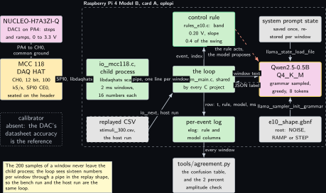
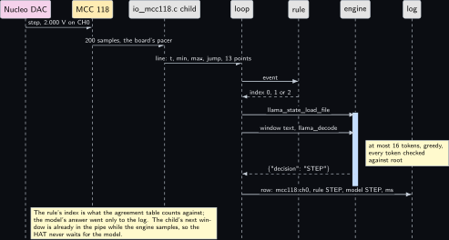
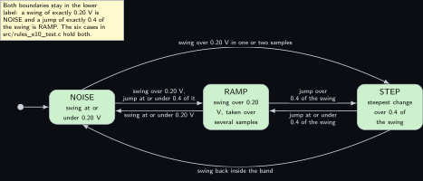
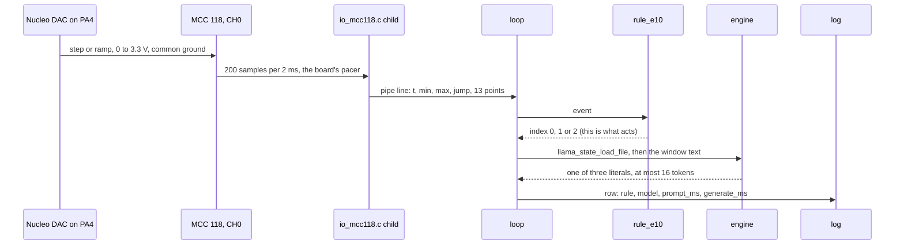
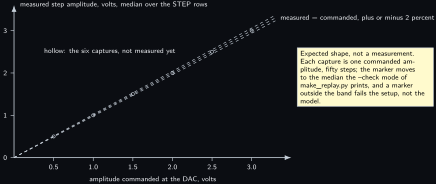

# Project 10. MCC 118 voltage event labeller

> **Board:** Raspberry Pi 4 Model B, card A, with the MCC 118 DAQ HAT; the NUCLEO-H7A3ZI-Q DAC on CH0  
> **Owns:** the only calibrated analog path in the volume: a 100 kS/s window labelled by a band and a slope test, and the same label proposed by the model

> [!IMPORTANT]
> **The question, instanced**
>
> What does a small local model add over a two-line threshold, and when does it get it wrong? Here the threshold is a hysteresis band and a slope test on a 2 ms window of one analog input, the stimulus is a DAC whose amplitude is commanded and therefore known, and the question is whether a 0.5B model given thirteen averaged points can tell a step from a ramp from nothing as well as two comparisons do, over 300 stimuli whose shape is not in doubt.

> **Key facts**
>
> - **Board:** Raspberry Pi 4 Model B, card A, `eplepi`, 4 threads
> - **HAT slot:** the MCC 118 DAQ HAT, 8 single-ended inputs, 12 bits, 100 kS/s aggregate, SPI0 CE0; live on this card since Friday 9 October 2026, serial DBA2019, firmware 1.03
> - **Parts:** the HAT, the NUCLEO-H7A3ZI-Q as the stimulus (DAC1 on PA4, 0 to 3.3 V), two jumper wires; no calibrator
> - **Interface:** the daqhats C library over SPI0 in a project-local source, `src/io_mcc118.c`, run as a child process and fed to the shared loop through a pipe in the replay shape; the host run replays `replay/stimuli_300.csv`
> - **Language and variant:** C, catalogue variant C: plain C over `llama.h` and the HAT's own C library in one executable
> - **Model:** Qwen2.5-0.5B-Instruct Q4\_K\_M, 491 MB, Apache 2.0
> - **Decision:** one of NOISE, RAMP, STEP through the grammar; the stub answers NOISE in CI
> - **Control rule:** NOISE if the window's swing is 0.20 V or less; STEP if the steepest change between two neighbouring samples is more than 0.4 of the swing; else RAMP
> - **Acceptance:** 300 stimuli with zero free text; the median measured step amplitude within 2 percent of the amplitude commanded at the DAC, or the setup fails; no input ever above 10.1 V; the EEPROM read before the first open; throttle bits `0x0`
> - **Difficulty:** 4 of 5
> - **Effort:** two evenings on the host for the source, the generator and the oracle; one evening on the Nucleo for the stimulus; one afternoon at the Pi 4B for the 300

## Pitch

Every other sensor in this volume reports a number it has already decided on. The HAT reports a voltage, 100 000 times a second, and decides nothing, which makes it the one place where the question of the volume can be asked about a shape rather than a value. The project cuts the stream into 2 ms windows of 200 samples, and for each window the rule asks two things: did the voltage cross a band wide enough that noise cannot cross it, and if it did, did most of the crossing happen between two neighbouring samples. Two comparisons, three labels. The model is told the same two thresholds and handed the same window as thirteen averaged points with the minimum, the maximum and the steepest change, and it proposes one of the three labels through a grammar that admits nothing else. What makes the chapter more than a classifier is the stimulus: the Nucleo's DAC produces the steps and the ramps at an amplitude commanded in millivolts, so the measured amplitude of every step is checked against a number known before the capture, and a capture whose median step is more than 2 percent off is a wiring, ground or calibration fault and is set aside before any agreement is counted. The HAT's calibration comes from its EEPROM through the library, the DAC's accuracy is the datasheet's, and the bench owns no calibrator, which every figure says.

## Origin and what changed

Draft idea 7, the DAQ HAT labelling voltage events, with one thing added and one thing reduced. Added: a source. Without one the DAQ reads a floating terminal, and a Pi GPIO is not an analog source, it is a digital output with a series impedance nobody controls; the NUCLEO-H7A3ZI-Q already on the bench carries a 12-bit DAC on PA4 and has a proven bring-up in the firmware volume's project 6, where this same HAT was the witness of its 1 kHz sampler, so the DAC became the stimulus and the commanded amplitude became the acceptance test. Reduced: the window description. The plan wrote a 32-point description, and the event type of `io.h` carries sixteen values, three of which are the summaries the rule reads; `common/` is not this chapter's to change, so the description is thirteen averaged points and the chapter says thirteen wherever the plan said thirty-two. The other change is structural and is stated in `e10_main.c` itself: `io.h` has no hook for a project-local live source, so the project owns `main()`, forks the HAT capture into a child process and hands its windows to the unchanged shared loop through a pipe in the replay CSV shape. The loop, the wrapping, the state restore, the grammar and the log are byte for byte those of [Project 2](02-the-decision-loop.md).

## Parts and interface

| **Part** | **Role** | **Interface** | **Address or pin** |
| --- | --- | --- | --- |
| Raspberry Pi 4 Model B | runs the capture, the loop and the model | SSH, or the Renkforce cable from [Project 1](01-bring-up-and-the-honest-tokens-per-second.md) | the HAT covers all 40 pins |
| Card A, `eplepi` | Raspberry Pi OS trixie, the model file in `~/models`, the CAN overlays of card B commented out | the card is the hostname |  |
| MCC 118 DAQ HAT | 8 single-ended inputs, 12 bits over <span class="math">-10</span> to <span class="math">+10</span> V, 100 kS/s aggregate, factory calibration in its ID EEPROM; serial DBA2019, firmware 1.03 | SPI0 CE0 through the header, the daqhats C library in user space | address 0, all jumpers off; CH0 and the GND beside it on the terminal block |
| NUCLEO-H7A3ZI-Q | the stimulus: DAC1 channel 1 on PA4, steps and ramps at a commanded amplitude, 0 to 3.3 V | its own USB console on skyhorizon; two jumper wires to the terminal block | PA4, CN7 pin 17 (to verify in UM2408); any GND pin |
| `src/io_mcc118.c` | the live source: hat\_list, open, one sanity read, a continuous scan at 100 kS/s, one event per window | the daqhats C API, a child process, a pipe | `--live mcc118 0:0:2` |
| `replay/stimuli_300.csv` | 300 windows, 100 steps, 100 ramps, 100 noise, with the commanded amplitude in the tag, from `tools/make_replay.py` | `io_open_replay` |  |
| `src/rules_e10.c`, `grammars/e10_shape.gbnf` | the control rule, registered by name, and its three literals in the house shape | `rule_find("e10")`; root symbol `root` | index 0, 1, 2 |
| `tests/oracle/e10.expected.csv` | the 300 expected rule labels and the stub's column | the oracle check in C, row by row |  |

## Model and grammar

Qwen2.5-0.5B-Instruct at Q4\_K\_M, the file `qwen2.5-0.5b-instruct-q4_k_m.gguf`, 491 MB, Apache 2.0, from [Qwen/Qwen2.5-0.5B-Instruct-GGUF](https://huggingface.co/Qwen/Qwen2.5-0.5B-Instruct-GGUF) (verified Wednesday 14 October 2026); the Pi 4 default for enum decisions, admitted as long as [Project 1](01-bring-up-and-the-honest-tokens-per-second.md)'s memory reading is above 818 MB available, and replaced by SmolLM2-360M with no other change if it is not. The engine is the pinned `v0.6.0` of [Project 1](01-bring-up-and-the-honest-tokens-per-second.md). The grammar is the house shape of [Project 2](02-the-decision-loop.md), one JSON object with one `decision` key, root symbol `root`, in the engine's own GBNF syntax documented at [grammars/README.md](https://github.com/ggml-org/llama.cpp/blob/master/grammars/README.md) (to verify). The quiet label comes first, as the repository's grammar conventions ask, so that the stub's answer in CI is the one that means nothing happened.

```gbnf
# e10_shape.gbnf: the three literals of rules_e10.c, letter for letter and in the same
# order, in the house shape: one JSON object with one "decision" key. The quiet label
# NOISE comes first, so the CI stub answers {"decision":"NOISE"} on every window. ws
# admits spaces and tabs only, never a newline.
#
# This file used to add that the longest answer therefore stayed inside the n_predict of 8
# tokens on every tokenizer in the ladder. That sentence is withdrawn here for the same
# reason it was withdrawn from e02_decision.gbnf on Saturday 17 October 2026: it had never
# been counted against one tokenizer, and e02's identical sentence was false for Qwen2.5,
# whose ALERT path needs nine tokens. NOISE, RAMP and STEP are all shorter than ALERT, so
# eight may well be enough here, and that is a guess rather than a measurement. The budget
# the unit ships is 16, because the loop breaks at the end-of-generation token and this
# root ends at the closing brace, so an unused budget token costs nothing.
root     ::= "{" ws "\"decision\"" ws ":" ws decision ws "}"
decision ::= "\"NOISE\"" | "\"RAMP\"" | "\"STEP\""
ws       ::= [ \t]*
```

The system prompt, 71 words, decoded once and never again during a run, reads in full: You label one 2 ms window of a voltage input on a Raspberry Pi. You see the window's minimum, its maximum, the steepest change between two neighbouring samples, and 13 averaged points in time order. Answer only with the JSON decision and nothing else. NOISE when the maximum minus the minimum is 0.20 V or less. STEP when the steepest change is more than 0.4 of that swing. Otherwise RAMP. The model is told the thresholds, as in [Project 2](02-the-decision-loop.md); what is new is that the two numbers it must compare are given beside thirteen it does not need, and the question is whether it uses the right ones.

## What the model decides or writes

One of three literals, through the grammar, with `n_predict` 8 and greedy sampling. Every token is checked against the grammar's automaton before it is accepted, so the model column holds one JSON object whose decision is NOISE, RAMP or STEP, or an object that did not close inside eight tokens, which the agreement tool counts as a row without a literal and the chapter counts as its own failure. The user text per window is about seventy tokens, more than the other enum chapters’, because the thirteen points are in it. In CI there is no model file and no HAT: the stub answers the grammar's first expansion, `{"decision":"NOISE"}`, on every row with the engine column reading stub, and the loop, the replay path, the log, the oracle check and the agreement tool are exercised end to end.

## Control rule

Two comparisons on three of the sixteen values of the event. The band is a hysteresis of 0.20 V: the HAT's step is about 4.9 mV over its 20 V range and the stimulus noise is a few millivolts, so a swing inside the band is not a crossing whatever its shape. The slope test asks whether most of the swing happened between two neighbouring samples, 10 microseconds apart at 100 kS/s; a DAC step does that in one or two samples and a ramp of the stimulus firmware takes forty or more. Both boundaries stay in the lower label on purpose and the six test cases hold them.

```c
static const char *const rule_e10_names[] = { "NOISE", "RAMP", "STEP", NULL };

static int rule_e10_fn(const rule_ctx *ctx, const io_event *ev)
{
    (void)ctx;                                              /* one window decides */
    if (ev->n < 3) return 0;                                /* no summary: NOISE, not a guess */
    if (ev->v[1] - ev->v[0] <= 0.20) return 0;              /* NOISE: swing inside the band */
    if (ev->v[2] > 0.4 * (ev->v[1] - ev->v[0])) return 2;   /* STEP: most of it in one sample */
    return 1;                                               /* RAMP: a crossing over several */
}

/* The constructor below registers the rule before main() runs; rule_find("e10") then
 * returns it. The file is compiled into the executable, never into an archive. */
const rule_desc rule_e10 = { "e10", rule_e10_fn, rule_e10_names };
RULE_REGISTER(rule_e10);
```

The user text is built by the one function this project adds to the shared main. It prints the three summaries with three decimals and the thirteen points with two, in time order, and nothing else; the thresholds are in the system prompt and cost no tokens per window. An event without the summaries is logged with the rule alone.

```c
const char *project_format_prompt(const io_event *ev, const rule_ctx *ctx, char *buf,
                                  size_t len)
{
    int k, i;
    (void)ctx;                                           /* one window decides; no history */
    if (ev->n < 4)
        return NULL;
    k = snprintf(buf, len, "window: min %.3f V, max %.3f V, steepest change %.3f V between "
                           "two samples, points", ev->v[0], ev->v[1], ev->v[2]);
    for (i = 3; i < ev->n && k > 0 && k < (int)len - 16; i++)
        k += snprintf(buf + k, len - (size_t)k, "%s%.2f", i == 3 ? " " : ", ", ev->v[i]);
    if (k > 0 && k < (int)len - 16)
        snprintf(buf + k, len - (size_t)k, " V. Label.");
    return buf;
}
```

## Real, modelled, absent

- **have:** real: the Pi 4 Model B, card A, the MCC 118 and its EEPROM calibration, the daqhats C library built from source, the Nucleo and its DAC, the model file, the engine at the pinned tag, the rule, the grammar, the log
- **learn:** modelled: the replay windows, 300 synthetic windows of 200 samples each with the HAT's 4.9 mV quantisation and a few millivolts of noise, summarised by the same arithmetic as the live source and drawn dashed; they give the loop an oracle on the host and claim nothing about the HAT
- **absent:** absent: a calibrator, dotted. The DAC's accuracy is read from the STM32H7A3 datasheet (to verify) and the HAT's from its EEPROM through the library; the 2 percent band is a consistency check between those two, not a traceable measurement

## System architecture



*Figure 10.1. The stimulus, the HAT, the child process and the five pieces of the loop. Outside the dashed layer on the left: a solid firmware-coloured block for the NUCLEO-H7A3ZI-Q with its DAC on PA4, a solid hardware block for the MCC 118 on the header, and a dotted grey block for the absent calibrator. Inside the layer, labelled with the Pi 4 Model B and card A: the project-local source io\_mcc118.c in user-space green as a child process with the dashed grey replayed CSV below it, the loop in the centre with the control rule above it in the green rule outline and the per-event log below, and the model in the yellow outline on the right with the saved system prompt state above and the grammar file below. Solid arrows carry the DAC output to CH0, the samples over SPI0 into the child, one CSV line per window through the pipe into the loop, the replayed rows into the loop on the host run, the event up to the rule and its index back, the window text to the model with a dashed reply carrying the JSON label, the state and the grammar into the model, the log row down, and every window down to tools/agreement.py below the layer. A dashed stop-coloured arrow from the rule to the model says that the rule acts and the model proposes. A note says that the 200 samples of a window never leave the child and that the loop sees sixteen numbers per window.*

The arrow to read twice is the one from the child into the loop: sixteen numbers per window in the CSV shape the replay file has, which is what lets the bench run and the host run be one loop with one oracle. The dashed red arrow says what it says in every chapter: nothing here acts on anything, and the model's answer reaches only the log.

## Wiring

| **Header pin** | **BCM** | **Part pin** | **Wire colour if known** |
| --- | --- | --- | --- |
| 19 | GPIO10 | SPI0 MOSI, through the header | none; the HAT is seated |
| 21 | GPIO9 | SPI0 MISO | none |
| 23 | GPIO11 | SPI0 SCLK | none |
| 24 | GPIO8 | SPI0 CE0, the HAT's chip select | none |
| 27, 28 | ID\_SD, ID\_SC | the HAT ID EEPROM, read by `daqhats_read_eeproms` | none |
| 32, 33, 37 | GPIO12, GPIO13, GPIO26 | address jumpers A0 to A2, all off for address 0 | none |
| terminal CH0 | none | Nucleo DAC1 OUT1, PA4, CN7 pin 17 (to verify in UM2408) | not recorded; read it off the wire |
| terminal GND beside CH0 | none | any Nucleo GND pin | not recorded; this wire goes in first |
| terminals CH1 to CH7 | none | nothing; a floating input is never quoted | none |

The pins the HAT uses are the kit labs’ P05 record of this HAT; which rail it draws its power from is unread, because the HAT's user guide and electrical specification were not reachable from this bench on Wednesday 14 October 2026. The Nucleo's DAC cannot produce more than 3.3 V, so the 10.1 V input limit is respected by construction. Power order: the Pi first with the HAT seated, the Nucleo after, so that no input is driven while the HAT's input stage is unpowered; and the Nucleo is reflashed immediately before every capture, because two other volumes flash it and a stale flash reads as a reproduction.


*Figure 10.2. The 40-pin header of the Pi 4 Model B as two columns of small solid blocks, pin 1 at the top left, with nine blocks filled in the hardware colour, pins 19, 21, 23 and 24 for SPI0, 27 and 28 for the ID EEPROM, and 32, 33 and 37 for the address jumpers, inside a dashed layer labelled MCC 118 seated over all 40 pins. Three solid arrows lead from pins 24, 28 and 33 to a solid hardware block for the Pi 4 Model B on card A, labelled SPI0 CE0, ID EEPROM and address A0 to A2; the Pi powers the HAT's terminal block above it, a solid hardware block with CH0 to CH7, a GND beside each and the 10.1 V limit, which two solid arrows reach from a solid firmware-coloured block for the NUCLEO-H7A3ZI-Q on the right, PA4 to CH0 at 0 to 3.3 V and GND to GND first. A two-headed line joins the Pi to a grey console block; a note gives the power order, the card A rule and that the check is ls /dev/spidev0.0, not hat\_list. Nothing is dotted.*

## Sequence



*Figure 10.3. One window as a sequence diagram with seven actors: the Nucleo DAC in the firmware colour, the MCC 118 in the hardware colour, the io\_mcc118.c child process, then the loop, the rule, the engine and the log, all solid. Solid arrows carry a 2.000 V step from the DAC to CH0, 200 samples on the board's pacer from the HAT to the child, one pipe line with the time, the three summaries and the thirteen points from the child to the loop, and the event from the loop to the rule; a dashed reply brings the index 0, 1 or 2 back. Over a blue activation bar on the engine, two solid arrows from the loop carry llama\_state\_load\_file and then the window text with llama\_decode, with a note that at most 16 tokens are sampled greedily and every one is checked against root. A dashed reply returns the JSON label STEP, and the last solid arrow writes the row, tag mcc118:ch0, rule STEP, model STEP and the two times, into the log. A note says that the rule's index is what the agreement counts against, that the model's answer went only to the log, and that the child's next window is already in the pipe while the engine samples, so the HAT never waits for the model.*

## States and data



*Figure 10.4. The three labels as three rounded green states in a row, NOISE, RAMP and STEP, entered at NOISE from the initial dot. Between neighbours, pairs of solid arrows with the thresholds as labels: a swing over 0.20 V with the steepest change at or under 0.4 of it from NOISE to RAMP and a swing at or under 0.20 V back; a steepest change over 0.4 of the swing from RAMP to STEP and at or under it back. Two curved solid arrows join the ends: a swing over 0.20 V taken in one or two samples from NOISE straight to STEP over the top, and the swing back inside the band from STEP to NOISE underneath. A note at the top left says that both boundaries stay in the lower label and that the six cases hold them. Nothing is dashed or dotted.*

The event is the sixteen values of `io_event`, filled the same way by the live source's `e10_summarise` and by the generator, in the layout below; the rule reads the first three and the model is shown all sixteen. The record is the per-event log in the shape `elog.h` fixes, where the `raw` column joins the sixteen values with semicolons, which is what the amplitude check reads back.

| **Value** | **Meaning** | **How it is computed, live and replayed alike** |
| --- | --- | --- |
| `t_s` | window start, seconds | live: the Pi clock at scan start plus the board's sample count divided by the granted rate; replay: 2 ms per row |
| `tag` | where the window came from | live `mcc118:ch0`; replay `step:2.0`, `ramp:1.5`, `noise`, the amplitude commanded at the DAC |
| `v0` | minimum, volts | over the 200 samples, scaled and calibrated by the library |
| `v1` | maximum, volts | the same |
| `v2` | steepest change, volts | the largest absolute difference between two neighbouring samples: the slope over one 10 microsecond step |
| `v3` to `v15` | thirteen points, volts | bin `k` is the mean of samples `k * 200 / 13` to `(k + 1) * 200 / 13`, fifteen or sixteen each, in time order; the most `IO_MAX_VALUES` leaves after the three summaries |

## Data flow

```text
  NUCLEO-H7A3ZI-Q           MCC 118 on the Pi 4B, card A          edgellm-e10, one binary for both runs
  +------------------+      +------------------------+            +----------------------------------------+
  | DAC1 on PA4      |--+-->| CH0, 12 bit, 100 kS/s  |  SPI0 CE0  | child: io_mcc118.c                     |
  | steps and ramps, |  |   | pacer on the board     |----------->|   mcc118_a_in_scan_read, 200 samples   |
  | 0 to 3.3 V       |  |   | EEPROM calibration     | libdaqhats |   min, max, jump, 13 bin means         |
  +------------------+  |   +------------------------+            |      | pipe, one CSV line per 2 ms      |
    GND ----------------+-- GND terminal, wired first              |      v                                 |
                                                                  | parent: edgellm_main.c, unchanged      |
  replay/stimuli_300.csv (host run, dashed) ----io_next---------->| rule_e10.fn(ev) -> 0 NOISE|1 RAMP|2 STEP
  tools/make_replay.py, seeded, the same summary arithmetic       |      v  project_format_prompt(ev)      |
                                                                  | [state] --llama_state_load_file--> ctx |
  prompt.txt --decode once--> llama_state_save_file               |   window text --llama_decode--> ctx    |
  grammars/e10_shape.gbnf --> llama_sampler_init_grammar(root)    |   sample <= 8 under grammar, greedy    |
                                                                  |   {"decision": "STEP"}                 |
                                                                  | elog_row: t, mcc118:ch0, rule, model   |
                                                                  +----------------------------------------+
                                                                            | every window
                                                                            v
  tools/agreement.py: N, the rate, the confusion table    make_replay.py --check <log> <volts>: the median of
  tests/oracle/e10.expected.csv: the stub's column is     |v15 - v3| over the STEP rows within 2 percent of
  NOISE on every row, 100 of 300 agree                    the commanded amplitude, or the setup fails
```



## Latency design

The system prompt is 71 words, under 120 tokens on the Qwen tokenizer, decoded once at start and restored per window from the state file; the user text is about seventy tokens, the price of showing the model the shape and not only the summaries. `n_ctx` 512, `n_predict` 8, greedy under the grammar, 4 threads on the Pi 4B. The interval is set by the HAT and not by the loop: one window every 2 ms, which no model on the ladder can keep up with, and the chapter does not pretend otherwise. The child keeps scanning while the engine samples, the library buffers one second of samples and the pipe holds the lines not yet read, so the loop labels every window in order with a growing delay; a capture is sized by `--max-events` so that the buffer never overruns, which the child checks on every read. With [Project 1](01-bring-up-and-the-honest-tokens-per-second.md)'s table the admissible capture length becomes a number; until then a capture is 3000 windows, six seconds, which the stimulus sequence of fifty events fits inside. A deployment that must keep up would label one window in ten and say so; that is a future exercise, not a default.

> [!NOTE]
> **The generation budget here is 16 and was 8 until Saturday 17 October 2026.** It was raised without being measured on this project, which is the honest description of it. On that day e02, on a Raspberry Pi 4 Model B, lost 949 rows of 1000 to a budget of 8: the Qwen2.5 tokenizer needs nine tokens for the ALERT path where NORMAL needs eight, and every short row was a legal prefix of its grammar that stopped before the closing brace, so no grammar error was raised anywhere and no counter in the repository moved. The sentence claiming that eight sufficed on every tokenizer of the ladder had never been checked against one tokenizer, and it is withdrawn wherever it appeared.
>
> The budget is now set generously rather than at a measured minimum because an unused token is free. The loop stops at the end-of-generation token, and this grammar's root ends at the closing brace with nothing optional after it, so once the object closes that token is the only legal continuation: a budget of 16 and a budget of 8 produce the same bytes and the same timings for every answer that fits in eight. A budget one token short, by contrast, costs the whole row and says nothing while doing it. What is still unmeasured is the token count of this project's own longest literal on this project's own tokenizer, and [Project 2](02-the-decision-loop.md)'s pitfall on exactly that is the one to read before trusting any figure here.

## Steps

**Step 1.** Generate the replay file and the oracle on the authoring laptop and read the summary: the count of each label, the agreement the stub will reach, and the amplitude check run over the synthetic steps as its own self-test. The backtick continues the line in PowerShell; it is one command.

```bash
# win11 aquamarine
cd C:\Users\aquamarine\Desktop\edge-llm-pi; `
  python projects\e10-mcc118-labeller\tools\make_replay.py
```

**Step 2.** Build the repository with the stub in skyhorizon's WSL. The live source is not compiled in; the binary refuses `--live mcc118` with the reason.

```bash
# win11 skyhorizon, WSL side
cd ~/src/edge-llm-pi; cmake -S . -B build -DEDGELLM_STUB_MODEL=ON; cmake --build build -j8
```

**Step 3.** Run the shared rule harness, which carries this project's six cases beside every other project's, then the oracle test: the loop over the 300 rows with the stub, and the log compared row by row against the oracle file.

```bash
# win11 skyhorizon, WSL side
cd ~/src/edge-llm-pi; ctest --test-dir build -R 'rules_test|edgellm-e10-oracle' --output-on-failure
```

**Step 4.** Run the same stub loop by hand and score it, to see the table the CI number comes from: 33.3 percent, every disagreement the stub calling a RAMP or a STEP window NOISE, and zero rows without a literal.

```bash
# win11 skyhorizon, WSL side
cd ~/src/edge-llm-pi; build/projects/e10-mcc118-labeller/edgellm-e10 --project e10 \
  --replay projects/e10-mcc118-labeller/replay/stimuli_300.csv \
  --grammar projects/e10-mcc118-labeller/grammar.gbnf \
  --prompt projects/e10-mcc118-labeller/prompt.txt --log /tmp/e10_stub.csv --stub; \
  python tools/agreement.py /tmp/e10_stub.csv
```

**Step 5.** Pre-flight on the Pi 4B with card A: the library from source, the EEPROM read before the first open, the device node, and the absence of the CAN overlays. `hat_list` and `daqhats_list_boards` read the EEPROM copies and never touch the bus; the line that means something is the one for `/dev/spidev0.0`, and the grep must print nothing.

```bash
# Raspberry Pi 4 Model B, card A, eplepi
cd ~; git clone https://github.com/mccdaq/daqhats.git; cd daqhats; sudo ./install.sh
```

```bash
# Raspberry Pi 4 Model B, card A, eplepi
cd ~; sudo daqhats_read_eeproms; daqhats_list_boards; ls -l /dev/spidev0.0; \
  grep -n -E '^dtoverlay=(mcp251xfd|mcp2515)' /boot/firmware/config.txt; vcgencmd get_throttled
```

**Step 6.** Build on the Pi 4B against the real engine with the live source compiled in. The configure step fails with the reason if the library or its header is missing.

```bash
# Raspberry Pi 4 Model B, card A, eplepi
cd ~/edge-llm-pi; cmake -S . -B build -DGGML_NATIVE=ON -DEDGELLM_DAQHATS=ON; \
  cmake --build build -j4
```

**Step 7.** Wire the two jumpers with the Nucleo unpowered, ground first; power the Pi, then the Nucleo; flash the stimulus build immediately before the capture and copy its console banner with the build date and time into the evidence folder. Then one capture per commanded amplitude, 0.5 to 3.0 V in six steps, fifty steps each, and the ramps the same way, the amplitude in every log's file name so that each capture is attributable. The child prints the HAT's serial, firmware, the single-shot reading of CH0 and the granted rate before the first window; those lines go beside the log.

```bash
# Raspberry Pi 4 Model B, card A, eplepi
cd ~/edge-llm-pi; build/projects/e10-mcc118-labeller/edgellm-e10 --project e10 \
  --live mcc118 0:0:2 --grammar projects/e10-mcc118-labeller/grammar.gbnf \
  --prompt projects/e10-mcc118-labeller/prompt.txt \
  --model ~/models/qwen2.5-0.5b-instruct-q4_k_m.gguf --state /tmp/e10.state \
  --log projects/e10-mcc118-labeller/evidence/e10_live_step_2.000V.csv --max-events 3000
```

**Step 8.** For each capture: the agreement table, the amplitude check against the commanded value, and the throttle bits. A capture whose check fails or whose bits are not `0x0` is listed with its reason and not counted; the rest fill the agreement table with the date.

```bash
# Raspberry Pi 4 Model B, card A, eplepi
cd ~/edge-llm-pi; python tools/agreement.py \
  projects/e10-mcc118-labeller/evidence/e10_live_step_2.000V.csv --md
```

```bash
# Raspberry Pi 4 Model B, card A, eplepi
cd ~/edge-llm-pi; python projects/e10-mcc118-labeller/tools/make_replay.py --check \
  projects/e10-mcc118-labeller/evidence/e10_live_step_2.000V.csv 2.000; vcgencmd get_throttled
```

## Variant chosen

C, catalogue variant C: plain C over `llama.h` in one process, with the HAT's own C library linked into the same executable. On practicality it scores highest because the daqhats library is C, its header is one include and its link line one flag, and the decision core of [Project 2](02-the-decision-loop.md) is C already, so there is no second language anywhere in the sample path; on relevance it is the variant whose sample path is shortest, the library's buffer to the window summary to sixteen numbers in a pipe, with nothing copied through a binding; on popularity it is the less common way to use this HAT, since the vendor's examples and nearly every published project reach it through the Python wrapper, and the chapter says so; on compliance it is MIT on every side, the engine, the core and the library; on best practice it is the house rule of the bench, C for anything that runs on a board, and here also the rule that a sample path must not pass through an interpreter at 100 kS/s. What it costs is the fork: `io.h` has no hook for a project-local source and the chapter would not change `common/` for one HAT, so the project owns `main()`, and when it sees `--live mcc118` it forks, runs `mcc118_capture` in the child with the write end of a pipe, replaces the three tokens by `--replay /dev/fd/N` and calls `edgellm_main` unchanged; about sixty lines in `src/e10_main.c` that every other C project does without. What it gains is that the loop is unchanged and the oracle is one file, and that the HAT never waits for the model, because the child keeps the board's pacer served while the parent samples. Every daqhats call the source makes, from `hat_list` and `mcc118_open` to `mcc118_a_in_scan_cleanup` and `mcc118_close`, was read from the library's C reference on Wednesday 14 October 2026 and is listed with its order in the head of `src/io_mcc118.c`; two details the reference does not state, the name of the empty options value and the split of the firmware version into major and minor, are written as 0 and as hex there and are to verify. The library is MIT, read from its `LICENSE.md` the same day; its latest release is `v1.5.0.1` of Tuesday 31 March 2026, and the piwheels Python wrapper at 1.4.1.0 beside it is of no consequence to a C program.

## Embedded Linux and Yocto

The application recipe `meta-edgellm/recipes-app/edgellm-e10/edgellm-e10_0.1.bb` sets the three variables of the shared include, the project id `e10`, the folder `e10-mcc118-labeller` and the model package `model-qwen2.5-0.5b`, passes `-DEDGELLM_DAQHATS=ON` through `EDGELLM_IO_OPTIONS`, and adds `daqhats` to `DEPENDS` and `RDEPENDS`. That recipe does not exist in the layer yet; the stub of what it would be, a git fetch of the daqhats repository at the commit the `v1.5.0.1` tag points at, `oe_runmake -C lib`, the library and the headers installed under `libdir` and `includedir/daqhats`, with `libgpiod` as its dependency, is a comment in the e10 recipe, to verify on the first parse that includes it. The EEPROM read is a first-boot job on the target, not a build step: the calibration belongs to the seated board. The unit is a simple service with `--live mcc118 0:0:2`; there is no kernel device unit to order after, because the HAT is a user-space library over SPI0, so the unit's condition is the device node the library opens. No overlay fragment: SPI0 comes from `ENABLE_SPI_BUS = "1"` in the kas file for the Pi 4B (a meta-raspberrypi variable, to verify), and the CAN overlays of card B are not in that image at all.

```text
[Service]
Type=simple
# Live: the project's main forks the libdaqhats capture and feeds the shared loop
# through a pipe; --live mcc118 <address>:<channel>:<window_ms>. The run ends on stop.
# The budget is 16 and not the core's default of 8. On Saturday 17 October 2026 e02's
# thousand-decision run on a Raspberry Pi 4 Model B wrote 949 objects that never closed,
# because the Qwen2.5 tokenizer needs nine tokens for its ALERT path where NORMAL takes
# eight. Nothing here has been counted against a tokenizer either, so this budget is set
# generously rather than tightly: the loop breaks at the end-of-generation token, and this
# grammar's root ends at the closing brace with nothing optional after it, so an unused
# budget token costs nothing while a budget one token short costs the whole row.
ExecStart=/usr/bin/edgellm-e10 --project e10 \
    --live mcc118 0:0:2 \
    --model /usr/share/edgellm/models/qwen2.5-0.5b-instruct-q4_k_m.gguf \
    --grammar /usr/share/edgellm/e10/grammar.gbnf \
    --prompt /usr/share/edgellm/e10/prompt.txt \
    --log /var/lib/edgellm/e10.csv \
    --threads 4 --n-predict 16 --state /run/edgellm/e10.state
StateDirectory=edgellm
RuntimeDirectory=edgellm
```

The layer parse is the check that runs on skyhorizon before anything is wired; with the daqhats recipe absent it reports `edgellm-e10` as unbuildable for that reason, which is the expected result until the stub becomes a recipe:

```bash
# win11 skyhorizon, WSL side
cd ~/bench/edge-llm-pi; kas shell meta-edgellm/kas/edgellm-pi4.yml -c "bitbake -p"
```

## Acceptance test

Three quantities, and one gate that precedes them. The gate: `/dev/spidev0.0` exists, `daqhats_list_boards` names one MCC 118 at address 0 after `sudo daqhats_read_eeproms`, and no `mcp251xfd` or `mcp2515` overlay line is active in `config.txt`; a capture taken without the gate is not a capture. First: over 300 stimuli, fifty steps at each of six amplitudes from 0.5 to 3.0 V and the ramps the same way, the number of windows whose model column holds none of the three literals; the instrument is `tools/agreement.py` reading the log, the pass condition is zero. Second: for each step capture, the median over its STEP rows of the last averaged point minus the first, against the amplitude commanded at the DAC; the instrument is the `--check` mode of `tools/make_replay.py` reading the `raw` column of the same log, the pass condition is within 2 percent, and a capture outside it fails the setup, never the model, and is not counted. The check uses the two settled ends of the window and not the swing, because the swing adds the noise peaks and would fail a 0.5 V step by the noise alone; the same function runs over the synthetic file at the end of every generation as its own self-test, and passed at every amplitude on Wednesday 14 October 2026. Third: the number of stimuli the capture missed, an edge that fell on a window boundary; the instrument is the firmware's own event count against the rule column's count of non-NOISE windows, and the pass condition is that the missed fraction is stated, not that it is zero. All with `vcgencmd get_throttled` reading `0x0` before and after. The 2 percent band is wider than a 12-bit DAC's typical total error with its output buffer on, which is why the DAC can stand in for a calibrator; the figure itself is read from the STM32H7A3xI datasheet's DAC characteristics table (to verify), and if it says otherwise the band moves.

## Agreement table

Over the synthetic 300 as generated on Wednesday 14 October 2026 by `tools/make_replay.py` with its fixed seed, the rule column holds 100 NOISE, 100 RAMP and 100 STEP, by construction of the generator and confirmed by the rule in Python on the rounded values. On the bench the model column is not measured: no capture has been taken. In CI the stub answers NOISE for every row, so the agreement is the NOISE fraction of the rule column, 100 of 300, 33.3 percent, and every disagreement is of one kind, the stub calling a RAMP or a STEP window NOISE. That number is the floor. On the bench NOISE will dominate the rule column, because a six-second capture holds 3000 windows of which fifty carry a stimulus, so the rate will be high before the model has done anything; the cells that answer the question are the STEP row's RAMP column and the RAMP row's STEP column.

| **Rule says** | **Model NOISE** | **Model RAMP** | **Model STEP** | **Instrument** |
| --- | --- | --- | --- | --- |
| NOISE, 100 | 100 | 0 | 0 | the stub in CI; bench: not measured |
| RAMP, 100 | 100 | 0 | 0 | the stub in CI; bench: not measured |
| STEP, 100 | 100 | 0 | 0 | the stub in CI; bench: not measured |
| agreement | 33.3 percent |  |  | the stub in CI; bench: not measured, the six step captures and the ramp captures pending on the Pi 4B |

## Measured data



*Figure 10.5. The shape the acceptance test expects, drawn with TikZ axes and not a measurement. The horizontal axis is the amplitude commanded at the DAC, 0.5 to 3.0 V in six steps; the vertical axis the measured step amplitude, the median over the STEP rows of a capture of the last averaged point minus the first. A dashed identity line with a dashed 2 percent band either side is the condition. Six hollow markers sit on the identity line for the six captures not yet taken, with a label saying so. A note says that each capture is one commanded amplitude of fifty steps, that the marker moves to the median the check mode of make\_replay.py prints, and that a marker outside the band fails the setup, not the model.*

## Pitfalls

- **Both SPI0 chip selects taken by the CAN overlays.** Card B's `mcp251xfd` and `mcp2515` overlays claim CE0 and CE1; with them in `config.txt` the HAT's open fails while every listing still shows the board. Card A has those lines commented out with a dated backup from Friday 9 October 2026, and the pre-flight greps for them before every capture.
- **`hat_list` proves less than it reads as proving.** It and `daqhats_list_boards` read the EEPROM copies under `/etc/mcc/hats` and never touch the bus, so a listed board may still be unreachable. The check that means something is `ls -l /dev/spidev0.0` and the single-shot read the child prints before the scan.
- **A 10 microsecond sampler cannot see a nanosecond pulse.** The firmware volume established it with this HAT: a marker toggled and returned inside one sample period is invisible, and the spread floor is about 3.4 microseconds. A step this chapter sees is one the DAC holds; a glitch between two samples is nothing.
- **The HAT's own clock accuracy is unread.** The granted scan rate is printed and used for the timestamps, but the pacer's accuracy against a reference is in the electrical specification the bench could not fetch on Wednesday 14 October 2026. The 2 ms window is therefore 200 samples, not 2.000 ms, until that number is read.
- **Thermal range 0 to 55 C (to verify).** The operating range quoted for this HAT in the plan is from memory of the user guide, not from a page fetched for this chapter; the Pi 4B under the HAT at four threads warms the board, and a capture taken after a long model run is a capture at an unknown board temperature.
- **The library version pair.** The bench has the 1.5.0.1 library built from source and the 1.4.1.0 Python wrapper from piwheels. A C program links `libdaqhats.so` under `/usr/local/lib` and nothing from piwheels, so the pair does not matter here, and the chapter says so rather than leaving it to be rediscovered.
- **A step on a window boundary.** Non-overlapping windows see an edge that lands exactly between two of them as two NOISE windows. The stimulus spacing of 50 ms against a 2 ms window makes it rare and the third acceptance quantity counts it; an overlapping window is the fix and is a future exercise.
- **Thirteen points, not thirty-two.** The plan's 32-point description does not fit the sixteen values of `io_event`; a reader who copies a 32-point prompt from the plan gets a different chapter. The generator, the source and the prompt all say thirteen.

## Future and extra exercises

- The same project in C++ as variant B over `common/cpp/edgellm.hpp`: the delta is the RAII wrapper of [Project 7](07-iks4a1-climate-and-motion-narrator.md); the daqhats header is plain C and includes unchanged.
- The same project in Rust over `llama-cpp-2` (MIT) with a `bindgen` binding to `libdaqhats`: the delta is the generated binding for a library with no crate, and the unsafe block around every scan read.
- The same project in Python over the daqhats Python wrapper and `llama-cpp-python` (MIT): the popular route, the one the vendor's examples and the kit labs’ P05 take; the delta is the interpreter in the sample path at 100 kS/s, which is the reason this chapter did not choose it, priced in [Project 15](15-esp32-sidecar-with-a-bounded-pattern-proposal.md).
- The other seven channels: a channel mask of `0xFF` at 12.5 kS/s per channel, one event per window per channel with the channel in the tag; the delta is the interleaved buffer and the pacer rate per channel.
- A trigger on the Nucleo's marker line: PB4 at CN7 pin 19 of the firmware volume's project 6 into the HAT's trigger input with `OPTS_EXTTRIGGER` and `mcc118_trigger_mode`, so that every window starts at a stimulus and the boundary case disappears; the delta is the trigger wiring and the lost NOISE windows.
- Overlapping windows, and labelling one window in ten under load with the skipped windows logged with the rule alone: the honest deployment form, and the delta is a `NULL` from the prompt function on nine windows in ten.

## Video potential

3 of 5. The hook: a DAC makes a step, a HAT sees it, a rule names it, and a model guesses. On screen the Nucleo console commanding 2.000 V, the log scrolling with the tag mcc118:ch0 and two columns that mostly agree, then the amplitude check printing a median within a tenth of a percent, then the one confusion the model makes between RAMP and STEP. What is slow on camera is the model, one window in some hundreds of milliseconds against a HAT that produces five hundred a second, which is itself the point of the piece; what can fail on camera is the ground wire, and a floating CH0 reading a drifting value is shown deliberately before it is connected. The capture is recorded earlier and labelled so.

## Sources

- The daqhats C library reference, for every function, flag and result code the source uses, [mccdaq.github.io/daqhats/c.html](https://mccdaq.github.io/daqhats/c.html) (verified Wednesday 14 October 2026); the installation page, for `install.sh`, `daqhats_read_eeproms`, `daqhats_list_boards`, the header under `/usr/local/include/daqhats` and the link flag `-ldaqhats`, [mccdaq.github.io/daqhats/install.html](https://mccdaq.github.io/daqhats/install.html) (verified Wednesday 14 October 2026); the hardware overview, for the 8 single-ended inputs, 12 bits, <span class="math">-10</span> to <span class="math">+10</span> V, 100 kS/s and the address jumpers, [mccdaq.github.io/daqhats/overview.html](https://mccdaq.github.io/daqhats/overview.html) (verified Wednesday 14 October 2026).
- The daqhats repository, MIT (`LICENSE.md`, Measurement Computing Corp., 2018; cJSON inside it also MIT), latest release `v1.5.0.1` published Tuesday 31 March 2026, [github.com/mccdaq/daqhats](https://github.com/mccdaq/daqhats) (verified Wednesday 14 October 2026); and its finite scan example in C, for the order of the calls and the status bits, [examples/c/mcc118/finite\_scan/finite\_scan.c](https://raw.githubusercontent.com/mccdaq/daqhats/master/examples/c/mcc118/finite_scan/finite_scan.c) (verified Wednesday 14 October 2026).
- The MCC 118 electrical specification, for the pacer accuracy, the absolute accuracy and the operating temperature, [mccdaq.com/PDFs/Manuals/DAQ-HAT/MCC118-Spec.pdf](https://www.mccdaq.com/PDFs/Manuals/DAQ-HAT/MCC118-Spec.pdf) (to verify: the address redirected to a shop page on Wednesday 14 October 2026).
- Qwen2.5-0.5B-Instruct-GGUF, Apache 2.0, the file `qwen2.5-0.5b-instruct-q4_k_m.gguf` at 491 MB, [huggingface.co/Qwen/Qwen2.5-0.5B-Instruct-GGUF](https://huggingface.co/Qwen/Qwen2.5-0.5B-Instruct-GGUF) (verified Wednesday 14 October 2026).
- GBNF grammar syntax, in the engine's tree, [grammars/README.md](https://github.com/ggml-org/llama.cpp/blob/master/grammars/README.md) (to verify).
- The STM32H7A3xI datasheet, DAC characteristics table, for the offset, gain error, DNL and INL with the output buffer on (to verify; the vendor's site serves no PDF to this bench, read it from the CubeIDE installation's copy); and UM2408, the Nucleo-144 user manual, for the Zio pin that carries PA4 (to verify).
- The firmware volume, project 6, for the MCC 118 as the witness, the wiring of the marker on PB4 at CN7 pin 19, the power order and the daqhats build; the kit labs, P05, for the HAT's header pins and the 10.1 V rule; the joint node volume, chapter 1, for the honesty rule. Those volumes have no public URL.

---

[Previous](09-lcd-prompt-and-verdict-display.md) &nbsp;&nbsp;|&nbsp;&nbsp; [Contents](../CONTENTS.md) &nbsp;&nbsp;|&nbsp;&nbsp; [Next](11-nucleo-cdc-sensor-hub-narrator.md)
