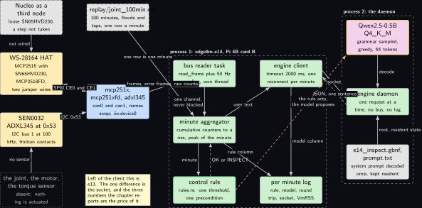
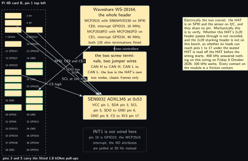
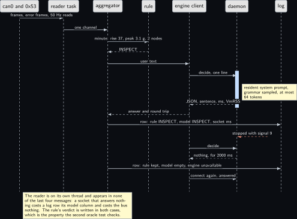
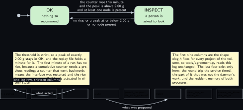
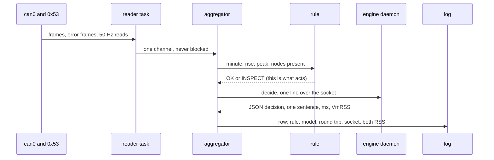
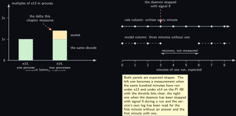

# Project 14. Joint monitor: CAN plus accelerometer

> **Board:** Raspberry Pi 4 Model B card B, Waveshare WS-28164 plus the ADXL345  
> **Owns:** the price of a process boundary: the same service as [Project 13](13-can-honesty-agent.md) with the model moved out of process, measured on the same bus

> [!IMPORTANT]
> **The question, instanced**
>
> What does a small local model add over a two-line threshold, and when does it get it wrong? Here the threshold is one line on two numbers a minute, a CAN error counter and a vibration peak, and the model is asked for the same verdict plus one sentence from a second process; the question this chapter adds is what that second process costs, in resident memory, in decision latency and in the time the service needs to answer again after the daemon has been stopped with signal 9.

> **Key facts**
>
> - **Board:** Raspberry Pi 4 Model B, card B, the spare Verbatim 32 GB; the card that carries the CAN overlays, because card A's MCC 118 claims the same SPI0 chip selects
> - **HAT slot:** Waveshare WS-28164 isolated RS232, RS485, CAN, CAN FD, classic frames only, its two controllers joined by two jumper wires
> - **Parts:** the HAT's MCP2515 with its SN65HVD230 and its MCP2518FD, both 120 ohm terminations fitted, and the DFRobot SEN0032 ADXL345 at 0x53 on header pins 3 and 5
> - **Interface:** SocketCAN on the interface name read from `dmesg` that session, and the ADXL345 through its IIO attributes at 50 Hz; the two coexist because the HAT is on SPI0 and the sensor is on I2C
> - **Language and variant:** Rust, catalogue variant R2: the [Project 13](13-can-honesty-agent.md) service with llama.cpp moved into a separate process, reached over a Unix domain socket
> - **Model:** Qwen2.5-0.5B-Instruct Q4\_K\_M, 491 MB, Apache 2.0, in the daemon only
> - **Decision:** one of OK, INSPECT through the grammar, plus one sentence; INSPECT is a recommendation to a person and nothing at all is actuated
> - **Control rule:** INSPECT when the CAN error counter rose and the vibration peak was above 2.00 g in the same minute, with at least one node present; else OK
> - **Acceptance:** 100 minutes with injected floods and hand taps and the agreement table; the recovery time after the daemon is stopped with signal 9 while the bus keeps running, by the service's own clock; the pair's resident memory from `VmRSS` against [Project 13](13-can-honesty-agent.md)'s one process; throttle bits `0x0` before and after
> - **Difficulty:** 4 of 5
> - **Effort:** one evening for the second process and the oracle on the host, one afternoon on the Pi 4B for the hundred minutes, and a second afternoon for the comparison against [Project 13](13-can-honesty-agent.md) on the same bus

## Pitch

This project is [Project 13](13-can-honesty-agent.md)'s service with one line changed. The bus reader is the same, the node table is the same, the grammar is the same, the log is the same, and the rule is one line on two numbers. What differs is that the answer arrives over a Unix domain socket from a second process that owns the model, and that is the only difference, which is what makes the pair worth a chapter: two programs that differ in one thing can be compared, and three numbers come out of the comparison. The resident memory of two processes against one, from `VmRSS` in `/proc` and not from a guess. The decision latency with a socket round trip added, measured by the service on one side and reported by the daemon on the other, so that the part of the round trip which was not the decode is a column in the log rather than an argument. And the one number a single process cannot have at all: the time between the daemon being stopped with signal 9 and the service answering again, while the bus keeps running and the rule keeps deciding every minute. The second half of the project is the subject it watches. One classic CAN bus whose error counters rise when a flood is injected, one accelerometer that reads a hand tap as a peak above 2 g, and a rule that calls a minute worth a person's attention only when both happened inside it.

## Origin and what changed

Draft idea 11, the CAN half. The idea paired a bus with a vibration sensor and asked a model to judge a joint; it was split, because the two halves need different parts and different boards: the vibration half became [Project 12](12-stwin-box-vibration-band-reporter.md) on the STWIN.box, where a 6 kHz sensor and an FFT belong, and the CAN half became this project, where the subject is the bus. What changed beyond the split is the second process. The draft had one program; this chapter exists because [Project 13](13-can-honesty-agent.md) already is that one program on this bus, and a second chapter that only added a sensor would have measured nothing. Moving the engine out of process makes the pair an experiment with one variable.

One thing has to be said plainly, with its date. On Wednesday 14 October 2026 project [Project 13](13-can-honesty-agent.md) is not yet written: there is no `projects/e13-can-honesty` in the repository and no `Cargo.toml` to depend on. So this project could not import [Project 13](13-can-honesty-agent.md)'s node table as a library crate, and it does not copy its code either, because there is no code to copy. What it carries is [Project 13](13-can-honesty-agent.md)'s design: a heartbeat period per node, a node ABSENT after three missed periods, a node whose frames arrive on a `vcan` interface MODELLED, everything else PRESENT, written as `node_state()` in `projects/e14-joint-monitor/src/rules.rs` with the comment that says so. When [Project 13](13-can-honesty-agent.md) lands with a library target, the node half of that file is deleted and a path dependency replaces it; until then the two chapters agree because one function has to, and that function is three lines with five test cases on it.

## Parts and interface

| **Part** | **Role** | **Interface** | **Address or pin** |
| --- | --- | --- | --- |
| Raspberry Pi 4 Model B | runs both processes; the HAT is Pi 4B and Pi 5 only | SSH, or the Renkforce cable from [Project 1](01-bring-up-and-the-honest-tokens-per-second.md) | header pins 1 to 40, see the wiring table |
| Card B | the spare Verbatim 32 GB; the CAN overlays live here because the MCC 118 of [Project 10](10-mcc-118-voltage-event-labeller.md) on card A claims the same chip selects | the card is the hostname |  |
| WS-28164 MCP2515 | the near node, with its own SN65HVD230 | SPI0 chip select 0 | interrupt GPIO23, 16 MHz crystal |
| WS-28164 MCP2518FD | the far node, classic frames only | SPI0 chip select 1 | interrupt GPIO24, 40 MHz crystal |
| Two jumper wires | CAN H to CAN H and CAN L to CAN L between the two screw terminals; the whole bus, proven on Tuesday 7 October 2026 | the HAT's terminal block | both 120 ohm terminations fitted |
| DFRobot SEN0032 | the ADXL345, read for the peak of each minute | I2C bus 1 at 100 kHz | 0x53; CS to pin 17, SDO to pin 6 |
| `src/main.rs` | the service: the bus reader task, the minute aggregator, the rule and the log | SocketCAN and IIO, or a replayed CSV |  |
| `src/bin/engine_daemon.rs` | the second process: the model, one request at a time | `/run/edgellm/e14-engine.sock` |  |
| `replay/joint_100min.csv` | 100 minutes, one row each, generated by `tools/make_replay.py`; a written catalogue and not a random walk | the replay reader |  |
| `grammars/e14_inspect.gbnf` | the two literals and one bounded sentence | the grammar sampler in the daemon | root symbol `root` |
| `tests/oracle/e14.expected.csv` | the 100 expected rule decisions and the stub's column | `tests/oracle.rs`, across the socket |  |

## Model and grammar

Qwen2.5-0.5B-Instruct at Q4\_K\_M, the file `qwen2.5-0.5b-instruct-q4_k_m.gguf`, 491 MB, Apache 2.0, from [Qwen/Qwen2.5-0.5B-Instruct-GGUF](https://huggingface.co/Qwen/Qwen2.5-0.5B-Instruct-GGUF) (verified Wednesday 14 October 2026). It is the Pi 4 default for enum decisions in the ladder and it is loaded in one place only, the daemon; the service never opens a model file and never links an engine, which is visible in its dependency list and is half the reason the resident memory comparison is interesting. The engine behind the daemon is llama.cpp through the `llama-cpp-2` crate at 0.1.159, MIT or Apache-2.0, published Wednesday 7 October 2026, read from [crates.io/api/v1/crates/llama-cpp-2](https://crates.io/api/v1/crates/llama-cpp-2) (verified Wednesday 14 October 2026). That crate bundles its own llama.cpp commit, which is *not* the release tag `v0.6.0` that [Project 1](01-bring-up-and-the-honest-tokens-per-second.md) pins for the C projects; both are recorded in `models/MODELS.md` and a timing figure from this chapter is never put in the same column as one from a C chapter without that note beside it.

The grammar is GBNF with the root symbol `root`, in the house shape extended by one key, exactly as [Project 4](04-pi-thermal-and-throttle-narrator.md) extends it: the `decision` key keeps its name so that `tools/agreement.py` reads this log like every other, and `summary` holds one sentence of 10 to 160 characters that can only end after a full stop. The syntax is the engine's own, documented at [grammars/README.md](https://github.com/ggml-org/llama.cpp/blob/master/grammars/README.md) in the engine's tree (verified Wednesday 14 October 2026), where the bounded repetition `{m,n}` and the rule that `root` is the starting point are both stated. The two keys are given their own rules so that no line of the file is wider than the page.

```gbnf
root     ::= "{" ws key_d ws ":" ws decision ws "," ws key_s ws ":" ws summary ws "}"
key_d    ::= "\"decision\""
key_s    ::= "\"summary\""
decision ::= "\"OK\"" | "\"INSPECT\""
summary  ::= "\"" [A-Za-z0-9 ,.]{9,159} "." "\""
ws       ::= [ \t]*
```

OK is first because the stub answers the first alternative of every rule and expands a character class to nothing, so in continuous integration the answer is `{"decision":"OK","summary":"."}` on every row and the oracle file expects exactly that. The system prompt, 80 words, is decoded once when the daemon starts and kept resident; it names the two thresholds and one more thing, that INSPECT asks a person to look and stops nothing, because a model that has been told what its verdict does is less likely to write a sentence claiming the joint was stopped.

## What the model decides or writes

One of two literals and one sentence, through the grammar, with `n_predict` 64 and greedy sampling. Greedy rather than a temperature of 0.3, which [Project 3](03-led-status-explainer.md) uses for its sentence: the enum has to be reproducible between two processes, because the whole point of the pair is that [Project 13](13-can-honesty-agent.md) and this project differ in the process boundary and in nothing else, and a sampler with a temperature would add a second difference. The sentence is what the grammar's character class allows and no more: no quote, no brace, no newline, between 10 and 160 characters, ending in a full stop. The model's answer goes into the model column of the log and nowhere else. In continuous integration there is no model file: the daemon answers from the stub, which walks the grammar's first alternative exactly as `common/c/src/edgellm_stub.c` does, so the whole boundary runs in seconds on a runner with no engine, and the Rust oracle file means the same thing a C project's oracle file means.

## Control rule

One line on two numbers, with one precondition in front of it. The counters of a CAN interface are cumulative, so the rule works on the rise inside the minute, which is what `err_delta` computes; a counter that went backwards means the interface was taken down and brought up again, and a rise of nothing is reported rather than a wrap of four thousand.

```rust
/// The difference of a cumulative counter over one minute. A counter that went backwards
/// means the interface was brought down and up again, which is not a rise.
pub fn err_delta(previous: u64, current: u64) -> u64 {
    current.saturating_sub(previous)
}

/// What one minute of the bus and the module amounts to. err_total is the cumulative
/// interface error count read at the end of the minute, err_delta its rise over the
/// minute, peak_g the vibration peak in g, nodes_present how many rows of the node
/// table were PRESENT during the minute.
#[derive(Clone, Copy, Debug, PartialEq)]
pub struct Minute {
    pub t_s: f64,
    pub err_total: u64,
    pub err_delta: u64,
    pub peak_g: f64,
    pub nodes_present: u32,
}

/// The control rule. Three lines: a minute with no node on the bus cannot be a
/// recommendation to inspect anything, and otherwise a rising error counter together
/// with a vibration peak above the threshold in the same minute is INSPECT.
pub fn decide(m: &Minute) -> Decision {
    if m.nodes_present == 0 {
        return Decision::Ok; /* nothing was on the bus; there is nothing to inspect */
    }
    if m.err_delta > 0 && m.peak_g > PEAK_G {
        Decision::Inspect /* the bus complained and the joint moved, in one minute */
    } else {
        Decision::Ok
    }
}
```

The precondition is [Project 13](13-can-honesty-agent.md)'s node table doing work here: a minute in which no row of the table was PRESENT is a minute with nothing on the bus, and a flood of errors with nobody there is a fact about the interface, not a reason to send a person to a joint. The nine unit cases in the same file hold the three boundaries: a peak of exactly 2.00 g, which stays OK because the threshold is strict, a counter that went backwards, and a minute with no node present.

## Real, modelled, absent

- **have:** real: the Pi 4 Model B and card B, the WS-28164 with both its controllers and both terminations, the two jumper wires that are the bus, the ADXL345 at 0x53, the model file, the two processes, the socket, and the log with its timings and its two `VmRSS` columns
- **learn:** modelled: the hundred replayed minutes, drawn dashed, which exist so that the rule, the boundary and the oracle have a check before any wire is touched; and the Nucleo as a third node on the bus with the loose SN65HVD230, which is a dated step that has not been taken and is drawn dashed for that reason
- **absent:** absent: the joint itself, the motor and the torque sensor, dotted grey. There is no joint on this bench. What is watched is a CAN bus whose errors are injected and a module that is tapped by hand, and the chapter never says otherwise

## System architecture



*Figure 14.1. The two processes. On the left, three solid hardware blocks, the WS-28164 HAT with its two controllers and two jumper wires, the SEN0032 ADXL345 at 0x53, and above them a dashed block for the Nucleo as a third node that has not been wired; below them a dotted grey block for the joint, the motor and the torque sensor, which are absent. One solid kernel-blue block holds the mcp251x, mcp251xfd and adxl345 drivers, and beside it a dashed block is the replayed hundred minutes. Inside a dashed layer labelled process 1 on the Pi 4B card B: the bus reader task, the minute aggregator, the control rule with the green rule outline, the engine client, and the per-minute log, all solid green. Inside a second dashed layer labelled process 2: the engine daemon in green, the Qwen2.5-0.5B model with the yellow model outline above it, and a grey block for the grammar and the resident system prompt below it. Solid arrows carry frames and samples from the drivers to the reader, the reader's one channel to the aggregator, the minute to the rule and its verdict back, the user text to the client and across the socket to the daemon, the decode into the daemon, and the rule and model columns to the log; a dashed reply carries the JSON decision and its sentence back from the daemon. A dashed stop-coloured arrow from the rule to the model says that the rule acts and the model proposes. A note repeats that everything left of the client is project e13 and that the socket is the one difference.*

The arrow to read twice is the dashed red one, and in this chapter it says slightly more than it does elsewhere in the volume: not only does the model's answer reach the log and nothing else, but the model is not even in the same process as the thing that decides. There is no actuation at all here, no `io_actuate` call, no line driven, no frame sent. The service's only outputs are a CSV file and a recommendation a person reads.

## Wiring

| **Header pin** | **BCM** | **Part pin** | **Wire colour if known** |
| --- | --- | --- | --- |
| 1 | 3V3 | ADXL345 VCC | not recorded; straight to the pin, never through a breadboard rail |
| 3 | GPIO2, SDA1 | ADXL345 SDA | not recorded; this pin carries a fitted 1.8 kOhm pull-up |
| 5 | GPIO3, SCL1 | ADXL345 SCL | not recorded; fitted pull-up as well |
| 6 | GND | ADXL345 SDO, tied low | not recorded; this is what makes the address 0x53 |
| 9 | GND | ADXL345 GND | not recorded |
| 17 | 3V3 | ADXL345 CS, tied high | not recorded; this is what keeps the part in I2C mode |
| 16 | GPIO23 | the HAT's MCP2515 interrupt | on the HAT; so INT1 is not wired in this project |
| 18 | GPIO24 | the HAT's MCP2518FD interrupt | on the HAT |
| 19, 21, 23 | GPIO10, GPIO9, GPIO11 | SPI0 MOSI, MISO, SCLK, both controllers | on the HAT |
| 24, 26 | GPIO8, GPIO7 | SPI0 chip select 0 and chip select 1 | on the HAT |
| 27, 28 | ID\_SD, ID\_SC | the HAT's identification EEPROM if fitted | on the HAT |
| everything else |  | nothing | electrically free with the two CAN overlays loaded: pins 7, 11, 12, 13, 15, 20, 22, 25, 29 to 40 |

The pads of the SEN0032 are read from the silkscreen and not from the schematic's J1 numbering, which puts the supply one pad out. INT1 is left unwired on purpose: project [Project 5](05-adxl345-event-reporter.md) puts it on header pin 16, and on this board pin 16 is GPIO23, the MCP2515's interrupt line. The sensor is therefore polled, and the cost is arithmetic rather than a guess: three axes of two bytes each with their register writes is about 1.8 ms of bus time at 100 kHz, so 50 Hz is about nine percent of the I2C bus and nothing else is on it.



*Figure 14.2. The 40-pin header of the Pi 4 Model B as two columns of small blocks, pin 1 at the top left. Both the sensor's pins and the HAT's pins are filled in the hardware colour because both are hardware; the HAT's carry a green outline and the sensor's the plain one. Filled with the plain outline: pin 1 as 3V3, pin 3 as GPIO2, pin 5 as GPIO3, pin 6 as GND, pin 9 as GND and pin 17 as 3V3. Filled with the green outline: pins 19, 21 and 23 as SPI0, pins 24 and 26 as the two chip selects, pin 16 as GPIO23, pin 18 as GPIO24, and pins 27 and 28 as the EEPROM. A dashed layer around all forty pins is labelled with the fitted pull-ups on pins 3 and 5. To the right, three solid hardware blocks: the HAT across the whole header with both controllers, their interrupts and their crystals; the two screw terminals joined by two jumper wires, which is the whole bus; and the ADXL345 with its six leads named. Below them a dotted grey block says INT1 is not wired here because pin 16 is the MCP2515's interrupt, and that the IIO attributes are polled at 50 Hz instead. Solid arrows carry SPI0 from the chip select pins to the HAT and SDA, SCL, CS and SDO from their pins to the sensor. A note states that the two coexist electrically because one is on SPI and the other on I2C, that whether this HAT's header passes through is not recorded and the stacking header is not on the bench, that 400 kHz answered nothing on this wiring on Friday 9 October 2026 while 100 kHz works, and that every contact on the module is a friction contact.*

## Sequence



*Figure 14.3. One minute and then a stopped daemon, as a sequence diagram with seven solid actors: the bus and the sensor together, the reader task, the aggregator, the rule, the engine client, the daemon and the log. Solid arrows carry frames, error frames and the 50 Hz reads to the reader, the reader's one channel to the aggregator, and the minute with its rise of 37, its peak of 3.1 g and its two present nodes to the rule; a dashed reply brings INSPECT back. A solid arrow carries the user text to the client and a second one the request across the socket to the daemon, over a blue activation bar that covers the whole round trip, with a note inside it for the resident system prompt, the grammar sampling and the 64 token bound; dashed replies bring the answer back to the client and to the aggregator, and a solid arrow writes the row with rule INSPECT, model INSPECT and the socket milliseconds into the log. Then a dashed stop-coloured arrow marks the daemon being stopped with signal 9: the next request gets nothing for 2000 ms, the row written for that minute keeps the rule's verdict with an empty model column and the engine column reading unavailable, and the request after it connects again and is answered. A note says that the reader appears in none of the last four messages, so a socket that answers nothing costs a log row its model column and costs the bus nothing.*

## States and data



*Figure 14.4. Above, the two decisions as two rounded green states, OK entered from the initial dot and INSPECT to its right. The arrow from OK to INSPECT carries the whole rule in three lines: the counter rose this minute, and the peak is above 2.00 g, and at least one node is present. The arrow back carries its negation: no rise, or a peak at or below 2.00 g, or no node present. Below, one log row as eight small blocks in a row, holding the timestamp and tag, the raw field with the total, the rise, the peak and the node count, then the rule column, the model column, the three timing columns, the engine column, the round trip and socket columns, and the two resident memory columns; a curved solid arrow from the rule column is labelled what acted and one from the model column what was proposed. One note says the threshold is strict so a peak of exactly 2.00 g stays in OK, that the first minute of a run has no rise because a cumulative counter needs a previous reading, that a counter which went backwards means a restarted interface and a rise of zero, and that nothing is actuated in either state. A second note says the first nine columns are the shape elog.h fixes for the whole volume and the last four exist only here.*

The record is the per-minute log, `projects/e14-joint-monitor/evidence/e14_run.csv`. Its first nine columns are the shape `elog.h` fixes for every project, written by the same quoting rules as `common/c/src/elog.c`, so `tools/agreement.py` reads it with no option. The four columns after them are this chapter's subject: `round_trip_ms` as the service timed it, `socket_ms` as that round trip minus the work the daemon reported, and `daemon_rss_kb` beside `service_rss_kb`, so that one row carries the resident memory of both halves of the pair and no second tool has to catch two processes at the same moment.

## Data flow

```text
  tools/make_replay.py (a written catalogue)      process 1: edgellm-e14             process 2
  +---------------------------+                 +------------------------------+   +--------------+
  | replay/joint_100min.csv   |--one row a----->| reader task (own thread)     |   | engine       |
  |  t_s,tag,v0,v1,v2         |   minute        |   |  one channel, unbounded  |   |  daemon      |
  |  v0 cumulative counter    |                 |   v                          |   |              |
  +---------------------------+                 | minute aggregator            |   | resident     |
                                                |   err_delta(prev, now)       |   |  system      |
  can0: read_frame + error frames ------------->|   peak of the minute         |   |  prompt      |
  /sys/class/net/can0/statistics/{rx,tx}_errors |   nodes_present from e13     |   |              |
  iio:device0: in_accel_{x,y,z}_raw at 50 Hz -->|   |                          |   | grammar:     |
                                                |   v  rules.rs::decide        |   |  root, two   |
                                                | OK | INSPECT  <- this acts   |   |  literals    |
                                                |   |                          |   +--------------+
                                                |   v  "decide\t..." ----------|------> one line
                                                | engine client, 2000 ms       |<------ one line
                                                |   one reconnect per minute   |   OK, answer, ms,
                                                |   |                          |   n, engine, rss
                                                |   v                          |
                                                | log row: 9 shared columns +  |
                                                |   round_trip_ms, socket_ms,  |
                                                |   daemon_rss_kb, service_rss |
                                                +------------------------------+
  tests/oracle/e14.expected.csv: the rule column from the same rule in Python; the model column the stub's
```



## Latency design

One decision a minute, which is three orders of magnitude slower than the decision itself, so nothing here is tight; what matters is that the two slow things are bounded. The system prompt is 80 words, under 120 tokens on the Qwen tokenizer, and it is decoded once when the daemon starts and kept resident, which is the route [Project 2](02-the-decision-loop.md) named and did not take: a daemon that lives for days should not read a state file per decision, and the file route's advantage, surviving a restart, is worth nothing to a process whose restart reloads the model anyway. `n_ctx` is 512, `n_predict` 64 for the enum and its sentence, sampling greedy under the grammar, four threads on the Pi 4B. The socket side is bounded by one number, the client's timeout, 2000 ms by default, and it is set on the read and on the write, so a daemon that has stopped answering costs one timeout a minute and nothing else. The second bound is the channel between the two tasks: at 50 Hz and a 2000 ms timeout the reader can put at most about 100 samples of 32 bytes into it while the aggregator waits, which is why a socket timeout delays a log row and never a frame.

## Steps

**Step 1.** Generate the replay file and the oracle on the authoring laptop, and read the printed summary: it gives the count of each decision and the agreement the stub will reach in continuous integration.

```bash
# win11 aquamarine
cd C:\Users\aquamarine\Desktop\edge-llm-pi; python projects\e14-joint-monitor\tools\make_replay.py
```

**Step 2.** Build and test the project in skyhorizon's WSL with the default features, which pull in no dependency at all: no SocketCAN, no llama.cpp, and a test run of seconds. Nothing compiles on aquamarine, by rule.

```bash
# win11 skyhorizon, WSL side
cd ~/src/edge-llm-pi; cargo test --manifest-path projects/e14-joint-monitor/Cargo.toml
```

**Step 3.** Read what that run proved: nine rule cases, three client cases, three stub cases in the daemon, and three integration tests, of which one starts the daemon on a socket under the temporary directory and compares a hundred rows against the oracle file, and one runs the service with no daemon at all and insists that every minute still carries the rule's verdict.

**Step 4.** Build the bench binaries with both features. This is the first compile of `socketcan` 4.0.0 and `llama-cpp-2` 0.1.159 in this tree and the first check of their exact symbol surface; it is a Linux job and it takes minutes, because the second crate builds llama.cpp.

```bash
# win11 skyhorizon, WSL side
cd ~/src/edge-llm-pi; cargo build --release --manifest-path \
  projects/e14-joint-monitor/Cargo.toml --features live,engine
```

**Step 5.** Put card B in the Pi 4B, seat the WS-28164, wire the ADXL345 to pins 1, 3, 5, 6, 9 and 17, and read the interface names and the sensor before anything else. The names swap between boots and this is the one command of the session that cannot be skipped.

```bash
# Raspberry Pi 4 Model B, card B
cd ~; dmesg | grep mcp25; ip -details -statistics link show
```

```bash
# Raspberry Pi 4 Model B, card B
cd ~; i2cdetect -y 1; i2cget -y 1 0x53 0x00; cat /sys/bus/iio/devices/iio:device0/name
```

**Step 6.** Bring both interfaces up at 500 kbit/s, read the memory and the throttle bits, and check that the model file fits under 60 percent of `MemAvailable`. For this project the figure to compare is the pair, not one process.

```bash
# Raspberry Pi 4 Model B, card B
cd ~; sudo ip link set can0 up type can bitrate 500000
```

```bash
# Raspberry Pi 4 Model B, card B
cd ~; sudo ip link set can1 up type can bitrate 500000
```

```bash
# Raspberry Pi 4 Model B, card B
cd ~; free -m; grep MemAvailable /proc/meminfo; vcgencmd get_throttled
```

**Step 7.** Start the daemon, then the service, and let the hundred minutes run while the floods and the taps of the fault catalogue are injected from a third terminal with `cansend` and by hand.

```bash
# Raspberry Pi 4 Model B, card B
cd ~/edge-llm-pi; target/release/edgellm-e14-engine-daemon \
  --socket /run/edgellm/e14-engine.sock \
  --grammar projects/e14-joint-monitor/grammar.gbnf \
  --prompt projects/e14-joint-monitor/prompt.txt \
  --model ~/models/qwen2.5-0.5b-instruct-q4_k_m.gguf --n-predict 64 --threads 4
```

```bash
# Raspberry Pi 4 Model B, card B
cd ~/edge-llm-pi; target/release/edgellm-e14 --project e14 --live can0 \
  --iio /sys/bus/iio/devices/iio:device0 --socket /run/edgellm/e14-engine.sock \
  --minute-s 60 --sample-hz 50 --log projects/e14-joint-monitor/evidence/e14_run.csv
```

**Step 8.** Read both resident sizes while the pair is running, in one command, and the throttle bits again straight after the hundred minutes.

```bash
# Raspberry Pi 4 Model B, card B
cd /proc; grep VmRSS $(pidof edgellm-e14)/status $(pidof edgellm-e14-engine-daemon)/status
```

**Step 9.** Stop the daemon with signal 9 during a run, while the bus keeps running, and read the recovery from the service's own log: the first minute whose engine column reads unavailable and the first minute after it with a round trip in milliseconds.

```bash
# Raspberry Pi 4 Model B, card B
cd ~; pkill --signal 9 -f edgellm-e14-engine-daemon
```

**Step 10.** Score the log, then run the same hundred minutes under [Project 13](13-can-honesty-agent.md) on the same bus with the same model file and put the two rows of the comparison table side by side with the date.

```bash
# Raspberry Pi 4 Model B, card B
cd ~/edge-llm-pi; python tools/agreement.py projects/e14-joint-monitor/evidence/e14_run.csv --md
```

## Variant chosen

Rust, catalogue variant R2: a Rust service with llama.cpp in a separate process. The five criteria are scored for this project alone, and the honest version of the paragraph is short, because the only difference from [Project 13](13-can-honesty-agent.md) is the process boundary. On practicality R2 costs one more binary, one socket path and one timeout, and buys a service whose dependency list holds no engine at all, which means the thing that watches a bus cannot be taken down by a fault in a model loader. On relevance it is the shape a product takes: the measuring process and the inference process have different lifetimes, different memory profiles and different restart policies, and a device that runs for weeks wants them separable. On popularity it is the second most common way a language model is put behind a device service, after an HTTP server, and it is cheaper than the HTTP route that [Project 4](04-pi-thermal-and-throttle-narrator.md) prices. On compliance it keeps the two licences apart in two binaries, MIT on the service side and MIT or Apache-2.0 for the binding and the engine on the other, which matters to nobody on this bench and matters a great deal in a product. On best practice it is the restart isolation that [Project 8](08-explorer700-console-with-a-model.md) demonstrates for a console, applied to a monitor, and the chapter measures it rather than asserting it.

What it costs is three numbers, and what makes them worth having is that [Project 13](13-can-honesty-agent.md) is the same program without the boundary, on the same bus, with the same model file and the same hundred minutes. The table is filled on the Pi 4B and not before. Two of its rows cannot be filled at all until [Project 13](13-can-honesty-agent.md) exists, and the table says so rather than leaving a cell to look measured.

| **Figure** | **e13, R1** | **e14, R2** | **Delta** | **Instrument** |
| --- | --- | --- | --- | --- |
| Resident memory | not measured | not measured | not measured | `VmRSS` in `/proc/<pid>/status`, both processes in one command; e13 not written |
| Decision latency | not measured | not measured | not measured | the log's `round_trip_ms` against e13's `prompt_ms` plus `generate_ms` |
| Socket cost alone | not applicable | not measured |  | the `socket_ms` column, which is the round trip minus the work the daemon reported |
| Recovery after signal 9 | not applicable | not measured |  | the service's own log: the first minute with no answer and the first minute with one |
| Agreement, 100 minutes | not measured | 92.0 percent in continuous integration |  | the stub in the daemon; the bench run is not taken |

## Embedded Linux and Yocto

Two units and one recipe, and the direction of the dependency between the units is the part worth reading twice. The application recipe `meta-edgellm/recipes-app/edgellm-e14/edgellm-e14_0.1.bb` is the layer's first Rust recipe and deliberately does not include `meta-edgellm/recipes-app/edgellm-common.inc`, which is the shared pattern for a CMake project built against the installed `libllama`; this project is cargo with two binaries and no CMake. It inherits the `cargo` and `systemd` classes, builds with the crate's default features, so BitBake needs no crate vendoring and no network to parse and build what is in the tree, and installs both binaries, the prompt, the grammar, the replay folder and both units. Two honest limits are written into the recipe as comments rather than left for a build to discover. The bench build uses the `live` and `engine` features, and the dependency trees those bring in need a generated crate list (`bitbake -c update_crates edgellm-e14`) that is not in the tree yet, so the image today carries a service without its SocketCAN backend and a daemon with the stub. And the `engine` feature compiles llama.cpp a second time inside cargo through `llama-cpp-sys-2` instead of linking the layer's one pinned engine, which contradicts the layer's own rule; whether that crate can be told to link an installed `libllama` is to verify, and until it can, the C ABI daemon of [Project 18](18-mini-industrial-serial-logger.md) is the route that keeps one engine in an image.

```text
[Unit]
Description=edgellm e14 joint monitor, one CAN bus and one accelerometer
Documentation=https://github.com/ambrosiobing/edge-llm-pi
# Wants, never Requires and never BindsTo: the rule is what decides, so the monitor must
# keep deciding and keep logging when the engine is not there. The engine daemon is
# ordered before it so that the first minute of a boot usually has an answer, and the
# client reconnects by itself when it does not.
Wants=edgellm-e14-daemon.service
After=edgellm-e14-daemon.service
```

The daemon's unit carries the other half of the pair, and it points the other way:

```text
# BindsTo points at the monitor, not the other way round, and the direction is the whole
# argument of the chapter: this daemon exists only to answer the monitor, so when the
# monitor stops the engine stops with it and no model sits resident on a 4 GB board for
# nothing. The monitor only Wants this unit, so a stopped engine never stops the
# monitoring. The two directions are not symmetric and swapping them would make the
# model a dependency of a measurement, which the volume's safety rule refuses.
BindsTo=edgellm-e14.service
```

The overlay is not a kernel fragment: it is three lines of `config.txt` on card B, the two CAN overlays with their interrupts and crystals and the I2C bus held at 100 kHz, listed in `projects/e14-joint-monitor/wiring.md` and repeated in the recipe's last comment. The layer parse is the check that runs on skyhorizon before anything is wired:

```bash
# win11 skyhorizon, WSL side
cd ~/bench/edge-llm-pi; kas shell meta-edgellm/kas/edgellm-pi4.yml -c "bitbake -p"
```

## Acceptance test

Four quantities, each with its instrument and its pass condition.

First, the agreement over the hundred minutes of `replay/joint_100min.csv` and then over a hundred minutes on the bus: the instrument is `tools/agreement.py` reading the log, and the pass condition is zero rows whose model column holds neither literal. One row with anything else fails the chapter, because it means the grammar did not hold or the object did not close inside 64 tokens.

Second, the recovery after the daemon is stopped with signal 9 while the bus keeps running. The instrument is the service's own log and nothing else: the first minute whose engine column reads unavailable and the first minute after it with a number in `round_trip_ms`. The pass condition is that the rule column is written for every minute in between, that the service never stops, and that the recovery needs no operator. A recovery time of a minute or two is expected, because the daemon reloads a 491 MB model and the service asks once a minute; the number itself is reported, not predicted.

Third, the resident memory of the pair against [Project 13](13-can-honesty-agent.md)'s single process, both from `VmRSS` in `/proc/<pid>/status` on the same board with the same model file. There is no pass condition, because this is a measurement and not a target; what would fail the chapter is reporting it without [Project 13](13-can-honesty-agent.md)'s figure beside it.

Fourth, the decision latency: `round_trip_ms` and the `socket_ms` column derived from it, against [Project 13](13-can-honesty-agent.md)'s `prompt_ms` plus `generate_ms`. All of it is taken with `vcgencmd get_throttled` reading `0x0` before and after, and a run with any bit set is discarded. In continuous integration the first quantity and the exact log shape are checked by the oracle test across a real socket, with the stub as the engine:

```bash
# win11 skyhorizon, WSL side
cd ~/src/edge-llm-pi/projects/e14-joint-monitor; cargo test --test oracle
```

## Agreement table

Over the hundred minutes as generated on Wednesday 14 October 2026 by `projects/e14-joint-monitor/tools/make_replay.py`, the rule column holds 92 OK and 8 INSPECT. The catalogue behind those numbers is written and not random: fourteen minutes carry an injected flood, sixteen carry a hand tap, ten carry both, and of those ten, one is the boundary minute whose peak is exactly 2.00 g and one is the minute with no node present, so eight minutes are INSPECT. On the bench the model column is not measured: the Pi 4B run has not been taken. In continuous integration the stub answers OK for every row, so the agreement is the OK fraction of the rule column, 92 of 100, 92.0 percent, and every disagreement is of one kind, the stub calling an INSPECT minute OK. The number is printed here so that a reader of the CI log knows what to expect and so that the first number from the real model has something beside it: a model that scores 92 percent on this set has learned nothing that the first literal did not already give it.

| **Rule says** | **Model OK** | **Model INSPECT** | **Instrument** |
| --- | --- | --- | --- |
| OK, 92 minutes | 92 | 0 | the stub in the daemon, in CI; bench: not measured |
| INSPECT, 8 minutes | 8 | 0 | the stub in the daemon, in CI; bench: not measured |
| agreement | 92.0 percent |  | the stub in CI; bench: not measured, the hundred minutes on the Pi 4B are pending |
| not a decision of the rule | 0 |  | the oracle test compares all hundred model cells letter for letter |

## Measured data



*Figure 14.5. Two expected shapes drawn with TikZ axes, neither of them a measurement. On the left, decision latency in multiples of project e13's in-process figure: one dashed green bar at 1x for e13 in one process, and beside it a dashed bar for e14 in two processes, the same green decode up to 1x with a hardware-coloured block stacked on top of it for the socket, labelled as the delta this chapter measures by a dashed stop-coloured arrow. On the right, nine minutes of one run along a time axis: a solid line with a filled marker on every minute is the rule column, written every minute; a dashed line below it with markers is the model column, broken for three minutes in the middle. A dashed stop-coloured arrow from above marks the minute in which the daemon was stopped with signal 9, and a two-headed line between that minute and the first answered minute is labelled recovery, not measured. A note says both panels become measurements only when the same hundred minutes have run under e13 and under e14 with the throttle bits clear, and when the daemon has been stopped with signal 9 during a run and the service's own log has been read.*

## Pitfalls

- **The interface names swap between boots.** `can0` and `can1` are assigned in probe order, and on this HAT that order is not stable, so a command line or a unit that names the wrong one watches a bus nobody is on and reports a hundred quiet minutes. `dmesg | grep mcp25` is the first command of every session, and the unit reads the name from `/etc/default/edgellm-e14` rather than carrying it in `ExecStart`.
- **The error counters are cumulative.** A rule written on the counter itself calls every minute after the first flood an error minute for the rest of the run. The rule works on the rise inside the minute, and a rise computed with a wrapping subtraction turns a restarted interface into a rise of four thousand: the service uses a saturating subtraction and the replay file holds a minute that would catch the other kind.
- **A socket timeout must not stall the bus reader.** If the reader and the engine client sit on one thread, every minute in which the daemon is slow is a minute of frames the kernel socket buffer has to hold, and a flood overruns it. The reader is a thread of its own and meets the aggregator at one channel, so the client's timeout delays a log row and nothing else; the channel's worst case is bounded by the timeout times the sample rate and is about a hundred samples.
- **The node table lives in the service, not the daemon.** A restart of the daemon must not lose it, and it cannot, because the daemon holds no state about the bus at all: it owns the model, the grammar and the system prompt. That is also why a restart costs a model load and not a bus re-synchronisation, and why the recovery number is a property of the engine's start-up rather than of the monitor.
- **`BindsTo` in the wrong direction switches the monitoring off.** Put `BindsTo=edgellm-e14-daemon.service` in the monitor's unit, and systemd stops the monitor when the engine process ends, which is exactly backwards: the rule is what decides. The daemon is bound to the monitor and the monitor only wants the daemon. Measuring the in-process reconnect under systemd therefore needs the pair started by hand, because with the correct direction a daemon stopped with signal 9 is restarted by its own `Restart=always` and the chapter measures that too.
- **INT1 is not available on this board.** Project [Project 5](05-adxl345-event-reporter.md) reads the ADXL345 through its interrupt on header pin 16, GPIO23, and GPIO23 is the MCP2515's interrupt line here. Wiring INT1 anyway gives two consumers on one line and a bus that stops at the first tap. The sensor is polled in this project, and the arithmetic for 50 Hz at 100 kHz is in the wiring subsection.
- **The bus must stay at 100 kHz.** 400 kHz answered nothing on these leads on Friday 9 October 2026. `dtparam=i2c_arm_baudrate=100000` is not an optimisation to revisit on a bench whose every contact is a friction contact, and an intermittent VCC on this module clamps SDA and SCL toward its dead rail and takes the bus down with it, which has been observed here.
- **Whether the HAT's header passes through is not recorded.** The 2x20 stacking header that frees the pins under a seated HAT is not on this bench. If the WS-28164's header does not pass through, the six leads of the ADXL345 cannot reach pins 1 to 17 while the HAT is seated and the hundred minutes cannot be taken; read the header before planning the sitting, and write what you see into `projects/e14-joint-monitor/wiring.md` with the date.
- **A CAN error frame may not carry the counters.** With `CAN_ERR_CNT` set, the kernel puts the transmit and receive error counters in bytes 6 and 7 of the error frame, and not every driver sets it; whether `mcp251x` does is to verify. That is why the rule reads the interface's own counters from `/sys/class/net` and treats the counters inside an error frame as material for the prompt and the log.
- **Two crates whose symbol surface is unverified.** The `socketcan` and `llama-cpp-2` versions here are read from crates.io, not from a compile: no cargo exists on the authoring laptop by rule. The first build in skyhorizon's WSL is the first check, and until it has run, the names used in the two feature-gated modules are to verify.

## Future and extra exercises

- Variant R1, the engine in the service's own process: that is [Project 13](13-can-honesty-agent.md), and the delta is this whole chapter's three numbers.
- Variants R3 and R5, a Rust service over a C ABI `edgellm_decide()` exported by a C daemon: that is [Project 18](18-mini-industrial-serial-logger.md), and the delta is one engine in the image instead of a second copy compiled inside cargo.
- The same service in C over `common/c/include/edgellm.h` and `io_can.c`: the delta is the two tasks becoming a `poll` loop over the CAN socket and a timer file descriptor, and the loss of the two crates.
- A real CAN FD phase, once a transceiver is bought: the delta is the MCP2518FD's data phase and a bus whose two nodes do not both have to speak classic frames; the loose SN65HVD230 is physical layer only and the Nucleo end is the dashed node of the figures.
- Shared memory instead of a socket, the other half of catalogue variant O: the delta is the copy of one line per minute, which at one decision a minute is not worth the complexity and is named here so that nobody has to wonder whether it was considered.
- The IIO buffer with its own trigger instead of 50 Hz polling, as [Project 5](05-adxl345-event-reporter.md) does with INT1 on a board where GPIO23 is free: the delta is timestamps from the kernel rather than from the reader's clock.

## Video potential

3 of 5. The hook: the model is stopped with signal 9 and the monitor does not stop. On screen two terminals, one scrolling the log and one holding the daemon; the daemon is stopped, the engine column turns to unavailable, the rule column keeps filling, and then the sentence comes back. It is a clear three minute statement of the volume's safety rule and it is a hard sell as a stand-alone piece, because the bus half is invisible and the subject of the comparison is two numbers in a table. It is better as the second half of **Video 2** (the video chapters are not published), which is the bus video, where the honesty table of [Project 13](13-can-honesty-agent.md) has already put the nodes on screen.

## Sources

- Qwen2.5-0.5B-Instruct-GGUF, Apache 2.0, the file `qwen2.5-0.5b-instruct-q4_k_m.gguf` at 491 MB, read from the card's file list, [huggingface.co/Qwen/Qwen2.5-0.5B-Instruct-GGUF](https://huggingface.co/Qwen/Qwen2.5-0.5B-Instruct-GGUF) (verified Wednesday 14 October 2026).
- `llama-cpp-2` 0.1.159, MIT or Apache-2.0, published Wednesday 7 October 2026, [crates.io/api/v1/crates/llama-cpp-2](https://crates.io/api/v1/crates/llama-cpp-2) (verified Wednesday 14 October 2026). It bundles its own llama.cpp commit, which is not [Project 1](01-bring-up-and-the-honest-tokens-per-second.md)'s pinned tag.
- `socketcan` 4.0.0, MIT, published Saturday 5 September 2026, Linux only, [crates.io/api/v1/crates/socketcan](https://crates.io/api/v1/crates/socketcan) (verified Wednesday 14 October 2026).
- GBNF grammar syntax, the root rule and the bounded repetition `{m,n}`, in the engine's tree, [grammars/README.md](https://github.com/ggml-org/llama.cpp/blob/master/grammars/README.md) (verified Wednesday 14 October 2026).
- The WS-28164's two controllers, their chip selects, interrupts and crystals, and the vendor's tested overlay block, read from [waveshare.com/wiki/RS232-RS485-CAN-Board](https://www.waveshare.com/wiki/RS232-RS485-CAN-Board) and the board schematic on Tuesday 6 October 2026 (to verify: the page has not been opened again for this chapter).
- The SEN0032's silkscreen pad order, its CS and SDO straps for address 0x53, its BL8555-30 regulator and its complete absence of resistors, read from the vendor schematic on Tuesday 6 October 2026; the 100 kHz finding and the DEVID read of `0xe5` are bench records of Friday 9 October 2026. Those records have no public URL.
- The CAN error frame layout, the `CAN_ERR_CNT` class and the counters in bytes 6 and 7, from the kernel header `include/uapi/linux/can/error.h` (to verify against the kernel on card B, `6.18.50+rpt-rpi-v8`).
- The honesty rule, solid, dashed and dotted, and the rig that injects faults and turns a build red, from the joint node volume, chapters 1 and 20; that volume has no public URL.

---

[Previous](13-can-honesty-agent.md) &nbsp;&nbsp;|&nbsp;&nbsp; [Contents](../CONTENTS.md) &nbsp;&nbsp;|&nbsp;&nbsp; [Next](15-esp32-sidecar-with-a-bounded-pattern-proposal.md)
