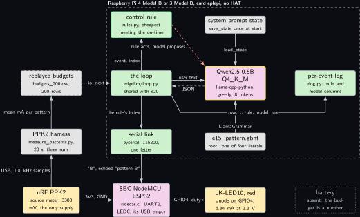
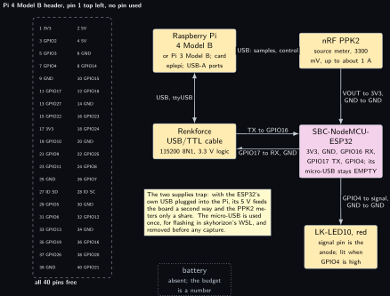
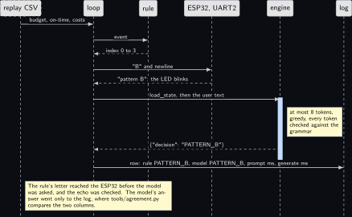
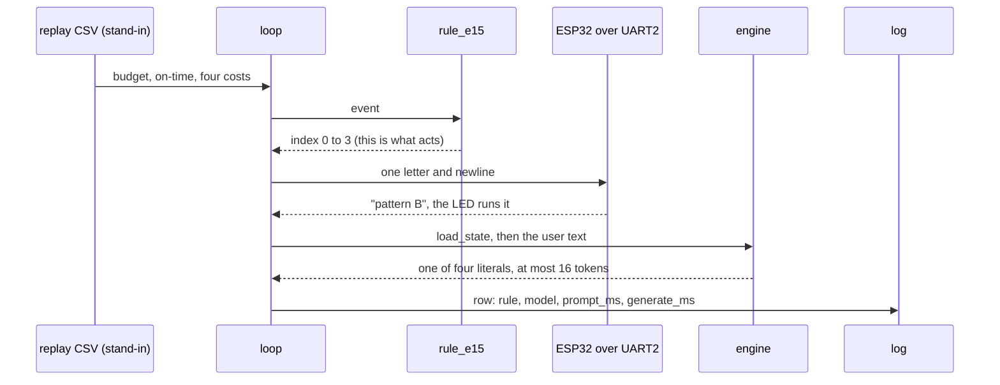
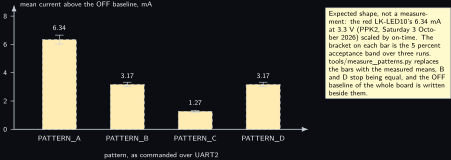

# Project 15. ESP32 sidecar with a bounded pattern proposal

> **Board:** Raspberry Pi 4 Model B or Pi 3 Model B, no HAT; the SBC-NodeMCU-ESP32 on the PPK2  
> **Owns:** the one project where the model's proposal is priced in measured milliamps, and the one loop written in Python that e20 reuses

> [!IMPORTANT]
> **The question, instanced**
>
> What does a small local model add over a two-line threshold, and when does it get it wrong? Here the threshold is a loop over four measured costs, the model is handed the same four numbers, a budget and a brightness requirement, and the question is whether a 0.5B model picks the cheapest pattern that still meets the requirement over 200 budgets, when the rule's pick is what the ESP32 actually runs and the model's pick is only logged.

> **Key facts**
>
> - **Board:** Raspberry Pi 4 Model B, or the Pi 3 Model B with no other change; card `eplepi`; 4 threads
> - **HAT slot:** empty; both instruments reach the Pi over USB
> - **Parts:** the SBC-NodeMCU-ESP32 as the sidecar, one Joy-it LK-LED10 module (red) on its GPIO4, the nRF PPK2 as the ESP32's only supply and its ammeter, the Renkforce USB/TTL cable on the ESP32's UART2
> - **Interface:** the replayed budget CSV through `edgellm/io.py`; pyserial to the ESP32 at 115200; ppk2-api to the PPK2; the PPK2 in source-meter mode at 3.3 V
> - **Language and variant:** Python, catalogue letter R8 in Python: the loop is a client of an engine it does not link, here `llama-cpp-python` in the same process; the bench rule that code is C is consciously overridden, and this chapter says so
> - **Model:** Qwen2.5-0.5B-Instruct Q4\_K\_M, 491 MB, Apache 2.0
> - **Decision:** one of PATTERN\_A, PATTERN\_B, PATTERN\_C, PATTERN\_D through the grammar; the stub answers PATTERN\_A in CI
> - **Control rule:** the cheapest pattern whose on-time meets the requirement; a tie goes to the lower index; the budget is told to the model and cannot change the rule
> - **Acceptance:** the PPK2 mean current per pattern repeats within 5 percent across three 20 s runs; the agreement table over the 200 budget prompts with zero rows outside the four literals
> - **Difficulty:** 3 of 5
> - **Effort:** one evening on the host for the package, the rule and the oracle; one evening in skyhorizon's WSL for the firmware; one afternoon on the bench for the PPK2 runs and the 200 decisions

## Pitch

The ESP32 is the one board on this bench the PPK2 can both power and meter, so it is the one place where a pattern's cost can be a measured milliamp figure rather than a datasheet line. Four LED patterns run on the sidecar, steady, slow blink, fast blink and breathing, each selected by one letter over a UART and each echoed back. A harness on the Pi commands each in turn, captures 20 seconds of current three times, and writes the mean and the spread per pattern into the evidence folder; the replay generator folds that table into 200 budget prompts. The loop hands the model the four costs, a budget and the minimum on-time required, and the model proposes a pattern; the rule computes the cheapest pattern that meets the requirement in six lines, and the rule's letter is what goes down the wire. The model's letter goes to the log beside it, and the agreement table says whether a 0.5B model can compare four numbers it has been given. The chapter is written in Python on purpose and says why; the shared package it leaves behind is what [Project 20](20-what-should-i-measure-next.md) runs on.

## Origin and what changed

Draft idea 8, the hybrid Pi and ESP32 system, and the power-aware half of draft idea 2, merged. Draft 8 had the ESP32 join the LAN over Wi-Fi and take MQTT topics, which is the kit labs’ P16 and is not repeated; here the radio stays off, because a sidecar with Wi-Fi on cannot be metered to a stable milliamp figure in 20 seconds and a transmit burst approaches the PPK2's sourcing limit of about 1 A. Draft 2 wanted a battery budget decided by the model; what changed is that the PPK2 can meter the ESP32 and cannot meter a Pi, so the costs became real and the battery became a number in a CSV, drawn dotted. The decision is non-safety, an LED pattern, which is why this chapter and not a modem chapter is where the model's proposal is priced. The engine moved from the C core to `llama-cpp-python`, because the instrument's only host interface is a Python package and three languages in one loop would have been cost without gain; Future and extra exercises prices the C form.

## Parts and interface

| **Part** | **Role** | **Interface** | **Address or pin** |
| --- | --- | --- | --- |
| Raspberry Pi 4 Model B | runs the loop, the model, the harness; the Pi 3 Model B runs the same files | SSH; two USB-A ports | none on the header |
| Card `eplepi` | Raspberry Pi OS trixie, the model file in `~/models`, the Python environment | the card is the hostname |  |
| SBC-NodeMCU-ESP32 | the sidecar: four patterns, one letter, one echo | UART2 at 115200 8N1 | GPIO17 TX, GPIO16 RX, 3V3, GND; its micro-USB empty |
| LK-LED10 module, red | the actuator; 6.34 mA at 3.3 V (PPK2, Saturday 3 October 2026) | one GPIO through LEDC | ESP32 GPIO4 to the signal pin, GND to GND |
| nRF PPK2 | the ESP32's only supply at 3300 mV, and the ammeter at 100 kHz | USB to the Pi, `ttyACM`; ppk2-api 0.9.2 | VOUT to 3V3, GND to GND |
| Renkforce USB/TTL cable | the serial link to the ESP32 | USB to the Pi, `ttyUSB`; pyserial 3.5 | TX to GPIO16, RX from GPIO17, GND |
| `replay/budgets_200.csv` | 200 rows of `t_s,tag,v0..v5`: budget, on-time, four costs, from `tools/make_replay.py` | `ReplaySource` |  |
| `grammars/e15_pattern.gbnf` | the four literals in the house shape | `LlamaGrammar` | root symbol `root` |
| `prompt.txt` | the system prompt, 68 words | decoded once, state saved |  |
| `edgellm_e15/rules.py` | the control rule, registered by name | `find("e15")` | index 0 to 3 |
| `tests/oracle/e15.expected.csv` | the 200 expected rule decisions and the stub's column | the oracle test, row by row |  |

## Model and grammar

Qwen2.5-0.5B-Instruct at Q4\_K\_M, the file `qwen2.5-0.5b-instruct-q4_k_m.gguf`, 491 MB, Apache 2.0, from [Qwen/Qwen2.5-0.5B-Instruct-GGUF](https://huggingface.co/Qwen/Qwen2.5-0.5B-Instruct-GGUF) (verified Wednesday 14 October 2026), the Pi 4 default for enum decisions and admitted on the Pi 3 Model B only if [Project 1](01-bring-up-and-the-honest-tokens-per-second.md)'s reading of that board gives more than 818 MB available; otherwise the chapter runs on SmolLM2-360M with no other change. The engine is not the pinned tag of [Project 1](01-bring-up-and-the-honest-tokens-per-second.md) this time: it is the llama.cpp build that `llama-cpp-python` 0.3.36 bundles and compiles at install time, MIT, the latest release on PyPI read from [pypi.org/pypi/llama-cpp-python/json](https://pypi.org/pypi/llama-cpp-python/json) (verified Wednesday 14 October 2026); the llama.cpp commit it bundles is read from the installed package on the Pi and written beside the manifest (to verify). The grammar is GBNF in the house shape, with PATTERN\_A first so that the CI stub has a quiet answer; the syntax is the engine's own, documented at [grammars/README.md](https://github.com/ggml-org/llama.cpp/blob/master/grammars/README.md) (to verify).

```gbnf
root     ::= "{" ws "\"decision\"" ws ":" ws decision ws "}"
decision ::= "\"PATTERN_A\"" | "\"PATTERN_B\"" | "\"PATTERN_C\"" | "\"PATTERN_D\""
ws       ::= [ \t]*
```

The system prompt, decoded once and never again during a run, reads in full: You are an edge agent on a Raspberry Pi with an ESP32 driving one LED. Patterns: PATTERN\_A steady, on 100 percent. PATTERN\_B slow blink, on 50 percent. PATTERN\_C fast blink, on 20 percent. PATTERN\_D breathing, on 50 percent on average. You see each pattern's measured cost in milliamps, a budget and the minimum on-time required. Answer only with the JSON decision: the cheapest pattern whose on-time meets the requirement. The on-times are told to the model because they are properties of the firmware, not of the event; the costs are in the user text because they are what the bench measured.

## What the model decides or writes

One of four literals, through the grammar, with `n_predict` 8 and greedy sampling. The user text is the four costs, the budget and the requirement, in one sentence of about thirty tokens, and the answer is checked token by token against the grammar's automaton, so the model column holds one JSON object whose decision is one of the four names, or an object that did not close inside eight tokens, which the agreement tool counts as a row whose model column is not one of the rule's decisions and the chapter counts as its own failure. In CI there is no model file: `StubEngine` in the shared package expands the grammar's first alternative on every path, exactly as `common/c/src/edgellm_stub.c` does, so it answers `{"decision":"PATTERN_A"}` with timings of zero and the engine column reading stub, and the loop, the log, the oracle test and the agreement tool run end to end on a host with no engine, which is how the tests ran on the authoring laptop.

## Control rule

Six lines on the six values of the event: `v0` the budget in milliamps, `v1` the minimum on-time in percent, `v2` to `v5` the mean cost of each pattern above the LED-off baseline. The on-times are constants of the firmware and the rule carries the same four figures as `firmware/main/sidecar.c`. The budget is not read: the cheapest qualifying pattern fits the budget whenever any does, so the budget can only change what the model answers, never what the rule does, and that asymmetry is intended. The last line registers the rule under the name `e15`.

```python
NAMES = ("PATTERN_A", "PATTERN_B", "PATTERN_C", "PATTERN_D")
ON_PCT = (100.0, 50.0, 20.0, 50.0)   # the on-time of each pattern, fixed by the firmware
COMMANDS = ("A", "B", "C", "D")      # the one-letter command the firmware answers to


class RuleE15:
    project = "e15"
    names = NAMES

    def __call__(self, history, ev):
        if ev.n < 6:                                           # a short event is steady, no guess
            return 0
        best, best_cost = 0, None
        for i in range(4):
            if ON_PCT[i] < ev.v(1):                            # on-time below the requirement
                continue
            cost = ev.v(2 + i)
            if best_cost is None or cost < best_cost:          # strictly cheaper wins a tie
                best, best_cost = i, cost
        return best


rule_e15 = register(RuleE15())
```

The two hooks this project adds to the shared loop are in `edgellm_e15/main.py`. The first sends the rule's letter down the serial link and checks the echo; without a link, in CI and on the host, the replay source records the call instead, exactly as `io_actuate` does in the C replay backend. The second builds the user text and names only the numbers.

```python
    def actuate(self, source, rule, index, ev):
        """The rule's pattern goes to the ESP32 as one letter; the reply must echo it."""
        if self.link is None:
            return source.actuate("pattern", index)
        reply = self.link.command(COMMANDS[index])
        self.sent += 1
        if reply != "pattern " + COMMANDS[index]:
            self.mismatches += 1
            return -1
        return 0

    def format_prompt(self, ev, history):
        """The costs, the budget and the requirement; the on-times are in prompt.txt."""
        if ev.n < 6:
            return None                                       # log the rule alone
        return ("cost mA: A %.2f, B %.2f, C %.2f, D %.2f. Budget %.1f mA. "
                "Minimum on-time %.0f percent. Decide."
                % (ev.v(2), ev.v(3), ev.v(4), ev.v(5), ev.v(0), ev.v(1)))
```

The sidecar's half of the rule is the function below, in C on the ESP32: every pattern is a function of time, so a letter that arrives mid-cycle restarts the cycle and the on-time figures hold per cycle. The firmware never starts Wi-Fi or Bluetooth, which is what keeps the 20 s mean stable.

```c
static int duty_for(char p, int ms)
{
    switch (p) {
    case 'A': return DUTY_MAX;                                  /* steady */
    case 'B': return (ms % 1000) < 500 ? DUTY_MAX : 0;          /* 1 Hz, 50 percent */
    case 'C': return (ms % 200) < 40 ? DUTY_MAX : 0;            /* 5 Hz, 20 percent */
    case 'D': {                                                 /* 0.5 Hz triangle */
        int phase = ms % 2000;
        int up = phase < 1000 ? phase : 2000 - phase;           /* 0..1000..0 */
        return up * DUTY_MAX / 1000;
    }
    default:  return 0;                                         /* O and anything else */
    }
}
```

## Real, modelled, absent

- **have:** real: the Pi, the card, the model file, the ESP32 and its firmware, the red LK-LED10 on GPIO4, the PPK2 as the only supply, the Renkforce cable, the rule, the grammar, the log, and the measured mean current per pattern once the harness has run
- **learn:** modelled: the budget and on-time pairs, a seeded draw of 200 rows drawn dashed; and, until `evidence/pattern_costs_summary.csv` exists, the four costs in the replay, which are the red module's 6.34 mA scaled by each pattern's on-time, a derivation from one named record and not a measurement
- **absent:** absent: a battery, drawn dotted. The budget is a number in a CSV; no cell is discharged and no coulomb counter is read. The chapter never claims a runtime

## System architecture



*Figure 15.1. The Pi and the sidecar side. Inside a dashed layer labelled with the board and the card, seven solid blocks: the loop (edgellm/loop.py) in user-space green at the centre, the control rule above it with the green rule outline, the model to its right with the yellow model outline, grey blocks for the system prompt state (save\_state once, load\_state per decision) above the model and the grammar file below it, the per-event log in green on the right, and the serial link in green below the loop. Outside the layer: on the left a dashed grey block for the replayed budgets, the one stand-in, with a grey block for measure\_patterns.py below it; along the bottom a solid firmware-coloured block for the ESP32, a solid hardware block for the red LK-LED10, a solid hardware block for the PPK2, and a dotted grey block for the absent battery. Solid arrows carry io\_next from the replay to the loop, the event up to the rule and its index back, the user text to the model with a dashed reply carrying the JSON decision, the state and the grammar into the model, the row down and across to the log, the rule's index down to the serial link and the letter B on to the ESP32 with its echo, the duty from the ESP32 to the LED, 3V3 and GND from the PPK2 to the ESP32 and never its USB, the 100 kHz samples from the PPK2 to the harness, and the mean milliamps per pattern from the harness into the replay. A dashed stop-coloured arrow from the rule to the model says that the rule acts and the model proposes.*

Two arrows carry the chapter: the dashed red one, the volume's safety rule, since the only path to the ESP32 starts at the rule; and the one from the harness into the replay, the chapter's own rule, since every cost the model is told traces to a PPK2 capture.

## Wiring

| **Header pin** | **BCM** | **Part pin** | **Wire colour if known** |
| --- | --- | --- | --- |
| none | none | none | nothing on the header; the PPK2 (`ttyACM`, to verify on the first plug-in) and the Renkforce cable (`ttyUSB`) are both USB, addressed by their `/dev/serial/by-id` paths |
| ESP32 3V3 |  | PPK2 VOUT | not recorded; label the lead; source-meter mode, 3300 mV, set before the DUT is enabled |
| ESP32 GND |  | PPK2 GND, cable GND, LED GND | not recorded; connect first |
| ESP32 GPIO17 |  | cable RX | not recorded; read the plug label; UART2 TX |
| ESP32 GPIO16 |  | cable TX | not recorded; read the plug label; UART2 RX |
| ESP32 GPIO4 |  | LK-LED10 red, signal pin | not recorded; the anode; lit when high |
| ESP32 micro-USB |  | nothing | empty during every capture and run; flashing only, in skyhorizon's WSL |



*Figure 15.2. The 40-pin header of the Pi 4 Model B as two columns of small solid blocks, pin 1 at the top left, with no block filled and a dashed layer around all forty labelled all 40 pins free. To the right, a solid hardware block for the Pi joined by a solid two-headed line labelled USB, samples and control, to a solid hardware block for the PPK2 in source-meter mode at 3300 mV, and by a second two-headed line labelled USB, ttyUSB, down to a solid hardware block for the Renkforce USB/TTL cable at 115200 8N1 with 3.3 V logic. Below the PPK2 a solid firmware-coloured block for the ESP32, whose text names 3V3, GND, GPIO16 RX, GPIO17 TX and GPIO4 and says its micro-USB stays empty; a solid arrow from the PPK2 carries VOUT to 3V3 and GND to GND, two solid arrows between the cable and the ESP32 carry cable TX to GPIO16 and GPIO17 to cable RX with GND, and a solid arrow down carries GPIO4 to the signal pin of the red LK-LED10, a solid hardware block. A dotted grey block for the absent battery sits below the cable, and a note states the two supplies trap: with the ESP32's own USB plugged into the Pi, its 5 V feeds the board a second way and the PPK2 meters only a share.*

The UART2 pins are set by `uart_set_pin()` in the firmware, so the board's default mapping does not matter; the silkscreen labels of GPIO16 and GPIO17 are read before wiring against the manual linked from [joy-it.net/en/products/SBC-NodeMCU-ESP32](https://joy-it.net/en/products/SBC-NodeMCU-ESP32) (verified Wednesday 14 October 2026; the manual PDF is to verify), which gives 3.3 V operation and 40 mA per GPIO, more than the red module's 6.34 mA. GPIO0, GPIO2, GPIO5, GPIO12 and GPIO15 are strapping pins, named on the ESP-IDF GPIO page [api-reference/peripherals/gpio.html](https://docs.espressif.com/projects/esp-idf/en/stable/esp32/api-reference/peripherals/gpio.html) (verified Wednesday 14 October 2026), and carry nothing here.

## Sequence



*Figure 15.3. One budget event as a sequence diagram with six actors: the replay CSV, drawn dashed as the stand-in, then the loop, the rule, the ESP32 on UART2, the engine and the log, all solid. Solid arrows carry the budget, on-time and costs from the replay to the loop and the event from the loop to the rule; a dashed reply brings the index 0 to 3 back. A solid arrow carries the letter B and a newline from the loop to the ESP32 and a dashed reply brings pattern B back, with the note that the LED blinks. Over a blue activation bar on the engine, a solid arrow from the loop carries load\_state and then the user text, with a note that at most 16 tokens are sampled greedily and every one is checked against the grammar; a dashed reply returns the JSON decision PATTERN\_B to the loop, and the last solid arrow writes the row, rule PATTERN\_B, model PATTERN\_B, prompt ms and generate ms, into the log. A note says that the rule's letter reached the ESP32 before the model was asked and that the echo was checked.*

## States and data


*Figure 15.4. Five rounded green states: OFF at the left, entered from the initial dot and labelled as the letter O and the PPK2 baseline; then PATTERN\_A (steady, on 100 percent) and PATTERN\_B (1 Hz blink, on 50 percent) in the top row and PATTERN\_C (5 Hz blink, on 20 percent) and PATTERN\_D (breathing, 50 percent mean) in the bottom row. Solid arrows from OFF to A and to C carry the letters A and C; a solid arrow from A to B carries required on-time 21 to 50 percent, from B down to D the tie at 50 percent with D only when it measures cheaper, from B diagonally to C the requirement at most 20 percent, from C up to A the requirement above 50 percent, and from D to C cheaper still, C when at most 20. A note says that OFF enters any pattern on its letter, that the requirement is at or above, and that with the placeholder costs B and D tie so D is never the rule's answer until the evidence says it is cheaper. Nothing is dashed or dotted.*

The record is the per-event log, `projects/e15-esp32-sidecar/evidence/e15_run.csv`, in the shape `elog.h` fixes and `common/python/edgellm/edgellm/elog.py` reproduces byte for byte: `t_s, tag, raw, rule, model, prompt_ms, generate_ms, n_generated, engine`, with the raw column holding the six values joined by semicolons. The second record is `evidence/pattern_costs_summary.csv` with the columns `pattern, mean_ma, spread_pct, runs`, written by the PPK2 harness and read by the replay generator; and the third is `evidence/pattern_costs.csv`, every capture with its run number, so that the summary can be recomputed by hand.

## Data flow

```text
  tools/measure_patterns.py (once, on the Pi)     the loop, edgellm/loop.py, on the Pi            host
  +----------------------------+                  +-------------------------------------+   +--------------+
  | PPK2 source 3300 mV -> ESP32|  O,A,B,C,D x 3   | rule_e15(history, ev) -> 0..3        |   | agreement.py |
  | 20 s mean mA per pattern   |----------------->|      |                               |   |  4 by 4      |
  | evidence/pattern_costs_*   |  into the replay |      v  actuate: "B\n" -> UART2 ---> | ESP32: "pattern B"
  +----------------------------+                  |      |  <- "pattern B" echo checked  |   +--------------+
  tools/make_replay.py (seeded) ----------------->|      v  format_prompt(ev)            |          ^
    replay/budgets_200.csv: budget, on-time, costs|      "cost mA: A 6.34, B 3.17 ..."   |          |
  prompt.txt --tokenize, eval once--------------->| [state] --load_state--> ctx          |          |
    save_state (at start)                         |      user tokens --eval--> ctx        |          |
  grammars/e15_pattern.gbnf -------------------->|      generate <= 8 under grammar     |          |
    LlamaGrammar.from_string                      |      {"decision": "PATTERN_B"}       |          |
                                                  |      v                               |          |
                                                  | elog row: t, rule, model, ms, engine |--200 rows+
                                                  +-------------------------------------+
  tests/oracle/e15.expected.csv: rule column from the same on-time table in Python; model column the stub's
```



## Latency design

The system prompt is 68 words, decoded once at start with `Llama.eval` and kept with `Llama.save_state`, which returns a state object in memory rather than a file; before every decision `Llama.load_state` restores it and the user text, about thirty tokens, is the only decode the event pays for. The binding's `generate` is called with `reset=False` so that it continues from the restored context rather than clearing it; the first bench run confirms that (to verify) by reading the `prompt_ms` column against [Project 1](01-bring-up-and-the-honest-tokens-per-second.md)'s tokens per second, since a figure that fits a full prompt decode means the state was not reused. The file route the C loop takes has no one-call equivalent in the binding, so a restart decodes the system prompt again, once. `n_ctx` 512, `n_predict` 8, greedy under the grammar, 4 threads; the bench run adds `--interval 1` so that the LED is seen changing pattern between decisions. What the interpreter adds per decision is the tokenize call, the state copy and the generator protocol around each sampled token, measured by the same two columns against [Project 2](02-the-decision-loop.md)'s C loop on the same board.

> [!NOTE]
> **The generation budget here is 16 and was 8 until Saturday 17 October 2026.** It was raised without being measured on this project, which is the honest description of it. On that day e02, on a Raspberry Pi 4 Model B, lost 949 rows of 1000 to a budget of 8: the Qwen2.5 tokenizer needs nine tokens for the ALERT path where NORMAL needs eight, and every short row was a legal prefix of its grammar that stopped before the closing brace, so no grammar error was raised anywhere and no counter in the repository moved. The sentence claiming that eight sufficed on every tokenizer of the ladder had never been checked against one tokenizer, and it is withdrawn wherever it appeared.
>
> The budget is now set generously rather than at a measured minimum because an unused token is free. The loop stops at the end-of-generation token, and this grammar's root ends at the closing brace with nothing optional after it, so once the object closes that token is the only legal continuation: a budget of 16 and a budget of 8 produce the same bytes and the same timings for every answer that fits in eight. A budget one token short, by contrast, costs the whole row and says nothing while doing it. What is still unmeasured is the token count of this project's own longest literal on this project's own tokenizer, and [Project 2](02-the-decision-loop.md)'s pitfall on exactly that is the one to read before trusting any figure here.

## Steps

**Step 1.** Generate the replay file and the oracle on the authoring laptop, and read the summary: it prints which costs it used, the count of each decision and the agreement the stub will reach.

```bash
# win11 aquamarine
cd C:\Users\aquamarine\Desktop\edge-llm-pi; python projects\e15-esp32-sidecar\tools\make_replay.py
```

**Step 2.** Run the shared package's cases and the project's cases with the stub on the authoring laptop. Nothing compiles: the stub answers from the grammar alone, and the engine's import is guarded.

```bash
# win11 aquamarine
cd C:\Users\aquamarine\Desktop\edge-llm-pi; python -m pytest common\python\edgellm `
  projects\e15-esp32-sidecar
```

**Step 3.** Build the firmware in skyhorizon's WSL with ESP-IDF, target `esp32`, and write the version `idf.py --version` prints into `firmware/README.md`.

```bash
# win11 skyhorizon, WSL side
cd ~/src/edge-llm-pi/projects/e15-esp32-sidecar/firmware; idf.py set-target esp32; idf.py build
```

**Step 4.** Flash through the board's own micro-USB, the one time it is plugged in, after `usbipd attach` into WSL; read the boot line with its build stamp, then unplug the micro-USB.

```bash
# win11 skyhorizon, WSL side
cd ~/src/edge-llm-pi/projects/e15-esp32-sidecar/firmware; idf.py -p /dev/ttyUSB0 flash monitor
```

**Step 5.** On the Pi, make the environment and install the pinned packages. The `llama-cpp-python` wheel builds llama.cpp from source here; how long that takes on a Pi 4B is not measured and is written down when it has been.

```bash
# Raspberry Pi 4 Model B, card eplepi
cd ~/edge-llm-pi; python -m venv .venv; .venv/bin/pip install -r requirements.txt
```

```bash
# Raspberry Pi 4 Model B, card eplepi
cd ~/edge-llm-pi; .venv/bin/pip install -e common/python/edgellm; \
  .venv/bin/pip install -e projects/e15-esp32-sidecar
```

**Step 6.** Wire per `wiring.md`: PPK2 VOUT to the ESP32's 3V3, grounds common, the cable on GPIO16 and GPIO17, the red module on GPIO4, the ESP32's micro-USB in the drawer. Read the two serial identities and the throttle bits.

```bash
# Raspberry Pi 4 Model B, card eplepi
cd ~; ls -l /dev/serial/by-id/; vcgencmd get_throttled
```

**Step 7.** Run the PPK2 harness: it sets source-meter mode and 3300 mV, enables the DUT, commands O, A, B, C, D in turn, captures 20 s each, three runs, and prints PASS when every pattern's spread is within 5 percent.

```bash
# Raspberry Pi 4 Model B, card eplepi
cd ~/edge-llm-pi; .venv/bin/python projects/e15-esp32-sidecar/tools/measure_patterns.py \
  --serial /dev/serial/by-id/<the Renkforce cable> --out projects/e15-esp32-sidecar/evidence
```

**Step 8.** Regenerate the replay from the measured means, so that the costs in the user text are the bench's; the generator prints measured and the file name when it finds the summary.

```bash
# Raspberry Pi 4 Model B, card eplepi
cd ~/edge-llm-pi; .venv/bin/python projects/e15-esp32-sidecar/tools/make_replay.py
```

**Step 9.** Run the 200 decisions with the real model and the serial link, and read the throttle bits again. The log's engine column must name the binding, not the stub, and the summary line must report zero commands not echoed.

```bash
# Raspberry Pi 4 Model B, card eplepi
cd ~/edge-llm-pi; .venv/bin/edgellm-e15 --project e15 \
  --replay projects/e15-esp32-sidecar/replay/budgets_200.csv \
  --grammar projects/e15-esp32-sidecar/grammar.gbnf \
  --prompt projects/e15-esp32-sidecar/prompt.txt \
  --model ~/models/qwen2.5-0.5b-instruct-q4_k_m.gguf --interval 1 \
  --log projects/e15-esp32-sidecar/evidence/e15_run.csv \
  --serial /dev/serial/by-id/<the Renkforce cable>; vcgencmd get_throttled
```

**Step 10.** Score the log. Rows without a literal must be zero; the agreement goes into the table below with its date, each disagreement classified by whether the model's pick met the on-time, exceeded the budget, or neither.

```bash
# Raspberry Pi 4 Model B, card eplepi
cd ~/edge-llm-pi; python tools/agreement.py projects/e15-esp32-sidecar/evidence/e15_run.csv --md
```

## Variant chosen

Python, catalogue letter R8 in Python rather than Rust: the loop is a client of an engine it does not link, and the engine is `llama-cpp-python` in the same process, its bundled llama.cpp built at install time. On practicality it scores highest because the PPK2 has a Python API and nothing else: the harness that produces the chapter's one measured number can only be Python, and a loop in another language would put two runtimes around one instrument. On relevance it fits, because the project is orchestration of an instrument, a sidecar and a model, three things reached through three serial or binding interfaces. On popularity Python scores highest of the volume's four languages for exactly this orchestration. On compliance the boundary is the kernel's serial ABI, `/dev/ttyUSB` and `/dev/ttyACM` through pyserial and ppk2-api, and the pinned wheels of `requirements.txt`. On best practice the house rule of the bench is that code that runs on a board is C, and that rule is consciously overridden here by Joseph's per-project rule, which scores each project on the five criteria alone; the chapter says so in those words. What it costs: the interpreter's time per decision, measured in the two timing columns against [Project 2](02-the-decision-loop.md)'s; the wheel's build time on the Pi, unknown until measured; and a Yocto recipe that depends on a package with no recipe. What it gains: one language for the instrument, the link and the model, and the shared package `common/python/edgellm` that [Project 20](20-what-should-i-measure-next.md) runs on without a second loop. The measured figures go into the table below once the run exists.

| **Loop** | **prompt ms** | **generate ms** | **VmRSS kB** | **Instrument** |
| --- | --- | --- | --- | --- |
| Python, this chapter | not measured | not measured | not measured | the e15 log on the Pi 4B, not run yet |
| C, [Project 2](02-the-decision-loop.md)'s loop | not measured | not measured | not measured | the e02 log on the same board, not run yet |

## Embedded Linux and Yocto

Two recipes in `meta-edgellm/recipes-app/edgellm-e15/`, both on the `setuptools3` class and not on the layer's shared include, which is the C and C++ pattern. `python3-edgellm_0.1.bb` builds the shared package from `common/python/edgellm` in the tree the layer sits in, and runtime-depends on `python3-pyserial`; `edgellm-e15_0.1.bb` builds the project, installs the prompt, the grammar and the replay under `/usr/share/edgellm/e15`, carries the unit, and runtime-depends on the shared package, on pyserial, on the model package and on `python3-llama-cpp-python`. That last package has no recipe in poky or meta-openembedded: the wheel builds llama.cpp at install time, and a recipe would have to carry that CMake build against the layer's `llama-cpp` runtime recipe. The recipe names the dependency anyway, with a comment, so that the layer parse fails loudly rather than the service failing quietly on the board; the routes out are a `python3-llama-cpp-python` recipe under `recipes-runtime/` or `--stub` in the unit (to verify which, on the first parse). The unit runs the 200-row replay with the serial link and ends by itself; it is not auto-enabled, because the cable's by-id path has to be written into it on the board first. No overlay fragment: nothing on the header.

```text
# The budget is 16 and not the core's default of 8. On Saturday 17 October 2026 e02's
# thousand-decision run on a Raspberry Pi 4 Model B wrote 949 objects that never closed,
# because the Qwen2.5 tokenizer needs nine tokens for its ALERT path where NORMAL takes
# eight. Nothing here has been counted against a tokenizer either, so this budget is set
# generously rather than tightly: the loop breaks at the end-of-generation token, and this
# grammar's root ends at the closing brace with nothing optional after it, so an unused
# budget token costs nothing while a budget one token short costs the whole row.
# e15's chapter named this failure in its own pitfalls list, PATTERN_D is the longest
# answer, and named the remedy, --n-predict 10, and then shipped 8 anyway.
ExecStart=/usr/bin/edgellm-e15 --project e15 \
    --replay /usr/share/edgellm/e15/replay/budgets_200.csv \
    --model /usr/share/edgellm/models/qwen2.5-0.5b-instruct-q4_k_m.gguf \
    --grammar /usr/share/edgellm/e15/grammar.gbnf \
    --prompt /usr/share/edgellm/e15/prompt.txt \
    --log /var/lib/edgellm/e15.csv \
    --threads 4 --n-predict 16 \
    --serial /dev/serial/by-id/<the-Renkforce-cable>
```

```bash
# win11 skyhorizon, WSL side
cd ~/bench/edge-llm-pi; kas shell meta-edgellm/kas/edgellm-pi4.yml -c "bitbake -p"
```

## Acceptance test

Two quantities. First, for each of the four patterns, the spread of the 20 s mean current across three runs, (max minus min) over the mean, as `tools/measure_patterns.py` computes and prints it from the PPK2 in source-meter mode at 3300 mV with the ESP32's micro-USB disconnected: the pass condition is at most 5 percent for every pattern, and the tool exits non-zero otherwise. An OFF baseline that moves between the three sweeps is read as a wiring fault first, because nothing in the firmware changes between sweeps. Second, over the 200 rows of `replay/budgets_200.csv` as regenerated from the measured means, the number of rows whose model column holds none of the four literals, counted by `tools/agreement.py`: the pass condition is zero. Both are taken with `vcgencmd get_throttled` reading `0x0` before and after, and the loop's summary line must report zero commands not echoed. The commands are steps 7 and 9; CI checks the second quantity's shape through the oracle test with the stub.

## Agreement table

Over the 200 budgets as generated on Wednesday 14 October 2026 by `tools/make_replay.py` with its fixed seed and the placeholder costs, the rule column holds 71 PATTERN\_A, 92 PATTERN\_B, 37 PATTERN\_C and 0 PATTERN\_D: with the placeholder, B and D cost the same and the lower index wins, so D cannot be the rule's answer until the evidence file says it is cheaper. On the bench the model column is not measured. In CI the stub answers PATTERN\_A for every row, so the agreement is the PATTERN\_A fraction, 71 of 200, 35.5 percent, and every disagreement is of one kind, the stub proposing the steady pattern where the rule chose a cheaper one. The number is printed so that the first figure from the real model has something beside it: a model that scores 35 percent here has learned nothing the first literal did not give it.

| **Rule says** | **Model A** | **Model B** | **Model C** | **Model D** | **Instrument** |
| --- | --- | --- | --- | --- | --- |
| PATTERN\_A, 71 | 71 | 0 | 0 | 0 | the stub in CI; bench: not measured |
| PATTERN\_B, 92 | 92 | 0 | 0 | 0 | the stub in CI; bench: not measured |
| PATTERN\_C, 37 | 37 | 0 | 0 | 0 | the stub in CI; bench: not measured |
| PATTERN\_D, 0 | 0 | 0 | 0 | 0 | placeholder tie; the measured costs may add rows |
| agreement | 35.5 percent |  |  |  | the stub in CI; bench: not measured, run pending |

## Measured data



*Figure 15.5. The shape the acceptance test expects, drawn with TikZ axes and not a measurement. The horizontal axis carries the four patterns as commanded over UART2, the vertical axis the mean current above the OFF baseline in milliamps, 0 to 8. Four dashed hardware-coloured bars at 6.34, 3.17, 1.27 and 3.17 mA for PATTERN\_A to PATTERN\_D, each labelled with its value and each carrying a small bracket at plus and minus 5 percent of its height, the acceptance band over three runs. A note says the bars are the red LK-LED10's 6.34 mA at 3.3 V from the PPK2 record of Saturday 3 October 2026 scaled by each pattern's on-time, that tools/measure\_patterns.py replaces them with the measured means, that B and D then stop being equal, and that the OFF baseline of the whole board is written beside them.*

## Pitfalls

- **The two supplies trap.** With the ESP32's micro-USB plugged into the Pi, the Pi's 5 V feeds the board through its regulator a second way and the PPK2 meters whatever share happens to flow through VOUT. Three patterns that measure the same plausible current are the symptom. The micro-USB is used once, for flashing in skyhorizon's WSL, and is not on the bench during a capture.
- **Ampere-meter mode where source-meter mode is meant.** In ampere-meter mode the PPK2 sits in series with a supply the DUT already has; here the DUT has none, so the mode is source meter at 3300 mV, set before `toggle_DUT_power` is called, or the ESP32 sees whatever the instrument was last left at.
- **An LED on a strapping pin.** GPIO0, GPIO2, GPIO5, GPIO12 and GPIO15 are read at reset; a module hanging on one of them can change the boot mode or the flash voltage. The LED is on GPIO4, and a reader who moves it checks the GPIO page first.
- **`ttyUSB` against `ttyACM`.** The Renkforce cable is a USB serial bridge and appears as `ttyUSB`; the PPK2 is a CDC device and appears as `ttyACM`. Both numbers change with plug-in order, and a harness given the wrong one either talks to the instrument as if it were the sidecar or opens the sidecar as if it were the PPK2. Every command uses `/dev/serial/by-id`.
- **The wheel that builds the engine.** `pip install llama-cpp-python` on a Pi compiles llama.cpp from source; it takes long, and how long is unknown until measured, and a 1 GB board may need swap for it. The install is step 5, alone, with the throttle bits read after, and never the step before a timing run.
- **The stub always answers the first literal.** A log where every model cell reads `{"decision":"PATTERN_A"}` and every engine cell reads stub is a CI log, and its 35.5 percent is the PATTERN\_A fraction of the replay, not a property of any model. Read the engine column before the agreement.
- **The placeholder tie.** Until `evidence/pattern_costs_summary.csv` exists, B and D carry the same cost and the rule never answers D; an agreement table with an empty D row is then a property of the placeholder. The replay is regenerated from the measured means before the bench run, and the generator prints which costs it used.
- **A literal that spends the token budget, and a pitfall that is not a gate.** PATTERN\_D is the longest answer; if the object around it does not close inside the budget the row has no literal. This entry named that failure and named its remedy, `--n-predict 10`, and the chapter shipped 8 regardless, which is how e02 came to lose 949 rows of 1000 to the same thing on Saturday 17 October 2026. The budget is now 16, set generously because an unused token is free: the loop stops at the end-of-generation token and this root ends at the closing brace. The first bench log's `n_generated` column says how many were actually spent, and that column, not this paragraph, is what settles whether PATTERN\_D fits.
- **An echo that does not match.** The sidecar answers `pattern ?` to a letter it does not know and the loop counts an actuation error. A non-zero count in the summary line means the link or the firmware, never the model; the board's GPIOs are 3.3 V, and the cable's 5 V lead, if it has one, goes nowhere.

## Future and extra exercises

- The same loop in C on the shared main of [Project 2](02-the-decision-loop.md), with a serial backend for the letter and the capture left to the Python harness: the delta is the interpreter's time per decision, read off the two timing columns of both logs on the same board.
- The same loop in Rust over `llama-cpp-2` (MIT) and `serialport`: the delta is one static binary against a virtual environment, and the bundled engine commit against the wheel's.
- The ESP32 asking the Pi itself: the sidecar sends its own budget line over UART2 and `SerialSource` in the shared package becomes the event source; the delta is a round trip measured on the same cable.
- Deep sleep as a fifth pattern, PATTERN\_E: the ESP32 sleeps between blinks and the PPK2 sees the dev-board's regulator and USB-UART silicon leak as tens of microamps to low milliamps; the delta is the UART that must wake the board.
- Variant D, `llama-server` over HTTP in place of the in-process binding: the delta is the request round trip and the loss of `save_state`, measured in [Project 4](04-pi-thermal-and-throttle-narrator.md).

## Video potential

4 of 5. The hook: a tiny model is told what each blink costs, measured, and picks one; a six-line rule picks too, and the LED does what the rule says. On screen the PPK2 trace switching between four patterns, four milliamp figures with their spread, then the log with two columns that mostly agree. The three-run capture, five minutes, is recorded earlier and labelled so; a disagreement may not come on cue.

## Sources

- Qwen2.5-0.5B-Instruct-GGUF, Apache 2.0, the file `qwen2.5-0.5b-instruct-q4_k_m.gguf` at 491 MB, [huggingface.co/Qwen/Qwen2.5-0.5B-Instruct-GGUF](https://huggingface.co/Qwen/Qwen2.5-0.5B-Instruct-GGUF) (verified Wednesday 14 October 2026).
- llama-cpp-python, MIT, 0.3.36 the latest release on PyPI, [pypi.org/pypi/llama-cpp-python/json](https://pypi.org/pypi/llama-cpp-python/json) (verified Wednesday 14 October 2026); its API reference for `Llama`, `tokenize`, `eval`, `generate`, `detokenize`, `save_state`, `load_state` and `token_eos`, [llama-cpp-python.readthedocs.io/en/latest/api-reference/](https://llama-cpp-python.readthedocs.io/en/latest/api-reference/) (verified Wednesday 14 October 2026); `LlamaGrammar.from_string` and `from_file` from [llama\_cpp/llama\_grammar.py](https://raw.githubusercontent.com/abetlen/llama-cpp-python/main/llama_cpp/llama_grammar.py) on the main branch (verified Wednesday 14 October 2026); the behaviour of `generate(reset=False)` after `load_state` on 0.3.36 is to verify on the bench.
- ppk2-api 0.9.2, GPLv2, released Friday 9 June 2023 per `models/MODELS.md`; the README and the source of `PPK2_API` with `list_devices`, `get_modifiers`, `use_source_meter`, `use_ampere_meter`, `set_source_voltage`, `toggle_DUT_power`, `start_measuring`, `get_data`, `get_samples` and `stop_measuring`, [github.com/IRNAS/ppk2-api-python](https://github.com/IRNAS/ppk2-api-python) (verified Wednesday 14 October 2026).
- pyserial 3.5, BSD-3-Clause, the short introduction with `Serial(port, baudrate, timeout)`, `write`, `readline` and the context manager, [pyserial.readthedocs.io/en/latest/shortintro.html](https://pyserial.readthedocs.io/en/latest/shortintro.html) (verified Wednesday 14 October 2026).
- ESP-IDF v6.1 stable, Apache 2.0 (licence page to verify): the LEDC reference, [api-reference/peripherals/ledc.html](https://docs.espressif.com/projects/esp-idf/en/stable/esp32/api-reference/peripherals/ledc.html) (verified Wednesday 14 October 2026); the UART reference, [api-reference/peripherals/uart.html](https://docs.espressif.com/projects/esp-idf/en/stable/esp32/api-reference/peripherals/uart.html) (verified Wednesday 14 October 2026); the GPIO reference with the strapping pins, [api-reference/peripherals/gpio.html](https://docs.espressif.com/projects/esp-idf/en/stable/esp32/api-reference/peripherals/gpio.html) (verified Wednesday 14 October 2026); the `idf.py` commands, [get-started/linux-macos-start-project.html](https://docs.espressif.com/projects/esp-idf/en/stable/esp32/get-started/linux-macos-start-project.html) (verified Wednesday 14 October 2026). The version installed on skyhorizon's WSL is to verify at the first build.
- JOY-iT SBC-NodeMCU-ESP32, 3.3 V operation, 40 mA per GPIO, [joy-it.net/en/products/SBC-NodeMCU-ESP32](https://joy-it.net/en/products/SBC-NodeMCU-ESP32) (verified Wednesday 14 October 2026); its manual PDF, for the silkscreen labels of GPIO16 and GPIO17, [SBC-NodeMCU-ESP32-Manual-2021-06-29.pdf](https://joy-it.net/files/files/Produkte/SBC-NodeMCU-ESP32/SBC-NodeMCU-ESP32-Manual-2021-06-29.pdf) (to verify).
- Nordic Power Profiler Kit II, the source-meter range and the second USB cable for higher sourced currents, [nordicsemi.com/Products/Development-hardware/Power-Profiler-Kit-2](https://www.nordicsemi.com/Products/Development-hardware/Power-Profiler-Kit-2) (to verify).
- GBNF grammar syntax, in the engine's tree, [grammars/README.md](https://github.com/ggml-org/llama.cpp/blob/master/grammars/README.md) (to verify).
- The bench facts cited by part: the red LK-LED10 at 6.34 mA on Saturday 3 October 2026, the PPK2's limits, the two supplies trap from the kit labs’ P10 and the sidecar pattern from P16, and the honesty rule from the joint node volume; those volumes have no public URL.

---

[Previous](14-joint-monitor.md) &nbsp;&nbsp;|&nbsp;&nbsp; [Contents](../CONTENTS.md) &nbsp;&nbsp;|&nbsp;&nbsp; [Next](16-nb-iot-sleep-interval-from-measured-microamps.md)
