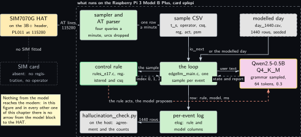
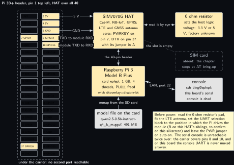
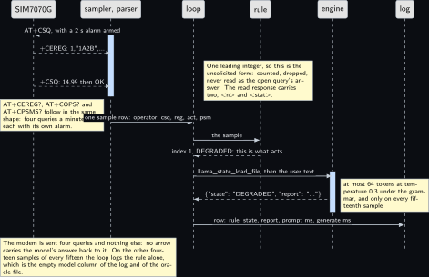
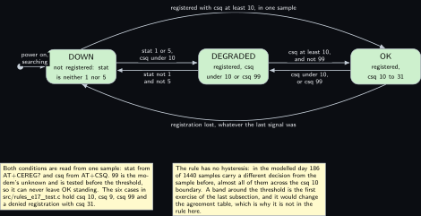
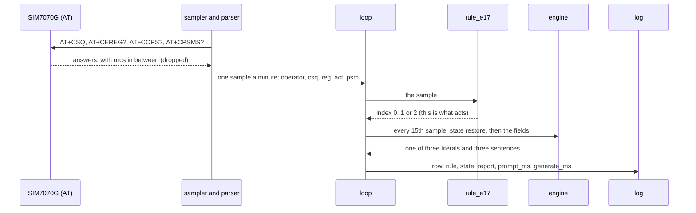
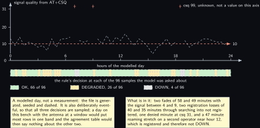

# Project 17. Cellular status summariser

> **Board:** Raspberry Pi 3 Model B Plus, SIM7070G Cat-M, NB-IoT and GPRS HAT  
> **Owns:** the AT parser that survives unsolicited result codes, and the count of operator names the model invented

> [!IMPORTANT]
> **The question, instanced**
>
> What does a small local model add over a two-line threshold, and when does it get it wrong? Here the threshold is registration and one signal number, which is right by definition, and the model writes three sentences about the same fields. So the question becomes a counting question: over a day of samples, how often does it agree with the rule, and how many operator names and numbers does it put in its sentences that the modem never reported.

> **Key facts**
>
> - **Board:** Raspberry Pi 3 Model B Plus, 1 GB, card `eplepi`, 4 threads
> - **HAT slot:** Waveshare SIM7070G Cat-M/NB-IoT/GPRS HAT, the only HAT on this header for this project; the Explorer700 of [Project 8](08-explorer700-console-with-a-model.md) cannot be seated at the same time
> - **Parts:** the Pi 3B+, the SIM7070G HAT with its LTE antenna, a Cat-M or NB-IoT SIM (an open item: without one this chapter stops at AT bring-up and says so)
> - **Interface:** the PL011 UART on header pins 8 and 10 at 115200, freed with `dtoverlay=disable-bt`; the host logic voltage is set by a 0 ohm resistor on the HAT, not by a jumper, and is read on the board before power
> - **Language and variant:** C, catalogue variant C: plain C over `llama.h` through the shared core, with a termios AT parser of 230 lines and its own eleven cases
> - **Model:** Qwen2.5-0.5B-Instruct Q4\_K\_M, 491 MB, Apache 2.0, or SmolLM2-360M if [Project 1](01-bring-up-and-the-honest-tokens-per-second.md)'s memory reading refuses the rung on a 1 GB board
> - **Decision:** one of OK, DEGRADED, DOWN through the grammar, and a report of three sentences, 40 to 400 characters, in the same object
> - **Control rule:** registered and the signal at least 10 is OK; registered with a lower signal, or a signal of 99, is DEGRADED; not registered is DOWN
> - **Acceptance:** 1440 samples at one a minute with a model answer every 15 minutes, so 96 answered samples; the state agreement over those 96; the count of invented operator names and of numbers that were not in the inputs, published whatever they are; the parser's eleven cases pass first
> - **Difficulty:** 4 of 5
> - **Effort:** two evenings on the host for the parser and its cases, one for the sampler and the generated day, one bench day for the sampling run, and an evening for the summaries and the table

## Pitch

A modem is the device most often described in prose and least often described correctly. It answers four short queries about itself, each a line of text with fields in a fixed order, and it also talks when nobody asked: a registration change, a paging notification, a SIM state. So this chapter builds two things that have nothing to do with language models and one that does. The first is an AT parser that keeps exactly one query open at a time and classifies every line before reading it, so that an unsolicited line is counted and dropped rather than mixed into the answer; it has eleven cases and no modem, and it is what makes any later sentence about the link worth reading. The second is a rule of two conditions on the sample the parser produced, which is right by definition and is what acts. The third is the model: once every fifteen minutes it gets the same fields and writes three sentences under a grammar that admits one of three state literals and a bounded report. The product is three published numbers over a day: the agreement between the model's state and the rule's, the count of operator names in the reports that the modem did not report in that minute, and the count of numbers in the reports that were not in that minute's inputs. The last two are the reason this chapter exists. A model writing prose about a device is the most common proposed use of a small local model, and a counted day of it is evidence that is almost never published.

## Origin and what changed

Draft idea 3, the cellular status summariser, with draft idea 17 folded into it. Idea 17 was a cellular failover: two radios, and a decision about which one to use. It is folded in here and not built, and the reason is worth stating in the words the front matter uses: the failover itself is already a deterministic rule in kit lab P13 and in the Linux volume's project 15, and the model would add only one log sentence to it. Building it as its own project would have produced a chapter whose model contribution is a sentence, measured against a rule that was already written and already correct. It is therefore the first item of the last subsection, with the pointer to those two chapters, and this chapter keeps the part of the idea that was not already solved: parsing the modem honestly, and counting what the prose invents.

What changed from the draft is the shape of the input. The draft read the modem inside the decision loop, which makes a status sample and an AT dialogue the same piece of code and leaves no way to test either. Here the sampler writes one row a minute in the replay CSV shape and the loop reads rows, so the parser is testable without a modem, the day is reproducible without a SIM, and the bench run differs from the modelled run by one file path. The second change is the interval: the draft asked the model about every sample. At one a minute on a Pi 3B+ that is 1440 answers of up to 64 tokens a day, and the modem is idle between them; the chapter asks every fifteenth sample instead and says below what that costs.

## Parts and interface

| **Part** | **Role** | **Interface** | **Address or pin** |
| --- | --- | --- | --- |
| Raspberry Pi 3 Model B Plus | runs the sampler, the loop and the model; its serial console is dead on this bench | SSH only | header pins 8 and 10 carry the UART |
| Card `eplepi` | Raspberry Pi OS trixie, the model file in `~/models` | the card is the hostname |  |
| SIM7070G HAT | the modem: Cat-M, NB-IoT and GPRS, with its own GNSS engine, which this project does not use | AT over the PL011 at 115200 | 5 V on pins 2 and 4, GND on 6, PWRKEY on 7 (GPIO4), DTR on 37 (GPIO26) with its jumper in A |
| 0 ohm resistor on the HAT | sets the host logic voltage to 3.3 V or 5 V; it is a resistor and not a jumper, so the setting is whatever the factory fitted | read by eye, photographed | no pin |
| LTE antenna | fitted before power; a module that transmits into an open port stresses its own power amplifier for no result | main port on the HAT |  |
| SIM card | absent on this bench: an open item carried in the volume rather than blocking it | SIM slot on the HAT |  |
| `replay/day_1440.csv` | the modelled day: 1440 rows of `t_s,tag,v0,v1,v2,v3,v4` generated by `tools/make_replay.py`, seed 2026 | `io_open_replay` |  |
| `grammars/e17_status.gbnf` | the three literals and the bounded report | the grammar sampler of the engine | root symbol `root` |
| `src/at_parser.c` | the four queries, the state machine and the unsolicited lines | fed one line at a time | no port of its own |
| `src/rules_e17.c` | the control rule, registered by name | `rule_find("e17")` | index 0, 1, 2 |
| `tests/oracle/e17.expected.csv` | the 1440 expected rule decisions and the stub's column on the 96 answered rows | the oracle check in C, row by row |  |

## Model and grammar

Qwen2.5-0.5B-Instruct at Q4\_K\_M, the file `qwen2.5-0.5b-instruct-q4_k_m.gguf`, 491 MB, Apache 2.0, from [Qwen/Qwen2.5-0.5B-Instruct-GGUF](https://huggingface.co/Qwen/Qwen2.5-0.5B-Instruct-GGUF) (verified Wednesday 14 October 2026). This is the rung the ladder calls the Pi 3 upper one, and it is also the rung the rung rule may refuse: the file must sit under 60 percent of `MemAvailable`, which on this 1 GB board means 818 MB available after a headless boot. If [Project 1](01-bring-up-and-the-honest-tokens-per-second.md)'s reading on the Pi 3B+ is lower, this chapter runs on SmolLM2-360M-Instruct Q4\_K\_M (0.27 GB, Apache 2.0) with no other change, because nothing below depends on which model answers; what changes is the token count of the report, which is measured either way. The engine is the pinned `v0.6.0` of [Project 1](01-bring-up-and-the-honest-tokens-per-second.md).

The grammar is one JSON object with two keys. The first is the state, the three literals of the rule's name table letter for letter. The second is the report, a bounded character class that admits letters, digits, space, comma, full stop, percent, plus and minus, and therefore neither a quote nor a brace nor a newline, so the object always closes and the log's CSV quoting stays simple; it ends with a literal full stop, so the end of generation token is reachable only after a complete sentence.

```gbnf
root   ::= "{" ws "\"state\"" ws ":" ws state ws "," ws "\"report\"" ws ":" ws report ws "}"
state  ::= "\"OK\"" | "\"DEGRADED\"" | "\"DOWN\""
report ::= "\"" [A-Za-z0-9 ,.%+-]{39,399} "." "\""
ws     ::= [ \t]*
```

The key is named `state` and not the house name `decision`, because the state of a modem is what this chapter calls it and the report beside it is about that state. That costs something exact, which is why it is said here rather than discovered later: `tools/agreement.py` reads a `decision` key, so it does not apply to this project at all, and the agreement table below is printed by `projects/e17-cellular-summariser/tools/hallucination_check.py`, which reads the `state` key and counts the two kinds of invention in the same pass. [Project 3](03-led-status-explainer.md) made the same choice with a `colour` key and its own checker, so this is the volume's second instance of it rather than a new idea.

The system prompt, decoded once and never again during a run, is 75 words and reads in full: You are an edge agent on a Raspberry Pi watching one cellular modem over AT. You see its signal quality, registration state, operator name, access technology and power saving. Answer only with the JSON state and a report of three sentences. OK when registered with signal at least 10. DEGRADED when registered with a lower signal, or signal 99, which means unknown. DOWN when not registered. Name no operator or number that is not given. The last sentence is the one the harness checks, and telling the model not to invent is not the same as it not inventing, which is the whole point of counting.

## What the model decides or writes

One of three literals and one report of three sentences, in one object, with `n_predict` 64 and temperature 0.3. The grammar bounds the report at 40 to 400 characters, and `n_predict` bounds it again at 64 tokens, which on the Qwen tokenizer is roughly 250 characters: so the effective bound is the token budget and the grammar's 400 is a backstop against a model that would otherwise write a paragraph. An answer that has not closed its object inside 64 tokens is logged as it stands, counted by the checker as a row without a parseable object, and counted by this chapter as its own failure rather than the model's; the knob is `n_predict` 96, and it is turned only with the count that justified it printed beside it. In CI there is no model file: the stub expands the grammar's first alternative on every path and every character class to nothing, so it answers `{"state":"OK","report":"."}` with timings of zero and the engine column reading stub, and the loop, the log, the oracle check and the checker are exercised end to end on a runner with no engine and no modem.

## Control rule

Two conditions on one sample, in this order, and the order matters: the registration state decides DOWN before any signal number is looked at, and the signal value 99 is tested before the threshold. A modem reports 99 for unknown or not detectable, which as a number sorts above the scale's maximum of 31 and as a signal means there is nothing to report, so a rule that compares it with a threshold calls a modem that cannot hear anything OK.

```c
static const char *const rule_e17_names[] = { "OK", "DEGRADED", "DOWN", NULL };

static int rule_e17_fn(const rule_ctx *ctx, const io_event *ev)
{
    int csq, stat;
    (void)ctx;                                     /* one sample decides; no history */
    if (ev->n < 3) return 2;                       /* an incomplete sample is DOWN, not a guess */
    csq = (int)ev->v[0];
    stat = (int)ev->v[2];
    if (stat != 1 && stat != 5) return 2;          /* DOWN: not registered, home or roaming */
    if (csq == 99 || csq < 10) return 1;           /* DEGRADED: 99 is unknown, never excellent */
    return 0;                                      /* OK: registered and CSQ at least 10 */
}

/* The constructor below registers the rule before main() runs; rule_find("e17") then
 * returns it. The file is compiled into the executable, never into an archive. */
const rule_desc rule_e17 = { "e17", rule_e17_fn, rule_e17_names };
RULE_REGISTER(rule_e17);
```

The parser is the other half of the rule's honesty, and its one interesting function is the line classifier. Every line is sorted before it is read: the echo, a final result code, the open query's own prefix, or an unsolicited line that is counted and dropped. The last clause is the one to read twice. A `+CEREG` line has two forms, a read response that begins with two integers, the reporting mode and then the state, and an unsolicited form that begins with one, the state, followed by quoted fields; a parser that reads field 1 as the state turns a tracking area code into a registration state and says nothing about it. So a line with that prefix is read as the answer only when it carries at least two leading integer fields, and everything else with it goes to the drop count even while the CEREG query is open.

```c
at_result at_parser_line(at_parser *p, const char *line)
{
    const char *text = skip_space(line);
    const char *pre;
    size_t pre_len;

    p->lines++;
    if (*text == '\0')
        return AT_MORE;
    if (strncmp(text, "AT", 2) == 0)
        return AT_MORE;                            /* the echo of our own command */
    if (strcmp(text, "OK") == 0) {
        if (!p->waiting)
            return AT_MORE;
        p->waiting = 0;
        return AT_COMPLETE;
    }
    if (strncmp(text, "ERROR", 5) == 0 || strncmp(text, "+CME ERROR", 10) == 0 ||
        strncmp(text, "+CMS ERROR", 10) == 0) {
        p->waiting = 0;
        return AT_FAILED;
    }
    pre = at_query_prefix(p->open);
    pre_len = strlen(pre);
    if (p->waiting && pre_len > 0 && strncmp(text, pre, pre_len) == 0) {
        const char *args = skip_space(text + pre_len);
        if (p->open != AT_Q_CEREG || leading_ints(args) >= 2) {
            read_answer(p, args);
            return AT_MORE;                        /* the final result code still follows */
        }
    }
    p->sample.urcs++;
    return AT_URC;
}
```

The user text the loop hands to the engine is built by the one function this project adds to the shared main, and the same function implements the interval: it returns NULL on every sample that is not a multiple of fifteen minutes, which the shared main logs with the rule alone and an empty model column. The rule's own verdict is deliberately absent from the prompt: a model that has been told the answer agrees with it, and the agreement table would then measure nothing.

```c
const char *project_format_prompt(const io_event *ev, const rule_ctx *ctx, char *buf,
                                  size_t len)
{
    long minute = (long)(ev->t_s / E17_SAMPLE_SECONDS + 0.5);
    int csq, ber, stat, act, psm;

    (void)ctx;
    if (minute % E17_MODEL_EVERY != 0)
        return NULL;
    csq = ev->n > 0 ? (int)ev->v[0] : AT_UNKNOWN;
    ber = ev->n > 1 ? (int)ev->v[1] : AT_UNKNOWN;
    stat = ev->n > 2 ? (int)ev->v[2] : AT_UNKNOWN;
    act = ev->n > 3 ? (int)ev->v[3] : AT_UNKNOWN;
    psm = ev->n > 4 ? (int)ev->v[4] : AT_UNKNOWN;
    snprintf(buf, len,
             "signal %d, bit error rate %d, %s, operator %s, access technology %s, "
             "power saving %s. Three sentences.",
             csq, ber, reg_words(stat), ev->tag[0] != '\0' ? ev->tag : "none",
             act_words(act), psm == 1 ? "on" : "off");
    return buf;
}
```

## Real, modelled, absent

- **have:** real: the Pi 3 Model B Plus, the card, the SIM7070G HAT on its header, the UART at 115200, the AT dialogue, the parser and its eleven cases, the rule, the grammar, the model file and the log with its timings
- **learn:** modelled: the day. `replay/day_1440.csv` is generated, seeded and drawn dashed; it stands in for a bench day so that the loop, the oracle and the checker have a reproducible input before a SIM exists, and nothing about any network is claimed from it
- **absent:** absent: the SIM card, drawn dotted. Without one the modem answers `AT`, `AT+CPIN?`, `AT+CMNB=1` and `AT+CSQ`, and the chapter stops at AT bring-up, which is a pass; what cannot be taken is a bench day, because with no SIM there is no registration to lose and no operator to report, so every sample is DOWN and the agreement table would measure the rule against a constant

## System architecture



*Figure 17.1. The two halves of one binary on the Pi 3 Model B Plus. Outside a dashed layer, on the left, a solid hardware block for the SIM7070G HAT and, below it, a dotted grey block for the absent SIM card joined to the HAT by a dotted line labelled no SIM fitted. Inside the layer, which is labelled with the board and the card, six solid blocks: the sampler with the AT parser in user-space green, the sample CSV in grey beside it, the control rule with the green rule outline, the loop at the centre in green, the model with the yellow model outline on the right, and the per-event log below the loop. One dashed grey block sits outside to the upper right, the modelled day, the only stand-in; a solid arrow carries it into the loop as the alternative input. Solid arrows carry the AT lines from the HAT to the sampler, one row a minute from the sampler to the sample CSV, io\_next from the CSV down into the loop, the sample from the loop to the rule with a dashed reply carrying the index 0, 1 or 2, the user text from the loop to the model with a dashed reply carrying the state and the report, and the log row from the loop down to the log and on to the host checker. A dashed stop-coloured arrow runs from the rule around and under the log to the model and says that the rule acts and the model proposes. A note repeats that no arrow leaves the model block except to the log.*

The arrow to read twice is the dashed one, and in this chapter it has a second meaning. The rule's index is what acts, and here nothing is actuated at all: the modem is sent four queries and nothing else, ever. There is no path by which a sentence the model wrote becomes an AT command, a message or a bearer change, and that is not a convention of the volume but a property of the code, since the only writer on the port is the sampler's query table.

## Wiring

| **Header pin** | **BCM** | **Part pin** | **Wire colour if known** |
| --- | --- | --- | --- |
| 2 and 4 | 5 V | HAT 5 V | no wire: the HAT is seated, the supply comes through the header |
| 6 | GND | HAT GND | no wire |
| 8 | GPIO14, TXD | module RXD | no wire; the PL011 after `dtoverlay=disable-bt` |
| 10 | GPIO15, RXD | module TXD | no wire |
| 7 | GPIO4 | PWRKEY | the HAT's own assignment; the PWR jumper's other position takes the key to the supply instead |
| 37 | GPIO26 | DTR | only with the DTR jumper in position A; the default is disconnected |
| all others |  | nothing | pass-through under the carrier, which covers them |
| no pin |  | the 0 ohm logic voltage resistor | it decides whether the HAT drives the header at 3.3 V or at 5 V, and the vendor page does not say which way it was fitted |



*Figure 17.2. The 40-pin header of the Pi 3 Model B Plus as two columns of small blocks, pin 1 at the top left, inside a dashed layer labelled as covered by the carrier. Seven blocks are filled in the hardware colour: 2 and 4 for the 5 V supply, 6 for the ground, 7 for the power key, 8 and 10 for the UART pair, and 37 for the data terminal ready line. Four solid arrows join the supply, the ground and the two UART pins to a solid hardware block for the SIM7070G HAT, with the receive direction drawn back towards the header. To the right of the HAT a second solid hardware block is the 0 ohm resistor that sets the host logic voltage, joined by a solid two-headed line labelled read it by eye; below it a dotted grey block is the absent SIM card, joined to the HAT by a dotted line. Below the HAT a solid hardware block for the board itself carries the card name and the disable-bt overlay, joined to the HAT by a two-headed line labelled the 40-pin header, to a grey console block by a two-headed line labelled LAN port 22, and to a grey block for the model file on the card by a solid arrow labelled mmap. A note lists what is done before power and says the serial console is unreachable twice over.*

## Sequence



*Figure 17.3. One sample, and one model answer on every fifteenth of them, as a sequence diagram with six solid actors: the SIM7070G, the sampler with its parser, the loop, the rule, the engine and the log. Over a blue activation bar on the sampler, a solid arrow carries AT+CSQ to the modem with a 2 s alarm armed; a dashed reply brings back an unsolicited registration line, and a note beside it says that one leading integer marks the unsolicited form, which is counted, dropped and never read as the open query's answer, while the read response carries two. A second dashed reply brings the signal quality answer and its final result code, and a note says the other three queries follow in the same shape, four a minute, each with its own alarm. A solid arrow then carries one sample row to the loop, another the sample to the rule, and a dashed reply the index 1, DEGRADED, marked as what acts. Over a blue activation bar on the engine, a solid arrow carries the state restore and the user text and a dashed reply the JSON state and report, with a note that at most 64 tokens at temperature 0.3 are sampled under the grammar and only on every fifteenth sample. The last solid arrow writes the row into the log. A note at the bottom says the modem is sent four queries and nothing else, and that the other fourteen samples in fifteen are logged with the rule alone and an empty model column.*

## States and data



*Figure 17.4. The three decisions of the rule as three rounded green states in a row, DOWN, DEGRADED and OK, entered at DOWN from the initial dot with the label power on, searching. Between neighbours, pairs of solid arrows carry the conditions: from DOWN to DEGRADED when the state is 1 or 5 and the signal is under 10, back when the state is neither 1 nor 5; from DEGRADED to OK when the signal is at least 10 and not 99, back when it is under 10 or is 99. Two curved solid arrows join the ends, from DOWN straight to OK when one sample is registered with a signal of at least 10, and from OK straight back to DOWN when registration is lost whatever the last signal was. Two notes sit below: the first says both conditions come from one sample, that 99 is tested before the threshold so it can never leave OK standing, and which boundary values the six rule cases hold; the second says the rule has no hysteresis, that 186 of the 1440 samples of the modelled day differ from the sample before them, almost all across the signal 10 boundary, and that a band around the threshold is the first exercise of the last subsection because it would change the agreement table. Nothing is dashed or dotted.*

The record is the per-event log, `projects/e17-cellular-summariser/evidence/e17_run.csv`, in the shape `elog.h` fixes for every project: `t_s, tag, raw, rule, model, prompt_ms, generate_ms, n_generated, engine`. Two columns carry this chapter's own meaning. The `tag` column holds the operator name the modem reported in that minute, which is what makes an invented name countable: the checker compares the names in the report against that cell and against the universe of names the day contains. The `raw` column holds the five values joined by semicolons, the signal quality, the bit error rate, the registration state, the access technology and the power saving mode, which is the set a number in the report has to belong to.

## Data flow

```text
  the modem, on the header                 one binary, two halves, on the Pi 3B+              host
  +--------------------------+           +------------------------------------------+   +----------------+
  | SIM7070G                 |  AT+CSQ   | sampler: four queries a minute           |   | hallucination_ |
  |   +CSQ: 14,99            |<----------|   at_parser_begin(AT_Q_CSQ, now, 2.0)    |   |   check.py     |
  |   +CEREG: 2,1,"1A2B",7   |---------->|   at_parser_line(line) -> MORE | URC |   |   |  agreement,    |
  |   +COPS: 0,0,"A1",7      |  115200   |     COMPLETE | FAILED                   |   |  invented names,|
  |   +CPSMS: 1,,,"...","..."|           |   urcs counted, never read as an answer  |   |  numbers not    |
  |   +CEREG: 1,"1A2B",...   |  <- a urc |   alarm(2) is the timeout, SIGALRM       |   |    given        |
  +--------------------------+           +------------------------------------------+   +----------------+
                                                       | one row a minute                        ^
  tools/make_replay.py (seeded)                        v                                         |
  +--------------------------+           +------------------------------------------+            |
  | replay/day_1440.csv      |-io_next-->| rule_e17.fn(ctx, ev) -> 0 | 1 | 2        |            |
  |  t_s,tag,v0..v4  1440    |           |      |   project_format_prompt(ev, ctx)  |            |
  +--------------------------+           |      |     NULL on 14 samples in 15      |            |
                                         |      v     "signal 14, ... Three sent."  |            |
  prompt.txt --decode once-------------> | [state] --llama_state_load_file--> ctx    |           |
    llama_state_save_file (at start)     |      sample <= 64 under grammar, 0.3 temp |           |
  grammars/e17_status.gbnf ------------> |      {"state": "OK", "report": "..."}     |           |
    llama_sampler_init_grammar(root)     |      v                                    |           |
                                         | elog_row: t, tag, raw, rule, model, ms    |--1440 rows+
                                         +------------------------------------------+
  tests/oracle/e17.expected.csv: the rule column from the same two conditions in Python; the model
  column the stub's answer on the 96 asked rows and empty on the other 1344
```



## Latency design

The system prompt is 75 words, decoded once at start, written with `llama_state_save_file` and restored before every decision, so each answered sample pays for its own thirty tokens of user text and nothing else. `n_ctx` 512, `n_predict` 64, temperature 0.3 under the sentence grammar, 4 threads on the Pi 3B+. Two intervals matter and they are not the same. The sampler asks the modem once a minute, which is the modem's interval: four short queries, each with a 2 s alarm, and the sampler is idle for the rest of the minute. The model answers once every fifteen samples, which is the chapter's interval, and that choice is the one with a cost.

The cost is exactly this. One day is 1440 rows of log whatever the interval, because the rule runs on every sample and every sample is a row; what the interval changes is how many of those rows carry a model column. At every fifteenth sample, 96 rows carry one and 1344 are the rule alone, the log is about 170 kB, and the table at the end scores 96 answers. At every sample it would score 1440, the log would be about twice the size, and the Pi 3B+ would be decoding up to 64 tokens once a minute all day: with [Project 1](01-bring-up-and-the-honest-tokens-per-second.md)'s generation figure for this board, which is not measured yet, each answer is of the order of ten seconds, so a one-minute interval spends a sixth of the board's day in the engine to describe a link that changed 186 times. The fifteen-minute interval spends a ninetieth of it. What it costs in return is the arithmetic of the acceptance: 96 answered samples in a day is four short of this volume's floor of 100 events for an agreement table, so the floor is met by two days, the modelled one in CI and the bench one, for 192 answers between them. That number is written as 96 and 192 and never rounded up to about 100.

## Steps

**Step 1.** Read the HAT before it meets the board. Find the 0 ohm resistor that sets the host logic voltage, record which of its two pads carries it, and photograph it. If it sits on the 5 V pad, the Pi's GPIO14 and GPIO15 are outside their absolute maximum the moment the HAT is powered, and this bench has no soldering iron to move it. While the board is in hand, read the UART selection block on the silkscreen and the PWR jumper.

**Step 2.** Generate the modelled day and its oracle on the authoring laptop, and read the summary: it prints the count of each decision over the 1440 rows and over the 96 the model is asked about, and the agreement the stub will reach.

```bash
# win11 skyhorizon, WSL side
cd ~/src/edge-llm-pi/projects/e17-cellular-summariser; python3 tools/make_replay.py
```

**Step 3.** Build the repository with the stub model and the serial backend in skyhorizon's WSL. Nothing compiles on aquamarine.

```bash
# win11 skyhorizon, WSL side
cd ~/src/edge-llm-pi; cmake -S . -B build -DEDGELLM_STUB_MODEL=ON -DEDGELLM_IO_SERIAL=ON
```

```bash
# win11 skyhorizon, WSL side
cd ~/src/edge-llm-pi; cmake --build build -j8
```

**Step 4.** Run the parser's eleven cases first. They need no modem, no model and no file, and nothing below means anything until they pass.

```bash
# win11 skyhorizon, WSL side
cd ~/src/edge-llm-pi; ctest --test-dir build -R e17-at-parser --output-on-failure
```

**Step 5.** Run the shared rule harness, which carries this project's six cases beside every other project's, and then the oracle test: the loop over the 1440 rows with the stub, with the log compared row by row against the oracle file, empty model cells included.

```bash
# win11 skyhorizon, WSL side
cd ~/src/edge-llm-pi; ctest --test-dir build -R "rules_test|edgellm-e17-oracle" --output-on-failure
```

**Step 6.** Run the same stub loop by hand and score the log, to see the table the CI number comes from: 68.8 percent, with every disagreement the stub calling a DEGRADED or a DOWN sample OK, zero invented operator names and zero numbers that were not in the inputs, because the stub's report is a full stop.

```bash
# win11 skyhorizon, WSL side
cd ~/src/edge-llm-pi; build/projects/e17-cellular-summariser/edgellm-e17 --project e17 \
  --replay projects/e17-cellular-summariser/replay/day_1440.csv \
  --grammar projects/e17-cellular-summariser/grammar.gbnf \
  --prompt projects/e17-cellular-summariser/prompt.txt \
  --n-predict 64 --temperature 0.3 --log /tmp/e17_stub.csv --stub
```

```bash
# win11 skyhorizon, WSL side
cd ~/src/edge-llm-pi; python projects/e17-cellular-summariser/tools/hallucination_check.py \
  /tmp/e17_stub.csv --operators A1,Magenta
```

**Step 7.** Free the PL011 for the module on the Pi 3B+, with the HAT seated and the antenna fitted. The mini UART's baud rate follows the core clock, which is why the overlay is not optional, and the console must let go of the port.

```bash
# Raspberry Pi 3 Model B Plus, card eplepi
cd /boot/firmware; sudo sh -c 'printf "enable_uart=1\ndtoverlay=disable-bt\n" >> config.txt'
```

```bash
# Raspberry Pi 3 Model B Plus, card eplepi
cd ~; sudo systemctl disable --now hciuart serial-getty@ttyAMA0; sudo reboot
```

**Step 8.** Bring the modem up by hand, in one session, and lock the radio access technology before anything else. `AT+CMNB=1` is a request; `AT+CPSI?` is the evidence, and it must mention CAT-M or eMTC. Leave this session before starting the sampler: two writers on one port interleave their commands and read each other's answers.

```bash
# Raspberry Pi 3 Model B Plus, card eplepi
cd ~; picocom -b 115200 /dev/ttyAMA0
```

**Step 9.** Start the sampler for a day and read its first lines on stderr: each says how many of the four queries answered, how many unsolicited lines were dropped, and the three fields the rule and the report will use. A sample with fewer than four answers is written as it stands, with the unanswered fields at -1, and the rule calls it DOWN.

```bash
# Raspberry Pi 3 Model B Plus, card eplepi
cd ~/edge-llm-pi; build/projects/e17-cellular-summariser/edgellm-e17 \
  --modem /dev/ttyAMA0:115200 --sample-interval 60 --max-samples 1440 \
  --sample-log ~/e17_bench_day.csv
```

**Step 10.** Run the loop over the day the sampler wrote, with the real model, and read the throttle bits before and after. The command is the one from step 6 with one path changed, which is what ready for board wiring means here.

```bash
# Raspberry Pi 3 Model B Plus, card eplepi
cd ~; vcgencmd get_throttled
```

```bash
# Raspberry Pi 3 Model B Plus, card eplepi
cd ~/edge-llm-pi; build/projects/e17-cellular-summariser/edgellm-e17 --project e17 \
  --replay ~/e17_bench_day.csv \
  --grammar projects/e17-cellular-summariser/grammar.gbnf \
  --prompt projects/e17-cellular-summariser/prompt.txt \
  --model ~/models/qwen2.5-0.5b-instruct-q4_k_m.gguf --n-predict 64 --temperature 0.3 \
  --threads 4 --state /tmp/e17.state \
  --log projects/e17-cellular-summariser/evidence/e17_run.csv; vcgencmd get_throttled
```

**Step 11.** Score the real log and write all three numbers into the table below with the date of the run. The count of rows without a parseable object must be zero; the agreement and the two invention counts are whatever they are.

```bash
# Raspberry Pi 3 Model B Plus, card eplepi
cd ~/edge-llm-pi; python projects/e17-cellular-summariser/tools/hallucination_check.py \
  projects/e17-cellular-summariser/evidence/e17_run.csv --operators A1,Magenta --md
```

## Variant chosen

C, catalogue variant C: plain C over `llama.h` through the shared core of [Project 2](02-the-decision-loop.md), with the AT parser in the same language and the same process. On relevance and popularity the five criteria agree for once: an AT state machine in C over termios is the classic embedded route to a cellular module, it is what the vendor's own application notes assume, and it is the code a reviewer of embedded work expects to read. On practicality the Linux volume's project 16 already has the parser shape, a reader that sorts lines into responses and unsolicited codes with timeouts and retries as data, so this project reuses a design that has already been through a bench rather than inventing one; what it changes is the language, because that project's version is Python around `pyserial` and this one runs beside the engine in one process. On best practice the parser's unit tests are the whole argument: a summary of a modem's state is trustworthy only if the fields in it came from the query they claim, and eleven cases that feed transcripts to a function with no port are what establish that, where a bench session only ever establishes that it worked once. On compliance the serial ABI needs nothing vendor-specific: termios, four 3GPP commands and one SIMCom command for the radio access technology, so there is no licence, no SDK and no binary blob in the path, and the one vendor-specific line, `AT+CMNB`, is named in this chapter and in `wiring.md`.

What it costs is that the project carries its own `main`, as [Project 3](03-led-status-explainer.md) does: the sampler half and the loop half are one binary that dispatches on `--modem`, and the loop itself is untouched. What it gains is the one property the volume asks for, that the bench run and the host run are the same binary with the same loop, differing in which CSV the loop reads. That is also where this chapter departs from the volume's one-binary rule: a status sample is four AT responses, and an event source that yields one event per line cannot carry one, so e17's live path is the sampler writing the sample file and the loop reading it, rather than `--live serial`. The deviation is stated here, in `wiring.md` and in the recipe's unit files, and nowhere is a sampled day presented as if the loop had read the modem directly.

## Embedded Linux and Yocto

The application recipe `meta-edgellm/recipes-app/edgellm-e17/edgellm-e17_0.1.bb` is the shared pattern of [Project 2](02-the-decision-loop.md) with four lines of its own: the project id `e17`, the folder `e17-cellular-summariser`, the model package `model-qwen2.5-0.5b`, and `EDGELLM_IO_OPTIONS` carrying `-DEDGELLM_IO_SERIAL=ON` so the sampler can open the port. It also does two things no sibling recipe does. It installs a second unit beside the one the shared include installs, because this project has two services and not one; and it sets `SYSTEMD_AUTO_ENABLE` to disable, because a sampling day starts deliberately: the antenna is fitted, the SIM is in, the 0 ohm resistor has been read, and `AT+CMNB` has locked the radio access technology by hand. A unit that started the modem at boot would skip all four.

```text
[Service]
Type=simple
# The sampler half of the same binary: four queries a minute through the termios backend,
# every unsolicited line counted and dropped by the AT parser, one row written per sample
# in the replay CSV shape. --max-samples 1440 ends the service after one day, which is the
# acceptance quantity; leave it out for a service that samples until it is stopped.
# AT+CMNB must have locked the radio access technology before this starts, by hand, as
# wiring.md records: nothing here configures the modem.
ExecStart=/usr/bin/edgellm-e17 \
    --modem /dev/ttyAMA0:115200 \
    --sample-interval 60 \
    --query-timeout 2 \
    --max-samples 1440 \
    --sample-log /var/lib/edgellm/e17_day.csv
StateDirectory=edgellm
RuntimeDirectory=edgellm
SupplementaryGroups=dialout
Restart=on-failure
RestartSec=30
Nice=5
```

The second unit, `edgellm-e17.service`, is `Type=oneshot` with `After=edgellm-e17-sampler.service`, and it runs the loop over the file the sampler finished. That is deliberate rather than convenient: a replay source stops at end of file, so a file the sampler is still appending to is not a live source, and a unit that pretended otherwise would end after one row. On a first bring-up on the image it points at the packaged modelled day instead, which is the honest way to prove the service before a SIM is trusted.

The overlay fragment is not a device tree overlay of this layer's own but two machine lines of `meta-raspberrypi`, `ENABLE_UART = "1"` and `DISABLE_BT = "1"`, which together give the module the PL011 and stop the Bluetooth service from reclaiming it; both are to verify against that layer at the bench release before the first image build. The layer parse is the check that runs on skyhorizon before anything is wired:

```bash
# win11 skyhorizon, WSL side
cd ~/bench/edge-llm-pi; kas shell meta-edgellm/kas/edgellm-pi3bp.yml -c "bitbake -p"
```

## Acceptance test

Four quantities, and the parser's cases are the gate on all of them. First, the eleven cases of `src/at_parser_test.c`: the instrument is the executable itself, the pass condition is every case, and a failure stops the chapter before any modem is powered, because a field read from the wrong line is a wrong number that looks right. Second, over the 1440 rows of the day, the number of rows whose model column holds no parseable object with a state and a report: the instrument is `tools/hallucination_check.py`, the pass condition is zero, and a single row with anything else means the grammar did not hold or the answer did not close inside 64 tokens. Third, the state agreement over the 96 answered samples, which is published whatever it is. Fourth, the two invention counts, the operator names and the numbers, also published whatever they are; they are the numbers this chapter was built to produce, and a chapter that reported them as zero without saying how they were counted would be worth nothing. On the bench all four are taken with `vcgencmd get_throttled` reading `0x0` before and after, and a run with any bit set is discarded. The commands are steps 4, 5, 6 and 11. In CI, with the stub and no modem, the first two run and the last two have the numbers the next subsection prints.

## Agreement table

Over the modelled day as generated on Wednesday 14 October 2026 by `tools/make_replay.py` with seed 2026, the rule column holds 1053 OK, 311 DEGRADED and 76 DOWN over 1440 samples, and on the 96 samples the model is asked about it holds 66 OK, 26 DEGRADED and 4 DOWN. On the bench the model column is not measured: no SIM is fitted and the Pi 3B+ run has not been taken. In CI the stub answers OK for every asked row, so the agreement is the OK fraction of those 96, 66 of 96, 68.8 percent, and every disagreement is of one kind, the stub calling a DEGRADED or a DOWN sample OK. The invention counts in CI are zero by construction and not by merit: the stub's report is a single full stop, because every character class expands to nothing, so it carries no name and no number to count. That is printed here so that the first number from the real model has something beside it, and so that nobody reads a zero in a CI log as a finding.

| **Rule says** | **Model OK** | **Model DEGRADED** | **Model DOWN** | **Instrument** |
| --- | --- | --- | --- | --- |
| OK, 66 of 96 asked | 66 | 0 | 0 | the stub in CI; bench: not measured |
| DEGRADED, 26 of 96 | 26 | 0 | 0 | the stub in CI; bench: not measured |
| DOWN, 4 of 96 | 4 | 0 | 0 | the stub in CI; bench: not measured |
| agreement | 68.8 percent |  |  | the stub in CI; bench: not measured, no SIM fitted |
| invented operator names | 0 |  |  | the stub in CI, by construction: its report is one full stop; bench: not measured |
| numbers not in the inputs | 0 |  |  | the stub in CI, by construction; bench: not measured |
| rows with the rule alone | 1344 of 1440 |  |  | the interval: fourteen samples in fifteen carry no model column |

## Measured data



*Figure 17.5. The modelled day, drawn from the file it is generated from and not measured on a modem. Above, the signal quality from AT+CSQ against the 24 hours of the day, sampled every 30 minutes, as four dashed segments: the chain is broken at the three sampled minutes that report 99, which is unknown and not a value on the axis, and those three are drawn as stop-coloured crosses above the scale with a label saying so. A dashed stop-coloured horizontal line at 10 is the rule's threshold. Below the time axis, a strip of 96 blocks, one for each sample the model is asked about, coloured by the rule's decision for that sample: green for the 66 OK, hardware-coloured for the 26 DEGRADED and grey for the 4 DOWN, which is exactly the rule column of the agreement table above. A legend names the three counts. Two notes say that the day is generated, seeded and dashed rather than measured, that it is deliberately eventful so that all three decisions are sampled, and what it contains: two fades of 58 and 49 minutes with the signal between 4 and 9, two registration losses of 40 and 35 minutes through searching into not registered, one denied minute at signal 31, and a 47 minute roaming stretch on a second operator near hour 12, which is registered and therefore not DOWN.*

## Pitfalls

- **`AT+CMNB` must lock the radio access technology.** The SIM7070G is dual-mode silicon and will also fall back to GPRS. An unlocked module hunts between Cat-M and NB-IoT, and every hunt moves the signal quality, the registration state and sometimes the operator, so the day's summaries describe the hunting rather than the link. Send `AT+CNMP=38` and `AT+CMNB=1` before the sampler starts and confirm with `AT+CPSI?`, which must mention CAT-M or eMTC; a module that fell back has a day worth discarding, not interpreting.
- **Unsolicited result codes arrive in the middle of a response.** A parser that takes the next line after a command as the answer will put a registration notification into the signal quality and a SIM state into the operator name, and nothing anywhere reports an error. The parser keeps one query open, matches the prefix, and counts everything else as unsolicited; the count is in the sampler's own output so a modem that talks a great deal is visible rather than mysterious.
- **The two forms of `+CEREG`.** The read response begins with two integers, the reporting mode and the state; the unsolicited form begins with one, the state, followed by quoted fields. Read field 1 of the unsolicited form and a tracking area code becomes a registration state. The discriminator is the count of leading integer fields, two cases of the eleven cover it, and the chapter would rather drop a usable notification than accept an ambiguous one.
- **A signal of 99 means unknown, not excellent.** `AT+CSQ` reports 99 for unknown or not detectable. As a number it sorts above the scale's maximum of 31, so any rule of the form signal greater than threshold calls a modem that can hear nothing OK. The rule tests 99 first and the modelled day carries 79 such minutes on purpose.
- **The host logic voltage is a 0 ohm resistor.** The vendor page says "Logic voltage: 5V/3.3V (switch via 0ohm resistor)" and does not say which way the factory fitted it. That is not a jumper: it is a resistor to be unsoldered and moved, this bench has no soldering iron, and if it sits on the 5 V pad the Pi's GPIO14 and GPIO15 are outside their absolute maximum as soon as the HAT is powered. So the first action with this board is to look at it, not to read about it.
- **An operator name the model invents is the thing being counted.** It is not an error, it does not fail a test, and it is the finding. The checker counts a name as invented when it is a name the day contains but not the name this minute's sample carried, which is strict, needs no judgement and cannot be argued with. Beside it an advisory count of unrecognised capitalised words catches a city or a technology the modem never mentioned; it is advisory because it would also catch a word like Registration, which is exactly why the published number is the strict one.
- **The HAT covers the header and the console is dead anyway.** The carrier sits over all forty pins, so pins 8 and 10 are not reachable for a console while the modem is using them, and on this board the console UART is never muxed in the first place, because disabling Bluetooth leaves the `uart0_pins` node empty. The route is SSH, and an hour spent on a console that cannot work is the usual cost of forgetting it.
- **The event tag is 32 bytes.** The shared `io.h` carries the modem's line in `io_event.tag`, truncated to 31 characters, and a full registration response is exactly 31. The parser therefore reads only fields that survive the truncation, the signal quality, the registration state, the operator name and the power saving mode, and it takes the access technology from the `+COPS` answer, where it sits early enough in the line to arrive. A field read from a longer line is a field that may silently be missing, which is why the sample carries -1 for not answered rather than 0.
- **Two writers on one port.** The port is open read-write for the sampler's queries and the backend's replies, and a `picocom` session left open beside it interleaves its commands with the sampler's and reads the sampler's answers. Close the hand session before starting the service, which is the last line of the bring-up step.
- **`tools/agreement.py` does not apply here.** It reads a `decision` key and this grammar's key is `state`, so it would score every row as a disagreement and print an agreement of 0 percent with no error. The project's own checker is the instrument, it is named in `project.toml` and in `wiring.md`, and a 0 percent agreement from the wrong tool has already been a confusing half hour in [Project 3](03-led-status-explainer.md).

## Future and extra exercises

- The failover of kit lab P13 as a rule, with the model writing only the log line: that is draft idea 17, folded into this chapter because the failover itself is already a deterministic rule in that lab and in the Linux volume's project 15, and the model would add only one log sentence to it. The delta to implement is two radios on two hosts, the rule that chooses between them, and one sentence per switch.
- A band around the signal threshold, so that a one-minute fade does not move the state and move it back: the delta is two numbers instead of one, and an agreement table that is not comparable with this one, which is why it is here and not in the rule.
- The same project in C++ over the C API: the delta is `std::string_view` line splitting in the parser and the RAII wrapper of `common/cpp`, against one more language boundary on a 1 GB board.
- The same project in Rust over `llama-cpp-2` (MIT) and `serialport` (MPL-2.0): the delta is a parser whose states are an enum the compiler checks, and the bundled engine commit against the pinned tag.
- The same project in Python over `llama-cpp-python` (MIT) and `pyserial` (BSD): the delta is the interpreter's cost per answer, and it is already the Linux volume's project 16, which is where to read the comparison rather than repeating it.
- A CoAP or MQTT uplink of the report: the module carries its own MQTT client, so `AT+SMCONF`, `AT+SMCONN` and `AT+SMPUB` send the three sentences with no socket on the Pi, as kit lab P03 does with a GNSS stamp; the CoAP route over `AT+CAOPEN` and `AT+CASEND` is the Linux volume's project 16. The delta is that the model's prose would then leave the board, which this chapter deliberately does not do.
- The granted power saving timers read from the `+CEREG` unsolicited code with `AT+CEREG=4`, and eDRX with `AT+CEDRXS`: the delta is two quoted timer strings to decode and a day whose samples are minutes apart but whose modem is asleep between them.
- The SIM7600E-H 4G HAT for Cat-4 on the same code: the delta is the jumper block rather than a 0 ohm resistor, LTE transmit peaks above 1 A, and a bearer whose signal quality moves for different reasons. That HAT is on the bench and is seated by no project here.

## Video potential

4 of 5, and the piece is written as **Video 4** (the video chapters are not published). The hook: this modem never said that name, the model did, and here is how often. On screen the three sentences with one operator name circled, then the two-number rule, then the day's plot with the rule's band, then the count. What is slow on camera is the attach, which takes minutes and is recorded earlier and labelled so; what cannot be promised live is an invented name in the four minutes of the live segment, which is why the day's log is indexed by minute and a labelled example is shown from it.

## Sources

- Waveshare SIM7070G Cat-M/NB-IoT/GPRS HAT wiki, for the logic voltage set by a 0 ohm resistor, the 5 V supply, the 41 mA idle current, the Cat-M and NB-IoT band lists, the GNSS constellations, the power key held for about a second, and the AT commands the page itself shows, which include `AT+CNMP=38`, `AT+CMNB=2`, `AT+CSQ`, `AT+CGREG?` and `AT+CPSI?`, [waveshare.com/wiki/SIM7070G\_Cat-M/NB-IoT/GPRS\_HAT](https://www.waveshare.com/wiki/SIM7070G_Cat-M/NB-IoT/GPRS_HAT) (verified Wednesday 14 October 2026). What that page does not carry, read the same day: no pin table, no UART selection jumper, no power key polarity, no transmit current, and no `AT+CEREG`, `AT+COPS` or `AT+CPSMS`.
- SIMCom SIM7070 series AT command manual, for the field order of `+CSQ`, `+CEREG`, `+COPS` and `+CPSMS` and for the `AT+CMNB` values; the manual is linked from the wiki's downloads and was not opened for this chapter, so every field order here is from 3GPP TS 27.007 and from the shapes the kit labs recorded (to verify).
- 3GPP TS 27.007, the AT command set for user equipment, for `+CEREG`, `+COPS`, `+CPSMS` and `+CEDRXS`, [3gpp.org/DynaReport/27007.htm](https://www.3gpp.org/DynaReport/27007.htm) (to verify).
- Qwen2.5-0.5B-Instruct-GGUF, Apache 2.0, the file `qwen2.5-0.5b-instruct-q4_k_m.gguf` at 491 MB, [huggingface.co/Qwen/Qwen2.5-0.5B-Instruct-GGUF](https://huggingface.co/Qwen/Qwen2.5-0.5B-Instruct-GGUF) (verified Wednesday 14 October 2026).
- SmolLM2-360M-Instruct-GGUF by bartowski, Apache 2.0, 0.27 GB at Q4\_K\_M, the fallback rung if the memory reading refuses the Qwen file, [huggingface.co/bartowski/SmolLM2-360M-Instruct-GGUF](https://huggingface.co/bartowski/SmolLM2-360M-Instruct-GGUF) (verified Wednesday 14 October 2026).
- GBNF grammar syntax, in the engine's tree, [grammars/README.md](https://github.com/ggml-org/llama.cpp/blob/master/grammars/README.md) (to verify).
- The kit labs, P03 for the Cat-M lock, the module's own MQTT AT set and the seating rules this chapter reuses, and P13 for the dual-radio failover that draft idea 17 is already solved by; the Linux volume, project 15 for the router and its failover and project 16 for the AT state machine with its unsolicited queue, its timeouts as data and its power saving timers. Those volumes have no public URL.
- The bench hardware record of the Linux volume's project 16, for the reading of the SIM7070G wiki of Wednesday 7 October 2026 and for the finding that the host logic voltage is a 0 ohm resistor rather than a jumper; no public URL.
- The honesty rule, solid, dashed and dotted, from the joint node volume, chapter 1; that volume has no public URL.

---

[Previous](16-nb-iot-sleep-interval-from-measured-microamps.md) &nbsp;&nbsp;|&nbsp;&nbsp; [Contents](../CONTENTS.md) &nbsp;&nbsp;|&nbsp;&nbsp; [Next](18-mini-industrial-serial-logger.md)
