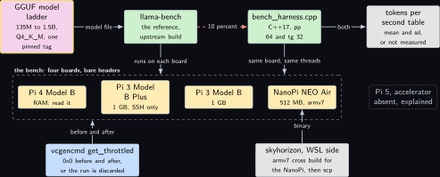
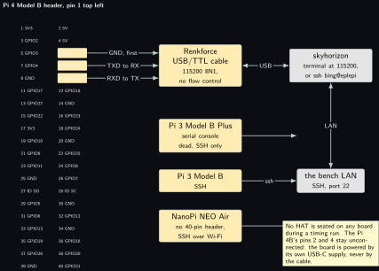
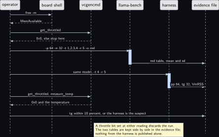
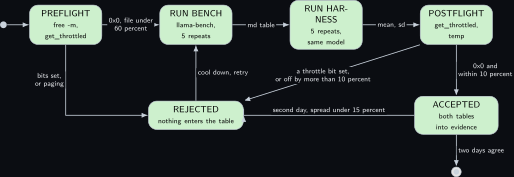
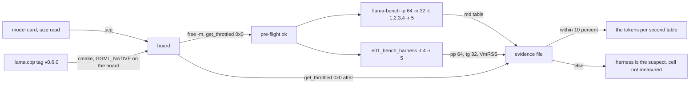
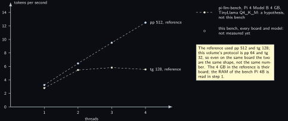

<!-- Written from the chapter source by the catalogue's publish step. Do not hand edit: the chapter is the record and this file is its copy. -->

# Project 1. Bring-up and the honest tokens per second table

> **Board:** all four boards, no HAT  
> **Owns:** the price list: tokens per second per board, model and thread count, with its instrument named

> [!IMPORTANT]
> **The question, instanced**
>
> What does a small local model add over a two-line threshold, and when does it get it wrong? Before any chapter can answer that, this one asks the question underneath it: how many tokens per second does each board on this bench actually produce, measured by an instrument that has itself been checked.

> **Key facts**
>
> - **Board:** Raspberry Pi 4 Model B Rev 1.4 (8 GB, read in step 1 on Friday 16 October 2026), Raspberry Pi 3 Model B Plus (1 GB), Raspberry Pi 3 Model B Rev 1.2 (1 GB), NanoPi NEO Air (512 MB, armv7)
> - **HAT slot:** empty on every board for the whole chapter
> - **Parts:** the four boards, two SD cards, the eMMC of the NanoPi, the Renkforce USB/TTL cable
> - **Interface:** SSH to every board; the serial console on the Pi 4B only
> - **Language and variant:** C++17, catalogue variant A: the upstream llama.cpp tools built as they are, plus a C++ harness that links the same library
> - **Model:** the whole ladder, SmolLM2-135M to Qwen2.5-1.5B, Q4\_K\_M
> - **Decision:** none; this chapter is the instrument, the model decides nothing
> - **Control rule:** the upstream `llama-bench`: the harness is published only when it agrees with it within 10 percent on the same board, model and thread count
> - **Acceptance:** harness within 10 percent of `llama-bench` `tg` on each board; `vcgencmd get_throttled` reads `0x0` before and after; a second day's run within 15 percent of the first
> - **Difficulty:** 2 of 5
> - **Effort:** one afternoon per Pi, one evening for the NanoPi cross build, and a second day for the repeat

## Pitch

Every number in the nineteen chapters that follow is a number from this one. A decision latency in [Project 2](../../chapters/02-the-decision-loop.md) is a prompt length times a tokens-per-second figure; the interval a sensor can be narrated at in a later chapter is the same figure turned around. If that figure is wrong, every later claim is wrong in the same direction and nobody notices, because the later chapters never measure the engine again. So this chapter does one thing: it builds the engine at one pinned tag on each board, runs the upstream benchmark, runs a second instrument of its own in the same shape, and prints both side by side. Where the two disagree by more than 10 percent, the instrument this volume wrote is the suspect, not the board. Where the throttle bits were set during a run, the run is discarded. Where a model file would not fit under 60 percent of the memory the board actually has free, the cell says so instead of reporting the speed of an SD card. The product is a table whose every cell names the instrument that produced it, or reads **not measured** with the reason.

## Origin and what changed

New, because no draft idea measures the instrument first, and because the Pi 4 Model B's RAM was unknown when this chapter was written: Joseph quoted the 1, 2, 4 and 8 GB variants on Wednesday 14 October 2026, not his board. Step 1 read it on Friday 16 October 2026 and the answer is the top of the range, a Rev 1.4 with 8 GB, MemTotal 8,007,396 kB and MemAvailable 7,789,840 kB after boot. That retires the open item and it changes two later chapters: every rung of the model ladder is admissible on this board, Phi-3-mini at 2.2 GB included, and project e20's fall back to a model held on skyhorizon becomes a choice rather than a necessity. The draft treated speed as something to look up. The reference figures that exist for these boards were taken on other people's boards with other versions of the engine and other prompt lengths, so they are the shape to expect and nothing more. What changed is that the speed table became a project with an acceptance test that can fail, and that reading the Pi 4's memory with `free -m` became step 1 of the whole volume: the model ladder's upper rungs for the Pi 4 are decided by that one reading, and [Project 2](../../chapters/02-the-decision-loop.md) and every later Pi 4 chapter inherit the result.

## Parts and interface

| **Part** | **Role** | **Interface** | **Address or pin** |
| --- | --- | --- | --- |
| Raspberry Pi 4 Model B | the fastest board; 8 GB, read on Friday 16 October 2026, not assumed | SSH, or the Renkforce USB/TTL cable at 115200 | header pins 6 (GND), 8 (GPIO14 TXD), 10 (GPIO15 RXD) |
| Raspberry Pi 3 Model B Plus | 1 GB; the serial console is dead on this board (GPIO14 is never muxed because `disable-bt` leaves `uart0_pins` empty) | SSH only | none on the header |
| Raspberry Pi 3 Model B Rev 1.2 | 1 GB; the SmolLM2 board of later chapters | SSH | none on the header |
| NanoPi NEO Air | 512 MB, Allwinner H3, four Cortex-A7 cores, armv7; the floor of the ladder | SSH over Wi-Fi; no 40-pin header, no `vcgencmd` | none |
| Card `eplepi` | Raspberry Pi OS, Debian 13 trixie, kernel 6.18.50+rpt-rpi-v8, user `bing`; logged in the 3B+ on Wednesday 30 September 2026 and in the 4B on Wednesday 7 October 2026 | the card, not the board, carries the hostname |  |
| The second card | the spare Verbatim 32 GB, card B of the HAT allocation, with a copy of the model files |  |  |
| Renkforce USB/TTL cable | the Pi 4B console when the network is down | USB on skyhorizon | three leads, colours not recorded; read the plug labels |
| skyhorizon, WSL side | the cross build for the NanoPi and the Yocto build | LAN |  |

## Model and grammar

There is no grammar in this chapter, because nothing is decided. The model ladder is the input, and the column that matters is the one no card can fill in: whether the file fits under 60 percent of `MemAvailable` on the board after a headless boot, with `n_ctx` 512. The arithmetic below is only what a 1 GB or a 512 MB total already settles; every other cell reads **read it** until step 1 has been run on that board. Sizes are the figures printed on the model cards on Wednesday 14 October 2026.

| **Model, Q4\_K\_M** | **Size** | **Licence** | **Pi 4B** | **Pi 3B+, Pi 3B** | **NanoPi** |
| --- | --- | --- | --- | --- | --- |
| SmolLM2-135M-Instruct | 105 MB | Apache 2.0 | read it | read it; needs 175 MB available | read it; needs 175 MB available |
| SmolLM2-360M-Instruct | 0.27 GB | Apache 2.0 | read it | read it; needs 450 MB available | read it; needs 450 MB of 512 MB total, unlikely |
| Qwen2.5-0.5B-Instruct | 491 MB | Apache 2.0 | read it | read it; needs 818 MB available | no: needs more than the 512 MB total |
| TinyLlama-1.1B-Chat-v1.0 | 0.67 GB | Apache 2.0 | read it | no: needs 1.12 GB available, more than the 1 GB total | no |
| Llama-3.2-1B-Instruct | 0.81 GB | Llama 3.2 community, linked not mirrored | read it | no | no |
| Gemma 3 1B it | 806 MB | Gemma terms, linked not mirrored | read it | no | no |
| Qwen2.5-1.5B-Instruct | 1.12 GB | Apache 2.0 | read it; needs 1.87 GB available | no | no |
| Phi-3-mini-4k-instruct | 2.2 GB | MIT | read it; needs 3.7 GB available, 8 GB board only | no | no |

The engine is llama.cpp at the release tag `v0.6.0`, published Sunday 5 October 2026 at commit `d8123504`, the latest release of the project when its API was read on Wednesday 14 October 2026, [api.github.com/repos/ggml-org/llama.cpp/releases/latest](https://api.github.com/repos/ggml-org/llama.cpp/releases/latest) (verified Wednesday 14 October 2026). The newest build tag the same day was `b11617`, read from [github.com/ggml-org/llama.cpp/releases](https://github.com/ggml-org/llama.cpp/releases) (verified Wednesday 14 October 2026); the release tag is pinned, not the build tag, because a release is what the runtime recipe and the Rust binding can both name. The pin is recorded once, in `cmake/llama_tag.cmake`, and every project in the repository builds against it; the C API at that tag has no `use_mmap` field and no `llama_kv_self_*` functions, which is why a snippet copied from an older page fails to compile and why the tag is pinned rather than tracked. The symbols this chapter's harness uses were read from the header at [include/llama.h](https://raw.githubusercontent.com/ggml-org/llama.cpp/master/include/llama.h) (verified Wednesday 14 October 2026): `llama_backend_init`, `llama_model_load_from_file`, `llama_model_get_vocab`, `llama_init_from_model`, `llama_tokenize`, `llama_batch_get_one`, `llama_decode`, `llama_get_memory`, `llama_memory_clear`, `llama_sampler_chain_init`, `llama_sampler_init_greedy`, `llama_sampler_sample`, `llama_sampler_accept`, and for the table's first three columns `llama_model_desc`, `llama_model_size` and `llama_model_n_params`.

## What the model decides or writes

Nothing. The model is loaded, decodes a 64-token prompt and generates 32 tokens under greedy sampling, and the text it produces is discarded; only the time is kept. A sampled end-of-generation token is decoded like any other token, because this is a throughput instrument and not a conversation. The prompt is the first 64 tokens of `projects/e01-bringup/prompt.txt`, which is long enough for every tokenizer in the ladder to yield more than 64 tokens, and the harness refuses to run if one does not. `n_ctx` is 512, the same as every decision loop in the volume, so that the memory the table reports is the memory the later chapters will use.

## Control rule

The control rule of this chapter is the upstream instrument. `llama-bench` from the same build, on the same board, with the same model and thread count, is the reference, and the rule is one line: the harness figure is published only when it sits within 10 percent of the reference, otherwise the harness is wrong until shown otherwise. The loop below is the whole harness, and it is the same shape as the reference's two tests: one batch of 64 tokens for the prompt, then 32 single-token decodes for generation, each timed with `std::chrono::steady_clock`, the memory cleared between repeats.

```cpp
    std::vector<double> pp, tg;
    for (int r = 0; r < o.reps; ++r) {
        llama_memory_clear(llama_get_memory(ctx), true);
        double t0 = ms_now();
        if (llama_decode(ctx, llama_batch_get_one(toks.data(), (int32_t)toks.size())) != 0) {
            std::fprintf(stderr, "prompt decode failed in repeat %d\n", r);
            return 1;
        }
        double t1 = ms_now();
        pp.push_back(1000.0 * o.n_pp / (t1 - t0));

        double t2 = ms_now();
        for (int i = 0; i < o.n_tg; ++i) {
            llama_token tok = llama_sampler_sample(smpl, ctx, -1);
            llama_sampler_accept(smpl, tok);
            if (llama_decode(ctx, llama_batch_get_one(&tok, 1)) != 0) {
                std::fprintf(stderr, "generation decode failed in repeat %d token %d\n", r, i);
                return 1;
            }
        }
        double t3 = ms_now();
        tg.push_back(1000.0 * o.n_tg / (t3 - t2));
    }
```

The generation loop includes the greedy sample in its timing, which the reference does not; greedy sampling is one pass over the logits and is expected to be invisible at the 10 percent level, and if it is not, that is a finding about the harness, printed as one.

## Real, modelled, absent

- **have:** real: the four boards, both cards, the engine built on each board, both instruments, the throttle and temperature readings, the memory reading
- **learn:** modelled: the two reference rows from pi-llm-bench, drawn dashed in the data figure, taken on somebody else's Pi 4 Model B with 4 GB at a different prompt length and an older build; they are hypotheses to test and are never copied into a measured cell
- **absent:** absent: a Pi 5, an AI accelerator, and any way to meter a Pi's current (the PPK2 cannot source or meter a Raspberry Pi under load); energy per token is not in this volume

## System architecture



*Figure 1.1. The instrument. Along the top, four solid blocks: the GGUF model ladder with the yellow model outline, the upstream llama-bench and the C++ harness in user-space green, and the tokens per second table in grey. A solid arrow carries the model file from the ladder to llama-bench, a dashed stop-coloured arrow from llama-bench to the harness carries the 10 percent rule, and a solid arrow from the harness to the table says that both columns are written. Below, inside a dashed layer labelled as the bench, four solid hardware blocks: the Pi 4 Model B with its 8 GB marked as read, the Pi 3 Model B Plus with SSH only, the Pi 3 Model B, and the NanoPi NEO Air with 512 MB and armv7; to their right a dotted grey block for the absent Pi 5 and accelerator. At the bottom, a solid kernel-blue block for vcgencmd, read before and after every run, and a solid grey block for skyhorizon's WSL side, which cross builds the armv7 binary and copies it to the NanoPi.*

Read the figure as two instruments and one gate. The reference instrument is built from the engine's own tree and never edited. The harness links the same library and reproduces the two tests in the simplest code that can do so, so that any disagreement between the two columns is a fact about the harness and can be found by reading forty lines. The gate is the kernel block at the bottom: a throttle bit set at either reading means the clock was not what the table assumes, and the run leaves nothing behind.

## Wiring

| **Header pin** | **BCM** | **Part pin** | **Wire colour if known** |
| --- | --- | --- | --- |
| 6 (Pi 4B only) | GND | Renkforce cable GND | not recorded; connect first |
| 8 (Pi 4B only) | GPIO14, TXD | Renkforce cable RX | not recorded; read the plug label |
| 10 (Pi 4B only) | GPIO15, RXD | Renkforce cable TX | not recorded; read the plug label |
| 2 and 4 | 5 V | nothing | the board is powered by its own USB-C supply, never by the cable |
| all others |  | nothing | no HAT on any board during a timing run |



*Figure 1.2. The 40-pin header of the Pi 4 Model B as two columns of small solid blocks, pin 1 at the top left, with three blocks filled in the hardware colour: pin 6 GND, pin 8 GPIO14 TXD and pin 10 GPIO15 RXD. Three solid arrows lead from those pins to a solid hardware block for the Renkforce USB/TTL cable at 115200 8N1, labelled GND first, TXD to cable RX, and RXD to cable TX; a solid two-headed line carries USB from the cable to a grey block for skyhorizon. Below the cable, three solid hardware blocks for the Pi 3 Model B Plus (serial console dead, SSH only), the Pi 3 Model B, and the NanoPi NEO Air (no 40-pin header, SSH over Wi-Fi) are joined by solid arrows to a grey block for the bench LAN, which is joined to skyhorizon. A note says that no HAT is seated during a timing run and that pins 2 and 4 stay unconnected. Nothing is dashed or dotted: every block in this figure is on the bench.*

## Sequence



*Figure 1.3. One measurement on one board, as a sequence diagram with six solid actors: the operator, the board shell, vcgencmd, llama-bench, the harness and the evidence file. Solid arrows carry free -m to the shell and get\_throttled to vcgencmd, and dashed replies bring MemAvailable and 0x0 back, with the note that any other reading stops the run. A solid arrow starts llama-bench with -p 64 -n 32 -t 1,2,3,4 -r 5 -o md over a blue activation bar, and llama-bench writes its Markdown table into the evidence file; a second solid arrow starts the harness with the same model at -t 4 -r 5, and the harness writes pp 64, tg 32 and VmRSS into the same file. The post-flight get\_throttled and measure\_temp follow with their dashed reply, and the last solid arrow, from the operator to the evidence file, is the comparison: tg within 10 percent, or the harness is the suspect. A note at the bottom says that a throttle bit at either reading discards the run and that nothing from the harness is published alone.*

## States and data



*Figure 1.4. A timing run as a state machine of six rounded green states. The initial dot enters PREFLIGHT (free -m and get\_throttled); a solid arrow labelled 0x0 and the file under 60 percent leads to RUN BENCH (llama-bench, 5 repeats), then md table to RUN HARNESS (5 repeats, same model), then mean and sd to POSTFLIGHT (get\_throttled and the temperature). From POSTFLIGHT one arrow labelled 0x0 and within 10 percent leads down to ACCEPTED, where both tables enter the evidence file, and another labelled a throttle bit set or off by more than 10 percent leads to REJECTED, where nothing enters the table; PREFLIGHT also exits to REJECTED when bits are set or the file would page. REJECTED returns to RUN BENCH after a cool down, ACCEPTED returns to REJECTED's side for the second day with the spread under 15 percent as the condition, and ACCEPTED reaches the final state only when the two days agree.*

The record every cell of the table is drawn from is one evidence file per board and model, written by `tools/bench_runner.py` as `projects/e01-bringup/evidence/<date>_llama-bench_<board>_<model>.md`, whose header names the board and the card, the kernel, the command and the two throttle readings, and whose body is the reference's Markdown table, with the harness table pasted below it by hand. A table cell without such a file behind it is not a cell; it is the word not measured.

## Data flow

```text
  model card (Hugging Face)            the board (one of four)                    evidence/
  +----------------------+   scp    +------------------------------------+     +-----------------+
  | <model>-Q4_K_M.gguf  |--------->| free -m, MemAvailable ............ |---->| board, card     |
  | size from the card   |          | vcgencmd get_throttled == 0x0 .... |     | throttled before|
  +----------------------+          |                                    |     |                 |
                                    | llama-bench -p 64 -n 32 -t 1,2,3,4 |---->| md table (ref)  |
  llama.cpp tag v0.6.0              |   -r 5 -o md   mean +/- sd         |     |                 |
  +----------------------+  cmake   |                                    |     |                 |
  | git clone --branch   |--------->| e01_bench_harness --model ... -t 4 |---->| pp 64, tg 32,   |
  |   v0.6.0 --depth 1   |  on the  |   -r 5   mean +/- sd, VmRSS        |     |   VmRSS         |
  +----------------------+  board   |                                    |     |                 |
                                    | vcgencmd get_throttled == 0x0 .... |---->| throttled after |
  NanoPi only: cross build in       +------------------------------------+     +-----------------+
  skyhorizon's WSL, then scp                                                          |
                                                                                      v
                                    one division, written beside the two tables: |harness - ref| / ref
                                    at or below 0.10, else the harness is the suspect and the cell
                                    stays not measured
```



## Latency design

This chapter sets the parameters the latency design of every later chapter assumes, and measures nothing else. Prompt length 64 tokens and generation 32, the two tests of the reference instrument at the sizes a decision loop actually uses: a system prompt under 120 tokens decoded once, a user text of twenty to forty tokens per event, and an enum answer of at most 8 tokens. `n_ctx` 512 on every board. Threads 1 to 4 on the Pi 4 and the Pi 3 family, with 4 the figure the later chapters quote; on the NanoPi all four thread counts are measured because the H3's four Cortex-A7 cores share one small memory bus and the curve may bend before 4. Five repeats, the mean and the sample standard deviation printed, and the whole protocol run again on a second day: a figure that moves by more than 15 percent between two days on the same board is not a figure, it is a thermal or a paging state.

## Steps

**Step 1.** Read the Pi 4 Model B's memory before anything else, and write both lines into the evidence file. This one reading decides the upper rungs of the ladder for the whole volume.

```bash
# Raspberry Pi 4 Model B, card eplepi, over SSH from skyhorizon
cd ~; free -m; grep -E 'MemTotal|MemAvailable' /proc/meminfo
```

**Step 2.** Read the throttle state and the temperature on the same board. `0x0` is the only acceptable reading; bits 0 to 3 mean under-voltage, frequency capped, throttled and soft temperature limit now, bits 16 to 19 the same since boot.

```bash
# Raspberry Pi 4 Model B, card eplepi
cd ~; vcgencmd get_throttled; vcgencmd measure_temp
```

**Step 3.** Build the engine at the pinned tag on the Pi 4B, natively, with the CPU flags of the board it runs on. The same three commands run on the Pi 3B+ and the Pi 3B with `-j2` in place of `-j4`, because a 1 GB board swaps at four parallel compiles of this tree.

```bash
# Raspberry Pi 4 Model B, card eplepi
cd ~; git clone --branch v0.6.0 --depth 1 https://github.com/ggml-org/llama.cpp.git
```

```bash
# Raspberry Pi 4 Model B, card eplepi
cd ~/llama.cpp; cmake -S . -B build -DGGML_NATIVE=ON -DCMAKE_BUILD_TYPE=Release -DLLAMA_CURL=OFF
```

```bash
# Raspberry Pi 4 Model B, card eplepi
cd ~/llama.cpp; cmake --build build --config Release -j4 --target llama-bench llama-cli
```

**Step 4.** Cross build for the NanoPi NEO Air in skyhorizon's WSL. The board is armv7 with 512 MB and an eMMC, and a native build would need swap on that eMMC for an hour or more and wear it for nothing; the choice is the cross build, and its cost is the toolchain package on the WSL side, one `scp`, and the flags below, which are read from the H3's Cortex-A7 (NEON with VFPv4) and are confirmed by the first run of `llama-bench` printing its system line.

```bash
# win11 skyhorizon, WSL side
cd ~/src; git clone --branch v0.6.0 --depth 1 https://github.com/ggml-org/llama.cpp.git nano-llama
```

```bash
# win11 skyhorizon, WSL side
cd ~/src/nano-llama; cmake -S . -B build-armv7 -DGGML_NATIVE=OFF -DLLAMA_CURL=OFF \
  -DCMAKE_SYSTEM_NAME=Linux -DCMAKE_SYSTEM_PROCESSOR=armv7l \
  -DCMAKE_C_COMPILER=arm-linux-gnueabihf-gcc -DCMAKE_CXX_COMPILER=arm-linux-gnueabihf-g++ \
  -DCMAKE_C_FLAGS="-mcpu=cortex-a7 -mfpu=neon-vfpv4 -mfloat-abi=hard" \
  -DCMAKE_CXX_FLAGS="-mcpu=cortex-a7 -mfpu=neon-vfpv4 -mfloat-abi=hard"
```

```bash
# win11 skyhorizon, WSL side
cd ~/src/nano-llama; cmake --build build-armv7 -j8 --target llama-bench
```

```bash
# win11 skyhorizon, WSL side
cd ~/src/nano-llama; scp build-armv7/bin/llama-bench nanopi:
```

**Step 5.** Copy the model files that the memory reading admits onto each card, and record the size the card listed beside the size `ls -l` reports. The Qwen file is `qwen2.5-0.5b-instruct-q4_k_m.gguf` from [Qwen/Qwen2.5-0.5B-Instruct-GGUF](https://huggingface.co/Qwen/Qwen2.5-0.5B-Instruct-GGUF) (verified Wednesday 14 October 2026).

**Step 6.** Run the reference on the Pi 4B. The output is a Markdown table with the columns model, size, params, backend, threads, test and t/s, one row per test and thread count, the last column the mean followed by the plus-minus sign and the standard deviation over the five repeats; the test column reads `pp 64` and `tg 32`.

```bash
# Raspberry Pi 4 Model B, card eplepi
cd ~/llama.cpp; build/bin/llama-bench -m ~/models/qwen2.5-0.5b-instruct-q4_k_m.gguf \
  -p 64 -n 32 -t 1,2,3,4 -r 5 -o md
```

**Step 7.** Build and run the harness on the same board against the same file, at 4 threads. The repository builds the engine from its submodule at the pinned tag, so the submodule is fetched first. Its table has the same seven columns and the same two test names, with `+/-` written in ASCII, followed by the VmRSS line and the engine's system line.

```bash
# Raspberry Pi 4 Model B, card eplepi
cd ~/edge-llm-pi; git submodule update --init --depth 1 third_party/llama.cpp
```

```bash
# Raspberry Pi 4 Model B, card eplepi
cd ~/edge-llm-pi; cmake -S . -B build -DGGML_NATIVE=ON -DEDGELLM_BUILD_TESTS=OFF
```

```bash
# Raspberry Pi 4 Model B, card eplepi
cd ~/edge-llm-pi; cmake --build build -j4 --target e01_bench_harness
```

```bash
# Raspberry Pi 4 Model B, card eplepi
cd ~/edge-llm-pi; build/projects/e01-bringup/e01_bench_harness \
  --model ~/models/qwen2.5-0.5b-instruct-q4_k_m.gguf \
  --prompt projects/e01-bringup/prompt.txt -p 64 -n 32 -t 4 -r 5
```

**Step 8.** Read the throttle state and the temperature again, immediately, before the board cools. Then compare the two `tg 32` figures at 4 threads: within 10 percent, both tables go into the evidence file; outside it, the harness is read line by line before anything else is touched.

```bash
# Raspberry Pi 4 Model B, card eplepi
cd ~; vcgencmd get_throttled; vcgencmd measure_temp
```

**Step 9.** Repeat steps 2 to 8 on the Pi 3B+ (SSH only), the Pi 3B and the NanoPi (where the throttle reading is replaced by `scaling_cur_freq` and `thermal_zone0` before and after, and the thread counts 1 to 4 are all run), with the models the memory reading admits on each.

**Step 10.** Run the whole protocol again on a second day and compute the spread per cell. Only then does a cell move from not measured to a number with its instrument named.

## Variant chosen

C++, catalogue variant A: the upstream tools built as they are, plus a C++17 harness linked to the same library. On practicality it scores highest because the reference instrument is a C++ program in the engine's own tree and a harness in the same language links it with no binding layer to doubt; on relevance it is the only variant whose disagreement with the reference can be attributed to forty lines of the harness rather than to a wrapper; on popularity it is the way the engine's own documentation measures speed; on compliance it adds nothing, MIT on both sides; on best practice it is the instrument-first rule of the bench volumes, where the reference is run before the custom harness and never after it. What it costs is one more build target and one afternoon per board; what it gains is a table where every published cell has been produced twice by two programs that agree. The C baseline, the Rust bindings and the Python bindings are each priced against this table in the chapter that chooses them, not here.

## Embedded Linux and Yocto

The runtime recipe is the one every project of the layer depends on: `meta-edgellm/recipes-runtime/llama-cpp/llama-cpp_git.bb` fetches the engine at the commit the tag `v0.6.0` points at, `SRCREV d8123504`, with `PV` `0.6.0`, builds with the `cmake` class and `-DGGML_NATIVE=OFF`, because the build runs on the host and `-march=native` would describe the wrong CPU; the target flags come from the machine tune, and `GGML_CPU_ARM_ARCH` names the ISA the kernels are selected for per machine, armv8-a with CRC for both Pi families, with the 32-bit string for the NanoPi marked to verify on its first build. The recipe ships `llama-bench` and `llama-server` beside the library, so an image carries the reference instrument. The e01 application recipe, `meta-edgellm/recipes-app/edgellm-e01/edgellm-e01_0.1.bb`, builds the harness against the installed library (`-DEDGELLM_SYSTEM_LLAMA=ON`) from the tree the layer sits in, with no network and no second clone, and installs it as `edgellm-e01-harness` with `prompt.txt` under `/usr/share/edgellm/e01`. It does not use the layer's shared include on purpose: that include installs a project binary with a grammar and a replay folder, and this project has neither, which the recipe says in its own comment. What the image adds over Raspberry Pi OS for this chapter is one thing: the table can be taken on the production image, which is the fifth item of the layer's checklist, benchmark on the production image and not only on the development card. A Yocto build is hours and is not the first run; the first run is Raspberry Pi OS. The layer parse is the check that runs first:

```bash
# win11 skyhorizon, WSL side
cd ~/bench/edge-llm-pi; kas shell meta-edgellm/kas/edgellm-pi4.yml -c "bitbake -p"
```

```bash
# win11 skyhorizon, WSL side, a separate later sitting: the image build takes hours
cd ~/bench/edge-llm-pi; kas build meta-edgellm/kas/edgellm-pi4.yml
```

## Acceptance test

Quantity: `tg 32` tokens per second at 4 threads (1 to 4 on the NanoPi), per board and per admitted model, from two instruments. Instrument: `llama-bench` at tag `v0.6.0` built on the board, and `e01_bench_harness` from the same library, with `vcgencmd get_throttled` as the gate. Pass: the harness mean within 10 percent of the reference mean on every board, `0x0` at both readings, and the second day's reference mean within 15 percent of the first. Fail: any of the three, in which case the cell keeps the words not measured and the failure is written beside it with its reading. The runner executes the reference with the gate before and after, runs the harness itself, and writes the dated evidence file with both tables, the division between them and the verdict. It exits non-zero when the run does not pass, so the sitting is one command:

```bash
# Raspberry Pi 4 Model B, card eplepi
cd ~/edge-llm-pi
python3 tools/bench_runner.py \
  --model ~/models/qwen2.5-0.5b-instruct-q4_k_m.gguf \
  --board pi4b-eplepi --evidence projects/e01-bringup/evidence \
  --llama-bench build/bin/llama-bench \
  --harness build/projects/e01-bringup/e01_bench_harness \
  --prompt projects/e01-bringup/prompt.txt \
  --hat "bare header, no HAT"
```

It did not start that way. On the first run the protocol said the harness table was to be pasted into the evidence file by hand and the division written beside it, which is eight figures transcribed twice per board and a pass-or-fail decision taken in someone's head. Both were moved into the runner the same evening, and because a measuring tool that decides anything has to be measured itself, the parser and the gate carry their own tests in `tools/tests`: the fixture is that first real run, the expected percentages were worked out by hand before the parser existed, and two of the cases exist to fail, a harness figure twenty percent out and a missing figure. A gate that has never refused anything is not known to work. `--hat` is in the command for a smaller reason that cost something real: the chapter asks for a bare header or an explicit note, and on the first run nobody wrote it down, so the runner now asks while somebody is still looking at the board.

Two spellings in that one command were changed on Friday 16 October 2026 by running it, and only one of them was wrong. It is `python3`, but not for the reason first written here: bare `python` does work on this card, because `python-is-python3` is installed and symlinks it, which was checked rather than assumed only after the claim had already been written down. `python3` stays because it is the spelling that cannot be wrong anywhere, while `python` depends on a package a Lite image need not carry and the other three boards were never checked. The lesson is the smaller and more awkward one: a reason that sounds right is not a measurement, and this chapter had published one inside a paragraph about correcting an error. And the reference binary is `build/bin/llama-bench`, because llama.cpp's own `CMakeLists.txt` sets `CMAKE_RUNTIME_OUTPUT_DIRECTORY` to `${CMAKE_BINARY_DIR}/bin`, and `CMAKE_BINARY_DIR` names the top-level build directory even when llama.cpp is added as a subdirectory of another project. The path `build/llama.cpp/tools/llama-bench` looks right and is a directory: the build tree mirrors the source tree, and llama.cpp's source folder for that tool carries the tool's name. Handing it to the runner raises `PermissionError` on exec, which is the signature of trying to execute a folder.

## Agreement table

Not applicable: this chapter is the instrument, and there is no model column to agree or disagree with a rule. What it contributes to the scorecard of the last chapter is the row below, which every later chapter's latency figure cites.

| **Project** | **Events N** | **Agreement** | **What it contributes** |
| --- | --- | --- | --- |
| e01 | 0; no events | not applicable, instrument | tokens per second per board, model and thread count, each cell with its instrument named; the 10 percent harness check; the Pi 4B memory reading that fixes the ladder |

## Measured data

| **Board** | **Model, Q4\_K\_M** | **pp 64** | **tg 32** | **Threads** | **Instrument** |
| --- | --- | --- | --- | --- | --- |
| Pi 4 Model B | Qwen2.5-0.5B | 6.87, 13.62, 20.04, 25.58 | 4.85, 8.39, 9.47, 8.70 | 1, 2, 3, 4 | llama-bench, engine v0.6.0 built on the board, Friday 16 October 2026 |
| Pi 4 Model B | Qwen2.5-0.5B | 19.99, 24.70 | 9.26, 9.18 | 3, 4 | the e01 harness, same sitting; agrees to 2.2 percent on tg and 0.25 percent on pp at 3 threads |
| Pi 4 Model B | TinyLlama-1.1B | not measured | not measured | 1, 2, 3, 4 | not run yet; the 8 GB reading admits it, and it is the control for the bend below |
| Pi 3 Model B Plus | SmolLM2-360M | not measured | not measured | 4 | not run yet |
| Pi 3 Model B | SmolLM2-360M | not measured | not measured | 4 | not run yet |
| NanoPi NEO Air | SmolLM2-135M | not measured | not measured | 1, 2, 3, 4 | not run yet; cross build pending |
| Pi 4 Model B 4 GB, theirs | TinyLlama-1.1B | 3.24, 6.44, 9.51, 12.49 at pp 512 | 2.79, 5.47, 5.82, 5.55 at tg 128 | 1, 2, 3, 4 | pi-llm-bench, build b10991; a hypothesis, not this bench |

The last row is the reference point, from [github.com/yosefdenham/pi-llm-bench](https://github.com/yosefdenham/pi-llm-bench) (verified Wednesday 14 October 2026): a Raspberry Pi 4 Model B with 4 GB, TinyLlama 1.1B Q4\_K\_M, llama.cpp build b10991, CPU only, tests pp 512 and tg 128. Its generation figure stops rising after two threads, which that page attributes to memory bandwidth; whether this bench's Pi 4B shows the same bend at the same place was the first hypothesis the table tests. Its prompt length and generation length are eight and four times this protocol's, so the two are the same shape and not the same number even on the same board.

That hypothesis now has an answer, from the run of Friday 16 October 2026. The bend is there and it is not in the same place: generation on this board rises to three threads and falls back at four, where theirs stops after two. Prompt processing meanwhile scales 3.72 times over four cores, nearly linearly, which is the distinction the chapter exists to draw. Reading a prompt is compute bound and the fourth core helps; writing tokens is bound by the memory bus and the fourth core does not, so four cores buy less than two cores’ worth of generation. The obvious suspect for the different knee is the model: theirs is 1.1 B and saturates the bus sooner than this 0.5 B, and the 8 GB reading now admits TinyLlama-1.1B on this same board, which turns that suspicion into a control rather than an argument. If the knee moves to two threads when only the model changes, the bandwidth explanation holds on this bench's own hardware; if it does not, the explanation was borrowed and should be dropped. One observation of a bend is not a mechanism for it.

The same run says something about the processor that is worth more than either number. Every ARM feature probe failed at configure time: no `dotprod`, no `i8mm`, no `sve`, no `sme`, no half-precision vector arithmetic, and ggml settled on `-mcpu=cortex-a72+crc+nodotprod+noi8mm+nosve+nosme`. That is correct for a Cortex-A72, which is ARMv8-A without the ARMv8.2 dot-product extension, and it is the honest reason the published Raspberry Pi 5 figures are so much higher: the A76 in a Pi 5 has `dotprod` and takes a quantised matmul kernel this board cannot. The difference is an instruction set, not a generation of marketing, and a reader with a Pi 4 can check it in one line of their own configure output.



*Figure 1.5. Tokens per second against thread count, drawn with TikZ axes. Two solid lines with filled markers are this bench's Pi 4 Model B Rev 1.4 with 8 GB running Qwen2.5-0.5B Q4\_K\_M on engine v0.6.0, measured on Friday 16 October 2026: prompt processing at 6.87, 13.62, 20.04 and 25.58 tokens per second at 1 to 4 threads, rising almost linearly, and generation at 4.85, 8.39, 9.47 and 8.70, peaking at three threads and falling back at four. Four open markers are the e01 harness at 3 and 4 threads, 19.99 and 24.70 for prompt processing and 9.26 and 9.18 for generation, drawn on top of the measured line rather than beside it because the point is that they coincide. Two dashed lines with small filled markers are the pi-llm-bench reference rows on a Pi 4 Model B with 4 GB and TinyLlama Q4\_K\_M: generation at 2.79, 5.47, 5.82 and 5.55, flat after two threads, and prompt processing at 3.24, 6.44, 9.51 and 12.49, rising to four. They stay dashed because they are hypotheses from another bench, at pp 512 and tg 128 rather than this protocol's 64 and 32. A note repeats that the 4 GB is their board, that the two protocols are the same shape and not the same number, and that the bend appears on both boards in different places.*

## Pitfalls

- **The dead Pi 3B+ console.** Established on this bench: with Bluetooth disabled the `uart0_pins` node is empty, GPIO14 is never muxed to the UART, and the cable shows nothing. The diagnosis is `dmesg` and the pinmux listing, never the cable, and the route is SSH. The symptom on a timing day is an hour spent on a console that cannot work.
- **The swapping card.** A model file over 60 percent of `MemAvailable` loads, runs, and prints a tokens-per-second figure that is the speed of the SD card. The number looks plausible and is meaningless. Read `free -m` first; if `Swap` used is not 0 after the run, the cell is not measured.
- **Thermal throttling while narrating.** A Pi 4B without a heatsink reaches the soft limit inside a five-repeat run at four threads; the figure falls repeat by repeat and the standard deviation says so before `get_throttled` does. Read the bits after the run, immediately, and discard the run if bit 2 or bit 3 is set.
- **Paging that looks like slowness.** The first repeat is slower than the rest while the file is paged in from the card; the mean over five hides it, the five raw figures show it. If the first repeat is more than twice the others, say so and consider whether the whole file was ever resident.
- **The NanoPi armv7 NEON flags.** A build without `-mfpu=neon-vfpv4` runs and is several times slower than the board can do; a build with the wrong `-mfloat-abi` does not run at all. The system line `llama-bench` prints on start lists the features it detected, and it goes into the evidence file beside the table.
- **A tag that moved.** The harness compiles against `v0.6.0` and nothing else; an untagged clone fails at `use_mmap` or at a `llama_kv_self` function. Pin, and record the pin, which `cmake/llama_tag.cmake` does for every project at once.

## Future and extra exercises

- A Rust harness over the `llama-cpp-2` crate (MIT): the same two tests, and the delta is the bundled llama.cpp commit, which is not the pinned tag; it is priced in the chapter that chooses Rust.
- A Python harness over `llama-cpp-python` (MIT): the same tests, and the delta is the interpreter's own overhead per decode call, priced in the chapter that chooses Python.
- candle (Apache 2.0 or MIT) as a Rust-native engine, with the delta being a second engine on the same GGUF and the question whether its quantised kernels reach the pinned engine's figure on a Cortex-A72; declined for now in the front matter.
- `llama-server` throughput: the same model behind HTTP, requests per second against a client count, which is the figure the chapter that chooses variant D needs.
- Energy per token: not possible on a Pi with the PPK2; it would need a USB-C inline meter the bench does not own.

## Video potential

4 of 5. The hook: how fast is the Pi you already own, honestly. Every existing video on the subject shows a Pi 5 with an accelerator, or an Ollama pull on a board that is never named; a three-minute piece that reads the memory on camera, shows the throttle bits, runs the reference and the harness side by side, and ends on a table with not measured cells left in is a differentiator on its own. What is slow on camera is the run itself, five repeats at four thread counts; it is recorded earlier and labelled so.

## Sources

- llama.cpp, the latest release read from the API: tag `v0.6.0`, published Sunday 5 October 2026, commit `d8123504`, [api.github.com/repos/ggml-org/llama.cpp/releases/latest](https://api.github.com/repos/ggml-org/llama.cpp/releases/latest) (verified Wednesday 14 October 2026). MIT.
- llama.cpp releases page, the build tag `b11617` read as the newest build the same day, [github.com/ggml-org/llama.cpp/releases](https://github.com/ggml-org/llama.cpp/releases) (verified Wednesday 14 October 2026).
- llama.cpp `include/llama.h` at the master branch, for the C API symbols and the absence of `use_mmap`, [raw.githubusercontent.com/ggml-org/llama.cpp/master/include/llama.h](https://raw.githubusercontent.com/ggml-org/llama.cpp/master/include/llama.h) (verified Wednesday 14 October 2026).
- llama-bench, its options and the Markdown output shape, [tools/llama-bench/README.md](https://github.com/ggml-org/llama.cpp/blob/master/tools/llama-bench/README.md) (verified Wednesday 14 October 2026).
- pi-llm-bench, the reference rows for a Pi 4 Model B with 4 GB, [github.com/yosefdenham/pi-llm-bench](https://github.com/yosefdenham/pi-llm-bench) (verified Wednesday 14 October 2026).
- Qwen2.5-0.5B-Instruct-GGUF, Apache 2.0, 491 MB at Q4\_K\_M, [huggingface.co/Qwen/Qwen2.5-0.5B-Instruct-GGUF](https://huggingface.co/Qwen/Qwen2.5-0.5B-Instruct-GGUF) (verified Wednesday 14 October 2026).
- SmolLM2-360M-Instruct-GGUF by bartowski, Apache 2.0, 0.27 GB at Q4\_K\_M, [huggingface.co/bartowski/SmolLM2-360M-Instruct-GGUF](https://huggingface.co/bartowski/SmolLM2-360M-Instruct-GGUF) (verified Wednesday 14 October 2026).
- SmolLM2-135M-Instruct-GGUF by bartowski, Apache 2.0, 105 MB at Q4\_K\_M, [huggingface.co/bartowski/SmolLM2-135M-Instruct-GGUF](https://huggingface.co/bartowski/SmolLM2-135M-Instruct-GGUF) (verified Wednesday 14 October 2026).
- TinyLlama-1.1B-Chat-v1.0-GGUF by TheBloke, Apache 2.0, 0.67 GB at Q4\_K\_M, [huggingface.co/TheBloke/TinyLlama-1.1B-Chat-v1.0-GGUF](https://huggingface.co/TheBloke/TinyLlama-1.1B-Chat-v1.0-GGUF) (verified Wednesday 14 October 2026).
- Qwen2.5-1.5B-Instruct-GGUF, Apache 2.0, 1.12 GB at Q4\_K\_M, [huggingface.co/Qwen/Qwen2.5-1.5B-Instruct-GGUF](https://huggingface.co/Qwen/Qwen2.5-1.5B-Instruct-GGUF) (to verify). The Llama 3.2, Gemma 3 and Phi-3 cards are cited in the front matter's ladder with their own marks and are linked, not mirrored.
- The bench facts cited by part: the dead Pi 3B+ console, the card identities and their dates, the Renkforce cable, from the bench records of the Linux volume; those volumes have no public URL.

---

[Previous](../../chapters/00-about-this-volume.md) &nbsp;&nbsp;|&nbsp;&nbsp; [Contents](../../CONTENTS.md) &nbsp;&nbsp;|&nbsp;&nbsp; [Next](../../chapters/02-the-decision-loop.md)
