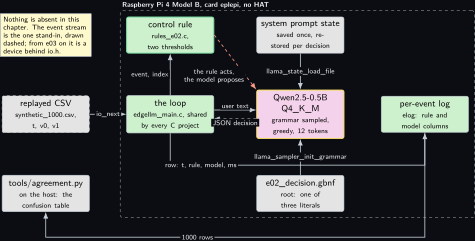
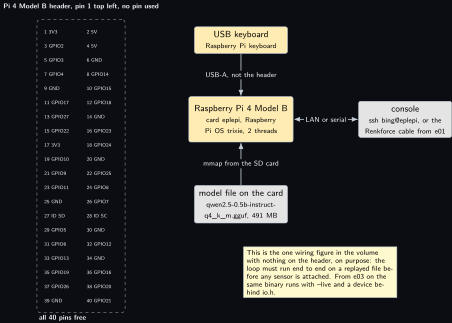
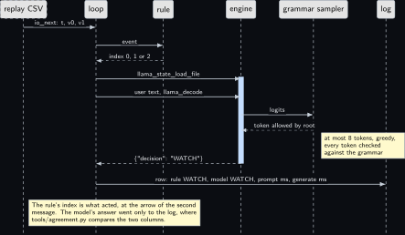
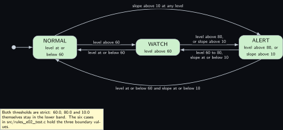
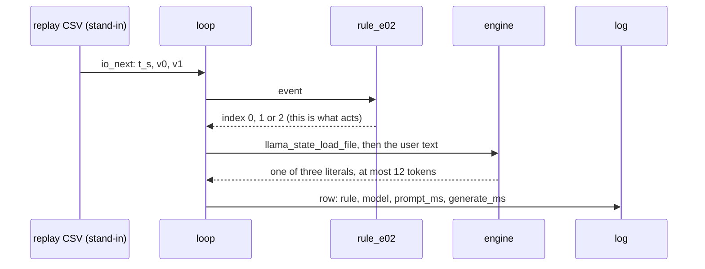
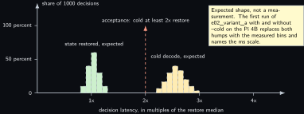

<!-- Written from the chapter source by the catalogue's publish step. Do not hand edit: the chapter is the record and this file is its copy. -->

# Project 2. The decision loop: grammar, state reuse, control harness

> **Board:** Raspberry Pi 4 Model B, no HAT  
> **Owns:** the reference loop every later chapter instances: one model, one grammar, one saved prompt state, one rule, one log

> [!IMPORTANT]
> **The question, instanced**
>
> What does a small local model add over a two-line threshold, and when does it get it wrong? Here the threshold is two lines of C on a synthetic level and slope, the model is told the same two thresholds in its system prompt, and the question is whether a 0.5B model constrained to three literals can even apply them, over 1000 events, without ever producing a fourth word.

> **Key facts**
>
> - **Board:** Raspberry Pi 4 Model B, card `eplepi`, 2 threads
> - **HAT slot:** empty; the one wiring figure in the volume with nothing on the header
> - **Parts:** the Pi 4B, a USB keyboard, the console from [Project 1](../../chapters/01-bring-up-and-the-honest-tokens-per-second.md); no sensor
> - **Interface:** a replayed CSV through `io.h`; from [Project 1](../../chapters/01-bring-up-and-the-honest-tokens-per-second.md)'s table the latency, from here the loop every later chapter runs with `--live`
> - **Language and variant:** C, catalogue variant C: plain C over `llama.h` in one process; variants A and B priced beside it once, in this chapter only
> - **Model:** Qwen2.5-0.5B-Instruct Q4\_K\_M, 491 MB, Apache 2.0
> - **Decision:** one of NORMAL, WATCH, ALERT through the grammar; the stub answers NORMAL in CI
> - **Control rule:** ALERT if the level is above 80 or the slope above 10; WATCH if the level is above 60; else NORMAL
> - **Acceptance:** 1000 decisions with zero free text; state restore at least 2x faster than a cold decode, measured by the comparison harness; throttle bits `0x0` before and after
> - **Verdict:** measured Saturday 17 October 2026, and **this project does not pass**: the first clause fails at 949 rows of 1000, and the second is unmeasured and waits on the board's power supply
> - **Difficulty:** 3 of 5
> - **Effort:** two evenings on the host for the loop and the oracle, one afternoon on the Pi 4B for the 1000-decision run and the comparison

## Pitch

Every later chapter is this loop with a device behind the `io.h` boundary instead of a file. So the loop is built once, here, on a file, and tested until it is boring: an event arrives, the rule decides in two lines and that decision is what acts, the loop restores the saved state of a system prompt that was decoded once at start, appends twenty tokens of user text, and samples at most twelve tokens under a grammar whose root can produce exactly three strings. The model's answer goes into the log beside the rule's, and nowhere else. Two things are measured: that the grammar keeps its promise over 1000 events, which the oracle test checks letter for letter, and that restoring the saved state costs less than half of decoding the prompt again, which is the whole reason the latency design of the volume is affordable on a Pi. The agreement table at the end is the first instance of the volume's through-line question, and in CI it has a number already: the stub always answers the grammar's first expansion, and the agreement that produces is the fraction of events the rule also calls NORMAL.

Both bench numbers have since been attempted, on Saturday 17 October 2026, and the chapter does not pass. The grammar kept its promise and the generation budget did not: every answer was a legal prefix of the grammar and 949 of 1000 stopped before the closing brace. The budget is a one-number fix and was shown to work the same day; what the repaired run then shows is a model that answers ALERT almost always and WATCH never, so it agrees with the rule on 4.0 percent of a quiet hundred. The second number, the state restore against the cold decode, has one half measured and the other lost to a board that restarts under load. What follows is written in the order it was measured, with each failure left where it happened rather than tidied into the result.

## Origin and what changed

New, because every later project is an instance of it. The draft had the decision loop written inside each idea, with a different prompt shape, a different way of trimming the context and a different log in each; a disagreement in one chapter could then have been a fact about the model or a fact about that chapter's loop, and nobody could tell which. What changed is that the loop moved into `common/c/src/edgellm_main.c` with one callback per project for the user text, that the five pieces, model, grammar, system prompt state, rule and log, got one file each in the repository with the chapter printing the same files, and that the synthetic event stream was written so the loop has an oracle before any sensor exists. The two alternative loops in C++, one on `llama.h` directly and one over the C API, exist only in this chapter, so that the cost of a C++ layer is priced once and never argued about again.

## Parts and interface

| **Part** | **Role** | **Interface** | **Address or pin** |
| --- | --- | --- | --- |
| Raspberry Pi 4 Model B | runs the loop, the model and the comparison | SSH, or the Renkforce cable from [Project 1](../../chapters/01-bring-up-and-the-honest-tokens-per-second.md) | none on the header |
| Card `eplepi` | Raspberry Pi OS trixie, the model file in `~/models` | the card is the hostname |  |
| USB keyboard | the Raspberry Pi keyboard, for a sitting at the board itself | USB-A | not the header |
| `replay/synthetic_1000.csv` | the event stream, 1000 rows of `t_s,tag,v0,v1` generated by `tools/make_replay.py` | `io_open_replay` |  |
| `grammars/e02_decision.gbnf` | the three literals, in the house shape | the grammar sampler of the engine | root symbol `root` |
| `prompt.txt` | the system prompt, 59 words, well under 120 tokens | decoded once, state saved |  |
| `src/rules_e02.c` | the control rule, registered by name | `rule_find("e02")` | index 0, 1, 2 |
| `tests/oracle/e02.expected.csv` | the 1000 expected rule decisions and the stub's column | the oracle check in C, row by row |  |

## Model and grammar

Qwen2.5-0.5B-Instruct at Q4\_K\_M, the file `qwen2.5-0.5b-instruct-q4_k_m.gguf`, 491 MB, Apache 2.0, from [Qwen/Qwen2.5-0.5B-Instruct-GGUF](https://huggingface.co/Qwen/Qwen2.5-0.5B-Instruct-GGUF) (verified Wednesday 14 October 2026). It is the Pi 4 default for enum decisions in the ladder and the rung the Pi 4B admits as long as [Project 1](../../chapters/01-bring-up-and-the-honest-tokens-per-second.md)'s memory reading is above 818 MB available; if that reading says otherwise, this chapter runs on SmolLM2-360M with no other change, because nothing below depends on which model answers. The engine is the pinned `v0.6.0` of [Project 1](../../chapters/01-bring-up-and-the-honest-tokens-per-second.md). The grammar is GBNF, one file per decision enum, root symbol `root`, in the house shape every grammar of the repository follows: one JSON object with one `decision` key; the syntax is the engine's own, documented at [grammars/README.md](https://github.com/ggml-org/llama.cpp/blob/master/grammars/README.md) in the engine's tree (to verify). Whitespace admits spaces and tabs and never a newline.

This paragraph used to end by saying that the longest answer therefore stayed inside eight tokens on every tokenizer of the ladder. **That sentence is withdrawn. It was falsified on the Raspberry Pi 4 Model B with the card eplepi on Saturday 17 October 2026.** This tokenizer splits ALERT into two pieces where NORMAL is one, so the ALERT path needs nine tokens and at eight it loses its closing brace; NORMAL completed in exactly eight, which is why the quiet rows looked right. The claim had never been checked against a single tokenizer, and the words every tokenizer of the ladder were the part that made it sound checked. The grammar itself was never violated: each truncated row is a legal prefix of the root below that stopped before the accept state, which is also why no grammar error was raised anywhere. The remedy belongs to the loop rather than to the grammar, `--n-predict 12`, and the grammar file carries the withdrawal in its own header comment so that nobody meets the rules without it.

```gbnf
root     ::= "{" ws "\"decision\"" ws ":" ws decision ws "}"
decision ::= "\"NORMAL\"" | "\"WATCH\"" | "\"ALERT\""
ws       ::= [ \t]*
```

Those three rules are the whole grammar. The file in the repository opens with twenty lines of comment, the house-shape note and then the withdrawal above, so a reader of the repository meets the correction before the rules; only the rules are printed here because the chapter has just said the same thing at greater length.

The system prompt, decoded once and never again during a run, reads in full: You are an edge agent on a Raspberry Pi. You see one level reading and its slope. Answer only with the JSON decision and nothing else. ALERT when the level is above 80 or the slope is above 10 per second. WATCH when the level is above 60. Otherwise NORMAL. The model is told the thresholds on purpose: the question of this chapter is not whether a 0.5B model can guess a rule, it is whether it can apply one it has been given, which is the easiest version of the volume's question and therefore the right one to ask first.

## What the model decides or writes

One of three literals, through the grammar, with `n_predict` 12 and greedy sampling. The model cannot write anything else: every token is checked against the grammar's automaton before it is accepted, and a token that no continuation of `root` allows is never sampled. So the model column of the log holds one JSON object whose decision is NORMAL, WATCH or ALERT, or an object that did not close inside the budget, which is the chapter's own failure and not the model's. The budget was 8 and produced 949 such rows in 1000 on Saturday 17 October 2026; it is 12 because 12 was measured to close every object of a hundred on the same board the same day. **A row that never closed was counted by nothing.** All three counters in this repository read zero on that log, each for its own reason, and what they count now is in the acceptance step below. In CI there is no model file; the stub behind the same `edgellm_decide` expands the grammar's first alternative on every path, so it answers `{"decision":"NORMAL"}` with timings of zero and the engine column reading stub, and the loop, the log, the oracle check and the agreement tool are exercised end to end on a runner with no engine.

## Control rule

Two thresholds, strict, on the two values of the event. The names table is what the grammar reproduces letter for letter; the oracle test and the agreement table both depend on that equality, which is why the names live in the rule file and the grammar is written from them by hand once and compared by lint ever after. The last line registers the rule before `main` runs, so the shared main finds it by the name `e02`.

```c
static const char *const rule_e02_names[] = { "NORMAL", "WATCH", "ALERT", NULL };

static int rule_e02_fn(const rule_ctx *ctx, const io_event *ev)
{
    (void)ctx;                                        /* two values decide; no history */
    if (ev->n < 2) return 0;                          /* a short event is NORMAL, not a guess */
    if (ev->v[0] > 80.0 || ev->v[1] > 10.0) return 2; /* ALERT: above 80, or slope above 10 */
    if (ev->v[0] > 60.0) return 1;                    /* WATCH: level above 60 */
    return 0;                                         /* NORMAL */
}

/* The constructor below registers the rule before main() runs; rule_find("e02") then
 * returns it. The file is compiled into the executable, never into an archive. */
const rule_desc rule_e02 = { "e02", rule_e02_fn, rule_e02_names };
RULE_REGISTER(rule_e02);
```

The user text the loop hands to the engine is built by the one function this project adds to the shared main. It names the level, the slope and the last three levels, and nothing else; the thresholds are in the system prompt, so they cost no tokens per event. The current event is not yet in the history when the function is called, so the previous levels are exactly that.

```c
const char *project_format_prompt(const io_event *ev, const rule_ctx *ctx, char *buf,
                                  size_t len)
{
    char hist[96] = "";
    int  k = 0, i;
    for (i = (ctx->n > 3 ? ctx->n - 3 : 0); i < ctx->n && k < (int)sizeof hist - 12; i++)
        k += snprintf(hist + k, sizeof hist - (size_t)k, "%s%.0f", k ? ", " : "",
                      ctx->hist[i].v[0]);
    snprintf(buf, len, "level %.1f, slope %.1f per second, previous levels %s. Decide.",
             ev->n > 0 ? ev->v[0] : 0.0, ev->n > 1 ? ev->v[1] : 0.0, k ? hist : "none");
    return buf;
}
```

## Real, modelled, absent

- **have:** real: the Pi 4 Model B, the card, the model file, the engine at the pinned tag, the rule, the grammar, the log and the timings it holds
- **learn:** modelled: the event stream, a replayed CSV generated by a seeded walk, drawn dashed; it stands in for a sensor only so that the loop has an oracle before any sensor is wired, and nothing about the sensor is claimed
- **absent:** absent: nothing. This is the one chapter with no dotted block; every later chapter adds at least one

## System architecture



*Figure 2.1. The five pieces on the Pi 4 Model B. Inside a dashed layer labelled with the board and the card, six solid blocks: the loop (edgellm\_main.c) in user-space green at the centre, the control rule above it with the green rule outline, the model to its right with the yellow model outline, and three grey blocks around the model for the saved system prompt state, the grammar file and, further right, the per-event log in green. Outside the layer on the left, a dashed grey block for the replayed CSV, the only stand-in, and a solid grey block for tools/agreement.py on the host. Solid arrows carry io\_next from the replay to the loop, the event up to the rule and its index back, the user text from the loop to the model with a dashed reply carrying the JSON decision, the saved state and the grammar into the model, and the log row down and across to the log; a dashed stop-coloured arrow from the rule to the model says that the rule acts and the model proposes. A last solid arrow carries the 1000 rows from the log to the agreement tool. A note says that nothing is absent here.*

The one arrow to read twice is the dashed red one. The rule's index is what the loop acts on, in [Project 3](../../chapters/03-led-status-explainer.md) by lighting an LED through `project_actuate` and in later chapters by sending a message; the model's answer only ever reaches the log. In this chapter nothing is actuated at all, and the shared main's empty default stands in. The safety rule of the volume is not a sentence in the front matter, it is the absence of any arrow from the model block to anything but the log, in this figure and in all nineteen that follow it.

## Wiring

| **Header pin** | **BCM** | **Part pin** | **Wire colour if known** |
| --- | --- | --- | --- |
| none | none | none | nothing is wired; the keyboard is USB and the console is the LAN or the cable from [Project 1](../../chapters/01-bring-up-and-the-honest-tokens-per-second.md) |



*Figure 2.2. The 40-pin header of the Pi 4 Model B as two columns of small solid blocks, pin 1 at the top left, with no block filled and a dashed layer around all forty labelled all 40 pins free. To the right, a solid hardware block for the Pi 4 Model B with the card eplepi and two threads; above it a solid hardware block for the USB keyboard joined by a solid arrow labelled USB-A, not the header; to its right a grey block for the console, SSH or the Renkforce cable, joined by a solid two-headed line; below it a grey block for the model file on the card joined by a solid arrow labelled mmap from the SD card. A note says this is the one wiring figure in the volume with nothing on the header, on purpose, and that from e03 on the same binary runs with -live and a device behind io.h. Nothing is dotted.*

## Sequence



*Figure 2.3. One decision as a sequence diagram with six actors: the replay CSV, drawn dashed as the stand-in, then the loop, the rule, the engine, the grammar sampler and the log, all solid. Solid arrows carry io\_next with t, v0 and v1 from the replay to the loop and the event from the loop to the rule; a dashed reply brings the index 0, 1 or 2 back. Over a blue activation bar on the engine, two solid arrows from the loop carry llama\_state\_load\_file and then the user text with llama\_decode; inside the bar a solid arrow carries logits to the grammar sampler and a dashed reply brings back the one token the root allows, with a note that at most 12 tokens are sampled greedily and every one is checked. A dashed reply returns the JSON decision to the loop, and the last solid arrow writes the row, rule WATCH, model ALERT, prompt ms and generate ms, into the log. That row is a disagreement on purpose, because a disagreement is what this board produces: the model answered WATCH in no run of Saturday 17 October 2026, and on 81 of the 110 WATCH events of the thousand-row run its answer was an ALERT object that the generation budget had cut before its closing brace. A note says that the rule's index is what acted and that the model's answer went only to the log.*

## States and data



*Figure 2.4. The three decisions as three rounded green states in a row, NORMAL, WATCH and ALERT, entered at NORMAL from the initial dot. Between neighbours, pairs of solid arrows with the thresholds as labels: level above 60 from NORMAL to WATCH and level at or below 60 back; level above 80 or slope above 10 from WATCH to ALERT and level 60 to 80 with slope at or below 10 back. Two curved solid arrows join the ends: slope above 10 at any level from NORMAL straight to ALERT over the top, and level at or below 60 with slope at or below 10 from ALERT straight back to NORMAL underneath. A note says that both thresholds are strict, so 60.0, 80.0 and 10.0 stay in the lower band, and that the six test cases hold those three boundary values. Nothing is dashed or dotted.*

The record is the per-event log, `projects/e02-decision-loop/evidence/e02_run.csv`, in the shape `elog.h` fixes for every project: `t_s, tag, raw, rule, model, prompt_ms, generate_ms, n_generated, engine`. The rule column and the model column sit side by side so that `tools/agreement.py` needs nothing from the program to build the table, and the engine column names the build so that a log from the stub can never be read as a log from the Pi.

## Data flow

```text
  tools/make_replay.py (seeded)        the loop, edgellm_main.c, on the Pi 4B            host
  +------------------------+           +----------------------------------------+     +----------------+
  | replay/synthetic_1000  |-io_next-->| rule_e02.fn(ctx, ev) -> 0 | 1 | 2       |     | agreement.py   |
  |   t_s,tag,v0,v1        |           |      |                                  |     |  confusion     |
  +------------------------+           |      v   project_format_prompt(ev, ctx) |     |  table, 3 by 3 |
                                       |      |   "level 72.4, slope 3.1 ..."    |     +----------------+
  prompt.txt ---decode once----------> | [state] --llama_state_load_file--> ctx  |            ^
    llama_state_save_file  (at start)  |      user tokens --llama_decode--> ctx  |            |
                                       |      sample <= 8 under grammar, greedy  |            |
  grammars/e02_decision.gbnf --------> |      {"decision": "WATCH"}              |            |
    llama_sampler_init_grammar(root)   |      |                                  |            |
                                       |      v                                  |            |
                                       | elog_row: t, rule, model, ms, engine    |--1000 rows-+
                                       +----------------------------------------+
  tests/oracle/e02.expected.csv: rule column from the same thresholds in Python; model column the stub's
```



## Latency design

The system prompt is 59 words, under 120 tokens on the Qwen tokenizer, and it is decoded once at start; its state is written with `llama_state_save_file` and read back with `llama_state_load_file` before every decision, so each event pays for its own twenty to forty tokens of user text and nothing else. The alternative, keeping the prompt resident and trimming the user tokens after each decision with `llama_memory_seq_rm`, saves the file read and is the route a long-running service takes; the chapter uses the file route because it is the one that survives a restart, and [Project 8](../../chapters/08-explorer700-console-with-a-model.md) measures the resident route when it builds its daemon. `n_ctx` 512 is more than ten times what one decision occupies and is kept because the state file's size follows the context. `n_predict` 12, greedy under the grammar, 2 threads on the Pi 4B, and the interval is whatever the replay file says, one event per second in the synthetic set, which is far slower than the loop and is meant to be. The expected decision time is one prompt decode of about thirty tokens plus at most twelve single-token decodes.

That shape now has a number. From the hundred-decision run of Saturday 17 October 2026 at two threads: mean prompt 3081.2 ms and mean generate 2023.2 ms, so about five seconds for one decision, with a resident 580208 kB against a model file of 462.96 MiB. One event per second is therefore five times faster than this loop can answer. A replay file tolerates that because it is a file and the loop simply reads the next row late; a sensor would not, so from [Project 3](../../chapters/03-led-status-explainer.md) on the interval is a design constraint rather than a convenience, and the chapters that read a device say what they drop.

Two threads rather than four is not a tuning result and should not be read as one. The board restarted unexplained four times during this chapter's measurements, and the thread count was lowered after the third. Two threads is the condition under which every figure here was taken, not a recommendation, and the paragraph near the end of this chapter says what the four restarts do and do not establish.

## Steps

**Step 1.** Generate the replay file and the oracle on the authoring laptop, and read the summary: it prints the count of each decision and the agreement the stub will reach.

```bash
# win11 aquamarine
cd C:\Users\aquamarine\Desktop\edge-llm-pi; python projects\e02-decision-loop\tools\make_replay.py
```

**Step 2.** Build the repository with the stub model in skyhorizon's WSL. Nothing compiles on aquamarine; this is the first build and the first test of every C project at once.

```bash
# win11 skyhorizon, WSL side
cd ~/src/edge-llm-pi; cmake -S . -B build -DEDGELLM_STUB_MODEL=ON; cmake --build build -j8
```

**Step 3.** Run the shared rule harness, which carries this project's six cases beside every other project's. Three of the six are the boundary values.

```bash
# win11 skyhorizon, WSL side
cd ~/src/edge-llm-pi; ctest --test-dir build -R rules_test --output-on-failure
```

**Step 4.** Run the oracle test: the loop over the 1000 rows with the stub, and the log compared row by row against the oracle file by `tests/oracle_check`. It passes only when every rule cell and every model cell matches.

```bash
# win11 skyhorizon, WSL side
cd ~/src/edge-llm-pi; ctest --test-dir build -R edgellm-e02-oracle --output-on-failure
```

**Step 5.** Run the same stub loop by hand and score the log with the agreement tool, to see the table the CI number comes from: 82.3 percent, with every disagreement the stub calling a WATCH or an ALERT event NORMAL, and zero rows whose model column is not one of the rule's decisions.

```bash
# win11 skyhorizon, WSL side
cd ~/src/edge-llm-pi; build/projects/e02-decision-loop/edgellm-e02 --project e02 \
  --replay projects/e02-decision-loop/replay/synthetic_1000.csv \
  --grammar projects/e02-decision-loop/grammar.gbnf \
  --prompt projects/e02-decision-loop/prompt.txt --log /tmp/e02_stub.csv --stub
```

```bash
# win11 skyhorizon, WSL side
cd ~/src/edge-llm-pi; python tools/agreement.py /tmp/e02_stub.csv
```

**Step 6.** Copy the model file and the repository to the Pi 4B, build against the real engine with the board's own flags as in [Project 1](../../chapters/01-bring-up-and-the-honest-tokens-per-second.md), and read the throttle bits before the run.

```bash
# Raspberry Pi 4 Model B, card eplepi
cd ~/edge-llm-pi; cmake -S . -B build -DGGML_NATIVE=ON; cmake --build build -j4
```

```bash
# Raspberry Pi 4 Model B, card eplepi
cd ~; vcgencmd get_throttled
```

**Step 7.** Run the 1000 decisions with the real model and read the bits again. The log's engine column must name the build, not the stub. **About 85 minutes**, and the figure is computed from the only measurement of this budget there is: the hundred-row run of Saturday 17 October 2026 at `--n-predict 12` and two threads averaged 3081.2 ms of prompt and 2023.2 ms of generation, so 5104.5 ms a thousand times is 5105 seconds. The `fsync` added to the logger on Monday 19 October 2026 costs 6.594 ms a row on this card and moves that by six seconds, which is why it was measured before being left in.

This step said seventy-five minutes until Monday 19 October 2026, and that number was not wrong so much as borrowed. It is the duration of the budget-8 run, whose thousand rows average 4546.3 ms each for 75.8 minutes, and it stayed here when the step changed to the repaired budget. Raising the budget from 8 to 12 raised generation from 1564.6 to 2023.2 ms a decision, which is more than the extra token accounts for and is most likely the board being warmer by then, since that run followed the other one by eighteen minutes. The 85 minutes is therefore the honest estimate and not a tight one.

Run it detached with `nohup` and a trailing `&`, because a dropped session ends a foreground run, this bench has had one, and the first attempt at four threads was lost at row 880 to a restart that `uptime` was the only witness to. Start `tools/throttle_log.sh` beside it with a sample cap, so the run arrives with its own register and clock trace and a sampler that cannot outlive it.

```bash
# Raspberry Pi 4 Model B, card eplepi
cd ~/edge-llm-pi; build/projects/e02-decision-loop/edgellm-e02 --project e02 \
  --threads 2 --n-predict 12 \
  --replay projects/e02-decision-loop/replay/synthetic_1000.csv \
  --grammar projects/e02-decision-loop/grammar.gbnf \
  --prompt projects/e02-decision-loop/prompt.txt \
  --model ~/models/qwen2.5-0.5b-instruct-q4_k_m.gguf --state /tmp/e02.state \
  --log projects/e02-decision-loop/evidence/e02_run.csv; vcgencmd get_throttled
```

**Step 8.** Score the real log. The pass condition is zero rows whose model column is not one of the decisions the rule itself emitted in that log. `tools/agreement.py` lists those rows and exits non-zero when any exist, so read its exit status and not only its table. The agreement is whatever it is, and it goes into the table below with its date. Until Saturday 17 October 2026 this step read the count of rows without a literal must be zero, and the tool counted only an empty column: the step passed a run in which 949 rows of 1000 held an object that never closed. The wording and the tool are now the same condition, and the tool proves both directions in its tests.

```bash
# Raspberry Pi 4 Model B, card eplepi
cd ~/edge-llm-pi; python tools/agreement.py projects/e02-decision-loop/evidence/e02_run.csv --md
```

**Step 9.** Measure the state restore against the cold decode with the comparison harness, twice: once restoring the saved state, once with `--cold`. The ratio of the two mean `prompt_ms` figures is the second acceptance number. A hundred rows of the head of the replay are enough and a thousand are not needed, because every row of this measurement costs about the same; at a thousand rows each pass is over forty minutes on a board that has restarted under shorter loads than that. **The two passes must not overlap.** They share `/tmp/e02_a.state` and they compete for the same two cores, so a run started while another is alive measures neither.

```bash
# Raspberry Pi 4 Model B, card eplepi
cd ~/edge-llm-pi; head -n 101 \
  projects/e02-decision-loop/replay/synthetic_1000.csv > /tmp/e02_first_100.csv
```

```bash
# Raspberry Pi 4 Model B, card eplepi
cd ~/edge-llm-pi/projects/e02-decision-loop; ../../build/projects/e02-decision-loop/e02_variant_a \
  --model ~/models/qwen2.5-0.5b-instruct-q4_k_m.gguf --replay /tmp/e02_first_100.csv \
  --threads 2 --state /tmp/e02_a.state --log evidence/e02_variant_a_restore.csv
```

```bash
# Raspberry Pi 4 Model B, card eplepi
cd ~/edge-llm-pi/projects/e02-decision-loop; ../../build/projects/e02-decision-loop/e02_variant_a \
  --model ~/models/qwen2.5-0.5b-instruct-q4_k_m.gguf --replay /tmp/e02_first_100.csv \
  --threads 2 --cold --state /tmp/e02_a.state --log evidence/e02_variant_a_cold.csv
```

**Step 10.** Run variant B the same way, then `ls -l` the three binaries and copy the three VmRSS lines and the three timing lines into the comparison table of the Variant chosen subsection, with the date.

## Variant chosen

C, catalogue variant C: plain C over `llama.h` in one process, which is the shared `common/c` core every later C project links and the C ABI that [Project 18](../../chapters/18-mini-industrial-serial-logger.md)'s Rust service and [Project 8](../../chapters/08-explorer700-console-with-a-model.md)'s daemon call. On practicality it scores highest because the engine's API is C already and the loop is sixty lines that need no class to be readable; on relevance it is the one variant that can be the reference for all the others, since a C ABI is what every other language binds; on popularity it is the second most common way the engine is embedded, after the C++ tools themselves; on compliance it is MIT on both sides with no third party; on best practice it is the house rule of the bench, C for anything that runs on a board, with the exceptions stated where a chapter makes one. What it costs is the comparison this chapter makes once so that nobody has to make it again: variants A and B, the two C++ loops in `src/variant_a_cpp.cpp`, which includes `llama.h` directly and owns the engine in one class, and `src/variant_b_capi.cpp`, which never sees `llama.h` and reaches the C API through the header-only wrapper `common/cpp/edgellm.hpp` that [Project 7](../../chapters/07-iks4a1-climate-and-motion-narrator.md), [Project 9](../../chapters/09-lcd-prompt-and-verdict-display.md) and [Project 12](../../chapters/12-stwin-box-vibration-band-reporter.md) build on, run the same 1000 rows with the same rule symbol, prompt, grammar and oracle, and are compared on four figures: resident memory from `VmRSS` in `/proc/self/status`, binary size from `ls -l`, tokens per second from the mean `prompt_ms` and `generate_ms` columns of each log, and agreement against the same oracle, which must be identical to the last row or one of the three loops is wrong. Two of its three rows were filled on the Pi 4B on Saturday 17 October 2026 and the third was not, and the two that exist are not yet a comparison: variant C ran at `n_predict` 12 and variant A at the 8 fixed in its source, variant A restores the state where variant C's figure includes the state file read, and variant A still decodes one token more per row than it uses. Each row therefore says what it was taken with, and the columns are read down rather than across until variant B exists and all three are taken the same way.

| **Variant** | **VmRSS kB** | **Binary size** | **prompt, generate ms** | **Agreement** | **Instrument** |
| --- | --- | --- | --- | --- | --- |
| C, variant C (chosen) | 580208 | not measured | 3081.2, 2023.2 | 4.0 percent | the edgellm-e02 log on the Pi 4B, 100 rows of the replay head, 2 threads, n\_predict 12, Saturday 17 October 2026 |
| C++ on llama.h, variant A | 579904 | not measured | 1320.6, 1506.3 | not scorable | e02\_variant\_a restoring the saved state, the same 100 rows and 2 threads, the same day |
| C++ over the C API, variant B | not measured | not measured | not measured | not measured | e02\_variant\_b, built on the board that day and not yet run |

## Embedded Linux and Yocto

The application recipe `meta-edgellm/recipes-app/edgellm-e02/edgellm-e02_0.1.bb` is the layer's worked example: three variables, the project id `e02`, the folder `e02-decision-loop` and the model package `model-qwen2.5-0.5b`, and then the shared include `meta-edgellm/recipes-app/edgellm-common.inc`, which builds the loop with the `cmake` class against the installed library of [Project 1](../../chapters/01-bring-up-and-the-honest-tokens-per-second.md)'s runtime recipe from the tree the layer sits in, installs the binary as `/usr/bin/edgellm-e02` with the prompt, the grammar and the replay folder under `/usr/share/edgellm/e02`, and enables the unit below. The model file is not in this package: it comes from the model recipe, which fetches the GGUF with its SHA256 into `/usr/share/edgellm/models`, or from the external model partition the image recipe describes. The unit is a simple service that runs the 1000-row replay, ends by itself and is restarted only on failure; a live project replaces `--replay` with `--live` and adds `After=` for its device. No overlay fragment: nothing on the header.

```text
[Service]
Type=simple
# The replay run ends by itself; a live project (e03 onwards) replaces --replay with
# --live <backend> <spec> and adds After= for the device its overlay creates.
# n-predict is 12 and not the core's default of 8. Measured on a Raspberry Pi 4 Model B,
# card eplepi, on Saturday 17 October 2026: the Qwen2.5 tokenizer needs nine tokens for
# the ALERT path and at eight it writes an object that never closes, 949 rows of 1000.
# The withdrawal of the claim that eight sufficed is in grammars/e02_decision.gbnf.
ExecStart=/usr/bin/edgellm-e02 --project e02 \
    --replay /usr/share/edgellm/e02/replay/synthetic_1000.csv \
    --model /usr/share/edgellm/models/qwen2.5-0.5b-instruct-q4_k_m.gguf \
    --grammar /usr/share/edgellm/e02/grammar.gbnf \
    --prompt /usr/share/edgellm/e02/prompt.txt \
    --log /var/lib/edgellm/e02.csv \
    --threads 4 --n-predict 12 --state /run/edgellm/e02.state
StateDirectory=edgellm
RuntimeDirectory=edgellm
```

The layer parse, not the image build, is the check that runs on skyhorizon before anything is wired; the image build is a separate later sitting of hours, and the kas file for the Pi 4B lists `edgellm-e02` as the one application of the first image:

```bash
# win11 skyhorizon, WSL side
cd ~/bench/edge-llm-pi; kas shell meta-edgellm/kas/edgellm-pi4.yml -c "bitbake -p"
```

## Acceptance test

Two quantities. First, over the 1000 rows of `replay/synthetic_1000.csv`, the number of rows whose model column is not one of the decisions the rule itself emitted in that log: the instrument is `tools/agreement.py` reading the log, the pass condition is zero, the tool lists the offending rows and exits non-zero, and a single row fails the chapter, because it means either that the grammar did not hold or that the answer did not close inside the budget. Second, the ratio of the mean `prompt_ms` with the system prompt decoded again every event to the mean with the saved state restored, measured by `e02_variant_a` with and without `--cold` on the Pi 4B at two threads over the same hundred rows: the pass condition is at least 2.0. Both are taken with `vcgencmd get_throttled` reading `0x0` before and after, and a run with any bit set is discarded. The commands are steps 8 and 9 above; the CI run, with the stub, checks the first quantity and the exact log shape through the oracle test of step 4.

**Measured Saturday 17 October 2026: the first clause fails and the second is unmeasured.** 949 rows of 1000 held an object that never closed, which is a failure of this chapter's generation budget and not of the model or the grammar. The restore half of the second clause reads a mean `prompt_ms` of 1320.6, so the cold pass must exceed **2641.2 ms** for the ratio to reach 2.0; that pass has been attempted once and lost, three minutes into about seven, to the fourth of the board's unexplained restarts. It is not retried here because a ratio is two means taken under the same conditions on one board, and a board that fails unpredictably under the load being measured cannot supply either half as evidence however many attempts eventually produce a number.

The first clause's wording also deserves its own line, because it is the part that nearly hid the failure. Until that day it read the count of rows without a literal must be zero, and the tool it named counted only an empty column, so a truncated answer was scored as though it were a decision. By the chapter's own sentence and the chapter's own tool, the clause passed. What caught it was a reader noticing `{ "decision": "ALERT"` standing as a column header in the confusion table, which is not a check. An acceptance clause that cannot fail is worse than no clause, because it is reported as a pass.

## Agreement table

Over the synthetic 1000 as generated on Wednesday 14 October 2026 by `tools/make_replay.py` with its fixed seed, the rule column holds 823 NORMAL, 110 WATCH and 67 ALERT. Three runs are in the table: the thousand-row run with the budget at 8, the hundred-row run with the budget at 12, and the CI stub.

**The two bench rows are not comparable with each other, and neither is a repaired figure over the full thousand.** The head of the replay is 97 NORMAL, 1 WATCH and 2 ALERT where the whole file is 823, 110 and 67, so a hundred-row slice that is almost entirely quiet gives a model almost nothing to agree with. That file was cut for a timing ratio, where the head is adequate because every row costs about the same, and it is not adequate for an agreement figure. The repaired agreement over the full thousand is unmeasured: it is one detached run of about eighty-five minutes at two threads, waiting on a board that can be trusted for that long.

The stub row is printed for a different reason: so that a reader of a CI log knows what to expect from it. The stub answers the grammar's first expansion on every row, so its agreement is the NORMAL fraction of the replay, 82.3 percent, and every disagreement is of one kind. A model that scores 82 percent on this set has learned nothing that the first literal did not already give it, which is the number the bench figures should be read against rather than against zero.

| **Rule says** | **Model NORMAL** | **Model WATCH** | **Model ALERT** | **Did not close** | **Instrument** |
| --- | --- | --- | --- | --- | --- |
| NORMAL, 823 | 21 | 0 | 0 | 802 | the Pi 4B, 1000 rows, 2 threads, `n_predict` 8, Saturday 17 October 2026 |
| WATCH, 110 | 29 | 0 | 0 | 81 | the same run |
| ALERT, 67 | 1 | 0 | 0 | 66 | the same run |
| agreement | 2.1 percent |  |  | 949 | the same run; the first clause fails on the last column |
| NORMAL, 97 | 2 | 0 | 95 | 0 | the Pi 4B, the 100-row replay head, 2 threads, `n_predict` 12, the same day |
| WATCH, 1 | 1 | 0 | 0 | 0 | the same run |
| ALERT, 2 | 0 | 0 | 2 | 0 | the same run |
| agreement | 4.0 percent |  |  | 0 | the same run; the budget is repaired and the model is not |
| NORMAL, 823 | 823 | 0 | 0 | 0 | the stub in CI, the grammar's first expansion every row |
| WATCH, 110 | 110 | 0 | 0 | 0 | the stub in CI |
| ALERT, 67 | 67 | 0 | 0 | 0 | the stub in CI |
| agreement | 82.3 percent |  |  | 0 | the stub in CI; the NORMAL fraction of the replay, not a property of any model |

**The model never says WATCH.** Not once in 1000 rows and not once in 100. The three-way enum is two-way in its mouth, and in the repaired run the second way is almost unused: it answers ALERT on 97 of 100, including 95 of the 97 events the rule calls NORMAL. The input is not at fault. The user line carries the level, the slope and up to three previous levels, and the system prompt carries the thresholds in words, so this is the easiest form of the volume's question, whether a model can apply a rule it has been given, and on this rung the answer is no. The grammar did its whole job: no row in any run held a fourth word. What the grammar cannot do is make a constrained answer a correct one, and a chapter that only counted free text would have called this a success.

So the honest reading of e02 is narrower than the chapter set out to claim, and it is still worth printing. A thousand grammar-constrained decisions ran to completion on this board with one `state_write_data` and one `state_read_data` each, which is the mechanism every later chapter instances, and it costs about five seconds a decision at two threads. The model adds nothing to the rule here. The volume's spine admits that as a result, and [Project 3](../../chapters/03-led-status-explainer.md) onwards is where the question is asked of a model that has something to explain rather than something to decide.

## Measured data



*Figure 2.5. The shape the acceptance test expects, drawn with TikZ axes and not a measurement. The horizontal axis is decision latency in multiples of the state-restore median, 1x to 4x; the vertical axis the share of the 1000 decisions. Two dashed histograms: a narrow green hump centred at 1x, labelled state restored, expected, and a wider hardware-coloured hump centred near 2.5x, labelled cold decode, expected. A dashed stop-coloured vertical line at 2x carries the acceptance condition, cold at least 2x restore. A note says that the first run of e02\_variant\_a with and without -cold on the Pi 4B replaces both humps with measured bins and names the millisecond scale.*

The figure is still a shape, and one of its two humps now has a measurement that the other one needs. The restore pass of Saturday 17 October 2026 gives a mean `prompt_ms` of 1320.6 over a hundred rows at two threads, with a mean `generate_ms` of 1506.3 and a resident 579904 kB. Two cautions travel with those numbers. `e02_variant_a` has no `--n-predict` option and its budget is fixed at eight in its source, so its own log holds the truncated form and must not be fed to the agreement tool as though it were clean; its `rows without a literal 0` is a substring search finding ALERT inside the truncation, not a statement that the text is complete. And its `generate_ms` includes one wasted decode of the final token on every row, which the C core guards against and this binary does not. That flaw is deliberately left in place until the cold pass is taken, so that both halves of the ratio are measured by identical code; repairing it first would move the half already in hand and leave nothing to compare.

Every figure in this chapter is in `projects/e02-decision-loop/evidence/2026-10-17_1408_decision-loop_pi4b-eplepi_qwen2.5-0.5b-instruct-q4_k_m.md`, which was written by hand because e02 has no runner as [Project 1](../../chapters/01-bring-up-and-the-honest-tokens-per-second.md) does, and which says so in its first line. Each figure there carries the command that produced it, and where a figure is missing the file says that rather than leaving a gap.

**What the four restarts say, and one claim withdrawn.** The board restarted unexplained four times across the two days of this chapter's work, under four different workloads and at two different thread counts: a four-core build on Friday 16 October 2026, which left no log at all; a sequence of benchmark stages that made `get_throttled` read `0x50000` before any reboot, bits 16 and 18, under-voltage and throttling since boot; the first attempt at the thousand-decision run at four threads, which stopped at row 880; and the cold pass of `e02_variant_a` at two threads, which stopped after three minutes of about seven. Only the second of those left a register to read. The sticky bits of `get_throttled` clear at boot, so after a restart the register is `0x0` and says nothing, and `uptime` is the only witness left: it read 3 min at 14:26 where it had read 1:40 at 14:08.

A paragraph written into this project's wiring sheet that same morning, claiming the thread count was the one control left on this supply, is **withdrawn**. Two threads completed a thousand decisions in about seventy-five minutes that morning and failed three minutes into a seven-minute run that afternoon. A setting that survives the longer load and fails the shorter one is controlling nothing; the claim was two successes read as a mechanism, and one observation is not a mechanism however convenient it is.

What the four restarts do establish is narrow: the fault is not a function of the thread count, and it is not a function of this chapter's code, because the first of the four happened during a compile.

**The supply was identified on Sunday 18 October 2026, and it is two supplies rather than one.** All four restarts happened with the board fed through an ISY IAD-1025-1 USB-C dock, a hub carrying HDMI, USB-A, gigabit Ethernet, two card slots and an audio jack alongside its power path; its exact topology on those two days, meaning which plug entered the Pi's own USB-C socket, is not confirmed and is recorded as unconfirmed rather than guessed. On Sunday 18 October 2026 the board was fed instead from an ISY IAC-5065, a 65 W USB-C charger whose label gives its 5 V rail as 5.0 V at 3.0 A. The current is adequate. The voltage is 5.0 V where a Raspberry Pi 4 is specified at 5.1 V, so this charger is not above suspicion either.

On that charger the board held two hundred-row passes back to back without restarting, where the attempt of Saturday 17 October 2026 stopped after three minutes of about seven. Across the thirty minutes that covers, `get_throttled` never set bit 16, bit 17 or bit 18: no under-voltage event, no frequency capping, no throttling. The dock is now the leading explanation for the four restarts rather than one observation's worth of suspicion. It is still not the established cause, because nothing has been moved back to test it.

**The pair was taken on Sunday 18 October 2026, both halves in one sitting on one supply at two threads, which is what the acceptance asks for and what no earlier attempt had.** Over the first hundred rows of the replay the restored prompt averaged 1325.6 ms against 5927.5 ms decoded cold, and generation averaged 1524.8 ms against 1560.6 ms. That is a ratio of **4.47** against an acceptance of at least 2.0, and a saving of 4.6 seconds on every decision.

Three reproducibility checks arrive with it, and they are better grounds for believing the pair than the size of the ratio is. The restore half, measured again a day later on a different supply, moved 0.38 percent. The cold half, measured twice within the same evening, moved 1.67 percent. And generation, the one column that state restore does not touch, moved 2.35 percent between the two halves of the pair, which is the internal check that the two passes differ in the way the experiment intends and not in some other way.

**By the letter of this chapter's acceptance the pair is still discarded**, because the acceptance asks for `0x0` before and after and discards a run with any bit set, and the register read `0x0` before the pair and `0x80000` after: bit 19 alone, the soft temperature limit since boot. What is new is that the cost of that bit was measured while the cold pass ran rather than argued about afterwards. Bit 3, the live half of the same limit, toggled on and off through the pass, and `vcgencmd measure_clock arm` moved with it: 1.800 GHz whenever bit 3 was clear, and 1.775 GHz and 1.726 GHz in the two samples taken while it was set, which is 1.4 and 4.1 percent below full. Two samples, and nothing sampled how long the limit was engaged, so the time-averaged cost on these figures is not known and is not stated here. What can be said is that an intermittent reduction whose observed extremes are 1.4 and 4.1 percent cannot carry 4.47 down to 2.0.

**The acceptance is not rewritten, and that is the decision.** Settled on Monday 19 October 2026: the clause keeps the form it was published with, a ratio of at least 2.0 with `get_throttled` reading `0x0` before and after, and *cooling is a condition of the run rather than an amendment to the criterion*. A goalpost moved after the measurement that failed to reach it is not a protocol change however well it is argued, and the readings in the previous paragraph would have made a good argument, which is precisely why they are not used as one. So the pair stands as measured at 4.47 and not accepted, which is a different statement from unmeasured, and the conditions sit beside the numbers instead of inside the rule.

**The conditions, recorded beside the figures they belong to.** The board is a bare Raspberry Pi 4 Model B with no heatsink, case or fan. Idle after a boot sits at or below 53 degrees C and still falling. The restore pass ran from 53.5 to 74.5 degrees C in five minutes with the register clean at both ends. The cold pass started at 56.9 degrees C, passed 75 degrees C inside two minutes, and held between 80 and 83 degrees C for the rest of its twelve and a half minutes with bit 3 toggling throughout. Once the load stopped the board fell from 80.3 to 67.2 degrees C in about forty seconds, so the heat path is adequate at idle and short of what a sustained load asks of it. And the cold pass drifted **1.4 percent within itself**, from 5896.9 ms across its first twenty-five rows to 5978.6 ms across its last twenty-five, where the restore pass stayed flat at 1323.9, 1323.5, 1329.6 and 1325.5 ms over the same quarters. That drift is the thermal effect appearing in the published figures rather than only in the register, and it agrees with the 1.4 percent clock reduction read live during the run: two independent measurements of one thing.

**Six things the columns say that no acceptance clause asks for.** Counted on Monday 19 October 2026 by `tools/verify_e02_figures.py`, which recounts every figure this chapter publishes against the log column it came from and found all fourteen unchanged. These six are observations and they stay observations: none becomes a criterion, because a criterion added after the measurement that suggested it is the same error as a criterion loosened after one.

- **The budget bound every decision, not most of them.** `n_generated` reads 8 on 1000 rows of 1000. Not one row finished early, so the ceiling was reached a thousand times out of a thousand and the failure is a property of the budget rather than of some inputs.
- **The shortfall was one token.** At a budget of 12 an `ALERT` object costs 9 tokens and a `NORMAL` one costs 8. So 8 was short by exactly one for two of the three literals, 9 would have sufficed, and 12 is slack.
- **The malformed run has two defensible agreement figures and no single one.** Counting only the 51 objects that close gives 21 of 1000. Reading the literal out of the truncated text gives 87 of 1000. Both are honest, they differ by a factor of four, and that is the sharpest available statement of why a run whose objects do not close cannot be scored for agreement at all.
- **The state-restore saving is uniform across the hundred rows.** Per-row ratios run from 4.265 to 4.547 with a median of 4.463, and **zero of 100 rows** fall below 2.0. The clause is satisfied row by row and not only on the means, which is the stronger reading and the one a ratio of two means cannot give.
- **The first row is not an outlier in either pass**, 0.1 percent below its own pass for the restore and 0.5 percent below for the cold. A state-restore measurement invites the worry that the first decision carries a warm-up the others do not, and it does not.
- **The thermal drift is in the log and not only in the register**, at the 1.4 percent recorded with the conditions above.

**A measurement condition this volume records nowhere, found while reading that clock.** The full ARM clock on this board is 1.800 GHz, and `arm_boost=1` in `/boot/firmware/config.txt` is the line that asks for it. That option is the documented switch for the Raspberry Pi 4's boost clock; what this board runs at without it has not been measured here and is not asserted. The protocol pins the model file, the thread count and the engine tag and says nothing about frequency, so a reader reproducing these figures without that line would not be at 1.800 GHz and would have nothing in the chapter to explain the gap.

Three values make the condition reproducible and all three were read on Sunday 18 October 2026: revision code `d03114`, which decodes to a Raspberry Pi 4 Model B Rev 1.4 with 8 GB from Sony UK; firmware of Monday 14 September 2026 at `a869839`; and `arm_boost=1`. Those three belong in the measurement protocol beside the thread count, because the clock moves every figure in this volume and nothing recorded it until now. The revision code also confirms the 8 GB from the silicon rather than from `free -m`, which is the figure the model ladder's rung rule divides by.

## Pitfalls

- **`use_mmap` and `llama_kv_self_*` are gone.** Any loop copied from a page older than the pinned tag fails to compile at those names; the memory is reached through `llama_get_memory` and the state through `llama_state_save_file` and `llama_state_load_file`. Pin the tag and build against it, nothing else.
- **A literal that differs by one letter.** The grammar's `"WATCH"` and the rule's `"WATCH"` must be the same bytes; a trailing space, a lower-case letter or an underscore in one of them gives 0 percent agreement with no error anywhere. Lint compares the printed files to the repository; the oracle test compares the columns.
- **A tokenizer that splits an enum literal.** ALERT may be two tokens on one tokenizer and one on another; the grammar handles that, but the token count of the longest answer changes. This happened here: ALERT is two pieces on Qwen2.5 where NORMAL is one, so 8 was one short and 949 rows of 1000 never closed. The 12 now used was measured on Qwen alone and may be one short on SmolLM2 or on any rung this chapter has not run. The failure is an object that never closes; the fix is to count the tokens of each literal on the tokenizer in use before fixing `n_predict`, which is one line of the engine's own tokenizer and was never run before the claim was written down.
- **The stub always answers the first expansion.** A log where every model cell reads `{"decision":"NORMAL"}` and every engine cell reads stub is a CI log, not a bench log, and its 82.3 percent is the NORMAL fraction of the replay, not a property of any model. Read the engine column before reading the agreement.
- **A rule file put into a static library.** `RULE_REGISTER` is a constructor, and the linker drops an archive member nothing references, so the rule is silently absent and the loop stops with no rule registered for project e02. The rule file is listed as a source of the executable, which `edgellm_add_project` does.
- **Restoring a state saved with a different model or context size.** `llama_state_load_file` refuses it, and the loop must treat that refusal as fatal rather than falling back to a cold decode silently, or the 2x acceptance is measured against the wrong thing.
- **The model file over 60 percent of `MemAvailable`.** Then every decision pages, the restore path and the cold path both read the card, and the ratio between them says nothing. [Project 1](../../chapters/01-bring-up-and-the-honest-tokens-per-second.md)'s reading comes first.
- **A sampler accepted twice.** `llama_sampler_sample` accepts the token it returns. A loop that calls `llama_sampler_accept` on that same token advances the grammar twice per step and the stack empties, which aborts with `Unexpected empty grammar stack after accepting piece` on the first decision, not the hundredth. `common/c/src/edgellm.c` carries the warning in its own header comment and makes no such call, which is why the C core managed a thousand rows while `e02_variant_a` could not manage one until it was fixed on Saturday 17 October 2026. Also call `llama_sampler_reset` once per decision, or the grammar starts the second decision wherever the first one left it.
- **A binary the manifest does not build.** `projects/e02-decision-loop/project.toml` left `e02_variant_a` and `e02_variant_b` out of its build command, so neither had ever been compiled by CI, by the host or on a board, while this chapter asked one of them for an acceptance number. A target no manifest names is not covered by a green pipeline. Build every target the chapter cites, or the chapter cites code that has never run.
- **A counter that reads zero because it counts the wrong noun.** Three counters in this repository reported zero on the thousand-row log: the agreement tool counted only an empty column, the shared loop's model errors counted only an engine returning failure, and the comparison binary's rows without a literal was a substring search that finds ALERT inside the truncated form. Build the failure a counter claims to detect, run the counter over it, and read the number before trusting a zero.
- **A buffered log and a board that restarts.** `std::ofstream` without a flush per row leaves a zero-byte file when the board goes down, so a lost run leaves no rows at all rather than the rows that finished. The C core flushes in `common/c/src/elog.c`; the comparison binary did not until that day, and a cold pass three minutes in was lost completely.
- **A pitfall is not a check.** The entry above about a tokenizer splitting a literal was written into this chapter before any of it ran, and it names exactly the failure that then cost 949 rows of 1000. The grammar comment and the acceptance step both assumed it away in the same chapter. A reader warned of a failure still ships it; only a number that moves when the failure is present will stop it.

## Future and extra exercises

- The same loop in C++ as the chosen variant, A or B: already written here as the comparison; the delta is the RAII wrapper in `common/cpp` that [Project 7](../../chapters/07-iks4a1-climate-and-motion-narrator.md) and [Project 9](../../chapters/09-lcd-prompt-and-verdict-display.md) build on.
- The same loop in Rust over `llama-cpp-2` (MIT): the delta is the bundled engine commit against the pinned tag, and the `socketcan` and `industrial-io` crates that [Project 5](../../chapters/05-adxl345-event-reporter.md) and [Project 13](../../chapters/13-can-honesty-agent.md) need.
- The same loop in Python over `llama-cpp-python` (MIT): the delta is the interpreter's cost per decision, priced in [Project 15](../../chapters/15-esp32-sidecar-with-a-bounded-pattern-proposal.md).
- Variant D, the loop as a client of `llama-server` over HTTP: the delta is the request round trip and the loss of `llama_state_save_file`, measured in [Project 4](../../chapters/04-pi-thermal-and-throttle-narrator.md).
- Variant O, the engine as a separate daemon over a Unix socket: the delta is restart isolation, which [Project 8](../../chapters/08-explorer700-console-with-a-model.md) demonstrates by stopping the daemon under the console.
- The resident-state route, `llama_memory_seq_rm` instead of the file: the delta is the file read per decision against the loss of the state across a restart.

## Video potential

3 of 5. The hook: the model is only allowed to answer A, B or C. On screen the grammar file, seven lines, then the log scrolling with two columns that mostly agree and sometimes do not, then the agreement table. It is the clearest three-minute statement of what the volume is for, and it is a hard sell as a first video because nothing moves and nothing lights; it is better as the second half of [Project 3](../../chapters/03-led-status-explainer.md)'s piece, where the same loop lights an LED through the rule and the model only explains.

## Sources

- Qwen2.5-0.5B-Instruct-GGUF, Apache 2.0, the file `qwen2.5-0.5b-instruct-q4_k_m.gguf` at 491 MB, [huggingface.co/Qwen/Qwen2.5-0.5B-Instruct-GGUF](https://huggingface.co/Qwen/Qwen2.5-0.5B-Instruct-GGUF) (verified Wednesday 14 October 2026).
- llama.cpp `include/llama.h`, for the state, memory, grammar and sampler symbols, [raw.githubusercontent.com/ggml-org/llama.cpp/master/include/llama.h](https://raw.githubusercontent.com/ggml-org/llama.cpp/master/include/llama.h) (verified Wednesday 14 October 2026). MIT.
- llama.cpp, the pinned release `v0.6.0`, [api.github.com/repos/ggml-org/llama.cpp/releases/latest](https://api.github.com/repos/ggml-org/llama.cpp/releases/latest) (verified Wednesday 14 October 2026).
- GBNF grammar syntax, in the engine's tree, [grammars/README.md](https://github.com/ggml-org/llama.cpp/blob/master/grammars/README.md) (to verify).
- The honesty rule, solid, dashed and dotted, from the joint node volume, chapter 1; that volume has no public URL.

---

[Previous](../../chapters/01-bring-up-and-the-honest-tokens-per-second.md) &nbsp;&nbsp;|&nbsp;&nbsp; [Contents](../../CONTENTS.md) &nbsp;&nbsp;|&nbsp;&nbsp; [Next](../../chapters/03-led-status-explainer.md)
