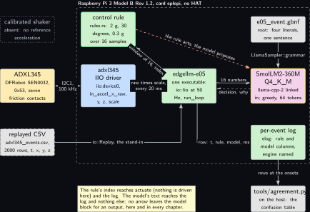
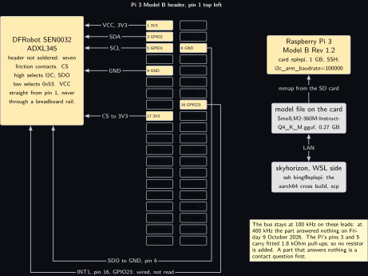
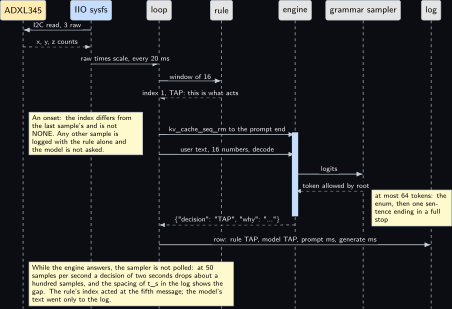
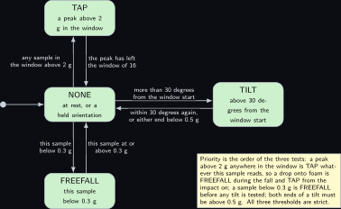
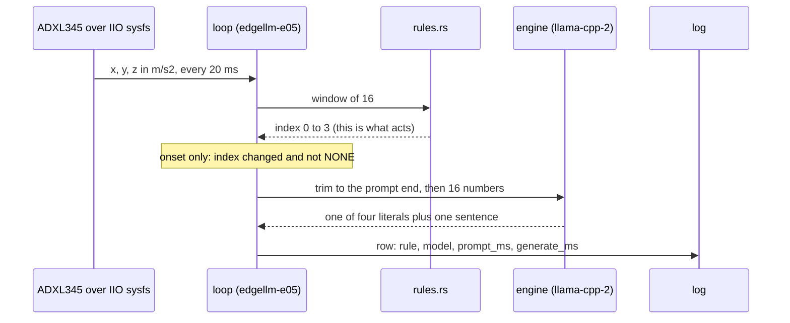
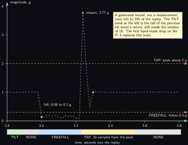

<!-- Written from the chapter source by the catalogue's publish step. Do not hand edit: the chapter is the record and this file is its copy. -->

# Project 5. ADXL345 event reporter

> **Board:** Raspberry Pi 3 Model B Rev 1.2, no HAT: the ADXL345 on seven flying leads  
> **Owns:** the first Rust project and the shared Rust crate: one executable with the engine inside, an IIO source, and the price of that binary beside e03's C one

> [!IMPORTANT]
> **The question, instanced**
>
> What does a small local model add over a two-line threshold, and when does it get it wrong? Here the threshold is three comparisons over sixteen accelerometer samples, the model is handed the same sixteen numbers in words and asked for the same four-way enum plus one sentence, and the question is whether a 360M model on a 1 GB Pi 3 ever names the event the rule did not, and whether its sentence says why.

> **Key facts**
>
> - **Board:** Raspberry Pi 3 Model B Rev 1.2, 1 GB, card `eplepi`, SSH, 4 threads
> - **HAT slot:** empty; the part hangs on seven flying leads from pins 1, 3, 5, 6, 9, 16 and 17
> - **Parts:** the DFRobot SEN0032 ADXL345 at 0x53, header not soldered; a sheet of foam
> - **Interface:** the kernel's IIO driver from the Linux volume's project 5, read through `/sys/bus/iio/devices/iio:device0` at 50 samples per second; a replayed CSV on the host
> - **Language and variant:** Rust, catalogue variant R7: one executable, the whole loop in Rust over the `llama-cpp-2` binding, the engine linked in
> - **Model:** SmolLM2-360M-Instruct Q4\_K\_M, 0.27 GB, Apache 2.0, the Pi 3 default
> - **Decision:** one of NONE, TAP, TILT, FREEFALL through the grammar, plus one sentence; asked only at the onset of a non-NONE decision; the stub answers NONE in CI
> - **Control rule:** over the last 16 samples: TAP when the peak magnitude is above 2 g; FREEFALL when this sample is below 0.3 g; TILT when the gravity vector has turned by more than 30 degrees since the start of the window; NONE otherwise
> - **Acceptance:** 100 hand-made events labelled by the person making them, three-way agreement label, rule, model; the sample spacing in the log at the configured 0.02 s; binary size, VmRSS and tokens per second beside e03's C binary on the same board; throttle bits `0x0` before and after
> - **Difficulty:** 4 of 5
> - **Effort:** three evenings on the host for the crate, the project and the oracle; one evening on skyhorizon for the cross build; one afternoon on the Pi 3 for the hundred events and the comparison

## Pitch

An accelerometer behind a kernel driver, read by a service that never stops, is the shape of job for which embedded Linux work now reaches for Rust, and this chapter builds that service once, as one executable with the language model inside it, so that the cost of the choice can be read off a table rather than argued. The loop is [Project 2](../../chapters/02-the-decision-loop.md)'s loop written a second time in a second language, in the same five pieces and with the same nine log columns, so that `tools/agreement.py` scores it without knowing which language produced the file. The rule is three comparisons over a window of sixteen samples; the model is asked only when the rule's decision changes to something other than NONE, the one place a sentence is worth a second of compute on a Pi 3, and its answer goes into the log beside the rule's and nowhere else. Two things are measured that [Project 2](../../chapters/02-the-decision-loop.md) could not: what one Rust binary with the engine linked in costs against [Project 3](../../chapters/03-led-status-explainer.md)'s C binary on the same board, in bytes, resident memory and tokens per second, and whether a model given the sixteen numbers the rule saw ever calls a drop a tap. The crate this chapter leaves in `common/rust/edgellm` is what [Project 13](../../chapters/13-can-honesty-agent.md), [Project 14](../../chapters/14-joint-monitor.md) and [Project 18](../../chapters/18-mini-industrial-serial-logger.md)'s service build on.

## Origin and what changed

Draft idea 1, split. The draft paired the accelerometer with the time-of-flight sensor in one narrator; the two parts answer different questions, motion and distance, sit in different projects of the kit labs, and would have needed two drivers, two rules and two grammars in one chapter whose agreement table could not say which half the model got wrong. The distance half is [Project 6](../../chapters/06-vl53l4cd-too-close-explainer.md). Three more things changed. The draft had the service in C like every other; variant R7, one Rust executable over the FFI binding, was assigned here because an IIO reader as a long-running service is the case where the language's claims are the ones a reviewer asks about, and because one file is the deployment the Yocto layer wants. The draft asked the model on every sample, which at 50 per second is two orders of magnitude more decisions than a Pi 3 can take; the model is asked at the onset of a non-NONE decision and the log holds the rule alone for every other sample. And the tap detection is in software over the IIO raw path, not in the part's own tap engine on INT1, which is the interrupt exercise at the end: it would put a second detector in the loop before the first has been scored.

## Parts and interface

| **Part** | **Role** | **Interface** | **Address or pin** |
| --- | --- | --- | --- |
| Raspberry Pi 3 Model B Rev 1.2 | runs the service, the model and the comparison; 1 GB, card `eplepi` seated for this chapter; SmolLM2-360M needs 450 MB available | SSH | header pins 1, 3, 5, 6, 9, 16, 17 |
| DFRobot SEN0032 ADXL345 | the three-axis accelerometer, full resolution, read through IIO; header not soldered | I2C1 at 100 kHz, CS strapped high, SDO strapped low | 0x53 |
| The adxl345 IIO driver | bound by the Linux volume's project 5 overlay; exposes `in_accel_x_raw`, `y`, `z`, `in_accel_scale`, `sampling_frequency` | sysfs reads | `iio:device0` |
| A sheet of foam | the drop target: a fall of a hand's height gives a freefall below 0.3 g and an impact above 2 g without harm to the leads | none |  |
| `replay/adxl345_events.csv` | the stand-in: 2000 rows of `t_s,tag,v0,v1,v2` at 50 per second written by `tools/make_replay.py`, thirty scripted events | `io::Replay` |  |
| `grammars/e05_event.gbnf` | the four literals and one sentence, in the house shape | the engine's grammar sampler | root symbol `root` |
| `prompt.txt` | the system prompt, 76 words; its token count on the SmolLM2 tokenizer is read on the first run | decoded once, kept resident |  |
| `src/rules.rs` | the control rule, its window and the sixteen-number summary | `Registry::find("e05")` | index 0 to 3 |
| `common/rust/edgellm` | the shared crate: engine, stub, IIO and replay sources, rule registry, logger, template, loop | a path dependency |  |
| `tests/oracle/e05.expected.csv` | 2000 expected rule decisions and the stub's column on the 60 onset rows | `tests/oracle.rs`, row by row |  |

## Model and grammar

SmolLM2-360M-Instruct at Q4\_K\_M, the file `SmolLM2-360M-Instruct-Q4_K_M.gguf`, 0.27 GB, Apache 2.0, from [bartowski/SmolLM2-360M-Instruct-GGUF](https://huggingface.co/bartowski/SmolLM2-360M-Instruct-GGUF) (verified Wednesday 14 October 2026): the Pi 3 family default of the ladder, the only rung a 1 GB board admits with room for the sampler and the binary. The engine is not the pinned `v0.6.0` of [Project 1](../../chapters/01-bring-up-and-the-honest-tokens-per-second.md): the Rust binding builds its own copy of llama.cpp inside the crate, at the commit its own repository pins, and the Variant chosen subsection says what that means for a number. The grammar is GBNF in the house shape with one addition over [Project 2](../../chapters/02-the-decision-loop.md): a second key, `why`, whose value is one sentence of 8 to 120 plain characters that must end in a full stop before the closing quote, so that the end-of-generation token is reachable only after a finished sentence. The quiet state NONE is the first literal, so the CI stub answers NONE.

```gbnf
# e05_event.gbnf: the four literals of projects/e05-adxl345-events/src/rules.rs, letter for
# letter and in the same order, plus one sentence, in the house shape: one JSON object with
# a "decision" key and a "why" key. The quiet state NONE is first, so the CI stub answers
# NONE. The sentence is bounded to 120 characters of plain text and must end with a full
# stop before the closing quote, so the end-of-generation token is reachable only after a
# finished sentence; n_predict is 64 in the project, enough for the enum and the sentence.
# ws admits spaces and tabs only, never a newline.
root     ::= "{" ws "\"decision\"" ws ":" ws decision ws "," ws why ws "}"
why      ::= "\"why\"" ws ":" ws sentence
decision ::= "\"NONE\"" | "\"TAP\"" | "\"TILT\"" | "\"FREEFALL\""
sentence ::= "\"" [A-Za-z0-9 ,%-]{8,120} "." "\""
ws       ::= [ \t]*
```

The system prompt reads in full: You are an edge agent on a Raspberry Pi reading a three-axis accelerometer. You see a summary of the last 16 samples, magnitudes in g and angles in degrees. Answer only with the JSON object: the decision and one short sentence why. TAP when the peak is above 2 g. FREEFALL when the current magnitude is below 0.3 g. TILT when the tilt angle is above 30 degrees. Otherwise NONE. The first condition that holds wins. The thresholds and their priority are given on purpose, as in [Project 2](../../chapters/02-the-decision-loop.md): the question is whether the model applies three given comparisons to sixteen given numbers, and the sentence is where it shows whether it read the right ones.

## What the model decides or writes

One of four literals and one sentence, through the grammar, with `n_predict` 64 and greedy sampling. The enum costs a handful of tokens and the sentence the rest; a sentence that has not reached its full stop by the sixty-fourth token leaves an object that never closes, which `tools/agreement.py` counts as a row without a literal and the chapter counts as its own failure. The model is asked at the onset of a non-NONE decision only, the first sample at which the rule's index differs from the previous sample's and is not NONE; every other row carries the rule and an empty model column. Over the replay of 2000 rows that is 60 answers: one per tap, one per drop's fall and one per its impact, and three per tilt (the turn out, a short return to NONE as the window catches up, the turn back). The user text is sixteen numbers in words, built by `src/main.rs`: peak, minimum, mean and current magnitude in g, the tilt angle in degrees and the window length, the angles of the current and of the first gravity vector to each axis, and the three current accelerations in metres per second squared. The rule's index is handed to `actuate` before the prompt is built, which is where the onset is detected; nothing is driven, and the model never sees that index. In CI the stub behind the same `Decider` trait expands the grammar's first alternative on every path and answers `{"decision":"NONE","why":"."}` with timings of zero and the engine column reading stub.

## Control rule

Three comparisons over a window of sixteen samples, the last fifteen of the history plus the current one, in a fixed order that is the rule's priority. The constants are the grammar's literals and the chapter's thresholds; the tilt test compares a dot product against the cosine of 30 degrees rather than taking an arc cosine, so that the Python oracle and the Rust rule take the same floating point path and agree bit for bit on every row.

```rust
/// Standard gravity in metres per second squared; the IIO scale delivers that unit.
pub const G: f64 = 9.80665;
/// The window: the last 15 events of the history plus the current one.
pub const WINDOW: usize = 16;
/// TAP when the peak magnitude in the window is above this, in g. Strict.
pub const TAP_G: f64 = 2.0;
/// FREEFALL when the current sample's magnitude is below this, in g. Strict.
pub const FREEFALL_G: f64 = 0.3;
/// cos 30 degrees. The tilt test compares a dot product against it so that the Python
/// oracle and this file take the same floating point path and agree bit for bit.
pub const COS_TILT: f64 = 0.866_025_403_784_438_6;
/// A sample below this, in g, is not an orientation and cannot start or end a tilt.
pub const TILT_MIN_G: f64 = 0.5;

/// The grammar's literals, in the grammar's order.
pub const NAMES: [&str; 4] = ["NONE", "TAP", "TILT", "FREEFALL"];
```

```rust
impl Rule for E05Rule {
    fn project(&self) -> &str {
        "e05"
    }

    fn names(&self) -> &[&'static str] {
        &NAMES
    }

    fn decide(&self, ctx: &RuleCtx, ev: &Event) -> usize {
        if ev.v.len() < 3 {
            return 0; // a short event is NONE, not a guess
        }
        let s = summarise(ctx, ev);
        if s.peak_g > TAP_G {
            return 1; // TAP: a peak above 2 g anywhere in the window of 16
        }
        if s.cur_g < FREEFALL_G {
            return 3; // FREEFALL: this sample below 0.3 g
        }
        if s.tilted {
            return 2; // TILT: more than 30 degrees from the start of the window
        }
        0 // NONE
    }
}
```

The order is a finding in itself: a drop onto foam is FREEFALL for the twelve or so samples of the fall, because nothing in the window is above 2 g yet, and TAP from the impact for the sixteen samples that follow, because the peak now sits in the window; the rule reports two onsets per drop and the person labelling the hundred events writes two labels. A held tilt reads TILT only while the first sample of the window still holds the old orientation; sixteen samples later the decision is NONE again. The rule reports a change of orientation, not an orientation, and the prompt tells the model the same. The loop itself lives in the crate, in the order of `common/c/src/edgellm_main.c`: rule on the history, index checked against the name table, actuate, user text, wrap, decide, log row, push. A read error from the source ends the run, on purpose: on this bench an open contact shows as a read error and never as a wrong value, and a loop that carried on would log a sensor that is not there.

```rust
    while let Some(ev) = src.next()? {
        let idx = rule.decide(&ctx, &ev);
        if idx >= n_names {
            return err(format!(
                "{}: rule {} returned {} outside its {} names",
                cfg.project,
                rule.project(),
                idx,
                n_names
            ));
        }
        if project.actuate(src.as_mut(), rule, idx, &ev).is_err() {
            sum.n_act_errors += 1;
        }
        let mut logged: Option<Decision> = None;
        if let Some(user) = project.format_prompt(&ev, &ctx) {
            let wrapped = template::wrap_user(cfg.template, &user);
            match engine.decide(&wrapped) {
                Ok(d) => {
                    sum.n_model += 1;
                    sum.sum_prompt_ms += d.prompt_ms;
                    sum.sum_generate_ms += d.generate_ms;
                    logged = Some(d);
                }
                Err(e) => {
                    eprintln!("{}: {}", cfg.project, e);
                    sum.n_model_errors += 1;
                    logged = Some(Decision::default());
                }
            }
        }
        log.row(&ev, rule.names()[idx], logged.as_ref())?;
        ctx.push(&ev);
        sum.n_events += 1;
        if cfg.max_events > 0 && sum.n_events >= cfg.max_events {
            break;
        }
        if cfg.interval > 0.0 {
            std::thread::sleep(Duration::from_secs_f64(cfg.interval));
        }
    }
```

## Real, modelled, absent

- **have:** real: the Pi 3 Model B, the card, the SEN0032 on its seven leads, the IIO driver and its sysfs attributes, the model file, the engine inside the binary, the rule, the grammar, the log and the timings it holds, the foam
- **learn:** modelled: the event stream during development, a replayed CSV of 2000 rows with thirty scripted taps, tilts and drops written by a seeded generator, drawn dashed; it gives the loop and the crate an oracle before the part is read, and the data figure is drawn from it and says so
- **absent:** absent: a calibrated shaker or any reference acceleration. The hundred events are made by hand and labelled by the hand that made them; the 2 g threshold is tested against the driver's scale, not against a standard

## System architecture



*Figure 5.1. The ADXL345 through the kernel into one Rust executable on the Pi 3 Model B. On the left, a solid hardware block for the ADXL345 (the SEN0032 at 0x53, seven friction contacts), joined by a solid two-headed line labelled I2C1 at 100 kHz to a solid kernel-blue block for the adxl345 IIO driver and its raw and scale attributes. Inside a dashed layer labelled with the board and the card: that driver, the control rule above it with the green rule outline, a solid green block for the executable edgellm-e05 (io::Iio at 50 Hz and run\_loop) fed by the driver every 20 ms, the model to its right with the yellow outline (SmolLM2-360M, llama-cpp-2 linked in), the grammar file above the model and the per-event log below it. Solid arrows carry the window of 16 from the loop to the rule and the index back, sixteen numbers from the loop to the model with a dashed reply carrying the decision and the sentence, the grammar into the model, and the log row down from the loop to the log; a dashed stop-coloured arrow from the rule to the model says that the rule acts and the model proposes. Outside the layer: a dashed grey block for the replayed CSV, the one stand-in, with its arrow into the loop; a dotted grey block above it for the absent calibrated shaker; and a solid grey block for tools/agreement.py on the host, fed by the log's onset rows. A note repeats that no arrow leaves the model block for anything but the log.*

Two blocks are not in [Project 2](../../chapters/02-the-decision-loop.md)'s figure. The kernel block is the reason the project exists: the driver, not the program, owns the bus, the part's timing and the unit of the values, and the program reads three files. The dotted block is the reason the 2 g is a software threshold: without a shaker the only reference is the driver's scale, about 0.0383 metres per second squared per count at full resolution (to verify in the driver source), which the first rest reading, about 256 counts on the axis pointing up, checks against gravity to a few percent.

## Wiring

| **Header pin** | **BCM** | **Part pin** | **Wire colour if known** |
| --- | --- | --- | --- |
| 1 | 3V3 | VCC | not recorded; straight from pin 1, never through a breadboard rail |
| 3 | GPIO2, SDA1 | SDA | not recorded; the Pi's fitted 1.8 kOhm pull-up, no resistor added |
| 5 | GPIO3, SCL1 | SCL | not recorded; the same pull-up |
| 6 | GND | SDO | not recorded; SDO low selects address 0x53, the strap is the lead |
| 9 | GND | GND | not recorded |
| 16 | GPIO23 | INT1 | not recorded; wired, not read by this project |
| 17 | 3V3 | CS | not recorded; CS high selects I2C over SPI, the strap is the lead |



*Figure 5.2. The 40-pin header of the Pi 3 Model B as two columns of small solid blocks, pin 1 at the top left, with seven blocks filled in the hardware colour: pins 1, 3, 5, 9 and 17 in the left column and pins 6 and 16 in the right. To the left of the header a tall solid hardware block for the DFRobot SEN0032 ADXL345, with the note inside that its header is not soldered, that CS high selects I2C and SDO low selects 0x53, and that VCC comes straight from pin 1. Five solid arrows run straight from the left-column pins into the part, labelled VCC 3V3, SDA, SCL, GND and CS to 3V3; two more leave the right-column pins, run under the header and up into the part's underside, labelled SDO to GND, pin 6, and INT1, pin 16, GPIO23, wired and not read. To the right of the header, a solid hardware block for the Pi 3 Model B with the card eplepi and the 100 kHz baud rate line, a grey block for the model file on the card joined by a solid arrow labelled mmap from the SD card, and a grey block for skyhorizon's WSL side (SSH, the aarch64 cross build) joined by a solid two-headed line labelled LAN. A note repeats that the bus stays at 100 kHz because at 400 kHz the part answered nothing on Friday 9 October 2026, that the pull-ups are the Pi's own, and that a part that answers nothing is a contact question first. Nothing is dashed or dotted.*

The two straps are leads, not solder: the SEN0032 carries no on-board strap for CS or SDO, and with either lead open the part drifts between 0x53 and 0x1d or answers nothing, which was the first hour of its bring-up on this bench. The bus speed is a bench fact, not a datasheet one: on these leads, at this length, with these pull-ups, the part answered nothing at 400 kHz on Friday 9 October 2026 and answered at 100 kHz, so the `config.txt` line is `dtparam=i2c_arm_baudrate=100000` until the leads change.

## Sequence



*Figure 5.3. One sample that becomes an onset, as a sequence diagram with seven solid actors: the ADXL345 in the hardware colour, the IIO sysfs in kernel blue, then the loop, the rule, the engine, the grammar sampler and the log. A solid arrow from the sysfs actor to the part carries the I2C read of three raw values and a dashed reply brings the x, y, z counts back; a solid arrow carries raw times scale into the loop, every 20 ms. The loop sends the window of 16 to the rule and a dashed reply brings index 1, TAP, back with the note that this is what acts; a note says what an onset is and that any other sample is logged with the rule alone. Over a blue activation bar on the engine, two solid arrows from the loop carry the trim of the context back to the prompt end and then the user text of sixteen numbers to decode; inside the bar a solid arrow carries logits to the grammar sampler and a dashed reply brings back the one token the root allows, with a note that at most 64 tokens are sampled, the enum and then one sentence ending in a full stop. A dashed reply returns the JSON object to the loop and the last solid arrow writes the row, rule TAP, model TAP, prompt ms and generate ms, into the log. The bottom note says that the sampler is not polled while the engine answers, so a two-second decision drops about a hundred samples at 50 per second, which the spacing of t\_s in the log shows, and that the model's text went only to the log.*

## States and data



*Figure 5.4. The four decisions as rounded green states with NONE at the centre: TAP above it, TILT to its right, FREEFALL below it, entered at NONE from the initial dot. Three pairs of straight solid arrows carry the thresholds: up to TAP on any sample in the window above 2 g and back down when the peak has left the window of 16; right to TILT on more than 30 degrees from the window start and back when within 30 degrees again or when either end is below 0.5 g; down to FREEFALL on this sample below 0.3 g and back when this sample is at or above 0.3 g. A note at the lower right carries the priority, which is the order of the three tests: a peak above 2 g anywhere in the window is TAP whatever this sample reads, so a drop onto foam is FREEFALL during the fall and TAP from the impact on; a sample below 0.3 g is FREEFALL before any tilt is tested; both ends of a tilt must be above 0.5 g; all three thresholds are strict. Nothing is dashed or dotted.*

The record is the per-event log, `projects/e05-adxl345-events/evidence/e05_run.csv`, in the nine columns `elog.h` fixes for every project and the crate's `common/rust/edgellm/src/elog.rs` reproduces byte for byte, the three raw values joined by semicolons in C's `%.6g`, which the crate implements and tests against thirteen cases so that a Rust log and a C log read the same. The engine column of a bench log reads `llama-cpp-2 0.1.159`, never the tag of the C projects, on purpose.

## Data flow

```text
  SEN0032 ADXL345        the kernel                  edgellm-e05, one Rust executable, Pi 3 Model B
  +--------------+ I2C1  +--------------------+      +---------------------------------------------+
  | 0x53, CS to  |------>| adxl345 IIO driver |      | io::Iio: read x, y, z raw * scale, 50 Hz     |
  | 3V3, SDO to  |100 kHz| in_accel_x_raw .. z|--+   |   |                                         |
  | GND, INT1 nc |       | in_accel_scale     |  |   |   v  rules.rs: window of 16 -> 0|1|2|3      |
  +--------------+       +--------------------+  +-->|   |  onset? (index changed, not NONE)       |
                                                     |   |   yes: 16 numbers -> ChatML user turn   |
  replay/adxl345_events.csv (seeded) ---io::Replay-->|   |   kv_cache_seq_rm to the prompt end     |
    2000 rows, 30 events, the stand-in               |   |   decode, sample <= 64 under the grammar|
                                                     |   |   {"decision":"TAP","why":"..."}         |
  prompt.txt ---ChatML system, decoded once--------->|   v                                         |
  grammars/e05_event.gbnf --LlamaSampler::grammar--->| elog: t, tag, raw, rule, model, ms, engine  |--+
                                                     +---------------------------------------------+  |
  tests/oracle/e05.expected.csv: rule and the stub's column on the 60 onset rows                       |
                                                 host: tools/agreement.py over the onset rows  <-------+
```



## Latency design

The system prompt is 76 words; its token count on the SmolLM2 tokenizer is read on the first run, with the expectation that it sits under 120. It is decoded once at open and kept resident; before each decision the crate removes every position past it with the binding's `kv_cache_seq_rm`, [Project 2](../../chapters/02-the-decision-loop.md)'s resident route rather than its file route, because a service that runs for days has no restart to survive between decisions and the file read per decision buys nothing. The `--state` file route exists in the crate behind `state_save_file` and `state_load_file`, whose signatures are to verify on the first build. The user text is sixteen numbers in about 90 tokens, `n_predict` 64, greedy under the grammar, `n_ctx` 512, 4 threads. The interval is the sampler's: three sysfs files every 20 ms, and between onsets a sample costs three reads and three comparisons. During a decision the sampler is not polled. A decision on the Pi 3 is one decode of about 90 tokens plus up to 64 single-token decodes, and with [Project 1](../../chapters/01-bring-up-and-the-honest-tokens-per-second.md)'s SmolLM2-360M row for this board that is a number; until that row is measured it is a shape, and the data figure shows the record, not the latency.

## Steps

**Step 1.** Write the replay file and the oracle on the authoring laptop, and read the summary: the count of each decision, the 60 onset rows, and the agreement the stub reaches on them, which is zero by construction.

```bash
# win11 aquamarine
cd C:\Users\aquamarine\Desktop\edge-llm-pi; python projects\e05-adxl345-events\tools\make_replay.py
```

**Step 2.** Test the crate and the project with the stub in skyhorizon's WSL: the stub expansion, the IIO scan on a fake sysfs directory, the logger's `%.6g`, the template, the rule's cases, and the oracle test, which runs the binary over the 2000 rows and compares the rule and model columns row by row.

```bash
# win11 skyhorizon, WSL side
cd ~/src/edge-llm-pi; cargo test --manifest-path common/rust/edgellm/Cargo.toml
```

```bash
# win11 skyhorizon, WSL side
cd ~/src/edge-llm-pi; cargo test --manifest-path projects/e05-adxl345-events/Cargo.toml
```

**Step 3.** Run the stub loop by hand and score it, to see the table the CI number comes from: 2000 rows, 60 scored, 0.0 percent, every disagreement the stub calling an onset NONE.

```bash
# win11 skyhorizon, WSL side
cd ~/src/edge-llm-pi; projects/e05-adxl345-events/target/debug/edgellm-e05 --project e05 \
  --replay projects/e05-adxl345-events/replay/adxl345_events.csv \
  --grammar projects/e05-adxl345-events/grammar.gbnf \
  --prompt projects/e05-adxl345-events/prompt.txt --log /tmp/e05_stub.csv --stub
```

```bash
# win11 skyhorizon, WSL side
cd ~/src/edge-llm-pi; python tools/agreement.py /tmp/e05_stub.csv
```

**Step 4.** Install the cross toolchain once: the binding compiles llama.cpp with cmake and writes its bindings with bindgen, so the host needs the aarch64 C and C++ compilers, cmake and libclang, and the Rust target `aarch64-unknown-linux-gnu`.

```bash
# win11 skyhorizon, WSL side
cd ~; rustup target add aarch64-unknown-linux-gnu
```

```bash
# win11 skyhorizon, WSL side
cd ~; sudo apt-get install gcc-aarch64-linux-gnu g++-aarch64-linux-gnu cmake clang libclang-dev
```

**Step 5.** Cross build the bench binary with the engine. The four variables tell cargo, the cmake crate and bindgen which compiler, linker and sysroot the target uses; the set is the one the first build is expected to need, and the messages of bindgen and cmake name anything missing (to verify on skyhorizon).

```bash
# win11 skyhorizon, WSL side
cd ~/src/edge-llm-pi; export CC_aarch64_unknown_linux_gnu=aarch64-linux-gnu-gcc \
  CXX_aarch64_unknown_linux_gnu=aarch64-linux-gnu-g++ \
  CARGO_TARGET_AARCH64_UNKNOWN_LINUX_GNU_LINKER=aarch64-linux-gnu-gcc \
  BINDGEN_EXTRA_CLANG_ARGS="--sysroot=/usr/aarch64-linux-gnu"; \
  cargo build --release --target aarch64-unknown-linux-gnu \
  --manifest-path projects/e05-adxl345-events/Cargo.toml --no-default-features --features engine
```

**Step 6.** Copy the binary to the Pi 3, seat the part per the wiring table with the board off, add the three `config.txt` lines from `wiring.md`, reboot, and run the pre-flight: the scan must show 53 (or UU once the driver holds it) and nothing at 1d, the name file must read adxl345, and the raw values at rest must give about 256 counts on the axis pointing up.

```bash
# Raspberry Pi 3 Model B, card eplepi
cd /sys/bus/iio/devices/iio:device0; i2cdetect -y 1; cat name in_accel_scale sampling_frequency \
  in_accel_x_raw in_accel_y_raw in_accel_z_raw
```

**Step 7.** Read the memory and the throttle bits, then run the replay through the real engine on the board first, so that the model's 60 answers exist before any hand is on the part. The engine column must read the binding's name, never stub.

```bash
# Raspberry Pi 3 Model B, card eplepi
cd ~/edge-llm-pi; free -m; vcgencmd get_throttled; ./edgellm-e05 --project e05 \
  --replay projects/e05-adxl345-events/replay/adxl345_events.csv \
  --grammar projects/e05-adxl345-events/grammar.gbnf \
  --prompt projects/e05-adxl345-events/prompt.txt --n-predict 64 \
  --model ~/models/SmolLM2-360M-Instruct-Q4_K_M.gguf \
  --log projects/e05-adxl345-events/evidence/e05_replay.csv; vcgencmd get_throttled
```

**Step 8.** Run live and make the hundred events: taps on the table beside the part, tilts of the part by hand through more than 30 degrees, drops of a hand's height onto the foam. Write each label with the log's onset time into `evidence/e05_labels.csv` as it happens; a drop is two labels. Stop with Ctrl-C after the hundredth; the log is flushed per row.

```bash
# Raspberry Pi 3 Model B, card eplepi
cd ~/edge-llm-pi; ./edgellm-e05 --project e05 --live iio /sys/bus/iio/devices/iio:device0:0.02 \
  --grammar projects/e05-adxl345-events/grammar.gbnf \
  --prompt projects/e05-adxl345-events/prompt.txt --n-predict 64 \
  --model ~/models/SmolLM2-360M-Instruct-Q4_K_M.gguf \
  --log projects/e05-adxl345-events/evidence/e05_run.csv; vcgencmd get_throttled
```

**Step 9.** Score the live log, twice for the three-way table, and check the sample spacing. The count of rows without a literal must be zero; the median spacing must be 0.02 s; the largest gaps are the decisions and go into the latency row with their count.

```bash
# Raspberry Pi 3 Model B, card eplepi
cd ~/edge-llm-pi; python tools/agreement.py projects/e05-adxl345-events/evidence/e05_run.csv --md
```

```bash
# Raspberry Pi 3 Model B, card eplepi
cd ~/edge-llm-pi; awk -F, 'NR>2 {print $1 - p} {p = $1}' \
  projects/e05-adxl345-events/evidence/e05_run.csv | sort -n \
  | awk '{a[NR] = $1} END {print "median", a[int(NR / 2)], "max", a[NR]}'
```

**Step 10.** Take the three comparison figures against [Project 3](../../chapters/03-led-status-explainer.md)'s binary on the same board: `ls -l` on both, the VmRSS line of each process after its first decision, and the tokens per second from each log's timing columns, and copy them with the date into the table of the Variant chosen subsection.

```bash
# Raspberry Pi 3 Model B, card eplepi
cd ~/edge-llm-pi; ls -l edgellm-e05 build/projects/e03-led-explainer/edgellm-e03; ldd edgellm-e05
```

## Variant chosen

Rust, catalogue variant R7: one executable, the whole loop in Rust over the `llama-cpp-2` binding, with the engine compiled inside the crate and linked in. On practicality it scores well but not highest: the binding builds llama.cpp with cmake and bindgen on every clean build, and a cross build needs four environment variables the C projects do not. On relevance it scores highest, because an IIO reader as a long-running service is where current embedded Linux work reaches for the language, and a volume that did not build that case would leave its Rust claim untested. On popularity it is the most used Rust route to the engine, a binding kept within days of upstream, 0.1.159 published on Wednesday 7 October 2026 and 0.1.158 a week before. On compliance it is MIT or Apache 2.0 on the binding and MIT on the engine, and the service runs without root, since the `in_*_raw` attributes are world readable and the loop writes nothing under `/sys`. On best practice it is the deployment the Yocto layer wants, one file with no shared library of its own to version, which is what one executable means here: the engine is linked statically into the Rust binary against the target's glibc, `ldd` on the result still lists libc, libm, libstdc++ and libgcc\_s, and it is not a musl static binary. What it costs is the comparison this chapter makes once, the same loop as [Project 3](../../chapters/03-led-status-explainer.md)'s C binary on the same Pi 3 on three figures and one agreement, with one caveat the table carries in its first column: the two binaries hold two builds of the engine. The binding's repository pins its llama.cpp submodule at commit `26394b4e` of Monday 21 September 2026, read from [the contents API of utilityai/llama-cpp-rs](https://api.github.com/repos/utilityai/llama-cpp-rs/contents/llama-cpp-sys-2/llama.cpp) (verified Wednesday 14 October 2026); the C projects build tag `v0.6.0` of Sunday 5 October 2026. So e05's tokens per second are reported beside e03's as two builds of the same engine two weeks apart, never as the same build, and the engine column of every log names which.

| **Binary** | **Size** | **VmRSS kB** | **tokens per s** | **Agreement** | **Instrument** |
| --- | --- | --- | --- | --- | --- |
| edgellm-e05, Rust, R7, llama-cpp-2 0.1.159 | not measured | not measured | not measured | not measured | ls -l, /proc/pid/status, the e05 log on the Pi 3; not run yet |
| edgellm-e03, C, variant C, llama.cpp v0.6.0 | not measured | not measured | not measured | not measured | the same three on the same board, e03's log; not run yet |

The crate's two features are the whole of the build choice, and the pin is one line:

```toml
[features]
default = ["stub"]
stub = []
engine = ["dep:llama-cpp-2"]
```

```toml
llama-cpp-2 = { version = "=0.1.159", optional = true, default-features = false }
```

The version is the newest on crates.io, published Wednesday 7 October 2026, read from [crates.io/api/v1/crates/llama-cpp-2](https://crates.io/api/v1/crates/llama-cpp-2) (verified Wednesday 14 October 2026); the sys crate it pulls is [llama-cpp-sys-2](https://crates.io/api/v1/crates/llama-cpp-sys-2) (verified Wednesday 14 October 2026) at the same version, with bindgen 0.72.1 and the cmake crate at build time. The commit inside the 0.1.159 crate itself is to verify after the first build, from the registry copy under `~/.cargo/registry`, because the contents API reads the main branch and main was already at 0.1.160 on Wednesday 14 October 2026. The types and methods the crate's `engine.rs` uses were read on [docs.rs/llama-cpp-2](https://docs.rs/llama-cpp-2/latest/llama_cpp_2/) (verified Wednesday 14 October 2026): `LlamaBackend::init`, `LlamaModelParams`, `LlamaModel::load_from_file` and `new_context`, `LlamaContextParams::with_n_ctx`, `with_n_batch`, `with_n_threads` and `with_n_threads_batch`, `LlamaVocab::tokenize`, `is_eog` and `token_to_piece`, `LlamaBatch::get_one`, `LlamaContext::decode`, `clear_kv_cache` and `kv_cache_seq_rm`, `LlamaSampler::grammar`, `greedy`, `temp`, `dist`, `chain_simple`, `sample` and `reset`; `state_save_file` and `state_load_file` were seen on the same pages with their signatures left to verify on the first build. The `csv` and `serde` crates are not used: the log and the replay are written and read by hand so that the byte shape stays the C logger's. Nothing compiles on aquamarine, so the first `cargo test` in skyhorizon's WSL is the proof that the names above are also the right signatures.

## Embedded Linux and Yocto

The application recipe `meta-edgellm/recipes-app/edgellm-e05/edgellm-e05_0.1.bb` is the layer's first Rust recipe and does not include the shared C file: it inherits the `cargo` class, takes its sources from the tree the layer sits in (the project folder, the shared crate it depends on by path, and the unit), sets `CARGO_SRC_DIR` to the project, and asks for `--no-default-features --features engine` so that an image can never carry a binary that answers from the grammar alone. Two things are to verify on the first parse: the cargo class fetches every crate of the lock file through `crate://` entries with checksums, written by the class itself with `bitbake -c update_crates edgellm-e05` and then included by the recipe; and bindgen needs libclang at build time, which on scarthgap is the meta-clang layer's `clang-native`, not yet in the kas files. `DEPENDS` keeps `llama-cpp` because the image must carry `llama-bench`, the instrument every tokens per second figure is published beside, and because the binding's `dynamic-link` feature, the extra exercise, needs that library to find. The model package is `model-smollm2-360m`. The unit runs the live source as a dynamic user and is restarted on a read error, which is what an open contact produces.

```text
[Service]
Type=simple
ExecStartPre=/bin/sh -c 'test -r /sys/bus/iio/devices/iio:device0/in_accel_x_raw'
# Live source, 50 samples per second; the model is asked only at the onset of a TAP, TILT
# or FREEFALL decision, so the loop keeps up with the sampler between onsets.
ExecStart=/usr/bin/edgellm-e05 --project e05 \
    --live iio /sys/bus/iio/devices/iio:device0:0.02 \
    --model /usr/share/edgellm/models/SmolLM2-360M-Instruct-Q4_K_M.gguf \
    --grammar /usr/share/edgellm/e05/grammar.gbnf \
    --prompt /usr/share/edgellm/e05/prompt.txt \
    --log /var/lib/edgellm/e05.csv \
    --threads 4 --n-predict 64
StateDirectory=edgellm
# No root: the in_*_raw attributes are world readable, and the loop writes nothing under
# /sys. A dynamic user owns the state directory and nothing else.
DynamicUser=yes
# A read error (an open contact) ends the run with exit 1; it is restarted, and the log is
# flushed per row so nothing is lost.
Restart=on-failure
RestartSec=5
Nice=5
```

The overlay fragment is the Linux volume's project 5 overlay, which binds the mainline `adxl345` I2C driver at 0x53 on `i2c1`; the kas file for the Pi 3 already sets `ENABLE_I2C` and leaves the overlay and the 100 kHz line to the project's own include with `:forcevariable`. The layer parse is the check that runs on skyhorizon before anything is wired; the image build is a separate later sitting of hours.

```bash
# win11 skyhorizon, WSL side
cd ~/bench/edge-llm-pi; kas shell meta-edgellm/kas/edgellm-pi3.yml -c "bitbake -p"
```

## Acceptance test

Four quantities. First, over the hundred hand-made events, the three-way agreement: the instrument is `tools/agreement.py` run twice over the live log, once with the rule column replaced by the label (label against model) and once with the model column replaced by the label (label against rule); the pass condition is zero rows without a literal and every disagreement listed with its row, and the agreement figures go into the table with their date, whatever they are. Second, the sample spacing: the median of the differences of `t_s` in the live log must be 0.020 s, the configured poll interval, and the largest gaps must be as many as the onsets and no more, because each is a decision; the instrument is the awk line of step 9. Third, the comparison: size, VmRSS and tokens per second of this binary beside [Project 3](../../chapters/03-led-status-explainer.md)'s on the same board, the instruments named in the table. Fourth, the rest check of the scale: the three raw values at rest give a magnitude within 5 percent of 1 g after the driver's scale, else the threshold of 2 g is in the wrong unit and nothing else is scored. All with `vcgencmd get_throttled` reading `0x0` before and after. The CI run, with the stub, checks the loop end to end through the oracle test of step 2: 2000 rows, every rule cell and every model cell equal to the oracle file, the engine cell reading stub on every row.

## Agreement table

Over the replay of 2000 rows as written on Wednesday 14 October 2026 by `tools/make_replay.py` with its fixed seed, the rule column holds 1287 NONE, 320 TAP, 273 TILT and 120 FREEFALL, and the model is asked on 60 rows, the onsets: 20 TAP (ten taps and ten impacts), 30 TILT and 10 FREEFALL. In CI the stub answers NONE on all 60, and every onset is by definition not NONE, so the stub's agreement is 0 of 60, 0.0 percent. That is not a defect of the replay; it is the ask policy made visible. A model that is asked only when something happens cannot score by saying the quiet word, which is exactly how [Project 2](../../chapters/02-the-decision-loop.md)'s stub reached 82.3 percent, and the first number from the real model on the Pi 3 has nothing to hide behind. On the bench the model column is not measured: the Pi 3 run has not been taken.

| **Rule says** | **Model NONE** | **Model TAP** | **Model TILT** | **Model FREEFALL** | **Instrument** |
| --- | --- | --- | --- | --- | --- |
| TAP, 20 onsets | 20 | 0 | 0 | 0 | the stub in CI; bench: not measured |
| TILT, 30 onsets | 30 | 0 | 0 | 0 | the stub in CI; bench: not measured |
| FREEFALL, 10 onsets | 10 | 0 | 0 | 0 | the stub in CI; bench: not measured |
| NONE, 1287 rows |  |  |  |  | never asked: the rule alone, empty model column |
| agreement | 0.0 percent |  |  |  | the stub in CI; bench: not measured, run pending on the Pi 3 |

## Measured data



*Figure 5.5. One drop onto foam from the replay generator, drawn with TikZ axes from rows 141 to 191 of replay/adxl345\_events.csv and not a measurement. The horizontal axis is time from 2.8 to 3.8 seconds into the replay, the vertical axis the magnitude in g from 0 to 4. A dashed trace sits at 1 g, falls to between 0.08 and 0.2 g for twelve samples from 3.00 s, spikes to 3.77 g at 3.24 s, marked impact, and settles back to 1 g. Two dashed stop-coloured horizontal lines mark the thresholds, TAP above 2 g and FREEFALL below 0.3 g. Under the axis, five filled bands carry the rule's decision over the same time: TILT for the first five samples, the tail of the previous tilt event's return still inside the window of 16; NONE; FREEFALL from the start of the fall; TAP for sixteen samples from the peak; NONE. A note says that this is a generated record and that the first hand-made drop on the Pi 3 replaces it.*

## Pitfalls

- **An open contact is a read error, never a wrong value.** The header is not soldered, so every one of the seven leads is a friction contact, and a lead that lets go shows up as the driver refusing the read, which ends the run and restarts the unit. A value that stays the same while the part is moved is the other face of the same contact. Reseat before reading any code.
- **The 100 kHz bus.** At 400 kHz the part answered nothing on these leads on Friday 9 October 2026, and a driver that cannot read the part does not create the device at all, so the symptom is an empty `/sys/bus/iio/devices`, not a wrong reading. The baud rate line in `config.txt` is part of the wiring.
- **The CS and SDO straps.** With CS open the part sits in SPI mode and ignores the bus; with SDO open its address floats between 0x53 and 0x1d. Both straps are leads on this breakout, so a scan that shows 1d, or nothing, is a strap before it is a driver.
- **The scale file's unit.** `in_accel_scale` is metres per second squared per count, so the IIO source delivers metres per second squared and the rule divides by 9.80665 to get g; a rule written in counts, or a replay written in g, would put the 2 g threshold out by a factor of 25 or 10 with no error anywhere. The rest check of the acceptance test exists to catch exactly that.
- **A 50 Hz poll can miss a tap.** A tap on the ADXL345 is a few milliseconds long, and a 20 ms poll reads the part's latest sample, not its peak, so a light tap falls between two reads and the rule says NONE while the person says TAP. That disagreement is the person's and the rule's, not the model's; the part's own tap engine on INT1 is the exercise that closes it.
- **The model stalls the sampler.** The loop is single-threaded like the C one, so during a decision no sample is read; at 50 per second a two-second answer drops a hundred samples, and the window after the decision holds samples from before it. The spacing of `t_s` in the log shows every stall and the acceptance test counts them against the onsets; a tap during a decision is lost, and the chapter says so rather than threading the sampler before the first hundred events are scored.
- **The binary with the engine inside, and two builds of one engine.** A release build with the engine linked in is tens of megabytes, not the hundreds of kilobytes of [Project 3](../../chapters/03-led-status-explainer.md)'s C binary; the size is the point of the comparison, not a defect, and strip and LTO are on in the release profile so that the figure is the deployable's. The binding bundles llama.cpp at its own commit and the C projects build `v0.6.0`, so a tokens per second figure from this chapter placed in [Project 1](../../chapters/01-bring-up-and-the-honest-tokens-per-second.md)'s table without the engine column beside it would compare two builds as one.
- **A stub log read as a bench log.** A log where every model cell at an onset reads `{"decision":"NONE","why":"."}` and every engine cell reads stub is a CI log, and its 0.0 percent is the ask policy, not a property of any model. Read the engine column before reading the agreement.

## Future and extra exercises

- The `industrial-io` crate (MIT, 0.6.1 of Saturday 13 September 2025, read from [crates.io/api/v1/crates/industrial-io](https://crates.io/api/v1/crates/industrial-io) (verified Wednesday 14 October 2026)) over libiio instead of sysfs polling: the delta is the kernel's triggered buffer with its own timestamps, at the cost of a C library the image must carry; the sample rate check then reads the buffer's timestamps rather than the log's spacing.
- The same project in C on `common/c` with the `iio` backend of `common/c/src/io_iio.c`: the delta is the comparison row itself, measured from the other side, with the same rule in `rules_e05.c`.
- candle (Apache 2.0 or MIT) as a Rust-native engine on the same GGUF: the delta is a second engine with no C++ in the build, and the question whether its quantised kernels reach the binding's figure on a Cortex-A53; declined for now in the front matter.
- An interrupt-driven path on INT1 (GPIO23, already wired): the part's own tap and freefall engines raise the line and a reader blocked on the GPIO event replaces the 50 Hz poll; the delta is the missed-tap pitfall closed, and a second detector in the loop whose thresholds must be scored against the rule's before it is trusted.
- A sampler thread with a channel into the loop, so that a decision no longer stalls the sampler: the delta is the first use of the language's concurrency claim in the volume, and a window complete through every decision. Variant R2, the engine in its own process, is [Project 14](../../chapters/14-joint-monitor.md)'s on the same crate.

## Video potential

4 of 5. The hook: a sensor on seven loose wires, a drop onto foam, and a model that has to say what happened in one sentence. On screen the part being tilted, tapped and dropped, the log scrolling with the rule's word and the model's word side by side and the sentence after them, the moments they disagree frozen and read aloud, and one number from the comparison table: how many megabytes one Rust binary with a language model inside weighs next to a C program that lights an LED. What can fail on camera is a contact: a lead that lets go mid-take ends the run with a read error, which is itself a thirty-second segment if it happens. The cross build is recorded earlier and labelled so.

## Sources

- SmolLM2-360M-Instruct-GGUF by bartowski, Apache 2.0, the file `SmolLM2-360M-Instruct-Q4_K_M.gguf` at 0.27 GB, [huggingface.co/bartowski/SmolLM2-360M-Instruct-GGUF](https://huggingface.co/bartowski/SmolLM2-360M-Instruct-GGUF) (verified Wednesday 14 October 2026).
- llama-cpp-2 on crates.io, 0.1.159 published Wednesday 7 October 2026, MIT OR Apache-2.0, repository utilityai/llama-cpp-rs, [crates.io/api/v1/crates/llama-cpp-2](https://crates.io/api/v1/crates/llama-cpp-2) (verified Wednesday 14 October 2026); llama-cpp-sys-2 at the same version, with bindgen 0.72.1 and the cmake crate as build dependencies read from its manifest on docs.rs, [crates.io/api/v1/crates/llama-cpp-sys-2](https://crates.io/api/v1/crates/llama-cpp-sys-2) (verified Wednesday 14 October 2026).
- The binding's documentation for the backend, model, context, batch, vocabulary and sampler types, [docs.rs/llama-cpp-2/latest/llama\_cpp\_2](https://docs.rs/llama-cpp-2/latest/llama_cpp_2/) (verified Wednesday 14 October 2026).
- The llama.cpp submodule commit the binding's main branch pins, `26394b4e`, [api.github.com/repos/utilityai/llama-cpp-rs/contents/llama-cpp-sys-2/llama.cpp](https://api.github.com/repos/utilityai/llama-cpp-rs/contents/llama-cpp-sys-2/llama.cpp) (verified Wednesday 14 October 2026), and that commit's date, Monday 21 September 2026, [api.github.com/repos/ggml-org/llama.cpp/commits/26394b4e](https://api.github.com/repos/ggml-org/llama.cpp/commits/26394b4e6749a41c3633db040e0987500a5f7013) (verified Wednesday 14 October 2026). MIT.
- llama.cpp, the C projects’ pinned release `v0.6.0` of Sunday 5 October 2026, [api.github.com/repos/ggml-org/llama.cpp/releases/latest](https://api.github.com/repos/ggml-org/llama.cpp/releases/latest) (verified Wednesday 14 October 2026).
- industrial-io on crates.io, 0.6.1 of Saturday 13 September 2025, MIT, not used, [crates.io/api/v1/crates/industrial-io](https://crates.io/api/v1/crates/industrial-io) (verified Wednesday 14 October 2026); csv 1.4.0 (Unlicense or MIT) and serde 1.0.229 (MIT or Apache 2.0), read the same day and not used either, [crates.io/api/v1/crates/csv](https://crates.io/api/v1/crates/csv) (verified Wednesday 14 October 2026), [crates.io/api/v1/crates/serde](https://crates.io/api/v1/crates/serde) (verified Wednesday 14 October 2026).
- The IIO sysfs ABI, for the raw and scale attributes and the unit of acceleration, [Documentation/ABI/testing/sysfs-bus-iio](https://www.kernel.org/doc/Documentation/ABI/testing/sysfs-bus-iio) (to verify: the page refused the fetch on Wednesday 14 October 2026); the mainline adxl345 driver, for the scale constant and the sampling frequencies, [drivers/iio/accel/adxl345\_core.c](https://github.com/torvalds/linux/blob/master/drivers/iio/accel/adxl345_core.c) (to verify: the raw page refused the fetch the same day).
- The Rust target `aarch64-unknown-linux-gnu` and the cargo linker variable, [doc.rust-lang.org/cargo/reference/config.html](https://doc.rust-lang.org/cargo/reference/config.html) (to verify); the cargo class of Yocto, for `CARGO_SRC_DIR` and the crate list, [docs.yoctoproject.org/ref-manual/classes.html](https://docs.yoctoproject.org/ref-manual/classes.html) (to verify).
- GBNF grammar syntax, in the engine's tree, [grammars/README.md](https://github.com/ggml-org/llama.cpp/blob/master/grammars/README.md) (to verify); the DFRobot SEN0032 wiki page, for the breakout's pins, [wiki.dfrobot.com, SEN0032](https://wiki.dfrobot.com/Triple_Axis_Accelerometer_Breakout_-_ADXL345_SKU_SEN0032) (to verify).
- The bench facts cited by part: the 100 kHz measurement of Friday 9 October 2026, the straps, the pull-ups on pins 3 and 5, the unsoldered header, from the bench records of the Linux volume and the kit labs; those volumes have no public URL.

---

[Previous](../../chapters/04-pi-thermal-and-throttle-narrator.md) &nbsp;&nbsp;|&nbsp;&nbsp; [Contents](../../CONTENTS.md) &nbsp;&nbsp;|&nbsp;&nbsp; [Next](../../chapters/06-vl53l4cd-too-close-explainer.md)
