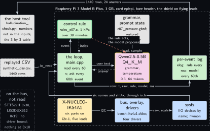
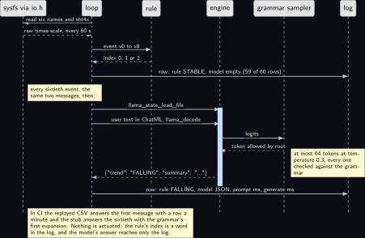
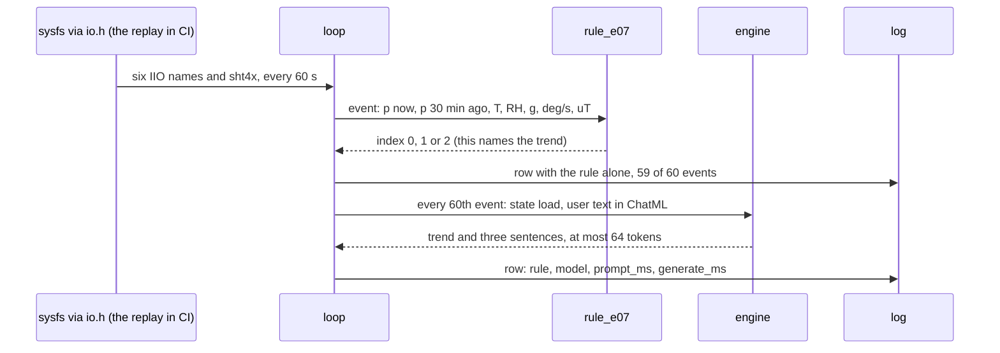

<!-- Written from the chapter source by the catalogue's publish step. Do not hand edit: the chapter is the record and this file is its copy. -->

# Project 7. IKS4A1 climate and motion narrator

> **Board:** Raspberry Pi 3 Model B Plus, bare header, the X-NUCLEO-IKS4A1 on flying leads  
> **Owns:** a day of six sensors read through sysfs every minute, the pressure trend by rule, one three-sentence summary an hour by the model, and the count of numbers the model made up

> [!IMPORTANT]
> **The question, instanced**
>
> What does a small local model add over a two-line threshold, and when does it get it wrong? Here the threshold is the LPS22DF's change over 30 minutes against 1 hPa, the model is told that threshold and seven numbers from six parts of one shield, and the question has two halves: whether a 0.5B model names the same trend as the rule 24 times in a day, and how many numbers it writes into its three sentences that were never among its inputs.

> **Key facts**
>
> - **Board:** Raspberry Pi 3 Model B Plus, 1 GB, card `eplepi`, 4 threads, SSH only
> - **HAT slot:** bare; the shield hangs off header pins 1, 3, 5, 6 and 18 on five flying leads
> - **Parts:** the X-NUCLEO-IKS4A1: LPS22DF pressure, SHT40AD1B humidity and temperature, LSM6DSV16X accelerometer and gyroscope, LIS2MDL magnetometer, LSM6DSO16IS as a second witness; the STTS22H and the LIS2DUXS12 on the bus and unread
> - **Interface:** I2C1 on pins 3 and 5 at 100 kHz, the Linux volume's project 10 overlay, six IIO devices under `/sys/bus/iio/devices` bound by name and one hwmon device, all behind `io.h`; a replayed CSV of a synthetic day in CI
> - **Language and variant:** C++17, catalogue variant B: C++ over the C API through the header-only wrapper `common/cpp/edgellm.hpp`, nothing includes `llama.h`
> - **Model:** Qwen2.5-0.5B-Instruct Q4\_K\_M, 491 MB, Apache 2.0, the Pi 3 upper rung; SmolLM2-360M if the memory reading of [Project 1](../../chapters/01-bring-up-and-the-honest-tokens-per-second.md) says so
> - **Decision:** the trend, one of STABLE, RISING, FALLING, and a summary of three sentences, 44 to 398 characters, both in one JSON object through the grammar
> - **Control rule:** the pressure now minus the pressure 30 minutes earlier: above plus 1 hPa is RISING, below minus 1 hPa is FALLING, else STABLE
> - **Acceptance:** a 24 hour log of 1440 events with 24 model answers; every answer holds a trend literal; the agreement over the 24; the count of numbers in the 24 summaries that are not among that event's inputs, published as it is; throttle bits `0x0` before and after
> - **Difficulty:** 3 of 5
> - **Effort:** two evenings on the host for the reader, the loop and the oracle, one afternoon on the Pi 3B+ for the binding check and the build, and one unattended day

## Pitch

A shield with six parts that answer on one bus is the first project of the volume where the model has more than one number to talk about, and the first where it writes prose. The rule stays two comparisons on two numbers, the pressure now and the pressure half an hour ago, and the model is asked once an hour to name the same trend and to write three sentences on the climate and the motion from the seven numbers it is given. The reading side is as much the point as the model: six IIO devices whose `iio:deviceN` numbers change with probe order are found by their `name` attribute, the humidity sensor is not an IIO device and is read through hwmon, and the kernel ABI's units are converted once before any number reaches a prompt. The day produces 1440 rows and only 24 model answers, so the agreement table is small and says so, and the second acceptance figure is one no enum chapter has: a tool lists every number in every summary and counts the ones that are not among the inputs of that event. A model that names the trend 24 times out of 24 and writes two pressures that never existed has told the reader something a threshold could not, and something it should not.

## Origin and what changed

Drafts 4 and 14 merged. Draft 4 was a sensor dashboard the model would describe and draft 14 a fusion summary over the same shield; both read the same six parts on the same bus through the same drivers and differ only in how many sentences the model writes, so one IKS4A1 on one bus is one project, as the front matter records. The LCD half of draft 4 went to [Project 9](../../chapters/09-lcd-prompt-and-verdict-display.md), where the display is the subject. What changed is the interval design and the second acceptance figure. The drafts asked the model at every reading; at the Pi 3B+'s speed that is seconds of decoding every minute for a sentence nobody reads, so the loop reads the sensors every 60 s, runs the rule and logs every reading, and asks the model every 60th event. And the drafts scored the model on whether its text sounded right; this chapter scores it on whether the numbers in its text existed, which a Python tool can check without anyone reading the sentences. The addresses and the device names come from the bench record of Wednesday 30 September 2026 and the binding of Thursday 1 October 2026 in the Linux volume's project 10, not from the shield's documentation, which this bench could not fetch from the vendor.

## Parts and interface

| **Part** | **Role** | **Interface** | **Address or pin** |
| --- | --- | --- | --- |
| Raspberry Pi 3 Model B Plus, card `eplepi` | runs the reader, the loop and the model; 1 GB, so the model file is admitted only by [Project 1](../../chapters/01-bring-up-and-the-honest-tokens-per-second.md)'s reading; the overlay `bench-iks4a1.dtbo` on the card's boot partition | SSH; the serial console of this board is dead | header pins 1, 3, 5, 6, 18 |
| X-NUCLEO-IKS4A1 | the shield, in Mode 1, every part on its default solder bridges | five flying leads to its Arduino R3 connectors | CN6 pins 4 and 6, CN5 pins 9 and 10, CN9 pin 6 |
| LPS22DF | pressure, the one number the rule reads | `st_pressure`, IIO device `lps22df` | 0x5d, SA0 high |
| SHT40AD1B | humidity and temperature | `sht4x`, hwmon device `sht4x`, thousandths | 0x44 |
| LSM6DSV16X | acceleration and rotation rate, the motion half of the summary | `st_lsm6dsx`, `lsm6dsv16x_accel` and `lsm6dsv16x_gyro` | 0x6b, WHO\_AM\_I 0x70; INT1 on pin 18, unused here |
| LSM6DSO16IS | the ISPU part; two magnitudes logged as a witness, never prompted | `st_lsm6dsx`, `lsm6dso16is_accel` and `lsm6dso16is_gyro` | 0x6a, WHO\_AM\_I 0x22 |
| LIS2MDL | magnetic field magnitude | `st_magn`, IIO device `lis2mdl` | 0x1e |
| STTS22H and LIS2DUXS12 | on the bus, no driver bound, not read | none | 0x38; 0x19, which answers a register read with 0x47; nothing at 0x18 |
| `replay/synthetic_day.csv` | the synthetic day, 1440 rows of `t_s,tag,v0` to `v8` from `tools/make_replay.py` | `io_open_replay` |  |
| `grammars/e07_pressure.gbnf` | the three literals and the three sentences | the grammar sampler | root symbol `root` |
| `prompt.txt` | the system prompt, 85 words, plain text; the ChatML markers are added by `src/main.cpp` | decoded once, state saved |  |
| `src/rules_e07.c` | the control rule, registered by name | `rule_find("e07")` | index 0, 1, 2 |
| `tests/oracle/e07.expected.csv` | 1440 expected rule cells and the stub's 24 model cells | `tests/oracle_check` |  |

## Model and grammar

Qwen2.5-0.5B-Instruct at Q4\_K\_M, the file `qwen2.5-0.5b-instruct-q4_k_m.gguf`, 491 MB, Apache 2.0, from [Qwen/Qwen2.5-0.5B-Instruct-GGUF](https://huggingface.co/Qwen/Qwen2.5-0.5B-Instruct-GGUF) (verified Wednesday 14 October 2026). On a 1 GB board it is the upper rung and it is admitted only when the Pi 3B+'s `MemAvailable` after a headless boot, read in step 7, is at least 818 MB under the 60 percent rule; below that the chapter runs on SmolLM2-360M-Instruct with no other change, and what changes is the quality of the three sentences, which the hallucination count will show. The engine is the pinned `v0.6.0` of [Project 1](../../chapters/01-bring-up-and-the-honest-tokens-per-second.md). The grammar is one file with two keys in one JSON object: the trend, whose first literal is the quiet state the stub answers, and the summary, three sentences each a capital letter, 12 to 130 characters from a class that holds neither a quote nor a backslash, and a full stop. Three such sentences with two spaces are 44 to 398 characters, inside the 40 to 400 the project promises, and the object stays valid JSON whatever the model writes inside the class. The syntax is the engine's own, documented at [grammars/README.md](https://github.com/ggml-org/llama.cpp/blob/master/grammars/README.md) in the engine's tree (to verify).

```gbnf
root      ::= "{" ws "\"trend\"" ws ":" ws trend ws "," ws "\"summary\"" ws ":" ws text ws "}"
trend     ::= "\"STABLE\"" | "\"RISING\"" | "\"FALLING\""
text      ::= "\"" sentence " " sentence " " sentence "\""
sentence  ::= [A-Z] [A-Za-z0-9 ,.%:()]{12,130} "."
ws        ::= [ \t]*
```

The system prompt, decoded once and never again during a run, reads in full: You are an edge agent on a Raspberry Pi reading a sensor shield. You get the air pressure now and 30 minutes ago, the temperature, the humidity, the acceleration, the rotation rate and the magnetic field. Answer only with the JSON object. trend is RISING if the pressure rose by more than 1 hPa in 30 minutes, FALLING if it fell by more than 1 hPa, else STABLE. summary is three short sentences on the climate and the motion that use only the numbers given. The last sentence is the one the hallucination count tests. The model is told the threshold, as in [Project 2](../../chapters/02-the-decision-loop.md), because the question is whether it can apply one it has been given; and the user text states the change as a signed number, so the question is whether a 0.5B model can compare a number with 1, not whether it can subtract.

## What the model decides or writes

Two things in one object, through the grammar, with `n_predict` 64 and temperature 0.3. The trend is one of three literals and nothing else: a token outside the grammar's automaton is never sampled, so the model column holds one of the three or an object that did not close, which the project's tool counts as an answer without a trend key and the chapter counts as its own failure. The summary is prose inside the character class, and the grammar bounds its length but not its truth; 398 characters of English is more than 64 tokens, so the budget is the practical ceiling and a summary not finished inside it leaves the object unclosed. The trend literal is sampled at the same temperature as the prose, one difference from the greedy enum chapters, stated so the agreement table is read with it in mind. In CI there is no model file; the stub expands the grammar's first alternative on every path, which here is `{"trend":"STABLE","summary":". . ."}`, three dots because a character class contributes nothing to the expansion, and the oracle file carries exactly that string on the 24 rows the loop asks and an empty cell on the other 1416.

## Control rule

Two comparisons on two numbers of the event. The rule's history window in `rules.h` is 16 events, which at this project's interval is 16 minutes, so the 30-minute-old pressure cannot come from the history; it travels inside the event as `v[1]`, kept by the reader's ring of 31 readings in the live run and written by the generator in the replay, and the rule stays memoryless. Both thresholds are strict, so a change of exactly 1.00 hPa stays STABLE, and the six cases in `src/rules_e07_test.c` hold both boundary values.

```c
static const char *const rule_e07_names[] = { "STABLE", "RISING", "FALLING", NULL };

static int rule_e07_fn(const rule_ctx *ctx, const io_event *ev)
{
    double d;
    (void)ctx;                                  /* the 30-minute-old value is in the event */
    if (ev->n < 2) return 0;                    /* a short event is STABLE, not a guess */
    d = ev->v[0] - ev->v[1];                    /* hPa over the last 30 minutes */
    if (d > 1.0) return 1;                      /* RISING: more than 1 hPa up */
    if (d < -1.0) return 2;                     /* FALLING: more than 1 hPa down */
    return 0;                                   /* STABLE */
}

/* The constructor registers the rule before main() runs; rule_find("e07") returns it.
 * The file is compiled into the executable and into tests/rules_test, never into an
 * archive. */
const rule_desc rule_e07 = { "e07", rule_e07_fn, rule_e07_names };
RULE_REGISTER(rule_e07);
```

The user text per event is built by one function of the C++ main. It names seven numbers and nothing else; the thresholds are in the system prompt and cost no tokens per event.

```cpp
std::string format_prompt(const io_event &ev)
{
    char buf[320];
    std::snprintf(buf, sizeof buf,
                  "pressure %.1f hPa, 30 minutes ago %.1f hPa, change %+.1f hPa, "
                  "temperature %.1f C, humidity %.0f percent, acceleration %.2f g, "
                  "rotation %.1f deg per second, field %.0f uT. Decide and summarise.",
                  ev.v[0], ev.v[1], ev.v[0] - ev.v[1], ev.v[2], ev.v[3], ev.v[4], ev.v[5],
                  ev.v[6]);
    return buf;
}
```

The event is assembled by the reader class `SensorSet` from eight `io.h` sources, six IIO devices and two hwmon attributes, with the unit conversions in one method: the kernel's ABI gives pressure in kilopascal, acceleration in metres per second squared, angular velocity in radians per second and magnetic field in Gauss, and the hwmon driver gives thousandths, while the prompt speaks hPa, g, degrees per second, microtesla, degrees and percent. The three magnitudes are the vector norms of the three axes, so the summary speaks of motion and not of orientation.

## Real, modelled, absent

- **have:** real: the Pi 3 Model B Plus, the card, the shield on its five leads, the six I2C parts that answered on Wednesday 30 September 2026, the six IIO devices and the hwmon device bound on Thursday 1 October 2026, the overlay, the rule, the grammar, the log and the timings it holds
- **learn:** modelled: the synthetic day, a replayed CSV of 1440 rows from a seeded script with a tide, a front and a recovery, drawn dashed; it stands in for the shield so the loop has an oracle in CI, and nothing about the weather is claimed from it
- **absent:** absent from the data path, in the dotted block: the STTS22H at 0x38, which has no mainline driver, and the LIS2DUXS12 at 0x19, which answers a register read with 0x47 but whose driver is not in the image; nothing answers at 0x18. Neither is read by this project and neither appears in any number of the log

## System architecture



*Figure 7.1. The narrator on the Pi 3 Model B Plus. Inside a dashed layer labelled with the board, the card and the shield on flying leads, the bottom row is the kernel chain in three solid blocks: the shield in the hardware colour, one kernel-blue block for the I2C bus, the overlay and the four drivers, and sysfs, joined by solid arrows labelled SDA and SCL, and raw and scale. The middle row holds the loop in user-space green, the model with the yellow model outline, and the per-event log in green; the top row holds the control rule above the loop with the green rule outline and a grey block for the grammar and the saved prompt state above the model. A solid arrow from sysfs runs under the middle row into the lower half of the loop's left side, labelled six names and sht4x through io.h; a dashed grey block for the replayed CSV outside the layer feeds the upper half, a row a minute. Solid arrows carry the event to the rule with a dashed reply for the index, the user text to the model with a dashed reply for the JSON answer, and the grammar and state into the model; a dashed stop-coloured arrow from the rule to the model says the rule acts and the model proposes. The log row leaves the loop downwards and runs right to the log, and a last solid arrow runs over the top from the log to a grey host block for the hallucination tool. Outside the layer at the bottom left, a dotted grey block names what is on the bus and not read: the STTS22H, the LIS2DUXS12, and the empty 0x18.*

There is no actuator in this chapter, so the rule's index is a word in the log, and the safety rule of the volume is kept by construction: the one arrow that leaves the model block goes to the loop as a reply and from there only to the log. The arrow worth reading twice is the long one from sysfs: six devices are opened by name and read through the same `io.h` the replay comes through, so the binary that ran the synthetic day in CI runs the real day on the bench with `--live` in place of `--replay` and no other change.

## Wiring

| **Header pin** | **BCM** | **Part pin** | **Wire colour if known** |
| --- | --- | --- | --- |
| 1 | 3V3 | shield CN6 pin 4, 3.3 V | not recorded; read the lead at both ends before power |
| 3 | GPIO2, SDA1 | shield CN5 pin 9, D14 | not recorded; the Pi's fitted 1.8 kOhm pull-up serves |
| 5 | GPIO3, SCL1 | shield CN5 pin 10, D15 | not recorded; same pull-up |
| 6 | GND | shield CN6 pin 6 | not recorded; connect first |
| 18 | GPIO24 | shield CN9 pin 6, LSM6DSV16X INT1 | not recorded; wired for the Linux volume's project 10, never read by this project |
| all others |  | nothing | no HAT is seated; the Explorer700 and the SIM7070G of [Project 8](../../chapters/08-explorer700-console-with-a-model.md), [Project 17](../../chapters/17-cellular-status-summariser.md) and [Project 19](../../chapters/19-event-driven-cellular-alert-composer.md) come off this header first |


*Figure 7.2. The 40-pin header of the Pi 3 Model B Plus as two columns of small solid blocks, pin 1 at the top left, with five blocks filled in the hardware colour: pin 1 3V3, pin 3 GPIO2, pin 5 GPIO3, pin 6 GND and pin 18 GPIO24, inside a dashed layer labelled no HAT seated and naming the pull-ups on pins 3 and 5. Five solid arrows lead from those pins to one tall solid hardware block for the X-NUCLEO-IKS4A1: the three odd pins leave through the gap between the columns, rise over the top of the header and run right, labelled 3V3 to CN6 pin 4, SDA1 to CN5 pin 9 and SCL1 to CN5 pin 10; pin 6 runs straight right labelled GND to CN6 pin 6; the fifth arrow points the other way, from CN9 pin 6, the LSM6DSV16X interrupt, to pin 18, marked unused. The shield block names its mode, the six addresses that answer, the LIS2DUXS12 that answers a register read only, and the empty 0x18. Below it a solid hardware block for the board is joined by a two-headed line labelled LAN to a grey console block, SSH only, and a grey block for the model file joins the board with an arrow labelled mmap. A note says wire colours were not recorded on Wednesday 30 September 2026, that the bus stays at 100 kHz, and that GPIO24 is never read here. Nothing is dashed except the header layer and nothing is dotted.*

## Sequence



*Figure 7.3. One minute of the loop and then the sixtieth, as a sequence diagram with six solid actors: sysfs through io.h, the loop, the rule, the engine, the grammar sampler and the log. In the first minute a solid arrow from the loop asks sysfs to read six names and sht4x and a dashed reply brings raw times scale back every 60 s; the event with v0 to v8 goes to the rule and a dashed reply brings the index; the loop writes a row with the rule alone and an empty model cell, which is 59 rows of 60. A note introduces the sixtieth event, where after the same two messages a blue activation bar on the engine spans llama\_state\_load\_file, the user text in ChatML with llama\_decode, logits to the grammar sampler and the dashed reply of a token the root allows, with a note that at most 64 tokens are sampled at temperature 0.3 and every one is checked. A dashed reply returns the JSON object with the trend and the summary, and the last solid arrow writes the row with the rule, the model's object and the two timings. A closing note says that in CI the replayed CSV answers the first message and the stub the sixtieth, and that nothing is actuated.*

## States and data


*Figure 7.4. The three trends as three rounded green states in a row with STABLE in the middle, FALLING to its left and RISING to its right, entered at STABLE from the initial dot above it with the label first event, d is 0, where d is the pressure now minus the pressure 30 minutes earlier. Pairs of solid arrows join STABLE to each neighbour: d above plus 1 hPa to RISING and d at or below plus 1 and at or above minus 1 back; d below minus 1 hPa to FALLING and the mirror condition back. Two curved solid arrows join the ends directly, d above plus 1 in one step from FALLING to RISING underneath and d below minus 1 in one step from RISING to FALLING over the top. A note says both thresholds are strict, so exactly 1.00 hPa stays STABLE and the six test cases hold both boundary values, and that the old pressure travels inside the event because the history window of rules.h is 16 events. Nothing is dashed or dotted.*

The record is the per-event log, `projects/e07-iks4a1-narrator/evidence/e07_day.csv`, in the shape `elog.h` fixes: `t_s, tag, raw, rule, model, prompt_ms, generate_ms, n_generated, engine`, where `raw` joins the nine values of the event with semicolons in the order v0 pressure hPa, v1 pressure 30 minutes earlier, v2 temperature, v3 humidity, v4 acceleration in g, v5 rotation rate in degrees per second, v6 field in microtesla, v7 and v8 the same two magnitudes from the LSM6DSO16IS. The `raw` column is what the hallucination tool reads the inputs from, so the check needs nothing from the program but its log, and the `engine` column separates a stub log from a bench log.

## Data flow

```text
  the shield on i2c-1 (Pi 3B+)        the reader and the loop, main.cpp, every 60 s         host
  +---------------------------+       +---------------------------------------------+   +-----------------+
  | lps22df     0x5d  kPa     |-iio-->| SensorSet: find each name under /sys/bus/iio|   | hallucination_  |
  | lsm6dsv16x_accel 0x6b m/s2|-iio-->|   open "iio" and "sysfs" sources via io.h   |   |  check.py       |
  | lsm6dsv16x_gyro 0x6b rad/s|-iio-->|   convert once: hPa, g, deg/s, uT, C, pct   |   |  numbers not in |
  | lis2mdl     0x1e  Gauss   |-iio-->|   ring of 31 pressures -> v1 (30 min ago)   |   |  the inputs;    |
  | lsm6dso16is 0x6a  witness |-iio-->|      |                                      |   |  3 by 3 table   |
  | sht4x (hwmon) 0x44 milli  |-sysfs>|      v  rule_e07.fn(ctx, ev): d = v0 - v1   |   +-----------------+
  +---------------------------+       |         -> 0 STABLE | 1 RISING | 2 FALLING  |            ^
  replay/synthetic_day.csv -(CI)----->|      |                                      |            |
  prompt.txt -decode once-> [state] ->| every 60th event: format_prompt(ev), ChatML |            |
  grammars/e07_pressure.gbnf -------->|   sample <= 64 under the grammar, temp 0.3  |            |
                                      |   {"trend": "FALLING", "summary": "..."}    |            |
                                      |      v                                      |            |
                                      | elog_row: t, raw (v0..v8), rule, model, ms  |--1440 rows-+
                                      +---------------------------------------------+   24 model answers
  tests/oracle/e07.expected.csv: the rule column from the same two comparisons in Python; the stub's 24 cells
```



## Latency design

The system prompt is 85 words, under 120 tokens on the Qwen tokenizer by the usual reckoning, and the first run on the board prints what the engine counted; it is decoded once at start, its state saved with `llama_state_save_file` and restored before each of the 24 answers, so an answer pays for its own forty-odd tokens of user text and up to 64 generated tokens. `n_ctx` is 512 and threads are 4. The interval design is two intervals, the one design decision here that is not inherited: the sensors are read every 60 s because a trend over 30 minutes needs no finer sampling and the sht4x driver will not measure more often than every 2 s in any case, and the model is asked every 60th event because at the Pi 3B+'s rate from [Project 1](../../chapters/01-bring-up-and-the-honest-tokens-per-second.md)'s table an answer of 64 tokens is tens of seconds of decoding, a tenth of every minute for a sentence nobody is waiting for, and a twenty-fourth of that at one an hour. The cost is the size of the agreement table, 24 answers a day, and the chapter says so rather than pretending that 1440 rows with 24 model cells are 1440 decisions; a second day doubles the table and is the first thing to run after the first. Until the board has run, the decision time is a shape, not a number.

## Steps

**Step 1.** Generate the synthetic day and the oracle on the authoring laptop, and read the summary: the trend counts over all 1440 rows and over the 24 asked rows, and the agreement the stub will reach in CI.

```bash
# win11 aquamarine
cd ~\Desktop\edge-llm-pi; python projects\e07-iks4a1-narrator\tools\make_replay.py
```

**Step 2.** Build the repository with the stub model in skyhorizon's WSL. Nothing compiles on aquamarine; the IIO backend is not needed for the replay and the configure step says so.

```bash
# win11 skyhorizon, WSL side
cd ~/src/edge-llm-pi; cmake -S . -B build -DEDGELLM_STUB_MODEL=ON; cmake --build build -j8
```

**Step 3.** Run the shared rule harness, which carries this project's six cases beside every other project's; two of the six are the boundary values.

```bash
# win11 skyhorizon, WSL side
cd ~/src/edge-llm-pi; ctest --test-dir build -R rules_test --output-on-failure
```

**Step 4.** Run the oracle test: the loop over the 1440 rows with the stub, asking it every 60th row, and the log compared row by row with the oracle file by `tests/oracle_check`.

```bash
# win11 skyhorizon, WSL side
cd ~/src/edge-llm-pi; ctest --test-dir build -R edgellm-e07-oracle --output-on-failure
```

**Step 5.** Run the stub loop by hand and score the log with the project's tool, to see the table the CI number comes from: 17 of 24, 70.8 percent, every disagreement the stub calling a RISING or FALLING hour STABLE, and zero numbers in the three-dot summaries.

```bash
# win11 skyhorizon, WSL side
cd ~/src/edge-llm-pi; build/projects/e07-iks4a1-narrator/edgellm-e07 --project e07 \
  --replay projects/e07-iks4a1-narrator/replay/synthetic_day.csv \
  --grammar projects/e07-iks4a1-narrator/grammar.gbnf \
  --prompt projects/e07-iks4a1-narrator/prompt.txt --log /tmp/e07_stub.csv --stub
```

```bash
# win11 skyhorizon, WSL side
cd ~/src/edge-llm-pi; python projects/e07-iks4a1-narrator/tools/hallucination_check.py \
  /tmp/e07_stub.csv
```

**Step 6.** On the Pi 3B+, with the Explorer700 or the SIM7070G off the header and the shield on its five leads, create the bus device and read the bus both ways. The default scan shows 0x44 and misses 0x19 on most runs; `-r` shows 0x19 and misses 0x44; the two identity reads must return 0x22 and 0x70 in that order.

```bash
# Raspberry Pi 3 Model B Plus, card eplepi, over SSH
cd ~; sudo modprobe i2c-dev; i2cdetect -y 1; i2cdetect -y -r 1
```

```bash
# Raspberry Pi 3 Model B Plus, card eplepi
cd ~; i2cget -y 1 0x6a 0x0f; i2cget -y 1 0x6b 0x0f
```

**Step 7.** Confirm the overlay bound every part the project reads, and read the memory and the throttle bits. The six IIO names must all appear, in whatever `iio:deviceN` order this boot gave them, and `sht4x` must appear under hwmon; a missing name is the overlay's fault, not the driver's, as the Linux volume's project 10 established.

```bash
# Raspberry Pi 3 Model B Plus, card eplepi
cd ~; for d in /sys/bus/iio/devices/iio:device*; do echo "$d $(cat $d/name)"; done
```

```bash
# Raspberry Pi 3 Model B Plus, card eplepi
cd ~; cat /sys/class/hwmon/hwmon*/name; free -m; vcgencmd get_throttled
```

**Step 8.** Build on the board against the real engine with the IIO backend, at two parallel jobs, because a 1 GB board swaps at four compiles of the engine tree.

```bash
# Raspberry Pi 3 Model B Plus, card eplepi
cd ~/edge-llm-pi; cmake -S . -B build -DGGML_NATIVE=ON -DEDGELLM_IO_IIO=ON \
  -DEDGELLM_BUILD_TESTS=OFF; cmake --build build -j2 --target edgellm-e07
```

**Step 9.** Start the day. The run ends by itself after 1440 events, and the first lines of the error file name the directory each name resolved to.

```bash
# Raspberry Pi 3 Model B Plus, card eplepi
cd ~/edge-llm-pi; nohup build/projects/e07-iks4a1-narrator/edgellm-e07 --project e07 \
  --live iio /sys/bus/iio/devices --interval 60 --every 60 --max-events 1440 \
  --grammar projects/e07-iks4a1-narrator/grammar.gbnf \
  --prompt projects/e07-iks4a1-narrator/prompt.txt \
  --model ~/models/qwen2.5-0.5b-instruct-q4_k_m.gguf --state /tmp/e07.state \
  --log projects/e07-iks4a1-narrator/evidence/e07_day.csv > e07_day.err 2>&1 &
```

**Step 10.** A day later, read the throttle bits again and score the log. The engine column must name the build, every answer must carry a trend literal, and the agreement over the 24 and the count of numbers not in the inputs go into the table below with the date of the run.

```bash
# Raspberry Pi 3 Model B Plus, card eplepi
cd ~/edge-llm-pi; vcgencmd get_throttled; tail -2 e07_day.err
```

```bash
# Raspberry Pi 3 Model B Plus, card eplepi
cd ~/edge-llm-pi; python projects/e07-iks4a1-narrator/tools/hallucination_check.py \
  projects/e07-iks4a1-narrator/evidence/e07_day.csv --md
```

## Variant chosen

C++17, catalogue variant B: C++ over the `llama.h` C API, reached through the header-only RAII wrapper `common/cpp/edgellm.hpp` that [Project 2](../../chapters/02-the-decision-loop.md) priced against the C baseline once, so that nothing in this project includes `llama.h`. On practicality it scores highest because the work here is six sysfs readers and sentence assembly: finding a device by its `name` attribute, building a spec string, keeping a ring of 31 pressures and formatting seven numbers into one line want `std::filesystem`, `std::string` and `std::deque` rather than `scandir`, fixed buffers and a hand-rolled ring; on popularity and relevance it is the common language of sensor-fusion code in the field, so the reader class lifts into a C++ firmware or middleware project unchanged; on best practice the C API keeps the engine boundary stable across tags, because a tag change touches `common/c/src/edgellm.c` and nothing in this project; on compliance the kernel's IIO and hwmon ABIs keep the whole reader in user space with no vendor library, and the wrapper and the engine are MIT. What it costs is a second main: the shared `common/c/src/edgellm_main.c` expects one `io_source` and this project merges eight, so `src/main.cpp` carries its own loop in the shared main's order and wraps the ChatML markers itself, 385 lines where a C project adds 30. What it gains is that the merge, the conversions and the ring live in one class of 86 lines that a reader can check against the kernel ABI page line by line. Resident memory and binary size against the C baseline are [Project 2](../../chapters/02-the-decision-loop.md)'s comparison table, measured there and not here.

## Embedded Linux and Yocto

The application recipe `meta-edgellm/recipes-app/edgellm-e07/edgellm-e07_0.1.bb` sets the project id `e07`, the folder `e07-iks4a1-narrator`, the model package `model-qwen2.5-0.5b` and `EDGELLM_IO_OPTIONS` to `-DEDGELLM_IO_IIO=ON`, then requires the shared include of [Project 2](../../chapters/02-the-decision-loop.md), which builds the binary with the `cmake` class against the installed library of the runtime recipe, installs it as `/usr/bin/edgellm-e07` with the prompt, the grammar and the replay folder under `/usr/share/edgellm/e07`, and enables the unit. The overlay is not duplicated: the recipe runtime-depends on `bench-iks4a1`, the Linux volume's project 10 recipe in `meta-bench` that compiles `bench-iks4a1-overlay.dts` on the host with `dtc -@` and deploys the `.dtbo` into the boot partition's overlays directory, and the kas file for the Pi 3B+ puts `dtoverlay=bench-iks4a1` and `dtparam=i2c_arm=on` into `config.txt`. That overlay, as it stood on Thursday 1 October 2026, declares `st,lsm6dsv16x` at 0x6b with its level-high interrupt on GPIO24, `st,lsm6dso16is` at 0x6a, `st,lis2mdl` at 0x1e, `st,lps22df` at 0x5d and `sensirion,sht4x` at 0x44, and nothing at 0x19 or 0x38 on purpose: a node whose compatible no driver in the image matches is created, binds to nothing and prints nothing. The unit runs one day per start and ends by itself; `Restart=on-failure` covers a model that dies mid-day, and the log is flushed per row so a restart loses nothing.

```text
[Service]
Type=simple
# One sensor read every 60 s, the model every 60 events, 1440 events and then exit:
# one 24 hour day per start, with the log flushed per row.
ExecStart=/usr/bin/edgellm-e07 --project e07 \
    --live iio /sys/bus/iio/devices --interval 60 --every 60 --max-events 1440 \
    --model /usr/share/edgellm/models/qwen2.5-0.5b-instruct-q4_k_m.gguf \
    --grammar /usr/share/edgellm/e07/grammar.gbnf \
    --prompt /usr/share/edgellm/e07/prompt.txt \
    --log /var/lib/edgellm/e07.csv \
    --threads 4 --n-predict 64 --temperature 0.3 --state /run/edgellm/e07.state
StateDirectory=edgellm
RuntimeDirectory=edgellm
```

The layer parse is the check that runs on skyhorizon before anything is wired; the image build is a separate later sitting of hours, and the kas file for the 3B+ lists the 360M model as the default rung, adding the 0.5B one only when [Project 1](../../chapters/01-bring-up-and-the-honest-tokens-per-second.md)'s reading admits it.

```bash
# win11 skyhorizon, WSL side
cd ~/bench/edge-llm-pi; kas shell meta-edgellm/kas/edgellm-pi3bp.yml -c "bitbake -p"
```

## Acceptance test

Three quantities over one day of `evidence/e07_day.csv`, 1440 rows and 24 model answers, taken with `vcgencmd get_throttled` reading `0x0` before and after, a run with any bit set being discarded. First, the number of the 24 answers whose object holds no trend literal: the instrument is `tools/hallucination_check.py` reading the log, the pass condition is zero, and one such row fails the chapter, because the grammar did not hold or the object did not close inside 64 tokens. Second, the agreement of the trend column with the rule column over the 24, reported and not passed or failed: a model told the threshold and the signed change that still disagrees with a comparison against 1 is a finding, and so is one that agrees 24 times. Third, the count of numbers in the 24 summaries that are not among the inputs of their event: the tool takes the nine raw values of the row, the change the user text stated and the constants of the system prompt as the inputs, and counts a number as present when some input rounds to it at the precision the summary used, so 22 matches 22.11 and 1013.2 matches 1013.23, while a prompt constant matches only at its own precision, so the prompt's 1 hPa does not absorb a 1.00 g the model invented. The count is published as it is, with the date; the acceptance is that it was counted, not that it is small. The commands are steps 5 and 10 above; CI checks the first quantity and the log shape through the oracle test of step 4, where the count is zero by construction because the stub's summary holds no number.

## Agreement table

Over the synthetic day as generated on Wednesday 14 October 2026 by `tools/make_replay.py` with its fixed seed, the rule column holds 1098 STABLE, 216 RISING and 126 FALLING over the 1440 rows, and over the 24 rows the loop asks, 17 STABLE, 4 RISING and 3 FALLING. The front falls 12 hPa over five hours and the recovery rises 13 hPa over five and a half, so the 30-minute change sits near the threshold at the hour marks: hours 11, 12, 17 and 18 change by 0.92 to 0.97 hPa and stay STABLE by the strict rule while the pressure is plainly moving, which is where a model told the threshold and the number has its one chance to add something or to lose it. On the bench the model column is not measured: the day on the Pi 3B+ has not been run. In CI the stub answers STABLE on every asked row, so the agreement is the STABLE fraction of those 24, 17 of 24, 70.8 percent, and every disagreement is of one kind. With 24 answers a single disagreement moves the rate by 4.2 points, and the table is read with that in mind.

| **Rule says** | **Model STABLE** | **Model RISING** | **Model FALLING** | **Instrument** |
| --- | --- | --- | --- | --- |
| STABLE, 17 | 17 | 0 | 0 | the stub in CI; bench: not measured |
| RISING, 4 | 4 | 0 | 0 | the stub in CI; bench: not measured |
| FALLING, 3 | 3 | 0 | 0 | the stub in CI; bench: not measured |
| agreement | 70.8 percent |  |  | the stub in CI over 24 asked rows; bench: not measured, the day on the Pi 3B+ pending |
| numbers not in the inputs | 0 |  |  | the stub's summary holds no number; bench: not measured |

## Measured data


*Figure 7.5. The pressure of the synthetic day against the hour, drawn with TikZ axes from the replay file as generated on Wednesday 14 October 2026, as a dashed line through 24 hourly points with a small filled marker and a letter at each: S, R or F for the rule's STABLE, RISING or FALLING at that hourly ask, 17, 4 and 3 of them. The line sits near 1013 hPa with a tide of 1 hPa until hour 9, falls 12 hPa to hour 14, stays flat to hour 16 and recovers 13 hPa by hour 22, with the front and the recovery labelled beside the curve. Dashed because the day is modelled and not measured: a note says that the CI stub answers STABLE at every mark for 17 of 24, 70.8 percent, that hours 11, 12, 17 and 18 move by 0.92 to 0.97 hPa in 30 minutes and stay STABLE by the strict threshold, and that the Pi 3B+ run replaces the curve with the LPS22DF's own and the letters with the model's answers.*

## Pitfalls

- **SA0 high puts the LPS22DF at 0x5d.** The part's other address is 0x5c, and a node written from a datasheet default binds nothing while the scan shows the part plainly at 0x5d. The overlay must carry the address the bus showed on Wednesday 30 September 2026, and the symptom of getting it wrong is silence: no device, no message in `dmesg`.
- **The two IMUs are swapped against the first overlay.** 0x6a answers WHO\_AM\_I 0x22 and is the LSM6DSO16IS, 0x6b answers 0x70 and is the LSM6DSV16X; the overlay once bound `st,lsm6dsv16x` at 0x6a, and the driver, which checks the identity register at probe, would have refused it silently. Read both registers before trusting any node.
- **`dtparam=i2c_arm=on` is not `/dev/i2c-1`.** The parameter enables the controller; `modprobe i2c-dev` is what creates the device node that `i2cdetect` opens. Without it the bus is up and every tool reports no bus.
- **`iio:deviceN` follows probe order.** On Thursday 1 October 2026 the pressure sensor was `iio:device3` in the afternoon and `iio:device5` in the evening, after the second IMU's node was added. A program that opens a number reads the wrong part after a reboot with no error; the reader opens by `name`, and a missing name stops the run at open.
- **The humidity sensor is not an IIO device, and it has a rate.** The SHT40AD1B binds to the `sht4x` hwmon driver and appears under `/sys/class/hwmon` in thousandths; a program that enumerates IIO for humidity finds nothing and reports no error. Its `update_interval` is at least 2000 ms, so a read faster than every two seconds returns the last value, harmless at this project's 60 s and a frozen sensor at a faster loop.
- **The ABI's units are not the prompt's.** IIO gives kilopascal, metres per second squared, radians per second and Gauss, hwmon gives millidegrees and milli-percent; a prompt that says hPa and g from unconverted values gives the model a pressure of 101 and an acceleration of 9.8, and the agreement table then scores a conversation about the wrong numbers. The conversions sit in one method of the reader.
- **24 answers is a small table.** One disagreement is 4.2 points of agreement. A 60-minute interval was chosen for the Pi 3B+'s decoding cost, and the price is that one day proves little; the first repeat is a second day, not a shorter interval.
- **The key is `trend`, not `decision`.** `tools/agreement.py` reads the house key and would score every row of this project as free text; the project's own tool reads `trend` and prints the same table beside the hallucination count. A reader who runs the house tool on this log and sees 0 percent has run the wrong tool.

## Future and extra exercises

- The same project in C on the shared main, catalogue variant C: the delta is that `edgellm_main.c` opens one `io_source`, so the merge of eight sources and the ring of 31 pressures would become a ninth backend under `common/c/src`.
- The same reader in Rust over the `industrial-io` crate (MIT or Apache 2.0), as [Project 5](../../chapters/05-adxl345-event-reporter.md) does for one device: the delta is six devices and the hwmon path, which the crate does not cover, plus the bundled engine commit against the pinned tag.
- The same loop in Python over `llama-cpp-python` (MIT): the delta is the interpreter's cost per answer, priced in [Project 15](../../chapters/15-esp32-sidecar-with-a-bounded-pattern-proposal.md), which at one answer an hour is the one place in the volume where it would not matter.
- The IIO buffer and trigger path instead of sysfs polling: the LSM6DSV16X's FIFO with its level-high watermark interrupt on GPIO24, as the Linux volume's project 10 measured it, would give the motion half of the summary a real sample rate instead of one magnitude a minute; the delta is a reader on `/dev/iio:deviceN`.
- The AHRS fusion of the Linux volume's project 10 feeding roll and pitch into the event: the delta is two more numbers in the prompt and in the hallucination check, and a filter whose sign conventions that project has already checked against gravity.
- The two unread parts, once a driver is in the image: a node for `st,lis2duxs12` at 0x19 and, if `st,stts22h` ever reaches mainline, one at 0x38; the delta is two more names in the reader's list and nothing else.

## Video potential

3 of 5. The hook: the model wrote a number that no sensor measured, and here is the tool that caught it. On screen the shield on its five leads, the six names scrolling out of sysfs, one hourly answer appearing in the log with its three sentences, then the hallucination tool printing the count and the line it came from. What is slow on camera is everything, a sensor read a minute and an answer an hour, so the day is recorded earlier and labelled so, and the three minutes are the bind, one answer and the count. It sits behind [Project 6](../../chapters/06-vl53l4cd-too-close-explainer.md) and [Project 13](../../chapters/13-can-honesty-agent.md) because nothing lights and nothing moves, and ahead of [Project 2](../../chapters/02-the-decision-loop.md) because the summary is prose a viewer can read and judge.

## Sources

- Qwen2.5-0.5B-Instruct-GGUF, Apache 2.0, the file `qwen2.5-0.5b-instruct-q4_k_m.gguf` at 491 MB, [huggingface.co/Qwen/Qwen2.5-0.5B-Instruct-GGUF](https://huggingface.co/Qwen/Qwen2.5-0.5B-Instruct-GGUF) (verified Wednesday 14 October 2026).
- The kernel's Industrial I/O driver documentation, [kernel.org/doc/html/latest/driver-api/iio/](https://www.kernel.org/doc/html/latest/driver-api/iio/) (verified Wednesday 14 October 2026), and its core page for the `name` attribute and the `iio:deviceX` naming, [driver-api/iio/core.html](https://www.kernel.org/doc/html/latest/driver-api/iio/core.html) (verified Wednesday 14 October 2026).
- The IIO sysfs ABI, for the units after scale: kilopascal, milli degrees Celsius, metres per second squared, radians per second, Gauss, [Documentation/ABI/testing/sysfs-bus-iio](https://www.kernel.org/doc/Documentation/ABI/testing/sysfs-bus-iio) (verified Wednesday 14 October 2026).
- The `sht4x` hwmon driver: `temp1_input` in millidegrees, `humidity1_input`, address 0x44, `update_interval` at least 2000 ms, [kernel.org/doc/html/latest/hwmon/sht4x.html](https://www.kernel.org/doc/html/latest/hwmon/sht4x.html) (verified Wednesday 14 October 2026).
- ST's own Arduino library for the shield, which names the same seven parts and expects 0x19 and 0x38 on the bus, BSD-3-Clause, [github.com/stm32duino/X-NUCLEO-IKS4A1](https://github.com/stm32duino/X-NUCLEO-IKS4A1) (verified Wednesday 14 October 2026).
- The X-NUCLEO-IKS4A1 product page, [st.com/en/ecosystems/x-nucleo-iks4a1.html](https://www.st.com/en/ecosystems/x-nucleo-iks4a1.html) (to verify): the fetch timed out on Wednesday 14 October 2026, as every fetch from that host has on this bench; the connector table UM3239 Rev 5 Table 4 is cited from the bench record of the Linux volume's project 10.
- GBNF grammar syntax, in the engine's tree, [grammars/README.md](https://github.com/ggml-org/llama.cpp/blob/master/grammars/README.md) (to verify).
- The bench records cited by part: the scan and the identity reads of Wednesday 30 September 2026, the binding of all six IIO devices and the overlay's 0x6a node of Thursday 1 October 2026, the level-high interrupt measurement, from the Linux volume's project 10; the honesty rule from the joint node volume; those volumes have no public URL.

---

[Previous](../../chapters/06-vl53l4cd-too-close-explainer.md) &nbsp;&nbsp;|&nbsp;&nbsp; [Contents](../../CONTENTS.md) &nbsp;&nbsp;|&nbsp;&nbsp; [Next](../../chapters/08-explorer700-console-with-a-model.md)
