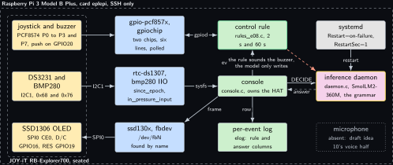
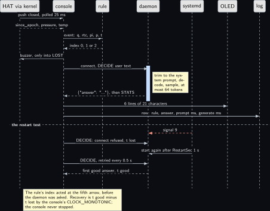
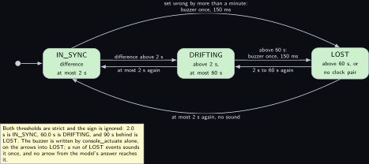
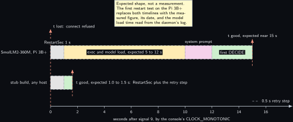

<!-- Written from the chapter source by the catalogue's publish step. Do not hand edit: the chapter is the record and this file is its copy. -->

# Project 8. Explorer700 console with a model

> **Board:** Raspberry Pi 3 Model B Plus, JOY-iT RB-Explorer700 seated  
> **Owns:** the two-process form: a console that owns the HAT and a daemon that owns the model, joined by a Unix domain socket, and the recovery time that join buys

> [!IMPORTANT]
> **The question, instanced**
>
> What does a small local model add over a two-line threshold, and when does it get it wrong? Here the threshold is the difference between a battery-backed clock and the Pi's own, the model is asked one of five fixed questions and must quote a live reading in twenty words, and the question is whether a 360M model can copy a number it was given without changing it, fifty times, while the process that holds it is stopped with signal 9 under the console.

> **Key facts**
>
> - **Board:** Raspberry Pi 3 Model B Plus, 1 GB, card `eplepi`, 4 threads, SSH only
> - **HAT slot:** the JOY-iT RB-Explorer700, seated for the whole sitting; nothing else on this header
> - **Parts:** the joystick (four contacts on the PCF8574 expander, the push contact on GPIO20), the DS3231 clock, the BMP280, the SSD1306 OLED on SPI0, the buzzer on the expander's P7
> - **Interface:** libgpiod 2 across two GPIO chips, sysfs for the clock and the sensor, the framebuffer for the panel, and a Unix domain socket between the two processes
> - **Language and variant:** C, catalogue variant O: a console process plus a separate inference daemon over a Unix domain socket, the daemon under `Restart=on-failure`
> - **Model:** SmolLM2-360M-Instruct Q4\_K\_M, 0.27 GB, Apache 2.0, the Pi 3 family default
> - **Decision:** one sentence of 20 to 160 characters under the grammar, answering one of five canned questions; the stub answers a bare full stop in CI
> - **Control rule:** IN\_SYNC when the DS3231 and the Pi clock are at most 2 s apart, DRIFTING above 2 s and at most 60 s, LOST above 60 s; the buzzer sounds once on the transition into LOST and never on anything the model writes
> - **Acceptance:** 50 of 50 answers carry the reading the question asked for within 1 percent of the sysfs value logged with the event; the only buzzer write is in the rule's path, by code review; the recovery time after the daemon is stopped with signal 9, measured by the console's own clock
> - **Difficulty:** 4 of 5
> - **Effort:** two evenings on the host for the daemon, the console and the oracle, one evening for the overlays and the pre-flight on the Pi 3B+, one afternoon for the fifty questions and the restart test

## Pitch

The Explorer700 is the one board on the bench that is a product in its own right: a clock that survives a power pull, a panel, a joystick, a buzzer and a barometer on one HAT with no lead to get wrong. Kit lab P11 made it a field console with a status page; this chapter puts a model behind the page and asks what the product practice for that is. The answer is not to link the model into the console. A console that owns a panel and a buzzer must keep running when the model's process dies, and a model's process does die: a bad token sequence, a memory spike on a 1 GB board, an upgrade of the engine. So the model lives in a second process behind a Unix domain socket, systemd restarts that process when it fails, and the console measures how long the restart takes by its own clock, from the reply it did not get to the first one it did. Everything else is the loop of [Project 2](../../chapters/02-the-decision-loop.md) rearranged: the joystick press is the event, the clock difference is the rule, the five questions are the user text, and the model's twenty words reach the OLED and the log and nothing else.

## Origin and what changed

Draft idea 10 was a voice console: speak a question, hear an answer. There is no microphone on the bench, so the voice half is dotted in every figure and the console half became this chapter on the Explorer700's panel and joystick, the display half becoming [Project 9](../../chapters/09-lcd-prompt-and-verdict-display.md) on the LCD. The building block is kit lab P11, which binds the DS3231 and the BMP280 through overlays and puts the clock on the OLED from `/dev/rtc0`, and the Linux volume's project 6, which read the vendor manual line by line and found that the OLED is on SPI, not I2C, that the joystick's four directions are on the expander and its push contact on a SoC pin, and that the buzzer is on the expander's P7. Three things changed against the draft. The framebuffer is not `/dev/fb1` from `ssd1307fb`: that driver depends on I2C in the kernel's configuration and cannot bind this panel, so the console finds the DRM driver's framebuffer by name and reads its depth. The joystick is not five lines on one chip: it is four lines on the PCF8574's gpiochip and one on the SoC's, polled, because the expander has no interrupt without its INT wire. And the console unit does not bind to the daemon unit: a bound unit is stopped while the daemon restarts, which would stop the very process whose survival the chapter measures.

## Parts and interface

| **Part** | **Role** | **Interface** | **Address or pin** |
| --- | --- | --- | --- |
| Pi 3 Model B Plus, card `eplepi` | runs both processes; 1 GB, so the 360M rung; the model file in `~/models` | SSH; the serial console is dead on this board and the HAT covers the header anyway | the 40-pin header, all of it |
| JOY-iT RB-Explorer700 | the HAT; every part below is routed on it | seated | 40 pins |
| DS3231 | the clock the rule compares to the Pi's | `rtc-ds1307`, the attribute `since_epoch` of `rtc0` | I2C1, 0x68 |
| BMP280 | pressure and temperature for the answers | `bmp280` under IIO, pressure in kPa, temperature in milli C | I2C1, 0x76 |
| PCF8574 | the expander: joystick Left, Up, Down, Right on P0 to P3, buzzer on P7 | `gpio-pcf857x`, a gpiochip labelled `pcf8574` | I2C1, 0x20 |
| Joystick push | the fifth contact, on the SoC | gpiod, active low, pull-up | GPIO20, header pin 38 |
| SSD1306 OLED | the answer, six lines of 21 characters | `ssd130x` DRM, its fbdev node found by name | SPI0 CE0 GPIO8, D/C GPIO16, RES GPIO19 |
| Buzzer | sounds once on the transition into LOST, from the rule | gpiod output on the expander | P7, net Buzz |
| the two programs, `daemon.c` and `console.c` | the model behind the socket; the HAT, the rule's action, the prompt, the OLED and the log | `DECIDE`, `STATS`, `VERSION` lines | `/run/edgellm/e08.sock` |

## Model and grammar

SmolLM2-360M-Instruct at Q4\_K\_M, the file `SmolLM2-360M-Instruct-Q4_K_M.gguf`, 0.27 GB, Apache 2.0, from [bartowski/SmolLM2-360M-Instruct-GGUF](https://huggingface.co/bartowski/SmolLM2-360M-Instruct-GGUF) (verified Wednesday 14 October 2026), whose card prints the ChatML form with the `im_start` and `im_end` markers that the daemon wraps around the system prompt and the user text. It is the Pi 3 family default of the ladder: a 1 GB board has about 900 MB available headless, and 270 MB sits under the 60 percent rule with room for the console beside it. The engine is the pinned `v0.6.0` of [Project 1](../../chapters/01-bring-up-and-the-honest-tokens-per-second.md). The grammar is a sentence grammar in the house shape, one JSON object with one `answer` key; the syntax is the engine's own, documented at [grammars/README.md](https://github.com/ggml-org/llama.cpp/blob/master/grammars/README.md) in the engine's tree (to verify). The value is 20 to 160 characters from a class with no quote and no newline, so the answer is always one line of the socket protocol and one cell of the CSV, and it ends in a literal full stop, so the end of generation is reachable only after a whole sentence.

```gbnf
root   ::= "{" ws "\"answer\"" ws ":" ws "\"" answer "\"" ws "}"
answer ::= [A-Za-z0-9 ,.:%+-]{19,159} "."
ws     ::= [ \t]*
```

The system prompt, 66 words, reads in full: You are the console of a Raspberry Pi with an Explorer700 HAT. You get one question and the live readings: the RTC time, the Pi time, their difference in seconds, the clock state, the pressure in kPa, the temperature in C. Answer the question in one sentence of about twenty words that quotes the relevant reading exactly as given. Answer only with the JSON object. The readings are in the user text with the question, so the model never has to remember a number across events; it has to copy one from forty tokens back, which is the easiest kind of grounding and therefore the one to test first on a 360M model.

## What the model decides or writes

One sentence, through the grammar, with `n_predict` 64 and temperature 0.3 under the sentence grammar as the latency design fixes for text. The grammar bounds the length and the character set, not the content: the model can write any twenty words from that class, including a pressure that is not the one it was given, and that is exactly what the acceptance test counts. The console pulls the sentence out of the object for the OLED and keeps the object in the log, where `tools/answer_check.py` reads the question index and the five inputs from the `raw` column and looks for the right one among the numbers in the answer. In CI the stub answers the grammar's first expansion, and for a sentence grammar the class expands to nothing, so every row reads `{"answer":"."}` with timings of zero and the engine column reading stub; the oracle test checks that shape, the loop, the socket and both processes end to end, and the answer check scores 0 of 120 on it by construction.

## Control rule

One difference, two strict thresholds, the sign ignored. The DS3231's seconds since the epoch come from `since_epoch` and the Pi's from `time()` at the same moment; an event without the clock pair is LOST, because a clock that cannot be read is not in sync with anything. The names are the three states the OLED's status line shows and the log's rule column holds; the grammar of this project is a sentence, so the names are not grammar literals here, and the oracle test compares the rule column alone letter for letter.

```c
static const char *const rule_e08_names[] = { "IN_SYNC", "DRIFTING", "LOST", NULL };

static int rule_e08_fn(const rule_ctx *ctx, const io_event *ev)
{
    double d;
    (void)ctx;                                 /* one difference decides; no history */
    if (ev->n < 3) return 2;                   /* no clock pair is a lost clock, not a guess */
    d = ev->v[1] - ev->v[2];                   /* DS3231 seconds minus Pi seconds */
    if (d < 0.0) d = -d;
    if (d > 60.0) return 2;                    /* LOST: more than a minute apart */
    if (d > 2.0) return 1;                     /* DRIFTING: more than two seconds apart */
    return 0;                                  /* IN_SYNC */
}
```

The rule's one action is the buzzer, and the code review item of the acceptance test is the function below: the only place in the console that writes expander line P7, called with the rule's index before the daemon is asked, sounding the buzzer once on the transition into LOST and reading nothing of the model's answer. In a replay run there is no HAT and the call is counted. The user text the daemon then gets names the question, both clocks in UTC, their difference, the rule's state, the pressure with the previous pressure, and the temperature; UTC so that the answer check can recompute the `HH:MM` from the logged epoch seconds on any host.

```c
static int console_actuate(void *hat_or_null, int rule_index, int *last_index, long *n_buzz)
{
    int entering_lost = rule_index == 2 && *last_index != 2;
    *last_index = rule_index;
    if (!entering_lost)
        return 0;
    (*n_buzz)++;
#ifdef EDGELLM_E08_LIVE
    if (hat_or_null != NULL) {
        hat *h = (hat *)hat_or_null;
        if (gpiod_line_request_set_value(h->buzz, BUZZER_OFFSET, GPIOD_LINE_VALUE_ACTIVE) != 0)
            return -1;
        sleep_s(BUZZER_MS / 1000.0);
        return gpiod_line_request_set_value(h->buzz, BUZZER_OFFSET, GPIOD_LINE_VALUE_INACTIVE);
    }
#else
    (void)hat_or_null;
#endif
    return 0;
}
```

## Real, modelled, absent

- **have:** real: the Pi 3B+, the card, the Explorer700 with its joystick, DS3231, BMP280, SSD1306 and buzzer, both processes, the socket, the units, the log and the recovery figure it holds
- **learn:** modelled: the replayed CSV of 120 presses with a seeded clock walk, drawn dashed; it stands in for the joystick and the two sysfs reads so that both processes and the socket have an oracle before the HAT is seated, and nothing about the HAT is claimed from it
- **absent:** absent: the microphone of draft idea 10, dotted in the architecture figure; the IR receiver, the PCF8591 inputs and the 1-Wire header are on the HAT but not in this project, and are listed as extra exercises

## System architecture



*Figure 8.1. Two processes on the Pi 3 Model B Plus. Inside a dashed layer for the board, a second dashed layer on the left holds the HAT's three solid hardware blocks: the joystick and buzzer on the PCF8574 and GPIO20, the DS3231 and BMP280 on I2C1, and the SSD1306 on SPI0. A middle column of three solid kernel-blue blocks carries their bindings, gpio-pcf857x with two gpiochips, rtc-ds1307 and the bmp280 IIO driver, and ssd130x with its framebuffer found by name. The console in user-space green sits at the centre with the control rule above it in the green rule outline and the per-event log below; on the right, systemd in grey above the inference daemon with the yellow model outline, and a dotted grey block for the absent microphone. Solid arrows carry the HAT's lines to the kernel (I2C1, SPI0), a two-headed gpiod line to the rule, sysfs reads and the frame between console and kernel, the event and index between console and rule, the row to the log, DECIDE to the daemon with a dashed reply carrying the answer, and the restart from systemd. A dashed stop-coloured arrow from the rule to the daemon says the rule sounds the buzzer and the model only writes.*

Two things in the figure are the design. The buzzer's arrow ends at the rule, not at the console's answer path: the gpiod line is drawn two-headed because the same chip carries the four joystick inputs and the one buzzer output, and the output is written by the rule's function alone. And the daemon has no arrow to anything but the console: it owns the model file, the system prompt state and the grammar, and it does not know a HAT exists. When it is stopped, the console keeps its panel, its joystick and its buzzer, and shows MODEL AWAY until the next good reply.

## Wiring

| **Header pin** | **BCM** | **Part pin** | **Wire colour if known** |
| --- | --- | --- | --- |
| 1, 2 | 3V3, 5V | HAT supply | routed on the HAT; no lead anywhere in this project |
| 3, 5 | GPIO2 SDA, GPIO3 SCL | DS3231 0x68, BMP280 0x76, PCF8591 0x48, PCF8574 0x20 | on the HAT |
| 19, 23 | GPIO10 MOSI, GPIO11 SCLK | SSD1306 MOSI and SCK | on the HAT |
| 24 | GPIO8, CE0 | SSD1306 CS, driven by the SPI controller | on the HAT |
| 36, 35 | GPIO16, GPIO19 | SSD1306 D/C (printed DNC on the manual's diagram) and RES, active low | on the HAT |
| 38 | GPIO20 | joystick push contact, closes to ground; the console requests the pull-up | on the HAT |
| expander | P0 to P3, P7 | joystick Left, Up, Down, Right, nets A to D, idle high by the part; buzzer, net Buzz, polarity to verify on the first sound | on the HAT |
| 40, 12, 37, 7 | GPIO21, 18, 26, 4 | expander INT, IR receiver, LED1, 1-Wire: routed on the HAT, not used here | on the HAT |

Every BCM number is from page 3 of the JOY-iT manual, the per-peripheral block diagram, [RB-Explorer700-Manual-16.11.2020.pdf](https://www.joy-it.net/files/files/Produkte/RB-Explorer700/RB-Explorer700-Manual-16.11.2020.pdf) (verified Wednesday 14 October 2026), dated Monday 16 November 2020, whose page 2 fixes that all numbers are Raspberry Pi BCM numbers. The same page calls the pressure sensor a BMP 180 in the diagram and a BMP280 in the component callout; the Linux volume's project 6 chose `bosch,bmp280` and the IIO driver covers both, naming the chip id it reads if the guess is wrong.


*Figure 8.2. The 40-pin header of the Pi 3 Model B Plus as two columns of small blocks, pin 1 at the top left, with the pins this project reads or drives through the HAT filled in the hardware colour: 1 and 2 for the supply, 3 SDA and 5 SCL, 9 GND, 19 MOSI, 23 SCLK, 24 CE0, 36 GPIO16, 35 GPIO19 and 38 GPIO20. Over them to the right, one wide solid hardware block for the JOY-iT RB-Explorer700 seated on all forty pins, and under it the parts it routes as solid hardware blocks at the height of their pins: the I2C1 parts with their four addresses, the SSD1306, the joystick with its four expander lines and the push contact, and the buzzer on P7. Two grey blocks name what the HAT also carries and this project leaves alone: the screw terminal and sensor header with nothing attached, and the IR receiver, LED1 and 1-Wire header. Solid arrows run from the filled pins to the parts, labelled SDA, SCL, MOSI, CS CE0, SCK, D/C, RES and push with pull-up, and from the I2C block to the joystick (P0 to P3) and to the buzzer (P7, rule only). A note says that filled pins are the ones this project uses, that the HAT covers the header so the session is SSH, and that nothing is dashed.*

## Sequence



*Figure 8.3. One question and then the restart test, as a sequence diagram with seven solid actors: the HAT through the kernel, the console, the rule, the daemon, systemd, the OLED and the log. A solid arrow carries the closed push contact, polled every 25 ms, from the HAT to the console, and a dashed reply brings since\_epoch, the pressure and the temperature. The console sends the event to the rule and a dashed reply brings the index back; a solid arrow back to the HAT carries the buzzer, only on the transition into LOST. Over a blue activation bar on the daemon, a solid arrow carries connect and DECIDE with the user text, a note inside the bar says the context is trimmed to the system prompt, the text decoded and at most 64 tokens sampled under the grammar, and a dashed reply returns the JSON answer followed by STATS. Two solid arrows write six lines of 21 characters to the OLED and the row to the log. Under a dashed rule labelled the restart test, a dashed stop-coloured arrow from systemd to the daemon carries signal 9, a solid arrow from the console to the daemon reads connect refused with the time t lost, systemd starts the daemon again after RestartSec 1 s, the console retries every 0.5 s, and a dashed reply brings the first good answer at t good. A note says the rule's index acted at the fifth arrow before the daemon was asked, and that recovery is t good minus t lost by the console's clock, which never stopped.*

## States and data



*Figure 8.4. The three clock states as three rounded green states in a row, IN\_SYNC, DRIFTING and LOST, entered at IN\_SYNC from the initial dot. Between neighbours, pairs of solid arrows with the thresholds as labels: difference above 2 s from IN\_SYNC to DRIFTING and at most 2 s again back; above 60 s from DRIFTING to LOST, labelled buzzer once 150 ms, and 2 s to 60 s again back. Two curved solid arrows join the ends: set wrong by more than a minute from IN\_SYNC straight to LOST over the top, again labelled buzzer once, and at most 2 s again with no sound from LOST straight back to IN\_SYNC underneath. A note says both thresholds are strict and the sign is ignored, so 2.0 s is IN\_SYNC, 60.0 s is DRIFTING and 90 s behind is LOST, that the buzzer is written by console\_actuate alone on the arrows into LOST, and that no arrow from the model's answer reaches it. Nothing is dashed or dotted.*

The record is the per-event log, `projects/e08-explorer700-console/evidence/e08_live.csv`, in the shape `elog.h` fixes: `t_s, tag, raw, rule, model, prompt_ms, generate_ms, n_generated, engine`. The `raw` column joins the five inputs with semicolons in the order question, DS3231 seconds, Pi seconds, pressure, temperature, which is what the answer check reads back; the `model` column holds the JSON object; the `engine` column holds what the daemon answered to `VERSION` at the console's start, so a log from the stub can never be read as a log from the Pi. The recovery figure is not a column: it is one line on the console's standard error, `daemon recovered after N s`, and the evidence folder keeps that stream beside the log.

## Data flow

```text
  the HAT, through the kernel           the console, console.c                   the daemon, daemon.c
  +--------------------------+          +--------------------------------+        +--------------------------+
  | joystick: PCF8574 P0..P3 |--poll--->| press: q = cursor 0..4         |        | SmolLM2-360M, n_ctx 512  |
  |   push on GPIO20 (gpiod) |  25 ms   |   since_epoch, pressure, temp, |        | system prompt decoded    |
  | DS3231  /sys/class/rtc   |--sysfs-->|   time()                       |        |   once, kept resident    |
  | BMP280  /sys/bus/iio     |          | rule_e08.fn -> 0 | 1 | 2       |        |                          |
  | buzzer  PCF8574 P7       |<-rule----|   console_actuate: P7 on LOST  |        | DECIDE <user text> ----> |
  | SSD1306 /dev/fbN (fbdev) |<-frame---|   format_prompt(q, rtc, pi, p) |-socket-| seq_rm, decode, sample   |
  +--------------------------+          |   DECIDE -> {"answer": "..."}  |<-------| under e08_answer.gbnf,   |
                                        |   STATS  -> prompt, generate   |        |   <= 64 tokens, temp 0.3 |
  systemd: Restart=on-failure, 1 s ---> |   lost reply .. first good one |        +--------------------------+
    starts the daemon again             |     = recovery, CLOCK_MONOTONIC|            ^   signal 9 ends it;
                                        | elog_row: raw, rule, answer    |------------+   the console lives
                                        +--------------------------------+
  tools/answer_check.py: the reading the question asked for, within 1 percent of raw, 50 of 50
```

```mermaid
sequenceDiagram
    participant H as HAT via kernel
    participant C as console
    participant R as rule_e08
    participant D as daemon
    participant S as systemd
    H->>C: push closed; since_epoch, pressure, temp
    C->>R: event: q, rtc, pi, p, t
    R-->>C: index 0, 1 or 2 (this is what sounds the buzzer)
    C->>H: buzzer on P7, once, only into LOST
    C->>D: DECIDE user text, over the Unix socket
    D-->>C: {"answer": "..."}, then STATS
    C->>H: six lines on the OLED; row to the log
    S->>D: signal 9, then start again after 1 s
    C->>D: retry every 0.5 s until the first good reply
```

## Latency design

Event-driven: nothing is asked until a contact closes, so the interval is the operator's. The system prompt is 66 words, under 120 tokens on the SmolLM2 tokenizer; the daemon decodes it once at start and keeps it resident, trimming the context back to it with `llama_memory_seq_rm` before every request, which is the resident route [Project 2](../../chapters/02-the-decision-loop.md) left to this chapter: a long-running service pays no file read per request and loses nothing across a restart that it would not have to recompute anyway. The user text is about fifty tokens; `n_predict` is 64 and the grammar's full stop ends most answers short of it; temperature 0.3 under the grammar, 4 threads, `n_ctx` 512. The decision time on the Pi 3B+ is one decode of about fifty tokens plus up to 64 single-token decodes, which with [Project 1](../../chapters/01-bring-up-and-the-honest-tokens-per-second.md)'s table for the 360M model on this board becomes a number; until then it is a shape. The figure this chapter adds is a different one: the time from a lost reply to the next good one when the daemon is stopped with signal 9, which is `RestartSec` plus the exec, the model load from the card, the system prompt decode and one answer, read by the console with 0.5 s resolution from its retry interval.

## Steps

**Step 1.** Generate the replay file and the oracle on the authoring laptop, and read the summary: 97 IN\_SYNC, 14 DRIFTING and 9 LOST presses over 120, two transitions into LOST.

```bash
# win11 aquamarine
cd C:\Users\aquamarine\Desktop\edge-llm-pi; `
  python projects\e08-explorer700-console\tools\make_replay.py
```

**Step 2.** Build the repository with the stub model and the gpiod backend in skyhorizon's WSL, the first build of both binaries and of the console's live half.

```bash
# win11 skyhorizon, WSL side
cd ~/src/edge-llm-pi; cmake -S . -B build -DEDGELLM_STUB_MODEL=ON -DEDGELLM_IO_GPIO=ON; \
  cmake --build build -j8
```

**Step 3.** Run the shared rule harness, which carries this project's six cases beside every other project's, and the oracle test: the console over the 120 presses with `--daemon`, so it starts the stub daemon itself on a socket in a temporary directory, and the log compared row by row against the oracle by `tests/oracle_check`.

```bash
# win11 skyhorizon, WSL side
cd ~/src/edge-llm-pi; ctest --test-dir build -R 'rules_test|edgellm-e08-console-oracle' \
  --output-on-failure
```

**Step 4.** Run the same pair by hand and score the log with the answer check, to see the CI number: 0 of 120, because the stub's full stop carries no reading, with the engine column reading stub.

```bash
# win11 skyhorizon, WSL side
cd ~/src/edge-llm-pi; build/projects/e08-explorer700-console/edgellm-e08-console --project e08 \
  --replay projects/e08-explorer700-console/replay/console_120.csv \
  --grammar projects/e08-explorer700-console/grammar.gbnf \
  --prompt projects/e08-explorer700-console/prompt.txt \
  --daemon build/projects/e08-explorer700-console/edgellm-e08-daemon --log /tmp/e08_stub.csv \
  --stub; python projects/e08-explorer700-console/tools/answer_check.py /tmp/e08_stub.csv
```

**Step 5.** Seat the HAT on the powered-off Pi 3B+, add the six lines of `wiring.md` to `/boot/firmware/config.txt`, reboot, and run the pre-flight over SSH: 0x76, 0x48 and 0x20 answer and 0x68 reads UU, a device named bmp280 under IIO, a framebuffer whose name mentions ssd130x, a gpiochip labelled pcf8574, and `MemAvailable` above 450 MB.

```bash
# Raspberry Pi 3 Model B Plus, card eplepi, over SSH
cd ~; i2cdetect -y 1; cat /sys/bus/iio/devices/iio:device*/name /sys/class/graphics/fb*/name; \
  gpioinfo | grep pcf8574; free -m
```

**Step 6.** Build on the Pi 3B+ against the real engine with the board's own flags and the gpiod backend, at two parallel jobs, because this tree at four swaps a 1 GB board.

```bash
# Raspberry Pi 3 Model B Plus, card eplepi
cd ~/edge-llm-pi; cmake -S . -B build -DGGML_NATIVE=ON -DEDGELLM_IO_GPIO=ON; \
  cmake --build build -j2
```

**Step 7.** Start the daemon, then the console, and ask fifty questions from the joystick, moving the cursor with Up and Down and pressing to ask; keep the standard error stream.

```bash
# Raspberry Pi 3 Model B Plus, card eplepi
cd ~/edge-llm-pi; vcgencmd get_throttled; \
  build/projects/e08-explorer700-console/edgellm-e08-daemon --socket /tmp/e08.sock \
  --grammar projects/e08-explorer700-console/grammar.gbnf \
  --prompt projects/e08-explorer700-console/prompt.txt \
  --model ~/models/SmolLM2-360M-Instruct-Q4_K_M.gguf --threads 4 --n-predict 64 --temperature 0.3 &
```

```bash
# Raspberry Pi 3 Model B Plus, card eplepi
cd ~/edge-llm-pi; build/projects/e08-explorer700-console/edgellm-e08-console --project e08 --live \
  --socket /tmp/e08.sock --grammar projects/e08-explorer700-console/grammar.gbnf \
  --prompt projects/e08-explorer700-console/prompt.txt \
  --log projects/e08-explorer700-console/evidence/e08_live.csv \
  2> projects/e08-explorer700-console/evidence/e08_live.stderr
```

**Step 8.** Score the fifty answers with the answer check in strict mode, and read the throttle bits again. The count must be 50 of 50; every failure is listed with its line and the reading it missed, and goes into the agreement table as a disagreement of its kind.

```bash
# Raspberry Pi 3 Model B Plus, card eplepi
cd ~/edge-llm-pi; python projects/e08-explorer700-console/tools/answer_check.py \
  projects/e08-explorer700-console/evidence/e08_live.csv --strict; vcgencmd get_throttled
```

**Step 9.** Install the two units, start both, and run the restart test: with the console running and a question asked every few seconds, stop the daemon with signal 9 and read the recovery line from the console's journal. The figure, with its date, replaces the expected shape in the data figure.

```bash
# Raspberry Pi 3 Model B Plus, card eplepi
cd ~/edge-llm-pi; sudo systemctl kill -s SIGKILL edgellm-e08-daemon.service; sleep 20; \
  journalctl -u edgellm-e08-console.service -n 5
```

## Variant chosen

C, catalogue variant O: a console process and a separate inference daemon over a Unix domain socket, the daemon under `Restart=on-failure`. On practicality it scores highest because the console must survive the model's process dying, and a process that has the model linked in dies with it; two processes is the only form in which the panel, the joystick and the buzzer are still there when the engine is not. On best practice it is the embedded product practice: restart isolation, where the part that can fail is the part that restarts, and systemd is the supervisor already on the board. On compliance and popularity it adds nothing: a Unix domain socket needs no library on either side, the protocol is three line commands, and the daemon's engine side is the same `edgellm.h` of [Project 2](../../chapters/02-the-decision-loop.md) with its MIT engine behind it. On relevance it is the one variant that buys a measurement no other chapter can take, the recovery time after the daemon is stopped with signal 9, measured by the console's own clock from the lost reply to the next good one, which is the figure a product review would ask for first. What it costs is a second binary, a second unit, the socket round trip per question, microseconds beside a decode of seconds, and the system prompt decode the daemon pays once per start, which the console counts inside the recovery figure. The live half of the console also steps outside the house rule that hardware is reached only through `io.h`, because the joystick spans two GPIO chips and no backend draws a framebuffer; the deviation is confined to the functions under `EDGELLM_E08_LIVE` in `src/console.c`, and the replay path is `io.h` as everywhere.

| **Quantity** | **Stub, CI** | **Pi 3B+** | **Resolution** | **Instrument** |
| --- | --- | --- | --- | --- |
| recovery after signal 9 | not measured; expected 1.0 to 1.5 s | not measured; expected near 15 s | 0.5 s, the retry step | the console's monotonic clock, the stderr line |
| model load to first reply | 0 by construction | not measured | the daemon's log | the daemon's listening line against the journal's start line |
| VmRSS of each process | not measured | not measured | kB | `/proc/self/status`, the summary lines of both |

## Embedded Linux and Yocto

The application recipe `meta-edgellm/recipes-app/edgellm-e08/edgellm-e08_0.1.bb` sets the three variables of the layer's pattern, `e08`, `e08-explorer700-console` and `model-smollm2-360m`, adds the gpiod backend through `EDGELLM_IO_OPTIONS` and `libgpiod` to its dependencies, and then departs from the shared include in one way: the include installs one binary and one unit, and this project has two of each, so the recipe drops the include's unit entry from `SRC_URI` and carries its own `do_install`, which installs both binaries, the prompt, the grammar and the replay folder under `/usr/share/edgellm/e08`, and the two units from the project's own `files/` folder, so that the chapter prints the same bytes the image ships. The daemon's unit carries the restart policy:

```text
[Service]
Type=simple
# One model, one socket, nothing else. The console is a separate unit; this one may be
# stopped with signal 9 at any time and systemd starts it again one second later. That
# interval plus the model load is the recovery time the console measures.
ExecStart=/usr/bin/edgellm-e08-daemon \
    --socket /run/edgellm/e08.sock \
    --model /usr/share/edgellm/models/SmolLM2-360M-Instruct-Q4_K_M.gguf \
    --grammar /usr/share/edgellm/e08/grammar.gbnf \
    --prompt /usr/share/edgellm/e08/prompt.txt \
    --threads 4 --n-predict 64 --temperature 0.3
RuntimeDirectory=edgellm
RuntimeDirectoryPreserve=yes
Restart=on-failure
RestartSec=1
```

The console's unit starts the daemon with `Wants=` and orders after it with `After=`, and deliberately not `BindsTo=`: the unit manual says that a unit bound to another with both `BindsTo=` and `After=` must have that other unit active to be active itself, and a daemon in its one-second auto-restart is not active, so a bound console would be stopped by the very event it is meant to survive. The manual is at [systemd.unit](https://www.freedesktop.org/software/systemd/man/latest/systemd.unit.html) (to verify: the page refused the connection on Wednesday 14 October 2026, and the sentence above is from memory of it until it is read). The overlay fragment is not the Linux volume's `bench-explorer700`, which gives the joystick to `gpio-keys-polled` and the buzzer to `gpio-beeper`, lines a kernel consumer holds and gpiod is then refused; it is the four overlays of Raspberry Pi OS's own tree, the same lines on the card and on the image, read from the overlay sources on Wednesday 14 October 2026:

```text
dtparam=i2c_arm=on
dtparam=spi=on
dtoverlay=i2c-rtc,ds3231
dtoverlay=i2c-sensor,bmp280,addr=0x76
dtoverlay=pcf857x,pcf8574,addr=0x20
dtoverlay=ssd1306-spi,dc_pin=16,reset_pin=19
```

They go into the Pi 3B+ kas file's `RPI_EXTRA_CONFIG` when `edgellm-e08` is added to its `EDGELLM_APPS`, which this chapter does not do: that file lists `edgellm-e02` as the one application of the first image, and the edit is one line when the image for this board is built. The layer parse is the check that runs first:

```bash
# win11 skyhorizon, WSL side
cd ~/bench/edge-llm-pi; kas shell meta-edgellm/kas/edgellm-pi3bp.yml -c "bitbake -p"
```

## Acceptance test

Three quantities. First, over fifty questions asked from the joystick on the Pi 3B+, the number of answers that carry the reading the question asked for within 1 percent of the value the console logged with the event: the instrument is `tools/answer_check.py` reading the log, the pass condition is 50 of 50, and an answer with the wrong number, no number, or the right number for the wrong question fails it. Second, that the buzzer never sounds on model output alone, which no run can show and a reading of `src/console.c` can: `console_actuate` is the only writer of expander line P7, it takes the rule's index and the previous index, it is called before the daemon is asked, and the model's answer is not among its arguments; the replay summary's buzzer count equalling the oracle's two transitions into LOST is the cheap check that this stays true. Third, the recovery time after the daemon is stopped with signal 9 under systemd, by the console's `CLOCK_MONOTONIC` from the first refused connection to the first good reply, with 0.5 s resolution: the console must still be the same process afterwards, the figure is stated with its date, and it is under 30 s on this board until the first measurement replaces that bound. All three with `vcgencmd get_throttled` reading `0x0` before and after; the commands are steps 8 and 9, and the CI run checks the log shape and both processes through the oracle test of step 3.

## Agreement table

For a sentence project the agreement is the answer check, not a confusion table between two enums: the rule column holds a clock state and the model column a sentence, and `tools/agreement.py` would score every row a disagreement by construction. Over the 120 presses of `replay/console_120.csv` as generated on Wednesday 14 October 2026 by `tools/make_replay.py` with its fixed seed, the rule column holds 97 IN\_SYNC, 14 DRIFTING and 9 LOST, with two transitions into LOST, and the questions are asked 27, 18, 20, 25 and 30 times in index order. In CI the stub answers a full stop in every row, so the answer check scores 0 of 120, 0.0 percent, every failure of one kind, no number in the answer; the number is printed so that the first bench number has something beside it. On the bench the model column is not measured: the fifty-question run has not been taken.

| **Rule says** | **Presses** | **Answer carries the reading** | **Answer misses it** | **Instrument** |
| --- | --- | --- | --- | --- |
| IN\_SYNC | 97 | 0 | 97 | the stub in CI; bench: not measured |
| DRIFTING | 14 | 0 | 14 | the stub in CI; bench: not measured |
| LOST | 9 | 0 | 9 | the stub in CI; bench: not measured |
| agreement | 120 | 0.0 percent |  | the stub in CI, no number in a full stop; bench: not measured, 50 questions pending on the Pi 3B+ |

## Measured data



*Figure 8.5. The shape the restart test expects, drawn with TikZ axes and not a measurement. The horizontal axis is seconds after signal 9 by the console's clock, 0 to 18; a dashed stop-coloured line at 0 marks the lost reply. Two timelines of dashed boxes: the real model on the Pi 3B+, with RestartSec 1 s in grey, the exec and model load in the hardware colour expected at 5 to 12 s, the system prompt decode in the firmware colour, and the first DECIDE in green ending at a dashed stop-coloured mark labelled t good, expected near 15 s; and the stub build, where the same RestartSec is followed by one retry step and t good is expected at 1.0 to 1.5 s. A short dashed bar shows the 0.5 s retry step as the resolution. A note says the first restart test on the Pi 3B+ replaces both timelines with the measured figure, its date and the model load time read from the daemon's log.*

## Pitfalls

- **SPI0 CE0 belongs to the OLED.** The ssd1306-spi overlay puts the panel on chip select 0 and disables `spidev0`; GPIO8 is the select because the controller drives it, not because any node claims it. Nothing else may sit on SPI0 on this Pi while the HAT is seated, and a program that opens `/dev/spidev0.0` is the symptom of a second owner on one line.
- **The DS3231 as hwclock against NTP time.** The Pi's clock is NTP-disciplined when the network is up, so the difference the rule sees is the DS3231 against network time, and a LOST is the DS3231's fault: a coin cell that is flat, or a `hwclock -w` that copied a wrong system clock into the chip. Write the chip from a synchronised clock first, then test; with the network down the comparison is against the kernel's free-running clock and a drift of seconds per day is the kernel's, not the chip's.
- **The joystick lines are inputs with pull-ups, on two chips.** The push contact on GPIO20 needs the SoC's pull-up, which the console requests as a gpiod bias; the four expander lines idle high by the PCF8574's own quasi-bidirectional stage, so the console asks for no bias there. A GPIO20 without its pull-up floats and reads as a joystick that presses itself; whether `gpio-pcf857x` refuses a bias request or ignores it is to verify on the first run.
- **The direction mapping is read off a rendered page.** P0 Left, P1 Up, P2 Down, P3 Right came from net letters A to D on the manual's diagram. A permuted joystick works, responds and is wrong, and nothing in software can tell; a thumb on the stick and the cursor on the OLED settle it in a minute, and the four defines at the top of the live section are the place to swap.
- **The buzzer's polarity is an assumption.** The console drives P7 active for 150 ms on the transition into LOST. If the buzzer sits behind a stage that sounds on a low line, the panel comes up to a buzzer that sounds always except during LOST, which is at least loud; the two writes in `console_actuate` swap and nothing else changes.
- **The HAT covers the header and the 3B+ console is dead anyway.** There is no way to reach a serial console on this sitting: the cable has nowhere to go and the pinmux leaves GPIO14 unmuxed on this board. The session is SSH from start to finish, and the network must be up before the HAT goes on.
- **The framebuffer's number follows probe order, and its driver is not ssd1307fb.** With HDMI unplugged there may be no `fb0` but the panel, and with it plugged the panel is `fb1` or later; the console finds the node whose name mentions ssd130x and reads its depth with the fbdev ioctls, because the DRM driver's emulation is 32 bits per pixel XRGB8888 and the old fbdev driver's was 1, and a frame written at the wrong depth is a panel of noise with no error. `FB_SSD1307` depends on I2C and has no SPI probe path, which the Linux volume's project 6 found by reading the driver; the binding is the DRM `ssd130x-spi`, and the Raspberry Pi OS overlay already uses it.
- **BindsTo= stops the console.** The unit directive that reads right for a console that depends on a daemon is the one that stops the console during the daemon's auto-restart, which is the interval this chapter measures. `Wants=` and `After=`, and the console's own retry loop, are the form that survives; and the daemon unlinks its stale socket file before binding, or signal 9 leaves an address in use that every restart fails on.

## Future and extra exercises

- The same pair in C++ over `common/cpp/edgellm.hpp` for the daemon: the delta is the RAII wrapper of [Project 7](../../chapters/07-iks4a1-climate-and-motion-narrator.md) on the engine side and nothing on the console side, which has no engine.
- The same pair in Rust, the console over the `gpiod` crate (Apache 2.0 or MIT) and the daemon over `llama-cpp-2` (MIT): the delta is the bundled engine commit against the pinned tag and the socket code in `std::os::unix::net`.
- The same pair in Python over `llama-cpp-python` (MIT) with `gpiod` 2's Python bindings: the delta is the interpreter's cost per decision, priced in [Project 15](../../chapters/15-esp32-sidecar-with-a-bounded-pattern-proposal.md), and a 5 by 7 font that already exists in kit lab P11's status page.
- The PCF8591's four analog inputs as a sixth question: the delta is a wired input on the screw terminal, because the four inputs are unterminated on this board and a floating input reads as a measurement.
- The IR receiver on GPIO18 as a second input, through `gpio-ir-recv` and `ir-keytable`: the delta is a keymap that depends on the remote in the drawer.
- The in-process form for comparison, the daemon's engine linked into the console as in [Project 2](../../chapters/02-the-decision-loop.md): the delta is that signal 9 then ends the panel with the model, which is the measurement this chapter exists to avoid, and the VmRSS of one process against two.

## Video potential

3 of 5. The hook: the model's process is stopped on camera and the panel does not blink. On screen the joystick, the OLED answering a question with a pressure that matches the reading beside it, then a terminal with the signal 9, the panel showing MODEL AWAY, and the answer coming back with the recovery figure printed. The model load after the restart is ten seconds or more of nothing and is shown at speed, labelled recorded earlier. It is a better second half than a first: the clock drift and the buzzer need a wrong DS3231 to show, which is a setup, and the piece leans on [Project 3](../../chapters/03-led-status-explainer.md) for the first lit LED.

## Sources

- JOY-iT RB-Explorer700 product page, with the parts list and the manual's link, [joy-it.net/en/products/RB-Explorer700](https://joy-it.net/en/products/RB-Explorer700) (verified Wednesday 14 October 2026).
- JOY-iT RB-Explorer700 manual, Monday 16 November 2020, page 2 for the BCM convention and page 3 for every pin number of this chapter, [RB-Explorer700-Manual-16.11.2020.pdf](https://www.joy-it.net/files/files/Produkte/RB-Explorer700/RB-Explorer700-Manual-16.11.2020.pdf) (verified Wednesday 14 October 2026).
- The Raspberry Pi OS overlays on the rpi-6.12.y branch: for the panel, the `solomon,ssd1306` compatible, the disabled `spidev0` and the `dc_pin` and `reset_pin` parameters with their defaults 24 and 25, [ssd1306-spi-overlay.dts](https://raw.githubusercontent.com/raspberrypi/linux/rpi-6.12.y/arch/arm/boot/dts/overlays/ssd1306-spi-overlay.dts) (verified Wednesday 14 October 2026); for the expander, the `pcf8574` and `addr` parameters, [pcf857x-overlay.dts](https://raw.githubusercontent.com/raspberrypi/linux/rpi-6.12.y/arch/arm/boot/dts/overlays/pcf857x-overlay.dts) (verified Wednesday 14 October 2026); and the README for the `i2c-rtc` `ds3231` and `i2c-sensor` `bmp280` parameters, [overlays/README](https://raw.githubusercontent.com/raspberrypi/linux/rpi-6.12.y/arch/arm/boot/dts/overlays/README) (verified Wednesday 14 October 2026).
- The Raspberry Pi kernel configuration on the same branch, where `DRM_SSD130X_SPI`, `GPIO_PCF857X`, `RTC_DRV_DS1307` and `BMP280` are modules, [bcm2711\_defconfig](https://raw.githubusercontent.com/raspberrypi/linux/rpi-6.12.y/arch/arm/configs/bcm2711_defconfig) (verified Wednesday 14 October 2026); the card runs 6.18.50, so the module list is to verify there with `modinfo`.
- The DRM driver `ssd130x.c`, for the XRGB8888 primary plane format, the preferred depth and the fbdev emulation through `drm_client_setup`, [drivers/gpu/drm/solomon/ssd130x.c](https://raw.githubusercontent.com/torvalds/linux/master/drivers/gpu/drm/solomon/ssd130x.c) (verified Wednesday 14 October 2026).
- libgpiod 2, `include/gpiod.h`, for every function and enumerator the console uses, [include/gpiod.h](https://raw.githubusercontent.com/brgl/libgpiod/master/include/gpiod.h) (verified Wednesday 14 October 2026). LGPL-2.1-or-later.
- The sysfs ABI documents: `since_epoch` as the RTC-provided seconds since the epoch, [sysfs-class-rtc](https://raw.githubusercontent.com/torvalds/linux/master/Documentation/ABI/testing/sysfs-class-rtc) (verified Wednesday 14 October 2026), and `in_pressure_input` in kilopascal with `in_temp_input` in milli degrees Celsius, [sysfs-bus-iio](https://raw.githubusercontent.com/torvalds/linux/master/Documentation/ABI/testing/sysfs-bus-iio) (verified Wednesday 14 October 2026).
- systemd unit directives, `BindsTo=`, `Wants=` and `After=`, [systemd.unit](https://www.freedesktop.org/software/systemd/man/latest/systemd.unit.html) (to verify: connection refused on Wednesday 14 October 2026).
- SmolLM2-360M-Instruct-GGUF by bartowski, Apache 2.0, 0.27 GB at Q4\_K\_M, with the ChatML form on its card, [huggingface.co/bartowski/SmolLM2-360M-Instruct-GGUF](https://huggingface.co/bartowski/SmolLM2-360M-Instruct-GGUF) (verified Wednesday 14 October 2026).
- GBNF grammar syntax, in the engine's tree, [grammars/README.md](https://github.com/ggml-org/llama.cpp/blob/master/grammars/README.md) (to verify).
- Kit lab P11, the Explorer700 field console, and the Linux volume's project 6, the overlay that read the manual line by line and found the SPI panel, the permuted joystick and the expander buzzer; those volumes have no public URL.

---

[Previous](../../chapters/07-iks4a1-climate-and-motion-narrator.md) &nbsp;&nbsp;|&nbsp;&nbsp; [Contents](../../CONTENTS.md) &nbsp;&nbsp;|&nbsp;&nbsp; [Next](../../chapters/09-lcd-prompt-and-verdict-display.md)
