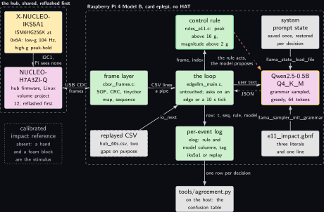
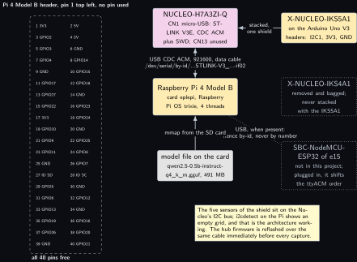
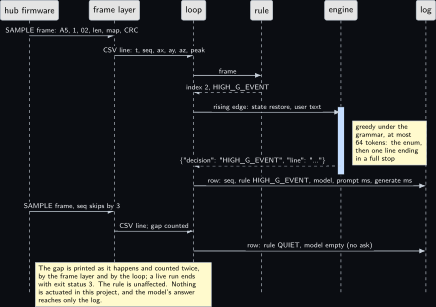
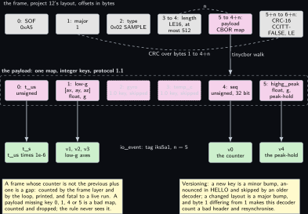
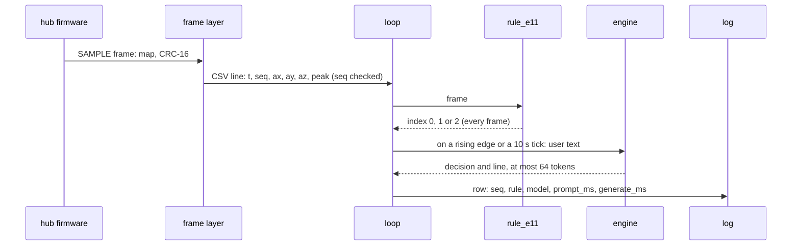

<!-- Written from the chapter source by the catalogue's publish step. Do not hand edit: the chapter is the record and this file is its copy. -->

# Project 11. Nucleo CDC sensor hub narrator

> **Board:** Raspberry Pi 4 Model B, no HAT; the NUCLEO-H7A3ZI-Q with the X-NUCLEO-IKS5A1 over USB CDC  
> **Owns:** the frame boundary: a microcontroller's framed CBOR stream decoded on the Pi, a rule per frame, and the model's incident line when something hits

> [!IMPORTANT]
> **The question, instanced**
>
> What does a small local model add over a two-line threshold, and when does it get it wrong? Here the threshold is two comparisons on one frame from a sensor hub the Pi never sees the inside of, a high-g peak-hold above 16 g and a low-g magnitude above 2 g, and the model is asked not only to pick the same literal but to write the one line an incident log wants; the question is whether the line names the right number and the right channel, over 100 impacts on a block of foam, with the sequence counter proving that no frame was lost.

> **Key facts**
>
> - **Board:** Raspberry Pi 4 Model B, card `eplepi`, 4 threads; the NUCLEO-H7A3ZI-Q is the hub, shared with two other volumes and reflashed before every capture
> - **HAT slot:** empty; the only connection is one USB data cable
> - **Parts:** the Pi 4B; the NUCLEO-H7A3ZI-Q carrying the X-NUCLEO-IKS5A1 (ISM6HG256X at 0x6A with a low-g channel at 104 Hz and a high-g channel reporting a peak-hold, ISM330IS at 0x6B, IIS2DULPX at 0x19, IIS2MDC at 0x1E, ILPS22QS at 0x5C, all on the microcontroller's I2C bus); a foam block; no calibrated impact reference
> - **Interface:** USB CDC ACM over the ST-LINK virtual COM port at 921600 baud, framed CBOR in the layout of the Linux volume's project 12, protocol 1.1; opened by its `/dev/serial/by-id` name, never by number
> - **Language and variant:** C, catalogue variant C: plain C over `llama.h` through the shared main of [Project 2](../../chapters/02-the-decision-loop.md), plus tinycbor (MIT) for the frames; the loop is untouched
> - **Model:** Qwen2.5-0.5B-Instruct Q4\_K\_M, 491 MB, Apache 2.0
> - **Decision:** one of QUIET, LOW\_G\_EVENT, HIGH\_G\_EVENT through the grammar, plus one line of under twenty words; the stub answers QUIET and an empty line in CI
> - **Control rule:** HIGH\_G\_EVENT when the high-g peak-hold is above 16 g; LOW\_G\_EVENT when the low-g magnitude is above 2 g; else QUIET; one frame decides
> - **Acceptance:** 100 hand impacts on foam and the agreement table; zero sequence gaps over the run, printed by the loop, a gap failing the run and not the rule; the frame rate from the hub's timestamps within 1 percent of its stated 104 Hz
> - **Difficulty:** 3 of 5
> - **Effort:** one evening on the host for the frame layer and the oracle, one evening to give the hub firmware its two new map keys and reflash, one afternoon on the Pi 4B for the 100 impacts

## Pitch

The Linux volume's project 12 built a sensor hub: the NUCLEO-H7A3ZI-Q samples the shield on its own I2C bus, wraps each sample in a CBOR map, frames it with a version byte, a type, a length and a CRC-16, and streams the frames over the ST-LINK's virtual COM port. That hub exists in C already, and this chapter adds the model layer where the frames arrive and nowhere else. A frame layer of two hundred lines turns each frame into an event for the loop of [Project 2](../../chapters/02-the-decision-loop.md): the sequence counter, the three low-g axes, the high-g peak-hold. The rule classifies every frame at the hub's 104 Hz in two comparisons. The model is asked only when something begins, on a rising edge of the rule's index, and once every ten seconds otherwise so that quiet rows exist, and it answers with the same literal and one line for the incident log: which channel saw what peak. Three numbers come out of one run of 100 impacts on foam: the agreement table, the count of sequence gaps, which must be zero and which fails the run rather than the rule when it is not, and the frame rate the hub's own timestamps imply against the 104 Hz it claims. What the chapter teaches that the earlier ones did not is the frame boundary: a contract of integer keys that a firmware change must version, a decoder that skips what it does not know, and a counter that makes a lost frame a fact instead of a suspicion.

## Origin and what changed

Drafts 8 and 14 merged, because the Nucleo hub from the Linux volume's project 12 already exists and the model layer is the only addition. Three things changed on the way from the plan to this chapter. First, the plan listed the serial backend of `common/c/src/io_serial.c` as the interface; that backend is line-oriented, one event per text line with the numbers parsed from it, and a binary frame carries the bytes 0x0A and 0x0D inside its payload, so the frame layer owns the port itself with the same termios settings and feeds the untouched shared main through a pipe. The loop is the same code on the bench and on a replayed file, and only the tag column of the log says which. Second, project 12's SAMPLE map carried a timestamp, the low-g triple, the gyro and a temperature, and no sequence counter and no high-g channel; this hub firmware adds keys 4 and 5, the counter and the peak-hold, as a minor bump to protocol 1.1 announced in HELLO, and the decoder skips keys 2 and 3 and anything newer by project 12's own rule. Third, the shield's population, which project 12 left open in a note, is settled by the kit lab P08 and the bench facts: the ISM6HG256X is the part with the two channels, and its high-g channel reports a peak-hold, an event quantity, which is why the rule reads v4 as a peak and never as a sample.

## Parts and interface

| **Part** | **Role** | **Interface** | **Address or pin** |
| --- | --- | --- | --- |
| Raspberry Pi 4 Model B, card `eplepi` | runs the frame layer, the loop, the rule and the model; Raspberry Pi OS trixie, the model file in `~/models` | SSH, or the Renkforce cable from [Project 1](../../chapters/01-bring-up-and-the-honest-tokens-per-second.md) | USB-A for the hub; none on the header |
| NUCLEO-H7A3ZI-Q | the hub: Cortex-M7 at 280 MHz, 1312 kB SRAM, the hub firmware of the Linux volume's project 12 with two added keys; shared, reflashed first | CN1 micro-USB, ST-LINK V3E: CDC ACM plus SWD | USART3 on PD8 and PD9 behind the ST-LINK |
| X-NUCLEO-IKS5A1 | the shield on the Nucleo's Arduino Uno V3 headers, the IKS4A1 removed and bagged; the ISM6HG256X is the one part read: a low-g accelerometer at 16 g full scale and a high-g accelerometer at 256 g, as a 104 Hz stream and a peak-hold | I2C1 on the Nucleo: SDA D14 (PB9), SCL D15 (PB8) | ISM6HG256X 0x6A, ISM330IS 0x6B, IIS2DULPX 0x19, IIS2MDC 0x1E, ILPS22QS 0x5C |
| USB data cable | micro-USB to USB-A; a charge-only cable powers the hub and never enumerates | USB 2.0 | `/dev/serial/by-id/usb-STMicroelectronics_STLINK-V3_...-if02` |
| tinycbor | the decoder, MIT, Debian trixie package `libtinycbor-dev` 0.6.1, or two sources from a checkout at v0.6.1 | pkg-config module `tinycbor` |  |
| `replay/hub_60s.csv` | sixty seconds of frames at 104 Hz with 60 low-g events, 40 high-g impacts and two sequence gaps, generated by `tools/make_replay.py` | `io_open_replay` |  |
| `grammars/e11_impact.gbnf` | the three literals and the one line | the grammar sampler | root symbol `root` |
| `prompt.txt` | the system prompt, 78 words | decoded once, state saved |  |
| `src/rules_e11.c` | the control rule, registered by name | `rule_find("e11")` | index 0, 1, 2 |
| `tests/oracle/e11.expected.csv` | 6236 expected rule decisions and the stub's column on the 105 rows the model is asked | the oracle check in C |  |

## Model and grammar

Qwen2.5-0.5B-Instruct at Q4\_K\_M, the file `qwen2.5-0.5b-instruct-q4_k_m.gguf`, 491 MB, Apache 2.0, from [Qwen/Qwen2.5-0.5B-Instruct-GGUF](https://huggingface.co/Qwen/Qwen2.5-0.5B-Instruct-GGUF) (verified Wednesday 14 October 2026), the Pi 4 default for enum decisions and the rung the Pi 4B admits as long as [Project 1](../../chapters/01-bring-up-and-the-honest-tokens-per-second.md)'s memory reading is above 818 MB available. The engine is the pinned `v0.6.0` of [Project 1](../../chapters/01-bring-up-and-the-honest-tokens-per-second.md). The grammar extends the house shape of [Project 2](../../chapters/02-the-decision-loop.md) by a second key: one JSON object with a `decision` key whose value is one of the rule's three literals, and a `line` key whose value is 8 to 120 characters of letters, digits, spaces and commas closed by a literal full stop, so the end of generation is reachable only after a complete sentence and the longest answer stays inside 64 tokens. The repetition range and the `root` rule are the engine's own syntax, documented at [grammars/README.md](https://github.com/ggml-org/llama.cpp/blob/master/grammars/README.md) in the engine's tree (verified Wednesday 14 October 2026).

```gbnf
root     ::= "{" ws "\"decision\"" ws ":" ws decision ws "," ws "\"line\"" ws ":" ws line ws "}"
decision ::= "\"QUIET\"" | "\"LOW_G_EVENT\"" | "\"HIGH_G_EVENT\""
line     ::= "\"" [A-Za-z0-9 ,]{8,120} "." "\""
ws       ::= [ \t]*
```

The decoder on the Pi side is tinycbor, MIT, from [github.com/intel/tinycbor](https://github.com/intel/tinycbor) (verified Wednesday 14 October 2026): the latest release is v7.0 of Tuesday 18 February 2025, which moved the build to CMake, and the release Debian trixie packages is v0.6.1 of Tuesday 12 March 2024, read from [github.com/intel/tinycbor/releases](https://github.com/intel/tinycbor/releases) (verified Wednesday 14 October 2026) and [packages.debian.org/trixie/libtinycbor-dev](https://packages.debian.org/trixie/libtinycbor-dev) (verified Wednesday 14 October 2026). The eighteen names the frame layer calls, from `cbor_parser_init` to `cbor_error_string`, are listed in the header of `src/cbor_frames.h` and were each read as declared in [src/cbor.h at v0.6.1](https://raw.githubusercontent.com/intel/tinycbor/v0.6.1/src/cbor.h) (verified Wednesday 14 October 2026). At that tag the float accessors are inline in the header and the parser proper is one source, so a build without the package compiles exactly two files from a checkout, `src/cborparser.c` and `src/cborerrorstrings.c`, which the project's `CMakeLists.txt` does when `EDGELLM_E11_TINYCBOR_SRC` names the checkout; nothing of tinycbor is copied into the repository. The pkg-config module is `tinycbor`, from [tinycbor.pc.in at v0.6.1](https://raw.githubusercontent.com/intel/tinycbor/v0.6.1/tinycbor.pc.in) (verified Wednesday 14 October 2026); whether the Debian package installs that file is (to verify) on the first build, and the source route is the fallback either way.

The system prompt, decoded once and never again during a run, reads in full: You are an edge agent on a Raspberry Pi reading an impact sensor hub. One frame gives the low-g magnitude, the high-g peak since the previous frame and the largest recent peak, in g. Answer only with the JSON object, a decision and one line. HIGH\_G\_EVENT when the high-g peak is above 16 g. LOW\_G\_EVENT when the low-g magnitude is above 2 g. Otherwise QUIET. The line names the peak and its channel in under twenty words. The thresholds are given on purpose, as in [Project 2](../../chapters/02-the-decision-loop.md); what is new is the line, which is where a 0.5B model can add a number that was never in its input.

## What the model decides or writes

One of three literals and one line, through the grammar, with `n_predict` 64 and greedy sampling. The decision cannot be anything but the three strings; the line cannot contain a quote, a newline or a second full stop, and must end in one. So the model column of the log holds one JSON object with both keys, or an object that did not close inside 64 tokens, which the agreement tool counts as a row whose model column is not one of the rule's decisions and the chapter counts as its own failure. Greedy is kept for the line too, although the volume's rule allows temperature 0.3 under a sentence grammar, because the decision and the line come out of one sampling pass and a sampled decision would make the agreement table a property of the seed. The line is scored separately and by hand: for each of the 100 impacts, does it name the peak within 1 g of the frame's `v4` and the right channel; a line that names a number not in the user text is counted as invented. In CI there is no model file; the stub expands the grammar's first alternative on every path and the character class to nothing, so it answers `{"decision":"QUIET","line":"."}` on every row the loop asks, and the oracle file carries exactly that on those 105 rows and the empty string on the 6131 rows where the loop logged the rule alone.

## Control rule

Two comparisons, strict, on one frame. The high-g peak-hold is read first, because a shock above 16 g saturates the low-g channel at its full scale and the low-g magnitude is then 16 g whatever the shock was; the kit lab P08 made that the point of the shield. The low-g magnitude is compared squared so the rule needs no libm and the shared harness links nothing extra. The names table is what the grammar reproduces letter for letter.

```c
static const char *const rule_e11_names[] = { "QUIET", "LOW_G_EVENT", "HIGH_G_EVENT", NULL };

static int rule_e11_fn(const rule_ctx *ctx, const io_event *ev)
{
    double m2;
    (void)ctx;                                           /* one frame decides; no history */
    if (ev->n < 5) return 0;                             /* a short frame is QUIET, not a guess */
    if (ev->v[4] > 16.0) return 2;                       /* HIGH_G_EVENT: peak-hold above 16 g */
    m2 = ev->v[1] * ev->v[1] + ev->v[2] * ev->v[2] + ev->v[3] * ev->v[3];
    if (m2 > 4.0) return 1;                              /* LOW_G_EVENT: magnitude above 2 g */
    return 0;                                            /* QUIET */
}

/* The constructor below registers the rule before main() runs; rule_find("e11") then
 * returns it. The file is compiled into the executable, never into an archive. */
const rule_desc rule_e11 = { "e11", rule_e11_fn, rule_e11_names };
RULE_REGISTER(rule_e11);
```

The rule runs on every frame; the model does not. The shared main calls `project_actuate` with the rule's index before it builds the prompt, and this project, which drives no output, uses that hook as its per-frame observer: it checks the sequence counter against the previous frame's plus one, keeps the first and last timestamp for the frame rate, and sets one flag when this frame is one the model should see, on a quiet tick every ten seconds on the tick's own clock, or on a rising edge of the rule's index. The prompt function then returns NULL on every other frame, which the shared main logs as the rule alone; when it does ask, it names the frame's counter, the low-g magnitude, the peak-hold and the largest peak over the previous sixteen frames, and nothing else.

```c
const char *project_format_prompt(const io_event *ev, const rule_ctx *ctx, char *buf,
                                  size_t len)
{
    double mag = 0.0, peak = 0.0;
    int i;
    if (!st.ask_now)
        return NULL;                             /* the rule ran alone; no model row */
    st.ask_now = 0;
    for (i = (ctx->n > E11_HIST_FRAMES ? ctx->n - E11_HIST_FRAMES : 0); i < ctx->n; i++)
        if (ctx->hist[i].n > 4 && ctx->hist[i].v[4] > peak)
            peak = ctx->hist[i].v[4];
    if (ev->n > 3)
        mag = sqrt(ev->v[1] * ev->v[1] + ev->v[2] * ev->v[2] + ev->v[3] * ev->v[3]);
    snprintf(buf, len, "frame %.0f: low-g magnitude %.1f g, high-g peak %.1f g, largest peak "
                       "over the previous %d frames %.1f g. Decide and write the line.",
             ev->n > 0 ? ev->v[0] : 0.0, mag, ev->n > 4 ? ev->v[4] : 0.0, E11_HIST_FRAMES, peak);
    return buf;
}
```

## Real, modelled, absent

- **have:** real: the NUCLEO-H7A3ZI-Q, the X-NUCLEO-IKS5A1 and its ISM6HG256X, the USB CDC link, the frame layer, the rule, the model, the log, the sequence counter and the timestamps it holds
- **learn:** modelled: the replayed CSV, sixty seconds of frames generated by a seeded script with 60 low-g events, 40 high-g impacts and two sequence gaps on purpose, drawn dashed; it stands in for the hub only so that the counter check and the loop have an oracle before the hub is plugged in, and nothing about the sensor's response to a real shock is claimed from it
- **absent:** absent: a calibrated impact reference, drawn dotted. The peaks in the log are the hub's numbers from the hub's own conversion; nothing on the bench can say what a hand on foam produced in g, so the acceptance test counts agreement and lost frames, never accuracy in g

## System architecture



*Figure 11.1. The hub and the Pi. On the left, inside a dashed layer labelled as the hub, shared and reflashed first, two solid blocks: the X-NUCLEO-IKS5A1 in hardware yellow above, with the ISM6HG256X at 0x6A and its low-g 104 Hz and high-g peak-hold channels, and the NUCLEO-H7A3ZI-Q in firmware pink below, the hub firmware of the Linux volume's project 12; a solid arrow carries I2C1 between them with the note that the Pi sees none of it. Below the layer a dotted grey block for the absent calibrated impact reference. A solid two-headed line labelled USB CDC and frames crosses into the Pi's dashed layer, labelled with the board, the card and no HAT, to the frame layer in user-space green; a solid arrow labelled CSV lines and a pipe carries them to the loop, the untouched shared main that asks on an edge or a 10 s tick. A dashed grey block for the replayed CSV with its two gaps feeds the same loop through io\_next. The control rule sits above the loop with the green rule outline, the log below it, the model to its right with the yellow model outline, the saved system prompt state above the model and the grammar below it. Solid arrows carry the frame up to the rule and its index back, the user text to the model with a dashed reply carrying the JSON, the state and the grammar into the model, and the row with the sequence, the rule and the model down to the log; a dashed stop-coloured arrow from the rule to the model says the rule acts and the model proposes. Below the Pi layer a solid grey block for tools/agreement.py on the host receives one row per decision from the log.*

Two things in the figure are deliberate. The replay block sits inside the Pi's layer and the frame layer sits beside it, both feeding the one loop, because that is the claim the chapter makes about readiness: the loop that passed the oracle on the file is the loop that runs on the bench, with the frame layer swapped in for the file by one argument. And the only arrow leaving the model goes to the log; the hub is never told anything by the Pi in this project, so the rule's index acts on nothing but the log row, and the safety rule of the volume holds trivially here and is still drawn.

## Wiring

| **Header pin** | **BCM** | **Part pin** | **Wire colour if known** |
| --- | --- | --- | --- |
| none | none | none | nothing is wired to the header; the hub reaches the Pi through one USB data cable, Nucleo CN1 to a Pi USB-A port |
| Nucleo Arduino headers |  | IKS5A1: I2C1 SDA on D14 (PB9), SCL on D15 (PB8), 3V3, GND | the shield stacks; no wire; pull-ups on the shield |
| Nucleo CN1 |  | ST-LINK V3E micro-USB: CDC ACM and SWD | the cable; a data cable, not a charge cable |
| Nucleo CN13 |  | USB OTG FS of the H7A3 | not used; a hub speaking CDC here would need its own USB stack and is a different firmware |

Project 12 uses the ST-LINK connector, and so does this chapter: the firmware's USART3 on PD8 and PD9 reaches the ST-LINK V3E through the board's default solder bridges and enumerates as a CDC ACM interface beside the debug interface, which is also the path the reflash takes; the pin assignment is confirmed by the Zephyr board page, [docs.zephyrproject.org, nucleo\_h7a3zi\_q](https://docs.zephyrproject.org/latest/boards/st/nucleo_h7a3zi_q/doc/index.html) (verified Wednesday 14 October 2026), which names USART3 on PD8 and PD9 as the ST-Link virtual COM port. The connector numbers CN1 and CN13 are project 12's and the silkscreen's; the MB1363 user manual on st.com is the reference and is (to verify), st.com having served no document to this bench so far.



*Figure 11.2. The 40-pin header of the Pi 4 Model B as two columns of small solid blocks, pin 1 at the top left, no block filled, inside a dashed layer labelled all 40 pins free. To the right, a solid hardware block for the Pi 4 Model B with the card eplepi and four threads; above it a solid firmware-pink block for the NUCLEO-H7A3ZI-Q with its CN1 ST-LINK micro-USB and CN13 unused, joined to the Pi by a solid two-headed line labelled USB CDC ACM at 921600 over a data cable and the by-id device name ending in if02. To the right of the Nucleo a solid hardware block for the X-NUCLEO-IKS5A1 on the Arduino Uno V3 headers, joined by a solid arrow labelled stacked, one shield. Below it two dotted grey blocks: the X-NUCLEO-IKS4A1, removed and bagged and never stacked with the IKS5A1, and the ESP32 of e15, not in this project, joined to the Pi by a dotted line that says it shifts the ttyACM order when it is plugged in, hence by-id and never by number. Below the Pi a grey block for the model file on the card joined by a solid arrow labelled mmap from the SD card. A note says the shield's five sensors sit on the Nucleo's I2C bus, that i2cdetect on the Pi shows an empty grid and that this is the architecture working, and that the hub firmware is reflashed over the same cable before every capture.*

## Sequence



*Figure 11.3. One impact frame and one lost frame, as a sequence diagram with six solid actors: the hub firmware, the frame layer, the loop, the rule, the engine and the log. A solid arrow carries a SAMPLE frame, SOF A5, major 1, type 02, length, map and CRC, from the hub to the frame layer, and another carries the CSV line with t, seq, ax, ay, az and peak to the loop; the loop sends the frame to the rule and a dashed reply brings index 2, HIGH\_G\_EVENT. Over a blue activation bar on the engine, a solid arrow from the loop says rising edge: state restore and user text, with a note that sampling is greedy under the grammar for at most 64 tokens, the enum then one line ending in a full stop; a dashed reply returns the JSON object with the decision and the line, and a solid arrow writes the row with the sequence, the rule, the model and the two timings into the log. Below, a second SAMPLE frame arrives whose counter skips by 3; the frame layer still writes its CSV line, noting the gap counted, and the loop logs the rule QUIET with an empty model column because nothing began. A note says the gap is printed as it happens and counted twice, by the frame layer and by the loop, that a live run ends with exit status 3, that the rule is unaffected, and that the model's answer reaches only the log.*

## States and data

The decision enum is memoryless here, as in [Project 2](../../chapters/02-the-decision-loop.md), and its state figure would add nothing; what this chapter's figure must show is the frame, because the frame is the contract. Its layout is project 12's, unchanged: a start byte, a major version, a type, a little-endian length, the CBOR payload and a CRC-16/CCITT-FALSE over everything after the start byte. Inside the payload one map with integer keys, and the keys are the whole of the agreement between the hub firmware and this decoder.

| **Key** | **Meaning** | **CBOR type** | **io\_event field** | **Note** |
| --- | --- | --- | --- | --- |
| 0 | t\_us, the hub's clock | unsigned | `t_s`, times 1e-6 | required; the frame rate is measured from it |
| 1 | low-g axes in g | array of three floats | `v1`, `v2`, `v3` | required; gravity included, saturates at 16 g |
| 2 | gyro in dps | array of three floats | none | protocol 1.0 key, skipped |
| 3 | temperature in C | float | none | protocol 1.0 key, skipped |
| 4 | sequence counter | unsigned, 32 bit | `v0` | required, new in 1.1; the gap check |
| 5 | high-g peak-hold in g | float | `v4` | required, new in 1.1; the largest magnitude since the previous frame, an event quantity |
| other | anything newer | any | none | skipped: a minor bump; a different major byte is refused as a bad header |



*Figure 11.4. The frame layout as three rows of narrow blocks. The top row, grey, is project 12's frame with byte offsets: SOF 0xA5, major 1, type 0x02 SAMPLE, length as LE16 of at most 512, the payload in firmware pink as a CBOR map, and the CRC-16 CCITT-FALSE in little endian; a dashed arc from the length to the payload is labelled n and another from the major byte to the CRC says what the CRC covers. The middle row, pink inside a dashed layer labelled as the payload with integer keys at protocol 1.1, holds the six keys: 0 t\_us unsigned, 1 low-g as an array of three floats in g, 2 gyro and 3 temp\_c dotted and labelled as 1.0 keys that are skipped, 4 seq unsigned 32 bit, and 5 highg\_peak float in g as a peak-hold; a solid arrow from the payload block down to the layer says tinycbor walk. The bottom row, green, is the io\_event with tag iks5a1 and n equal to 5: t\_s from t\_us, v1 to v3 the low-g axes, v0 the counter and v4 the peak-hold, each under the key it comes from with a solid arrow. Two notes say that a counter not equal to the previous plus one is a gap, counted by the frame layer and the loop, printed and fatal to a live run, that a payload missing a required key is a bad map that the rule never sees, and that a new key is a minor bump skipped by an older decoder while a changed layout is a major bump that makes this decoder count a bad header and resynchronise.*

The decoder is a walk and allocates nothing: it enters the map, reads each integer key, advances to the value, takes the four it needs and steps over the rest with `cbor_value_advance`, which skips a whole container in one call; a payload that closes without all four keys is a bad map, counted and dropped before the rule sees it. The head of the walk and the first key show the shape; the other three cases repeat it.

```c
    while (!cbor_value_at_end(&map)) {
        int key;
        if (!cbor_value_is_integer(&map) || cbor_value_get_int(&map, &key) != CborNoError ||
            cbor_value_advance(&map) != CborNoError)
            return -1;                                  /* now at the value */
        switch (key) {
        case CBOR_KEY_T_US:
            if (get_counter(&map, &t_us) != 0 || cbor_value_advance(&map) != CborNoError)
                return -1;
            have |= HAVE_T_US;
            break;
```

The record is the per-event log, `projects/e11-nucleo-hub-narrator/evidence/e11_run.csv`, in the shape `elog.h` fixes, one row per frame, the raw column carrying the five values joined by semicolons so that the sequence counter is in the log and a reader can redo the gap count from the file alone. Beside it the stderr of the run, `evidence/e11_run.stderr`, holds the HELLO line with the firmware's build stamp, every gap as it happened, the frame layer's counters and the last line with the gap count and the frame rate; a log without its stderr record is a log from an unknown firmware.

## Data flow

```text
  NUCLEO-H7A3ZI-Q, the hub (project 12)        Raspberry Pi 4B: edgellm-e11                       host
  +----------------------------------+         +---------------------------------------------+   +-------------+
  | IKS5A1 on I2C1: ISM6HG256X 0x6A  |         | frame layer (cbor_frames.c, a thread)       |   | agreement.py|
  |   low-g 104 Hz --> [ax,ay,az]    |  USB    |   SOF, major, len, CRC-16 .... bad: counted |   |  3 by 3,    |
  |   high-g --> peak-hold since last|  CDC    |   tinycbor map: 0 t_us, 1 lowg, 4 seq, 5 pk |   |  lines read |
  | map {0,1,2,3,4,5} -> frame -> CRC|-------->|   seq != prev+1 ............. gap: counted  |   |  by hand    |
  | HELLO {minor 1, fw build stamp}  | 921600  |   "t,iks5a1,seq,ax,ay,az,peak" --> a pipe   |   +-------------+
  +----------------------------------+         |        |                                    |          ^
                                               |        v  --replay /dev/fd/N (or the file)  |          |
  replay/hub_60s.csv (dashed stand-in) ------> | the loop, edgellm_main.c, untouched         |          |
    6236 frames, 2 gaps on purpose             |   rule_e11.fn(ev) -> 0 | 1 | 2  every frame |          |
                                               |   project_actuate: seq check, t first/last, |          |
  prompt.txt --decode once--> [state] -------> |     ask? a rising edge, or the 10 s tick    |          |
  grammars/e11_impact.gbnf ------------------> |   model: {"decision": ..., "line": "..."}   |          |
                                               |   elog_row: t, seq;ax;ay;az;peak, rule, mdl |--rows----+
                                               | exit: frames, gaps, Hz vs 104; gap live -> 3|
                                               +---------------------------------------------+
```



## Latency design

The system prompt is 78 words and is decoded once at start; the shared main saves its state and restores it before every decision, so a decision pays for about thirty-five tokens of user text and up to 64 generated tokens, the enum and the line. Whether 78 words stay under 120 tokens on the Qwen tokenizer is read from the engine's `n_prompt_tokens` at the first run, not assumed; if not, the last sentence of the prompt goes. The frames arrive at 104 Hz and the rule runs on every one of them in two comparisons; the model is asked on a rising edge and on the ten-second tick, which over 100 impacts at one every six seconds is about 200 decisions in ten minutes. During a decision the frames keep arriving: the frame layer writes them into the pipe, which holds 64 kB, about 1400 lines, about thirteen seconds of frames, and the loop drains them afterwards, running the rule on each. If impacts come faster than decisions, the pipe fills, the frame layer blocks, the kernel's serial buffer overflows, and the counter check reports the loss as gaps; that is the design failing honestly rather than silently, and the cadence of one impact per six seconds is chosen so that it does not. `n_ctx` 512, `n_predict` 64, greedy, 4 threads on the Pi 4B; the expected decision time is one prompt decode of thirty-five tokens plus up to 64 single-token decodes, which [Project 1](../../chapters/01-bring-up-and-the-honest-tokens-per-second.md)'s table turns into a number.

## Steps

**Step 1.** Generate the replay file and the oracle on the authoring laptop and read the summary: 6236 frames, two gaps, the three rule counts, the 105 rows the model is asked on, the 5.7 percent the stub will reach, and the 103.93 Hz the timestamps imply.

```bash
# win11 aquamarine
cd C:\Users\aquamarine\Desktop\edge-llm-pi
python projects\e11-nucleo-hub-narrator\tools\make_replay.py
```

**Step 2.** Install the decoder in skyhorizon's WSL and configure the repository with the stub; the configure line for e11 must say tinycbor was found through pkg-config, or name the checkout given by `-DEDGELLM_E11_TINYCBOR_SRC`.

```bash
# win11 skyhorizon, WSL side
cd ~; sudo apt install libtinycbor-dev
```

```bash
# win11 skyhorizon, WSL side
cd ~/src/edge-llm-pi; cmake -S . -B build -DEDGELLM_STUB_MODEL=ON; cmake --build build -j8
```

**Step 3.** Run the shared rule harness, which carries this project's six cases: both boundary values, 2 g on the low-g magnitude and 16 g on the peak-hold, stay in the lower band.

```bash
# win11 skyhorizon, WSL side
cd ~/src/edge-llm-pi; ctest --test-dir build -R rules_test --output-on-failure
```

**Step 4.** Run the oracle test: the loop over the 6236 frames with the stub, the log compared row by row against the oracle file. The two gaps are printed as they happen and the exit status is 0, because the source is a replay.

```bash
# win11 skyhorizon, WSL side
cd ~/src/edge-llm-pi; ctest --test-dir build -R edgellm-e11-oracle --output-on-failure
```

**Step 5.** Run the same stub loop by hand, score the log, and read the last two lines of stderr: the gap line must say 2 sequence gaps, 4 frames missing, and 103.93 Hz.

```bash
# win11 skyhorizon, WSL side
cd ~/src/edge-llm-pi; build/projects/e11-nucleo-hub-narrator/edgellm-e11 --project e11 \
  --replay projects/e11-nucleo-hub-narrator/replay/hub_60s.csv \
  --grammar projects/e11-nucleo-hub-narrator/grammar.gbnf \
  --prompt projects/e11-nucleo-hub-narrator/prompt.txt --n-predict 64 \
  --log /tmp/e11_stub.csv --stub
```

```bash
# win11 skyhorizon, WSL side
cd ~/src/edge-llm-pi; python tools/agreement.py /tmp/e11_stub.csv
```

**Step 6.** Reflash the hub from the Pi over the same cable, immediately before the capture, and read its name by id. The ELF is project 12's firmware with the two added keys, built in that project's tree; the by-id name ends in `-if02` and its serial is read, never typed.

```bash
# Raspberry Pi 4 Model B, card eplepi
cd ~; openocd -f interface/stlink.cfg -f target/stm32h7x.cfg \
  -c "program ~/sensorhub/sensorhub.elf verify reset exit"
```

```bash
# Raspberry Pi 4 Model B, card eplepi
cd ~; ls -l /dev/serial/by-id/; dmesg | grep -i cdc_acm
```

**Step 7.** Build on the Pi 4B against the real engine with the decoder installed, and read the throttle bits.

```bash
# Raspberry Pi 4 Model B, card eplepi
cd ~; sudo apt install libtinycbor-dev
```

```bash
# Raspberry Pi 4 Model B, card eplepi
cd ~/edge-llm-pi; cmake -S . -B build -DGGML_NATIVE=ON; cmake --build build -j4 \
  --target edgellm-e11
```

```bash
# Raspberry Pi 4 Model B, card eplepi
cd ~; vcgencmd get_throttled
```

**Step 8.** Start the live run with the stderr captured, then deliver 100 hand impacts on the foam block under the stacked boards, about one every six seconds, and stop with Ctrl-C. The HELLO line with the firmware's build stamp must appear within the first second; if it does not, the flash is stale or the port is the wrong one.

```bash
# Raspberry Pi 4 Model B, card eplepi
cd ~/edge-llm-pi; build/projects/e11-nucleo-hub-narrator/edgellm-e11 --project e11 \
  --live cdc /dev/serial/by-id/usb-STMicroelectronics_STLINK-V3_<serial>-if02:921600 \
  --grammar projects/e11-nucleo-hub-narrator/grammar.gbnf \
  --prompt projects/e11-nucleo-hub-narrator/prompt.txt \
  --model ~/models/qwen2.5-0.5b-instruct-q4_k_m.gguf --n-predict 64 --state /tmp/e11.state \
  --log projects/e11-nucleo-hub-narrator/evidence/e11_run.csv \
  2> projects/e11-nucleo-hub-narrator/evidence/e11_run.stderr; echo exit $?; vcgencmd get_throttled
```

**Step 9.** Score the run: the exit status and the last line of stderr give the gap count and the frame rate, the agreement tool gives the table, and the lines are read by hand against the raw column, one per impact.

```bash
# Raspberry Pi 4 Model B, card eplepi
cd ~/edge-llm-pi; tail -3 projects/e11-nucleo-hub-narrator/evidence/e11_run.stderr
```

```bash
# Raspberry Pi 4 Model B, card eplepi
cd ~/edge-llm-pi; python tools/agreement.py --md \
  projects/e11-nucleo-hub-narrator/evidence/e11_run.csv
```

## Variant chosen

C, catalogue variant C: plain C over `llama.h` in one process, through the shared main of [Project 2](../../chapters/02-the-decision-loop.md), with tinycbor for the frames. On practicality it scores highest because the hub exists in C already, the frame layout and the CRC function are project 12's and compile on both ends unchanged, and the only new code is the decoder walk and the pipe; on relevance it is the one variant where the model layer is added where the frames arrive, in the process that owns the port, with no second process, no bus and no binding between the frame and the decision; on popularity tinycbor is the library the hub firmware already encodes with, so the map that encodes is the map that decodes, and a CBOR decoder in C on a Linux host is the ordinary shape of this boundary in products; on compliance it is MIT on every side, the engine, the core and the decoder, with the Debian package or two source files from a tagged checkout and nothing vendored; on best practice it keeps the loop untouched, which is the rule the volume set in [Project 2](../../chapters/02-the-decision-loop.md): a disagreement in this chapter is a fact about the frame layer or the model, never about a loop written twice. What it costs is the pipe and a thread, about forty lines of `e11_main.c`, and the honesty that the shared main's own summary line says source replay for a live run while the line printed after it says source cdc and the log's tag says `iks5a1`; what it gains is that the oracle test of step 4 is the same binary as the bench run of step 8, including the counter check. The measured cost of the frame layer itself, the fraction of a core it takes to decode 104 frames a second on the Pi 4B, is read from `top` during the run and is not measured until then.

## Embedded Linux and Yocto

The application recipe `meta-edgellm/recipes-app/edgellm-e11/edgellm-e11_0.1.bb` sets the three variables, the project id `e11`, the folder `e11-nucleo-hub-narrator` and the model package `model-qwen2.5-0.5b`, requires the shared include of [Project 2](../../chapters/02-the-decision-loop.md), and adds two things the include does not know: a `DEPENDS` on `tinycbor`, whose `tinycbor.pc` the project's CMake finds through the `pkgconfig` class the include already inherits, and a udev rule that names the hub's virtual COM port `/dev/edgellm-hub`, tags it for systemd and tells ModemManager to leave it alone. Which layer provides the `tinycbor` recipe is (to verify) on the first layer parse: the layer index could not be read on Wednesday 14 October 2026 and the three usual paths under meta-oe did not hold one, so the recipe's comment names the two routes if none does, a four-line recipe over the v0.6.1 tarball with the `cmake` class, or `EXTRA_OECMAKE` pointing `EDGELLM_E11_TINYCBOR_SRC` at a checkout. The unit binds to that device with `BindsTo` and `After`, so the service follows the Nucleo: it starts when the hub is plugged in and stops when it is unplugged, and a sequence gap, which ends the run with exit status 3, becomes a restart with the gap line kept in the journal.

```text
ExecStart=/usr/bin/edgellm-e11 --project e11 \
    --live cdc /dev/edgellm-hub:921600 \
    --model /usr/share/edgellm/models/qwen2.5-0.5b-instruct-q4_k_m.gguf \
    --grammar /usr/share/edgellm/e11/grammar.gbnf \
    --prompt /usr/share/edgellm/e11/prompt.txt \
    --log /var/lib/edgellm/e11.csv \
    --threads 4 --n-predict 64 --state /run/edgellm/e11.state
```

```text
SUBSYSTEM=="tty", ATTRS{idVendor}=="0483", ATTRS{idProduct}=="374e", \
    SYMLINK+="edgellm-hub", TAG+="systemd", ENV{ID_MM_DEVICE_IGNORE}="1"
```

No overlay fragment: nothing on the header. The product id is the one project 12 read with `lsusb` for the ST-LINK V3 with its virtual COM port and is confirmed on the first plug. The layer parse is the check that runs on skyhorizon before anything is wired; the image build is a separate later sitting of hours.

```bash
# win11 skyhorizon, WSL side
cd ~/bench/edge-llm-pi; kas shell meta-edgellm/kas/edgellm-pi4.yml -c "bitbake -p"
```

## Acceptance test

Three quantities from one live run of at least 100 impacts, all on the Pi 4B with `vcgencmd get_throttled` reading `0x0` before and after. First, the agreement table over the rows the model was asked on, which are one per impact and one per ten seconds of quiet: the instrument is `tools/agreement.py` reading the log, the number of rows whose model column is not one of the rule's decisions must be zero, and the agreement is whatever it is. Second, the count of sequence gaps over the whole run: the instrument is the loop's own exit line on stderr, `e11: N frames, G sequence gaps`, and the pass condition is G equal to 0, which the binary also enforces with exit status 3 on a live run; a gap fails the run, not the rule, because a lost frame says nothing about the two thresholds and everything about the cadence, the cable or the port. Third, the frame rate from the hub's timestamps on the same line, which must sit within 1 percent of the 104 Hz the hub claims; the hub's own clock is the instrument, so this checks the hub's claim about itself against its own clock, and the delivery jitter on the Pi side is a different quantity, not measured here. In the replay the same line reads 6236 frames, 2 gaps on purpose with 4 frames missing, and 103.93 Hz, which is what four missing frames do to the rate over a minute. The command is step 8 above; the CI run, with the stub, exercises the same binary over the replay of step 4 and expects the two deliberate gaps to be printed and counted with exit status 0.

## Agreement table

Over the replay as generated on Wednesday 14 October 2026 by `tools/make_replay.py` with its fixed seed, the rule column over the 6236 frames holds 5940 QUIET, 217 LOW\_G\_EVENT and 79 HIGH\_G\_EVENT; the loop asks the model on 105 of those frames, 6 on the ten-second tick, all of them quiet, 59 on the rising edge into a low-g event and 40 on the rising edge into a high-g impact. On the bench the model column is not measured: the Pi 4B run has not been taken. In CI the stub answers QUIET on every asked row, so the agreement is 6 of 105, 5.7 percent, and every disagreement is the stub calling an event QUIET. The number is low on purpose and is printed so that the first real number has it beside it: the ask policy puts the model in front of events almost exclusively, so a model that answers the first literal scores nothing here, unlike [Project 2](../../chapters/02-the-decision-loop.md) where the quiet state was most of the file. On the bench the table gets two more rows, counted by hand over the 100 impacts: lines that name the frame's peak within 1 g and the right channel, and lines that name a number not in the user text.

| **Rule says** | **Model QUIET** | **Model LOW\_G** | **Model HIGH\_G** | **Instrument** |
| --- | --- | --- | --- | --- |
| QUIET, 6 asked of 5940 | 6 | 0 | 0 | the stub in CI; bench: not measured |
| LOW\_G\_EVENT, 59 asked of 217 | 59 | 0 | 0 | the stub in CI; bench: not measured |
| HIGH\_G\_EVENT, 40 asked of 79 | 40 | 0 | 0 | the stub in CI; bench: not measured |
| agreement | 5.7 percent |  |  | the stub in CI; bench: not measured, run pending on the Pi 4B |

## Measured data


*Figure 11.5. The distribution of event peaks in the replay file, drawn with TikZ axes from the summary tools/make\_replay.py prints for replay/hub\_60s.csv with seed 2026: the horizontal axis the peak of each event on the high-g channel in g from 0 to 96, the vertical axis events per 8 g bin out of 100. Twelve dashed bars: the two bins below 16 g in user-space green hold the 60 low-g events, 34 and 26; the ten bins from 16 to 96 g in hardware yellow hold the 40 high-g impacts, 4, 2, 4, 4, 2, 6, 5, 6, 3 and 4. Two dashed stop-coloured vertical lines carry the rule's thresholds, 2 g where LOW\_G\_EVENT begins and 16 g where HIGH\_G\_EVENT begins. A note says this is a modelled distribution and not a measurement, generated on Wednesday 14 October 2026, and that the bench run over 100 foam impacts replaces the bars and prints the gap count and the frame rate beside them.*

## Pitfalls

- **The ttyACM order with the ESP32 present.** The ESP32 sidecar of [Project 15](../../chapters/15-esp32-sidecar-with-a-bounded-pattern-proposal.md) enumerates as a CDC device too, and which of the two becomes `ttyACM0` depends on the order the kernel saw them, which changes at boot and on every replug. A run on the wrong port decodes nothing and its only symptom is a growing bytes-skipped counter. The port is named through `/dev/serial/by-id`, where the ST-LINK's name carries its own serial and ends in `-if02`, and never by number.
- **A stale flash reads as a reproduction.** The Nucleo is shared with two other volumes and whatever was flashed last is what runs. A firmware without the two new keys streams frames that decode as bad maps, and a firmware from another volume streams nothing this decoder recognises; neither says so. The hub is reflashed immediately before every capture and the HELLO frame's firmware string, which carries the build stamp, is printed by the frame layer at start; a stderr record without that line, or with yesterday's stamp, is not evidence of anything.
- **The IKS4A1 and the IKS5A1 never together.** The two shields are the same shape and carry different silicon at overlapping addresses. One is removed and bagged before the other leaves its bag, and they are never stacked; a hub firmware reading the ISM6HG256X at 0x6A finds an LSM6DSO16IS there on the wrong shield and reports the WHO\_AM\_I mismatch in the HELLO's sensor list, which the frame layer prints.
- **The high-g channel is a peak-hold, not a sample.** Key 5 is the largest magnitude the high-g channel saw since the previous frame, an event quantity; averaging it over a window produces a number with no physical meaning, and plotting it as a waveform is wrong by construction. The rule reads it as a peak, the prompt calls it a peak, and the data figure is a histogram of peaks, not a trace.
- **The map keys are the hub's contract.** A firmware that renames a key, changes a unit or moves the counter to another key breaks this decoder without an error from either side. Keys 4 and 5 were added as a minor bump to 1.1, announced in HELLO; a changed layout bumps the major byte, which this decoder refuses as a bad header. The version field in the frame is the only thing that lets a Pi notice.
- **Impacts faster than decisions.** While the model answers, frames accumulate in the pipe, which holds about thirteen seconds of them; past that the serial buffer overflows and frames are lost. The gap counter reports that loss honestly and the run fails, which is the correct outcome; the cadence of one impact per six seconds is the reason it should not happen.
- **ModemManager, and a charge-only cable.** ModemManager, when installed, probes a new ACM device with AT commands and can corrupt the first frames, which shows as a handful of bad-CRC counts at start; the udev rule sets `ID_MM_DEVICE_IGNORE`. A charge-only cable powers the Nucleo, lights its LEDs and never enumerates; `dmesg | grep cdc_acm` is the first check, before the firmware is suspected.

## Future and extra exercises

- The same project in C++ as catalogue variant B over the C API through `common/cpp/edgellm.hpp`: the delta is a frame class owning the port and the parser state with RAII, and nothing in the decision.
- The same project in Rust as R7, one static executable over `llama-cpp-2` (MIT) with a CBOR crate and a serial crate: the delta is the crate versions to pin and the loss of the shared main, which [Project 5](../../chapters/05-adxl345-event-reporter.md) prices.
- The same project in Python over `llama-cpp-python` (MIT), `pyserial` and `cbor2`: the delta is the interpreter decoding 104 frames a second beside a model, which [Project 15](../../chapters/15-esp32-sidecar-with-a-bounded-pattern-proposal.md) prices for a lower rate.
- The D-Bus service of the Linux volume's project 12 as the transport: the loop subscribes to `SampleReady` on the system bus instead of owning the port; the delta is sd-bus in the loop, a second process owning the port, and the broker's queue as a new place for frames to be lost, with the sequence counter the only witness.
- The machine learning core of the ISM330DHCX on the STWIN.box as a comparison: an impact classifier running in the sensor itself beside the model's, over [Project 12](../../chapters/12-stwin-box-vibration-band-reporter.md)'s USB-C link; the delta is a third column in the agreement table and the vendor's tool to train the core.

## Video potential

3 of 5. The hook: the Pi never sees the sensor, only one cable and one number per frame, and still writes the incident line. On screen the foam block, a hand, the stderr scrolling with a gap count that stays at zero, and the log's line column reading which channel saw what. What is slow on camera is the decision, seconds per impact, and what can fail on cue is a line that names the wrong channel, which is the point and is kept in. It is a better second half for [Project 12](../../chapters/12-stwin-box-vibration-band-reporter.md)'s piece, where the same kind of hub streams vibration, than a piece on its own.

## Sources

- Qwen2.5-0.5B-Instruct-GGUF, Apache 2.0, the file `qwen2.5-0.5b-instruct-q4_k_m.gguf` at 491 MB, [huggingface.co/Qwen/Qwen2.5-0.5B-Instruct-GGUF](https://huggingface.co/Qwen/Qwen2.5-0.5B-Instruct-GGUF) (verified Wednesday 14 October 2026).
- tinycbor, MIT, [github.com/intel/tinycbor](https://github.com/intel/tinycbor) (verified Wednesday 14 October 2026); its releases, v7.0 of Tuesday 18 February 2025 and v0.6.1 of Tuesday 12 March 2024, [github.com/intel/tinycbor/releases](https://github.com/intel/tinycbor/releases) (verified Wednesday 14 October 2026); `src/cbor.h` at v0.6.1 for the decoder names and the inline float accessors, [raw.githubusercontent.com/intel/tinycbor/v0.6.1/src/cbor.h](https://raw.githubusercontent.com/intel/tinycbor/v0.6.1/src/cbor.h) (verified Wednesday 14 October 2026); `src/cborparser.c` at the same tag for its includes, [raw.githubusercontent.com/intel/tinycbor/v0.6.1/src/cborparser.c](https://raw.githubusercontent.com/intel/tinycbor/v0.6.1/src/cborparser.c) (verified Wednesday 14 October 2026); the pkg-config template, [raw.githubusercontent.com/intel/tinycbor/v0.6.1/tinycbor.pc.in](https://raw.githubusercontent.com/intel/tinycbor/v0.6.1/tinycbor.pc.in) (verified Wednesday 14 October 2026).
- Debian trixie, `libtinycbor-dev` 0.6.1-1, [packages.debian.org/trixie/libtinycbor-dev](https://packages.debian.org/trixie/libtinycbor-dev) (verified Wednesday 14 October 2026); whether it installs `tinycbor.pc` is (to verify) on the first build.
- ST, the ISM6HG256X register driver and its README, a low-g accelerometer at 16 g and a high-g accelerometer at 256 g, [github.com/STMicroelectronics/STMems\_Standard\_C\_drivers, ism6hg256x\_STdC](https://github.com/STMicroelectronics/STMems_Standard_C_drivers/tree/master/ism6hg256x_STdC) (verified Wednesday 14 October 2026).
- Zephyr, the `nucleo_h7a3zi_q` board page, USART3 on PD8 and PD9 as the ST-Link virtual COM port, Cortex-M7 at 280 MHz, [docs.zephyrproject.org/latest/boards/st/nucleo\_h7a3zi\_q](https://docs.zephyrproject.org/latest/boards/st/nucleo_h7a3zi_q/doc/index.html) (verified Wednesday 14 October 2026).
- GBNF grammar syntax, the repetition range and the root rule, in the engine's tree, [grammars/README.md](https://github.com/ggml-org/llama.cpp/blob/master/grammars/README.md) (verified Wednesday 14 October 2026).
- ST, the X-NUCLEO-IKS5A1 product page, [st.com/en/ecosystems/x-nucleo-iks5a1.html](https://www.st.com/en/ecosystems/x-nucleo-iks5a1.html) (to verify), and the NUCLEO-H7A3ZI-Q user manual for the connector numbers, [st.com/en/evaluation-tools/nucleo-h7a3zi-q.html](https://www.st.com/en/evaluation-tools/nucleo-h7a3zi-q.html) (to verify): st.com has served no document to this bench.
- The OpenEmbedded layer index, for the provider of a `tinycbor` recipe, [layers.openembedded.org, recipes, tinycbor](https://layers.openembedded.org/layerindex/branch/master/recipes/?q=tinycbor) (to verify): it answered 403 on Wednesday 14 October 2026. CBOR itself, RFC 8949, [rfc-editor.org/rfc/rfc8949](https://www.rfc-editor.org/rfc/rfc8949) (to verify).
- The sensor hub, its frame layout, its CRC and its versioning rule: the Linux volume, project 12; the two channels of the ISM6HG256X and the peak-hold as an event quantity: the kit labs, P08; those volumes have no public URL.

---

[Previous](../../chapters/10-mcc-118-voltage-event-labeller.md) &nbsp;&nbsp;|&nbsp;&nbsp; [Contents](../../CONTENTS.md) &nbsp;&nbsp;|&nbsp;&nbsp; [Next](../../chapters/12-stwin-box-vibration-band-reporter.md)
