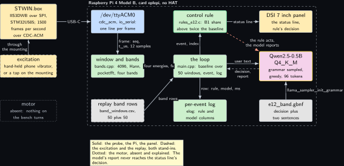
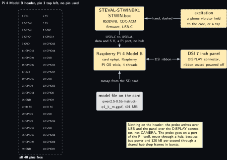
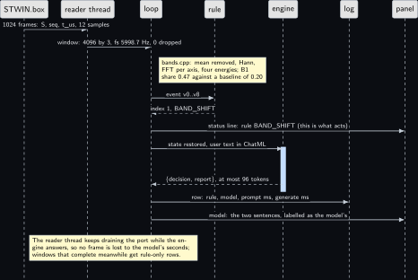
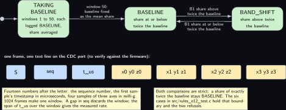
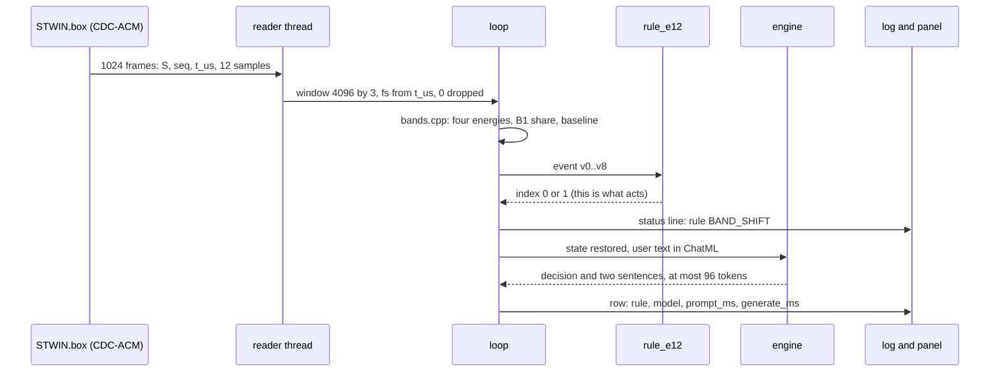
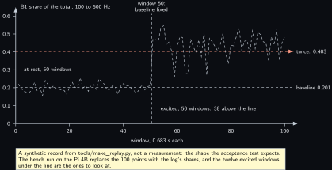

<!-- Written from the chapter source by the catalogue's publish step. Do not hand edit: the chapter is the record and this file is its copy. -->

# Project 12. STWIN.box vibration band reporter

> **Board:** Raspberry Pi 4 Model B, no HAT; the STWIN.box over USB-C and the DSI 7 inch panel  
> **Owns:** the only 6 kHz vibration path on the bench, windowed and banded in C++, with a rule on one band's share and a model that writes the two-sentence report

> [!IMPORTANT]
> **The question, instanced**
>
> What does a small local model add over a two-line threshold, and when does it get it wrong? Here the threshold is one ratio, the share of the 100 to 500 Hz band in the energy of a 4096-sample window against twice its resting value, computed by C++ code that a tone test keeps honest; the model is told the same ratio and asked for the decision and two sentences, and the question is whether its sentences ever name a band or a number the window did not contain.

> **Key facts**
>
> - **Board:** Raspberry Pi 4 Model B, card `eplepi`, 4 threads
> - **HAT slot:** empty; the probe is USB-C and the panel is DSI, so the header stays free
> - **Parts:** STEVAL-STWINBX1 STWIN.box (IIS3DWB over SPI inside the probe, STM32U585, CDC-ACM firmware), the official DSI 7 inch touchscreen, one short USB-C to USB-A cable, a phone with a vibration motor or a fingertip for the excitation
> - **Interface:** `/dev/ttyACM0` through `io_serial`, one text line per frame of four samples, 1500 lines per second; on the host a replay of band rows through `io_open_replay`
> - **Language and variant:** C++17, catalogue variant A: one process holds the frame path, the FFT, the rule and the engine; the FFT is pocketfft, BSD 3-clause
> - **Model:** Qwen2.5-0.5B-Instruct Q4\_K\_M, 491 MB, Apache 2.0; Qwen2.5-1.5B-Instruct Q4\_K\_M, 1.12 GB, if [Project 1](../../chapters/01-bring-up-and-the-honest-tokens-per-second.md)'s memory reading is at least 4 GB
> - **Decision:** one of BASELINE, BAND\_SHIFT plus a report of exactly two sentences, through the grammar; the stub answers BASELINE with an empty report in CI
> - **Control rule:** BAND\_SHIFT if the share of band B1 (100 to 500 Hz) in the total is above twice its mean over the first 50 windows; else BASELINE
> - **Acceptance:** 50 baseline and 50 excited windows logged with zero dropped frames; the stream's sample rate, read from its own timestamps, within 1 percent of 6000 Hz on every window; the agreement table; throttle bits `0x0` before and after
> - **Difficulty:** 4 of 5
> - **Effort:** two evenings on the host for the bands, the parser and the tone test; one afternoon on the Pi 4B with the probe and the panel

## Pitch

The STWIN.box is the one part on this bench that sees vibration above the few hundred hertz the ADXL345 can reach: its IIS3DWB streams at 6 kHz over the probe's USB-C port, and kit lab P04 of the kit labs volume brings that stream into Linux as a CDC-ACM port. This project takes the stream the rest of the way to a decision. Every 4096 samples, 0.683 s, each axis has its mean removed, is shaped by a Hann window and transformed; the one-sided spectrum is summed into four bands and the three axes are added. One number comes out per window, the share of the 100 to 500 Hz band in the total, and the rule is one strict comparison of that share with twice its resting value, the mean over the first fifty windows on the same mounting. The model sees the same share, the same baseline and their ratio, and under the grammar it can only answer the decision and two sentences. What the chapter measures is whether those sentences add anything to the status line the rule already put on the DSI panel, and how often they name a band, a ratio or a cause the window did not contain. A unit test on a synthetic tone keeps the DSP code honest, and a sequence number on every frame keeps the transport honest.

## Origin and what changed

Draft idea 11 was a joint monitor that watched a CAN bus and a vibration probe in one program. It split: the CAN half, with the WS-28164 and the ADXL345, is [Project 14](../../chapters/14-joint-monitor.md); the vibration half is this project, because the STWIN.box is the only 6 kHz source on the bench and kit lab P04 already brings it up, so the chapter inherits a port, a firmware mode and a mounting rule rather than inventing them. Three things changed on the way. P04's NumPy FFT and its three-word policy became C++ with one strict rule, because the band energies are what the chapter stands on and a unit test on a tone is cheapest in the language the bench run uses. P04's isolated core for the FFT became a reader thread that drains the port while the engine answers, because the engine's seconds, not the FFT's milliseconds, are what would drop frames here. And P04's warning not to invent a frame format became a parser with one marked assumption: P04 fixes no line layout, so this project defines one, draws it, and marks it to verify against the firmware actually flashed.

## Parts and interface

| **Part** | **Role** | **Interface** | **Address or pin** |
| --- | --- | --- | --- |
| Raspberry Pi 4 Model B | runs the reader thread, the FFT, the rule and the model; card `eplepi`, the model file in `~/models` | SSH, or the panel and the keyboard | none on the header |
| STEVAL-STWINBX1 STWIN.box | the IIS3DWB at 6 kHz over SPI inside the probe; the STM32U585 stamps and packetises, nothing else | USB-C to a USB-A port of the Pi, CDC-ACM | `/dev/ttyACM0`; the by-id name is read on the bench |
| DSI 7 inch touchscreen | the status line and the model's report, console font 16 by 32 | the DISPLAY connector | not the header |
| excitation | a phone's vibration motor held to the case, or a tap on the mounting; modelled, dashed | a hand |  |
| `replay/band_windows.csv` | 100 band rows, 50 at rest and 50 excited, generated by `tools/make_replay.py` | `io_open_replay` |  |
| `grammars/e12_band.gbnf` | the two literals and the two-sentence report | the grammar sampler of the engine | root symbol `root` |
| `src/rules_e12.c` | the control rule, registered by name | `rule_find("e12")` | index 0, 1 |
| `src/bands.cpp` | window, Hann, FFT, four bands; pocketfft or the built-in radix-2 | `window_energies` |  |
| `src/stwin_frames.cpp` | the frame parser and the window builder with the sequence check | `parse_frame_line`, `WindowBuilder` |  |
| `tests/oracle/e12.expected.csv` | the 100 expected rule decisions and the stub's column | `oracle_check`, row by row |  |

## Model and grammar

Qwen2.5-0.5B-Instruct at Q4\_K\_M, the file `qwen2.5-0.5b-instruct-q4_k_m.gguf`, 491 MB, Apache 2.0, from [Qwen/Qwen2.5-0.5B-Instruct-GGUF](https://huggingface.co/Qwen/Qwen2.5-0.5B-Instruct-GGUF) (verified Wednesday 14 October 2026), the Pi 4 default for enum decisions. This chapter asks for two sentences as well, which is where the next rung earns its place: if [Project 1](../../chapters/01-bring-up-and-the-honest-tokens-per-second.md)'s reading of the Pi 4B's memory is at least 4 GB, the run is repeated on Qwen2.5-1.5B-Instruct at Q4\_K\_M, `qwen2.5-1.5b-instruct-q4_k_m.gguf`, 1.12 GB, Apache 2.0, from [Qwen/Qwen2.5-1.5B-Instruct-GGUF](https://huggingface.co/Qwen/Qwen2.5-1.5B-Instruct-GGUF) (verified Wednesday 14 October 2026), and the two agreement tables go side by side. The engine is the pinned `v0.6.0` of [Project 1](../../chapters/01-bring-up-and-the-honest-tokens-per-second.md). The grammar is in the house shape of [Project 2](../../chapters/02-the-decision-loop.md) with one more key: after the decision, a report that the sentence rule bounds to two sentences, each opening with a capital, running 8 to 100 characters of plain text and ending with a full stop, so that the end-of-generation token is reachable only after two full stops.

```gbnf
# e12_band.gbnf: the two literals of rules_e12.c, letter for letter, in the house shape
# plus one more key: a report of exactly two sentences. The decision comes first so the
# agreement tool's "decision" key is where it is in every other grammar; the report is
# bounded by the sentence rule, which must open with a capital, run 8 to 100 characters
# of plain text and end with a full stop, so the end-of-generation token is reachable only
# after two full stops. ws admits spaces and tabs only, never a newline. The stub in CI
# expands the first alternative of every rule: {"decision":"BASELINE","report":". ."},
# which tests/oracle/e12.expected.csv carries in its model column.
root ::= "{" ws "\"decision\"" ws ":" ws decision ws "," ws "\"report\"" ws ":" ws report ws "}"
decision ::= "\"BASELINE\"" | "\"BAND_SHIFT\""
report ::= "\"" sentence " " sentence "\""
sentence ::= [A-Z] [a-z0-9 ,.%-]{8,100} "."
ws ::= [ \t]*
```

The system prompt, decoded once and restored per decision, reads in full: You are an edge agent on a Raspberry Pi watching a vibration probe. You see the share of band B1, 100 to 500 Hz, in one window, its baseline share and their ratio. Answer only with the JSON object: a decision and a report of two short sentences naming the band and the ratio. BAND\_SHIFT when the B1 share is above twice the baseline. Otherwise BASELINE. The threshold is given to the model on purpose, as in [Project 2](../../chapters/02-the-decision-loop.md): the decision half tests whether a 0.5B model applies a rule it has been told, and the report half tests whether it writes two sentences about the numbers it was given and no others.

## What the model decides or writes

One JSON object with two keys, through the grammar, with `n_predict` 96 and greedy sampling. The decision is one of two literals and can be nothing else. The report is two sentences of bounded length and bounded alphabet; inside that alphabet it may say anything, which is the point, because a report that names a 2 kHz resonance when the window's energy sat at 200 Hz is the error the agreement table cannot see and the chapter counts by hand. Greedy sampling is kept for the whole object rather than the volume's 0.3 for text, because the enum and the sentences come out of one sampler and the decision must stay deterministic; `n_predict` is 96 rather than 64 because there are two sentences, and an object that does not close inside 96 tokens is the chapter's failure. In CI the stub expands the grammar's first alternative on every path, here `{"decision":"BASELINE","report":". ."}`, two full stops standing where the sentences would be, and `tools/agreement.py` reads the decision key out of it as it does out of a real answer.

## Control rule

One strict comparison on two values of the event: `v5` is the share of band B1 in the total energy of the four bands for this window, `v6` is the baseline share, the mean of `v5` over the first fifty windows, carried inside the event because the rule's own history holds sixteen events and the baseline is fifty long. While the baseline is still being taken the loop sends `v6` as zero and the rule answers BASELINE without comparing anything, the first of its two refusals to guess.

```c
static const char *const rule_e12_names[] = { "BASELINE", "BAND_SHIFT", NULL };

static int rule_e12_fn(const rule_ctx *ctx, const io_event *ev)
{
    (void)ctx;                                   /* the baseline travels in the event */
    if (ev->n < 7) return 0;                     /* a short event is BASELINE, not a guess */
    if (ev->v[6] <= 0.0) return 0;               /* the baseline is still being taken */
    if (ev->v[5] > 2.0 * ev->v[6]) return 1;     /* BAND_SHIFT: share above twice baseline */
    return 0;                                    /* BASELINE */
}

/* The constructor below registers the rule before main() runs; rule_find("e12") then
 * returns it. The file is compiled into the executable, never into an archive. */
const rule_desc rule_e12 = { "e12", rule_e12_fn, rule_e12_names };
RULE_REGISTER(rule_e12);
```

The rule's input is computed by `src/bands.cpp`, and the four bands are the one design decision of the chapter that is not a number from a record, so they carry their reasons. B0, 10 to 100 Hz, holds the motion of a hand and of the mounting, and starts at 10 Hz so that the first bins, where the Hann window spreads what is left of the gravity offset after the mean is removed, stay out of every band. B1, 100 to 500 Hz, is where a phone's vibration motor lands, read off the peak bin at the first run, and where most small rotating parts land; it is the watched band. B2, 500 to 1500 Hz, is where a tap rings. B3, 1500 Hz to the Nyquist frequency of 3000 Hz, is where the enclosure and the desk resonate and where a dropped frame's broadband artefact shows first, which is why it stays in the total. The bin width is 6000 divided by 4096, 1.465 Hz.

```cpp
BandEnergies window_energies(const std::vector<float> &ax, const std::vector<float> &ay,
                             const std::vector<float> &az, double fs_hz)
{
    if (ax.size() != (size_t)kWindow || ay.size() != (size_t)kWindow ||
        az.size() != (size_t)kWindow)
        throw std::invalid_argument("window_energies: every axis must hold kWindow samples");
    static const std::vector<double> w = hann(kWindow);
    BandEnergies sum;
    std::vector<double> x((size_t)kWindow), p;
    for (const std::vector<float> *axis : { &ax, &ay, &az }) {
        double mean = 0.0;
        for (float v : *axis) mean += v;
        mean /= (double)kWindow;
        for (size_t i = 0; i < (size_t)kWindow; ++i)
            x[i] = ((double)(*axis)[i] - mean) * w[i];
        power_spectrum(x, p);
        BandEnergies be = band_energies(p, fs_hz);
        for (int b = 0; b < kBands; ++b)
            sum.e[(size_t)b] += be.e[(size_t)b];
        sum.total += be.total;
    }
    return sum;
}
```

The baseline is the loop's, not the rule's. The first fifty windows accumulate the share and the fiftieth fixes the mean; from the fifty-first on, the rule sees the same baseline on every window, which is what makes the fifty excited windows comparable with one another and with the replay. The user text the loop then hands to the engine names the four shares, the watched share, its baseline, their ratio and the measured sample rate, and nothing else; the threshold is in the system prompt and costs no tokens per window.

```cpp
    // The baseline over the first N windows: 0.0 while it is being taken, then fixed.
    double baseline_for(double share)
    {
        if (n_events < o.baseline_windows) {
            share_sum += share;
            if (n_events + 1 == o.baseline_windows) baseline = share_sum / o.baseline_windows;
            return 0.0;
        }
        return baseline;
    }
```

## Real, modelled, absent

- **have:** real: the STWIN.box and its IIS3DWB over CDC-ACM on the Pi 4B, the DSI panel, the card, the model file, the engine at the pinned tag, the FFT, the rule, the grammar, the log and the sequence numbers it was built from
- **learn:** modelled: the excitation, a hand-held phone vibrator or a tap on the mounting, drawn dashed because it is a hand and not a part; and the replay, 100 rows of band energies rather than 1.2 million raw samples, generated by a seeded script so that the loop has an oracle before the probe is plugged in
- **absent:** absent: a motor, dotted. Nothing on the bench turns, so no window in this chapter contains a machine, and the report the model writes is about a hand

## System architecture



*Figure 12.1. The probe, the Pi 4 Model B and the panel. On the left, outside the board, three blocks in a column: the STWIN.box in solid hardware colour with the IIS3DWB, the STM32U585 and 1500 frames per second over CDC-ACM; below it the excitation, a hand-held phone vibrator or a tap, dashed because it is modelled, joined to the probe by a solid arrow labelled through the mounting; and below that a dotted grey block for the absent motor. Inside a dashed layer labelled with the board and the card, nine blocks: the CDC port in kernel blue, the window and bands block in user-space green, the replay of band rows dashed below it, the control rule with the green rule outline, the loop and the per-event log in green, the DSI panel in hardware colour, the model with the yellow outline, and the grammar file in grey. Solid arrows carry the frames from the probe into the port over USB-C, the parsed frame into the bands block, the four energies and the rate into the loop, the band rows from the replay into the loop, the event up to the rule and the index back, the status line from the rule to the panel, the user text to the model with a dashed reply carrying the decision and the report, the grammar into the model and the log row down to the log. A dashed stop-coloured arrow from the rule to the model says that the rule acts and the model reports. A note names the solid, dashed and dotted blocks.*

Two arrows carry the chapter. The solid one from the rule to the panel is the action: the status line is the rule's decision, computed from the window and nothing else. The dashed red one from the rule to the model is the volume's safety rule in this figure: the report is printed under the status line, labelled as the model's, and there is no arrow from the model block to anything that acts.

## Wiring

| **Header pin** | **BCM** | **Part pin** | **Wire colour if known** |
| --- | --- | --- | --- |
| none | none | STWIN.box USB-C | one short USB-C to USB-A cable into a port of the Pi itself, never a hub; data and 5 V bus power on the same cable, strain-relieved at both ends |
| none | none | DSI panel ribbon | the DISPLAY connector, seated with the Pi powered off; not the CAMERA connector |
| all 40 |  | nothing | the header stays free; a HAT left seated from another sitting may stay, nothing here touches SPI0 or a GPIO line |



*Figure 12.2. The 40-pin header of the Pi 4 Model B as two columns of small solid blocks, pin 1 at the top left, with no block filled and a dashed layer around all forty labelled all 40 pins free. To the right, a solid hardware block for the Pi 4 Model B with the card eplepi and four threads; above it a solid hardware block for the STWIN.box with the IIS3DWB and the CDC-ACM firmware, joined by a solid arrow labelled USB-C to USB-A, data and 5 V, a Pi port, no hub; to the probe's right a dashed hardware block for the excitation, a phone vibrator or a tap, joined to the probe by a solid arrow labelled hand, dashed; to the board's right a solid hardware block for the DSI 7 inch panel on the DISPLAY connector, joined by a solid two-headed line labelled DSI ribbon; below the board a grey block for the model file on the card joined by a solid arrow labelled mmap from the SD card. A note says that nothing is on the header, that the panel is on DISPLAY and not CAMERA, and that the probe goes on a port of the Pi and never through a hub. Nothing is dotted.*

## Sequence



*Figure 12.3. One window as a sequence diagram with seven solid actors: the STWIN.box, the reader thread, the loop, the rule, the engine, the log and the panel. A solid arrow carries 1024 frames from the probe to the reader thread, each with its sequence number, its timestamp and twelve samples, and a second one carries the completed window of 4096 by 3 samples with the measured rate 5998.7 Hz and zero dropped frames to the loop. A note on the loop's lifeline says that bands.cpp removes the mean, applies the Hann window, transforms each axis and sums four energies, giving a B1 share of 0.47 against a baseline of 0.20. A solid arrow carries the event to the rule and a dashed reply brings index 1, BAND\_SHIFT, back; the next solid arrow runs from the loop to the panel with the status line, marked as what acts. Over a blue activation bar on the engine, a solid arrow carries the restored state and the user text in ChatML, and a dashed reply brings the JSON object with the decision and the report back, at most 96 tokens. The last two solid arrows write the row with the rule and model columns and the two timings to the log, and the model's two sentences to the panel, labelled as the model's. A note says the reader thread keeps draining the port while the engine answers, so no frame is lost to the model's seconds, and that windows completed meanwhile get rule-only rows.*

## States and data



*Figure 12.4. Three rounded green states in a row, TAKING BASELINE, BASELINE and BAND\_SHIFT, entered at TAKING BASELINE from the initial dot; the first state's own text says that windows 1 to 50 are each logged BASELINE while the share is averaged. A solid arrow from it to BASELINE carries window 50, the baseline fixed as the mean share; between BASELINE and BAND\_SHIFT a pair of solid arrows carry the strict comparison, B1 share above twice the baseline one way and at or below twice the baseline back. Below the states, a row of seven small blocks is the frame layout the parser expects, one text line per frame: the letter S, then in kernel blue the sequence number and the first sample's timestamp in microseconds, then in hardware colour four samples of three axes in milli-g; the heading over the row marks it to verify against the firmware. Two notes say that fourteen numbers follow the letter, that 1024 frames make one window, that a gap in the sequence discards the window and the span of the timestamps gives the measured rate, and that both comparisons are strict so that a share of exactly twice the baseline stays BASELINE, which the six test cases hold. Nothing is dashed or dotted.*

The record is the per-event log, `projects/e12-stwin-band-reporter/evidence/e12_run.csv`, in the shape `elog.h` fixes for every project: `t_s, tag, raw, rule, model, prompt_ms, generate_ms, n_generated, engine`. The raw column holds the nine values of the event joined by semicolons, the four energies, the total, the watched share, the baseline, the measured sample rate and the dropped count, so that the rate check and the data figure are both read from the log with no help from the program. The frame form the row of blocks shows is this project's definition, written in `src/stwin_frames.hpp` because kit lab P04 fixes none; it is to verify at the first `cat /dev/ttyACM0`, and the parser is the one file to change if the lines differ.

## Data flow

```text
  STWIN.box (STM32U585)                  the loop, main.cpp, on the Pi 4B                      host
  +----------------------+  USB-C, CDC   +------------------------------------------------+  +-------------+
  | IIS3DWB 6 kHz, SPI   |-------------->| reader thread: io_serial -> parse_frame_line   |  | agreement.py|
  | S,seq,t_us,12 values |  1500 lines/s |   WindowBuilder: seq gap? -> discard, count    |  | confusion   |
  +----------------------+               |   4096 by 3 -> queue (the port never waits)    |  | table 2 by 2|
      ^ dashed: a phone vibrator         |      |                                         |  +-------------+
      | or a tap, through the mounting   |      v  bands.cpp: mean, Hann, FFT per axis    |         ^
      | dotted: no motor                 |  e0..e3, total, share = e1/total, fs from t_us |         |
                                         |      |  baseline = mean share, windows 1..50   |         |
  replay/band_windows.csv (dashed) ----->|      v  rule_e12.fn(ev) -> 0 | 1 (acts: panel) |         |
    t_s,tag,e0,e1,e2,e3,fs_hz, 100 rows  |      v  format_prompt -> ChatML -> engine      |         |
                                         |  {"decision": "BAND_SHIFT", "report": "..."}   |         |
  prompt.txt --decode once--> [state]    |      v                                         |         |
  grammars/e12_band.gbnf -----> sampler  |  elog_row: t, raw (9 values), rule, model, ms  |-100 rows+
                                         +------------------------------------------------+
  tests/oracle/e12.expected.csv: rule column from the same baseline and comparison in Python; model the stub's
```



## Latency design

The system prompt is 65 words, decoded once at start and restored from its saved state before every decision, as in [Project 2](../../chapters/02-the-decision-loop.md); the user text is about forty tokens. `n_ctx` 512, `n_predict` 96, greedy, 4 threads. The interval is not chosen, it is the window: one event every 0.683 s, and a decision that generates up to 96 tokens on a Pi 4B takes longer than that by a factor [Project 1](../../chapters/01-bring-up-and-the-honest-tokens-per-second.md)'s table turns into a number. So the loop does not pretend to ask the model every window. The reader thread completes windows at the stream's pace and queues them; the loop pops a window, runs the bands and the rule, puts the status line on the panel, and asks the model only when no newer window is waiting behind this one. The windows that completed while the engine answered get rows with the rule column filled and the model column empty, which `tools/agreement.py` counts separately and never as agreement. On the replay there is no clock, so all 100 rows get a model answer; on the bench the agreement is over however many the engine managed, with the count printed, and the expected shape is one answer per ten to fifteen windows.

## Steps

**Step 1.** Generate the band replay and the oracle on the authoring laptop, and read the summary: the baseline share, the count of each decision and the agreement the stub will reach.

```bash
# win11 aquamarine
cd C:\Users\aquamarine\Desktop\edge-llm-pi; `
  python projects\e12-stwin-band-reporter\tools\make_replay.py
```

**Step 2.** Add the FFT as a submodule in skyhorizon's WSL clone. Without it the build uses the built-in radix-2 transform and says so at configure time; the bench build is the pocketfft one and the program's first line names which one it has.

```bash
# win11 skyhorizon, WSL side
cd ~/src/edge-llm-pi; git submodule add -b cpp \
  https://github.com/mreineck/pocketfft third_party/pocketfft
```

**Step 3.** Build the repository with the stub model. Nothing compiles on aquamarine; this is the first compile of the C++17 loop, the parser and the bands.

```bash
# win11 skyhorizon, WSL side
cd ~/src/edge-llm-pi; cmake -S . -B build -DEDGELLM_STUB_MODEL=ON; cmake --build build -j8
```

**Step 4.** Run the rule harness with this project's six cases, and the tone test: a 50, 200, 900 and 2200 Hz sine each put at least 99 percent of the total into the band the table names, a 1000 milli-g offset moves nothing, and Parseval holds on the transform.

```bash
# win11 skyhorizon, WSL side
cd ~/src/edge-llm-pi; ctest --test-dir build -R 'rules_test|e12_bands_test' --output-on-failure
```

**Step 5.** Run the oracle test: the loop over the 100 band rows with the stub, and the log compared row by row with the oracle file by `tests/oracle_check`.

```bash
# win11 skyhorizon, WSL side
cd ~/src/edge-llm-pi; ctest --test-dir build -R edgellm-e12-oracle --output-on-failure
```

**Step 6.** Run the stub loop by hand and score it, to see the CI number: 62.0 percent, every disagreement the stub calling a BAND\_SHIFT window BASELINE, and zero rows without a literal.

```bash
# win11 skyhorizon, WSL side
cd ~/src/edge-llm-pi; build/projects/e12-stwin-band-reporter/edgellm-e12 --project e12 \
  --replay projects/e12-stwin-band-reporter/replay/band_windows.csv \
  --grammar projects/e12-stwin-band-reporter/grammar.gbnf \
  --prompt projects/e12-stwin-band-reporter/prompt.txt --log /tmp/e12_stub.csv --stub
```

```bash
# win11 skyhorizon, WSL side
cd ~/src/edge-llm-pi; python tools/agreement.py /tmp/e12_stub.csv
```

**Step 7.** On the Pi 4B, with the probe flashed in the CDC-ACM mode kit lab P04 selects and plugged into a port of the board, read five frames and check the form against the figure: the letter S, a sequence number rising by one per line, fourteen numbers. This is the step that verifies the frame layout; if the lines differ, the parser changes and nothing else does.

```bash
# Raspberry Pi 4 Model B, card eplepi
cd ~; ls -l /dev/serial/by-id/ /dev/ttyACM*; timeout 2 cat /dev/ttyACM0 | head -n 5
```

**Step 8.** Build on the board against the real engine with the serial backend compiled in, set the panel's console font once, and read the throttle bits.

```bash
# Raspberry Pi 4 Model B, card eplepi
cd ~/edge-llm-pi; cmake -S . -B build -DGGML_NATIVE=ON -DEDGELLM_IO_SERIAL=ON; \
  cmake --build build -j4
```

```bash
# Raspberry Pi 4 Model B, card eplepi
cd ~; sudo sed -i 's/^FONTSIZE=.*/FONTSIZE=16x32/' /etc/default/console-setup; sudo setupcon
```

```bash
# Raspberry Pi 4 Model B, card eplepi
cd ~; vcgencmd get_throttled
```

**Step 9.** Mount the probe, let it settle, keep the hand away for the first 50 windows, then hold the phone's vibrator to the case or tap the mounting for the next 50. The run ends by itself at 100 windows; read the bits again.

```bash
# Raspberry Pi 4 Model B, card eplepi
cd ~/edge-llm-pi; build/projects/e12-stwin-band-reporter/edgellm-e12 --project e12 \
  --live serial /dev/ttyACM0:921600 \
  --grammar projects/e12-stwin-band-reporter/grammar.gbnf \
  --prompt projects/e12-stwin-band-reporter/prompt.txt \
  --model ~/models/qwen2.5-0.5b-instruct-q4_k_m.gguf --state /tmp/e12.state \
  --n-predict 96 --baseline-windows 50 --max-events 100 \
  --log projects/e12-stwin-band-reporter/evidence/e12_run.csv; vcgencmd get_throttled
```

**Step 10.** Score the log, read the rate column's extremes out of the raw field, and read the program's closing line for the dropped count. The agreement is whatever it is and goes into the table with its date; the rate and the dropped count are pass or fail.

```bash
# Raspberry Pi 4 Model B, card eplepi
cd ~/edge-llm-pi; python tools/agreement.py \
  projects/e12-stwin-band-reporter/evidence/e12_run.csv --md
```

```bash
# Raspberry Pi 4 Model B, card eplepi
cd ~/edge-llm-pi; awk -F, 'NR>1 {split($3, v, ";"); print v[8]}' \
  projects/e12-stwin-band-reporter/evidence/e12_run.csv | sort -n | sed -n '1p;$p'
```

## Variant chosen

C++17, catalogue variant A: one process that owns the 6 kHz frame path, the window and the transform, the rule and the engine, with the engine linked into the executable and reached through the repository's header-only wrapper so that the stub serves the same loop in CI. On relevance and popularity it scores highest because band energies and windowing are DSP code and C++ is the common language of that code: the FFT libraries that matter to an embedded bench are C or C++, and the one chosen here is a single C++11 header. On practicality, one process keeps the 6 kHz path and the model in one address space, so the window that was just transformed is the one the model is asked about, with no socket, no copy and no second clock. On compliance, the FFT library is BSD 3-clause: pocketfft, [github.com/mreineck/pocketfft](https://github.com/mreineck/pocketfft) (verified Wednesday 14 October 2026), whose `LICENSE.md` on the `cpp` branch names the BSD 3-clause licence and the Max-Planck-Society as the holder, chosen over kissfft, [github.com/mborgerding/kissfft](https://github.com/mborgerding/kissfft) (verified Wednesday 14 October 2026), also BSD 3-clause, because pocketfft's C++ form is one header with a real-to-complex transform in one call, while kissfft's real transform is a separate `.c` file; either would have done, and the C form below is where kissfft fits. On best practice, a unit test on a synthetic tone is what keeps the bands honest: four sines, one per band, an offset that must change nothing and a Parseval check on the transform itself, run by `ctest` on every build and on whichever transform the build selected. What it costs is a submodule, a reader thread and a second main; what it gains is a parser, a window builder and a band table that are plain C++ with no engine in sight, testable on a host with no port and no model. A against B and C was priced once in [Project 2](../../chapters/02-the-decision-loop.md); what is measured here is the loop's own VmRSS and two timings, from the closing line of the run.

## Embedded Linux and Yocto

The application recipe `meta-edgellm/recipes-app/edgellm-e12/edgellm-e12_0.1.bb` sets the three variables of the shared include, `e12`, `e12-stwin-band-reporter` and `model-qwen2.5-0.5b`, adds `-DEDGELLM_IO_SERIAL=ON` so the CDC port backend is compiled in, and adds the pocketfft submodule directory to `SRC_URI` with a second licence, `MIT & BSD-3-Clause`; the checksum of the submodule's `LICENSE.md` is a placeholder that the licence step refuses on purpose until it is read on the first build (to verify). The recipe requires the submodule: the built-in transform is for a host clone without it, never for the image. The kernel needs `CONFIG_USB_ACM`, which the Raspberry Pi configuration carries, and no overlay, because nothing is on the header and the DSI panel is found by the firmware. The unit binds to the port's device unit, so it starts when the probe enumerates and stops when it is unplugged, and sends its standard output to `tty1`, which is the panel.

```text
[Service]
Type=simple
# 100 windows per run: 50 baseline on the resting mounting, then 50 with the excitation.
# The run ends by itself and is restarted only on failure.
ExecStart=/usr/bin/edgellm-e12 --project e12 \
    --live serial /dev/ttyACM0:921600 \
    --model /usr/share/edgellm/models/qwen2.5-0.5b-instruct-q4_k_m.gguf \
    --grammar /usr/share/edgellm/e12/grammar.gbnf \
    --prompt /usr/share/edgellm/e12/prompt.txt \
    --log /var/lib/edgellm/e12.csv \
    --threads 4 --n-predict 96 --baseline-windows 50 --max-events 100 \
    --state /run/edgellm/e12.state
StandardOutput=tty
TTYPath=/dev/tty1
```

The layer parse is the check that runs on skyhorizon before the probe is plugged in; the image build is a later sitting of hours.

```bash
# win11 skyhorizon, WSL side
cd ~/bench/edge-llm-pi; kas shell meta-edgellm/kas/edgellm-pi4.yml -c "bitbake -p"
```

## Acceptance test

Three quantities, all from the log of one run of 100 windows on the Pi 4B. First, the transport: the program's closing line must report zero dropped frames and zero windows discarded for a gap, read from the sequence numbers by `WindowBuilder`; one dropped frame fails the run, because the chapter cannot tell a dropped frame's artefact from a tap. Second, the rate: the eighth value of the raw column, the sample rate measured from the stream's own timestamps over each window, must sit within 1 percent of 6000 Hz on all 100 windows; the instrument is the firmware's timestamp, the check is the `awk` line of step 10, and a window outside that band means the stream is not the 6 kHz stream the bands assume, so the whole log is set aside. Third, the model: the number of rows whose model column holds neither literal, counted by `tools/agreement.py`, must be zero over the rows that were asked, and the report of every BAND\_SHIFT row is read by hand for a band, a ratio or a cause the window did not contain, with the count written beside the table. Throttle bits `0x0` before and after; the same hand on the same mounting for all 50 excited windows. The CI run checks the log shape and the rule column through the oracle test of step 5.

## Agreement table

Over the 100 band rows as generated on Wednesday 14 October 2026 by `tools/make_replay.py` with its fixed seed, the baseline share over the first 50 rows is 0.2013 and the rule column holds 62 BASELINE and 38 BAND\_SHIFT: the 50 baseline rows, the 12 excited rows whose modelled excitation stayed under twice the baseline, and the 38 that crossed it. On the bench the model column is not measured: the probe has not been plugged into the Pi 4B for this project. In CI the stub answers BASELINE for every row, so the agreement is the BASELINE fraction, 62 of 100, 62.0 percent, and every disagreement is of one kind, the stub calling a BAND\_SHIFT window BASELINE. A model that scores 62 percent on this set has learned nothing the first literal did not give it, and one that scores 100 percent on the decision has still to be read for its sentences.

| **Rule says** | **Model BASELINE** | **Model BAND\_SHIFT** | **Instrument** |
| --- | --- | --- | --- |
| BASELINE, 62 | 62 | 0 | the stub in CI; bench: not measured |
| BAND\_SHIFT, 38 | 38 | 0 | the stub in CI; bench: not measured |
| agreement | 62.0 percent |  | the stub in CI; bench: not measured, run pending on the Pi 4B with the probe; invented bands or ratios in the reports: read by hand there |

## Measured data



*Figure 12.5. The share of band B1 in the total energy over the 100 windows of the replay, drawn with TikZ axes: windows of 0.683 s across, the share from 0 to 0.6 up. A dashed polyline joins the 100 points because the record is synthetic, written by tools/make\_replay.py on Wednesday 14 October 2026, not a measurement. The first 50 points sit around 0.2, labelled at rest; a dashed vertical line at window 50 is labelled baseline fixed; a dashed horizontal line at 0.201 is the baseline and a dashed stop-coloured line at 0.403 is twice it, the rule's threshold; the last 50 points, labelled excited, mostly sit between 0.4 and 0.55, 38 above the line and 12 under it. A note under the axes says this is the shape the acceptance test expects and that the bench run replaces the points.*

## Pitfalls

- **The firmware mode decides whether the port exists.** USB-C is a connector. CDC-ACM appears only when the firmware declares it: the Zephyr sensors sample, the mode kit lab P04 selects, enumerates with CDC-ACM as its console; FP-SNS-DATALOG2 streams a different, vendor protocol this parser does not read (to verify against the pack's documentation; st.com refused the fetch on Wednesday 14 October 2026).
- **A frame form that was not verified.** The line layout in the state figure is this project's, because P04 fixes none. Step 7 reads five lines before anything else; a parser that silently accepted a different layout would produce a spectrum that looks plausible and means nothing.
- **6 kHz times three axes over a byte-at-a-time port.** 1500 lines of about 80 characters per second is 120 kB per second, and the shared serial backend reads one byte per call; it holds on one core, but it is why the reader has its own thread and the dropped count is printed after every run, and a block read is the change if it does not. A dropped frame is a sequence number that skips and, in the spectrum, energy in every band at once, loudest in B3; the builder discards that window.
- **A baseline taken on another mounting, or under a hand.** The coupling of the probe to what it sits on sets the resting spectrum, so a baseline on one corner of the desk and excited windows on another compare two instruments, not two states; the baseline is retaken whenever the probe moves. A hand resting on the mounting during the first 50 windows raises B0 and B1 and hides the very shift the rule is meant to see.
- **The window is shorter than the decision.** 0.683 s per window against seconds per model answer. A loop that waited for the model would drop frames; the reader thread and the rule-only rows are the answer, and a log where every row has a model answer is a replay log, not a bench log. Read the empty model cells before the agreement.
- **The first bins hold the gravity offset.** 1 g on one axis is a thousand milli-g, and even after the mean is removed the Hann window spreads the residual into the first bins; B0 starts at 10 Hz for that reason, and the tone test checks it.
- **The panel's text size.** The console font the card boots with is readable at arm's length, not from where the hand holds the phone to the probe; the font is set once to 16 by 32 in `console-setup`.
- **The stub always answers the first expansion.** Every model cell reading `{"decision":"BASELINE","report":". ."}` marks a CI log, and its 62.0 percent is the BASELINE fraction of the replay, not a property of any model.

## Future and extra exercises

- A TensorFlow Lite C API classifier on the same four band energies as a third contender beside the rule and the model, catalogue variant I: the delta is a model trained on the bench's own windows and a three-column table.
- The machine learning core of the ISM330DHCX on the probe, which classifies on the sensor itself: the delta is a column that costs the Pi nothing and a firmware change.
- The same loop in C, variant C, with kissfft's `kiss_fftr` (BSD 3-clause) in place of pocketfft: the delta is the real transform as a compiled `.c` file and a pthread in place of `std::thread`.
- The same loop in Rust over `llama-cpp-2` and `rustfft` (MIT or Apache 2.0): the delta is the bundled engine commit against the pinned tag, priced in [Project 13](../../chapters/13-can-honesty-agent.md).
- The same loop in Python over `llama-cpp-python` with `numpy.fft`, which is the shape P04 wrote: the delta is the interpreter's cost per window, priced in [Project 15](../../chapters/15-esp32-sidecar-with-a-bounded-pattern-proposal.md).
- The two microphones on the probe, IMP34DT05 and IMP23ABSU, which stream the vendor's own protocol and not USB Audio: the delta is P04's orthogonality test, touch and the vibration band rises, speak and only the microphone RMS rises, reported by the model.

## Video potential

3 of 5. The hook: hold a phone to a probe and watch a language model describe the vibration in two sentences. On screen the panel's status line turning from BASELINE to BAND\_SHIFT as the phone touches the case, the two sentences appearing a few seconds later, then the log's two columns. The 34 s baseline is cut and labelled; a model naming a cause the window does not contain is the point and stays in.

## Sources

- pocketfft, the C++ header-only transform on the `cpp` branch, BSD 3-clause, copyright Max-Planck-Society, [github.com/mreineck/pocketfft](https://github.com/mreineck/pocketfft) (verified Wednesday 14 October 2026); kissfft, the alternative not chosen, BSD 3-clause, copyright Mark Borgerding, [github.com/mborgerding/kissfft](https://github.com/mborgerding/kissfft) (verified Wednesday 14 October 2026).
- Zephyr board page for the STEVAL-STWINBX1: USB-C device port, CDC-ACM as the default console, DFU over USB-C, no IIS3DWB data rate given, [docs.zephyrproject.org, boards/st/steval\_stwinbx1](https://docs.zephyrproject.org/latest/boards/st/steval_stwinbx1/doc/index.html) (verified Wednesday 14 October 2026).
- FP-SNS-DATALOG2 on st.com, for the vendor protocol the probe streams in that mode, [st.com, fp-sns-datalog2](https://www.st.com/en/embedded-software/fp-sns-datalog2.html) (to verify; the fetch timed out on Wednesday 14 October 2026); ST's repository of the pack, which names the board and the STDATALOG Python SDK but not the USB class, [github.com/STMicroelectronics/fp-sns-datalog2](https://github.com/STMicroelectronics/fp-sns-datalog2) (verified Wednesday 14 October 2026).
- Qwen2.5-0.5B-Instruct-GGUF, Apache 2.0, 491 MB at Q4\_K\_M, [huggingface.co/Qwen/Qwen2.5-0.5B-Instruct-GGUF](https://huggingface.co/Qwen/Qwen2.5-0.5B-Instruct-GGUF) (verified Wednesday 14 October 2026); Qwen2.5-1.5B-Instruct-GGUF, Apache 2.0, 1.12 GB, [huggingface.co/Qwen/Qwen2.5-1.5B-Instruct-GGUF](https://huggingface.co/Qwen/Qwen2.5-1.5B-Instruct-GGUF) (verified Wednesday 14 October 2026).
- Kit lab P04 of the kit labs volume, the STWIN.box USB gateway, and the Linux volume's project 17, the BLE gateway for the same probe, not repeated here; no public URL. The IIS3DWB data sheet: not fetched, to verify before 6 kHz is written as the sensor's figure rather than the stream's.

---

[Previous](../../chapters/11-nucleo-cdc-sensor-hub-narrator.md) &nbsp;&nbsp;|&nbsp;&nbsp; [Contents](../../CONTENTS.md) &nbsp;&nbsp;|&nbsp;&nbsp; [Next](../../chapters/13-can-honesty-agent.md)
