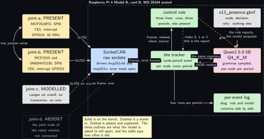
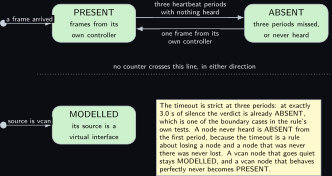
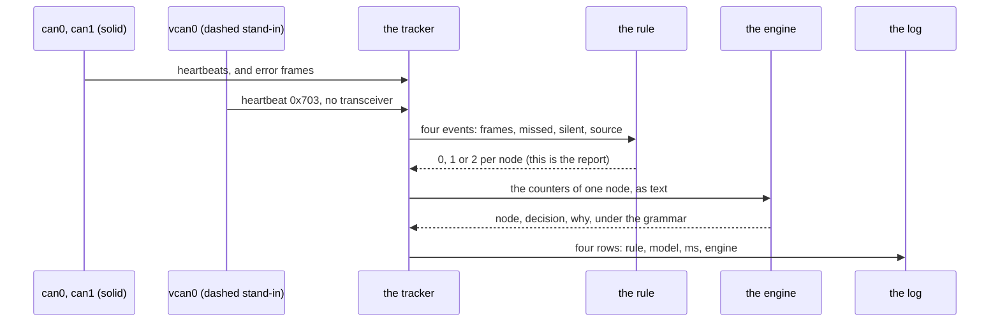
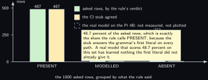

<!-- Written from the chapter source by the catalogue's publish step. Do not hand edit: the chapter is the record and this file is its copy. -->

# Project 13. CAN honesty agent

> **Board:** Raspberry Pi 4 Model B with card B, Waveshare WS-28164 isolated RS232, RS485, CAN, CAN FD HAT  
> **Owns:** the volume's honesty rule as a measured quantity: per node, PRESENT, MODELLED or ABSENT, with the model's verdict beside the rule's

> [!IMPORTANT]
> **The question, instanced**
>
> What does a small local model add over a two-line threshold, and when does it get it wrong? Here the threshold is three lines of Rust over four heartbeat counters, and the question the model is asked is the one the whole volume is drawn in: of the four nodes on this bus, which are hardware, which is a software stand-in, and which is not there at all. The rule knows because it was told; the model is given the same counters and has to reach the same verdict, and over 1000 heartbeat periods with injected dropouts the table says how often it did.

> **Key facts**
>
> - **Board:** Raspberry Pi 4 Model B with card B, the spare Verbatim 32 GB; 4 threads
> - **HAT slot:** Waveshare WS-28164, seated; this HAT and the MCC 118 of [Project 10](../../chapters/10-mcc-118-voltage-event-labeller.md) cannot share one `config.txt`, which is why there are two cards
> - **Parts:** the MCP2518FD on SPI0 CE1 with interrupt GPIO24 and a 40 MHz crystal, the MCP2515 with its own SN65HVD230 on SPI0 CE0 with interrupt GPIO23 and 16 MHz, both 120 ohm terminations fitted, two jumper wires between the CAN FD and CAN screw terminals
> - **Interface:** SocketCAN raw sockets, one per interface, classic CAN at 500 kbit; `vcan0` for the third node; nothing at all for the fourth
> - **Language and variant:** Rust, catalogue variant R1: one Rust service over the `llama-cpp-2` binding and the `socketcan` crate, in one process
> - **Model:** Qwen2.5-0.5B-Instruct Q4\_K\_M, 491 MB, Apache 2.0
> - **Decision:** per node, one of PRESENT, MODELLED, ABSENT through the grammar, plus one sentence naming the node and the counter that decided it
> - **Control rule:** a vcan source is MODELLED; three heartbeat periods with nothing heard, or never heard at all, is ABSENT; otherwise PRESENT
> - **Acceptance:** 1000 heartbeat periods with injected dropouts, the agreement table, zero rows without a literal; bus-off observed and the recovery seen through `ip -details -statistics link show`; every recorded measurement names the controller and never only the interface
> - **Difficulty:** 4 of 5
> - **Effort:** two evenings on the host for the service, the generator and the oracle, one evening in skyhorizon's WSL for the first Rust build, one afternoon on the Pi 4B for the bring-up, and one sitting for the 1000-period run and the wire out of the terminal

## Pitch

Every figure in this volume draws hardware present as a solid outline, a software stand-in as a dashed one and an absent part as a dotted grey block. That convention is borrowed from the joint node volume, where it is stated in chapter 1 as a rule about measurements: if a block is dashed, no measurement taken through it is a measurement of anything physical. In nineteen chapters the convention is how the figures are drawn. In this one it is the thing being measured.

The bus is the HAT talking to itself. Two CAN controllers sit on the WS-28164, the MCP2518FD on SPI0 chip select 1 and the MCP2515 with its own SN65HVD230 on chip select 0, and two jumper wires between the two screw terminals make them a genuine two-node bus, proven on Tuesday 7 October 2026 with frames in both directions, zero errors and the isolated side alive. Each controller sends a heartbeat once a second. A third node is a `cangen` on `vcan0`: it sends the same shape of heartbeat on time, every time, and it has no transceiver and no wire, so it is a stand-in by declaration and the rule says so whatever its counters do. A fourth node is the robot joint of the joint node volume, which is on the shelf, sends nothing, and is in the table so that its absence is counted rather than forgotten.

The rule is three lines and it is what the report shows. The model is given the same counters, one node per period, under a grammar that can produce the node name, one of the three literals and one bounded sentence, and nothing else. Two quantities come out. The first is the agreement table over 1000 periods with dropouts injected at seeded times, which is the volume's through-line question asked about its own convention. The second is the bus itself: pulling a jumper wire out of the screw terminal does not produce a clean dropout, it produces a transmitter talking into a broken pair, an error counter that climbs, a controller that takes itself off the bus, and a recovery whose interval was chosen rather than inherited. That sequence is read from `ip -details -statistics link show` and named by controller, and it is the second half of what this chapter is for.

## Origin and what changed

Draft idea 5 and video D, merged. The draft asked for a CAN monitor with a model summarising bus traffic, and video D wanted a bus demonstration. Three things changed.

The subject moved from traffic to presence. A summary of bus traffic has no right answer, so a model cannot be caught being wrong about it, and a chapter where the model cannot fail is not a chapter in this volume. Presence has a right answer that the hardware defines: a node either sent frames from a controller on this bench or it did not, and a node on a virtual interface is a stand-in no matter how well it behaves. That turns the volume's own drawing convention into a three-valued decision with an oracle.

The fourth node was added on purpose. A bus of two real nodes and one virtual one would let the model get a two-way question right by always answering the common case. The absent node costs nothing, is honest about something that is genuinely missing, and is the row that makes a model calling a dead node alive visible in the table.

CAN FD was dropped, and the chapter says so in its own words rather than in a footnote. The MCP2515 cannot do flexible data frames, so the only rate the two controllers can agree on is the classic one. Nothing measured on this bus says anything about CAN FD, and a 2 Mbit data phase test here would be one controller measured against itself. The FD data phase waits for an FD rated transceiver on the Nucleo end, which is one line in Future and extra exercises and not a claim anywhere else.

## Parts and interface

| **Part** | **Role** | **Interface** | **Address or pin** |
| --- | --- | --- | --- |
| Raspberry Pi 4 Model B | runs the service, the model and the bus | SSH, or the Renkforce cable of [Project 1](../../chapters/01-bring-up-and-the-honest-tokens-per-second.md) at 115200 | the HAT occupies ten header lines |
| Card B | the spare Verbatim 32 GB, with the two CAN overlays in its `config.txt` and the model file in `~/models` | the card is the configuration | not card A, which carries the MCC 118 overlay |
| MCP2518FD, node joint-a | the CAN FD controller, running classic frames; driver `mcp251xfd` | SPI0, interrupt line | chip select 1, GPIO24, 40 MHz crystal Y2 |
| MCP2515 with SN65HVD230, node joint-b | the classic controller with its own transceiver; driver `mcp251x` | SPI0, interrupt line | chip select 0, GPIO23, 16 MHz |
| Two jumper wires | the bus: CANH to CANH and CANL to CANL between the two screw terminals | the screw terminals, bare copper clamped | both 120 ohm terminations fitted |
| `vcan0`, node joint-c | the modelled node: `cangen` sends identifier 0x703 once a second with no transceiver | the kernel's virtual CAN | MODELLED by declaration, never by its counters |
| NUCLEO-H7A3ZI-Q, node joint-d | the absent node: the joint of the robot joint volume, not connected | none | its end has no CAN transceiver fitted |
| `replay/heartbeats_1000.csv` | 2918 frames over 1000 periods, written by `tools/make_replay.py` | `edgellm::io::Replay` | the same `t_s,tag,v0,v1` form as the C tree |
| `grammars/e13_presence.gbnf` | the node name, the three literals and one bounded sentence | the engine's grammar sampler | root symbol `root` |
| `projects/e13-can-honesty/src/rules.rs` | the control rule and its nine cases | `Registry::find("e13")` | indices 0, 1, 2 |
| `tests/oracle/e13.expected.csv` | 4000 expected rule cells and 1000 stub cells | the project's own `cargo test` |  |

## Model and grammar

Qwen2.5-0.5B-Instruct at Q4\_K\_M, the file `qwen2.5-0.5b-instruct-q4_k_m.gguf`, 491 MB, Apache 2.0, from [Qwen/Qwen2.5-0.5B-Instruct-GGUF](https://huggingface.co/Qwen/Qwen2.5-0.5B-Instruct-GGUF) (verified Wednesday 14 October 2026, the reading [Project 1](../../chapters/01-bring-up-and-the-honest-tokens-per-second.md) records). It is the Pi 4 default for enum decisions in the ladder, and this project needs the upper rung of the small end rather than the lower one because its answer carries a sentence as well as a literal. If [Project 1](../../chapters/01-bring-up-and-the-honest-tokens-per-second.md)'s memory reading refuses it, the chapter runs on SmolLM2-360M with no change anywhere, because nothing below depends on which model answers.

The grammar is GBNF with root symbol `root`, in the house shape of the repository ([grammars/README.md](https://github.com/ggml-org/llama.cpp/blob/master/grammars/README.md) (to verify), in the engine's tree) with two keys added. The key the shared agreement tool reads is still `decision`; `node` says which node the verdict is about, and `why` is the one sentence. The quiet state PRESENT is first, which is the convention `grammars/README.md` fixes, because the first alternative on every path is what the stub answers and the quiet state is the safe thing for a stub to say.

```gbnf
root     ::= "{" ws "\"node\"" ws ":" ws node ws "," ws "\"decision\"" ws ":" ws
             decision ws "," ws "\"why\"" ws ":" ws why ws "}"
node     ::= "\"joint-a\"" | "\"joint-b\"" | "\"joint-c\"" | "\"joint-d\""
decision ::= "\"PRESENT\"" | "\"MODELLED\"" | "\"ABSENT\""
why      ::= "\"" [A-Za-z0-9 ,.()-]{8,96} "\""
ws       ::= [ \t]*
```

The hyphen sits last in the `why` class so that it is a literal hyphen and not a range: the sentence has to be able to write a node name, and every node name on this bus carries one. Whitespace admits spaces and tabs and never a newline.

The system prompt, decoded once at start and restored before every decision, reads in full: You watch one CAN bus on a Raspberry Pi. For each node you are given its source, its frames this period, its missed periods and how long it has been silent. Answer only with the JSON object. A node whose source is a vcan interface is MODELLED whatever its counters say. A node silent for three heartbeat periods or more is ABSENT. Otherwise it is PRESENT. The why field names the node and the counter that decided it. That is 73 words, well under 120 tokens on the Qwen tokenizer, and it states the rule on purpose: the question is not whether a 0.5B model can guess a convention, it is whether it can apply one it has been given to counters it has been shown.

## What the model decides or writes

One object per asked node: the node name from four literals, one of three verdicts, and one sentence of 8 to 96 characters from a class that admits letters, digits, space, comma, full stop, round brackets and the hyphen. `n_predict` is 64, the volume's sentence budget, because the object is longer than an enum alone; sampling is greedy, which is the volume's setting for a decision and is kept here even though the answer carries prose, because the verdict is the thing measured and a greedy sentence that repeats itself is honest where a sampled one is merely nicer. The sentence is not scored by anything.

The model is asked about exactly one node per period: the first whose verdict changed since the previous period, and when none changed, the node whose turn it is. One decision of the order of a second is what a one second heartbeat period affords on a Pi 4 Model B, and a node whose verdict has just changed is the one worth it. So a 1000-period run carries 4000 rule verdicts and 1000 model verdicts, and the agreement table is over the 1000.

In CI there is no model file. The shared crate's stub, built by default, expands the grammar's first alternative on every path by the algorithm `common/c/src/edgellm_stub.c` documents, so it answers `{"node":"joint-a","decision":"PRESENT","why":""``}` on every period, with timings of zero and the engine column reading stub. The node key is wrong for three rows in four and the sentence is empty, which is exactly what a stub should look like in a log, and the agreement it reaches is a property of the replay file and not of any model.

## Control rule

Three lines, in this order, and the order is the rule. A vcan source is MODELLED first, because a virtual interface cannot become hardware by behaving well and no counter is allowed to argue. Then the timeout: three heartbeat periods with nothing heard, or never heard at all. Otherwise frames arrived from a hardware controller on this bench, which is PRESENT. The literals are the same bytes as the grammar's alternatives, in the same order, and the oracle test depends on that equality.

```rust
impl Rule for PresenceRule {
    fn project(&self) -> &str {
        "e13"
    }

    fn names(&self) -> &[&'static str] {
        &["PRESENT", "MODELLED", "ABSENT"]
    }

    /// The whole control rule.
    fn decide(&self, _ctx: &RuleCtx, ev: &Event) -> usize {
        if source_of(ev) == SOURCE_VCAN {
            return IDX_MODELLED;
        }
        if silent_of(ev) < 0.0 || silent_of(ev) >= ABSENT_AFTER_PERIODS * HEARTBEAT_PERIOD_S {
            return IDX_ABSENT;
        }
        IDX_PRESENT
    }
}
```

Two decisions hide in those three lines and both are stated rather than inherited. The timeout is three periods because one missed frame is noise, two is suspicious and three is a pattern, which is the joint node volume's choice in its chapter 12, kept unchanged. And a node never heard is ABSENT from the first period rather than after three, because the timeout is a rule about losing a node and a node that was never there was never lost; the alternative would report the absent node PRESENT for the first two periods of every run, which is the one thing this chapter exists to refuse. The accessors `source_of` and `silent_of` read the event's columns and default a malformed event to never heard, so an event without counters can only ever become ABSENT.

The user text handed to the engine is built by the one formatter this project adds. It names the node, where its frames come from as the service bound it, the frames in this period, the missed periods, the silence, and, for a hardware node, what that node's own controller says about the medium. It never names the rule's verdict.

```rust
fn format_prompt(node: &Node, now_s: f64, health: &[Health]) -> String {
    let silent = node.silent_for(now_s);
    let silent_text = if silent < 0.0 {
        "never heard".to_string()
    } else {
        format!("{:.1} s", silent)
    };
    let mut bus = String::new();
    if node.source.is_hardware() {
        if let Some(iface) = node.iface.as_deref() {
            if let Some(h) = health.iter().find(|h| h.iface == iface) {
                let _ = write!(bus, " Its controller is {}, tx errors {}, rx errors {}, \
                                      {} bus-off events.", h.state, h.tx_err, h.rx_err,
                               h.busoffs);
            }
        }
    }
    format!("Node {}, source {}. Frames this period {}, missed periods {}, silent {}.{} \
             Report this node.", node.name, node.describe_source(),
            node.frames_this_period, node.missed_periods, silent_text, bus)
}
```

## Real, modelled, absent

- **have:** real: the Pi 4 Model B with card B, the WS-28164 with both its controllers and both 120 ohm terminations, the two jumper wires that make the bus, the model file, the rule, the grammar, the per-event log and the error counters the two controllers report
- **learn:** modelled: node joint-c, a `cangen` heartbeat on `vcan0` with no transceiver and no wire, drawn dashed in every figure; and the 1000-period replay file, which is a file of frames and not a bus. Neither is ever presented as a measurement of anything physical, and the rule reports joint-c MODELLED in all 1000 periods
- **absent:** absent: node joint-d, the robot joint of the joint node volume, which has no CAN transceiver fitted on its end and sends nothing; drawn dotted. What it would add is that volume's subject and is cross-referenced rather than repeated: a real second machine on the pair, a heartbeat produced by firmware rather than by `cangen`, the synchronisation protocol of its chapter 3, and the node state machine and bus-off policy of its chapter 12. Also absent: any CAN FD data phase, because the MCP2515 cannot do one

## System architecture



*Figure 13.1. The four nodes and what happens to their frames. On the left, four node blocks in the volume's three outlines: joint-a and joint-b solid in the hardware colour, the MCP2518FD on SPI0 CE1 with interrupt GPIO24 and the MCP2515 with its SN65HVD230 on CE0 with interrupt GPIO23, joined on their left by a solid two-headed line labelled two jumper wires; joint-c dashed and grey, a cangen on vcan0 with no transceiver; joint-d dotted grey, the robot volume's joint node, not connected. Inside a dashed layer labelled with the board and card B, five solid blocks: the SocketCAN sockets in kernel blue, the tracker in user-space green at the centre, the control rule above it with the green rule outline, the model to its right with the yellow model outline, the grammar file above the model in grey, and the per-event log in green below right. Solid arrows carry heartbeat 0x701 and 0x702 from the two hardware nodes to the sockets; a dashed arrow carries 0x703 from the vcan node; a dotted grey arrow from joint-d is labelled no frame, ever. Solid arrows then carry frames and error frames to the tracker, a node-period event of frames, missed, silent and source up to the rule, and the same counters as text across to the model; a dashed reply brings the JSON verdict back to the tracker and a dashed reply brings the rule's index 0, 1 or 2 back, marked as the report. A dashed stop-coloured arrow from the rule to the model says the rule reports and the model proposes. One solid arrow leaves the tracker downward and across to the log, carrying four rows per period. A note restates the three outlines and says that telling them apart is what the model is asked to do.*

The arrow to read twice is the one that is not there. The model block has exactly one outgoing arrow, a dashed reply to the tracker, and the tracker's only outgoing arrow carries log rows. Nothing on this bus is declared real because a model said so, and nothing is actuated at all: this project has no `io_actuate` call and no output of any kind, which is the easiest form of the volume's safety rule to check, by looking.

## Wiring

| **Header pin** | **BCM** | **Part pin** | **Wire colour if known** |
| --- | --- | --- | --- |
| 19 | GPIO10, MOSI | SPI0 MOSI, both controllers | the HAT, no wire |
| 21 | GPIO9, MISO | SPI0 MISO, both controllers | the HAT, no wire |
| 23 | GPIO11, SCLK | SPI0 SCLK, both controllers | the HAT, no wire |
| 24 | GPIO8, CE0 | MCP2515 chip select | the HAT, no wire |
| 26 | GPIO7, CE1 | MCP2518FD chip select | the HAT, no wire |
| 16 | GPIO23 | MCP2515 interrupt | the HAT, no wire |
| 18 | GPIO24 | MCP2518FD interrupt | the HAT, no wire |
| 1, 2, 4, 6, 9 | 3V3, 5V, GND | HAT supply and ground | the HAT, no wire |
| CAN FD terminal H | none | CAN terminal H | jumper wire 1, colour not recorded; clamp the bare copper under the screw |
| CAN FD terminal L | none | CAN terminal L | jumper wire 2, colour not recorded; clamp the bare copper under the screw |
| all others |  | nothing | thirty header lines stay free; nothing else is seated |


*Figure 13.2. The 40-pin header of the Pi 4 Model B as two columns of small blocks, pin 1 at the top left, with ten blocks filled in the hardware colour: pins 1 and 2 and 6 for 3V3, 5V and ground, pins 19, 21 and 23 for SPI0 MOSI, MISO and SCLK, pins 24 and 26 for the two chip selects, and pins 16 and 18 for GPIO23 and GPIO24, the two interrupts. A dashed layer around all forty is labelled ten lines used, thirty free. Two solid arrows lead from the filled pins to one solid hardware block for the seated WS-28164, which names the MCP2518FD on CE1 with its 40 MHz crystal Y2 and the MCP2515 with its SN65HVD230 on CE0 with 16 MHz. Below it two solid hardware blocks are the CAN FD and CAN screw terminals, each with its 120 ohm cap fitted, joined by two solid two-headed lines labelled jumper wire 1 H to H and jumper wire 2 L to L, with a label beneath saying classic CAN at 500 kbit because the MCP2515 cannot do a data phase. Below the terminals, a dashed grey block is vcan0 with its cangen heartbeat and no transceiver, and a dotted grey block is the Nucleo joint with no transceiver fitted. A note says that this is card B only because the HAT's overlays and the MCC 118 both claim SPI0 chip selects, that dmesg must be read every session because which controller is can0 changes between boots, and that bare copper is clamped under the screw before any measurement because the terminal block is a friction fit for a Dupont lead.*

## Sequence


*Figure 13.3. One heartbeat period, the one in which joint-a's third period of silence is reached, as a sequence diagram with six actors: the two controllers as one solid actor, vcan0 drawn dashed because it is the stand-in, then the tracker, the rule, the engine and the log, all solid. Solid arrows carry heartbeat 0x702 from the controllers and 0x703 from vcan0 to the tracker, then an error frame from the controllers carrying controller problems, transmit passive and a transmit error counter of 128. A note says that nothing came from 0x701 this period nor in the two before it, and nothing from 0x704 in any period of the run. A solid arrow then carries four node-period events of frames, missed, silent and source to the rule, and a dashed reply brings back PRESENT, ABSENT, MODELLED, ABSENT. Over a blue activation bar on the engine, a solid arrow carries joint-a's counters as text, and a curved solid arrow on the engine itself is labelled 64 tokens under the grammar; a dashed reply returns the JSON object naming joint-a and ABSENT to the tracker. The last solid arrow writes four rows, carrying rule, model, milliseconds and engine, from the tracker to the log. A note says the rule's index at the fourth arrow is what the report shows and what the video reads aloud, and that the figure has no arrow from the engine to anything but the log row the tracker writes.*

## States and data



*Figure 13.4. The three verdicts as a state machine. Two rounded green states sit side by side at the top, PRESENT with frames from its own controller and ABSENT with three periods missed or never heard, joined by a pair of solid arrows: three heartbeat periods with nothing heard from left to right, and one frame from its own controller back. A third green state, MODELLED with its source is a virtual interface, sits below a dotted grey horizontal line labelled no counter crosses this line, in either direction; the line is the absence of a transition and not a transition. Two initial dots enter from the left, one into PRESENT labelled a frame arrived and one into MODELLED labelled source is vcan. A note says that the timeout is strict at three periods, so exactly 3.0 s of silence is already ABSENT, which is one of the boundary cases in the rule's tests; that a node never heard is ABSENT from the first period because the timeout is a rule about losing a node and a node that was never there was never lost; and that a vcan node that goes quiet stays MODELLED while a vcan node that behaves perfectly never becomes PRESENT. Nothing in the figure is dashed.*

The record is the per-event log, `projects/e13-can-honesty/evidence/e13_live.csv` on the bench and `e13_run.csv` for the replay, written by the shared crate's `edgellm::elog` in the nine columns `elog.h` fixes for every project in the repository: `t_s, tag, raw, rule, model, prompt_ms, generate_ms, n_generated, engine`. Here `tag` is the node name and never the interface name, and `raw` carries the three counters the rule and the prompt both saw, frames, missed periods and seconds of silence, with a silence of `-1` meaning never heard. Four rows share each timestamp, one per node, and only one of the four carries a model cell.

## Data flow

```text
  tools/make_replay.py (seeded)          the service, one process on the Pi 4B, card B
  +---------------------------+          +--------------------------------------------------+
  | replay/heartbeats_1000    |--------->| ingest: 0x701 can0 | 0x702 can1 | 0x703 vcan0     |
  |  t_s,tag,v0..v5           | Replay   |   error frame?  CRTL / BUSOFF / RESTARTED -> health|
  |  2918 frames, 1000 periods|          |   wrong interface for that id? -> stray, refused  |
  +---------------------------+          |      |                                           |
            or, on the bench             |      v  one node-period event per node           |
  +---------------------------+  socket  | rule.decide(ev) -> 0 PRESENT | 1 MODELLED | 2 ABSENT|
  | can0, can1 (bound by      |--------->|      |                                           |
  |   /sys/.../device/driver) |  per if  |      v  one node per period: the changed one      |
  | vcan0 (cangen 0x703)      |          | format_prompt(node) -> "Node joint-a, source ..." |
  +---------------------------+          |      |                                           |
  prompt.txt ---decoded once-----------> | [state] restored, user text decoded, 64 tokens    |
    73 words, state saved at start       |      {"node":"joint-a","decision":"ABSENT",...}   |
  grammars/e13_presence.gbnf ----------> |      |                                           |
    root: node, decision, why            |      v                                           |
                                         | elog: 4 rows per period, rule and model columns   |
                                         +--------------------------------------------------+
                                                       |                      |
  tests/oracle/e13.expected.csv  <--- 4000 rows -------+                      v
    rule column from the same three lines in Python,            tools/agreement.py --md
    model column the stub's first expansion                     1000 scored, 3 by 3 table
```



## Latency design

The system prompt is 73 words, under 120 tokens on the Qwen tokenizer, decoded once at start. With a `--state` path the shared crate writes it with the binding's state-save call and reads it back before every decision; with no path it keeps the prompt resident and trims every position past it, which is the route a long-running service wants and the default here, because a service that restores from a file 86400 times a day reads that file 86400 times for nothing. [Project 2](../../chapters/02-the-decision-loop.md) measured the file route against a cold decode and this project inherits that figure rather than measuring it again.

`n_ctx` is 512. `n_predict` is 64, because the answer carries a sentence; sampling is greedy under the grammar; four threads on the Pi 4B. The interval is the heartbeat period, 1.000 s, which is ten times slower than the joint node volume's 100 ms producer period with its 350 ms consumer timeout, and the reason is this chapter's own: one decision on a Pi 4 Model B with a 0.5B model takes of the order of a second, and a service that cannot answer inside its own period is not a service. The budget per period is one prompt decode of about sixty tokens of user text plus at most 64 single-token decodes, and with [Project 1](../../chapters/01-bring-up-and-the-honest-tokens-per-second.md)'s table that becomes a number; until that table is measured it is a shape and the data figure says so. Only the asked node costs a decision, so the budget is one decision per period and not four.

## Steps

**Step 1.** Generate the replay file and the oracle on the authoring laptop, and read the printed summary: it is the record the agreement table below quotes.

```bash
# win11 aquamarine
cd C:\Users\aquamarine\Desktop\edge-llm-pi; python projects\e13-can-honesty\tools\make_replay.py
```

**Step 2.** Build and test the project on the host in skyhorizon's WSL, with the default stub feature: no engine, no SocketCAN, nothing that needs a board. This is the first build of any kind, because nothing compiles on aquamarine by rule.

```bash
# win11 skyhorizon, WSL side
cd ~/src/edge-llm-pi; cargo test --manifest-path projects/e13-can-honesty/Cargo.toml
```

**Step 3.** Read the thirteen test names in that output. Nine are the rule's cases, including the boundary at exactly three periods and the two that hold the vcan node in MODELLED; four are the oracle test's, including the two that check joint-d is never reported PRESENT and joint-c never anything but MODELLED over all 1000 periods.

**Step 4.** Build for the bench, with the engine and the SocketCAN backend. The engine feature pulls the shared crate's `llama-cpp-2` binding, which builds its own copy of llama.cpp and wants a C++ toolchain and `libclang`; the live feature pulls `socketcan`, which wants nothing but the kernel headers.

```bash
# win11 skyhorizon, WSL side
cd ~/src/edge-llm-pi; cargo build --release --manifest-path projects/e13-can-honesty/Cargo.toml \
  --no-default-features --features engine,live
```

**Step 5.** Put card B in the Pi 4 Model B and read which controller the kernel called what. This is the step that is skipped once and costs an hour: the names swap between boots, and a service bound to `can0` by assumption reports the wrong controller with complete confidence.

```bash
# Raspberry Pi 4 Model B, card B
cd ~; dmesg | grep mcp25; ls -l /sys/class/net/can0/device/driver /sys/class/net/can1/device/driver
```

**Step 6.** Bring both links up at 500 kbit with the chosen recovery interval, create the virtual interface, and read the throttle bits before anything is timed.

```bash
# Raspberry Pi 4 Model B, card B
cd ~; sudo ip link set can0 up type can bitrate 500000 restart-ms 100
```

```bash
# Raspberry Pi 4 Model B, card B
cd ~; sudo ip link set can1 up type can bitrate 500000 restart-ms 100
```

```bash
# Raspberry Pi 4 Model B, card B
cd ~; sudo modprobe vcan; sudo ip link add dev vcan0 type vcan; sudo ip link set vcan0 up
```

```bash
# Raspberry Pi 4 Model B, card B
cd ~; vcgencmd get_throttled; vcgencmd measure_temp
```

**Step 7.** Start the two hardware heartbeats and the modelled one. The first two are `cangen` on each controller for the bring-up sitting; from [Project 14](../../chapters/14-joint-monitor.md) on, the far end is the joint node's own firmware.

```bash
# Raspberry Pi 4 Model B, card B
cd ~; cangen can0 -I 701 -L 1 -D 05 -g 1000 -n 1100 &
```

```bash
# Raspberry Pi 4 Model B, card B
cd ~; cangen can1 -I 702 -L 1 -D 05 -g 1000 -n 1100 &
```

```bash
# Raspberry Pi 4 Model B, card B
cd ~; cangen vcan0 -I 703 -L 1 -D 05 -g 1000 -n 1100 &
```

**Step 8.** Run the service live for 1000 periods with the real model, pulling one jumper wire out of the CAN FD screw terminal at a time you write down and pushing it back after ten seconds, twice. Read the throttle bits again immediately afterwards.

```bash
# Raspberry Pi 4 Model B, card B
cd ~/edge-llm-pi; ./target/release/edgellm-e13 --project e13 --live --periods 1000 \
  --grammar projects/e13-can-honesty/grammar.gbnf \
  --prompt projects/e13-can-honesty/prompt.txt \
  --model ~/models/qwen2.5-0.5b-instruct-q4_k_m.gguf \
  --log projects/e13-can-honesty/evidence/e13_live.csv; vcgencmd get_throttled
```

**Step 9.** Read the bus-off and recovery counters from both links by controller, not by interface, and paste the two blocks into the evidence file beside the times the wire was out.

```bash
# Raspberry Pi 4 Model B, card B
cd ~; ip -details -statistics link show can0; ip -details -statistics link show can1
```

**Step 10.** Score the log. The count of rows whose model cell holds no literal must be zero; the agreement is whatever it is and goes into the table below with its date and the controller names.

```bash
# Raspberry Pi 4 Model B, card B
cd ~/edge-llm-pi; python tools/agreement.py projects/e13-can-honesty/evidence/e13_live.csv --md
```

## Variant chosen

Rust, catalogue variant R1: one Rust service that reaches the engine through the `llama-cpp-2` binding and the bus through the `socketcan` crate, in one process. On relevance it is the clearest Rust case in the volume: a long-running bus service that must not stop, whose work is socket reading and bookkeeping rather than arithmetic, is the shape of embedded Linux work that reaches for Rust today. On popularity, SocketCAN in Rust is well served rather than experimental: `socketcan` 4.0.0 is published on crates.io under MIT with raw sockets, the CAN FD frame types, error frames and a netlink face for interface parameters, which is more of the kernel's CAN ABI than this project needs. On best practice it is one supervised process with no `unsafe` block anywhere outside the binding's own generated code, and a service that reports rather than acts needs no capability beyond `CAP_NET_RAW`, which the unit grants and nothing else. On compliance it is the kernel's own CAN ABI through a crate that wraps it rather than a vendor library, MIT on both sides, with the engine's MIT beneath. On practicality it is the project the second video films (**Video 2** (the video chapters are not published)), and the demonstration is a physical action, a hand pulling a wire, with a table behind it.

What it costs is a second toolchain on the build host and a first build that is slower than any C project's, because the binding compiles its own copy of llama.cpp. What it gains, beyond the language, is the boundary this chapter was able to draw: the engine and the bus are both optional cargo features, so the rule, the replay path, the oracle test and every number published here build and run with neither, and a crate API that moves cannot change a published figure. The shared crate of `common/rust/edgellm` is reused as it stands for the engine, the nine-column log writer, the chat template, the `Rule` trait with its registry and test helper, and the replay reader. Two things are this project's own and both are stated at the head of `src/main.rs`: the loop, because `run_loop` is one decision per event while here an event is a frame and a decision is about a node over a period; and the SocketCAN source, because a periodic reader over three interfaces has to know which interface each frame arrived on and has to see the error frames, and `IoSource::next`, one event at a time with no deadline, carries neither. Lifting that source into the shared crate is an exercise and not a change made from this chapter.

| **Quantity** | **Host, stub** | **Pi 4B, engine** | **Instrument** | **Pass** | **State** |
| --- | --- | --- | --- | --- | --- |
| Decision latency, ms | 0, the stub | not measured | the log's generate\_ms column | under 1000 ms | the Pi 4B run is pending |
| Resident memory, kB | not measured | not measured | `edgellm::rss_kb` from `/proc/self/status` | no condition | not run yet |
| Release binary size | not measured | not measured | `ls -l` on the release build | no condition | the WSL build is Joseph's |
| Rows with no literal | 0 of 1000 | not measured | `tools/agreement.py` | exactly 0 | CI only so far |
| Agreement | 48.7 percent | not measured | `tools/agreement.py` on the log | no condition; it is the finding | CI only so far |

## Embedded Linux and Yocto

A Rust project does not include the layer's shared `meta-edgellm/recipes-app/edgellm-common.inc`, which inherits `cmake` and installs a C binary. The recipe `meta-edgellm/recipes-app/edgellm-e13/edgellm-e13_0.1.bb` inherits the `cargo` class instead and is the layer's worked example for its four Rust projects ([Project 5](../../chapters/05-adxl345-event-reporter.md), this one, [Project 14](../../chapters/14-joint-monitor.md) and [Project 18](../../chapters/18-mini-industrial-serial-logger.md)'s service). Its sources are the tree the layer sits in, through `FILESEXTRAPATHS` and a `SRC_URI` that names `common/rust`, the project folder and `grammars`, so the recipe builds exactly the checked-out revision with no network and no second clone. It builds with `--no-default-features --features engine,live`, depends on `llama-cpp` and `clang-native` at build time and on `llama-cpp`, the Qwen model package and `can-utils` at run time. `can-utils` is a dependency rather than a convenience: `cangen` is what produces the modelled node's heartbeat, and `ip -details -statistics link show` is the instrument the acceptance test reads the bus-off counters from.

The crate list is not hand written. `cargo bitbake` reads `Cargo.lock` and writes one `SRC_URI` line with a checksum per dependency into `edgellm-e13-crates.inc` beside the recipe, which the recipe pulls in with `include` rather than `require` so that a layer parse before that file exists reports a missing fetch instead of a parse error.

The unit is where the swapping interface names show up again, and it is the one place where the obvious systemd idiom is wrong:

```text
[Unit]
Description=edge-llm-pi e13, the CAN honesty agent on the WS-28164 bus
Documentation=https://github.com/ambrosiobing/edge-llm-pi
# No After= on a named interface. sys-subsystem-net-devices-can0.device would bind this
# service to one boot's probe order, and on this HAT the two controllers swap names
# between boots. The service binds each node to its controller's driver instead, by
# reading /sys/class/net/<iface>/device/driver, and refuses to start when a driver is
# missing. systemd-networkd brings the links up; this unit only needs them to exist.
After=systemd-networkd.service
Wants=systemd-networkd.service
```

There is no device-tree overlay fragment in the layer for this project, because the two overlay lines are the vendor's own and belong in the machine configuration: `dtparam=spi=on`, `dtoverlay=mcp2515,spi0-0,oscillator=16000000,interrupt=23` and `dtoverlay=mcp251xfd,spi0-1,interrupt=24`, exactly as `wiring.md` carries them for card B, and never in the same configuration as the MCC 118 of [Project 10](../../chapters/10-mcc-118-voltage-event-labeller.md). The layer parse is the check that runs on skyhorizon before anything is wired; the image build is a separate later sitting of hours.

```bash
# win11 skyhorizon, WSL side
cd ~/bench/edge-llm-pi; kas shell meta-edgellm/kas/edgellm-pi4.yml -c "bitbake -p"
```

## Acceptance test

Three quantities, and all three can fail.

First, over 1000 heartbeat periods with injected dropouts, the number of rows whose model cell holds none of the three literals. The instrument is `tools/agreement.py` reading the log; the pass condition is zero. A single row with anything else means the grammar did not hold or the object did not close inside 64 tokens, and it fails the chapter rather than the model. On the host this runs against the replay file through the project's own oracle test, which compares all 4000 rows cell by cell with `tests/oracle/e13.expected.csv`; on the bench it runs against the live log.

Second, bus-off observed and the recovery seen. The instrument is `ip -details -statistics link show`, read on both links before the wire comes out, while it is out and after it is back, and the quantity is the state line, the `berr-counter` pair and the restart count in the statistics block. The pass condition is that a bus-off was reached, that the restart happened within one heartbeat period of `restart-ms 100`, and that the node whose controller went bus-off never crossed the three-period timeout because of it. That last clause is why the recovery interval is 100 ms and not a second, and it is a condition that can fail: a slower restart would make an error the bus recovered from look like a missing node.

Third, every recorded measurement names the controller. The instrument is reading the evidence file. A line that says `can0` and not MCP2518FD or MCP2515 is not a measurement of anything, because `can0` is this boot's name and the controller is the part. The pass condition is that no row of the evidence file names an interface without its controller beside it; the log itself helps, because its `tag` column carries the node name and the service prints the binding it read from the driver links at start.

Both bench quantities are taken with `vcgencmd get_throttled` reading `0x0` before and after, and a run with any bit set is discarded.

## Agreement table

Over the 1000 periods of `replay/heartbeats_1000.csv` as generated on Wednesday 14 October 2026 by `tools/make_replay.py` with its fixed seed, the file carries 2918 frames and 4000 rule verdicts: 1926 PRESENT, 1000 MODELLED and 1074 ABSENT. Thirteen dropouts were injected on joint-a, five on joint-b and three on joint-c, each four to nine periods long. The model was asked once per period, 1000 times, about the node whose verdict had just changed or, failing that, the node whose turn it was: 269 questions about joint-a, 248 about joint-b, 241 about joint-c and 242 about joint-d, and of those asked rows the rule calls 487 PRESENT, 241 MODELLED and 272 ABSENT.

On the bench the model column is not measured: the Pi 4B run has not been taken. In CI the stub answers `{"node":"joint-a","decision":"PRESENT","why":""``}` for every period, so the agreement is the PRESENT fraction of the asked rows, 487 of 1000, 48.7 percent, and every disagreement is of two kinds: 241 rows where the stub calls the modelled node present, and 272 where it calls an absent node present. Those are the two errors that matter on a bus, which is why the number is printed here before any model has answered: a model that scores 48.7 percent on this set has learned nothing that the grammar's first literal did not already give it, and a model that scores above it has to be shown to have done so on the rows the stub got wrong.

| **Rule says** | **Model PRESENT** | **Model MODELLED** | **Model ABSENT** | **Instrument** |
| --- | --- | --- | --- | --- |
| PRESENT, 487 | 487 | 0 | 0 | the stub in CI; bench: not measured |
| MODELLED, 241 | 241 | 0 | 0 | the stub in CI; bench: not measured |
| ABSENT, 272 | 272 | 0 | 0 | the stub in CI; bench: not measured |
| agreement | 48.7 percent |  |  | the stub in CI; bench: not measured, the Pi 4B run is pending |
| rows with no literal | 0 of 1000 |  |  | `tools/agreement.py`, CI |

## Measured data



*Figure 13.5. The CI agreement as a bar chart with TikZ axes, and a measurement of the replay file and the stub rather than of any model. The horizontal axis groups the 1000 asked rows by what the rule said, PRESENT, MODELLED and ABSENT; the vertical axis counts rows from 0 to 500. Each group holds two solid bars: a user-space green bar for the asked rows, 487, 241 and 272, and a hardware-coloured bar for the rows the CI stub agreed with, 487, 0 and 0, the two zeros drawn as a sliver with the figure 0 beside them. A legend names the two bars and carries a third, dashed and unfilled, for the real model on the Pi 4 Model B, which is not measured and is not plotted. A note says that 48.7 percent is exactly the share the rule calls PRESENT, because the stub answers the grammar's first literal on every path, and that a real model scoring 48.7 percent has learned nothing the first literal did not already give it.*

## Pitfalls

- **The interface order between boots.** On this HAT `can0` and `can1` are whatever the two drivers probed into, and the order changes between boots. A service that binds `can0` to the MCP2518FD by assumption reports the wrong controller with complete confidence, and the log looks perfect. Read `dmesg | grep mcp25` or the driver link under `/sys/class/net` every session; the service itself binds each node by driver name and prints what it bound, and the unit deliberately has no `After=` on a named interface.
- **The SPI0 chip selects shared with the MCC 118.** The WS-28164 overlays and the MCC 118 DAQ HAT both claim SPI0 chip selects and cannot live in one `config.txt`, which is why card A and card B exist. An e13 run on card A finds no CAN interface at all and reads as a wiring fault; the pre-flight is which card is in the board, before `dmesg`.
- **Bare copper under the screw.** The screw terminal is a friction fit for a Dupont lead, which holds well enough to pass frames during bring-up and badly enough to fail in the middle of a 1000-period run. Clamp the bare copper under the screw before any measurement, and write in the evidence file that it was clamped, because an intermittent contact produces exactly the dropouts this project measures and there is nothing in the log that tells the two apart.
- **The MCP2515 cannot do CAN FD.** The two controllers can only agree on classic frames, so this bus proves nothing about flexible data frames and a 2 Mbit data phase figure taken here would be one controller measured against itself. The chapter says so in its first page and the wiring file says so again; the FD data phase waits for an FD rated transceiver on the Nucleo end.
- **The bus-off recovery delay.** Pulling a wire is not a clean dropout: the transmitter on the other side talks into a broken pair, its error counter climbs through the warning and passive thresholds, and the controller takes itself off the bus with no software involved. With `restart-ms` unset it stays off until something brings it back, and the node reads ABSENT for an error it would have recovered from; with `restart-ms` too long the same thing happens more slowly. The policy here is 100 ms and up to the kernel's own retry behaviour, chosen so that the restart lands inside one heartbeat period, and it is written down in `wiring.md` with its reasoning rather than left in a command line.
- **The stub answering the first literal.** A log in which every model cell reads `{"node":"joint-a","decision":"PRESENT","why":""``}` and every engine cell reads stub is a CI log, not a bench log. Its 48.7 percent is the PRESENT fraction of the replay file, and its node key is wrong for three rows in four. Read the engine column before reading the agreement, every time.
- **A modelled node that replays a hardware node's identifier.** Nothing stops a generator on `vcan0` from sending 0x701, and if the service trusted the identifier alone a modelled node would read PRESENT, which is the one failure this project exists to prevent. The service credits a heartbeat only when it arrives on the interface its node is bound to, counts the rest as stray frames and prints the count at the end; a non-zero stray count is something to explain before any agreement figure is read.
- **Four decisions in a one second period.** Asking the model about all four nodes every period needs four decisions a second, which a Pi 4 Model B with a 0.5B model cannot do, and the service would fall behind the bus silently. One decision per period, about the node whose verdict changed, is the budget; the consequence is that the agreement table covers 1000 of the 4000 rule verdicts and the chapter says which.

## Future and extra exercises

- Variant R2, the same service with the engine in a separate process: that is [Project 14](../../chapters/14-joint-monitor.md), which runs on this bus with the ADXL345 added, so R1 and R2 are priced against each other on one bus rather than argued about. The delta is restart isolation and one socket round trip per decision.
- The C form of this service, catalogue variant C over `llama.h` with `io_can.c` as its source: the delta is the per-node bookkeeping, which is a structure and a loop in either language, against the loss of the `socketcan` crate's error frame and netlink types, which would become hand-written `linux/can` code.
- A real CAN FD data phase, once an FD rated transceiver is bought for the Nucleo end: the delta is a second node that is a machine rather than a controller on the same HAT, a data phase at 2 Mbit that means something, and the termination question becoming real rather than a jumper cap.
- A SocketCAN backend in the shared crate, `edgellm::io::Can` beside `Replay` and `Iio`, which its own module invites: the delta is a periodic multi-interface reader that `IoSource::next` cannot express today, so the trait would gain a deadline before the backend could move.
- The `socketcan` crate's netlink face (`CanInterface`, `InterfaceCanParams`, `CanCtrlMode`) instead of `ip link`: the delta is that the service could bring its own links up and read the error counters itself, and the cost is that it would then need more than `CAP_NET_RAW`.
- The crate's `tokio` or `smol` feature instead of a blocking read with a timeout: the delta is one task per interface and no period boundary in the reader, against an async runtime in a service whose whole job fits in one thread.

## Video potential

5 of 5, and it is the signature project of the channel's second video, **Video 2** (the video chapters are not published). The hook: it called the vcan node modelled before I did. On screen the four-row node table with two solid rows, one dashed and one dotted; a hand pulls one jumper wire out of the CAN FD screw terminal; the missed counter goes one, two, three; the rule's column flips to ABSENT and the model's follows a second or two later. Then the bus-off counters read aloud from `ip -details -statistics link show`, the wire back in, the recovery, and the agreement table. It is the only piece in the plan whose demonstration is a physical action with a right answer behind it, which is what the first three seconds need, and the dotted row is the part no other channel has: a node that is in the table precisely because it is not there.

## Sources

- `socketcan` 4.0.0, MIT, the newest release on crates.io, published Saturday 5 September 2026, repository `github.com/mbr/socketcan-rs`, read from [crates.io/api/v1/crates/socketcan](https://crates.io/api/v1/crates/socketcan) (verified Wednesday 14 October 2026).
- The crate's types, read from [docs.rs/socketcan/latest/socketcan/](https://docs.rs/socketcan/latest/socketcan/) (verified Wednesday 14 October 2026): `CanSocket` as the blocking raw socket, `CanFrame` with `CanDataFrame`, `CanRemoteFrame` and `CanFdFrame`, `CanErrorFrame` and `CanAnyFrame`, the `EmbeddedFrame` trait, `CanFilter`, and for the netlink feature `CanInterface`, `InterfaceCanParams` and `CanCtrlMode`. Four items this project's live module uses were NOT read there and are marked to verify at the first build in skyhorizon's WSL, which is the only place that module is compiled: the trait names `Socket`, `SocketOptions` and `Frame`, and the accessor `raw_id`. The crate's own error enumeration, `CanError` with `ErrorCause`, was read by name but its variant list is to verify.
- The crate's usage and feature flags (`tokio`, `smol`, `serde`, `vcan_tests`, `netlink_tests`) and the form `CanSocket::open("can0")`, from [the crate's README](https://raw.githubusercontent.com/mbr/socketcan-rs/master/README.md) (verified Wednesday 14 October 2026).
- The kernel's error frame encoding, from the can-utils copy of the kernel headers: `CAN_ERR_FLAG` `0x20000000` in [include/linux/can.h](https://raw.githubusercontent.com/linux-can/can-utils/master/include/linux/can.h) (verified Wednesday 14 October 2026) and, in [include/linux/can/error.h](https://raw.githubusercontent.com/linux-can/can-utils/master/include/linux/can/error.h) (verified Wednesday 14 October 2026), `CAN_ERR_CRTL` `0x4`, `CAN_ERR_BUSOFF` `0x40`, `CAN_ERR_RESTARTED` `0x100`, `CAN_ERR_CNT` `0x200`, the `CAN_ERR_CRTL_*` values in `data[1]` including transmit warning `0x08` and transmit passive `0x20`, and the transmit and receive error counters in `data[6]` and `data[7]` (both verified Wednesday 14 October 2026). GPL-2.0 headers, read and not copied.
- Qwen2.5-0.5B-Instruct-GGUF, Apache 2.0, 491 MB at Q4\_K\_M, [huggingface.co/Qwen/Qwen2.5-0.5B-Instruct-GGUF](https://huggingface.co/Qwen/Qwen2.5-0.5B-Instruct-GGUF) (verified Wednesday 14 October 2026).
- The `llama-cpp-2` binding at `0.1.159`, MIT or Apache-2.0, pinned by the shared crate in `common/rust/edgellm/Cargo.toml` with the bundled llama.cpp commit recorded in `common/rust/README.md`; [crates.io/crates/llama-cpp-2](https://crates.io/crates/llama-cpp-2) (to verify from this chapter: the version and its date are read from the shared crate's own note of Wednesday 14 October 2026, not fetched here).
- GBNF grammar syntax, in the engine's tree, [grammars/README.md](https://github.com/ggml-org/llama.cpp/blob/master/grammars/README.md) (to verify).
- The WS-28164's two controllers, their chip selects, interrupts, crystals and termination caps, and the vendor's tested overlay block, from the Waveshare wiki and schematic, [waveshare.com/wiki/RS232-RS485-CAN-Board](https://www.waveshare.com/wiki/RS232-RS485-CAN-Board) (to verify; read for the bench hardware record on Tuesday 6 October 2026, and that record notes the schematic does not name the termination jumper's reference designator). The two-node bus, the two jumper wires, the swapping interface names and the card A and card B split are bench facts, recorded Tuesday 7 October 2026 and restated in the front matter; those records have no public URL.
- The honesty rule, solid, dashed and dotted, from the joint node volume's chapter 1, and the heartbeat, the consumer timeout of three periods, the controller's error states and the bus-off recovery policy from its chapter 12; that volume has no public URL.

---

[Previous](../../chapters/12-stwin-box-vibration-band-reporter.md) &nbsp;&nbsp;|&nbsp;&nbsp; [Contents](../../CONTENTS.md) &nbsp;&nbsp;|&nbsp;&nbsp; [Next](../../chapters/14-joint-monitor.md)
