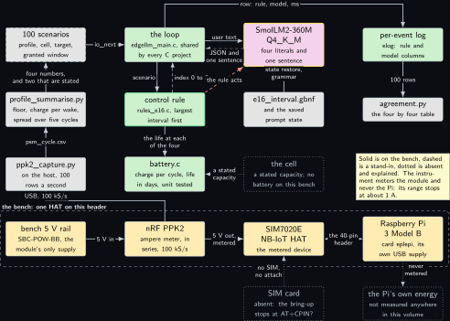
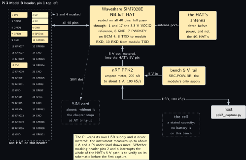
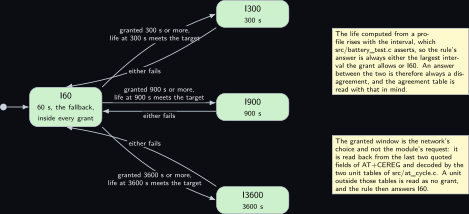
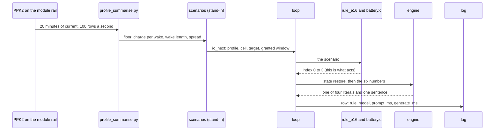
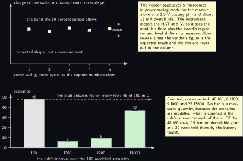

<!-- Written from the chapter source by the catalogue's publish step. Do not hand edit: the chapter is the record and this file is its copy. -->

# Project 16. NB-IoT sleep interval from measured microamps

> **Board:** Raspberry Pi 3 Model B Rev 1.2, Waveshare SIM7020E NB-IoT HAT  
> **Owns:** the energy decision taken offline on a logged current profile, and the correction that the instrument cannot meter a Raspberry Pi

> [!IMPORTANT]
> **The question, instanced**
>
> What does a small local model add over a two-line threshold, and when does it get it wrong? Here the threshold is one division done at most three times on numbers a current meter produced, the model is handed the same six numbers and the same four intervals, and the question is whether a 360M model picks the longest sleep that a battery target and the window the network granted both allow, over 100 replayed scenarios, when the arithmetic is a unit-tested C function and the model's answer only ever reaches the log.

> **Key facts**
>
> - **Board:** Raspberry Pi 3 Model B Rev 1.2, 1 GB, card `eplepi`, 4 threads
> - **HAT slot:** Waveshare SIM7020E NB-IoT HAT, the only HAT on this header for this project; the 3.5 inch LCD of [Project 9](../../chapters/09-lcd-prompt-and-verdict-display.md) and the Explorer700 of [Project 8](../../chapters/08-explorer700-console-with-a-model.md) want pins this carrier covers
> - **Parts:** the Pi 3B on its own USB supply, the SIM7020E HAT with its antenna, the nRF PPK2 in ampere-meter mode in series with the module's 5 V feed, and the bench 5 V rail that feeds the instrument
> - **Interface:** the PL011 on header pins 8 and 10 at 115200 after `dtoverlay=disable-bt`, for the AT bring-up alone; the scenarios are always a replayed CSV through `io.h`, because an attach and a power-saving-mode cycle both take minutes
> - **Language and variant:** C, catalogue variant C: plain C over `llama.h` through the shared main, with a small `main` of this project's own for the AT plan, the bring-up and the two requested timer octets
> - **Model:** SmolLM2-360M-Instruct Q4\_K\_M, 0.27 GB, Apache 2.0
> - **Decision:** one of I60, I300, I900, I3600 and one bounded sentence of reason in the same object, `n_predict` 64; the stub answers I60 in CI
> - **Control rule:** the largest of the four intervals that fits inside the granted window and whose computed battery life meets the target; otherwise I60, the safe fallback
> - **Acceptance:** the charge per wake repeats within 10 percent over five power-saving-mode cycles, with the spread published whether it passes or not; the agreement over the 100 replayed scenarios; the twenty-nine checks of the battery and timer unit test, and the rule's six cases, both before any capture
> - **Difficulty:** 4 of 5
> - **Effort:** one evening on the host for the scenarios and the oracle, one for the plan and the timer decode, one bench afternoon for the rail isolation and the capture, and an evening for the decision run and the table

## Pitch

**The correction first, because every number below depends on it.** The nRF PPK2 gives a 200 nA to 1 A measurement range and sources 0.8 to 5 V, from its own product page, [nordicsemi.com/Products/Development-hardware/Power-Profiler-Kit-2](https://www.nordicsemi.com/Products/Development-hardware/Power-Profiler-Kit-2) (verified Wednesday 14 October 2026). A Raspberry Pi under load draws more than that ceiling, so the instrument can neither power nor meter a Pi, and nothing in this chapter or in this volume is a Raspberry Pi energy figure. The Pi keeps its own USB supply. The PPK2 sits in ampere-meter mode in series with the module's own 5 V feed and meters the SIM7020E HAT alone. Joseph's draft idea had the Pi on the meter; that is why the project changed, and saying so is cheaper than publishing a figure that cannot exist.

What is left after the correction is a real measurement of a real radio. A power-saving-mode cycle is a short expensive wake and a long cheap floor, and the only honest way to choose the length of the floor is to integrate the wake. So the capture happens once, offline: twenty minutes of current at a hundred rows a second, `tools/ppk2_capture.py` writing the trace and `tools/profile_summarise.py` reducing it to the sleep floor, the charge of one wake, the length of that wake and the spread of that charge over five cycles, which is this chapter's acceptance condition. Two numbers that are not measured join them: the cell capacity, stated because there is no battery on this bench, and the window the network granted, which is the operator's choice and is read back over AT.

The decision is then deliberately not live: an attach takes minutes and a cycle takes minutes, so the loop runs over a hundred replayed scenarios built in the shape the summariser prints. The rule walks the four intervals from the largest down and takes the first whose computed life meets the target and which fits the grant; the arithmetic is four short functions in `src/battery.c` with their own unit test, because a battery claim that cannot be checked line by line is worth nothing. The model gets the same six numbers, proposes among the same four literals and writes one sentence of reason, and its answer goes into the log beside the rule's and nowhere else.

## Origin and what changed

Draft idea 2, the NB-IoT sleep interval, with draft idea 9 merged into it. Idea 9 was a battery-life calculator with the model doing the sums, and what changed is the division of labour: the calculator is a deterministic C function, four functions with no clock, no file and no device, checked against figures worked by hand in `src/battery_test.c`, and only the commentary is the model's. A language model that multiplies a sleep current by an interval produces a number that reads exactly like a measured one, and nobody downstream can tell them apart. Making the arithmetic a tested function is what lets this chapter publish a battery figure at all, and that figure is an upper bound, which `src/battery.h` states in the file rather than hiding in a constant.

The second change is the one at the head of the pitch, and it also corrects the first concept of the video that films this project, **Video 3** (the video chapters are not published): the draft wanted the Raspberry Pi on the instrument and the instrument's range forbids it. The third is about the scenario file. The draft would have asked the module for a power-saving-mode window and then assumed it had one; the request and the grant are different things, which the application note says in a note of its own, that the actual values of T3324 and T3412 are issued by the operator. So the granted window became the sixth column of every scenario, the AT sequence that reads it back became a printable plan that needs no port, and a reply whose timer unit is not in the note's tables is read as no window granted at all.

## Parts and interface

| **Part** | **Role** | **Interface** | **Address or pin** |
| --- | --- | --- | --- |
| Raspberry Pi 3 Model B Rev 1.2 | runs the AT bring-up, the loop and the model, on its own USB supply and never the instrument's; card `eplepi`, the model file in `~/models` | SSH; the UART carries the module, not a console | header pins 8 and 10 |
| Waveshare SIM7020E NB-IoT HAT | the metered device: the module, its regulator and its board, with its own antenna fitted before power | AT over the PL011 at 115200, the page's own default | 5 V on pins 2 and 4 (masked, see the wiring table), GND on 6, PWRKEY on 7 (BCM 4) |
| nRF PPK2 | the instrument: ampere-meter mode, in series with the module's 5 V feed, 100 kS/s | USB to the host that runs the capture | two terminals in series, never on the Pi |
| Bench 5 V rail | the module's only supply, through the instrument | Joy-it SBC-POW-BB | grounds common with the PPK2, the HAT and the Pi |
| SIM card | absent on this bench: an open item carried in the volume rather than blocking it | SIM slot on the HAT |  |
| A battery | absent: the cell is a stated capacity in the budget and nothing else, so the life figure is an upper bound | none | none |
| `replay/profiles_100.csv` | the 100 modelled scenarios, `t_s,tag,v0..v5` written by `tools/make_replay.py` with seed 2026 | `io_open_replay` | tag `ppk2_cycle` |
| `grammars/e16_interval.gbnf` | the four literals and one bounded sentence | the grammar sampler of the engine | root symbol `root` |
| `src/battery.c` | the deterministic arithmetic the rule calls, and the part that is deliberately not the model's | called by the rule and by its own test | no device |
| `src/at_cycle.c` | the eleven-step AT plan, the two 3GPP timer tables and the `+CEREG` reader | termios, only where the backend is compiled in | `/dev/ttyAMA0` at 115200 |
| `src/rules_e16.c` | the control rule, registered by name, with the 100 expected decisions in `tests/oracle/e16.expected.csv` | `rule_find("e16")` | index 0 to 3 |

## Model and grammar

SmolLM2-360M-Instruct at Q4\_K\_M, the file `SmolLM2-360M-Instruct-Q4_K_M.gguf`, 0.27 GB, Apache 2.0, from [bartowski/SmolLM2-360M-Instruct-GGUF](https://huggingface.co/bartowski/SmolLM2-360M-Instruct-GGUF) (verified Wednesday 14 October 2026). This is the rung the ladder calls the Pi 3 family default, and on this 1 GB board it passes the rung rule with room to spare, where the 491 MB Qwen file of [Project 17](../../chapters/17-cellular-status-summariser.md) needs 818 MB available and may not get it. The engine is the pinned `v0.6.0` of [Project 1](../../chapters/01-bring-up-and-the-honest-tokens-per-second.md).

The grammar is one JSON object with two keys, the e17 shape with the house key name kept. The decision is the four literals of the rule's name table, letter for letter and in the rule's order, so I60 is the grammar's first alternative and therefore the answer the CI stub produces. The reason admits letters, digits, space, comma, full stop and percent, and so admits neither a quote nor a brace nor a newline: the object always closes and the log's CSV quoting stays simple.

```gbnf
# ws admits spaces and tabs only, never a newline.
root ::= "{" ws "\"decision\"" ws ":" ws decision ws "," ws "\"reason\"" ws ":" ws reason ws "}"
decision ::= "\"I60\"" | "\"I300\"" | "\"I900\"" | "\"I3600\""
reason ::= "\"" [A-Za-z0-9 ,.%]{9,159} "." "\""
ws ::= [ \t]*
```

The project folder's grammar and `grammars/e16_interval.gbnf` are the same bytes, the repository's rule for every project, and the file's own comment block carries the stub's answer that every row of the oracle file expects. The syntax is the engine's own, documented at [grammars/README.md](https://github.com/ggml-org/llama.cpp/blob/master/grammars/README.md) in the engine's tree (to verify).

The system prompt, decoded once and never again during a run, is 73 words and reads in full: You are an edge agent on a Raspberry Pi with an NB-IoT module. You see one measured current profile and one battery target. Answer only with the JSON object and nothing else. Choose the largest interval of I60, I300, I900 or I3600 seconds whose battery life meets the target and which is not longer than the window the network granted. Give one short sentence of reason using only the numbers you were given. The model is told the policy and not the answer: the battery life at each interval is exactly what it is not given, because the question here is whether a 360M model can do that division from numbers a meter produced.

## What the model decides or writes

One of four literals and one sentence of 10 to 160 characters, in one object, with `n_predict` 64 and temperature 0.3. One property of the shared engine matters and is easy to get wrong: the sampler chain is built once, the grammar first and then either a greedy sampler at temperature 0 or a temperature sampler followed by a distribution sampler, and that one chain serves every token. So at temperature 0.3 the decision literal is sampled from the distribution as well, not greedily; what keeps it bounded is the grammar, which admits nothing but the four literals in that position. The distribution sampler is seeded 1 and the chain is reset before every decision, so a rerun with the same model and scenarios reproduces the same sentences.

An answer that has not closed its object inside 64 tokens is counted by `tools/agreement.py` as a row without a literal; that is this chapter's own failure and not the model's, and the knob is `n_predict` 96, turned only with the count that justified it beside it. In CI there is no model file: the stub expands the grammar's first alternative on every path and every character class to nothing, so it answers `{"decision":"I60","reason":"."}` with timings of zero and the engine column reading stub, and the loop, the log, the oracle check and the agreement tool are exercised end to end on a runner with no engine, no module and no instrument.

## Control rule

The rule is a search over four candidates. It walks them from the largest down and returns the first that satisfies both conditions, the interval fitting inside the granted window and the computed life meeting the target; index 0, I60, is the fallback for an unusable profile, a window that was never granted, or a target no candidate meets. I60 is first in the table for that reason: the shortest interval keeps the module reachable most often and is inside any window a network grants.

```c
static const char *const rule_e16_names[] = { "I60", "I300", "I900", "I3600", NULL };

static int rule_e16_fn(const rule_ctx *ctx, const io_event *ev)
{
    batt_profile p;
    int i;
    (void)ctx;                                         /* one scenario per event, no history */
    if (battery_profile_from_event(ev, &p) != 0 || !battery_valid_profile(&p))
        return 0;                                      /* I60, the safe fallback, not a guess */
    for (i = E16_INTERVALS - 1; i > 0; i--)            /* largest first, down to I60 */
        if (battery_interval_s[i] <= p.granted_s &&
            battery_life_days(&p, battery_interval_s[i]) >= p.target_days)
            return i;
    return 0;                                          /* I60: inside every grant, always */
}

/* The constructor below registers the rule before main() runs; rule_find("e16") then
 * returns it. The file is compiled into the executable, never into an archive. */
const rule_desc rule_e16 = { "e16", rule_e16_fn, rule_e16_names };
RULE_REGISTER(rule_e16);
```

The arithmetic is three functions, and the model of a cycle is the simplest one that can be checked by hand: the charge of a cycle is the wake's charge plus the sleep current over the rest of the interval, the charge of a day is that times the cycles in a day, and the life is the cell's charge divided by it.

```c
const double battery_interval_s[E16_INTERVALS] = { 60.0, 300.0, 900.0, 3600.0 };

double battery_charge_per_cycle_uah(const batt_profile *p, double interval_s)
{
    double sleep_s = interval_s - p->active_s;   /* the floor covers the rest of the cycle */
    if (sleep_s < 0.0)
        sleep_s = 0.0;                           /* a wake longer than the interval never sleeps */
    return p->active_uah + p->sleep_ua * sleep_s / 3600.0;
}

double battery_cycles_per_day(double interval_s)
{
    return interval_s > 0.0 ? 86400.0 / interval_s : 0.0;
}

double battery_life_days(const batt_profile *p, double interval_s)
{
    double per_day = battery_charge_per_cycle_uah(p, interval_s)
                     * battery_cycles_per_day(interval_s);
    return per_day > 0.0 ? p->capacity_mah * 1000.0 / per_day : 0.0;
}
```

The fourth function, `battery_valid_profile`, is the guard the search depends on. Stopping at the first interval that meets the target is only correct while the computed life does not fall as the interval grows, and that is not an assumption: differentiating the charge per day with respect to the interval shows that the life rises with the interval exactly when the wake costs more charge than the same span would cost at the sleep floor. The guard tests that inequality, with a positive capacity and target and non-negative currents and windows, so a degenerate row goes to the fallback instead of being searched in the wrong direction. Every radio satisfies it; a mistyped scenario row may not.

The user text is built by the one function this project adds to the shared main. It names the six numbers and nothing else: it carries neither the battery life at any interval nor the rule's verdict, because a model told the answer agrees with it and the table at the end would then measure nothing.

```c
const char *project_format_prompt(const io_event *ev, const rule_ctx *ctx, char *buf,
                                  size_t len)
{
    batt_profile p;
    (void)ctx;
    if (battery_profile_from_event(ev, &p) != 0) {
        snprintf(buf, len, "%s", "the scenario row is short. Choose.");
        return buf;
    }
    snprintf(buf, len, "sleep %.1f uA, wake %.1f uAh over %.0f s, cell %.0f mAh, "
                       "target %.0f days, network granted %.0f s. Choose.",
             p.sleep_ua, p.active_uah, p.active_s, p.capacity_mah, p.target_days,
             p.granted_s);
    return buf;
}
```

The sixth number is the one the trace cannot give, so the project carries its own `main` to go and get it. Four options are taken out of `argv` before the shared loop sees it: `--at-plan` prints the eleven-step sequence with every timer octet decoded and needs no port, no SIM and no module; `--at <dev>:<baud>` walks the same sequence on the module and prints what the network granted, and exists only in a build configured with `-DEDGELLM_IO_SERIAL=ON`, which CI has not got; `--tau` and `--active` set the two requested octets, defaulting to one hour of periodic tracking area update (`00100001`, unit 1 of one hour times 1) and ten seconds of active time (`00000101`, unit 0 of two seconds times 5).

The plan is a table of eleven steps in `src/at_cycle.c`, each a command with the reply token that proves it, a timeout and a retry budget: `AT`, `ATE0`, `AT+CMEE=2`, `AT+IPR=115200`, `AT+CPIN?`, `AT+CSQ`, `AT+CGREG?`, `AT+CEREG=4`, `AT+CPSMSTATUS=1`, the `AT+CPSMS` line built at run time from the two requested octets, and last `AT+CEREG?`, whose reply carries the granted octets as its last two eight-character quoted fields, the active time next to last. The timer units are two tables in the same file rather than arithmetic in the caller, and every code outside them decodes to minus one, so a window nobody can read is a window nobody claims.

## Real, modelled, absent

- **have:** real: the Pi 3 Model B Rev 1.2, the card, the SIM7020E HAT on its header, the PL011 at 115200, the nRF PPK2 in ampere-meter mode on the module's own 5 V feed, the bench 5 V rail, the AT plan and its eleven steps, the rule, the battery function and its unit test, the grammar, the model file and the log with its timings
- **learn:** modelled: the hundred scenarios. `replay/profiles_100.csv` is generated, seeded and drawn dashed; only the shape of a profile comes from the bench, a floor in the tens of microamps and a wake of tens of microamp hours over tens of seconds, and nothing about any network or any battery is claimed from it. A measured profile, when there is one, is one more row in the same file and the summariser prints it in that shape
- **absent:** absent: a battery, drawn dotted, which is a stated capacity in the budget and nowhere else, so every life figure is an upper bound; the SIM card, also dotted, without which the sequence stops at `AT+CPIN?`, which is still a pass for the bring-up because it proves the overlay, the seating, the jumper positions and the port, and after which there is no attach, no cycle, no capture, a granted window of 0 in every scenario and I60 everywhere, which this chapter says rather than publishing a profile taken without a SIM; and the Raspberry Pi's own energy, which no instrument on this bench can measure

## System architecture



*Figure 16.1. The bench along the bottom, the host chain up the left side, the decision across the top. Inside a dashed layer labelled as the bench, four solid hardware-coloured blocks, the bench 5 V rail, the nRF PPK2 in ampere-meter mode, the SIM7020E HAT as the metered device and the Raspberry Pi 3 Model B on its own USB supply, with solid arrows carrying 5 V from the rail into the instrument and metered 5 V out of it into the HAT, and a solid two-headed line joining the HAT and the Pi as the 40-pin header at 115200. Two dotted grey blocks hang below, the absent SIM card on a dotted arrow labelled no SIM no attach and the Pi's own energy on one labelled never metered. Up the left side, joined by solid arrows, a solid grey ppk2\_capture.py reached from the instrument by a routed solid arrow labelled USB at 100 kS/s, a solid grey profile\_summarise.py above it, and a dashed grey block for the 100 scenarios, the one stand-in. Across the top, solid arrows carry io\_next into the loop in user-space green, the user text to the model block with its yellow outline with a dashed reply back, and a routed row into the per-event log in green. Below them the control rule with its green outline, joined to the loop by a solid arrow and a dashed reply for the index 0 to 3; battery.c in green under it on a solid arrow labelled the life at each of the four; a dotted grey block for the absent cell on a dotted arrow labelled a stated capacity; a solid grey block for the grammar and the saved prompt state; and a solid grey agreement.py under the log on a solid arrow labelled 100 rows. One dashed stop-coloured arrow from the rule to the model says that the rule acts and the model proposes, and a note repeats that solid is on the bench, dashed is a stand-in, dotted is absent, and that the instrument meters the module and never the Pi.*

The figure is two chains that meet in one file: the measurement chain ends at the summariser, which prints a scenario row, and the decision chain begins at a file of such rows. A reader with no module and no instrument runs everything to the right of that file. The arrow to read twice is the dashed stop-coloured one: the rule's index is what sets a timer, if a timer is ever set, and the model's answer reaches the log and no other block, which is a property of the code rather than a convention, because the only writer on the port is the AT plan's own step table.

## Wiring

| **Header pin** | **BCM** | **Part pin** | **Wire colour if known** |
| --- | --- | --- | --- |
| 2 and 4 | 5 V | HAT 5V | no wire: masked with insulating tape before the HAT is seated, so the Pi's 5 V rail never reaches the HAT; the module's 5 V arrives from above, from the bench rail through the instrument |
| 6 | GND | HAT GND | no wire; common with the bench supply, the PPK2 and the Pi |
| 8 | GPIO14, TXD | module RXD | no wire; the PL011 after `dtoverlay=disable-bt`, 3.3 V logic |
| 10 | GPIO15, RXD | module TXD | no wire; the PL011 |
| 7 | GPIO4 | PWRKEY | the HAT's own PWR jumper, which the vendor page says is set to controllable by the BCM 4 pin of the Raspberry Pi by default; never drive it from anything else |
| 1 and 17 | 3V3 | VCCIO reference | the VCCIO jumper sets the operating voltage to 3.3 V or 5 V and 3.3 V is the default on this HAT, per the same page |
| HAT 5V pin |  | PPK2 device terminal | from above, through the pass-through header; the bench rail feeds the instrument's supply terminal |
| all others |  | pass-through | nothing else is on this header for the whole project |

The board's own page is the Waveshare SIM7020E NB-IoT HAT wiki, [waveshare.com/wiki/SIM7020E\_NB-IoT\_HAT](https://www.waveshare.com/wiki/SIM7020E_NB-IoT_HAT) (verified Wednesday 14 October 2026), and the facts above are its own: a 5 V supply, the VCCIO jumper at 3.3 V by default, the PWR jumper on BCM 4 by default, and 115200 baud by default. The same page carries the figures the first capture will be compared against, and they are the module's and not the board's: an overall idle current of about 18 mA, and for the module alone at a 3.3 V battery pin 5.6 mA idle, 0.4 mA sleeping, 5 microamps in power-saving mode and 70 microamps in extended discontinuous reception at 655.36 s. The instrument meters the HAT at 5 V, so it sees the module's floor plus the board's regulator and level shifters, and by how much the measured floor sits above 5 microamps is itself the interesting part of the first capture. The page's download list includes the AT command manual and the schematic; the manual has not been read on this bench.



*Figure 16.2. The 40-pin header of the Pi 3 Model B as two columns of small blocks, pin 1 at the top left, inside a dashed layer labelled as one HAT on this header. Five blocks are filled in the hardware colour, 1 and 17 for the 3.3 V VCCIO reference, 6 for the ground, 7 for the power key on BCM 4, and 8 and 10 for the UART pair; pins 2 and 4 are filled in the note colour and carry a free label saying they are masked with tape before the HAT is seated. A solid two-headed line joins the header to a wide solid hardware block for the Waveshare SIM7020E NB-IoT HAT, which names those five signals and the full pass-through, and a solid arrow joins the HAT to a solid hardware block for its own antenna. Below, the measurement: solid hardware blocks for the bench 5 V rail and the nRF PPK2 in ampere-meter mode, a solid arrow between them, a solid arrow out of the instrument labelled 5 V out metered into the HAT's 5V pin, and a routed solid two-headed line carrying USB to a grey host block running ppk2\_capture.py. Two dotted grey blocks sit at the lower right, the absent SIM card on a dotted arrow labelled SIM slot and the absent cell, a stated capacity only. A note says that the Pi keeps its own USB supply and is never metered, because the instrument measures up to about 1 A and a Pi under load draws more, and that whether masking pins 2 and 4 interrupts the whole of the HAT's 5 V path is to verify on its schematic before the first capture.*

The order of operations is step 8 below and it is not negotiable, because a device under test with two supplies turns every number in a capture into an unknown fraction of the truth. If the schematic shows that taping two pins is not the whole of the HAT's 5 V path, the route is the one the Linux volume's project 16 takes, which does not seat the HAT at all and runs six jumpers instead. The silkscreen names of the instrument's two terminals are also to verify, because Nordic's ampere-meter page returned a 404 on Wednesday 14 October 2026; the functional requirement does not depend on the label.

## Sequence


*Figure 16.3. The capture at the top, taken once and offline, then one of the hundred decisions, as a sequence diagram with seven actors: the PPK2, the summariser, the scenario file drawn dashed as the stand-in, the loop, the rule, the engine and the log, every other one solid. Solid arrows carry the twenty-minute trace from the instrument to the summariser and the floor, the charge per wake, the wake length and the spread into the scenario file, with a note beside them saying that an attach and a power-saving-mode cycle take minutes, so the capture is taken once and nothing below is live. Then a solid arrow carries io\_next with the profile, the cell, the target and the granted window to the loop, a solid arrow carries the scenario to the rule, a short solid self-call on the rule's lifeline carries the battery life at 3600, 900 and 300 seconds with its label beside it, and a dashed reply carries the index 0 to 3 back, marked as what acts. Over a blue activation bar on the engine, a solid arrow carries the state restore and then the six numbers, a note says that at most 64 tokens are sampled at temperature 0.3 under the grammar whose only decisions are the four literals, and a dashed reply brings back the JSON object. The last solid arrow writes the row, the rule's interval beside the model's with the prompt and generate times, into the log. A note at the bottom says that the rule set the interval, that the model's answer went only to the log, and that an answer longer than the granted window is counted as a disagreement and never used to set a timer.*

## States and data



*Figure 16.4. The four intervals of the rule as four rounded green states, I60 at the left entered from the initial dot and labelled as the fallback that is inside every grant, and I300, I900 and I3600 in a column to the right. Three pairs of solid arrows join I60 to each of them, outward with both conditions as the label, a grant of at least that interval and a computed life at that interval which meets the target, and back with the label either fails. Two notes sit to the right. The first says that the life computed from a profile rises with the interval, which the unit test asserts, so the rule's answer is always either I60 or the largest interval the grant allows, and that an answer between the two is therefore always a disagreement. The second says that the granted window is the network's choice and not the module's request, that it is read back from the last two quoted fields of AT+CEREG and decoded by the two unit tables in src/at\_cycle.c, and that a unit outside those tables is read as no grant, which sends the rule to I60. Nothing is dashed or dotted.*

The record is the per-event log, `evidence/e16_run.csv`, in the shape `elog.h` fixes for every project: `t_s, tag, raw, rule, model, prompt_ms, generate_ms, n_generated, engine`. The `raw` column holds the six values of the scenario joined by semicolons, which is the set a number in the model's sentence has to belong to if the sentence is to be checkable at all, and the `engine` column names the build, so a log from the stub can never be read as a log from the Pi.

## Data flow

```text
  the bench, metered once             the host, offline            the Pi 3B
  +----------------------+  USB     +---------------------+    +---------------------+
  | bench 5 V -> PPK2 -> |--------->| ppk2_capture.py     |    | rule_e16.fn ->      |
  |  SIM7020E HAT: the   | 100 kS/s |  --seconds 1200     |    |   0 | 1 | 2 | 3      |
  |  meter in series     |          |  --rate 100         |    | battery.c: charge   |
  |  with the module's   |          +---------------------+    |  per cycle, cycles  |
  |  5 V, never the Pi   |                     |               |  per day, life days |
  +----------------------+                     v               |      |              |
                                    +---------------------+    |      v              |
  AT, once, for one number:         | profile_summarise:  |    | project_format_     |
  edgellm-e16 --at /dev/ttyAMA0:..  |  floor = median of  |    |  prompt(ev):        |
   AT+CPSMS=1,,,"00100001",..       |   the lowest fifth  |    |  "sleep 14.2 uA,    |
   AT+CEREG? -> ..,"11100000"       |  wake = run above it|    |   wake 71.2 uAh     |
      | at_cereg_parse, 2 tables    |  charge = integral  |    |   over 19 s, ..."   |
      v                             |  spread of 5 cycles |    | [state] restore,    |
   granted window, seconds ---+     |   <= 10 percent     |    |  grammar sampled,   |
                              +---->+---------------------+    |  <= 64 tokens       |
  make_replay.py (seed 2026)                   |               | elog_row: t, raw,   |
  +----------------------+  io_next +---------------------+    |  rule, model, ms    |
  | profiles_100.csv:    |--------->| the loop,           |--->+---------------------+
  |  floor, wake uAh,    |<---------| edgellm_main.c      |              |
  |  wake s, cell,       | one row  +---------------------+     100 rows v
  |  target, grant       | per summary                           agreement.py
  +----------------------+  oracle: the rule column in Python, the model column
                            the stub's I60 on every row
```



## Latency design

The system prompt is 73 words, well under 120 tokens on the SmolLM2 tokenizer, decoded once at start, written with `llama_state_save_file` and restored with `llama_state_load_file` before every decision, so each scenario pays for its own twenty-five to thirty tokens of user text and nothing else. `n_ctx` 512, `n_predict` 64, temperature 0.3, 4 threads on the Pi 3B. One decision is of the order of a prompt decode of a hundred tokens plus up to 64 single-token decodes, which with [Project 1](../../chapters/01-bring-up-and-the-honest-tokens-per-second.md)'s generation figure for this board becomes a number; until that table is measured it is a shape.

Two intervals matter here and they are nothing like each other. The module's interval is the one being decided, 60 to 3600 seconds, and a hundred cycles at an hour each is four days of bench time; the decision's interval is seconds. The honest consequence is written here rather than left for a reader to notice: this chapter never demonstrates a hundred metered cycles, it demonstrates one metered cycle and a hundred decisions on scenarios built in its shape, and the one thing a hundred real cycles would change is the spread of the charge per wake, which is exactly why the acceptance condition is a spread and not a mean.

## Steps

**Step 1.** Generate the hundred scenarios and the oracle in the clone on skyhorizon's WSL side, and read the printed summary: it gives the count of each decision and the agreement the stub will reach in CI, which is the I60 fraction.

```bash
# win11 skyhorizon, WSL side
cd ~/src/edge-llm-pi/projects/e16-nbiot-sleep-interval; python3 tools/make_replay.py
```

**Step 2.** Build the repository with the stub model and the serial backend in skyhorizon's WSL. Nothing compiles on aquamarine.

```bash
# win11 skyhorizon, WSL side
cd ~/src/edge-llm-pi; cmake -S . -B build -DEDGELLM_STUB_MODEL=ON -DEDGELLM_IO_SERIAL=ON
```

```bash
# win11 skyhorizon, WSL side
cd ~/src/edge-llm-pi; cmake --build build -j8
```

**Step 3.** Run the battery and timer unit test first: twenty-nine checks, no model, no module, no SIM and no port. Nothing below means anything until it passes, because the arithmetic this chapter's claim rests on is checked by a program that none of those can affect. Then the shared rule harness, which carries this project's six cases beside every other project's, and the oracle test, which runs the loop over the hundred scenarios with the stub and compares the log row by row against the oracle file.

```bash
# win11 skyhorizon, WSL side
cd ~/src/edge-llm-pi; ctest --test-dir build -R e16_battery_test --output-on-failure
```

```bash
# win11 skyhorizon, WSL side
cd ~/src/edge-llm-pi; ctest --test-dir build -R "rules_test|edgellm-e16-oracle" --output-on-failure
```

**Step 4.** Run the same stub loop by hand and score the log, to see the table the CI number comes from: 48.0 percent, every disagreement of one kind, zero rows without a literal.

```bash
# win11 skyhorizon, WSL side
cd ~/src/edge-llm-pi; build/projects/e16-nbiot-sleep-interval/edgellm-e16 --project e16 \
  --replay projects/e16-nbiot-sleep-interval/replay/profiles_100.csv \
  --grammar projects/e16-nbiot-sleep-interval/grammar.gbnf \
  --prompt projects/e16-nbiot-sleep-interval/prompt.txt \
  --n-predict 64 --temperature 0.3 --log /tmp/e16_stub.csv --stub
```

```bash
# win11 skyhorizon, WSL side
cd ~/src/edge-llm-pi; python tools/agreement.py /tmp/e16_stub.csv
```

**Step 5.** Print the AT plan into the lab book before the HAT meets the board. It needs no port, no SIM and no module, and it prints the two requested octets decoded into seconds, so a wrong request is caught on paper.

```bash
# win11 skyhorizon, WSL side
cd ~/src/edge-llm-pi; build/projects/e16-nbiot-sleep-interval/edgellm-e16 --at-plan
```

**Step 6.** Free the PL011 for the module on the Pi 3B, then read the pre-flight: the throttle reading must be `0x0` and the model file must sit under 60 percent of `MemAvailable`. On a Pi 3 the PL011 belongs to the Bluetooth controller until the overlay moves it, and the mini UART's baud rate follows the core clock, so without these two lines the AT dialogue is silence or rubbish at 115200.

```bash
# Raspberry Pi 3 Model B Rev 1.2, card eplepi
cd /boot/firmware; sudo sh -c 'printf "enable_uart=1\ndtoverlay=disable-bt\n" >> config.txt'
```

```bash
# Raspberry Pi 3 Model B Rev 1.2, card eplepi
cd ~; sudo systemctl disable --now hciuart serial-getty@ttyAMA0; sudo reboot
```

```bash
# Raspberry Pi 3 Model B Rev 1.2, card eplepi
cd ~; free -m; vcgencmd get_throttled; ls -l /dev/ttyAMA0 models
```

**Step 7.** Isolate the module's supply rail and insert the instrument, in the order of `wiring.md`: power down, antenna on, tape over header pins 2 and 4, seat the HAT, confirm with the supply off that the HAT is dark, bench 5 V into the instrument and the instrument into the HAT's 5V pass-through pin, grounds common, instrument USB to the host, then power, the Pi first and the bench rail second. This step is a sequence of checks by eye and carries no command.

**Step 8.** Bring the module up on the port and read the granted window. Without a SIM the sequence stops at `AT+CPIN?` and the chapter stops there with it, which the program says in those words; with a SIM the last line is the window the operator granted, and it goes into the sixth column of the scenario file.

```bash
# Raspberry Pi 3 Model B Rev 1.2, card eplepi
cd ~/edge-llm-pi; build/projects/e16-nbiot-sleep-interval/edgellm-e16 --at /dev/ttyAMA0:115200
```

**Step 9.** Capture twenty minutes of the module's current, reduce it, and read the spread before anything else: it is the acceptance condition and the summariser prints it whether it passes or not. The summariser's own recovery is checked without the instrument with `--self-check`, on a synthetic capture with known figures.

```bash
# win11 skyhorizon, WSL side
cd ~/src/edge-llm-pi; python tools/ppk2_capture.py --seconds 1200 --rate 100 \
  --out projects/e16-nbiot-sleep-interval/evidence/psm_cycle.csv
```

```bash
# win11 skyhorizon, WSL side
cd ~/src/edge-llm-pi; python projects/e16-nbiot-sleep-interval/tools/profile_summarise.py \
  projects/e16-nbiot-sleep-interval/evidence/psm_cycle.csv --capacity 2000 --target 365 \
  --granted 3600
```

**Step 10.** Run the hundred decisions on the Pi 3B with the real model, read the throttle bits before and after, and score the log. The count of rows without a literal must be zero; the agreement is whatever it is and goes into the table below with the date of the run.

```bash
# Raspberry Pi 3 Model B Rev 1.2, card eplepi
cd ~/edge-llm-pi; vcgencmd get_throttled; build/projects/e16-nbiot-sleep-interval/edgellm-e16 \
  --project e16 --replay projects/e16-nbiot-sleep-interval/replay/profiles_100.csv \
  --grammar projects/e16-nbiot-sleep-interval/grammar.gbnf \
  --prompt projects/e16-nbiot-sleep-interval/prompt.txt \
  --model ~/models/SmolLM2-360M-Instruct-Q4_K_M.gguf --n-predict 64 --temperature 0.3 \
  --threads 4 --state /tmp/e16.state \
  --log projects/e16-nbiot-sleep-interval/evidence/e16_run.csv; vcgencmd get_throttled
```

```bash
# Raspberry Pi 3 Model B Rev 1.2, card eplepi
cd ~/edge-llm-pi; python tools/agreement.py \
  projects/e16-nbiot-sleep-interval/evidence/e16_run.csv --md
```

## Variant chosen

C, catalogue variant C: plain C over `llama.h` through the shared core of [Project 2](../../chapters/02-the-decision-loop.md), with the interval function, the battery arithmetic and the AT parser in the same language and the same process. On practicality the five criteria settle it before the first line is written: the attach and the cycle take minutes, so no decision can be live, and what the project needs is a small program that reads a logged profile, does one division four times and parses a few lines of AT text. On relevance the same answer, since an interval function and an AT parser are the two pieces of every NB-IoT node and the pieces an embedded reviewer reads first. On best practice the argument is the unit test: a battery claim is repeated for years after whoever made it stopped checking, so the arithmetic must be auditable line by line, and four short functions with twenty-nine checks against figures worked by hand is an audit a reader can repeat in an afternoon where a prompt is not. That is also why the arithmetic is deliberately not the model's job: it is the one part of this chapter where a plausible wrong answer would be invisible. On compliance the interface needs nothing vendor-specific beyond the module's own command set, termios and the kernel's serial ABI, so there is no licence, no SDK and no binary blob in the path. On popularity, every published NB-IoT node is written in C, which is also why the interval function can be lifted into a node with nothing else in common with this bench.

What it costs is that the project carries its own `main`, as [Project 3](../../chapters/03-led-status-explainer.md) and [Project 17](../../chapters/17-cellular-status-summariser.md) do: four options are stripped from `argv` and the rest is handed to `edgellm_main`, so the loop is untouched and the AT bring-up is another mode of the same binary. What it gains is that the bench run and the host run are the same binary over the same loop, differing in which CSV the loop reads and whether a real model is behind `edgellm_decide`, and that the hardware option is visible rather than silent: `src/at_cycle.c` compiles the live path only under `-DEDGELLM_IO_SERIAL=ON`, so a build without it refuses `--at` and names the option it wants.

## Embedded Linux and Yocto

The application recipe `meta-edgellm/recipes-app/edgellm-e16/edgellm-e16_0.1.bb` is the shared pattern of [Project 2](../../chapters/02-the-decision-loop.md) with three variables and two lines of its own. The variables are the project id `e16`, the folder `e16-nbiot-sleep-interval` and the model package `model-smollm2-360m`. The first line of its own is `EDGELLM_IO_OPTIONS` carrying `-DEDGELLM_IO_SERIAL=ON`, so the image can run the AT bring-up with `--at`; the scenarios still come from the replay folder, and the serial port is never the event source. The second is `SERIAL_CONSOLES` set empty, which no sibling recipe does: a login shell on `ttyAMA0` in the same image consumes the module's replies.

```text
ExecStart=/usr/bin/edgellm-e16 --project e16 \
    --replay /usr/share/edgellm/e16/replay/profiles_100.csv \
    --model /usr/share/edgellm/models/SmolLM2-360M-Instruct-Q4_K_M.gguf \
    --grammar /usr/share/edgellm/e16/grammar.gbnf \
    --prompt /usr/share/edgellm/e16/prompt.txt \
    --log /var/lib/edgellm/e16.csv \
    --threads 4 --n-predict 64 --temperature 0.3 --state /run/edgellm/e16.state
```

The rest of the unit is the replay service of [Project 2](../../chapters/02-the-decision-loop.md) with this project's paths, with `StateDirectory` and `RuntimeDirectory` of `edgellm`, `Nice=5`, and the `dialout` group only so the same binary can be used for the bring-up by hand. Its own comment is wrong about one thing and this chapter says so rather than repeating it: the enum is not greedy in this build, because one sampler chain serves the whole answer.

The overlay this project needs is not a device tree fragment of its own but the Raspberry Pi's own `disable-bt`. The recipe names the two machine lines it depends on, `ENABLE_UART = "1"` and `RPI_EXTRA_CONFIG += "dtoverlay=disable-bt"`, in a comment so the dependency is not lost between two files; both are to verify against `meta-raspberrypi` before the first image build. They are not yet in the board's kas file, `meta-edgellm/kas/edgellm-pi3.yml`, which lists `edgellm-e02` as its one application and sets `ENABLE_I2C` for the other projects of this board; that gap is stated here rather than discovered at an image build. The layer parse is the check that runs on skyhorizon before anything is wired.

```bash
# win11 skyhorizon, WSL side
cd ~/bench/edge-llm-pi; kas shell meta-edgellm/kas/edgellm-pi3.yml -c "bitbake -p"
```

## Acceptance test

Four quantities, and two of them need no hardware, which is why they come first.

First, the twenty-nine checks of `src/battery_test.c`: the instrument is the executable itself, the pass condition is every check, and a failure stops the chapter before any module is powered. Every expected figure was worked by hand from the model stated in `src/battery.h` and repeated as a comment beside the check, so a reader can check the test as well as the code: a 10 microamp floor with a 50 microamp hour wake over 20 seconds and a 2000 mAh cell gives 59.944444 microamp hours per cycle at 3600 seconds and a life of 1390.17609 days, and 50.777778 microamp hours and 136.76149 days at 300 seconds. The same file checks the application note's two worked octets, `01000111` being unit 2 at ten hours times 7, that is 70 hours, and `00001111` being unit 0 at two seconds times 15, that is 30 seconds, and it parses the literal `+CEREG` reply of the note's own example.

Second, the rule's six cases in the shared harness. Three are one profile, a 10 microamp floor with a 50 microamp hour wake over 20 seconds against a 2000 mAh cell, whose life is 1390 days at 3600 seconds, 397 at 900, 137 at 300 and 28 at 60: with an hour granted and a 300 day target it answers I3600, with 900 seconds granted I900, and with a 120 day target and 300 seconds granted I300. The other three are the fallbacks: a tighter profile against a 2000 day target that no interval meets, a scenario with no granted window, and the degenerate profile whose wake costs less than its own span at the floor, which the guard refuses without searching.

Third, the measurement, the one quantity with an instrument on it: the spread of the charge per wake over five consecutive power-saving-mode cycles, from a twenty-minute capture by the PPK2 in ampere-meter mode on the module's 5 V feed at a hundred rows a second, reduced by `tools/profile_summarise.py`. The pass condition is a spread, the maximum minus the minimum over the mean, of at most 10 percent, published whether it passes or not, because the spread is the result: a radio whose wake cost moves by a quarter from cycle to cycle has not given this chapter a profile to decide on, and that is a finding rather than a failure of the tooling. The summariser's own recovery is exercised first without any instrument, with `--self-check` building a synthetic capture of five cycles with known figures and comparing what it recovers.

Fourth, the hundred decisions: the number of rows whose model column holds none of the four literals must be zero, from `tools/agreement.py` reading the log, and the agreement is published whatever it is. On the bench all of this is taken with `vcgencmd get_throttled` reading `0x0` before and after, and a run with any bit set is discarded. In CI, with the stub and no module, the first, second and fourth run and the third does not exist.

## Agreement table

Over the hundred scenarios as generated on Wednesday 14 October 2026 by `tools/make_replay.py` with seed 2026, counted from `tests/oracle/e16.expected.csv`, the rule column holds 48 I60, 6 I300, 9 I900 and 37 I3600. On the bench the model column is not measured: no SIM is fitted, no capture has been taken and the Pi 3B run has not been made. In CI the stub answers I60 on every row, so the agreement is the I60 fraction of the rule column, 48 of 100, 48.0 percent, and every disagreement is of one kind, the stub proposing the shortest interval where the rule found a longer one affordable. A model that scores 48 percent on this set has learned nothing that the grammar's first literal did not already give it, which is why the number is printed before any model has answered.

| **Rule says** | **Model I60** | **Model I300** | **Model I900** | **Model I3600** | **Instrument** |
| --- | --- | --- | --- | --- | --- |
| I60, 48 | 48 | 0 | 0 | 0 | the stub in CI; bench: not measured |
| I300, 6 | 6 | 0 | 0 | 0 | the stub in CI; bench: not measured |
| I900, 9 | 9 | 0 | 0 | 0 | the stub in CI; bench: not measured |
| I3600, 37 | 37 | 0 | 0 | 0 | the stub in CI; bench: not measured |
| agreement | 48.0 percent |  |  |  | the stub in CI; bench: not measured, no SIM and no capture |
| rows without a literal | 0 |  |  |  | the stub in CI, by construction: the grammar admits nothing else |

The rule column is worth one more table, because its shape is set by the granted window and not by the battery. Of the 48 I60 rows, 19 are rows where the network granted nothing the timer tables could decode; the other 29 are rows where a longer interval was granted and the battery target refused it. And because the computed life rises with the interval, the rule's answer is always either I60 or the largest interval the grant allows: on 52 rows it is that largest interval and on the other 48 the fallback. No row has the rule choosing a middle interval while a longer one is granted, which is a property of the arithmetic and the first thing to check in a log that claims otherwise.

| **Granted window** | **Rows** | **Largest fits** | **I60** | **Why** |
| --- | --- | --- | --- | --- |
| 0 s, no decodable grant | 19 | 0 | 19 | no interval fits a window of zero, so the fallback is forced; this is the case the scenario file carries on purpose |
| 300 s or 600 s | 25 | 6 | 19 | I300 is the largest that fits; on 19 rows its life misses the target |
| 1800 s | 15 | 9 | 6 | I900 is the largest that fits; on 6 rows its life misses the target |
| 3600 s or 36000 s | 41 | 37 | 4 | I3600 is the largest that fits; on 4 rows its life misses the target |
| all rows | 100 | 52 | 48 | counted from tests/oracle/e16.expected.csv, seed 2026 |

One number the video's close asks for comes from neither table, and the chapter says where it does come from: the count of numbers in the model's sentences that were not in that scenario's six. This project ships no checker for it, because `tools/agreement.py` reads the decision key and nothing else; the sentence column of the hundred logged rows is read by hand on the first bench run, and the tool that would do it properly is [Project 17](../../chapters/17-cellular-status-summariser.md)'s, which is the first item of the exercises below.

## Measured data



*Figure 16.5. Two panels, drawn with TikZ axes. Above, the acceptance quantity: the charge of one wake in microamp hours against the cycle number, one to five, as five dashed markers around a dashed mean line, with two dashed stop-coloured lines above and below it marking the band the five must sit inside for the spread to be at most 10 percent. The vertical axis carries no number because no capture has been taken: this is the shape the acceptance test expects and a free label on the panel says so. A note beside it gives the vendor page's figures for comparison, 5 microamps for the module alone in power-saving mode and about 18 mA overall idle, and says that the instrument meters the HAT at 5 V and so sees the module's floor plus the board's regulator. Below, counted and not expected: the rule column over the hundred modelled scenarios as four solid bars with their counts above them, 48 for I60 in grey and 6 for I300, 9 for I900 and 37 for I3600 in the user-space green, with a dashed stop-coloured line across the top of the I60 bar labelled as the stub's CI agreement, 48 of 100. A second note says that no bar is a measured quantity because the scenarios are modelled, and that of the 48 I60 rows 19 had no decodable grant and 29 were held there by the battery target.*

## Pitfalls

- **The instrument cannot meter a Raspberry Pi.** Its range stops at about 1 A and a Pi under load draws more, so there is no configuration of this bench in which a Pi's current is a measured number. Everything here is the module's rail, and a reader who takes a figure from this chapter and calls it a Raspberry Pi power figure has transcribed the one thing the chapter exists to correct.
- **Two supplies into one device under test.** The HAT carries a full pass-through header, so the Pi's 5 V reaches it the moment it is seated; with the bench rail also feeding it through the instrument, the capture measures an unknown fraction of the module's current and looks entirely plausible. Pins 2 and 4 are masked before the HAT is seated and the HAT is confirmed dark with the supply off; whether that is the whole of its 5 V path is to verify on the schematic, and if it is not, the HAT is not seated at all and the six jumpers of the Linux volume's project 16 are the route. The tape comes off when the HAT does, or the next project on this board has no 5 V and a confusing afternoon.
- **An attach takes minutes, so nothing is decided live.** A loop that waited for a real cycle would produce one event every few minutes and a hundred events in days. The capture is taken once, the summariser reduces it, and the decision is offline on the result.
- **The granted window is the network's choice, not the module's request.** The application note says it in a note of its own: the actual values of T3324 and T3412 are issued by the operator. So `AT+CPSMS` is a request, `AT+CEREG?` is the evidence, and the sixth column of every scenario is what came back and not what was asked for. A timer octet whose unit is not in the note's tables, the deactivated code among them, decodes to minus one and is read as no window at all, which sends the rule to I60 rather than to a guess.
- **A capture taken without a SIM measures an attach that never completes.** Without a SIM the module answers `AT` and stops at `AT+CPIN?`; there is no registration, no power-saving-mode entry and no cycle, so a twenty-minute trace is a picture of a module trying. The bring-up without a SIM is a pass and is reported as one; the profile is not taken, the granted window stays 0, the rule answers I60 everywhere, and the chapter says that rather than publishing the trace.
- **The HAT's logic voltage, and the PL011 it talks on.** The vendor page says the VCCIO jumper sets the operating voltage to 3.3 V or 5 V with 3.3 V the default; it is a jumper on this board and not a 0 ohm resistor as on the SIM7070G of [Project 17](../../chapters/17-cellular-status-summariser.md), so it is read by eye before power, because on the 5 V setting the Pi's GPIO14 and GPIO15 are outside their absolute maximum as soon as the HAT is powered. On a Pi 3 that port is also the Bluetooth controller's until `enable_uart=1` and `dtoverlay=disable-bt` move it, and the mini UART's baud rate follows the core clock, so without those lines the dialogue at 115200 is silence or rubbish; the serial getty must let go of the port as well, and the diagnosis of a dead UART starts at `dmesg` and the pinmux listing, never at the cable.
- **One sampler chain serves the whole answer.** The shared engine builds it once: the grammar, then a greedy sampler at temperature 0 or a temperature sampler and a distribution sampler above it. At `--temperature 0.3` the decision literal is therefore sampled from the distribution too, not greedily, and the unit file's comment that the enum is still greedy is wrong about this build. What keeps the decision bounded is the grammar and not the sampler.
- **The published figure is an upper bound, not a battery life.** `src/battery.h` states the assumptions in the file: no self-discharge, no converter loss, no temperature derating, no capacity lost to the cut-off voltage, and a cell that delivers its full rated charge at the module's supply voltage. A real cell does worse, and there is no battery on this bench to check it against. The vendor's own 5 microamp figure is the module alone at a 3.3 V battery pin while the instrument is on the HAT's 5 V feed and sees the regulator as well, so those two are never put in one column either.
- **The HAT's AT command manual has not been read on this bench.** It is in the page's download list and it is the document that would settle several forms used here. Until it is read, every AT form in this chapter comes from the SIM7020 series low power mode application note or from 3GPP TS 27.007, and anything that would come from the manual is marked. The page's own quick test uses `AT+CGREG?`, which is why the plan reads both `AT+CGREG?` and `AT+CEREG?`. The SIM7020E also owns this header while it is seated: the 3.5 inch LCD, the Explorer700 and the MCC 118 each want pins this carrier covers, and the ADXL345 and the VL53L4CD of the other Pi 3B projects want pins 3 and 5.

## Future and extra exercises

- The invented-number count as a tool rather than a reading by hand: [Project 17](../../chapters/17-cellular-status-summariser.md)'s checker reads a bounded sentence and counts the numbers in it that were not in that row's inputs, and this project's `raw` column already holds those six numbers. The delta is one checker that reads the decision key instead of the state key, and the agreement table gains the row the video's close names.
- A greedy enum and a sampled sentence at once: two decisions per scenario, the literal at temperature 0 and the reason at 0.3, which the shared engine cannot do with one chain. The delta is a second `edgellm_decide` call and a second prompt state per row.
- The granted window read from the unsolicited `+CEREG` code rather than from a read response, which is what a node does in service: `AT+CEREG=4` is already in the plan and the parser already takes the octets from any `+CEREG` line. The delta is a long-running listener instead of an eleven-step sequence, which is [Project 17](../../chapters/17-cellular-status-summariser.md)'s shape.
- Extended discontinuous reception beside power-saving mode, `AT+CEDRXS`: the vendor page gives 70 microamps at a 655.36 s cycle for the module alone against power-saving mode's 5 microamps, so the trade is reachability against charge and the rule would gain a second axis. The delta is a second timer family to decode and a second measured floor.
- The same project in C++ over the C API, where the delta is the RAII wrapper of `common/cpp` and `std::string_view` field splitting in the AT reader; in Rust over `llama-cpp-2` (MIT) and `serialport` (MPL-2.0), where it is a timer octet whose unit is an enum the compiler checks and a bundled engine commit that is not the pinned tag; or in Python over `llama-cpp-python` (MIT) and `pyserial` (BSD), where it is the interpreter per decision that [Project 15](../../chapters/15-esp32-sidecar-with-a-bounded-pattern-proposal.md) prices. In all three the battery functions would be unchanged, which is itself the point.
- A measured profile per radio access technology and per operator, which is the project a SIM and a month would allow: the delta is a scenario file whose rows are measurements rather than a seeded walk, and an agreement table that is about a network rather than about arithmetic. The SIM7070G of [Project 17](../../chapters/17-cellular-status-summariser.md) on the same code is the nearer version of it, at the cost of a 0 ohm logic voltage resistor instead of a jumper and a second radio access technology to lock.

## Video potential

5 of 5, and the piece is written as **Video 3** (the video chapters are not published). The hook: this spike is the module talking, this floor is it asleep in microamps, and a local model is about to decide how long the floor lasts. It is the highest-scoring concept of the volume because the instrument is on screen with its leads visible, every number is read off it, and the correction is itself the credibility. What is slow on camera is the attach and the cycle, both minutes, both recorded earlier and labelled so with the real clock in the corner; what is live is the decision run, seconds per scenario on the Pi 3B. The title card shows the rule from `src/rules_e16.c`, which is the file this chapter prints, and the close puts the agreement over the hundred scenarios on screen beside the count of numbers in the sentences that the trace never produced, which the agreement subsection says is read from the log by hand until the checker exists.

## Sources

- Waveshare SIM7020E NB-IoT HAT wiki, for the 5 V supply, the VCCIO jumper at 3.3 V by default, the PWR jumper controllable by the BCM 4 pin by default, 115200 baud by default, the overall idle current of about 18 mA and the module's own figures at a 3.3 V battery pin (5.6 mA idle, 0.4 mA sleep, 5 microamps in power-saving mode, 70 microamps in extended discontinuous reception at 655.36 s), the connection table, the quick test with `AT+CGREG?` and the `AT+CPSMSTATUS` command, [waveshare.com/wiki/SIM7020E\_NB-IoT\_HAT](https://www.waveshare.com/wiki/SIM7020E_NB-IoT_HAT) (verified Wednesday 14 October 2026). Its download list carries the AT command manual, the schematic and the low power mode application note; the manual has NOT been read on this bench and nothing here comes from it.
- nRF Power Profiler Kit II, for the 200 nA to 1 A measurement range, the 0.8 to 5 V levels, the 100 kS/s sampling and the two modes, source measure unit and ampere meter, [nordicsemi.com/Products/Development-hardware/Power-Profiler-Kit-2](https://www.nordicsemi.com/Products/Development-hardware/Power-Profiler-Kit-2) (verified Wednesday 14 October 2026). The project's `wiring.md` names a 500 nA floor from an earlier reading; the figure above is the page as read on the date given, and the ceiling is the fact this chapter depends on. Nordic's separate ampere-meter page returned a 404 the same day, so the silkscreen names of its two terminals are to verify.
- SIMCom SIM7020 series low power mode application note V1.03, released Friday 10 May 2019, for the `AT+CPSMS` parameter order, the two timer unit tables, the two worked octet examples the unit test checks, the `+CEREG` example reply, and the note that the actual values of T3324 and T3412 are issued by the operator; it is linked from the page above and is cited by `src/at_cycle.h` (to verify).
- 3GPP TS 27.007, the AT command set for user equipment, for `+CPSMS`, `+CEREG` and `+CEDRXS`, [3gpp.org/DynaReport/27007.htm](https://www.3gpp.org/DynaReport/27007.htm) (to verify).
- SmolLM2-360M-Instruct-GGUF by bartowski, Apache 2.0, the file `SmolLM2-360M-Instruct-Q4_K_M.gguf` at 0.27 GB, [huggingface.co/bartowski/SmolLM2-360M-Instruct-GGUF](https://huggingface.co/bartowski/SmolLM2-360M-Instruct-GGUF) (verified Wednesday 14 October 2026).
- GBNF grammar syntax, in the engine's tree, [grammars/README.md](https://github.com/ggml-org/llama.cpp/blob/master/grammars/README.md) (to verify). ppk2-api, the Python package the capture harness uses, GPLv2, pinned in `requirements.txt` as named in [Project 15](../../chapters/15-esp32-sidecar-with-a-bounded-pattern-proposal.md).
- The kit labs, P10 for the PPK2 bench and the rule that a device under test has one supply; the Linux volume, project 16 for the Cat-M and NB-IoT tracker, its AT state machine and the six-jumper route that does not seat the HAT; the joint node volume, chapter 1, for the honesty rule of solid, dashed and dotted. Those volumes have no public URL.

---

[Previous](../../chapters/15-esp32-sidecar-with-a-bounded-pattern-proposal.md) &nbsp;&nbsp;|&nbsp;&nbsp; [Contents](../../CONTENTS.md) &nbsp;&nbsp;|&nbsp;&nbsp; [Next](../../chapters/17-cellular-status-summariser.md)
