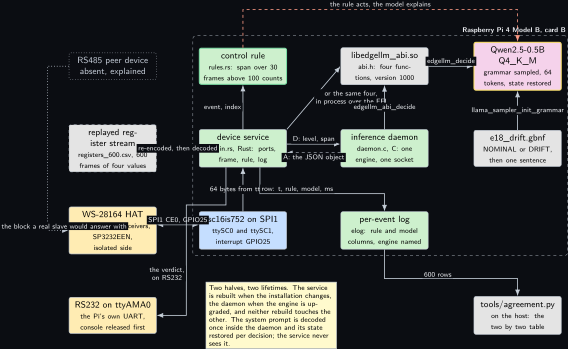
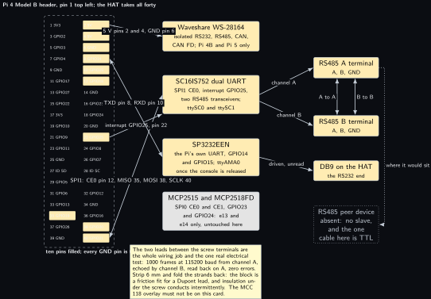
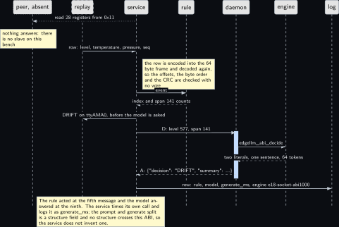
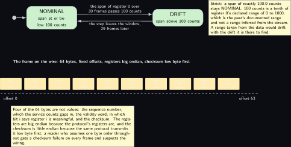
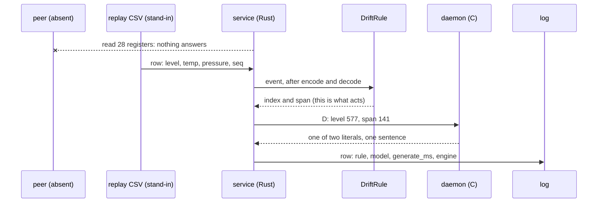
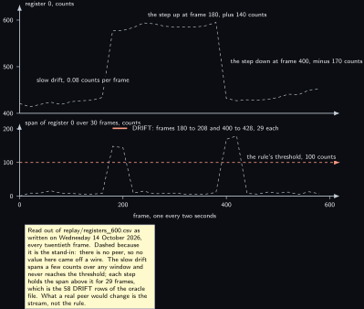

<!-- Written from the chapter source by the catalogue's publish step. Do not hand edit: the chapter is the record and this file is its copy. -->

# Project 18. Mini industrial serial logger

> **Board:** Raspberry Pi 4 Model B card B, Waveshare WS-28164 RS485 and RS232  
> **Owns:** the product shape: a Rust device service over a C ABI, where the ports and the log have one owner and the engine another

> [!IMPORTANT]
> **The question, instanced**
>
> What does a small local model add over a two-line threshold, and when does it get it wrong? Here the threshold is a span test on one register of an industrial frame, and the second question is the one a product asks: what does it cost to put the model behind a C ABI so that the device half and the inference half can be replaced without each other, and is that cost small enough to pay on a Pi 4.

> **Key facts**
>
> - **Board:** Raspberry Pi 4 Model B, card B, the spare Verbatim 32 GB, the same card [Project 13](../../chapters/13-can-honesty-agent.md) and [Project 14](../../chapters/14-joint-monitor.md) use
> - **HAT slot:** Waveshare WS-28164 isolated RS232, RS485, CAN, CAN FD; Pi 4B and Pi 5 only
> - **Parts:** two RS485 channels on an SC16IS752 over SPI1, interrupt GPIO25; one RS232 channel on the Pi's own UART through an SP3232EEN; two leads between the HAT's own RS485 screw terminals
> - **Interface:** `/dev/ttySC0` and `/dev/ttySC1` from the `sc16is752-spi1` overlay, `/dev/ttyAMA0` once the console is released
> - **Language and variant:** Rust and C, catalogue variants R3 and R5: a Rust device service over a C ABI exposed by a C inference daemon
> - **Model:** Qwen2.5-0.5B-Instruct Q4\_K\_M, 491 MB, Apache 2.0
> - **Decision:** NOMINAL or DRIFT through the grammar, plus one sentence of at most 160 characters
> - **Control rule:** DRIFT when the span of register 0 over the last 30 frames is above 100 counts, which is a tenth of its declared range of 0 to 1000
> - **Acceptance:** a 1000-frame RS485 half-duplex echo at 115200 baud with zero errors; the agreement table over the 600-frame replayed register stream; the ABI's cost per call against an in-process call
> - **Difficulty:** 4 of 5
> - **Effort:** two evenings for the two halves and the frame decoder, one evening for the oracle, one afternoon on the board for the console release, the overlay and the echo, and a second afternoon for the three latency figures

## Pitch

This is the chapter that looks like a product rather than a demonstration. A cabinet logger polls a register block over RS485 every two seconds, decides whether one register has drifted, writes the verdict on an RS232 line that an operator panel would read, and keeps a log. The decision is two lines of arithmetic and the model writes the sentence beside it, as everywhere in this volume. What is new is the seam: the device half owns the three serial ports, the 64-byte frame, the rule and the log, and is written in Rust; the inference half owns the model, the grammar and the sampler, and is written in C. They meet at four C declarations in `projects/e18-industrial-logger/c/abi.h`, and the whole chapter is an argument for that seam plus a measurement of what it costs. The argument is lifetimes: the device half changes when the installation changes, the inference half when the engine is upgraded, and in a product those are different release cycles and different authors. The measurement is three numbers on one prompt and one model, from no boundary at all, from the C ABI in process, and from the same four functions over a Unix domain socket. The honest part is the third block of the honesty rule. There is no peer device on this bench: no RS485 slave, nothing that answers a read holding registers request, and the one serial cable here is TTL rather than RS232, so it cannot stand in at either end. What is real is the HAT's own transceivers and the echo between its two RS485 channels, which is the one electrical test this project can run and which it runs 1000 times.

## Origin and what changed

Draft idea 18, a serial logger, with the peer declared absent. The draft assumed something on the other end of the RS485 pair: a Modbus slave, a second board, a USB adapter. The bench has none, and the check that settled it is the parts list rather than an opinion: the Renkforce USB/TTL cable of [Project 1](../../chapters/01-bring-up-and-the-honest-tokens-per-second.md) is a TTL cable, so it is neither an RS485 peer nor an RS232 one, and nothing else on the bench speaks either standard. Three things changed from that. The acceptance test moved to the one electrical measurement that is available, an echo between the HAT's own two RS485 channels, which tests the transceivers, the half-duplex direction control, the two leads and the frame decoder and says nothing at all about a peer. The register stream moved to a replayed file, dashed in every figure, so that the rule and the agreement table have an oracle before any device exists. And the project took the role the draft list was missing, the product shape, because the draft's twenty ideas were all one program: this one is two programs, and the boundary between them is the thing worth building and pricing. The language choice followed from that rather than preceding it.

## Parts and interface

| **Part** | **Role** | **Interface** | **Address or pin** |
| --- | --- | --- | --- |
| Raspberry Pi 4 Model B | runs both halves and owns the ports | SSH; its own serial console is given up in step 1 | card B in the board |
| Card B | the spare Verbatim 32 GB, card B of the HAT allocation; the MCC 118 overlay must be absent from it | the card carries the configuration |  |
| Waveshare WS-28164 | the whole 40-pin header: isolated RS232, RS485, CAN and CAN FD; the isolated side is alive, proven on Tuesday 7 October 2026 by an acknowledged classic CAN frame crossing the barrier twice | the HAT's own connector | pins 2, 4 (5 V), 6 and every GND |
| SC16IS752 | the two RS485 channels with their transceivers | SPI1 chip select 0, interrupt GPIO25 | pins 12, 35, 38, 40 and 22 |
| SP3232EEN | the RS232 channel, driven from the Pi's own UART | `/dev/ttyAMA0` | pins 8 (GPIO14 TXD) and 10 (GPIO15 RXD) |
| Two leads | between the RS485 A and RS485 B screw terminals, A to A and B to B; the only wiring job | the HAT's terminal blocks | bare copper under the screw |
| `replay/registers_600.csv` | the register stream, 600 frames of `t_s,tag,v0,v1,v2,v3` written by `tools/make_replay.py` | re-encoded into a frame and decoded again |  |
| `grammars/e18_drift.gbnf` | the two literals and one bounded sentence | the grammar sampler inside the daemon | root symbol `root` |
| `projects/e18-industrial-logger/c/abi.h` | the four declarations both halves speak | `libedgellm_abi.so`, soname `.so.1` | version 1000 |
| `tests/oracle/e18.expected.csv` | the 600 expected rule decisions and the stub's column | the oracle test in Rust, row by row |  |
| RS485 peer device | **absent:** absent: nothing answers a request on this bench; what a real one would change is in the last bullet of Real, modelled, absent |  |  |

## Model and grammar

Qwen2.5-0.5B-Instruct at Q4\_K\_M, the file `qwen2.5-0.5b-instruct-q4_k_m.gguf`, 491 MB, Apache 2.0, from [Qwen/Qwen2.5-0.5B-Instruct-GGUF](https://huggingface.co/Qwen/Qwen2.5-0.5B-Instruct-GGUF) (verified Wednesday 14 October 2026), the Pi 4 default for enum decisions in the ladder and the same rung [Project 2](../../chapters/02-the-decision-loop.md) uses. It needs 818 MB available on the board, which is [Project 1](../../chapters/01-bring-up-and-the-honest-tokens-per-second.md)'s reading to confirm. The engine is the pinned `v0.6.0`, reached through `common/c/include/edgellm.h` inside the daemon and never by the service. The grammar is GBNF with the house root symbol, the two literals of the rule letter for letter and one sentence bounded to end in a full stop, so the end of generation token is reachable only after a complete sentence; the syntax is the engine's own, documented at [grammars/README.md](https://github.com/ggml-org/llama.cpp/blob/master/grammars/README.md) in the engine's tree (to verify).

```gbnf
# NOMINAL is first because the stub answers the first literal on every path, in CI
# and in the Rust stub of rust/src/abi.rs, which must agree byte for byte with
# common/c/src/edgellm_stub.c on this grammar: {"decision":"NOMINAL","summary":"."}.
# ws admits spaces and tabs only, never a newline.
root ::= "{" ws "\"decision\"" ws ":" ws decision ws "," ws "\"summary\"" ws ":" ws summary ws "}"
decision ::= "\"NOMINAL\"" | "\"DRIFT\""
summary ::= "\"" [A-Za-z0-9 ,.%]{9,159} "." "\""
ws ::= [ \t]*
```

The system prompt, 80 words and well under 120 tokens, decoded once inside the daemon and its state restored per decision, reads in full: You are a logging agent on a Raspberry Pi reading one register block over RS485. You see register 0, a level in counts whose declared range is 0 to 1000, its span over the last 30 frames, and the temperature and pressure registers. Answer only with the JSON object and nothing else. DRIFT when the span of register 0 is above 100 counts, which is a tenth of its range. Otherwise NOMINAL. The summary names the register and the span. The model is given the threshold on purpose, as in [Project 2](../../chapters/02-the-decision-loop.md): the question is whether it can apply a rule it has been handed, which is the easiest form of this volume's question and the right one for a chapter whose subject is the boundary rather than the model.

## What the model decides or writes

One of two literals and one sentence, through the grammar, with `n_predict` 64 and greedy sampling. The sentence may use letters, digits, space, comma, full stop and the per cent sign and nothing else, which is why it can never carry a quote, a brace or a newline and why the log's CSV quoting stays simple and the daemon's one-line protocol needs no framing beyond the newline. The service puts the span in the prompt, so a sentence that names a different number is a disagreement the agreement tool can see. In CI there is no model and no C build at all: the Rust stub in `projects/e18-industrial-logger/rust/src/abi.rs` expands the grammar's first alternative on every path and a character class to nothing, exactly as `common/c/src/edgellm_stub.c` documents, so it answers `{"decision":"NOMINAL","summary":"."}` and the whole loop, the frame decoder, the log and the oracle comparison run on a host with no engine. That stub is the one piece of this project written twice on purpose, and the oracle file is what holds the two copies to the same bytes.

## Control rule

Three constants and a span. The declared range comes from the peer's documentation rather than from the stream, which matters more than it looks: a range inferred from the data drifts with the drift it is there to find, so the rule would quietly stop firing on a slowly worsening installation. The same three constants are written a second time, in Python, in `tools/make_replay.py`, which writes the oracle column; they are stated twice on purpose and nowhere else, and a change to one without the other is caught by the oracle test rather than by a reader.

```rust
/// Register 0 is declared 0 to 1000 counts by the peer's documentation, so the
/// fraction below is a fraction of that and not of whatever the stream happens to
/// have shown so far. A range inferred from the data is a different rule, and a worse
/// one: it drifts with the drift it is meant to detect.
pub const REG_RANGE: f64 = 1000.0;

/// A tenth of the range. Strict: a span of exactly 100.0 counts stays NOMINAL, as the
/// boundary cases below state.
pub const DRIFT_FRACTION: f64 = 0.10;

/// Frames, the current one and the twenty nine before it. At two seconds per frame
/// that is a minute of history, which is the shortest window in which this
/// installation's level register is expected to be flat.
pub const WINDOW: usize = 30;
```

The rule itself is the span over that window against that threshold, and it returns an index into its own name table so that the log and the grammar's literals agree letter for letter. A frame whose register block did not decode is NOMINAL rather than a guess, and it is logged with the model column empty.

```rust
impl Rule for DriftRule {
    fn project(&self) -> &'static str {
        "e18"
    }

    fn names(&self) -> &'static [&'static str] {
        &NAMES
    }

    fn decide(&self, ctx: &RuleCtx, ev: &Event) -> usize {
        if ev.v.is_empty() {
            return NOMINAL; // a frame with no register block is not a guess
        }
        if window_span(ctx, ev) > drift_threshold() {
            DRIFT
        } else {
            NOMINAL
        }
    }
}
```

The four declarations the two halves meet at are the other half of the design, and they are deliberately dull. No structure, no enum and no typedef crosses the boundary: only `const char *`, `char *`, `size_t`, `int` and `float`, so a caller has nothing whose layout can change under it. `edgellm_abi_decide` takes no handle because a handle is a pointer to a structure whose definition would then have to be shared, and one model is all the board holds anyway; a second open before a close is refused rather than silently granted.

```c
#define EDGELLM_ABI_VERSION 1000
#define EDGELLM_ABI_VERSION_MAJOR (EDGELLM_ABI_VERSION / 1000)

/* The version the LIBRARY was built with. A caller refuses a different major and
 * logs a different minor. Safe to call before edgellm_abi_open. */
unsigned edgellm_abi_version(void);
```

The Rust side binds exactly those four names and nothing else, which is what makes the binding reviewable in one screen and what makes the version check meaningful: there is no generated layer in which a silent mismatch could hide.

```rust
    #[link(name = "edgellm_abi")]
    extern "C" {
        pub fn edgellm_abi_version() -> c_uint;
        pub fn edgellm_abi_open(model_path: *const c_char, grammar_path: *const c_char,
                                prompt_path: *const c_char, state_path: *const c_char,
                                n_ctx: c_int, n_threads: c_int, n_predict: c_int,
                                temperature: c_float) -> c_int;
        pub fn edgellm_abi_decide(user: *const c_char, out: *mut c_char,
                                  out_len: usize) -> c_int;
        pub fn edgellm_abi_close();
    }
```

## Real, modelled, absent

- **have:** real: the Pi 4 Model B with card B, the WS-28164 and its two RS485 transceivers and its SP3232EEN, the SC16IS752 on SPI1, the two leads between the screw terminals, the echo between the two RS485 channels at 115200 baud, the Pi's own UART once the console is released, both programs, the C ABI and its version check, and the three latency figures once the board has taken them
- **learn:** modelled: the register stream, replayed from `replay/registers_600.csv` and drawn dashed; every replayed row is encoded into the 64-byte frame and decoded again before the rule sees it, so the byte offsets, the big endian register order and the checksum are on the oracle path with no wire present, and nothing about a device is claimed from it
- **absent:** absent: the RS485 peer device, drawn dotted. There is no slave on this bench, nothing that answers a read holding registers request, and the one serial cable here is TTL rather than RS232, so it is not an RS232 listener either. What a real peer would change is the stream and the timing, not the rule and not the boundary: it would replace the replayed rows with register values whose drift is a property of a process rather than of a seeded walk, it would put a turnaround delay and a silent interval into the frame timing that the echo between two channels on one board does not have, and it would make the sequence gap counter and the timeout path mean something. The rule, the grammar, the ABI, the two units and both acceptance numbers other than the stream itself would stand unchanged

## System architecture



*Figure 18.1. The product shape. Inside a dashed layer labelled with the board and the card, eight solid blocks in three columns: the control rule above the device service with the green rule outline, the device service in user-space green at the left with the sc16is752 kernel block below it, then the shared object libedgellm\_abi.so above the inference daemon with the per-event log below it, and at the right the model with the yellow model outline above the grammar file. Outside the layer on the left, from the top: a dotted grey block for the absent RS485 peer device, a dashed grey block for the replayed register stream, a solid hardware block for the WS-28164 HAT with its two RS485 transceivers and its SP3232EEN, and a solid hardware block for the RS232 channel on ttyAMA0; at the lower right, a solid grey block for tools/agreement.py on the host. Solid arrows carry the replayed row into the service re-encoded and decoded, the SPI1 bus and the GPIO25 interrupt between the HAT and the sc16is752, 64 bytes from ttySC0 up to the service, the event and its index to the rule, the request D with the level and the span to the daemon with a dashed reply carrying the JSON object, a second solid arrow from the service straight to the shared object for the same four functions in process over the FFI, edgellm\_abi\_decide from the daemon up to the library, edgellm\_decide from the library to the model, the grammar into the model, the log row from the service across to the log, the verdict from the service down and left to the RS232 block, and the 600 rows from the log across to the agreement tool. A dotted grey arrow runs from the absent peer around the left margin to the HAT, labelled as the block a real slave would answer with. A dashed stop-coloured arrow runs over the top from the rule to the model, labelled that the rule acts and the model explains. A note says that the two halves have two lifetimes and that the system prompt state lives inside the daemon, which the service never sees.*

Read the figure as two owners and one seam. Everything left of the service is a port, a stream or an absence; everything right of the shared object is the engine. The seam is the three arrows that cross the middle, and the only one that exists in two forms is the one the chapter measures: the service reaches the same four functions either over the socket to the daemon or in process through the shared object. The dashed red arrow over the top is the safety rule again, and here it is stronger than a convention: the verdict leaves on the RS232 line, by the arrow down to the left, before the daemon is asked anything, so a daemon that is stopped, upgraded or absent changes the log's model column and nothing else.

## Wiring

| **Header pin** | **BCM** | **Part pin** | **Wire colour if known** |
| --- | --- | --- | --- |
| 2 and 4 | 5 V | the HAT's supply | the HAT's own connector, no lead |
| 6, 9, 14, 20, 25, 30, 34, 39 | GND | the HAT's ground plane | the HAT's own connector |
| 12 | GPIO18 | SC16IS752 chip select, SPI1 CE0 | the HAT's own connector |
| 35 | GPIO19 | SPI1 MISO | the HAT's own connector |
| 38 | GPIO20 | SPI1 MOSI | the HAT's own connector |
| 40 | GPIO21 | SPI1 SCLK | the HAT's own connector |
| 22 | GPIO25 | SC16IS752 interrupt, the overlay's `int_pin=25` | the HAT's own connector |
| 8 | GPIO14, TXD | SP3232EEN driver input, the RS232 transmit path | the HAT's own connector |
| 10 | GPIO15, RXD | SP3232EEN receiver output, the RS232 receive path | the HAT's own connector |
| 16 and 18 | GPIO23, GPIO24 | the two CAN controllers’ interrupts | [Project 13](../../chapters/13-can-honesty-agent.md) and [Project 14](../../chapters/14-joint-monitor.md) only; untouched here |
| 24 and 26 | GPIO8, GPIO7 | SPI0 chip selects, the two CAN controllers | [Project 13](../../chapters/13-can-honesty-agent.md) and [Project 14](../../chapters/14-joint-monitor.md) only |
| RS485 A terminal, A |  | RS485 B terminal, A | not recorded; label both ends, strip 6 mm |
| RS485 A terminal, B |  | RS485 B terminal, B | not recorded; label both ends, strip 6 mm |



*Figure 18.2. The HAT over the whole header. On the left the 40-pin header of the Pi 4 Model B as two columns of small blocks, pin 1 at the top left, with ten filled in the hardware colour: pins 2 and 4 for 5 V, pin 6 for ground, pins 8 and 10 for the UART, pin 12 for the SPI1 chip select, pin 22 for the interrupt, and pins 35, 38 and 40 for MISO, MOSI and SCLK; a dashed layer around all forty says ten pins are filled and that every ground pin is tied to the HAT's plane. To their right, four solid blocks stacked: the Waveshare WS-28164 itself, the SC16IS752 dual UART with its two RS485 transceivers, the SP3232EEN on the Pi's own UART, and a grey block for the two CAN controllers, which belong to the two CAN chapters and are untouched here. Solid arrows run from the filled pins to those blocks, labelled with the 5 V and ground pins, the four SPI1 pins, the GPIO25 interrupt, and the TXD and RXD pins. At the right, two solid hardware blocks for the RS485 A and RS485 B screw terminals joined by two solid two-headed lines labelled A to A and B to B, which are the only leads anyone adds, with the two channels joined to them from the SC16IS752; below them a solid block for the HAT's DB9, joined from the SP3232EEN by an arrow labelled driven and unread. At the lower right, a dotted grey block for the absent RS485 peer device, joined by a dotted grey line from the A terminal labelled where it would sit. A note repeats that the two leads are the whole wiring job and the one real electrical test, that the terminal block is a friction fit so 6 mm of copper is stripped and folded back, and that the MCC 118 overlay must not be on this card.*

## Sequence



*Figure 18.3. One frame as a sequence diagram with seven actors: the peer, drawn dotted because it is absent, then the replay, drawn dashed as the stand-in, then the service, the rule, the daemon, the engine and the log, all solid. A dotted grey arrow carries a read of 28 registers from the service to the peer, with a note that nothing answers because there is no slave on this bench. A solid arrow brings the replayed row, level, temperature, pressure and sequence number, to the service, with a note that the row is encoded into the 64-byte frame and decoded again so that the offsets, the byte order and the checksum are checked with no wire. Solid arrows then carry the event to the rule, a dashed reply brings the index and the span of 141 counts back, and a third solid arrow carries DRIFT out on ttyAMA0 before the model is asked. Over a blue activation bar on the daemon, a solid arrow carries the request D with the level and the span from the service, a second solid arrow carries edgellm\_abi\_decide from the daemon to the engine, and a dashed reply brings back the two literals and one sentence inside 64 tokens; a dashed reply then returns the JSON object to the service. The last solid arrow writes the row, rule, model, generate\_ms and the engine name e18-socket-abi1000, into the log. A note says that the rule acted at the fifth message and the model answered at the ninth, and that the service times its own call rather than inventing a prompt and generate split the ABI does not carry.*

## States and data



*Figure 18.4. Two panels. Above, the decision as two rounded green states, NOMINAL labelled span at or below 100 counts and DRIFT labelled span above 100 counts, entered at NOMINAL from the initial dot, with a solid arrow to DRIFT labelled that the span of register 0 over 30 frames passes 100 counts and a solid arrow back labelled that the step leaves the window 29 frames later; a note says the test is strict so a span of exactly 100.0 counts stays NOMINAL, that 100 is a tenth of the register's declared range of 0 to 1000, and that a range inferred from the stream would drift with the drift it is there to find. Below, the frame on the wire as a row of ten small solid blocks with their byte offsets: addr at 0, func at 1, count at 2, seq at 3, register 0 the level at 4, register 1 the temperature at 6, register 2 the pressure at 8, registers 3 to 27 reserved from 10, the validity flags at 60 and the checksum at 62, under a dashed line marked offset 0 at the left and offset 63 at the right. A note says that four of the 64 bytes are not values, that the registers are big endian because the protocol's registers are and the checksum is little endian because the same protocol transmits it low byte first, and that a reader who assumes one byte order throughout gets a checksum failure on every frame and suspects the wiring. Nothing is dashed or dotted: the rule and the layout are both in the repository and both unit tested.*

The record is the per-event log, `projects/e18-industrial-logger/evidence/e18_replay.csv`, in the shape `elog.h` fixes for every project: `t_s, tag, raw, rule, model, prompt_ms, generate_ms, n_generated, engine`. Two columns are empty here and the reason is the boundary itself: the split between prompt decode and generation, and the token count, are fields of a structure, no structure crosses this ABI, and the service will not invent a split it cannot see. `generate_ms` holds the whole call as the caller paid for it, which is the figure worth publishing anyway, and the engine column reads `e18-socket-abi1000` or `e18-ffi-abi1000` or `e18-stub-abi1000`, so a log can never be read as coming from a boundary it did not cross.

## Data flow

```text
  tools/make_replay.py (seeded)        the device service, Rust, on the Pi 4B            host
  +--------------------------+         +--------------------------------------+   +---------------+
  | replay/registers_600.csv |-row---->| registers::encode -> 64 bytes        |   | agreement.py  |
  |  t_s,tag,v0,v1,v2,v3     |         | registers::decode -> offsets, CRC    |   |  table, 2 by 2|
  +--------------------------+         |      |                               |   +---------------+
                                       |      v  DriftRule::decide(ctx, ev)   |           ^
  [ RS485 peer device: ABSENT ]        |      |  span over 30 frames > 100    |           |
      nothing answers a request        |      +--> ttyAMA0: "DRIFT span 141"  |           |
                                       |      |      (the rule acts here)     |           |
  ttySC0 <-> ttySC1, the echo -------->|      v                               |           |
      1000 frames, 115200, 0 errors    | "D level 577, span 141" --+          |           |
                                       +---------------------------|----------+           |
                                                                   v  Unix socket, one line
  prompt.txt --decoded once-------->  +--------------------------------------+            |
    state restored per decision       | edgellm-e18-daemon (C)               |            |
  grammars/e18_drift.gbnf ---------->  | libedgellm_abi.so: four functions   |            |
    llama_sampler_init_grammar(root)  |   edgellm_abi_decide -> edgellm.h    |            |
                                      | {"decision":"DRIFT","summary":"..."} |            |
                                      +--------------------------------------+            |
                                                                   |                      |
  elog row: t, rule, model, generate_ms, engine e18-socket-abi1000  +--600 rows------------+
  tests/oracle/e18.expected.csv: rule column from the same span test in Python; model the stub's
```



## Latency design

The system prompt is 80 words, under 120 tokens on the Qwen tokenizer, and it is decoded once inside the daemon at start; its state is written with `llama_state_save_file` and restored before every decision, so each frame pays for its own thirty tokens of user text and nothing else. The frame period is two seconds, which is a realistic register poll for a cabinet logger and is also the budget: with `n_predict` 64 under the sentence grammar and four threads on the Pi 4B, the expected decision is one prompt decode of about thirty tokens plus up to sixty-four single-token decodes, and whether that fits inside two seconds is [Project 1](../../chapters/01-bring-up-and-the-honest-tokens-per-second.md)'s table turned around rather than a guess. The service counts the calls that took longer than the period and prints the count, so the figure the chapter publishes is a count of overruns and not an assurance. `n_ctx` is 512 as everywhere in the volume. The two boundary costs sit on top of that: the C ABI adds one indirection and one copy of at most 1024 bytes per call, and the socket adds a write, a read and two context switches, which is the number this chapter contributes and the reason both forms are built. The rule costs a span over thirty values and is not worth timing.

## Steps

**Step 1.** Release the Pi's own serial console on card B, over SSH and not over the Renkforce cable, because this step removes the console the cable would use. The grep must print `console=tty1` and nothing else.

```bash
# Raspberry Pi 4 Model B, card B, over SSH
cd ~; sudo systemctl disable --now serial-getty@ttyAMA0.service
```

```bash
# Raspberry Pi 4 Model B, card B, over SSH
cd /boot/firmware; sudo sed -i 's/console=serial0,115200 //' cmdline.txt
```

```bash
# Raspberry Pi 4 Model B, card B, over SSH
cd /boot/firmware; grep -o 'console=[^ ]*' cmdline.txt
```

**Step 2.** Add the wiki's tested block to this card's `config.txt`, all of it, and confirm that no MCC 118 line is there. Then reboot and read the kernel log: the two device nodes appear only when all four of `dtparam=spi=on`, `dtoverlay=spi1-3cs`, `dtoverlay=sc16is752-spi1,int_pin=25` and `enable_uart=1` are applied.

```bash
# Raspberry Pi 4 Model B, card B, over SSH
cd /boot/firmware; grep -n -e spi -e sc16is -e uart -e mcc config.txt
```

```bash
# Raspberry Pi 4 Model B, card B, over SSH
cd ~; dmesg | grep -i -e sc16is -e spi1 -e ttySC; ls -l /dev/ttySC0 /dev/ttySC1 /dev/ttyAMA0
```

**Step 3.** Write the two leads into the HAT's RS485 terminals, A to A and B to B, with 6 mm of copper stripped and the strands folded back, and tug each lead before counting it as made. Then one loopback by hand, which proves the leads and the direction control and nothing else.

```bash
# Raspberry Pi 4 Model B, card B, over SSH
cd ~; stty -F /dev/ttySC1 115200 raw -echo; timeout 5 od -An -tx1 /dev/ttySC1 &
```

```bash
# Raspberry Pi 4 Model B, card B, over SSH
cd ~; printf 'e18 echo probe\r\n' > /dev/ttySC0
```

**Step 4.** Write the replay file and the oracle on the authoring laptop and read the summary: it prints the window, the threshold and the count of each decision, and the NOMINAL count is the agreement the stub reaches in CI.

```bash
# win11 skyhorizon, WSL side
cd ~/src/edge-llm-pi/projects/e18-industrial-logger; python3 tools/make_replay.py
```

**Step 5.** Build the C half in skyhorizon's WSL with the stub and run the ABI test. Nothing compiles on aquamarine. This is a CMake project of its own, not a subdirectory of the repository's top level, which is the point of the chapter and not an accident of layout.

```bash
# win11 skyhorizon, WSL side
cd ~/src/edge-llm-pi/projects/e18-industrial-logger; cmake -S c -B build-c -DEDGELLM_STUB_MODEL=ON
```

```bash
# win11 skyhorizon, WSL side
cd ~/src/edge-llm-pi; cmake --build build-e18c; ctest --test-dir build-e18c --output-on-failure
```

**Step 6.** Build the Rust half and run its tests: the frame decoder's round trip and boundary values, the rule's nine cases, the stub's first expansion, and the oracle run over the 600 rows compared row by row.

```bash
# win11 skyhorizon, WSL side
cd ~/src/edge-llm-pi; cargo test --manifest-path projects/e18-industrial-logger/rust/Cargo.toml
```

**Step 7.** Run the echo on the board, 1000 frames at 115200 baud, with no model and no daemon. This is the one real electrical measurement in the chapter and it must report zero errors and zero sequence gaps.

```bash
# Raspberry Pi 4 Model B, card B
cd ~/edge-llm-pi; target/release/edgellm-e18 --echo 1000 --rs485-a /dev/ttySC0 \
  --rs485-b /dev/ttySC1 --baud 115200 \
  --grammar projects/e18-industrial-logger/grammar.gbnf \
  --prompt projects/e18-industrial-logger/prompt.txt
```

**Step 8.** Start the daemon with the real model and read the throttle bits before the run. The daemon prints its ABI version on start, and the service refuses a different major.

```bash
# Raspberry Pi 4 Model B, card B
cd ~/edge-llm-pi; sudo install -d -o $USER -g $USER /run/edgellm; vcgencmd get_throttled
```

```bash
# Raspberry Pi 4 Model B, card B
cd ~/edge-llm-pi; build-e18c/edgellm-e18-daemon --socket /run/edgellm/e18-daemon.sock \
  --model ~/models/qwen2.5-0.5b-instruct-q4_k_m.gguf \
  --grammar projects/e18-industrial-logger/grammar.gbnf \
  --prompt projects/e18-industrial-logger/prompt.txt \
  --state /run/edgellm/e18.state --n-ctx 512 --threads 4 --n-predict 64 &
```

**Step 9.** Run the 600 frames over the socket with the RS232 line driven, read the bits again, and score the log. The count of rows without a literal must be zero and the overrun count goes into the table with its date.

```bash
# Raspberry Pi 4 Model B, card B
cd ~/edge-llm-pi; target/release/edgellm-e18 \
  --replay projects/e18-industrial-logger/replay/registers_600.csv \
  --grammar projects/e18-industrial-logger/grammar.gbnf \
  --prompt projects/e18-industrial-logger/prompt.txt --engine socket \
  --socket /run/edgellm/e18-daemon.sock --rs232 /dev/ttyAMA0 \
  --log projects/e18-industrial-logger/evidence/e18_replay.csv; vcgencmd get_throttled
```

```bash
# Raspberry Pi 4 Model B, card B
cd ~/edge-llm-pi; python tools/agreement.py projects/e18-industrial-logger/evidence/*.csv --md
```

**Step 10.** Take the three latency figures on the same board, the same model and the same prompt: the C test prints the in-process figure and the ABI figure, and the service prints the socket figure. Then stop the daemon under the running service and confirm that the log keeps a row per frame with the rule column filled and the model column empty, which is the restart isolation the socket form buys.

```bash
# Raspberry Pi 4 Model B, card B
cd ~/edge-llm-pi; build-e18c/e18_abi_test \
  --grammar projects/e18-industrial-logger/grammar.gbnf \
  --prompt projects/e18-industrial-logger/prompt.txt \
  --model ~/models/qwen2.5-0.5b-instruct-q4_k_m.gguf --calls 200
```

```bash
# Raspberry Pi 4 Model B, card B
cd ~/edge-llm-pi; target/release/edgellm-e18 --bench 200 --engine socket \
  --socket /run/edgellm/e18-daemon.sock \
  --grammar projects/e18-industrial-logger/grammar.gbnf \
  --prompt projects/e18-industrial-logger/prompt.txt
```

## Variant chosen

Rust for the device service and C for the inference daemon, catalogue variants R3 and R5 together: a Rust device service with a C inference daemon, meeting at a C ABI boundary. On relevance it is the only choice that matches what this project is, the product shape of the volume, where the device logic and the inference engine have different lifetimes and, in a product, different authors: one is released when an installation changes and the other when the engine is upgraded, and a single binary would force those two release cycles into one. On practicality Rust owns the ports and the log because three serial ports, a 64-byte frame with a checksum and a long-running service are exactly where the compiler's bounds and lifetime checking pays for itself, while C owns the engine because the engine's API is C and a binding would add a layer to doubt between a disagreement and its cause. On best practice and on popularity a C ABI is the boundary both languages speak, with no binding generator and no serialisation format, and it is the one that survives a rewrite of either side: Rust reaches it directly, C++ with `extern "C"`, Python with `ctypes`, and a socket would need a protocol, which is a second thing to version. On compliance every dependency is permissively licensed, MIT on both halves of the repository, MIT on the engine, Apache 2.0 on the model, and the standard library on the Rust side, with no third party crate in the service at all. What it costs is two build systems, two units, one version number to discipline, and the per-call figures below, which are what this chapter contributes to the volume's variant comparison. What it gains is the demonstration of step 10: the daemon is stopped under the running service and the service keeps polling, deciding and logging.

| **Boundary** | **Mean per call** | **Sample sd** | **Calls** | **Instrument** |
| --- | --- | --- | --- | --- |
| none, `edgellm_decide` in process | not measured | not measured | 200 | `e18_abi_test`, the in process figure; not run yet |
| the C ABI, in process | not measured | not measured | 200 | `e18_abi_test`, the ABI figure; not run yet |
| the C ABI from Rust over the FFI | not measured | not measured | 200 | `edgellm-e18 --bench`, the ffi backend; needs the ffi feature, not run yet |
| the same four over the Unix socket | not measured | not measured | 200 | `edgellm-e18 --bench`, the socket backend; not run yet |
| the stub, no engine at all | not measured | not measured | 200 | `e18_abi_test` in a stub build; this row isolates the boundary from the decision |

The last row is the one to read first when the table is filled. With the stub behind the same four functions the decision itself costs almost nothing, so the difference between the first two rows in a stub build is the boundary alone; with the real model the same difference is the boundary against a decision of tens of milliseconds, which is the ratio that decides whether the seam is affordable. A boundary cost that is a few microseconds against a decision of that size is a result, and so is one that is not.

## Embedded Linux and Yocto

Two recipes, in one folder, because there are two packages with two lifetimes and that is the whole point. `meta-edgellm/recipes-app/edgellm-e18/edgellm-e18-daemon_0.1.bb` builds the C half with the `cmake` class against the installed `libllama` of [Project 1](../../chapters/01-bring-up-and-the-honest-tokens-per-second.md)'s runtime recipe, installs `libedgellm_abi.so.1`, `edgellm-e18-daemon`, the grammar and the prompt, creates the `edgellm` user and group the two processes meet on, and enables the daemon unit; the unversioned symlink and `abi.h` go to the development package, because only a build needs them. `meta-edgellm/recipes-app/edgellm-e18/edgellm-e18_0.1.bb` builds the Rust half with the `cargo` class of meta-rust, with the default feature set and therefore no link to the shared object at all, and adds a run time dependency on the daemon package and nothing else. Neither recipe includes the layer's shared application include, and both say why in their own comments: that include builds one project binary from the repository's top level CMake tree with a grammar and a replay folder, and e18 has two halves in two languages with one grammar between them. The soname is the discipline rather than the decoration: a major bump renames the file on disk, so a service linked against the old major keeps the old file rather than loading an incompatible one, and the version check catches a minor replacement at run time.

```text
[Unit]
Description=edge-llm-pi e18 device service, the Rust half that owns the ports and the log
Documentation=https://github.com/ambrosiobing/edge-llm-pi
# Wants= rather than Requires=: the device service is the one that must keep running.
# It polls the register block, applies the rule and writes the log and the RS232 line
# whether or not the engine is there; a decision it cannot get is a row with the rule
# column filled and the model column empty, which the agreement table counts as such.
# After= orders the start so that the first frame usually has an engine to ask.
Wants=edgellm-e18-daemon.service
After=edgellm-e18-daemon.service
```

The overlay fragment is not in either recipe and the comment at the foot of the service recipe says why: `dtparam=spi=on`, `dtoverlay=spi1-3cs`, `dtoverlay=sc16is752-spi1,int_pin=25` and `enable_uart=1` are `config.txt` lines for the whole card, which [Project 13](../../chapters/13-can-honesty-agent.md) and [Project 14](../../chapters/14-joint-monitor.md) share, so they belong in the layer's single `rpi-config` bbappend rather than in one project's recipe. Whether the bench's kas setup already carries meta-rust at the scarthgap release is to verify on the first parse, and the parse, not the image build, is the check that runs first:

```bash
# win11 skyhorizon, WSL side
cd ~/bench/edge-llm-pi; kas shell meta-edgellm/kas/edgellm-pi4.yml -c "bitbake -p"
```

## Acceptance test

Three quantities, and each can fail. First, the echo: 1000 frames of 64 bytes written on `/dev/ttySC0`, read and echoed on `/dev/ttySC1`, read back on `/dev/ttySC0`, at 115200 baud, with the instrument being the service's own `--echo` mode, which counts short reads, checksum failures, other refusals and sequence gaps separately. The pass condition is zero errors and zero gaps over all 1000 frames; one short read fails it, and the order to read afterwards is the leads, then the direction control, then the overlay. Second, the agreement over the 600 replayed frames, with the instrument being `tools/agreement.py` reading the log: the number of rows whose model column holds neither literal must be zero, and the agreement rate is whatever it is and goes into the table below with its date. Third, the boundary cost per call, with the instruments being `e18_abi_test` for the in-process and ABI figures and `edgellm-e18 --bench` for the FFI and socket figures, 200 calls each on the same prompt, the same model and the same board; there is no pass condition on a figure that has never been taken, so the condition is that all four rows are filled from one sitting with `vcgencmd get_throttled` reading `0x0` before and after, and a run with any bit set is discarded. In CI the first and third are not run at all, because there is no board and no model; what CI runs is the oracle test of step 6, which is the second quantity with the stub in place of the engine.

## Agreement table

Over the 600 frames of `replay/registers_600.csv` as written on Wednesday 14 October 2026 by `tools/make_replay.py` with its fixed seed, the rule column holds 542 NOMINAL and 58 DRIFT: two bands of 29 frames each, one after the step up at frame 180 and one after the step down at frame 400, and the slow drift between them never reaches the threshold. On the bench the model column is not measured, because the Pi 4B run has not been taken. In CI the Rust stub answers NOMINAL for every row, so the agreement is the NOMINAL fraction of the rule column, 542 of 600, 90.3 per cent, and every disagreement is of one kind, the stub calling a DRIFT frame NOMINAL. That number is here so that the first number from the real model has something beside it: a model that scores 90 per cent on this set has learned nothing the first literal did not already give it, and the figure to watch is the DRIFT row, where a useful model scores far above zero.

| **Rule says** | **Model NOMINAL** | **Model DRIFT** | **No literal** | **Instrument** |
| --- | --- | --- | --- | --- |
| NOMINAL, 542 | 542 | 0 | 0 | the Rust stub in CI; bench: not measured |
| DRIFT, 58 | 58 | 0 | 0 | the Rust stub in CI; bench: not measured |
| agreement | 90.3 per cent |  | 0 | the Rust stub in CI; bench: not measured, run pending on the Pi 4B |
| overruns past the 2 s period | not measured |  |  | the service's own counter; replay has no real time pressure, so this row needs the live run or a timed replay |

## Measured data



*Figure 18.5. Two panels drawn with TikZ axes from the replayed file, not a measurement. Above, register 0 in counts against the frame number, every twentieth frame of the 600, as a dashed line: a slow drift of about 0.08 counts per frame around 420 counts, a step up of 140 counts at frame 180 to a band near 585, and a step down of 170 counts at frame 400 back to about 430. Below, on its own axis, the span of register 0 over the trailing 30 frames, also dashed: a few counts almost everywhere, with two tall excursions to 148 and 179 counts at the two steps. A dashed stop-coloured horizontal line at 100 counts carries the rule's threshold, and two short stop-coloured bars at the top mark the two bands the rule calls DRIFT, frames 180 to 208 and frames 400 to 428, 29 frames each. A note says the traces were read out of replay/registers\_600.csv as written on Wednesday 14 October 2026, that they are dashed because there is no peer so no value came off a wire, that each step holds the span above the threshold for 29 frames which is the 58 DRIFT rows of the oracle file, and that a real peer would change the stream and not the rule.*

## Pitfalls

- **The MCC 118 overlay on this card.** Card B runs this project and both CAN chapters, and the MCC 118 of [Project 10](../../chapters/10-mcc-118-voltage-event-labeller.md) lives on card A for one reason: both claim SPI0 chip selects, so one `config.txt` cannot carry both. A card that has been used for the DAQ HAT and then moved here brings its lines with it, and the symptom is a CAN controller or a DAQ board that is probed and is not there. Read `config.txt` for `mcc` before reading anything else.
- **The sc16is752 overlay half applied.** The wiki's tested block has four lines this project needs and it is easy to apply one. `dtoverlay=sc16is752-spi1` without `dtoverlay=spi1-3cs` leaves SPI1 with no chip select for the part to answer on; `spi1-3cs` without `dtparam=spi=on` leaves the controller disabled; `enable_uart=1` is a separate matter again. The symptom in every case is the same, two missing device nodes and nothing in the kernel log that names a cause, so apply all four and read `dmesg` before touching a lead.
- **Half-duplex direction control, and the receiver during transmit.** On this HAT the RS485 transceiver's driver enable comes from the port's RTS line, so the driver owns the direction and the program must not: that is `SER_RS485_ENABLED` with `SER_RS485_RTS_ON_SEND` through the kernel's `serial_rs485` interface, which the service sets on both channels. The flag that is easy to leave out is `SER_RS485_RX_DURING_TX`: with the receiver muted while the port transmits, a port never sees its own frame, and on a two-wire pair where both transceivers share the line that is half the echo accounting gone, exactly as the MCC 118 witness on this bench has to count both polarities of a marker rather than one. Whether the `sc16is7xx` driver on this kernel honours that flag is to verify on the board, and the echo test's separate counters are what will say so.
- **Insulation under the screw.** The HAT's terminal block is a friction fit for a Dupont lead and nothing more. A lead pushed in and the screw turned down on its insulation holds mechanically and conducts intermittently, and the bus reads that as short reads and checksum failures that come and go with the bench being leaned on. Strip about 6 mm, fold the strands back so the screw bites on a double thickness, and tug each lead before counting the connection as made.
- **The RS232 channel takes the Pi's console UART.** On Raspberry Pi OS `/dev/ttyAMA0` is the serial console, and until the console is released the kernel and a login prompt are driving the line this project wants. Two things must end up done, the `console=serial0,115200` removed from `cmdline.txt` and `serial-getty@ttyAMA0` disabled, and doing them removes the Pi 4B's one working serial console, so the sitting that does it is over SSH. The exact `raspi-config nonint` spellings and the `/boot/firmware` path on Debian 13 trixie are to verify on the card.
- **A C ABI that changes without its version being bumped.** This is the failure the version field exists to catch, and it is silent: a library rebuilt with one more parameter on `edgellm_abi_open` and dropped in beside an unchanged service does not fail to load, it reads a register that holds something else. Three things prevent it, and all three are needed: `EDGELLM_ABI_VERSION` is bumped on any change to any of the four declarations, the soname carries the major so a major bump renames the file on disk, and `edgellm_abi_version()` returns the value the library was built with so the caller can refuse a different major at open. `e18_abi_test` checks the third on every build; nothing can check the first but discipline, which is why it is written at the top of the header rather than in a commit message.
- **A serial read that returns what has arrived rather than a frame.** A read on a character device returns the bytes that are there, and at 115200 baud a 64-byte frame takes about 5.6 ms to arrive, so a single read almost always returns part of one. The decoder refuses a short buffer by name rather than decoding whatever it was handed, and the reader loops to the frame length with a timeout; a decoder that silently accepted 40 bytes would read the checksum out of the middle of the register block and fail on the checksum, which sends the next hour to the leads instead of to the reader.
- **One byte order assumed throughout.** The registers are big endian because the protocol's registers are, and the checksum is little endian because the same protocol transmits it low byte first. A reader who assumes either order for both gets a checksum failure on every frame, which looks exactly like a wiring fault. The round trip test in `rust/src/registers.rs` asserts the two orders separately for that reason, and the joint node volume's rule applies here too: never copy a structure onto a wire, write the offsets out.

## Future and extra exercises

- The socket form alone, without the FFI backend, which is [Project 14](../../chapters/14-joint-monitor.md)'s shape: the delta is already built here as the second backend, so the exercise is the comparison across the two chapters on different hardware with the same engine.
- The mirror image, a C device service with a Rust inference engine over the same four declarations: the delta is `llama-cpp-2` inside a Rust shared object with `extern "C"` on the four names, and the question is whether the bundled engine commit matches the pinned tag.
- A real Modbus RTU peer, once one is bought: the delta is the turnaround delay, the silent interval between frames, a timeout path that can fire and a sequence gap counter that can count, and nothing in the rule, the grammar or the boundary.
- The CAN FD channel of the same HAT as a second register source beside RS485: the delta is a second `io` backend and the bus load arithmetic of the joint node volume, on a card that already carries the overlay.
- The service in C and the rule in C, which is the house default: the delta is the frame decoder's bounds checking moving from the compiler to the reader, which is the one place in this project where Rust was chosen against the house rule and the chapter says so.
- A shared memory boundary instead of the socket, for the case where the answer is large: the delta is one more thing to version, which is the argument the header makes against it.

## Video potential

2 of 5. The hook: two programs, two languages, four declarations between them. The honest reason it scores low is that the thing worth showing is a seam, and a seam does not move on camera: the strongest shot is the daemon being stopped while the log keeps filling with the rule's verdict and an empty model column, which is ten seconds of a terminal. The echo between two screw terminals on one board is a better picture and a worse story, because what it proves is that the HAT works and not that the project does. It belongs as a two-minute segment inside a video about the CAN chapters, where the same card and the same HAT are already on screen.

## Sources

- Qwen2.5-0.5B-Instruct-GGUF, Apache 2.0, the file `qwen2.5-0.5b-instruct-q4_k_m.gguf` at 491 MB, [huggingface.co/Qwen/Qwen2.5-0.5B-Instruct-GGUF](https://huggingface.co/Qwen/Qwen2.5-0.5B-Instruct-GGUF) (verified Wednesday 14 October 2026).
- The WS-28164 HAT, the two CAN controllers, the SC16IS752 on SPI1 with `int_pin=25`, the whole tested `config.txt` block and the Pi 4B and Pi 5 restriction, read Tuesday 6 October 2026 from [waveshare.com/wiki/RS232-RS485-CAN-Board](https://www.waveshare.com/wiki/RS232-RS485-CAN-Board) (to verify) and the board's schematic at [files.waveshare.com, RS232\_RS485\_CAN\_Board\_Sch.pdf](https://files.waveshare.com/wiki/RS232-RS485-CAN-Board/RS232_RS485_CAN_Board_Sch.pdf) (to verify). The isolated side's own proof is the bench record of Tuesday 7 October 2026, an acknowledged classic CAN frame crossing the barrier twice; that record has no public URL.
- llama.cpp `include/llama.h`, for the state, grammar and sampler symbols the daemon reaches through `common/c/include/edgellm.h`, [raw.githubusercontent.com/ggml-org/llama.cpp/master/include/llama.h](https://raw.githubusercontent.com/ggml-org/llama.cpp/master/include/llama.h) (verified Wednesday 14 October 2026). MIT.
- GBNF grammar syntax, in the engine's tree, [grammars/README.md](https://github.com/ggml-org/llama.cpp/blob/master/grammars/README.md) (to verify).
- The kernel's RS485 interface, `struct serial_rs485` with `SER_RS485_ENABLED`, `SER_RS485_RTS_ON_SEND` and `SER_RS485_RX_DURING_TX`, and the `sc16is7xx` driver's support for them, [kernel.org/doc/html/latest/driver-api/serial/serial-rs485.html](https://www.kernel.org/doc/html/latest/driver-api/serial/serial-rs485.html) (to verify).
- The frame layout's discipline, fixed offsets with an explicit byte order and a compile-time check on the total size, and the sequence number whose gaps the receiver counts, from the joint node volume, chapter 11; that volume has no public URL.
- The honesty rule, solid, dashed and dotted, from the joint node volume, chapter 1; the card allocation, the one-HAT rule and the Renkforce cable from the bench records of the Linux volume. Those volumes have no public URL.
- Licences named in this chapter: MIT for the repository and for llama.cpp, Apache 2.0 for the model, and the Rust standard library alone on the service side, with no third party crate in it.

---

[Previous](../../chapters/17-cellular-status-summariser.md) &nbsp;&nbsp;|&nbsp;&nbsp; [Contents](../../CONTENTS.md) &nbsp;&nbsp;|&nbsp;&nbsp; [Next](../../chapters/19-event-driven-cellular-alert-composer.md)
