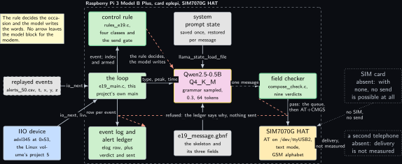
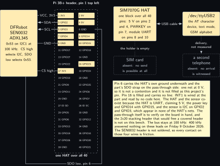
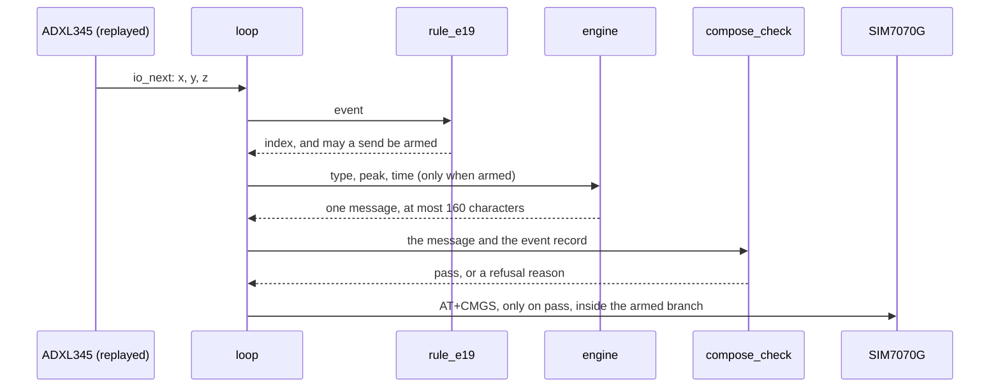
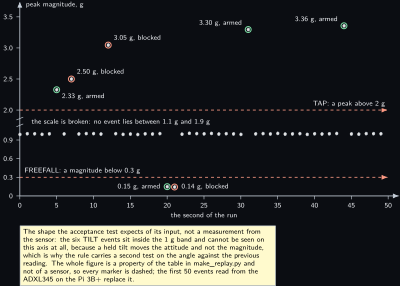

<!-- Written from the chapter source by the catalogue's publish step. Do not hand edit: the chapter is the record and this file is its copy. -->

# Project 19. Event-driven cellular alert composer

> **Board:** Raspberry Pi 3 Model B Plus, SIM7070G Cat-M HAT, with the ADXL345 on header pins 3 and 5  
> **Owns:** the sharpest instance of the volume's safety rule: the model composes the message, the rule alone decides whether anything is sent

> [!IMPORTANT]
> **The question, instanced**
>
> What does a small local model add over a two-line threshold, and when does it get it wrong? Here the threshold does the one thing that cannot be undone, deciding whether the board speaks at all, and the model only writes the words. Over 50 events the question is whether a 0.5B model can carry three numbers it was handed, the event type, the peak in g and the time, without inventing a fourth one.

> **Key facts**
>
> - **Board:** Raspberry Pi 3 Model B Plus, card `eplepi`, 4 threads
> - **HAT slot:** Waveshare SIM7070G Cat-M, NB-IoT and GPRS HAT, the one HAT on this header; shared with [Project 17](../../chapters/17-cellular-status-summariser.md)
> - **Parts:** the SIM7070G HAT with both antennas, the DFRobot SEN0032 ADXL345 at 0x53 on header pins 3 and 5 at 100 kHz; no SIM card and no second phone
> - **Interface:** the modem on an AT character device over the HAT USB cable, the sensor on I2C through the IIO driver of the Linux volume's project 5
> - **Language and variant:** C, catalogue variant C: plain C over `llama.h` in one process, with this project's own loop and its own send path
> - **Model:** Qwen2.5-0.5B-Instruct Q4\_K\_M, 491 MB, Apache 2.0, temperature 0.3 under the message grammar, `n_predict` 64
> - **Decision:** the model writes one message of at most 160 characters carrying the event type, the peak value and the time; it decides nothing
> - **Control rule:** send only on the TAP or the FREEFALL of the [Project 5](../../chapters/05-adxl345-event-reporter.md) classification, never otherwise, never on model output, and never twice inside 10 seconds
> - **Acceptance:** 50 events, every sent message checked field by field against the log; a message carrying a number that is in no field of the event is a failed message and the rate is published; zero sends on any event the rule did not arm
> - **Difficulty:** 4 of 5
> - **Effort:** two evenings on the host for the checker, the parser and the oracle, one afternoon on the Pi 3B+ for the wiring and the 50-event run, and a second sitting with a SIM and a borrowed phone before delivery is anything but "not measured"

## Pitch

This is the chapter where the volume's safety rule stops being a sentence and becomes a line of code a reader can find. An accelerometer event arrives, a rule of four lines classifies it, and a second function of three lines decides whether a message may be sent at all: only on a TAP or a FREEFALL, and only when at least ten seconds have passed since the last time it said yes. Only inside that branch is the model asked anything, and what it is asked for is words: one message of at most 160 characters that has to carry the event type, the peak in g and the time, in the printed forms the loop already wrote to the log. Then a field checker reads the message back and compares it with the event, field by field, and refuses it if a field is missing or if any number in it is in no field of the event. The grammar cannot make that check: the slot in the skeleton has the shape `d.dd`, and 2.74 satisfies it exactly as well as 2.47 does. So the chapter has two gates and says which one catches what, and the acceptance test publishes both rates: how often the model wrote a number the event never had, and how often a message left the board on an event the rule had not armed, which must be never. Delivery is a third question and this bench cannot answer it: without a SIM there is no send, and without a second phone there is no witness that anything arrived, so delivery reads "not measured" with the reason, and the message reference the module returns is reported for what it is, a counter inside the modem.

## Origin and what changed

Drafts 20 and 12 merged, because both are the same shape: an event happens and text goes out over cellular. Draft 20 was an alert composer with no event source named, and draft 12 was a sensor event summariser with no transport named; separately each would have had a figure with a dotted block where the other one's half belonged. What changed in the merge is that the two halves are now the two things this chapter is about, and that the merged project inherited a constraint neither draft had: the thing that may be sent is the model's own output, so the loop needs a check between the engine and the modem that no other project in the volume needs. That check is `projects/e19-cellular-alert/src/compose_check.c`, and it is the reason this project does not use the shared main of [Project 2](../../chapters/02-the-decision-loop.md). The shared loop hands a project two hooks, one before the model is asked and one to build the user text, and neither of them is ever given the model's answer, which is exactly right everywhere else and useless here. So `src/e19_main.c` carries its own `main`, takes the same options, and reuses `io.h`, `rules.h`, `elog.h` and `edgellm.h` unchanged, which [Project 4](../../chapters/04-pi-thermal-and-throttle-narrator.md) already does for its own reason. The AT reply parser is [Project 17](../../chapters/17-cellular-status-summariser.md)'s, listed as a source and not copied; at the time this chapter was written that project did not exist yet, so the parser sits in this project's `src` with a note at the top of the file saying where it moves to.

## Parts and interface

| **Part** | **Role** | **Interface** | **Address or pin** |
| --- | --- | --- | --- |
| Raspberry Pi 3 Model B Plus | runs the loop, the model, the checker and the send path | SSH; the serial console of this board is dead | card `eplepi` |
| Waveshare SIM7070G HAT | the radio and the SMS client; text mode, the GSM alphabet | AT character device over the HAT USB cable | `/dev/ttyUSB2`, to confirm against `/dev/serial/by-id` |
| DFRobot SEN0032 ADXL345 | the event source: three axes in metres per second squared | I2C at 100 kHz through the IIO driver of the Linux volume's project 5 | 0x53, pins 3 and 5, CS pin 17 high, SDO pin 6 low |
| SIM card | would make a send possible at all | the HAT's own holder | absent, dotted in every figure |
| A second telephone | would witness that a message arrived | none | absent; delivery is not measured |
| `replay/alerts_50.csv` | the 50 events, 5 taps, 2 freefalls, 6 tilts and 37 quiet seconds, from `tools/make_replay.py` | `io_open_replay` |  |
| `grammars/e19_message.gbnf` | the message skeleton with three fields and one note | the grammar sampler of the engine | root symbol `root` |
| `prompt.txt` | the system prompt, 88 words | decoded once, state saved |  |
| `src/rules_e19.c` | the classification and the send gate | `rule_find("e19")` and `rule_e19_sends` | indices 0 to 3 |
| `src/compose_check.c` | the field checker, nine verdicts | called between the engine and the queue |  |
| `src/at_parser.c` | [Project 17](../../chapters/17-cellular-status-summariser.md)'s AT reply parser, listed not copied | pure text, no port and no clock |  |
| `tests/oracle/e19.expected.csv` | the 50 expected rule decisions, and an empty model cell on every event the rule did not arm | `tests/oracle_check`, row by row |  |

## Model and grammar

Qwen2.5-0.5B-Instruct at Q4\_K\_M, the file `qwen2.5-0.5b-instruct-q4_k_m.gguf`, 491 MB, Apache 2.0, from [Qwen/Qwen2.5-0.5B-Instruct-GGUF](https://huggingface.co/Qwen/Qwen2.5-0.5B-Instruct-GGUF) (to verify). It is the Pi 3 upper rung of the ladder, and on a 1 GB board it is admitted only while [Project 1](../../chapters/01-bring-up-and-the-honest-tokens-per-second.md)'s reading of `MemAvailable` keeps the file under 60 percent of it; if it does not, this chapter runs on SmolLM2-360M with no other change, because nothing below depends on which model writes the words. The engine is the pinned release of [Project 1](../../chapters/01-bring-up-and-the-honest-tokens-per-second.md).

The grammar is not the house enum shape. Everywhere else in the volume the model answers with one JSON object carrying one key, and the log reads the key back out. Here the answer is the message itself, because the message is what may leave the board and a second encoding layer between the model and the modem would be one more place for a field to change on the way. So the grammar is a fixed skeleton with four slots: the event type, which admits only the two literals the rule can arm, the peak with the shape `d.dd`, the time as three pairs of digits, and a bounded note.

```gbnf
root  ::= "ALERT " etype " peak " peak " g at t+" stamp ". " note "."
etype ::= "TAP" | "FREEFALL"
peak  ::= dig "." dig dig
stamp ::= dig dig ":" dig dig ":" dig dig
note  ::= [A-Za-z0-9 ,.:;!?()/+-]{4,64}
dig   ::= [0-9]
```

Two numbers in that file are the chapter's own arithmetic. The longest body the grammar admits is 6 plus 8 plus 6 plus 4 plus 8 plus 8 plus 2 plus 64 plus 1, which is 107 characters, and the shortest is 47. The limit the field checker enforces is 160, the length of a single message body in the GSM 7 bit default alphabet, and the gap between 107 and 160 is the token budget: `n_predict` is 64 for one message, and a 107-character body stays inside that on the Qwen2.5 tokenizer while a 160-character one would not. The note's character class is the single-septet subset of that alphabet this project admits, so the body never forces the module into UCS-2, where one message holds 70 characters and not 160.

The system prompt, decoded once at start and never again during a run, reads in full: You are an alert composer on a Raspberry Pi with a cellular modem. You are given one motion event: its type, its peak acceleration in g, and its time since the run started. Write one short message that carries the event type, the peak value and the time exactly as given, and then one short note of at most sixty characters saying what a reader should check. Copy the three fields; do not round them. Use no number that is not in the event. Answer with the message and nothing else. The two instructions in the middle are there to be tested rather than trusted: the acceptance test counts how often they are followed.

## What the model decides or writes

Nothing is decided. The model writes one message, with `n_predict` 64 and temperature 0.3 under the grammar, and it is asked only on an event the rule has already armed, which over the 50 replayed events is 4 times and not 50. On a quiet second the model is not called at all, the log's model cell is empty, and the whole decision costs the rule's four lines. That is visible in the oracle file and is the cheapest honest statement of the safety rule in the volume: a build in which the loop asked the model on a quiet event would differ from `tests/oracle/e19.expected.csv` on 46 rows.

What the model can write is bounded in four ways at once. The grammar's automaton refuses any character outside the admitted set, any fourth event type, and any shape other than `d.dd` in the peak slot. The token budget refuses an answer that does not close inside 64 tokens, and such an answer is counted as a failed message of the chapter, not of the model. The field checker refuses a message whose fields do not match the event. And the rule refuses the whole occasion. In CI there is no model file: the stub behind the same `edgellm_decide` expands the grammar's first alternative on every path and a character class to nothing, so it answers `ALERT TAP peak . g at t+::. .` every time, the field checker refuses all four messages, and the number of sends in CI is zero by construction. The refusals are not identical, which is the useful part: three of the four armed events are taps and are refused for a missing peak value, and the fourth is a freefall, which the stub's fixed TAP skeleton does not name at all, so it is refused for a missing event type.

## Control rule

Two functions in one file, both deterministic, both tested, and together the only thing that decides whether the board speaks. The classification is the one [Project 5](../../chapters/05-adxl345-event-reporter.md) uses on the same part with the same three thresholds: a peak above 2 g is a TAP, a magnitude below 0.3 g is a FREEFALL, an attitude that moved more than 30 degrees against the previous reading is a TILT. Both magnitude thresholds are strict, so 2 g and 0.3 g themselves stay in the quiet band.

```c
static int rule_e19_fn(const rule_ctx *ctx, const io_event *ev)
{
    double m2, tap2 = (E19_TAP_G * E19_G) * (E19_TAP_G * E19_G);
    double ff2 = (E19_FREEFALL_G * E19_G) * (E19_FREEFALL_G * E19_G);
    if (ev->n < 3) return 0;                     /* a short event is NONE, not a guess */
    m2 = mag2(ev);
    if (m2 < ff2) return 3;                      /* FREEFALL: magnitude below 0.3 g */
    if (m2 > tap2) return 1;                     /* TAP: peak above 2 g */
    if (tilted(ctx, ev)) return 2;               /* TILT: attitude moved over 30 deg */
    return 0;                                    /* NONE */
}
```

There is no square root and no inverse cosine in that file, and the reason is not speed. A `rules_eNN.c` file is compiled a second time into the shared harness `tests/rules_test`, whose link line carries `edgellm_core` and nothing else, so a rule that pulled in a library would stop that harness for every project at once. The magnitude tests therefore compare squared magnitudes against squared thresholds, and the attitude test compares the squared cosine of the angle between two vectors against the squared cosine of 30 degrees. For the same reason the file includes `rules.h` alone and no header of its own project, and the send gate below is declared by hand in the two files that call it.

The send gate is the send rule of the chapter, and it is three statements.

```c
int rule_e19_sends(int index, double t_s, double t_last_arm_s)
{
    if (index != 1 && index != 3)
        return 0;
    if (t_last_arm_s < 0.0)
        return 1;
    return (t_s - t_last_arm_s) >= E19_MIN_SEND_S;
}
```

The interval is a constant in that file and deliberately not a command line option: an interval that can be set from the unit file is an interval that can be set to zero, and the alert storm the gate exists to prevent is then one command away. A longer interval is a change to the file, a new case in `src/rules_e19_test.c` and a rebuild. The clock counts armings and not successful sends, which is the one design decision in the chapter worth arguing with: an armed event costs one model call and one modem dialogue whether or not the checker lets the message through, so a model that wrote a bad number on every event would otherwise produce exactly the storm of attempts the gate is for. The cost is that a refused message consumes the interval, and that is why the refusal rate is published beside the gate in the agreement table.

Then the loop, where the rule's answer opens exactly one branch. This is the code review item of the chapter, and it is meant to be checked rather than believed: in `src/e19_main.c` there is one call to `alert_queue_push`, one call to `alert_queue_drain` and, inside that function, one call to `sms_send`, and the first two are both in the fragment below.

```c
        armed = rule_e19_sends(idx, ev.t_s, t_last_arm);
        if (armed) {
            const char *user;
            t_last_arm = ev.t_s;
            n_armed++;
            e19_record_init(&record, rule->names[idx], pk, stamp);
            user = project_format_prompt(&ev, &ctx, prompt_buf, PROMPT_BUF);
            if (user != NULL)
                user = wrap_user(user, wrapped_buf, PROMPT_BUF + 128);
            if (user != NULL && edgellm_decide(engine, user, &res) == 0) {
                n_composed++;
                verdict = e19_compose_check(res.text, &record);
                n_verdict[verdict]++;
                if (verdict == E19_PASS)
                    alert_queue_push(&queue, res.text, ev.t_s);
                /* The one call to the send path in this project. It is inside the
                 * branch the rule's index opened, and it can only send what the field
                 * checker passed, because that is all the queue ever holds. */
                n_sent += alert_queue_drain(&queue, &mdm);
```

The checker itself is a sequence of refusals in a fixed order, cheapest and most structural first. The order matters to whoever reads a refusal line: a message with no peak value at all is a different failure from one that carries a wrong peak, and both are different from one that carries the right peak and an extra number as well.

```c
    if (strstr(message, rec->type) == NULL)
        return E19_REFUSED_NO_TYPE;
    if (rec->other != NULL && strstr(message, rec->other) != NULL)
        return E19_REFUSED_WRONG_TYPE;
    if (rec->peak[0] == '\0' || strstr(message, rec->peak) == NULL)
        return E19_REFUSED_NO_PEAK;
    if (rec->stamp[0] == '\0' || strstr(message, rec->stamp) == NULL)
        return E19_REFUSED_NO_TIME;

    /* Every number in the message must be one of the record's: the peak, or one of the
     * groups of the time stamp. The peak must also stand on its own, so a message that
     * carries 12.47 where the event's peak was 2.47 is refused even though the peak is
     * a substring of it. This is the check the grammar cannot make. */
```

## Real, modelled, absent

- **have:** real: the Pi 3 Model B Plus, the card, the SIM7070G HAT with both antennas, the SEN0032 ADXL345 at 0x53 on pins 3 and 5 at 100 kHz, the model file, the engine at the pinned tag, the rule, the grammar, the checker, the AT parser, the event log and the alert ledger
- **learn:** modelled: the 50 events, a replayed CSV whose attitude, knocks and drops are a table in `tools/make_replay.py` and not a seed, drawn dashed in every figure; it stands in for the accelerometer so that the checker and the oracle exist before the sensor is wired, and nothing about the sensor is claimed from it
- **absent:** absent: the SIM card, without which no send happens at all, and a second telephone, without which no arrival can be witnessed. Both are dotted, and delivery reads "not measured" with that reason wherever it appears

## System architecture



*Figure 19.1. The two gates on the Pi 3 Model B Plus. Inside a dashed layer labelled with the board, the card and the HAT: the loop in user-space green at the centre, the control rule above it with the green rule outline, the model to its right with the yellow model outline, the field checker in green between the model and the modem, the grammar and the saved prompt state as grey blocks around the model, and the event log and the alert ledger in green below. Outside the layer on the left, a dashed grey block for the replayed event stream and a solid grey block for the IIO device of the Linux volume's project 5, the two sources the binary takes without a code change. On the right, solid blocks for the SIM7070G HAT and its AT character device; beyond them two dotted grey blocks, the SIM card and a second telephone, the first because no send is possible without it and the second because no arrival can be witnessed. Solid arrows carry the event to the loop and up to the rule, the index and the arming answer back, the user text to the model, the saved state and the grammar into the model, the message from the model to the checker, and the passed message from the checker through the queue to the modem. A dashed stop-coloured arrow from the rule to the model says that the rule decides the occasion and the model only writes the words, and a second dashed stop-coloured arrow from the checker back to the ledger carries a refusal. The arrow from the modem to the dotted telephone is dotted and labelled not measured.*

The figure is read for what is missing. There is no arrow from the model block to the modem block: every path from the model ends either at the checker or at the log, and the only line that reaches the modem starts at the checker and passes through the queue. In the code that absence is three call sites, which is the next subsection's acceptance item. The second thing to read is the pair of dotted blocks on the right. They are not a decoration: with no SIM the whole send path is reported as not fitted on every row of the ledger, and with no second telephone the strongest statement this chapter can make about a sent message is that the module accepted it and answered with a message reference.

## Wiring

| **Header pin** | **BCM** | **Part pin** | **Wire colour if known** |
| --- | --- | --- | --- |
| 1 | 3V3 | ADXL345 VCC, never 5 V | not recorded |
| 3 | GPIO2 | ADXL345 SDA, I2C1 data, 1.8 kOhm pull-up fitted on the Pi | not recorded |
| 5 | GPIO3 | ADXL345 SCL, I2C1 clock, 1.8 kOhm pull-up fitted on the Pi | not recorded |
| 6 | GND | ADXL345 SDO, strapped low, which selects 0x53 | not recorded |
| 9 | GND | ADXL345 GND | not recorded |
| 16 | GPIO23 | ADXL345 INT1, wired and not used by this project | not recorded |
| 17 | 3V3 | ADXL345 CS, strapped high, which selects I2C | not recorded |
| 2 and 4 | 5V | SIM7070G HAT supply through the header | the HAT's own |
| 7 | GPIO4 | SIM7070G PWRKEY, the HAT's own line | the HAT's own |
| 8 and 10 | GPIO14, GPIO15 | SIM7070G UART, used only on the UART route | the HAT's own |
| 37 | GPIO26 | SIM7070G DTR, only with the DTR jumper in position A, which is not the default | the HAT's own |

The chapter owes the reader one check before any of that is wired, and it is the question of whether this HAT leaves pins 3 and 5 free. Electrically it does. By the vendor's own claim list, read for the kit labs’ Cat-M lab on Thursday 8 October 2026, this HAT attaches 5 V on pins 2 and 4, ground, the module's UART on GPIO14 and GPIO15, the power key on pin 7, and the module's DTR on pin 37 only when the DTR jumper sits in position A, which is not its default position. GPIO2 and GPIO3 appear in none of those nets, so nothing on the HAT contends with the I2C bus. Whether they are also mechanically reachable is a fact about one board and is marked to verify: it depends on this HAT carrying a 40-pin pass-through, and the 2x20 stacking header that would free a covered header is not on this bench. If the board in hand has no pass-through, the sensor moves to the Pi 3 Model B of [Project 5](../../chapters/05-adxl345-event-reporter.md), the events reach this project over the LAN, the accelerometer becomes a dashed block in this chapter's figures and the chapter says so rather than quietly keeping a wiring table it cannot honour. The IO level jumper is never moved: it defaults to 3.3 V and its other position makes the HAT's logic 5 V on a header whose every pin is a 3.3 V input.



*Figure 19.2. The 40-pin header of the Pi 3 Model B Plus as two columns of small blocks, pin 1 at the top left, with the pins this project uses filled: 1, 3, 5, 9, 16 and 17 for the accelerometer and 2, 4, 7, 8 and 10 for the HAT. The SIM7070G HAT is drawn as one solid block over the whole header with its three claimed lines named, and the AT character device over the HAT USB cable is a solid block beside it. The SEN0032 ADXL345 is a solid block to the left of the odd column, joined to pins 3 and 5 by solid arrows labelled SDA and SCL and to pins 1, 9, 6 and 17 by lines labelled VCC, GND, SDO low and CS high. Two dotted grey blocks sit to the right, the SIM card in the HAT's holder and a second telephone. A note says that pin 6 carries the HAT's ground underneath and the SDO strap on the pass-through side, which is one net at 0 V and not a contention, that the pass-through itself is to verify on the board in hand, that the bus stays at 100 kHz because 400 kHz answered nothing on these leads on Friday 9 October 2026, and that the sensor header is not soldered, so every contact on those four wires is friction.*

## Sequence


*Figure 19.3. One armed event, from the accelerometer to the modem, as a sequence diagram with seven actors: the event source drawn dashed as the stand-in, then the loop, the rule, the engine, the field checker and the modem, all solid, and a dotted telephone at the right. Solid arrows carry io\_next with x, y and z to the loop and the event to the rule; two dashed replies bring back the index and the answer of the send gate, and a note on the second says that this is the only thing that opens the branch. Over a blue activation bar on the engine, solid arrows carry the restored prompt state and the user text with the three printed fields, and a dashed reply brings back one message of at most 160 characters, sampled under the grammar at temperature 0.3. A solid arrow then carries that message and the event record to the field checker, and a dashed reply brings back either pass or a refusal reason; a stop-coloured dashed arrow from the checker to the ledger is labelled refused, nothing sent. Only after the pass does a solid arrow reach the modem, labelled AT+CMGS inside the armed branch, and the module's reply carries the message reference. The last arrow, from the modem to the dotted telephone, is dotted and labelled delivery, not measured. A note at the foot says that the rule gates the occasion and the checker gates the content, and that a quiet event reaches neither the engine nor the modem.*

## States and data


*Figure 19.4. Above, the four classifications of rules\_e19.c as four rounded green states, NONE at the left, then TAP, TILT and FREEFALL, entered at NONE from the initial dot, with the thresholds on the arrows: a peak above 2 g to TAP, an attitude more than 30 degrees from the previous reading to TILT, a magnitude below 0.3 g to FREEFALL, and the return arrows labelled with the quiet band. Two of the four states, TAP and FREEFALL, carry a second green outline and a label saying that these are the only two the send gate can arm, and a note on them says that the gate adds the second condition, at least 10 seconds since the last arming. Below, the message layout as a row of narrow blocks in the order the grammar fixes: the fixed word ALERT, the event type of 3 or 8 characters, the fixed word peak, the peak value as d.dd, the fixed g at t+, the time as hh:mm:ss, and the bounded note of 4 to 64 characters, with the three fields the checker validates filled in hardware colour and the fixed parts left grey. A note under the row gives the arithmetic: 107 characters at most, 47 at least, against the checker's limit of 160. Nothing is dashed or dotted in this figure.*

The record is two files side by side. The first is the per-event log, `projects/e19-cellular-alert/evidence/e19_run.csv`, in the shape `elog.h` fixes for every project in the volume, so that nothing about this chapter changes how a log is read: `t_s, tag, raw, rule, model, prompt_ms, generate_ms, n_generated, engine`. The second is this project's own alert ledger, `evidence/e19_alerts.csv`, with one row for every event the rule classified as a TAP or a FREEFALL, armed or not: `t_s, rule, armed, peak_g, stamp, verdict, sent, mr, queued, message`. The ledger is what the acceptance test reads, because it is the only file that holds the refusal reason, the send outcome and the message beside the event it was composed from. The main log keeps its shape so that `tools/agreement.py` and `tests/oracle_check` work on it unchanged.

## Data flow

```text
  tools/make_replay.py (seeded)      the loop, e19_main.c, on the Pi 3B+              absent
  +-----------------------+          +---------------------------------------+     +----------+
  | replay/alerts_50.csv  |-io_next->| rule_e19_fn(ctx, ev) -> 0 | 1 | 2 | 3 |     | SIM card |
  |   t_s,tag,v0,v1,v2    |          |      |                                |     +----------+
  +-----------------------+          |      v  rule_e19_sends(idx, t, last)  |     +----------+
   OR /sys/bus/iio/.../device0 ----->|      |    no  -> log the rule alone   |     | a second |
      in_accel_x_raw * scale         |      |    yes -> compose, once per 10 s|    | phone    |
                                     |      v                                |     +----------+
  prompt.txt --decode once---------> | [state] -llama_state_load_file-> ctx  |          ^
    llama_state_save_file (at start) | project_format_prompt: type,peak,time |          | not
                                     |      sample <= 64 under the grammar   |          | measured
  grammars/e19_message.gbnf -------> |      "ALERT TAP peak 2.33 g at t+..." |          |
    llama_sampler_init_grammar(root) |      |                                |     +----------+
                                     |      v  e19_compose_check(msg, rec)   |     | SIM7070G |
                                     |      PASS -> queue -> sms_send -------|---->| AT+CMGS  |
                                     |      refused -> ledger, nothing sent  |     +----------+
                                     | elog_row: t, rule, model, ms, engine  |
                                     +---------------------------------------+
  tests/oracle/e19.expected.csv: the rule column, and an empty model cell on every unarmed event
```



## Latency design

The system prompt is 88 words, under 120 tokens on the Qwen tokenizer, decoded once at start with its state written by `llama_state_save_file` and restored before every composition, so an armed event pays for its own twenty tokens of user text and nothing else. `n_ctx` is 512, `n_predict` 64, temperature 0.3 under the message grammar, and 4 threads on the Pi 3B+. The interval is the event source's: the replay file carries one event per second, and the live run polls the IIO device at 10 Hz, which is the rate the Linux volume's project 5 sets.

What is different here is that the expensive path runs 4 times in 50 events and not 50. A quiet second costs the rule's four lines and one log row. An armed event costs one state restore, one prompt decode of about twenty tokens, up to 64 single-token decodes and one modem dialogue, and the rule's minimum interval of 10 seconds is also the shortest period in which that cost can repeat. The modem dialogue has two deadlines of its own and neither of them is allowed to hold the loop: the body prompt is waited for 5 seconds, the final result code of a send up to 60 seconds, and a message that cannot go out because the module is still attaching is queued rather than retried in place. The queue holds four messages, which at the rule's interval is at least forty seconds of unreachable modem, and the oldest is then dropped and counted. Until [Project 1](../../chapters/01-bring-up-and-the-honest-tokens-per-second.md)'s table is measured on this board the decision time is a shape and not a number, and the data figure draws the stream rather than the latency for that reason.

## Steps

**Step 1.** Generate the 50 events and the oracle on the authoring laptop, and read the summary: it prints the count of each classification, which events the send rule arms, which the minimum interval blocks, and the peak of each armed event.

```bash
# win11 aquamarine
cd C:\Users\aquamarine\Desktop\edge-llm-pi; python projects\e19-cellular-alert\tools\make_replay.py
```

**Step 2.** Build the repository with the stub model in skyhorizon's WSL. Nothing compiles on aquamarine. The two live backends are added here so that the same build serves the bench.

```bash
# win11 skyhorizon, WSL side
cd ~/src/edge-llm-pi; cmake -S . -B build -DEDGELLM_STUB_MODEL=ON -DEDGELLM_IO_IIO=ON \
  -DEDGELLM_IO_SERIAL=ON; cmake --build build -j8
```

**Step 3.** Run the three tests of this project: the six classification cases inside the shared rule harness, the nineteen checks of the field checker and the send gate in this project's own binary, and the oracle over the 50 events with the stub.

```bash
# win11 skyhorizon, WSL side
cd ~/src/edge-llm-pi; ctest --test-dir build --output-on-failure \
  -R "rules_test|e19_compose_check|edgellm-e19-oracle"
```

**Step 4.** Walk the review item by hand, before any hardware: three greps that must return one line each, and a fourth that must return nothing outside the queue.

```bash
# win11 skyhorizon, WSL side
cd ~/src/edge-llm-pi/projects/e19-cellular-alert; grep -n "sms_send(" src/e19_main.c
```

**Step 5.** Run the stub loop by hand with the alert ledger, and read the ledger: four armed events, four refusals with two different reasons, zero sends, zero left queued.

```bash
# win11 skyhorizon, WSL side
cd ~/src/edge-llm-pi; build/projects/e19-cellular-alert/edgellm-e19 --project e19 \
  --replay projects/e19-cellular-alert/replay/alerts_50.csv \
  --grammar projects/e19-cellular-alert/grammar.gbnf \
  --prompt projects/e19-cellular-alert/prompt.txt \
  --log /tmp/e19_stub.csv --alerts /tmp/e19_alerts.csv --stub; cat /tmp/e19_alerts.csv
```

**Step 6.** Seat the HAT on the Pi 3B+ with both antennas fitted and the SIM in before power, then confirm the pass-through by eye and the sensor on the bus. The identifier must read `0xe5` and nothing may answer at `0x1d`.

```bash
# Raspberry Pi 3 Model B Plus, card eplepi
cd ~; i2cdetect -y 1; i2cget -y 1 0x53 0x00; ls -l /dev/serial/by-id/
```

**Step 7.** Confirm the modem by hand before the program touches it: the SIM, the registration and the signal. Read the answers in a second session with `cat /dev/ttyUSB2`.

```bash
# Raspberry Pi 3 Model B Plus, card eplepi
cd ~; printf 'AT+CPIN?\r' > /dev/ttyUSB2; printf 'AT+CSQ\r' > /dev/ttyUSB2
```

```bash
# Raspberry Pi 3 Model B Plus, card eplepi
cd ~; printf 'AT+CREG?\r' > /dev/ttyUSB2
```

**Step 8.** Build on the board against the real engine and read the throttle bits before the run.

```bash
# Raspberry Pi 3 Model B Plus, card eplepi
cd ~/edge-llm-pi; cmake -S . -B build -DEDGELLM_IO_IIO=ON -DEDGELLM_IO_SERIAL=ON
```

```bash
# Raspberry Pi 3 Model B Plus, card eplepi
cd ~/edge-llm-pi; cmake --build build -j4
```

```bash
# Raspberry Pi 3 Model B Plus, card eplepi
cd ~; vcgencmd get_throttled
```

**Step 9.** Run the 50 replayed events with the real model and no modem, which measures the composer and the checker and sends nothing, then read the bits again. The ledger's verdict column is the acceptance record and the summary line is its total.

```bash
# Raspberry Pi 3 Model B Plus, card eplepi
cd ~/edge-llm-pi; build/projects/e19-cellular-alert/edgellm-e19 --project e19 \
  --replay projects/e19-cellular-alert/replay/alerts_50.csv \
  --grammar projects/e19-cellular-alert/grammar.gbnf \
  --prompt projects/e19-cellular-alert/prompt.txt \
  --model ~/models/qwen2.5-0.5b-instruct-q4_k_m.gguf --state /tmp/e19.state \
  --log projects/e19-cellular-alert/evidence/e19_run.csv \
  --alerts projects/e19-cellular-alert/evidence/e19_alerts.csv; vcgencmd get_throttled
```

**Step 10.** Only with a SIM fitted, and only after the ledger of step 9 has been read, run the live sensor with the send path fitted and a destination number. Knock the bench five times and drop nothing, and compare every sent message in the ledger with the event beside it.

```bash
# Raspberry Pi 3 Model B Plus, card eplepi
cd ~/edge-llm-pi; build/projects/e19-cellular-alert/edgellm-e19 --project e19 \
  --live iio /sys/bus/iio/devices/iio:device0:0.1 \
  --grammar projects/e19-cellular-alert/grammar.gbnf \
  --prompt projects/e19-cellular-alert/prompt.txt \
  --model ~/models/qwen2.5-0.5b-instruct-q4_k_m.gguf \
  --modem /dev/ttyUSB2:115200 --sms-to 00000000000 \
  --log projects/e19-cellular-alert/evidence/e19_live.csv \
  --alerts projects/e19-cellular-alert/evidence/e19_live_alerts.csv
```

## Variant chosen

C, catalogue variant C: plain C over `llama.h` in one process, the same shared `common/c` core every other C project in the volume links, with this project's own loop on top of it. The five criteria score it as follows for this project alone. On practicality, an event-to-message path is small and has to be auditable line by line, and one C file of about four hundred lines, read top to bottom, is what makes the review item of this chapter a matter of three greps rather than of trust; a layer of classes between the rule and the modem would move the same logic into three files and buy nothing here. On compliance, the only two dependencies are the AT interface of the module and the IIO ABI of the kernel, both of them text interfaces with published shapes, and the licences are MIT on the engine and on this repository, Apache 2.0 on the model; nothing vendor-specific is linked, and `libm` is pulled in for one square root. On popularity and relevance, the C route is what every published cellular node does: the AT state machine in C is the classic embedded form, the kernel's own IIO consumers are C, and a reader who has written a modem driver before will recognise this file. On best practice, it is the house rule of the bench, C for anything that runs on a board, and this chapter makes no exception to it.

What it costs is stated rather than hidden. The project does not use the shared main of [Project 2](../../chapters/02-the-decision-loop.md), so the loop exists twice in the repository: once there, for the eighteen projects where the rule acts and the model explains, and once here, for the one project where the thing that may be sent is the model's own output. The alternative would have been a third hook in the shared main, called after the engine answers, which every other project would carry and none would use. The comparison is not run on the board: there is nothing to measure between two loops that differ by one call, and the figures that would be measured, resident memory and decision latency, are [Project 2](../../chapters/02-the-decision-loop.md)'s and are not re-measured here.

| **Variant** | **What it would add** | **What it would cost** | **Instrument** |
| --- | --- | --- | --- |
| C, variant C (chosen) | one file to review, one square root of `libm` | a second loop in the repository | the three greps of step 4; not a timing |
| C++ over the C API, variant B | `std::string` for the message handling | a second language on a 1 GB board for one string | not measured, and not planned here |
| Rust, variant R7 | a checker that cannot read past the end of a buffer | a second toolchain for one project that [Project 5](../../chapters/05-adxl345-event-reporter.md) already pays for | not measured |
| A third hook in the shared main | one loop in the repository | a hook eighteen projects carry and none uses | not measured |

## Embedded Linux and Yocto

The application recipe `meta-edgellm/recipes-app/edgellm-e19/edgellm-e19_0.1.bb` sets the three variables of the layer's pattern, the project id `e19`, the folder `e19-cellular-alert` and the model package `model-qwen2.5-0.5b`, adds the two backend options `-DEDGELLM_IO_IIO=ON` and `-DEDGELLM_IO_SERIAL=ON`, and then requires the shared include `meta-edgellm/recipes-app/edgellm-common.inc`. No overlay fragment is written here: the ADXL345's IIO binding is the overlay of the Linux volume's project 5 and belongs to that volume, and the HAT needs no overlay at all on the USB route. The unit is where this project differs from every other one in the layer, in two lines worth reading.

```text
After=dev-ttyUSB2.device
Wants=dev-ttyUSB2.device
# The accelerometer, bound by the overlay of the Linux volume's project 5. With no
# device the unit does not start, which is better than a service that runs with no
# event source and an empty log.
ConditionPathExists=/sys/bus/iio/devices/iio:device0
```

The unit waits for the modem's character device and not for the module to be registered, because registration is the send path's own check and a message armed while the module is still attaching is queued rather than lost. It refuses to start without the IIO device, because a composer with no event source would run for days and write an empty log that looks like a quiet bench. The destination number is not in the recipe: a number in a recipe is a number in every image built from it, so the unit ships with a placeholder and the board's own number goes in a drop-in file. Nothing is retried after a restart, and the queue is in memory on purpose: an alert about an event from before a restart is late enough to be misleading. The layer parse, not the image build, is what runs on skyhorizon before anything is wired:

```bash
# win11 skyhorizon, WSL side
cd ~/bench/edge-llm-pi; kas shell meta-edgellm/kas/edgellm-pi3bp.yml -c "bitbake -p"
```

## Acceptance test

Four quantities, and the instrument for each. First, over the 50 events of `replay/alerts_50.csv`, the number of messages sent on an event the rule did not arm: the instrument is the alert ledger beside the event log, the pass condition is zero, and a single such row fails the chapter outright, because it means the branch was not the only path to the modem. Second, field by field, every message whose ledger row says it was sent must carry the event type, the peak and the time of the event in the same row: the instrument is `e19_compose_check` itself, running on every message before the send, plus a reading of the ledger by eye afterwards, and the pass condition is that the two agree on every row. Third, the rate of messages refused for carrying a number that is in no field of the event: the instrument is the `verdict` column of the ledger, the quantity is published rather than required, and a rate above a few percent is a result about the model at temperature 0.3 and is reported as one. Fourth, the number of messages left queued at the end of a run, which must be zero when a modem is fitted and registered. All four are taken with `vcgencmd get_throttled` reading `0x0` before and after, and a run with any bit set is discarded.

Delivery is not one of the four. Without a second telephone there is no witness that anything arrived, so the chapter does not claim it: `+CMGS` answers with the module's own message reference, which says that a body left the module and nothing about arrival. With a borrowed phone the fifth quantity is the number of sent messages that arrived, read off that phone, and the chapter's table has a row waiting for it.

The code review item is part of the acceptance and is run with the test suite, not after it. In `src/e19_main.c`, `alert_queue_push` has one call site, inside the branch the rule's index opened and after the checker returned `E19_PASS`; `alert_queue_drain` has one call site, in the same branch; and `sms_send`, the one function that writes `AT+CMGS`, has one call site, inside `alert_queue_drain`. Step 4 is the grep that shows it. The queue is the only thing the send path reads, and the only thing that fills the queue is a message that passed the checker on an event the rule armed.

## Agreement table

Over the 50 events as generated on Wednesday 14 October 2026 by `tools/make_replay.py` from the table in that file, the rule column holds 37 NONE, 5 TAP, 6 TILT and 2 FREEFALL. Of the 7 taps and freefalls the send gate arms 4, at the fifth, twentieth, thirty-first and forty-fourth second, and the minimum interval blocks 3, at the seventh, twelfth and twenty-first. On the bench the model column is not measured: the Pi 3B+ run has not been taken. In CI the stub composes 4 messages and the field checker refuses all 4, three of them for a missing peak value and one, the freefall, for a missing event type, so the number of sends in CI is zero and the number of invented numbers is zero as well, because the stub writes no number at all. Those are the figures a reader of the CI log should expect, and the first figures from the real model have them to sit beside: a model that passes the checker on all 4 is not yet evidence of anything, since 4 is a small number, and the live run with a knocked bench is where the rate becomes a measurement.

| **Quantity** | **In CI** | **On the Pi 3B+** | **Of** | **Instrument** |
| --- | --- | --- | --- | --- |
| events | 50 | not measured | 50 | the replay file; the event log |
| armed by the rule | 4 | not measured | 7 taps and freefalls | the ledger's armed column |
| blocked by the interval | 3 | not measured | 7 | the ledger's verdict column |
| messages composed | 4 | not measured | 4 armed | the ledger's message column |
| passed the checker | 0 | not measured | 4 composed | `e19_compose_check` |
| refused, peak missing | 3 | not measured | 4 composed | the stub writes no numbers |
| refused, type missing | 1 | not measured | 4 composed | the stub answers TAP on a freefall |
| refused, invented number | 0 | not measured | 4 composed | the verdict column |
| sent | 0 | not measured | 4 composed | the ledger's sent column |
| sent without an arming | 0 | not measured | 50 events | the ledger; pass condition zero |
| delivered | not measured | not measured | sent | absent: no second telephone |

## Measured data



*Figure 19.5. The replayed event stream, not a measurement from the sensor: the 50 events of replay/alerts\_50.csv as generated on Wednesday 14 October 2026, drawn with TikZ axes. The horizontal axis is the second of the run, 0 to 50; the vertical axis the peak magnitude in g on a broken scale from 0 to 3.5. Fifty dashed markers carry the magnitude of each event: a band of them just under 1 g, five knocks reaching 2.33, 2.50, 3.05, 3.30 and 3.36 g, and two drops at 0.15 and 0.14 g. Two dashed stop-coloured horizontal lines carry the rule's two magnitude thresholds, 2 g above and 0.3 g below. Four markers are ringed and labelled armed, at seconds 5, 20, 31 and 44, and three are ringed and labelled blocked by the minimum interval, at seconds 7, 12 and 21. A note says that the six TILT events sit inside the 1 g band and cannot be seen on this axis at all, which is why the rule carries a second test on attitude, and that the whole figure is a property of the table in make\_replay.py and not of a sensor.*

## Pitfalls

- **The model writes a plausible number the event never had.** The grammar's peak slot has the shape `d.dd`, and 2.74 satisfies it exactly as well as 2.47 does; a grammar bounds shape and never truth. This is what the field checker exists for, and the rate at which it refuses for this reason is published rather than assumed to be zero. The subtle form is a number that is correct as a substring: a message carrying 12.47 where the peak was 2.47 passes a careless check and is refused here, which is one of the cases in `src/compose_check_test.c`.
- **A character outside the SMS set changes the arithmetic, not the message.** A body that stays inside the GSM 7 bit default alphabet holds 160 characters in one message; a single character outside it moves the body to UCS-2, where one message holds 70, and a character from the alphabet's extension table costs two septets instead of one. Either way a 107-character message silently becomes two messages or a truncated one. The project admits a named subset of single-septet characters, the grammar's note class is that subset, the checker refuses anything else, and `AT+CSCS="GSM"` is set at start.
- **An alert storm if the rule fires repeatedly.** A knocked table rings for several seconds, and a gate that only looked at the classification would arm on every one of them. The minimum interval of 10 seconds is part of the rule, sits in `src/rules_e19.c` as a constant rather than as an option, and is tested at its boundary. In the 50 events it blocks 3 of 7 taps and freefalls, and those three are rows in the ledger rather than silence.
- **The modem is mid-attach when an event arrives.** Registration takes seconds to minutes after power, and a send that blocked would hold the loop and with it the next reading of the accelerometer. So the send path queues: four messages, drained on the spot and again on the next armed event, with the registration state read at most once every five seconds and status 2, searching, treated as not ready. A message tried three times is dropped and counted, and the count of messages left queued at the end of a run is an acceptance quantity.
- **The accelerometer's contacts are friction.** The SEN0032's header is not soldered, so four of this chapter's wires are held by friction, and a reading that stops for no reason is a contact and not a driver. The straps on pins 17 and 6 are what fix the address at 0x53; a floating CS or SDO makes the part drift between 0x53 and 0x1d, and the `0xe5` identifier read is the check that it has not.
- **Delivery is unobservable from the Pi.** The strongest statement the board can make is that the module accepted a body and answered with a message reference, which is a counter inside the modem. Arrival needs a second telephone, which this bench does not have, so delivery reads "not measured" with that reason everywhere, including in the video script. An operator that does not carry SMS over Cat-M is a second reason the same statement cannot be strengthened from this side, and it is marked to verify rather than assumed.
- **A rule file that includes a header of its own project.** Every `rules_eNN.c` is compiled a second time into the shared harness `tests/rules_test`, whose include path carries the core headers alone and whose link line is `edgellm_core` alone. A rule that included its project's header, or that called a function from `libm`, would stop that harness for all twenty projects at once, with an error that names this project and a file that looks innocent. That is why the rule here is libm-free and why the send gate is declared by hand in the two files that call it.
- **The HAT's pass-through is an assumption until it is seen.** This chapter's wiring needs pins 3 and 5 while a 40-pin HAT is seated. Electrically the SIM7070G leaves them free, which the vendor's own claim list settles; mechanically it depends on the board carrying a pass-through header, the stacking header is not on this bench, and the fallback is written into the wiring table rather than discovered at the bench.

## Future and extra exercises

- CoAP or MQTT instead of SMS: the module carries its own MQTT client, configured with `AT+SMCONF`, opened with `AT+SMCONN` and used with `AT+SMPUB`, which the kit labs’ Cat-M lab already drives. The delta is that the field checker is unchanged and only the send path's six lines move, which is the point of having the checker separate from the transport.
- The same project in C++ over the C API, variant B: the delta is `std::string` in the checker and the RAII wrapper of `common/cpp/edgellm.hpp`, against a second language on a 1 GB board for one string type.
- The same project in Rust, variant R7: the delta is a checker that cannot read past the end of a buffer, against a second toolchain which [Project 5](../../chapters/05-adxl345-event-reporter.md) already pays for on the other Pi 3.
- The same project in Python with `llama-cpp-python` and `pyserial`: the delta is the interpreter per armed event, which is affordable at one event per ten seconds and is priced in [Project 15](../../chapters/15-esp32-sidecar-with-a-bounded-pattern-proposal.md).
- A second telephone as the delivery witness: the delta is one row of the agreement table turning from "not measured" into a number, and one more thing to buy.
- A real time stamp from `AT+CCLK?` instead of the elapsed time: the delta is that the message can carry a wall clock the reader can act on, and the risk is that it carries an unsynchronised one, which is why the elapsed form was chosen first.
- Concatenated messages for a body over 160 characters: the delta is the user data header and a second septet budget, and the gain is a longer note, which is the part of the message that matters least.
- The SIM7600E-H for Cat-4 instead of the SIM7070G: the delta is a modem that can also carry the uplink of the Linux volume's project 15, a transmit peak over 1 A, and a different AT dialect for the same send.

## Video potential

4 of 5. The hook: a knock on the bench and a message on a phone, with the one line of C that decided whether the message was allowed to exist on screen between them. It films well because something physical happens and something arrives, and the piece can be honest about its own limits in the same three minutes: the second phone is borrowed, the delivery is the one thing the Pi cannot see, and the model writes the words and nothing else. The thing to show longest is not the message. It is the field checker refusing one: a message that reads perfectly well and carries a number that is in no field of the event, with the log line beside it. That is the whole argument of the volume in one shot, and it is the reason this project scores above [Project 2](../../chapters/02-the-decision-loop.md) on video and below [Project 13](../../chapters/13-can-honesty-agent.md).

## Sources

- Qwen2.5-0.5B-Instruct-GGUF, Apache 2.0, the file `qwen2.5-0.5b-instruct-q4_k_m.gguf` at 491 MB, [huggingface.co/Qwen/Qwen2.5-0.5B-Instruct-GGUF](https://huggingface.co/Qwen/Qwen2.5-0.5B-Instruct-GGUF) (to verify).
- GBNF grammar syntax, in the engine's tree, [grammars/README.md](https://github.com/ggml-org/llama.cpp/blob/master/grammars/README.md) (to verify). MIT.
- Waveshare SIM7070G Cat-M, NB-IoT and GPRS HAT wiki, for the header lines the HAT claims, the jumper positions and the antenna ports, [waveshare.com/wiki](https://www.waveshare.com/wiki/) (to verify). The reading of that page for the kit labs’ Cat-M lab, on Thursday 8 October 2026, is what the pass-through paragraph above rests on.
- DFRobot SEN0032 ADXL345 product wiki, for the CS and SDO straps and the 0x53 address, [wiki.dfrobot.com](https://wiki.dfrobot.com/) (to verify).
- Raspberry Pi hardware documentation, the 40-pin header, [raspberrypi.com/documentation](https://www.raspberrypi.com/documentation/computers/raspberry-pi.html) (to verify).
- 3GPP TS 27.005, the AT command set for SMS in text mode, which fixes the `AT+CMGF`, `AT+CSCS` and `AT+CMGS` dialogue this project drives, and 3GPP TS 23.038, which defines the GSM 7 bit default alphabet, its extension table and the 160 and 70 character counts quoted above. Neither specification was fetched, so both numbers are marked (to verify) and the arithmetic in the grammar file is written so that it can be re-derived from whichever count turns out to hold.
- The ADXL345 facts of this bench, the straps, the 100 kHz bus and the `0xe5` identifier read on Friday 9 October 2026, and the HAT and overlay facts: the kit labs’ motion-triggered gateway and Cat-M labs, and the Linux volume's projects 5 and 16. Those volumes have no public URL.
- The honesty rule, solid, dashed and dotted, from the joint node volume, chapter 1; that volume has no public URL.

---

[Previous](../../chapters/18-mini-industrial-serial-logger.md) &nbsp;&nbsp;|&nbsp;&nbsp; [Contents](../../CONTENTS.md) &nbsp;&nbsp;|&nbsp;&nbsp; [Next](../../chapters/20-what-should-i-measure-next.md)
