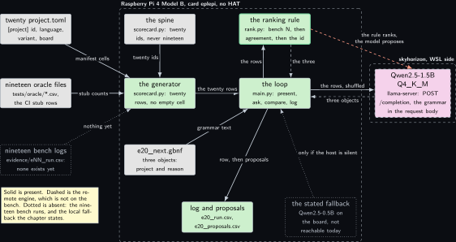
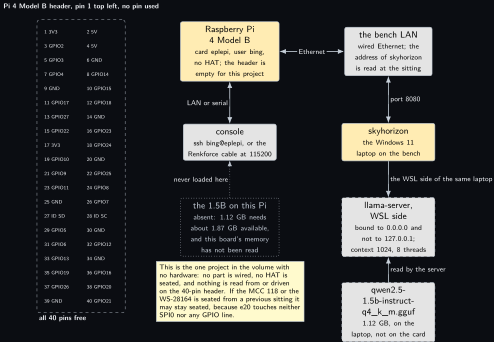
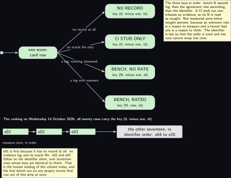
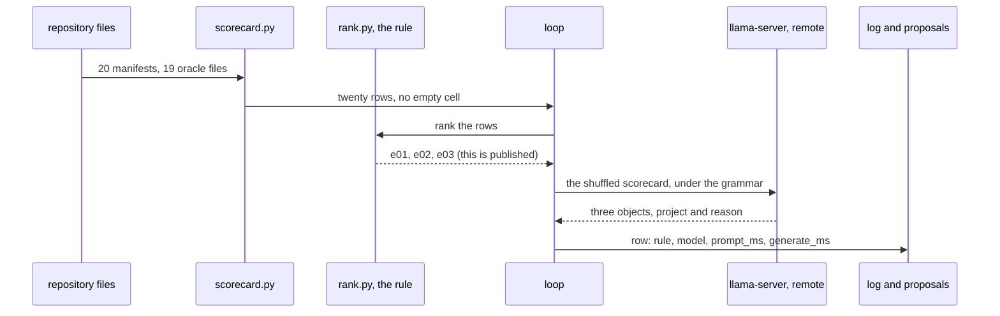
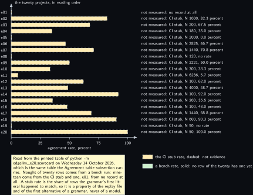

<!-- Written from the chapter source by the catalogue's publish step. Do not hand edit: the chapter is the record and this file is its copy. -->

# Project 20. What should I measure next, and the scorecard

> **Board:** Raspberry Pi 4 Model B, card `eplepi`, no HAT; the bench LAN to skyhorizon  
> **Owns:** the twenty-row scorecard of the whole volume, the rule that says what to measure next, and the one chapter whose inference is not local

> [!IMPORTANT]
> **The question, instanced**
>
> What does a small local model add over a two-line threshold, and when does it get it wrong? Here the inputs are the volume's own records, twenty manifests and nineteen oracle files, the threshold is a three-key sort that needs no model at all, and the question is whether a 1.5B model handed the same twenty rows names the same three projects to measure next, over fifty presentations that differ only in the order the rows are shown in.

> **Key facts**
>
> - **Board:** Raspberry Pi 4 Model B, card `eplepi`, user `bing`; the client runs on the board and the model does not
> - **HAT slot:** empty, and the header is empty too: this is the one project in the volume with no part wired at all
> - **Parts:** the Pi 4B, the bench LAN, and skyhorizon, the Windows 11 laptop whose WSL side serves the model; no sensor, no HAT, no instrument
> - **Interface:** the repository as files; HTTP over the bench LAN to `llama-server`, through `urllib` from the standard library
> - **Language and variant:** Python, catalogue variants P and R8: a client of an engine on another machine; the house rule that board code is C is overridden and this chapter says why
> - **Model:** Qwen2.5-1.5B-Instruct Q4\_K\_M, 1.12 GB, Apache 2.0, served remotely; the stated fallback is Qwen2.5-0.5B on the board itself
> - **Decision:** a JSON array of exactly three objects, each one project identifier and one reason of 20 to 200 characters; in CI the stub answers e01 three times
> - **Control rule:** sort by bench N ascending, then agreement ascending, then the identifier; the first three are what to measure next
> - **Acceptance:** the model's first identifier is the rule's on at least 40 of the 50 presentations; and the scorecard has twenty rows with no empty cell, every cell that is not a number reading "not measured" with its reason
> - **Difficulty:** 3 of 5
> - **Effort:** one evening on the authoring laptop for the generator, the rule and the oracle; one sitting of about an hour for the server and the replay run

## Pitch

This is the last chapter and it carries the one table the whole volume is for: twenty rows, one per project, saying what the model added over the rule there. The table is not written by hand. It is generated from the repository, from each project's `project.toml`, from each project's evidence folder and, where there is no evidence yet, from that project's oracle file, and the generator stops with a sentence rather than print a table with a hole in it. On top of the table sits a deterministic ranking, three lines of comparison, that answers what to measure next: least evidence first, then worst agreement, then the identifier. The model is handed the same twenty rows and asked for the same three projects with one reason each, under a grammar that admits nothing else, and the share of the fifty presentations where its first pick is the rule's is the chapter's one number. Two things here are unlike the other nineteen and are stated rather than hidden. The model is not on the Pi: it is served by `llama-server` in skyhorizon's WSL and the Pi 4B is a client over the bench LAN. And on the day this was written the scorecard is almost entirely "not measured", because no project of the volume has had its bench run yet. That is the honest state of the volume, not a gap to hide, and the last subsection before Sources says what the table will look like once the bench runs exist.

## Origin and what changed

Draft ideas 15 and 19, merged. Draft 19 was a results dashboard, and a dashboard is the output of the other nineteen projects rather than a project of its own; what makes it one is the ranking, because a ranking is a decision, it can be wrong, and a model can be scored against it. Draft 15 was an "explain this reading" mode, a model that puts a sentence beside a number a rule has already produced; that is the teaching voice of this same scorecard, so instead of a separate chapter it became the `reason` field of the answer, bounded by the grammar to 20 to 200 characters that can carry neither a quote nor a brace nor a newline. What changed from both drafts is the direction of trust: there the model produced the summary and the reader checked it, here the rule produces the ranking, the model's three identifiers go to the log and its three sentences to a proposals file, and no number in the chapter is taken from anything the model wrote. The second change is the engine, which left the Pi because the rung this prose wants does not fit the boards, and the Variant chosen paragraph says so rather than quietly.

## Parts and interface

| **Part** | **Role** | **Interface** | **Address or pin** |
| --- | --- | --- | --- |
| Raspberry Pi 4 Model B, card `eplepi` | runs the generator, the rule and the client; runs no model | SSH or the Renkforce cable at 115200; wired Ethernet | nothing on the header |
| skyhorizon, WSL side | serves the model with `llama-server`, context 1024, 8 threads | HTTP, `POST /completion` and `GET /health` | port 8080, bound to `0.0.0.0`; the address is read at the sitting |
| Twenty `projects/eNN-*/project.toml` | the language, the variant and the board of each row | `tomllib` | the `[project]` section |
| Nineteen `tests/oracle/eNN.expected.csv`, and `evidence/eNN_run.csv` | the CI stub rows that stand where a bench log is absent, and the bench logs themselves | both read as logs, rule and model columns | no evidence log exists yet |
| `grammars/e20_next.gbnf`, `prompt.txt`, `edgellm_e20/scorecard.py` and `rank.py` | the three objects and nothing else; the system prompt of 76 words; the generator with its spine of twenty rows; the control rule | the grammar goes in the request body and the prompt in the ChatML wrapper; `build(root)` and `find("e20")` | root symbol `root`; rule index 0 to 19 |
| `replay/scorecard_snapshot.csv`, `replay/scorecards_50.csv` and `tests/oracle/e20.expected.csv` | the dated scorecard a replay run is scored against, the fifty presentations, and the fifty rule answers with the stub's column | `rows_from_csv`, `ReplaySource`, the oracle test | seven columns, twenty rows; fifty rows each |

## Model and grammar

Qwen2.5-1.5B-Instruct at Q4\_K\_M, the file `qwen2.5-1.5b-instruct-q4_k_m.gguf`, 1.12 GB, Apache 2.0, from [Qwen/Qwen2.5-1.5B-Instruct-GGUF](https://huggingface.co/Qwen/Qwen2.5-1.5B-Instruct-GGUF) (verified Wednesday 14 October 2026, where the Q4\_K\_M file is listed at 1.12 GB and the card states Apache 2.0). It is the ladder's text rung, the one marked for a Pi 4 with 4 GB or more, and the arithmetic of the rung rule is why this chapter's engine is not on a board: 1.12 GB under 60 percent of `MemAvailable` needs about 1.87 GB available after boot, which neither 1 GB Pi 3 has and which the Pi 4 Model B is not known to have, because that board's memory has never been read. [Project 1](../../chapters/01-bring-up-and-the-honest-tokens-per-second.md) reads it with `free -m`, and until then the 1.5B rung on the Pi 4B is "read it" and not "yes". So the model is served by `llama-server` on skyhorizon's WSL side and this project is a client of it. The request and response fields the client uses, `prompt`, `grammar`, `n_predict`, `temperature` and `cache_prompt`, the answer's `content` and its `timings` object with `prompt_ms`, `predicted_ms` and `predicted_n`, and the readiness route `GET /health`, which answers `{"status": "ok"}` when the model is loaded and HTTP 503 while it loads, are documented in the engine's own server page, [tools/server/README.md](https://github.com/ggml-org/llama.cpp/blob/master/tools/server/README.md) (verified Wednesday 14 October 2026). The file `edgellm_e20/remote.py` marks those names "to verify" because the page had not been fetched on the day it was written; the reading above is that verification, and the file keeps its mark until someone edits it.

The grammar is GBNF with root symbol `root`, and it is not the house enum shape of the other nineteen chapters: the answer is an array of exactly three objects, because the rule returns three and the acceptance test compares the first of each. Its repetition braces and alternation bar are documented in the engine's grammar guide, [grammars/README.md](https://github.com/ggml-org/llama.cpp/blob/master/grammars/README.md) (verified Wednesday 14 October 2026).

```gbnf
root    ::= "[" ws item ws "," ws item ws "," ws item ws "]"
item    ::= "{" ws "\"project\"" ws ":" ws project ws "," ws "\"reason\"" ws ":" ws
            reason ws "}"
project ::= "\"e01\"" | "\"e02\"" | "\"e03\"" | "\"e04\"" | "\"e05\"" | "\"e06\"" |
            "\"e07\"" | "\"e08\"" | "\"e09\"" | "\"e10\"" | "\"e11\"" | "\"e12\"" |
            "\"e13\"" | "\"e14\"" | "\"e15\"" | "\"e16\"" | "\"e17\"" | "\"e18\"" |
            "\"e19\"" | "\"e20\""
reason  ::= "\"" [A-Za-z0-9 ,.()]{20,200} "\""
ws      ::= [ \t]*
```

The twenty literals of the `project` rule are the volume's twenty identifiers in reading order, the same letters as the rule's own name table, so the log's two columns are compared letter for letter and a test asserts that the two tables are the same tuple. The system prompt, sent with every request, reads in full: You are given a scorecard of twenty projects on one bench. Each row names a project, its bench evidence, its rule and model agreement, and three disagreement counts. A CI stub run is not evidence. Rank the rows by evidence ascending, then agreement ascending, then identifier ascending, where not measured ranks first. Answer only with the JSON array of three objects: the first three of that order, each with one reason that quotes only numbers from its own row. The rule is told to the model on purpose, as in [Project 2](../../chapters/02-the-decision-loop.md): the question is not whether a 1.5B model can invent a research priority, it is whether it can apply a sort it has been given to a table it has been shown.

## What the model decides or writes

Three identifiers in rank order, each with one sentence, with `n_predict` 192 and temperature 0.3. Every token is checked against the grammar's automaton before it is accepted, so the model column of the log holds the first identifier of a well-formed array, or nothing when the array did not close inside 192 tokens. The loop never trusts the grammar it asked for: `parse_answer` keeps only the objects whose `project` is one of the twenty names, and a row that yields no identifier is counted as such and not as a disagreement. The excerpt below is the middle of one event, after the guard against a stale replay file: the rule's index through the shared registry's bounds check, the presentation, the request and the comparison.

```python
                index = shared["rules"].check_index(rule, rule(history, event))
                shown = present(rows, seed)
                user_text = shared["template"].wrap_user(format_prompt(shown, seed),
                                                         args.template)
                answer = model.ask(system_text + user_text)
                picks, reasons = parse_answer(answer.text)
                events += 1
                if not picks:
                    empty += 1
                elif picks[0] == rule.names[index]:
                    matched += 1
```

In CI there is no server and no model file. `StubModel` expands the grammar's first alternative on every path and a character class to nothing, exactly as `common/c/src/edgellm_stub.c` does for the C projects, so it answers `[{"project":"e01","reason":""},...]` with timings of nought and the engine column reading stub. On the fifty rows that is e01 fifty times, which is also what the rule answers, so the CI run reports 50 of 50 and 100.0 percent: a meeting of two first literals and not a result, which is why the gate is also checked in the failing direction.

## Control rule

Three keys and nothing else. The first is the number of bench events, ascending, so that a project with no evidence outranks one with a bad rate over a thousand events; the second is the agreement rate, ascending; the third is the identifier, which makes the order total, so that two rows with the same evidence and rate cannot swap between runs and an oracle file can hold the rule's answer for a test to compare row for row.

```python
def sort_key(row):
    """The whole rule: least evidence first, then worst agreement, then the id."""
    return (row.rank_n, row.rank_agreement, row.project)


def rank(rows):
    """The scorecard in measure-next order. The input list is left as it was."""
    return sorted(rows, key=sort_key)
```

`top(rows, count=3)` is the three lines on top of that: it ranks, refuses a count below one, refuses a scorecard shorter than the count asked for, and returns the first three.

The two keys the sort reads are properties of the row and not its printed cells, which is where the honesty of the chapter sits. A CI figure is not evidence, so a row built from an oracle file reports nought events however many rows that file has; and an unmeasured rate sorts below nought percent, because an unknown rate is a reason to measure and a known bad one a reason to think.

```python
    @property
    def rank_n(self):
        """The evidence the ranking counts: bench rows only, never a CI figure."""
        return self.n if self.origin == BENCH else 0

    @property
    def rank_agreement(self):
        """Not measured sorts below nought percent: an unknown rate is a reason to
        measure, a known bad one is a reason to think."""
        return self.agreement if (self.measured and self.origin == BENCH) else -1.0
```

Two consequences follow for the day this chapter was written. Every one of the twenty rows reports nought bench events and an agreement of minus one to the sort, so the ranking is simply the reading order and the rule's three are e01, e02 and e03. And a generated oracle file landing in another chapter changes the printed N of its row without moving it one place, which is what keeps the replay and the oracle still while nineteen chapters are being written.

## Real, modelled, absent

- **have:** real: the Pi 4 Model B, the card, the bench LAN, skyhorizon and its WSL side, the model file on that laptop, the twenty manifests, the nineteen oracle files, the generator, the ranking rule, the grammar, the loop, and the 46 cases of the project's own test suite, which pass on the authoring laptop with no model, no server and no engine
- **learn:** modelled: the fifty presentations of `replay/scorecards_50.csv` and the dated snapshot beside them, drawn dashed; they stand in for nothing physical, they reshuffle one real table fifty ways so that the model's dependence on presentation order can be measured. The remote engine is drawn dashed too, because it is not on the board
- **absent:** absent: every bench run of the volume, which on the day of writing is all twenty, drawn dotted; and the stated local fallback, Qwen2.5-0.5B on the board, named in the manifest and not reachable today for the reason the Pitfalls give

## System architecture



*Figure 20.1. The records on the left, the generator and the rule in the middle, the remote model on the right. Inside a dashed layer labelled with the board and the card: the generator (scorecard.py) in user-space green, the spine in grey above it and the grammar file in grey below it, the ranking rule with the green rule outline above the loop, the loop in green at the centre, the log and proposals file in green, and a dotted grey block for the stated local fallback. Outside that layer on the left, two solid grey blocks for the twenty project.toml files and the nineteen oracle files, and a dotted grey block for the nineteen bench logs that do not exist. On the right, inside a second dashed layer labelled skyhorizon, WSL side, the language model block with its yellow outline and a dashed border, because the engine is not on the bench board. Solid arrows carry the manifest cells, the stub counts and the spine's twenty ids into the generator, the twenty rows and the grammar text into the loop, the rows up to the rule and the three to measure next back, the shuffled scorecard to the model with a dashed reply carrying three objects, and the log row down to the log. Dotted arrows say that no bench row exists yet and that the fallback runs only if the host is silent, and a dashed stop-coloured arrow from the rule to the model says that the rule ranks and the model proposes.*

The arrow to read twice is the dashed one on the right. The ranking is what this chapter publishes; the model's three identifiers reach the log and its three sentences the proposals file, and nothing it answers is read back into the scorecard, the ranking, the snapshot or the oracle. The second is the dotted block on the left: the generator is wired to nineteen evidence folders that are empty, and it says so once per row rather than printing a shorter table.

## Wiring

| **Header pin** | **BCM** | **Part pin** | **Wire colour if known** |
| --- | --- | --- | --- |
| none | none | none | nothing is connected to the header for this project; the only path is the bench LAN, and the console is SSH or the Renkforce cable at 115200 |



*Figure 20.2. The one project in the volume with no hardware. On the left the 40-pin header of the Pi 4 Model B as two columns of small solid blocks, pin 1 at the top left, no block filled, inside a dashed layer labelled all 40 pins free. On the right a solid hardware block for the Pi 4 Model B with the card eplepi and an empty header, joined by solid two-headed lines down to a grey block for the console, SSH or the Renkforce cable, and right to a grey block for the bench LAN. Below the LAN a solid hardware block for skyhorizon, the Windows 11 laptop on the bench, with a solid arrow into a dashed grey block for llama-server on its WSL side, bound to 0.0.0.0 and not to 127.0.0.1 with context 1024 and 8 threads, and below that a dashed grey block for the 1.12 GB model file on the laptop. To the left of the server a dotted grey block for the 1.5B model on this Pi, which has never been loaded there, with a dotted arrow towards the board. A note says that no part is wired, no HAT is seated and nothing is read from or driven on the header, and that a HAT left seated from a previous sitting may stay seated because this project touches neither SPI0 nor any GPIO line.*

The address of skyhorizon on the bench LAN is to verify at the sitting: `hostname -I` on the WSL side gives the WSL interface, and if the Pi sees nothing on port 8080 the usual reason is the Windows host's port forwarding rather than the server. The commands below name the host `skyhorizon.lan`, which is the name to replace with whatever that reading gives.

## Sequence


*Figure 20.3. One event, which is one presentation of the whole twenty-row scorecard, as a sequence diagram with six actors: the repository files, scorecard.py, rank.py, the loop and the log and proposals file, all solid, and llama-server, drawn dashed because it is not on the bench. Solid arrows carry twenty manifests and nineteen oracle files to scorecard.py, the twenty rows with no empty cell on to the loop, and the ranking request to rank.py; a dashed reply brings e01, e02, e03 back as what is published. A note says that present(rows, seed) reshuffles the rows for this event, that the rule never sees that order and that the model sees nothing else. Over a blue activation bar on the server, a solid arrow carries POST /completion with the grammar in the body, a note gives temperature 0.3, n\_predict 192 and cache\_prompt true, and a dashed reply returns three objects with a project and a reason each. The last two solid arrows write the log row and the three proposals. A closing note says that the acceptance figure is the share of the fifty presentations whose first identifier is the rule's, and that nothing the model answers reaches the scorecard or any file another chapter reads.*

## States and data



*Figure 20.4. The ranking drawn as a decision over one scorecard row. At the left an initial dot into a rounded green state for one scorecard row; at the right four rounded green states, each carrying the sort key it produces: NO RECORD and CI STUB ONLY, both with the key nought, minus one and the identifier; BENCH, NO RATE with N, minus one and the identifier; and BENCH, RATED with N, the rate and the identifier. Four solid arrows fan out from the row, labelled no record at all, an oracle file only, a log with nothing answered, and a log with answers. A note gives the three keys in order and says why a stub N is read as nought and why not measured sorts below nought percent. Along the bottom, the ranking as it stands on Wednesday 14 October 2026: three small green blocks for e01, e02 and e03 joined by solid arrows to a grey block for the other seventeen in identifier order, under the label measure next, in order. Nothing in this figure is dashed or dotted.*

The record the chapter's own run is scored against is the dated snapshot, seven columns and twenty rows, written by `tools/make_replay.py` with the replay file and the oracle so that all three move at once or not at all. Its first five lines read:

```text
project,n,agreement,quieter,louder,no_literal,origin
e01,0,not measured,not measured,not measured,not measured,none
e02,1000,82.3 percent,177,0,0,CI stub
e03,200,67.5 percent,65,0,0,CI stub
e04,180,35.0 percent,117,0,0,CI stub
```

The snapshot carries cells and no prose, because a note runs to two hundred characters and the repository's own rule is ninety-nine columns in every text file; the language, the variant and the board are read back from the spine, and the full twelve-column form is what `--csv` writes. The second record is the per-event log, `projects/e20-scorecard/evidence/e20_run.csv`, in the shape `elog.h` fixes for every project: `t_s, tag, raw, rule, model, prompt_ms, generate_ms, n_generated, engine`, with the seed and the three expected identifier numbers in the raw column. The third is the proposals file, `t_s, seed, rank, project, reason`, three rows per event, from which no number in this chapter is taken.

## Data flow

```text
  the repository, read only                 the loop, edgellm_e20/main.py, on the Pi 4B     skyhorizon WSL
  +-----------------------------+           +--------------------------------------+   +------------------+
  | 20 projects/*/project.toml  |--cells--->| rank.top(rows, 3) -> e01, e02, e03   |   | llama-server     |
  | 19 tests/oracle/*.csv       |  N and    |      |                               |   |  qwen2.5-1.5b    |
  |  0 evidence/*_run.csv       |  classes  |      v  present(rows, seed)          |   |  -c 1024 -t 8    |
  +-----------------------------+           |      "e06 evidence 0 agreement ..."  |   +------------------+
    scorecard.build(root) -> 20 rows        |      |                               |       ^       |
  replay/scorecard_snapshot.csv ----------->|      v  POST /completion ------------|-------+       |
  replay/scorecards_50.csv: 50 seeds ------>|      [{"project": "e01", "reason" ...}] <------------+
  grammars/e20_next.gbnf ------------------>|      |                               |
                                            |      v                               |
                                            | elog row: t, rule, model, ms, engine |--50 rows--+
                                            +--------------------------------------+           |
  evidence/e20_run.csv and evidence/e20_proposals.csv <--------------------------------------- +
  tests/oracle/e20.expected.csv: the rule column is e01 on all fifty; the model column is the stub's e01
```



## Latency design

One event here is the whole scorecard, not one sensor reading, which is why every figure of the volume's shared latency design is varied and the variation named. The user text of one presentation is 2163 characters on the snapshot of Wednesday 14 October 2026, which the loop's own note puts at about four hundred tokens, to verify on the Qwen tokenizer at the first run. That is roughly ten times what the other nineteen chapters send per event, so the server runs with a context of 1024 rather than the volume's usual 512 and `n_predict` is 192 rather than 8, because the answer is three objects with three sentences and not one literal. Sampling is at temperature 0.3 under the grammar, the form text projects use. There is no `llama_state_save_file` over HTTP: a completion is stateless, so what stands in for the saved system-prompt state of [Project 2](../../chapters/02-the-decision-loop.md) is the server's own prefix cache, asked for with `cache_prompt`. Two honest consequences: the decision latency here includes a network round trip and is not comparable with any figure in the other nineteen chapters, and the client is a timer-driven one-shot rather than a loop, because the scorecard changes when a bench run lands and not every minute.

## Steps

**Step 1.** Generate the snapshot, the fifty presentations and the oracle on the authoring laptop, and read the summary: it prints how many of the twenty rows carry numbers, the rule's three, and the stub's agreement on the top pick. Then run the project's own cases, which need nothing but the interpreter.

```bash
# win11 aquamarine
cd C:\Users\aquamarine\Desktop\edge-llm-pi; python projects\e20-scorecard\tools\make_replay.py
```

```bash
# win11 aquamarine
cd C:\Users\aquamarine\Desktop\edge-llm-pi; python -m pytest projects\e20-scorecard
```

**Step 2.** Print the scorecard of the repository as it stands, which is the table this chapter carries, then the ranking, which is what the chapter publishes and what the model is scored against. Read the notes printed under the table; neither command reads the network.

```bash
# win11 aquamarine
cd C:\Users\aquamarine\Desktop\edge-llm-pi; python -m edgellm_e20.scorecard --repo . --md; `
  python -m edgellm_e20.rank
```

**Step 3.** On skyhorizon's WSL side, check the model file and the memory, then start the server bound to all interfaces, or the Pi cannot reach it.

```bash
# win11 skyhorizon, WSL side
cd ~; ls -l models/qwen2.5-1.5b-instruct-q4_k_m.gguf; free -m; \
  llama-server -m ~/models/qwen2.5-1.5b-instruct-q4_k_m.gguf --host 0.0.0.0 --port 8080 \
  -c 1024 -t 8
```

**Step 4.** Still on skyhorizon's WSL side, read the readiness route on the loopback and the address the Pi has to use, which replaces `skyhorizon.lan` below.

```bash
# win11 skyhorizon, WSL side
cd ~; curl -s http://127.0.0.1:8080/health; hostname -I
```

**Step 5.** On the Pi 4B, install the shared package and this project, then read the throttle bits and reach the server over the bench LAN before running anything, with `ping` first if the route is silent. A readiness route that does not answer here is a network or a binding problem and never a model problem.

```bash
# Raspberry Pi 4 Model B, card eplepi
cd ~/edge-llm-pi; python -m pip install -e common/python/edgellm; \
  python -m pip install -e projects/e20-scorecard
```

```bash
# Raspberry Pi 4 Model B, card eplepi
cd ~; vcgencmd get_throttled; curl -s http://skyhorizon.lan:8080/health
```

**Step 6.** Run the fifty presentations against the remote model with the acceptance condition armed, then read the throttle bits again. The log's engine column must name the remote model and the host, never the stub.

```bash
# Raspberry Pi 4 Model B, card eplepi
cd ~/edge-llm-pi; python -m edgellm_e20.main --server http://skyhorizon.lan:8080 \
  --log projects/e20-scorecard/evidence/e20_run.csv \
  --proposals projects/e20-scorecard/evidence/e20_proposals.csv \
  --require 0.80; vcgencmd get_throttled
```

**Step 7.** Score the log with the shared tool, then regenerate the three files and the chapter's table together, never one of them alone, so that this chapter's own row stops reading "CI stub" and starts reading "bench".

```bash
# Raspberry Pi 4 Model B, card eplepi
cd ~/edge-llm-pi; python tools/agreement.py projects/e20-scorecard/evidence/e20_run.csv --md
```

## Variant chosen

Python, catalogue variants P and R8 together: P because the engine is llama.cpp on another machine, and R8 because the application is a client of an engine it does not link. On practicality Python scores highest for a reason that has nothing to do with [Project 15](../../chapters/15-esp32-sidecar-with-a-bounded-pattern-proposal.md)'s instrument: the work here is file processing over the repository, twenty manifests and nineteen oracle files read, parsed, counted and sorted, and the standard library carries `tomllib`, `csv`, `json` and `urllib`, so the generator, the rule and the client add no dependency at all and the volume's one table can be printed on the authoring laptop, on the board and on a continuous integration runner alike. On relevance the choice is forced by the model rather than by the language: 1.12 GB needs about 1.87 GB of `MemAvailable`, which neither 1 GB Pi 3 has and which the Pi 4 Model B is not known to have until [Project 1](../../chapters/01-bring-up-and-the-honest-tokens-per-second.md) reads it, so the engine is remote and the application is a client, and a client of an HTTP route is the one case where the application language is almost free. On popularity a Python client of a local HTTP inference server is the commonest shape this whole subject has. On compliance the boundary is one documented HTTP route, the licences are Apache 2.0 for the model and MIT for the engine, and nothing proprietary is reached. On best practice the house rule that board code is C is consciously overridden here for the second and last time in the volume: what is written is a table generator over the repository and a client of a documented route, not board code.

What it costs is the chapter's own honesty point. The volume's rule is that the Pi runs the model, and this chapter breaks it: the round trip is part of every decision latency here, the saved prompt state of [Project 2](../../chapters/02-the-decision-loop.md) has no equivalent over HTTP, and the project depends on a second machine being awake, which is why a fallback is stated at all. What it gains is that the volume's central table can be produced with the model the prose needs, on the four shared modules [Project 15](../../chapters/15-esp32-sidecar-with-a-bounded-pattern-proposal.md) left behind.

| **Route** | **Round trip ms** | **Resident on the Pi** | **Top pick** | **Instrument** |
| --- | --- | --- | --- | --- |
| P, the remote 1.5B (chosen) | not measured | not measured | not measured | the e20 log on the Pi 4B against the server on skyhorizon, not run yet |
| The stated fallback, 0.5B on the board | not measured | not measured | not measured | the same log with `--fallback-model`; the call was aligned on Wednesday 14 October 2026 and has not been run against a model file, see the Pitfalls |
| The stub, no model | 0.0 by construction | not measured | 50 of 50 | the oracle case on the authoring laptop, Wednesday 14 October 2026 |

## Embedded Linux and Yocto

The manifest declares two files for this project, `meta-edgellm/recipes-app/edgellm-e20/files/edgellm-e20.service` and its `edgellm-e20.timer`, and on Wednesday 14 October 2026 that folder exists and is empty: neither the recipe nor the unit nor the timer is written yet, and this subsection says what each will carry rather than printing a file that is not there. The recipe pair follows [Project 15](../../chapters/15-esp32-sidecar-with-a-bounded-pattern-proposal.md)'s pattern and not the layer's shared include, because this is a Python project: `python3-edgellm_0.1.bb` already builds the shared package on the `setuptools3` class, and `edgellm-e20_0.1.bb` will build this one the same way, install the prompt, the grammar and the replay folder under `/usr/share/edgellm/e20`, and runtime-depend on the shared package alone. It names no model package and no `python3-llama-cpp-python`: the board needs no GGUF and no engine for this path.

The unit is a timer-driven one-shot and not a service loop, because the scorecard changes when a bench run lands and not every minute: `Type=oneshot` with the server URL and the two output paths, a `StateDirectory`, and a timer with a conservative `OnCalendar` plus `Persistent=true`. It is not auto-enabled, because the server's address has to be written into it on the board first. No overlay fragment and no line in `config.txt`: nothing on the header. The layer parse, not the image build, runs on skyhorizon:

```bash
# win11 skyhorizon, WSL side
cd ~/bench/edge-llm-pi; kas shell meta-edgellm/kas/edgellm-pi4.yml -c "bitbake -p"
```

## Acceptance test

Two quantities, both able to fail. First, over the fifty presentations of `replay/scorecards_50.csv`, the share on which the model's first identifier is the rule's: the instrument is the loop's own summary line, counted against the snapshot the presentations were generated from, the condition is at least 40 of 50 fixed before the run, and `--require 0.80` makes the run exit non-zero below it. Because the fifty differ only in the order the rows are shown in, that share also measures how much the answer depends on the presentation, which for the rule is not at all. Second, the scorecard itself: twenty rows, no empty cell, every cell that is not a number reading "not measured" with its reason. The instrument is `blank_cells` over the generated rows, checked by `--strict` on the command line, by `tools/make_replay.py`, which refuses to write any of its three files when a cell is empty, and by `tests/test_scorecard.py` against the repository as it stands. Both are taken with `vcgencmd get_throttled` reading `0x0` before and after. In CI the stub path checks the loop, the grammar, the rule, the log and the comparison end to end, and the first gate is checked in the failing direction too, with a condition of 1.01.

## Agreement table

The table below is the output of `python -m edgellm_e20.scorecard --repo .` on Wednesday 14 October 2026, pasted unaltered: the chapter and the repository cannot disagree, because the chapter holds a printout and not a copy of the numbers. The language and variant cell is truncated to thirteen characters by the text form, so e15 reads `Python, R8-sh` and e18 `Rust and C, R`; the full twelve columns are what `--csv` writes.

```text
No.  lang, var          N     agreement  quieter  louder   noLit  origin
-----------------------------------------------------------------------------------------------
e01  C++, A             0  not measured not measured not measured not measured  none
e02  C, C            1000  82.3 percent      177       0       0  CI stub
e03  C, C             200  67.5 percent       65       0       0  CI stub
e04  C, D             180  35.0 percent      117       0       0  CI stub
e05  Rust, R7        2000   0.0 percent       60       0       0  CI stub
e06  C, C            2825  46.7 percent     1506       0       0  CI stub
e07  C++, B          1440  70.8 percent        7       0       0  CI stub
e08  C, O             120  not measured not measured not measured not measured  CI stub
e09  C++, A          2221  50.0 percent      100       0       0  CI stub
e10  C, C             300  33.3 percent      200       0       0  CI stub
e11  C, C            6236   5.7 percent       99       0       0  CI stub
e12  C++, A           100  62.0 percent       38       0       0  CI stub
e13  Rust, R1        4000  48.7 percent      513       0       0  CI stub
e14  Rust, R2         100  92.0 percent        8       0       0  CI stub
e15  Python, R8-sh    200  35.5 percent      129       0       0  CI stub
e16  C, C             100  48.0 percent       52       0       0  CI stub
e17  C, C            1440  68.8 percent       30       0       0  CI stub
e18  Rust and C, R    600  90.3 percent       58       0       0  CI stub
e19  C, C              50  not measured not measured not measured not measured  CI stub
e20  Python, P and     50 100.0 percent        0       0       0  CI stub
-----------------------------------------------------------------------------------------------
0 of 20 rows from a bench run, 19 from a CI stub run, 1 from nothing at all
17 rows carry an agreement rate; 3 read not measured
```

Read the two summary lines before any rate. Nought of the twenty rows comes from a bench run: nineteen come from that project's oracle file, which is a CI stub run and not a measurement, and one, e01, from no record at all, because that chapter is the volume's instrument and has no decision to log. Three rows print the words "not measured" in the agreement cell, e01, e08 and e19, and the other seventeen print a stub rate; but a stub rate is not a bench rate, so to the ranking all twenty rows read "not measured" and all twenty carry nought events. Every disagreement is "quieter", the model naming a literal earlier in its project's name table than the rule did, which is what a stub answering the first alternative produces, and "louder" and "no literal" are nought on every row. N is printed beside every rate because 100 rows and 6236 rows do not support the same sentence.

Each row's reason is the generator's own note column, which is why no cell is blank:

| **Rows** | **Why the row reads as it does; the source is that project's oracle file** |
| --- | --- |
| e01 | no evidence log and no oracle file: neither the bench run nor a replay run has been taken, and the origin and source cells read none |
| e02, e03, e04, e06, e10, e12, e14, e15, e16, e18 | the stub in CI, which is not a measurement: the bench run has not been taken |
| e05, e07, e09, e11, e13, e17 | the same, and the model was not asked on part of the rows, where the rule acted alone: 1940 of 2000 in e05, 1416 of 1440 in e07, 2021 of 2221 in e09, 6131 of 6236 in e11, 3000 of 4000 in e13, 1344 of 1440 in e17 |
| e08, e19 | the same, and the decision there is a sentence and not an enum, so a disagreement has no direction and this scorecard does not classify one; that chapter's own checker scores it |
| e20 | the same; this chapter's own row, whose 100.0 percent over 50 rows is the stub agreeing with the rule because both answer their first literal |

This chapter's own agreement figure is the one in the Variant chosen table: 50 of 50 from the stub on the authoring laptop on Wednesday 14 October 2026, and not measured against the remote model, whose run has not been taken.

## Measured data



*Figure 20.5. The twenty rows as a horizontal bar chart drawn with TikZ axes, from the generated table of Wednesday 14 October 2026, and not a measurement. The vertical axis carries the twenty projects in reading order from e01 at the top to e20 at the bottom, the horizontal axis the agreement rate in percent from nought to 100. Every bar is dashed and hardware-coloured, and the text beside each bar begins with the words not measured: e01 reads no record at all and has no bar, e08 and e19 read CI stub with their N and no rate and have no bar, and the other seventeen read CI stub with their N and the stub rate the bar's length shows, from 0.0 percent at e05 to 100.0 percent at e20. A legend gives the dashed swatch as the CI stub rate, which is not evidence, and a solid green swatch as a bench rate, of which no row of the twenty has one yet. A note says the chart was read from the generator's printed table and that a stub rate is a property of a replay file and of a grammar's first alternative, never of a model.*

## Pitfalls

- **A generated table that quietly loses a project.** A scorecard with nineteen rows because one folder was malformed would be worse than no scorecard at all, so the generator stops with a sentence on three conditions: a `project.toml` that does not parse or carries no `[project]` id, language and variant; a folder or a manifest naming an identifier outside the twenty, or two folders claiming one identifier; and an oracle file with no rule and model columns. A missing `project.toml` is deliberately not one of them: the row is still printed from the spine, with that reason in its note.
- **The remote host that does not answer.** The client raises one failure with the route, the timeout and what to do next in the message, and the two usual causes are named there: a server started on `127.0.0.1` instead of `0.0.0.0`, and the Windows host's port forwarding in front of the WSL side, which is the commonest reason a Pi sees nothing on port 8080. Step 7 reaches the readiness route from the Pi before step 8 runs anything, so a network problem is never read as a model problem.
- **The fallback was written against the wrong signature, and the guard is what found it.** `LocalModel` first asked the shared package for an engine with keyword arguments, while `common/python/edgellm/edgellm/engine.py` takes a `Config` object and a grammar *path*. The call raised, the guard turned it into one sentence naming the module and the mismatch, and the fallback could not have run. It was aligned on Wednesday 14 October 2026: the grammar text is written to a temporary file, a `Config` carries it with the model and the thread count, and the file is removed when the engine closes. The system prompt is left empty in that `Config` on purpose, because this project's loop sends the wrapped system text with every request so that the local path and the remote path answer the same prompt; the cost is that the local path re-decodes that text on every decision rather than restoring a saved prefix state as project e02 does, which is why the two are priced separately above. The fallback has still never run against a real model file, so it stays dotted in every figure until it has.
- **The 1.5B model against a memory reading nobody has taken.** 1.12 GB under the volume's 60 percent rung rule needs about 1.87 GB of `MemAvailable` after boot. Neither Pi 3 has it. Whether the Pi 4 Model B has it is unknown until [Project 1](../../chapters/01-bring-up-and-the-honest-tokens-per-second.md) reads it with `free -m`, and a chapter that assumed 4 GB and loaded the file anyway would be reporting SD-card paging as tokens per second. The remote route is the consequence of that unknown, not a preference.
- **An agreement rate over a handful of events.** A rate over 50 rows and one over 6236 rows do not support the same sentence, so the table prints N beside every rate and the ranking sorts on N first. A reader who sorts by rate alone puts e05 at nought percent over 2000 rows ahead of e01, which has no record at all, and measures the wrong project next.
- **The stub in CI, read as a result.** The stub answers the grammar's first alternative on every path, which here is e01 three times with an empty reason, and the rule answers e01 first for an unrelated reason, so the CI run reports 100.0 percent on all fifty presentations. Two first literals meeting is not agreement. The origin column is part of the table and not decoration, and a chapter that quoted its stub rate as a measurement would pass every gate in this volume and still be wrong: read the engine column before the rate, here and in all nineteen others.

## Future and extra exercises

- Variant D on the board itself, `llama-server` on the Pi 4B with Qwen2.5-0.5B behind the same client: the delta is a loopback round trip instead of a network one, and a comparison with [Project 4](../../chapters/04-pi-thermal-and-throttle-narrator.md)'s HTTP cost, once [Project 1](../../chapters/01-bring-up-and-the-honest-tokens-per-second.md) says which model fits.
- The same client in C with libcurl, which [Project 4](../../chapters/04-pi-thermal-and-throttle-narrator.md) already builds, or in Rust as a true R8 over `reqwest`: the delta is one binary with no interpreter on the board against the four shared Python modules, measured as import time at service start.
- The teaching mode of draft idea 15 as a second grammar: one bounded sentence that explains one row of the scorecard to a reader, scored the way [Project 7](../../chapters/07-iks4a1-climate-and-motion-narrator.md) and [Project 17](../../chapters/17-cellular-status-summariser.md) score a sentence, by counting the numbers in it that are not in the row.
- A second model on the same fifty presentations, Qwen2.5-0.5B remote beside the 1.5B: the delta is whether the ranking task needs the upper rung at all, which is the one question this chapter cannot answer from its own run.

## Video potential

3 of 5. The hook: a table of twenty rows that almost all read "not measured", and a model asked what to measure first. On screen the generator printing the table, the two summary lines, the ranking with its three marked rows, then the model's three sentences beside the rule's. It is the most honest three minutes in the series and the least photogenic: nothing moves and nothing lights. It works as the closing piece of a channel that has already shown a sensor, an LED and a CAN bus, and it is a poor opener.

## What this volume looks like once the bench runs exist

Nothing in the harness changes, and that is the claim this chapter makes. The volume's claim is not a result; it is a method and the harness that carries it: a control rule per project, a grammar that bounds what the model may say, a log with the rule's column and the model's column side by side, an oracle file so that the loop can be tested before any sensor exists, and one generated table that refuses to be shorter than twenty rows. On the day of writing that table is almost entirely "not measured", and the right response is to read the ranking: e01 first, because its memory reading decides the rung on three chapters.

When the bench runs have happened, four things change here and in no other chapter. The origin column fills with the word bench and each source cell names an evidence file with a date. The N column stops being the size of an oracle file and becomes the count of logged events, at least 100 per project as the front matter requires. The agreement column carries rates that are properties of a model on a board, with the disagreement counts no longer all "quieter". And the ranking stops being the reading order: the keys separate, the project with the least evidence and the worst agreement rises to the top, and the chapter's question becomes answerable as a fraction with its denominator printed. Until then this chapter publishes the shape of the answer and says, in every row, that it is not the answer.

## Sources

- Qwen2.5-1.5B-Instruct-GGUF, Apache 2.0, the file `qwen2.5-1.5b-instruct-q4_k_m.gguf` at 1.12 GB, [huggingface.co/Qwen/Qwen2.5-1.5B-Instruct-GGUF](https://huggingface.co/Qwen/Qwen2.5-1.5B-Instruct-GGUF) (verified Wednesday 14 October 2026: that file size and that licence are on the card).
- The llama.cpp HTTP server, MIT, for `POST /completion` with `prompt`, `grammar`, `n_predict`, `temperature` and `cache_prompt`, for `content` and `timings` in the answer, and for `GET /health`, [github.com/ggml-org/llama.cpp/blob/master/tools/server/README.md](https://github.com/ggml-org/llama.cpp/blob/master/tools/server/README.md) (verified Wednesday 14 October 2026). This reading is what settles the "to verify" mark in `projects/e20-scorecard/edgellm_e20/remote.py`.
- GBNF grammar syntax, in the engine's tree, for the root symbol, the alternation bar and the repetition braces this grammar uses, [github.com/ggml-org/llama.cpp/blob/master/grammars/README.md](https://github.com/ggml-org/llama.cpp/blob/master/grammars/README.md) (verified Wednesday 14 October 2026).
- The model ladder, the rung rule of 60 percent of `MemAvailable` and the honesty rule: the front matter of this volume, and the joint node volume, which has no public URL. The repository's own files, which this chapter prints rather than describes, are all under `projects/e20-scorecard/` in `Desktop/edge-llm-pi`, which has no public URL for this edition: `grammar.gbnf`, `edgellm_e20/rank.py`, `scorecard.py`, `main.py`, `replay/scorecard_snapshot.csv` and `wiring.md`.

---

[Previous](../../chapters/19-event-driven-cellular-alert-composer.md) &nbsp;&nbsp;|&nbsp;&nbsp; [Contents](../../CONTENTS.md)
